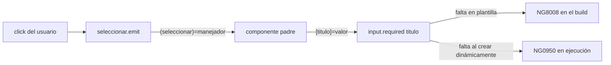
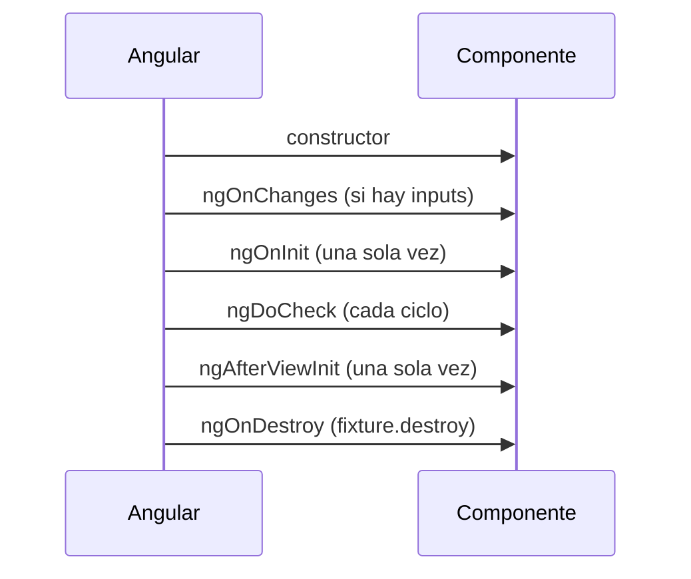
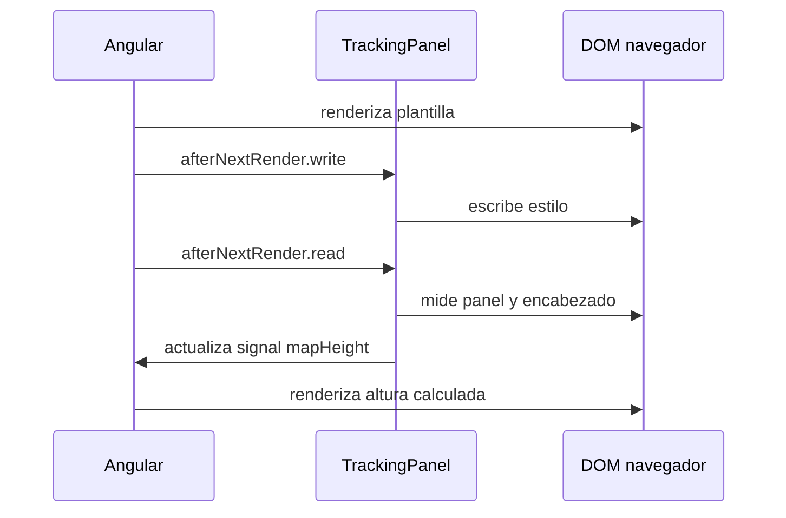
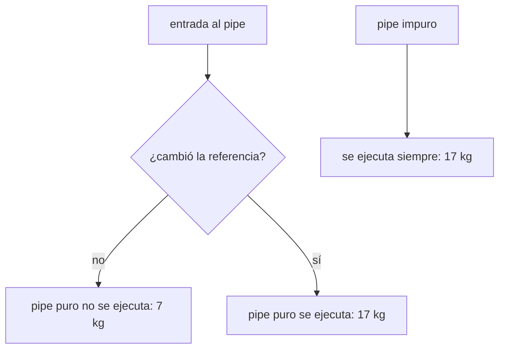

# Módulo 1: Componentes, plantillas y data binding


## Aprende construyendo

Cada tema verifica su garantía con código real: el error genuino de Angular al faltar un input requerido, una comprobación real de identidad de nodos del DOM con `track`, contenido proyectado real verificado sobre `fixture.nativeElement`, y un espía real confirmando el orden exacto de los hooks de ciclo de vida.


### Tema 1: input()/output() basados en signals · Básico · 20 min

<details open>
<summary><strong>Capa 1 — Lectura</strong></summary>

#### ► DE QUÉ TRATA
Al finalizar podrás confirmar que input.required() hace cumplir su contrato en dos momentos: en una plantilla padre, el compilador rechaza la omisión en el build (NG8008); al crear el componente dinámicamente sin el input, Angular lanza NG0950 en ejecución. Nunca obtienes un valo…

#### ► CÓMO FUNCIONA


</details>

<details>
<summary><strong>Capa 2 — Construcción</strong></summary>

#### Código y verificación


```ts
@Component({ selector: 'app-tarjeta', template: `
  <h2>{{ titulo() }}</h2>
  <button (click)="seleccionar.emit()">Ver más</button>
`})
export class Tarjeta {
  titulo = input.required<string>();
  seleccionar = output<void>();
}
```

```html
<app-tarjeta [titulo]="'Mi tarea'" (seleccionar)="abrirDetalle()" />
```

```bash
mkdir demo-input-output
cd demo-input-output
npx -y @angular/cli@22 new . --standalone --style=css --routing=false --skip-git --defaults
```

```ts
// src/app/tarjeta-pedido.component.ts
import { Component, input, output } from '@angular/core';

@Component({
  selector: 'app-tarjeta-pedido',
  standalone: true,
  template: `
    <h2>{{ titulo() }}</h2>
    <button type="button" (click)="seleccionar.emit()">Ver más</button>
  `,
})
export class TarjetaPedidoComponent {
  titulo = input.required<string>();
  seleccionar = output<void>();
}
```

```ts
// src/app/tarjeta-pedido.component.spec.ts
import { Component } from '@angular/core';
import { TestBed } from '@angular/core/testing';
import { TarjetaPedidoComponent } from './tarjeta-pedido.component';

describe('TarjetaPedidoComponent (input.required real y output real)', () => {
  it('crear el componente sin su input requerido lanza el error real NG0950', () => {
    // Creación dinámica: ninguna plantilla padre que el compilador pueda revisar.
    const fixture = TestBed.createComponent(TarjetaPedidoComponent); // sin setInput('titulo', ...)

    expect(() => fixture.detectChanges()).toThrowError(/NG0950/);
  });

  it('emitir el output real es recibido por el padre', () => {
    @Component({
      selector: 'app-padre-con-input',
      standalone: true,
      imports: [TarjetaPedidoComponent],
      template: `<app-tarjeta-pedido titulo="PED-001" (seleccionar)="verMas = true" />`,
    })
    class PadreConInputComponent {
      verMas = false;
    }

    TestBed.configureTestingModule({ imports: [PadreConInputComponent] });
    const fixture = TestBed.createComponent(PadreConInputComponent);
    fixture.detectChanges();

    const boton: HTMLButtonElement = fixture.nativeElement.querySelector('button');
    boton.click();
    fixture.detectChanges();

    expect(fixture.componentInstance.verMas).toBe(true);
  });
});
```

</details>

### Tema 2: Control de flujo nativo — @if, @for, @switch · Básico · 20 min

<details open>
<summary><strong>Capa 1 — Lectura</strong></summary>

#### ► DE QUÉ TRATA
Al finalizar podrás confirmar, con una comprobación real de identidad de nodos del DOM, que track con un identificador estable preserva los mismos elementos al reordenar una lista, mientras track $index fuerza a Angular a recrearlos innecesariamente.

</details>

<details>
<summary><strong>Capa 2 — Construcción</strong></summary>

#### Código y verificación
```
┌── track tarea.id ─────┐   reordenar → Angular RECONOCE el mismo elemento
└──────────────────────────┘             (reposiciona el nodo DOM existente)
┌── track $index ───────┐   reordenar → Angular CREE que cambio todo
└──────────────────────────┘             (destruye y recrea nodos DOM)
```

```html
@if (tareas().length > 0) {
  <ul>
    @for (tarea of tareas(); track tarea.id) {
      <li>{{ tarea.titulo }}</li>
    }
  </ul>
} @else {
  <p>No hay tareas todavía.</p>
}
```

```bash
mkdir -p src/app
```

```ts
// src/app/lista-pedidos.component.ts
import { Component, signal } from '@angular/core';

interface Pedido { id: number; titulo: string; }

@Component({
  selector: 'app-lista-pedidos',
  standalone: true,
  template: `
    @for (pedido of pedidos(); track pedido.id) {
      <li [attr.data-id]="pedido.id">{{ pedido.titulo }}</li>
    }
  `,
})
export class ListaPedidosComponent {
  pedidos = signal<Pedido[]>([
    { id: 1, titulo: 'PED-001' },
    { id: 2, titulo: 'PED-002' },
    { id: 3, titulo: 'PED-003' },
  ]);
}
```

```ts
// src/app/lista-pedidos.component.spec.ts
import { TestBed } from '@angular/core/testing';
import { ListaPedidosComponent } from './lista-pedidos.component';

describe('track por id preserva la identidad real de los nodos del DOM', () => {
  it('reordenar la lista mantiene el MISMO elemento DOM para cada pedido', () => {
    const fixture = TestBed.createComponent(ListaPedidosComponent);
    fixture.detectChanges();

    const nodoAntesDelReorden = fixture.nativeElement.querySelector('[data-id="2"]');

    // reordena: mueve el pedido 2 al inicio, sin cambiar SU identidad
    fixture.componentInstance.pedidos.update((lista) => [lista[1], lista[0], lista[2]]);
    fixture.detectChanges();

    const nodoDespuesDelReorden = fixture.nativeElement.querySelector('[data-id="2"]');

    // === compara IDENTIDAD de referencia del objeto DOM, no solo su contenido
    expect(nodoDespuesDelReorden).toBe(nodoAntesDelReorden);
  });
});
```

```bash
npx ng test --watch=false
```

</details>

### Tema 3: Content projection con ng-content · Básico · 20 min

<details open>
<summary><strong>Capa 1 — Lectura</strong></summary>

#### ► DE QUÉ TRATA
Al finalizar podrás confirmar, con contenido proyectado real verificado sobre fixture.nativeElement, que ng-content posiciona marcado HTML arbitrario del componente padre dentro de la plantilla del componente hijo, incluyendo el uso de múltiples slots nombrados.

</details>

<details>
<summary><strong>Capa 2 — Construcción</strong></summary>

#### Código y verificación
```
┌── padre ───────────────────────┐
│  <span encabezado>...</span>   │──┐
│  <p>...</p>                    │──┼─┐
└─────────────────────────────────┘  │ │
┌── app-modal-generico (hijo) ───┐  │ │
│  <ng-content select=[encabezado]>│◀─┘ │  slot con selector
│  <ng-content /> (por defecto)    │◀───┘  slot sin selector
└─────────────────────────────────┘
```

```ts
@Component({ selector: 'app-modal', template: `<div class="modal"><ng-content /></div>` })
export class Modal {}
```

```html
<app-modal><p>Contenido arbitrario del padre</p></app-modal>
```

```bash
mkdir -p src/app
```

```ts
// src/app/modal-generico.component.ts
import { Component } from '@angular/core';

@Component({
  selector: 'app-modal-generico',
  standalone: true,
  template: `
    <div class="modal">
      <header data-testid="encabezado"><ng-content select="[encabezado]" /></header>
      <main data-testid="cuerpo"><ng-content /></main>
    </div>
  `,
})
export class ModalGenericoComponent {}
```

```ts
// src/app/modal-generico.component.spec.ts
import { Component } from '@angular/core';
import { TestBed } from '@angular/core/testing';
import { ModalGenericoComponent } from './modal-generico.component';

describe('ModalGenericoComponent (content projection real)', () => {
  it('el contenido proyectado del padre aparece REALMENTE en cada slot correspondiente', () => {
    @Component({
      selector: 'app-padre-con-modal',
      standalone: true,
      imports: [ModalGenericoComponent],
      template: `
        <app-modal-generico>
          <span encabezado>Confirmar entrega PED-001</span>
          <p>¿Confirmas que el paquete fue entregado?</p>
        </app-modal-generico>
      `,
    })
    class PadreConModalComponent {}

    TestBed.configureTestingModule({ imports: [PadreConModalComponent] });
    const fixture = TestBed.createComponent(PadreConModalComponent);
    fixture.detectChanges();

    const encabezado = fixture.nativeElement.querySelector('[data-testid="encabezado"]');
    const cuerpo = fixture.nativeElement.querySelector('[data-testid="cuerpo"]');

    expect(encabezado.textContent).toContain('Confirmar entrega PED-001');
    expect(cuerpo.textContent).toContain('¿Confirmas que el paquete fue entregado?');
  });
});
```

</details>

### Tema 4: Ciclo de vida completo de un componente · Básico · 20 min

<details open>
<summary><strong>Capa 1 — Lectura</strong></summary>

#### ► DE QUÉ TRATA
Al finalizar podrás confirmar, con un espía real (vi.fn() de Vitest, el runner que configura ng new en Angular 22) registrado en cada hook, el orden EXACTO en que Angular invoca los hooks de ciclo de vida de un componente, y que ngOnDestroy se invoca realmente al destruir el fixt…

#### ► LA IDEA EN UNA FRASE
**Al finalizar podrás confirmar, con un espía real (vi.fn() de Vitest, el runner que configura ng new en Angular 22) registrado en cada hook, el orden EXACTO en que Angular invoca los hooks de ciclo de vida de un componente, y que ngOnDestroy se invoca realmente al destruir el fixture.**

#### ► LA ANALOGÍA
**Conceptos clave:** hooks de ciclo de vida, orden de invocación, propósito de cada uno.

Angular invoca una secuencia bien definida de "hooks" de ciclo de vida en momentos específicos y predecibles de la existencia de un componente, cada uno con un propósito distinto. `ngOnChanges` se invoca cada vez que un input cambia de valor (antes de cualquier otro hook, en cada ciclo de detección de cambios donde eso ocurra), recibiendo un objeto que detalla el valor anterior y el nuevo de cada input modificado, útil para reaccionar específicamente a cambios de un input concreto con lógica que necesita conocer tanto el valor anterior como el nuevo. `ngOnInit` se invoca una única vez, después de que los inputs iniciales ya están establecidos, siendo el lugar recomendado para lógica de inicialización que depende de esos valores iniciales (en vez del constructor, que se ejecuta antes de que Angular haya establecido los inputs).

`ngDoCheck` se invoca en cada ciclo de detección de cambios, incluso cuando Angular no detectó ningún cambio relevante por sí mismo, permitiendo implementar lógica de detección de cambios completamente personalizada para casos donde el mecanismo estándar de Angular no sería suficiente (un hook usado con moderación, dado su coste de invocarse en cada ciclo sin excepción). `ngAfterContentInit` y `ngAfterContentChecked` se invocan después de que el contenido proyectado mediante `ng-content` (Tema 3) se ha inicializado y verificado respectivamente; `ngAfterViewInit` y `ngAfterViewChecked` cumplen el mismo rol pero para la propia vista del componente (incluyendo sus componentes hijos declarados directamente en su plantilla, no proyectados), siendo el lugar apropiado para lógica que necesita acceder a elementos del DOM ya renderizados o a componentes hijos ya inicializados mediante `ViewChild`.

`ngOnDestroy`, el hook final del ciclo de vida, se invoca justo antes de que Angular destruya el componente, siendo el lugar indispensable para cualquier limpieza necesaria: cancelar suscripciones manuales a Observables que no usan el `async` pipe (Módulo 6), limpiar temporizadores (`clearInterval`/`clearTimeout`), o desconectar cualquier observer del navegador (como los estudiados en el Módulo 8 del track de JavaScript) que el componente haya registrado durante su vida, previniendo fugas de memoria que de otro modo persistirían indefinidamente después de que el componente ya no exista visualmente en la aplicación.

**Analogía:** el ciclo de vida de un componente es como el ciclo completo de un empleado en una empresa: la contratación inicial con verificación de credenciales (`ngOnChanges`/`ngOnInit`), el desempeño continuo verificado periódicamente (`ngDoCheck`), la integración con su equipo de trabajo directo una vez asignado (`ngAfterViewInit`), y finalmente el proceso ordenado de salida donde se revocan accesos y se cierran cuentas pendientes (`ngOnDestroy`), cada etapa con un propósito claramente distinto en el ciclo de vida completo.

**Diagrama:**



**Código del ejemplo:**

```ts
export class MiComponente implements OnChanges, OnInit, AfterViewInit, OnDestroy {
  ngOnChanges(cambios: SimpleChanges) { /* un input cambió */ }
  ngOnInit() { /* inputs iniciales ya establecidos, una sola vez */ }
  ngAfterViewInit() { /* vista y componentes hijos ya inicializados */ }
  ngOnDestroy() { /* limpieza: cancelar suscripciones, timers, observers */ }
}
```

#### ► CÓMO FUNCIONA


</details>

<details>
<summary><strong>Capa 2 — Construcción</strong></summary>

#### Código y verificación


```ts
export class MiComponente implements OnChanges, OnInit, AfterViewInit, OnDestroy {
  ngOnChanges(cambios: SimpleChanges) { /* un input cambió */ }
  ngOnInit() { /* inputs iniciales ya establecidos, una sola vez */ }
  ngAfterViewInit() { /* vista y componentes hijos ya inicializados */ }
  ngOnDestroy() { /* limpieza: cancelar suscripciones, timers, observers */ }
}
```

```bash
mkdir -p src/app
```

```ts
// src/app/seguimiento-conductor.component.ts
import { Component, OnInit, OnDestroy } from '@angular/core';

@Component({
  selector: 'app-seguimiento-conductor',
  standalone: true,
  template: `<p>Siguiendo al conductor</p>`,
})
export class SeguimientoConductorComponent implements OnInit, OnDestroy {
  ordenInvocacion: string[] = [];

  ngOnInit() {
    this.ordenInvocacion.push('ngOnInit');
  }

  ngOnDestroy() {
    this.ordenInvocacion.push('ngOnDestroy');
  }
}
```

```ts
// src/app/seguimiento-conductor.component.spec.ts
import { TestBed } from '@angular/core/testing';
import { SeguimientoConductorComponent } from './seguimiento-conductor.component';

describe('Ciclo de vida real de SeguimientoConductorComponent', () => {
  it('ngOnInit se invoca una vez al crear, ngOnDestroy al destruir, en ese orden exacto', () => {
    const fixture = TestBed.createComponent(SeguimientoConductorComponent);
    const instancia = fixture.componentInstance;

    expect(instancia.ordenInvocacion).toEqual([]); // constructor: ningun hook invocado todavia

    fixture.detectChanges(); // dispara ngOnInit REALMENTE
    expect(instancia.ordenInvocacion).toEqual(['ngOnInit']);

    fixture.destroy(); // dispara ngOnDestroy REALMENTE
    expect(instancia.ordenInvocacion).toEqual(['ngOnInit', 'ngOnDestroy']);
  });
});
```

```bash
npx ng test --watch=false
```

</details>

### Tema 5: Consultas signal y trabajo posterior al render · Básico · 20 min

<details open>
<summary><strong>Capa 1 — Lectura</strong></summary>

#### ► DE QUÉ TRATA
Al finalizar podrás confirmar, con un componente real que usa viewChild.required() y las fases write/read de afterNextRender(), que Angular puede consultar y medir el DOM de forma segura después del render, sin que esa medición rompa la compatibilidad con SSR.

#### ► CÓMO FUNCIONA


</details>

<details>
<summary><strong>Capa 2 — Construcción</strong></summary>

#### Código y verificación


```bash
ng new ejemplo
cd ejemplo
```

```text
src/app/features/tracking/
├── tracking-panel.component.ts
├── tracking-panel.component.html
├── tracking-panel.component.css
└── tracking-panel.component.spec.ts
```

```html
<!-- src/app/features/tracking/tracking-panel.component.html -->
<section class="tracking-panel" #panel>
  <header #header>
    <h2>Seguimiento de la entrega</h2>
  </header>
  <div class="map" [style.height.px]="mapHeight()" aria-label="Mapa de seguimiento"></div>
</section>
```

```css
/* src/app/features/tracking/tracking-panel.component.css */
.tracking-panel {
  display: block;
  min-height: 400px;
}

.map {
  background: #e5e7eb;
}
```

```ts
// src/app/features/tracking/tracking-panel.component.ts
import { Component, ElementRef, afterNextRender, signal, viewChild } from '@angular/core';

@Component({
  selector: 'app-tracking-panel',
  standalone: true,
  templateUrl: './tracking-panel.component.html',
  styleUrl: './tracking-panel.component.css',
})
export class TrackingPanelComponent {
  private readonly panel = viewChild.required<ElementRef<HTMLElement>>('panel');
  private readonly header = viewChild.required<ElementRef<HTMLElement>>('header');
  readonly mapHeight = signal(320);

  constructor() {
    afterNextRender({
      write: () => {
        this.panel().nativeElement.style.setProperty('--panel-ready', '1');
      },
      read: () => {
        const panelHeight = this.panel().nativeElement.getBoundingClientRect().height;
        const headerHeight = this.header().nativeElement.getBoundingClientRect().height;
        this.mapHeight.set(Math.max(240, panelHeight - headerHeight - 24));
      },
    });
  }
}
```

</details>

### Tema 6: Directivas y pipes personalizados · Básico · 20 min

<details open>
<summary><strong>Capa 1 — Lectura</strong></summary>

#### ► DE QUÉ TRATA
Al finalizar podrás crear una directiva de atributo que modifica el comportamiento de un elemento y un pipe que transforma un valor en la plantilla, reutilizables en toda la app. Prerrequisitos: Temas 1-4 de este módulo (componentes y binding).

</details>

<details>
<summary><strong>Capa 2 — Construcción</strong></summary>

#### Código y verificación
```bash
ng new ejemplo
cd ejemplo
```

```typescript
// distancia.pipe.ts — transforma metros en texto legible
import { Pipe, PipeTransform } from '@angular/core';

@Pipe({ name: 'distancia', standalone: true })
export class DistanciaPipe implements PipeTransform {
  transform(metros: number): string {
    return metros >= 1000 ? `${(metros / 1000).toFixed(1)} km` : `${metros} m`;
  }
}
```

```typescript
// resaltar.directive.ts — resalta el elemento según una condición
import { Directive, ElementRef, input, effect } from '@angular/core';

@Directive({ selector: '[appResaltar]', standalone: true })
export class ResaltarDirective {
  urgente = input(false, { alias: 'appResaltar' });
  constructor(private el: ElementRef<HTMLElement>) {
    effect(() => {
      this.el.nativeElement.style.background = this.urgente() ? '#ffe3e3' : '';
    });
  }
}
```

```bash
ng serve
```

</details>

### Tema 7: Pipes puros e impuros, AsyncPipe y signals · Básico · 20 min

<details open>
<summary><strong>Capa 1 — Lectura</strong></summary>

#### ► DE QUÉ TRATA
Al finalizar podrás explicar cuándo Angular vuelve a ejecutar un pipe puro y uno impuro, demostrar el error de mutar un array con un pipe puro, usar AsyncPipe con un Observable y elegir signals con actualizaciones inmutables. Prerrequisitos: Tema 6 de este módulo y Módulo 2 (sign…

#### ► CÓMO FUNCIONA


</details>

<details>
<summary><strong>Capa 2 — Construcción</strong></summary>

#### Código y verificación


```bash
mkdir angular-pipes && cd angular-pipes
npx -y @angular/cli@22 new pipes-demo --defaults --skip-git --style=css --ssr=false
cd pipes-demo
```

```typescript
import { Pipe, PipeTransform } from '@angular/core';

export interface Paquete { guia: string; kilos: number; }

let ejecucionesPuro = 0;
let ejecucionesImpuro = 0;
export const contadores = () => ({ puro: ejecucionesPuro, impuro: ejecucionesImpuro });

// Puro (por defecto): Angular solo lo vuelve a ejecutar si cambia la REFERENCIA de la entrada
@Pipe({ name: 'totalKilos' })
export class TotalKilosPipe implements PipeTransform {
  transform(paquetes: Paquete[]): number {
    ejecucionesPuro++;
    return paquetes.reduce((total, p) => total + p.kilos, 0);
  }
}

// Impuro: se ejecuta en CADA detección de cambios, aunque la referencia sea la misma
@Pipe({ name: 'totalKilosImpuro', pure: false })
export class TotalKilosImpuroPipe implements PipeTransform {
  transform(paquetes: Paquete[]): number {
    ejecucionesImpuro++;
    return paquetes.reduce((total, p) => total + p.kilos, 0);
  }
}
```

```typescript
import { Component, signal } from '@angular/core';
import { AsyncPipe } from '@angular/common';
import { interval, map, take } from 'rxjs';
import { Paquete, TotalKilosImpuroPipe, TotalKilosPipe } from './kilos.pipes';

@Component({
  selector: 'app-carga',
  imports: [TotalKilosPipe, TotalKilosImpuroPipe, AsyncPipe],
  template: `
    <p id="puro">Puro: {{ paquetes | totalKilos }} kg</p>
    <p id="impuro">Impuro: {{ paquetes | totalKilosImpuro }} kg</p>
    <p id="senal">Con signal: {{ paquetesSignal() | totalKilos }} kg</p>
    <p id="async">Camiones en ruta: {{ camiones$ | async }}</p>
  `,
})
export class Carga {
  paquetes: Paquete[] = [{ guia: 'G-1', kilos: 2 }, { guia: 'G-2', kilos: 5 }];
  paquetesSignal = signal<Paquete[]>([...this.paquetes]);
  // AsyncPipe se suscribe, muestra el último valor y se desuscribe al destruir el componente
  camiones$ = interval(10).pipe(take(3), map((n) => n + 1));

  agregarMutando(p: Paquete) {
    this.paquetes.push(p);                       // misma referencia: el pipe puro no se entera
  }
  agregarInmutable(p: Paquete) {
    this.paquetesSignal.update((lista) => [...lista, p]);   // referencia nueva
  }
}
```

```typescript
import { TestBed } from '@angular/core/testing';
import { Carga } from './carga';
import { contadores } from './kilos.pipes';

const texto = (el: HTMLElement, id: string) => el.querySelector(`#${id}`)!.textContent!.trim();

describe('Carga: pipes puros, impuros y async', () => {
  it('muestra el efecto de mutar frente a crear una referencia nueva', async () => {
    const fixture = TestBed.createComponent(Carga);
    const el = fixture.nativeElement as HTMLElement;
    await fixture.whenStable();

    fixture.componentInstance.agregarMutando({ guia: 'G-3', kilos: 10 });
    fixture.componentInstance.agregarInmutable({ guia: 'G-3', kilos: 10 });
    fixture.changeDetectorRef.markForCheck();
    fixture.detectChanges();

    console.log(texto(el, 'puro'), '|', texto(el, 'impuro'), '|', texto(el, 'senal'));
    console.log('Ejecuciones', contadores());
    expect(texto(el, 'puro')).toBe('Puro: 7 kg');          // desactualizado: no vio el push
    expect(texto(el, 'impuro')).toBe('Impuro: 17 kg');
    expect(texto(el, 'senal')).toBe('Con signal: 17 kg');
  });

  it('AsyncPipe muestra el último valor emitido', async () => {
    const fixture = TestBed.createComponent(Carga);
    await new Promise((r) => setTimeout(r, 60));
    await fixture.whenStable();
    fixture.detectChanges();
    const el = fixture.nativeElement as HTMLElement;
    console.log(texto(el, 'async'));
    expect(texto(el, 'async')).toBe('Camiones en ruta: 3');
  });
});
```

```bash
rm src/app/app.spec.ts
npx ng test --watch=false
```

</details>
