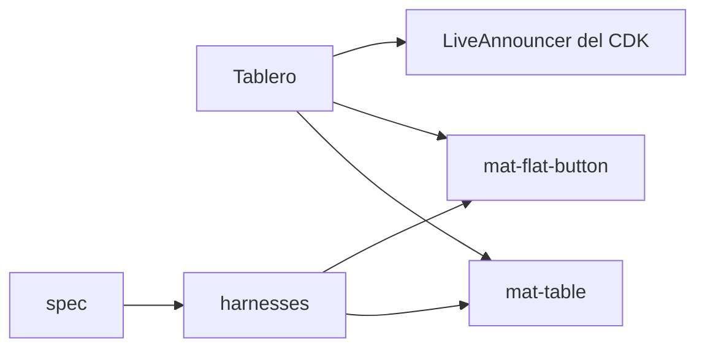

# Módulo 10: Testing en Angular


## Aprende construyendo


### Tema 1: TestBed y componentes standalone · Avanzado · 40 min

<details open>
<summary><strong>Capa 1 — Lectura</strong></summary>

#### ► DE QUÉ TRATA
Al finalizar podrás confirmar, con TestBed real, que un input() signal se asigna desde una prueba con fixture.componentRef.setInput(...) o, al crear el componente, con bindings: [inputBinding(...)] —nunca escribiéndolo directamente—, reproduciendo el error real que ocurre al inte…

#### ► LA IDEA EN UNA FRASE
**Al finalizar podrás confirmar, con TestBed real, que un input() signal se asigna desde una prueba con fixture.componentRef.setInput(...) o, al crear el componente, con bindings: [inputBinding(...)] —nunca escribiéndolo directamente—, reproduciendo el error real que ocurre al intentar el atajo incorrecto.**

#### ► POR QUÉ EXISTE ESTO
Resuelve un problema real de diseño o implementación y evita decisiones a ciegas.

#### ► LA ANALOGÍA
**Conceptos clave:** `TestBed.configureTestingModule`, `createComponent`, `componentRef.setInput`.

`TestBed` es el entorno de pruebas de Angular que permite crear una instancia real y renderizada de un componente dentro de un entorno controlado y aislado para pruebas, sin necesidad de arrancar la aplicación completa. `TestBed.configureTestingModule({ imports: [Tarjeta] })` declara qué componente (u otras dependencias) estarán disponibles en ese entorno de prueba específico; al tratarse de un componente standalone (Módulo 0), simplemente se importa directamente, sin necesidad de declarar un `NgModule` de pruebas dedicado como se requería en versiones anteriores de Angular.

`TestBed.createComponent(Tarjeta)` instancia realmente el componente dentro del entorno de prueba, devolviendo un `fixture` que da acceso tanto a la instancia del componente como a su elemento DOM real renderizado (`fixture.nativeElement`), permitiendo verificar tanto el estado interno del componente como lo que efectivamente se renderiza visualmente en el DOM, siendo esta verificación del DOM renderizado generalmente preferible a inspeccionar directamente propiedades internas del componente, dado que refleja más fielmente lo que un usuario real experimentaría.

`fixture.componentRef.setInput('titulo', 'Hola')` es la forma correcta y soportada de asignar un valor a un `input()` signal (Módulo 1) desde una prueba: dado que los inputs signal son de solo lectura desde la perspectiva del propio componente, no pueden asignarse directamente como una propiedad normal del componente; `setInput` pasa por el mecanismo interno correcto que Angular usa en producción para propagar valores de binding hacia inputs, siendo necesario además llamar `await fixture.whenStable()` después, para esperar a que la detección de cambios y cualquier efecto asociado (Módulo 2) se hayan estabilizado antes de hacer las aserciones.

**Analogía:** `TestBed` es como un laboratorio controlado donde se puede montar una réplica exacta de un componente para experimentar con él de forma aislada, sin afectar ni depender del resto de la aplicación; `setInput` es como ajustar un dial de entrada del experimento exactamente de la misma forma en que se ajustaría en el mundo real, en vez de forzar internamente un valor que el experimento nunca aceptaría normalmente.

**Diagrama — setInput respeta el mecanismo real de binding:**

```
┌──────────────┐   setInput('titulo','Hola')   ┌──────────────────┐
│ fixture         │ ──────────────────────────────▶│ componentRef       │
│ (entorno de test)│                                │ (mismo mecanismo   │
└──────────────┘                                │  que un binding    │
                                                  │  real en produccion)│
                                                  └──────────────────┘
```

**Código del ejemplo:**

```ts
describe('Tarjeta', () => {
  it('muestra el título', async () => {
    await TestBed.configureTestingModule({ imports: [Tarjeta] }).compileComponents();
    const fixture = TestBed.createComponent(Tarjeta);
    fixture.componentRef.setInput('titulo', 'Hola');
    await fixture.whenStable();
    expect(fixture.nativeElement.textContent).toContain('Hola');
  });
});
```

**Dónde se rompe la analogía:** el modelo simplifica la realidad; en producción influyen escala, fallos, costo y contexto.

#### ► CÓMO FUNCIONA
1. Identifica el problema que testbed y componentes standalone resuelve.
2. Observa sus componentes y relaciones.
3. Aplica la opción más simple que funcione.
4. Verifica el resultado y los límites.

#### ► LO QUE PUEDE SALIR MAL
| Síntoma | Causa probable | Arreglo |
|---|---|---|
| TestBed y componentes standalone se aplica pero el resultado no mejora | Se usó sin medir el problema real | Mide antes y compara contra la alternativa simple |
| Aparece complejidad inesperada | Se adoptó la técnica sin comprender sus trade-offs | Vuelve a la sección de trade-offs y reduce el alcance |
| Falla en un caso límite | Se asumió un contexto que no se cumple | Prueba el caso límite y documenta cuándo NO usarlo |

#### ► TRADE-OFFS
| Opción | Cuándo usarla | Cuándo NO usarla |
|---|---|---|
| Usar TestBed y componentes standalone | Cuando el problema coincide con su propósito y el beneficio es observable | Cuando agrega complejidad sin resolver un problema real |
| Alternativa más simple | Cuando el contexto es pequeño, estable o fácil de razonar | Cuando ya demostró no escalar o no cumplir el requisito |
| Postergar la decisión | Cuando falta evidencia del problema | Cuando el costo de esperar es mayor que el costo de probar |

#### ► CUÁNDO NO USAR ESTO
No uses testbed y componentes standalone por defecto. Aplícalo cuando el problema lo justifique y puedas verificar el beneficio; si una alternativa más simple resuelve igual, prefiérela.

#### ► DE VUELTA A LA ANALOGÍA
Volviendo a la analogía: testbed y componentes standalone funciona como el modelo inicial, pero recuerda dónde se rompe: en producción importan la evidencia, la escala y el costo de equivocarte.

#### ► LO QUE DEBES RECORDAR
- TestBed y componentes standalone existe para resolver un problema específico.
- Mide antes de adoptar complejidad.
- Conoce el caso donde NO usarlo.
- Verifica con evidencia observable.

#### ► PREGUNTAS PARA PENSAR
1. ¿Qué problema concreto resuelve testbed y componentes standalone en tu contexto?
2. ¿Cómo sabrías que testbed y componentes standalone no está funcionando bien?
3. ¿Qué alternativa más simple considerarías antes de usar testbed y componentes standalone?

</details>

<details>
<summary><strong>Capa 2 — Construcción</strong></summary>

#### Código y verificación
```
┌──────────────┐   setInput('titulo','Hola')   ┌──────────────────┐
│ fixture         │ ──────────────────────────────▶│ componentRef       │
│ (entorno de test)│                                │ (mismo mecanismo   │
└──────────────┘                                │  que un binding    │
                                                  │  real en produccion)│
                                                  └──────────────────┘
```

```ts
describe('Tarjeta', () => {
  it('muestra el título', async () => {
    await TestBed.configureTestingModule({ imports: [Tarjeta] }).compileComponents();
    const fixture = TestBed.createComponent(Tarjeta);
    fixture.componentRef.setInput('titulo', 'Hola');
    await fixture.whenStable();
    expect(fixture.nativeElement.textContent).toContain('Hola');
  });
});
```

```bash
npx -y @angular/cli@22 new demo-testbed --standalone --skip-git --defaults
cd demo-testbed
mkdir -p src/app
```

```ts
// src/app/tarjeta.ts
import { Component, input } from '@angular/core';

@Component({
  selector: 'app-tarjeta',
  standalone: true,
  template: `<h2>{{ titulo() }}</h2>`,
})
export class Tarjeta {
  titulo = input.required<string>();
}
```

```ts
// src/app/tarjeta.spec.ts
import { TestBed } from '@angular/core/testing';
import { inputBinding, signal } from '@angular/core';
import { Tarjeta } from './tarjeta';

describe('formas soportadas de asignar un input signal en un test', () => {
  it('setInput propaga el valor y se refleja en el DOM renderizado', async () => {
    await TestBed.configureTestingModule({ imports: [Tarjeta] }).compileComponents();
    const fixture = TestBed.createComponent(Tarjeta);
    fixture.componentRef.setInput('titulo', 'Hola mundo');
    await fixture.whenStable();

    expect(fixture.nativeElement.textContent).toContain('Hola mundo');
  });

  it('inputBinding asigna el input al crear el componente y sigue a su signal', async () => {
    const titulo = signal('Desde inputBinding');
    const fixture = TestBed.createComponent(Tarjeta, { bindings: [inputBinding('titulo', titulo)] });
    await fixture.whenStable();
    expect(fixture.nativeElement.textContent).toContain('Desde inputBinding');

    titulo.set('Cambiado');
    await fixture.whenStable();
    expect(fixture.nativeElement.textContent).toContain('Cambiado');
  });

  it('intentar llamar .set() directamente sobre el input signal falla en tiempo de ejecucion', async () => {
    await TestBed.configureTestingModule({ imports: [Tarjeta] }).compileComponents();
    const fixture = TestBed.createComponent(Tarjeta);
    fixture.componentRef.setInput('titulo', 'Valor inicial');
    await fixture.whenStable();

    expect(() => {
      (fixture.componentInstance.titulo as any).set('Intento invalido');
    }).toThrow();
  });
});
```

```bash
npx ng test --watch=false
```

</details>

### Tema 2: Angular Testing Library · Avanzado · 40 min

<details open>
<summary><strong>Capa 1 — Lectura</strong></summary>

#### ► DE QUÉ TRATA
Al finalizar podrás confirmar, con dos pruebas equivalentes (una por selector CSS interno y otra por rol/texto), que solo la prueba orientada al usuario sobrevive a un refactor puramente cosmético del componente — la garantía concreta que justifica preferir Angular Testing Librar…

#### ► LA IDEA EN UNA FRASE
**Al finalizar podrás confirmar, con dos pruebas equivalentes (una por selector CSS interno y otra por rol/texto), que solo la prueba orientada al usuario sobrevive a un refactor puramente cosmético del componente — la garantía concreta que justifica preferir Angular Testing Library.**

#### ► POR QUÉ EXISTE ESTO
Resuelve un problema real de diseño o implementación y evita decisiones a ciegas.

#### ► LA ANALOGÍA
**Conceptos clave:** consultas orientadas al usuario, `render`, `screen`, `userEvent`.

Angular Testing Library es una capa sobre `TestBed` que promueve un estilo de prueba centrado deliberadamente en cómo un usuario real interactúa con la interfaz, en vez de en detalles internos de implementación: en lugar de acceder a elementos del DOM mediante selectores CSS internos (`fixture.nativeElement.querySelector('.boton-interno')`, que se rompe si el nombre de una clase CSS cambia por razones puramente visuales sin afectar el comportamiento real), se consulta el DOM por texto visible o por rol semántico de accesibilidad (`screen.getByRole('button', { name: /ver más/i })`), exactamente la misma información que un usuario (o una tecnología asistiva como un lector de pantalla) usaría para identificar ese elemento.

`render(Tarjeta, { inputs: { titulo: 'Hola' }, on: { seleccionar } })` renderiza el componente pasando directamente los valores de inputs y los manejadores de outputs (Módulo 1) como opciones declarativas, evitando gran parte de la ceremonia manual de `TestBed.configureTestingModule`/`createComponent`/`setInput` del Tema 1 para el caso común de simplemente montar un componente con ciertos valores iniciales. `userEvent.click(screen.getByRole('button', {...}))` simula una interacción de usuario real (incluyendo los eventos intermedios que un clic real dispara en un navegador, no solo el evento `click` final), disparando después la aserción sobre el manejador de output esperado (`expect(seleccionar).toHaveBeenCalled()`).

Este enfoque produce pruebas que sobreviven refactors internos de implementación (cambiar la estructura interna del HTML, renombrar clases CSS, reorganizar el árbol de componentes internos) siempre que el comportamiento observable desde la perspectiva del usuario permanezca igual, a diferencia de pruebas acopladas a selectores CSS internos, que se rompen ante cualquier cambio puramente cosmético sin relación real con el comportamiento probado.

**Analogía:** probar por selector CSS interno es como verificar que un cajero automático funciona revisando el color exacto de un cable interno específico; probar con Testing Library es como verificar que, al presionar el botón correcto en la pantalla (lo que cualquier usuario real haría), el dinero efectivamente sale — sin que importe qué cable interno específico haya cambiado de color entretanto.

**Diagrama — qué sobrevive a un refactor cosmético:**

```
┌───────────────────────────┐   renombrar .boton-interno   ┌────────┐
│ query por selector CSS       │ ─────────────────────────────▶│ ROTA    │
└───────────────────────────┘                                └────────┘
┌───────────────────────────┐   renombrar .boton-interno   ┌────────┐
│ query por rol/texto          │ ─────────────────────────────▶│ SIGUE   │
│ (screen.getByRole)           │                                │ PASANDO │
└───────────────────────────┘                                └────────┘
```

**Código del ejemplo:**

```ts
import { render, screen } from '@testing-library/angular';
import userEvent from '@testing-library/user-event';

it('emite el evento al hacer click', async () => {
  const seleccionar = vi.fn();
  await render(Tarjeta, { inputs: { titulo: 'Hola' }, on: { seleccionar } });
  await userEvent.click(screen.getByRole('button', { name: /ver más/i }));
  expect(seleccionar).toHaveBeenCalled();
});
```

**Dónde se rompe la analogía:** el modelo simplifica la realidad; en producción influyen escala, fallos, costo y contexto.

#### ► CÓMO FUNCIONA
1. Identifica el problema que angular testing library resuelve.
2. Observa sus componentes y relaciones.
3. Aplica la opción más simple que funcione.
4. Verifica el resultado y los límites.

#### ► LO QUE PUEDE SALIR MAL
| Síntoma | Causa probable | Arreglo |
|---|---|---|
| Angular Testing Library se aplica pero el resultado no mejora | Se usó sin medir el problema real | Mide antes y compara contra la alternativa simple |
| Aparece complejidad inesperada | Se adoptó la técnica sin comprender sus trade-offs | Vuelve a la sección de trade-offs y reduce el alcance |
| Falla en un caso límite | Se asumió un contexto que no se cumple | Prueba el caso límite y documenta cuándo NO usarlo |

#### ► TRADE-OFFS
| Opción | Cuándo usarla | Cuándo NO usarla |
|---|---|---|
| Usar Angular Testing Library | Cuando el problema coincide con su propósito y el beneficio es observable | Cuando agrega complejidad sin resolver un problema real |
| Alternativa más simple | Cuando el contexto es pequeño, estable o fácil de razonar | Cuando ya demostró no escalar o no cumplir el requisito |
| Postergar la decisión | Cuando falta evidencia del problema | Cuando el costo de esperar es mayor que el costo de probar |

#### ► CUÁNDO NO USAR ESTO
No uses angular testing library por defecto. Aplícalo cuando el problema lo justifique y puedas verificar el beneficio; si una alternativa más simple resuelve igual, prefiérela.

#### ► DE VUELTA A LA ANALOGÍA
Volviendo a la analogía: angular testing library funciona como el modelo inicial, pero recuerda dónde se rompe: en producción importan la evidencia, la escala y el costo de equivocarte.

#### ► LO QUE DEBES RECORDAR
- Angular Testing Library existe para resolver un problema específico.
- Mide antes de adoptar complejidad.
- Conoce el caso donde NO usarlo.
- Verifica con evidencia observable.

#### ► PREGUNTAS PARA PENSAR
1. ¿Qué problema concreto resuelve angular testing library en tu contexto?
2. ¿Cómo sabrías que angular testing library no está funcionando bien?
3. ¿Qué alternativa más simple considerarías antes de usar angular testing library?

</details>

<details>
<summary><strong>Capa 2 — Construcción</strong></summary>

#### Código y verificación
```
┌───────────────────────────┐   renombrar .boton-interno   ┌────────┐
│ query por selector CSS       │ ─────────────────────────────▶│ ROTA    │
└───────────────────────────┘                                └────────┘
┌───────────────────────────┐   renombrar .boton-interno   ┌────────┐
│ query por rol/texto          │ ─────────────────────────────▶│ SIGUE   │
│ (screen.getByRole)           │                                │ PASANDO │
└───────────────────────────┘                                └────────┘
```

```ts
import { render, screen } from '@testing-library/angular';
import userEvent from '@testing-library/user-event';

it('emite el evento al hacer click', async () => {
  const seleccionar = vi.fn();
  await render(Tarjeta, { inputs: { titulo: 'Hola' }, on: { seleccionar } });
  await userEvent.click(screen.getByRole('button', { name: /ver más/i }));
  expect(seleccionar).toHaveBeenCalled();
});
```

```bash
npm install @testing-library/angular @testing-library/user-event --save-dev
mkdir -p src/app
```

```ts
// src/app/boton-entrega.ts
import { Component, output } from '@angular/core';

@Component({
  selector: 'app-boton-entrega',
  standalone: true,
  template: `<button class="boton-interno-v1" (click)="confirmar.emit()">Confirmar entrega</button>`,
})
export class BotonEntrega {
  confirmar = output<void>();
}
```

```ts
// src/app/boton-entrega.spec.ts
import { TestBed } from '@angular/core/testing';
import { render, screen } from '@testing-library/angular';
import userEvent from '@testing-library/user-event';
import { BotonEntrega } from './boton-entrega';

describe('prueba acoplada a selector CSS interno (fragil)', () => {
  it('encuentra el boton por su clase CSS interna', async () => {
    await TestBed.configureTestingModule({ imports: [BotonEntrega] }).compileComponents();
    const fixture = TestBed.createComponent(BotonEntrega);
    fixture.detectChanges();
    const boton = fixture.nativeElement.querySelector('.boton-interno-v1');

    expect(boton).not.toBeNull();
  });
});

describe('prueba orientada al usuario con Testing Library (robusta)', () => {
  it('encuentra el boton por su rol y texto visible, sin importar su clase CSS', async () => {
    const confirmar = vi.fn();
    await render(BotonEntrega, { on: { confirmar } });

    await userEvent.click(screen.getByRole('button', { name: /confirmar entrega/i }));

    expect(confirmar).toHaveBeenCalled();
  });
});
```

```bash
npx ng test --watch=false
```

</details>

### Tema 3: Mockear HttpClient y el builder predeterminado basado en Vitest · Avanzado · 40 min

<details open>
<summary><strong>Capa 1 — Lectura</strong></summary>

#### ► DE QUÉ TRATA
Al finalizar podrás confirmar, con HttpTestingController real, tanto una respuesta exitosa como un error 500 simulados, verificando en código que un servicio maneja ambos casos sin ninguna dependencia de un backend real.

#### ► LA IDEA EN UNA FRASE
**Al finalizar podrás confirmar, con HttpTestingController real, tanto una respuesta exitosa como un error 500 simulados, verificando en código que un servicio maneja ambos casos sin ninguna dependencia de un backend real.**

#### ► POR QUÉ EXISTE ESTO
Resuelve un problema real de diseño o implementación y evita decisiones a ciegas.

#### ► LA ANALOGÍA
**Conceptos clave:** `HttpTestingController`, aislamiento de pruebas del backend real, migración de Karma a Vitest.

`HttpTestingController` es el mecanismo de Angular para interceptar peticiones HTTP realizadas durante una prueba sin que lleguen a un servidor real: `httpMock.expectOne('/api/usuarios')` verifica que exactamente una petición a esa URL fue realizada por el código bajo prueba, devolviendo un objeto `req` sobre el que se puede llamar `req.flush([{ id: 1, nombre: 'Ana' }])` para simular la respuesta exacta del servidor que la prueba necesita, permitiendo probar cómo el servicio o componente maneja esa respuesta específica (incluyendo casos de error simulados con `req.flush(null, { status: 500, statusText: 'Error' })`) sin ninguna dependencia de un backend real disponible ni de datos reales impredecibles.

Históricamente, las pruebas de Angular se ejecutaban con Karma (un ejecutor de pruebas que abre un navegador real, típicamente Chrome, para ejecutar las pruebas dentro de él) combinado con Jasmine como framework de aserciones; hoy `ng new` configura por defecto el builder `@angular/build:unit-test`, que usa Vitest y jsdom (Karma sigue soportado como opción heredada; fuente: https://angular.dev/guide/testing). Vitest es un ejecutor de pruebas considerablemente más rápido para arrancar y para el modo watch de desarrollo (re-ejecutar automáticamente solo las pruebas afectadas por un cambio de archivo), dado que Vitest puede ejecutar pruebas en un entorno simulado de DOM sin necesidad de abrir un navegador real completo para cada ejecución, aunque sigue siendo posible ejecutar contra un navegador real cuando es necesario verificar comportamiento específico de un motor de renderizado particular.

**Analogía:** `HttpTestingController` es como un actor que se hace pasar por el servidor real durante un ensayo teatral, respondiendo exactamente las líneas que el guion de la prueba requiere, sin necesidad de que el servidor real (y todos sus datos reales impredecibles) esté presente en el ensayo; migrar de Karma a Vitest es como reemplazar un ensayo que requiere montar el escenario físico completo cada vez por uno que puede simularse rápidamente en una sala más simple, llegando al mismo resultado con mucha menor fricción de configuración.

**Diagrama — dos escenarios simulados con la misma peticion:**

```
servicio.cargarUsuarios()
        │
        ▼
┌──────────────────┐
│ HttpTestingController│
└──────────────────┘
   │ flush([...])         │ flush(null, {status:500})
   ▼                       ▼
┌───────────┐        ┌────────────┐
│ caso exito  │        │ caso error  │
└───────────┘        └────────────┘
```

**Código del ejemplo:**

```ts
const httpMock = TestBed.inject(HttpTestingController);
servicio.cargarUsuarios().subscribe();
const req = httpMock.expectOne('/api/usuarios');
req.flush([{ id: 1, nombre: 'Ana' }]);
```

**Dónde se rompe la analogía:** el modelo simplifica la realidad; en producción influyen escala, fallos, costo y contexto.

#### ► CÓMO FUNCIONA
1. Identifica el problema que mockear httpclient y el builder predeterminado basado en vitest resuelve.
2. Observa sus componentes y relaciones.
3. Aplica la opción más simple que funcione.
4. Verifica el resultado y los límites.

#### ► LO QUE PUEDE SALIR MAL
| Síntoma | Causa probable | Arreglo |
|---|---|---|
| Mockear HttpClient y el builder predeterminado basado en Vitest se aplica pero el resultado no mejora | Se usó sin medir el problema real | Mide antes y compara contra la alternativa simple |
| Aparece complejidad inesperada | Se adoptó la técnica sin comprender sus trade-offs | Vuelve a la sección de trade-offs y reduce el alcance |
| Falla en un caso límite | Se asumió un contexto que no se cumple | Prueba el caso límite y documenta cuándo NO usarlo |

#### ► TRADE-OFFS
| Opción | Cuándo usarla | Cuándo NO usarla |
|---|---|---|
| Usar Mockear HttpClient y el builder predeterminado basado en Vitest | Cuando el problema coincide con su propósito y el beneficio es observable | Cuando agrega complejidad sin resolver un problema real |
| Alternativa más simple | Cuando el contexto es pequeño, estable o fácil de razonar | Cuando ya demostró no escalar o no cumplir el requisito |
| Postergar la decisión | Cuando falta evidencia del problema | Cuando el costo de esperar es mayor que el costo de probar |

#### ► CUÁNDO NO USAR ESTO
No uses mockear httpclient y el builder predeterminado basado en vitest por defecto. Aplícalo cuando el problema lo justifique y puedas verificar el beneficio; si una alternativa más simple resuelve igual, prefiérela.

#### ► DE VUELTA A LA ANALOGÍA
Volviendo a la analogía: mockear httpclient y el builder predeterminado basado en vitest funciona como el modelo inicial, pero recuerda dónde se rompe: en producción importan la evidencia, la escala y el costo de equivocarte.

#### ► LO QUE DEBES RECORDAR
- Mockear HttpClient y el builder predeterminado basado en Vitest existe para resolver un problema específico.
- Mide antes de adoptar complejidad.
- Conoce el caso donde NO usarlo.
- Verifica con evidencia observable.

#### ► PREGUNTAS PARA PENSAR
1. ¿Qué problema concreto resuelve mockear httpclient y el builder predeterminado basado en vitest en tu contexto?
2. ¿Cómo sabrías que mockear httpclient y el builder predeterminado basado en vitest no está funcionando bien?
3. ¿Qué alternativa más simple considerarías antes de usar mockear httpclient y el builder predeterminado basado en vitest?

</details>

<details>
<summary><strong>Capa 2 — Construcción</strong></summary>

#### Objetivo observable
Al finalizar podrás confirmar, con `HttpTestingController` real, tanto una respuesta exitosa como un error 500 simulados, verificando en código que un servicio maneja ambos casos sin ninguna dependencia de un backend real.

**Conocimiento previo:** Módulo 7 de este track (`HttpTestingController`); Temas 1-2 de este módulo.

</details>

### Tema 4: Angular Material y CDK: componentes accesibles probados con harnesses · Avanzado · 40 min

<details open>
<summary><strong>Capa 1 — Lectura</strong></summary>

#### ► DE QUÉ TRATA
Al finalizar podrás construir una tabla con Angular Material, anunciar cambios a lectores de pantalla con el CDK y probar el componente con *component harnesses* en lugar de selectores de CSS. Prerrequisitos: Temas 1 y 2 de este módulo.

#### ► LA IDEA EN UNA FRASE
**Al finalizar podrás construir una tabla con Angular Material, anunciar cambios a lectores de pantalla con el CDK y probar el componente con *component harnesses* en lugar de selectores de CSS.**

#### ► POR QUÉ EXISTE ESTO
Resuelve un problema real de diseño o implementación y evita decisiones a ciegas.

#### ► LA ANALOGÍA
**Angular Material** ofrece componentes que siguen Material Design y las pautas de accesibilidad (roles ARIA, foco, teclado). Debajo está el **CDK** (Component Dev Kit): utilidades sin estilo como `LiveAnnouncer` (anuncia texto a lectores de pantalla), `FocusTrap` u *overlays*, que sirven aunque uses otro diseño. Los **harnesses** (`MatTableHarness`, `MatButtonHarness`) son APIs de prueba que interactúan con el componente como lo haría una persona, sin depender de su HTML interno.

**Analogía:** Material es una cocina modular que ya viene con enchufes e instalaciones en regla; el harness es el inspector que prueba que los interruptores funcionan sin abrir las paredes.

**Diagrama:**



**¿Por qué es importante?** porque usar bien una librería de componentes ahorra semanas de trabajo, mejora la accesibilidad y hace que las pruebas sobrevivan a los cambios visuales.
**Fuente oficial:** [Angular Material: Table](https://material.angular.dev/components/table/overview), [Angular CDK: Component Harnesses](https://material.angular.dev/cdk/test-harnesses/overview).
**Conceptos clave:** Angular Material, CDK, `LiveAnnouncer`, `mat-table`, component harness, `TestbedHarnessEnvironment`, accesibilidad.
**Cuándo no usarlo:** si el producto tiene un sistema de diseño propio muy distinto de Material, usa solo el CDK y tus estilos, en lugar de pelear con los estilos de Material.

**Transferencia al proyecto integrador «Centro de control logístico»:** reemplaza la tabla de envíos del centro de control por `mat-table` y cubre sus acciones con harnesses.
Como **siguiente** paso, aplica lo aprendido en el proyecto integrador del track y compara el resultado con lo que esperabas.
**Errores comunes:** probar un `mat-table` consultando clases CSS internas de Material en vez de un harness (`MatTableHarness`), lo que rompe la prueba en cada actualización de versión; omitir `LiveAnnouncer` al anunciar un cambio de estado y asumir que el rol ARIA del componente ya lo cubre.

**Dónde se rompe la analogía:** el modelo simplifica la realidad; en producción influyen escala, fallos, costo y contexto.

#### ► CÓMO FUNCIONA


#### ► LO QUE PUEDE SALIR MAL
| Síntoma | Causa probable | Arreglo |
|---|---|---|
| Angular Material y CDK: componentes accesibles probados con harnesses se aplica pero el resultado no mejora | Se usó sin medir el problema real | Mide antes y compara contra la alternativa simple |
| Aparece complejidad inesperada | Se adoptó la técnica sin comprender sus trade-offs | Vuelve a la sección de trade-offs y reduce el alcance |
| Falla en un caso límite | Se asumió un contexto que no se cumple | Prueba el caso límite y documenta cuándo NO usarlo |

#### ► TRADE-OFFS
| Opción | Cuándo usarla | Cuándo NO usarla |
|---|---|---|
| Usar Angular Material y CDK: componentes accesibles probados con harnesses | Cuando el problema coincide con su propósito y el beneficio es observable | Cuando agrega complejidad sin resolver un problema real |
| Alternativa más simple | Cuando el contexto es pequeño, estable o fácil de razonar | Cuando ya demostró no escalar o no cumplir el requisito |
| Postergar la decisión | Cuando falta evidencia del problema | Cuando el costo de esperar es mayor que el costo de probar |

#### ► CUÁNDO NO USAR ESTO
No uses angular material y cdk: componentes accesibles probados con harnesses por defecto. Aplícalo cuando el problema lo justifique y puedas verificar el beneficio; si una alternativa más simple resuelve igual, prefiérela.

#### ► DE VUELTA A LA ANALOGÍA
Volviendo a la analogía: angular material y cdk: componentes accesibles probados con harnesses funciona como el modelo inicial, pero recuerda dónde se rompe: en producción importan la evidencia, la escala y el costo de equivocarte.

#### ► LO QUE DEBES RECORDAR
- Angular Material y CDK: componentes accesibles probados con harnesses existe para resolver un problema específico.
- Mide antes de adoptar complejidad.
- Conoce el caso donde NO usarlo.
- Verifica con evidencia observable.

#### ► PREGUNTAS PARA PENSAR
1. ¿Qué problema concreto resuelve angular material y cdk: componentes accesibles probados con harnesses en tu contexto?
2. ¿Cómo sabrías que angular material y cdk: componentes accesibles probados con harnesses no está funcionando bien?
3. ¿Qué alternativa más simple considerarías antes de usar angular material y cdk: componentes accesibles probados con harnesses?

</details>

<details>
<summary><strong>Capa 2 — Construcción</strong></summary>

#### Código y verificación


```bash
mkdir angular-material && cd angular-material
npx -y @angular/cli@22 new tablero-material --defaults --skip-git --style=css --ssr=false
cd tablero-material
npm install @angular/material@22 @angular/cdk@22
```

```typescript
import { Component, computed, inject, signal } from '@angular/core';
import { MatTableModule } from '@angular/material/table';
import { MatButtonModule } from '@angular/material/button';
import { MatChipsModule } from '@angular/material/chips';
import { LiveAnnouncer } from '@angular/cdk/a11y';

interface Envio { guia: string; barrio: string; estado: 'en ruta' | 'entregado'; }

@Component({
  selector: 'app-tablero',
  imports: [MatTableModule, MatButtonModule, MatChipsModule],
  template: `
    <h2 id="titulo">Envíos de hoy</h2>
    <mat-chip-set aria-label="Resumen">
      <mat-chip>{{ pendientes() }} en ruta</mat-chip>
    </mat-chip-set>

    <table mat-table [dataSource]="envios()" aria-labelledby="titulo">
      <ng-container matColumnDef="guia">
        <th mat-header-cell *matHeaderCellDef>Guía</th>
        <td mat-cell *matCellDef="let e">{{ e.guia }}</td>
      </ng-container>
      <ng-container matColumnDef="barrio">
        <th mat-header-cell *matHeaderCellDef>Barrio</th>
        <td mat-cell *matCellDef="let e">{{ e.barrio }}</td>
      </ng-container>
      <ng-container matColumnDef="estado">
        <th mat-header-cell *matHeaderCellDef>Estado</th>
        <td mat-cell *matCellDef="let e">{{ e.estado }}</td>
      </ng-container>
      <tr mat-header-row *matHeaderRowDef="columnas"></tr>
      <tr mat-row *matRowDef="let fila; columns: columnas"></tr>
    </table>

    <button mat-flat-button (click)="entregarPrimero()" [disabled]="pendientes() === 0">
      Marcar primera entrega
    </button>
  `,
})
export class Tablero {
  private anunciador = inject(LiveAnnouncer);   // CDK: avisa a lectores de pantalla
  columnas = ['guia', 'barrio', 'estado'];
  envios = signal<Envio[]>([
    { guia: 'BO-1', barrio: 'Chapinero', estado: 'en ruta' },
    { guia: 'BO-2', barrio: 'Suba', estado: 'en ruta' },
    { guia: 'BO-3', barrio: 'Bosa', estado: 'entregado' },
  ]);
  pendientes = computed(() => this.envios().filter((e) => e.estado === 'en ruta').length);

  entregarPrimero() {
    const indice = this.envios().findIndex((e) => e.estado === 'en ruta');
    if (indice < 0) return;
    this.envios.update((lista) => lista.map((e, i) => (i === indice ? { ...e, estado: 'entregado' } : e)));
    this.anunciador.announce(`Envío ${this.envios()[indice].guia} entregado. Quedan ${this.pendientes()} en ruta`);
  }
}
```

```typescript
import { TestBed } from '@angular/core/testing';
import { TestbedHarnessEnvironment } from '@angular/cdk/testing/testbed';
import { MatTableHarness } from '@angular/material/table/testing';
import { MatButtonHarness } from '@angular/material/button/testing';
import { MatChipHarness } from '@angular/material/chips/testing';
import { Tablero } from './tablero';

describe('Tablero con Angular Material', () => {
  it('marca entregas y deshabilita el botón al terminar', async () => {
    const fixture = TestBed.createComponent(Tablero);
    // Los harnesses prueban el componente como lo usa una persona, sin depender del HTML interno
    const loader = TestbedHarnessEnvironment.loader(fixture);
    const tabla = await loader.getHarness(MatTableHarness);
    const boton = await loader.getHarness(MatButtonHarness.with({ text: /Marcar primera/ }));
    const chip = await loader.getHarness(MatChipHarness);

    expect((await tabla.getRows()).length).toBe(3);
    expect(await chip.getText()).toBe('2 en ruta');

    await boton.click();
    await boton.click();

    const estados = await tabla.getCellTextByColumnName();
    expect(estados['estado'].text).toEqual(['entregado', 'entregado', 'entregado']);
    expect(await chip.getText()).toBe('0 en ruta');
    expect(await boton.isDisabled()).toBe(true);
  });
});
```

```bash
rm src/app/app.spec.ts
npx ng test --watch=false
```

```text
 Test Files  1 passed (1)
      Tests  1 passed (1)
```

</details>
