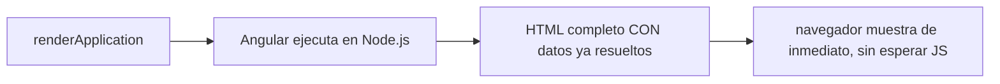
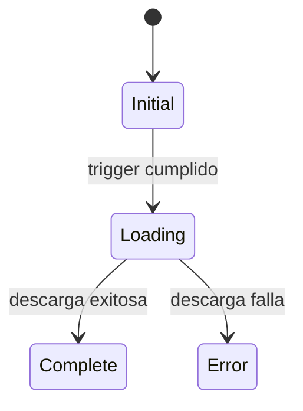
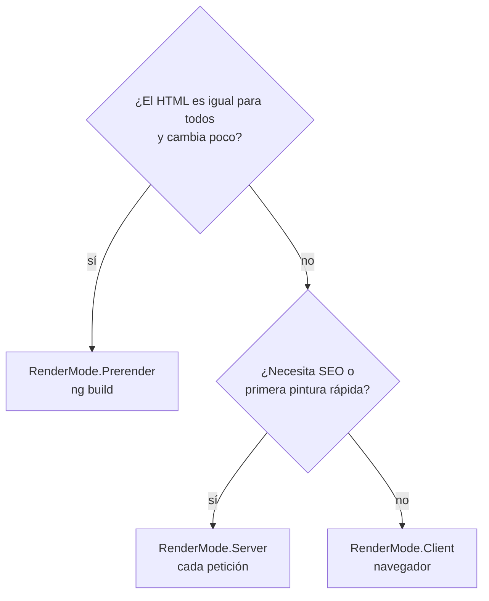
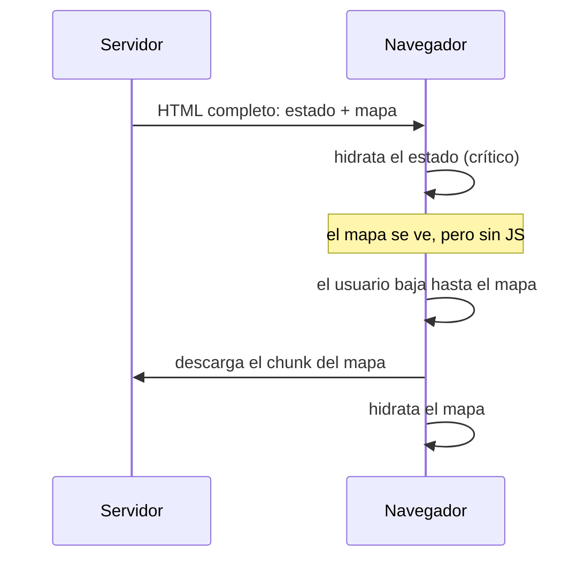

# Módulo 11: Performance, SSR y zoneless


## Aprende construyendo

Cada tema verifica su garantía con la API real correspondiente: `renderApplication` de `@angular/platform-server` para SSR real, un contraste determinista/no-determinista para hidratación, la API oficial de bloques `@defer` (estado `Error`) y `provideZonelessChangeDetection()` real para el modo sin Zone.js.

### Tema 1: Server-Side Rendering · Avanzado · 40 min

#### Paso 1 · Objetivo y preparación

Al finalizar podrás confirmar, con `renderApplication` real de `@angular/platform-server` (la misma API que usa el servidor de SSR de Angular internamente), que el HTML generado contiene el contenido de datos ya resuelto, sin depender de que ningún JavaScript se ejecute en el navegador.

**Conocimiento previo:** Módulo 7 de este track (HttpClient).

#### Paso 2 · Contexto y caso real

**¿Por qué es importante?** Una página de seguimiento de entregas debe mostrar contenido rápido y ser indexable por buscadores; sin SSR, el navegador recibe un documento casi vacío que debe ejecutar JavaScript completo antes de mostrar cualquier dato real, un costo perceptible en conexiones lentas y una barrera real para rastreadores que no ejecutan JavaScript de forma confiable.

#### Paso 3 · Teoría con analogía

**Conceptos clave:** `renderApplication`, HTML completo generado en servidor, sin espera de JavaScript del cliente.

SSR traslada la generación inicial del HTML desde el navegador hacia el servidor: Angular ejecuta la aplicación en Node.js, genera el HTML completo de la vista inicial con los datos ya presentes, y lo envía listo al navegador. `renderApplication` (de `@angular/platform-server`) es la función real que realiza este renderizado; puede invocarse directamente en un test para confirmar el HTML producido, sin necesitar un servidor HTTP completo corriendo.

**Analogía:** una aplicación sin SSR es entregar una caja de ingredientes crudos con una receta, esperando que el comensal cocine antes de comer; con SSR, el plato llega ya preparado y listo de inmediato.

**Diagrama:**



#### Paso 4 · Demostración guiada desde cero

Parte de una carpeta vacía:

```bash
mkdir demo-ssr
cd demo-ssr
npx -y @angular/cli@22 new . --standalone --style=css --routing=false --skip-git --defaults --ssr
mkdir -p src/app
```

`--ssr` es la bandera que agrega, desde la generación del proyecto, el soporte de Server-Side Rendering (renderizar la app en el servidor antes de enviarla al navegador).

Crea `src/app/resumen-envio.component.ts`:

```ts
// src/app/resumen-envio.component.ts
import { Component } from '@angular/core';

@Component({
  selector: 'app-resumen-envio',
  standalone: true,
  template: `<h1>Envío PED-001</h1><p>Estado: en tránsito</p>`,
})
export class ResumenEnvioComponent {}
```

Confirma con `renderApplication` real (la misma API que usa `@angular/ssr` internamente) que el HTML generado ya contiene el contenido, sin necesitar ningún navegador:

```ts
// src/app/ssr-render.spec.ts
import { renderApplication } from '@angular/platform-server';
import { bootstrapApplication } from '@angular/platform-browser';
import { ResumenEnvioComponent } from './resumen-envio.component';

describe('SSR con renderApplication', () => {
  it('el HTML generado por el servidor ya contiene el contenido, sin ejecutar JS de cliente', async () => {
    const html = await renderApplication(
      // en Angular 22, en el servidor bootstrapApplication debe recibir el BootstrapContext (si no: NG0401)
      (context) => bootstrapApplication(ResumenEnvioComponent, { providers: [] }, context),
      { document: '<app-resumen-envio></app-resumen-envio>' }
    );

    expect(html).toContain('Envío PED-001');
    expect(html).toContain('en tránsito');
  });
});
```

```bash
npx ng test --watch=false
```

**Resultado esperado:** el test pasa; `renderApplication` ejecuta Angular REALMENTE en el entorno Node.js del test (no una simulación textual) y produce una cadena HTML que ya contiene "Envío PED-001" y "en tránsito" — el contenido real que un navegador mostraría inmediatamente al recibir esa respuesta, sin ejecutar ningún JavaScript primero.

**Fallo deliberado:** cambia el template del componente para mostrar el estado de forma condicional basada en una promesa NO resuelta antes del renderizado (por ejemplo, `{{ estadoAsincrono }}` donde `estadoAsincrono` se asigna dentro de un `setTimeout` sin esperarlo) y ejecuta de nuevo el test. La aserción `toContain('en tránsito')` FALLA porque el HTML generado captura el estado en el momento del renderizado del servidor, ANTES de que ese `setTimeout` se resuelva — diagnostica confirmando que SSR renderiza un snapshot del estado disponible sincrónicamente (o de promesas correctamente esperadas por Angular), no un estado que llegará después de forma asíncrona sin coordinación. Restaura el contenido síncrono antes de continuar.

#### Paso 5 · Práctica guiada — repetición progresiva

1. Agrega un segundo componente con datos distintos y confirma con un test independiente que `renderApplication` produce HTML específico para cada uno, sin mezclar contenido.
2. Documenta, en un comentario, por qué el HTML generado por SSR beneficia a rastreadores de buscadores que no ejecutan JavaScript de forma confiable.
3. Mide (documentando el resultado en un comentario, sin necesariamente automatizarlo) cuántos bytes tiene el HTML generado por SSR comparado con el documento HTML vacío inicial de una SPA tradicional.
4. Escribe de memoria (sin mirar) un componente simple y un test `renderApplication` que confirme su contenido en el HTML generado. Compara después contra el patrón del Paso 4.

**Pista:** `renderApplication` es la MISMA función que Angular usa internamente en su servidor de SSR generado por `ng add @angular/ssr` — probarla directamente en un test es más rápido y determinista que levantar un servidor Node.js completo y hacerle una petición HTTP real.

#### Paso 6 · Práctica independiente

**Completa el código:** rellena el espacio con la función real de `@angular/platform-server` que renderiza una aplicación Angular a una cadena HTML:

```ts
const html = await ____(
  (context) => bootstrapApplication(ResumenEnvioComponent, { providers: [] }, context),
  { document: '<app-resumen-envio></app-resumen-envio>' }
);
```

**Reto de memoria sin mirar:** cierra este documento y escribe, solo de memoria, un componente simple y un test `renderApplication` que confirme su contenido en el HTML generado por el servidor. Compara después contra el patrón del Paso 4.

#### Paso 7 · Cierre

Ya confirmas con `renderApplication` real que Angular genera HTML completo en el servidor, sin depender de la ejecución de JavaScript del cliente. El siguiente tema confirma por qué el contenido no determinista rompe la reutilización del DOM durante la hidratación. Fuentes oficiales: [Angular — Server-side rendering](https://angular.dev/guide/ssr).

**Errores comunes:** asumir que cualquier dato asíncrono aparece automáticamente en el HTML de SSR sin que Angular lo espere correctamente; acceder a `window` u otras APIs de navegador durante el renderizado del servidor, donde no existen.

**Cuándo no usarlo:** para una aplicación interna sin necesidad de indexación SEO y donde todos los usuarios tienen conexiones rápidas (por ejemplo, una herramienta administrativa interna), el costo operativo adicional de mantener un servidor de SSR puede no justificarse.

**Transferencia al proyecto integrador «Centro de control logístico»:** Renderiza en servidor la página pública de seguimiento con datos no sensibles. Inspecciona el HTML inicial y confirma que contiene el estado de la guía sin depender de ejecutar JavaScript.

### Tema 2: Hidratación · Avanzado · 40 min

#### Paso 1 · Objetivo y preparación

Al finalizar podrás demostrar, contrastando contenido determinista con no determinista, exactamente por qué el contenido no determinista (como `Date.now()` o `Math.random()` sin coordinación) produce una discrepancia entre lo que el servidor renderizó y lo que el cliente renderizaría al hidratarse.

**Conocimiento previo:** Tema 1 de este módulo.

#### Paso 2 · Contexto y caso real

**¿Por qué es importante?** Una vez que el HTML del servidor llega al navegador, la aplicación aún no es interactiva; la hidratación reutiliza ese DOM existente en vez de destruirlo y re-renderizarlo, pero SOLO si la estructura que Angular generaría en el cliente coincide exactamente con la que el servidor ya generó — cualquier discrepancia real fuerza un re-render costoso o produce un error de hidratación visible.

#### Paso 3 · Teoría con analogía

**Conceptos clave:** reutilización del DOM, contenido no determinista, discrepancia servidor/cliente.

La hidratación "toma posesión" del HTML ya existente: adjunta listeners de eventos y activa reactividad SIN destruir y reconstruir el DOM. Esto requiere que la estructura generada por el servidor coincida EXACTAMENTE con la que Angular generaría en el cliente. Contenido no determinista (una marca de tiempo generada en el momento exacto del render, un número aleatorio) casi con certeza produce un valor DISTINTO en cada ejecución — servidor y cliente ejecutan el mismo componente en momentos distintos, por lo que un valor "generado en el momento" diverge entre ambos.

**Analogía:** la hidratación es un actor que llega tarde a un escenario ya montado y simplemente toma su lugar sin desmontar nada; pero si el escenario que el actor esperaba encontrar (basado en su guion) no coincide con el escenario real ya montado, no puede simplemente "tomar su lugar" — algo debe reconstruirse.

**Diagrama:**

```
┌── Contenido determinista ─────────┐  servidor y cliente producen el MISMO valor
└──────────────────────────┘         → hidratación reutiliza el DOM sin conflicto
┌── Contenido no determinista ──────┐  servidor y cliente producen valores DISTINTOS
└──────────────────────────┘         → discrepancia real de hidratación
```

#### Paso 4 · Demostración guiada desde cero

Continuando en `demo-ssr` (o, si prefieres un ejemplo independiente, parte de una carpeta vacía con `npx -y @angular/cli@22 new demo-hidratacion --standalone --skip-git --defaults --ssr` y luego `cd demo-hidratacion`), crea `src/app/marca-tiempo.component.ts`:

```bash
mkdir -p src/app
```

```ts
// src/app/marca-tiempo.component.ts
import { Component, input } from '@angular/core';

@Component({
  selector: 'app-marca-tiempo',
  standalone: true,
  template: `<span>Generado: {{ momentoGenerado() }}</span>`,
})
export class MarcaTiempoComponent {
  // determinista: recibe el valor como INPUT, no lo genera internamente
  momentoGenerado = input.required<string>();
}

@Component({
  selector: 'app-marca-tiempo-no-determinista',
  standalone: true,
  template: `<span>Generado: {{ momentoGeneradoInternamente }}</span>`,
})
export class MarcaTiempoNoDeterministaComponent {
  // NO determinista: genera el valor en el momento exacto del render
  momentoGeneradoInternamente = new Date().toISOString();
}
```

Confirma con un test real que dos renders "separados" (simulando servidor y cliente) del componente determinista producen el MISMO HTML, mientras el no determinista produce HTML DISTINTO:

```ts
// src/app/marca-tiempo.spec.ts
import { TestBed } from '@angular/core/testing';
import { MarcaTiempoComponent, MarcaTiempoNoDeterministaComponent } from './marca-tiempo.component';

describe('Determinismo del contenido para hidratacion', () => {
  it('el componente determinista produce el MISMO HTML en dos renders separados', async () => {
    const valorCompartido = '2026-07-21T10:00:00.000Z'; // el "servidor" calcula esto UNA vez y lo pasa como dato

    await TestBed.configureTestingModule({ imports: [MarcaTiempoComponent] }).compileComponents();
    const fixtureServidor = TestBed.createComponent(MarcaTiempoComponent);
    fixtureServidor.componentRef.setInput('momentoGenerado', valorCompartido);
    fixtureServidor.detectChanges();

    const fixtureCliente = TestBed.createComponent(MarcaTiempoComponent);
    fixtureCliente.componentRef.setInput('momentoGenerado', valorCompartido); // el MISMO valor, pasado explicitamente
    fixtureCliente.detectChanges();

    expect(fixtureServidor.nativeElement.textContent).toBe(fixtureCliente.nativeElement.textContent);
  });

  it('el componente NO determinista produce HTML DISTINTO entre dos renders separados', async () => {
    await TestBed.configureTestingModule({ imports: [MarcaTiempoNoDeterministaComponent] }).compileComponents();
    const fixtureServidor = TestBed.createComponent(MarcaTiempoNoDeterministaComponent);
    fixtureServidor.detectChanges();

    await new Promise((resolve) => setTimeout(resolve, 5)); // simula el tiempo real transcurrido entre servidor y cliente

    const fixtureCliente = TestBed.createComponent(MarcaTiempoNoDeterministaComponent);
    fixtureCliente.detectChanges();

    expect(fixtureServidor.nativeElement.textContent).not.toBe(fixtureCliente.nativeElement.textContent);
  });
});
```

```bash
npx ng test --watch=false
```

**Resultado esperado:** ambos tests pasan: el componente que recibe el valor como INPUT (calculado una sola vez, en el servidor, y transportado al cliente vía `TransferState` en una app real) produce texto IDÉNTICO en ambos renders; el componente que genera `new Date()` internamente produce texto DIFERENTE — una demostración concreta y medible de exactamente la discrepancia que causa errores reales de hidratación.

**Fallo deliberado:** en el primer test, cambia `valorCompartido` para que el "cliente" use un valor LIGERAMENTE distinto (por ejemplo, agregando un milisegundo) simulando un desajuste real de datos entre servidor y cliente, y ejecuta de nuevo. La aserción `toBe(...)` FALLA — diagnostica confirmando que la hidratación es tan estricta como una comparación de texto exacta: incluso una diferencia mínima entre lo que el servidor renderizó y lo que el cliente esperaría renderizar constituye una discrepancia real, no solo diferencias "grandes" y obvias. Restaura el valor compartido idéntico antes de continuar.

#### Complemento: proteger código de navegador y activar la hidratación al arrancar

**Contexto.** Además del contenido no determinista, la otra causa frecuente de fallos de SSR e hidratación es código que usa APIs que solo existen en el navegador (`localStorage`, `window`) mientras se renderiza en el servidor.

**Hazlo tú.** Crea `src/app/preferencias.service.ts`:

```ts
import { Injectable, PLATFORM_ID, inject } from '@angular/core';
import { isPlatformBrowser } from '@angular/common';

@Injectable({ providedIn: 'root' })
export class PreferenciasService {
  private readonly platformId = inject(PLATFORM_ID);

  obtenerTemaGuardado(): string {
    if (!isPlatformBrowser(this.platformId)) {
      return 'claro'; // en el servidor no existe localStorage: valor por defecto
    }
    return localStorage.getItem('tema') ?? 'claro';
  }
}
```

Y `src/app/preferencias.service.spec.ts`, que simula el servidor sobrescribiendo `PLATFORM_ID`:

```ts
import { PLATFORM_ID } from '@angular/core';
import { TestBed } from '@angular/core/testing';
import { PreferenciasService } from './preferencias.service';

describe('PreferenciasService', () => {
  afterEach(() => {
    vi.restoreAllMocks();
    localStorage.clear();
  });

  it('en el servidor no toca localStorage y devuelve el valor por defecto', () => {
    TestBed.configureTestingModule({ providers: [{ provide: PLATFORM_ID, useValue: 'server' }] });
    const leer = vi.spyOn(Storage.prototype, 'getItem');
    localStorage.setItem('tema', 'oscuro');

    const tema = TestBed.inject(PreferenciasService).obtenerTemaGuardado();

    expect(tema).toBe('claro');
    expect(leer).not.toHaveBeenCalled();
  });

  it('en el navegador lee el tema guardado', () => {
    TestBed.configureTestingModule({ providers: [{ provide: PLATFORM_ID, useValue: 'browser' }] });
    localStorage.setItem('tema', 'oscuro');
    expect(TestBed.inject(PreferenciasService).obtenerTemaGuardado()).toBe('oscuro');
  });
});
```

```bash
npx ng test --watch=false
```

**Resultado esperado:** las dos pruebas pasan: con `PLATFORM_ID` igual a `'server'`, el servicio devuelve `'claro'` sin llamar a `localStorage.getItem`, aunque haya un tema guardado; con `'browser'`, devuelve `'oscuro'`.

**Fallo deliberado:** borra el bloque `if (!isPlatformBrowser(...)) { ... }`. **Error esperado:** `AssertionError: expected 'oscuro' to be 'claro'`. **Diagnóstico:** jsdom sí tiene `localStorage`, así que la prueba no explota; lo que detecta es que el servidor produciría un HTML distinto del que el navegador del usuario genera al hidratar (y en un servidor Node real, `localStorage` no existe y el render falla). Restaura el bloque.

**Entiende: la configuración de arranque.** `isPlatformBrowser` protege código puntual; la hidratación se activa al arrancar, en dos archivos que `ng new --ssr` de Angular 22 genera así:

```ts
// src/app/app.config.ts (cliente; el servidor lo reutiliza)
providers: [provideBrowserGlobalErrorListeners(), provideRouter(routes), provideClientHydration()]

// src/app/app.config.server.ts (solo servidor)
const serverConfig: ApplicationConfig = {
  providers: [provideServerRendering(withRoutes(serverRoutes))],
};
export const config = mergeApplicationConfig(appConfig, serverConfig);
```

`provideServerRendering()` (de `@angular/ssr`) renderiza en el servidor con las rutas de `app.routes.server.ts` (Tema 6); `provideClientHydration()` (de `@angular/platform-browser`) hace que el cliente reutilice ese HTML en vez de reconstruirlo. Si quitas `provideClientHydration()`, el cliente vuelve a renderizar todo desde cero sobre el HTML del servidor y pierdes la ventaja de la hidratación.

#### Paso 5 · Práctica guiada — repetición progresiva

1. Identifica, en el proyecto `demo-ssr` de los Temas 1-2, cualquier otro punto donde `Math.random()`, `Date.now()` o `new Date()` se use directamente dentro de una plantilla o su lógica de renderizado, y documenta cómo refactorizarlo a un input determinista.
2. Escribe un test que confirme que DOS instancias del componente determinista, ambas recibiendo el MISMO input, producen resultados idénticos sin importar cuántas veces se repita el test.
3. Documenta, en un comentario, la diferencia entre "no determinista por diseño" (una marca de tiempo real que cambia) y "no determinista por accidente" (un `Map` iterado en un orden no garantizado que produce una lista en orden distinto).
4. Escribe de memoria (sin mirar) un componente determinista (recibe datos como input) y uno no determinista (los genera internamente), con un test que confirme la diferencia de comportamiento entre ambos. Compara después contra el patrón del Paso 4.

**Pista:** cualquier valor que dependa del momento exacto de ejecución (`Date.now()`, `new Date()`, `Math.random()`, un contador global mutable) es una fuente de no-determinismo real entre el render del servidor y el del cliente — la solución casi siempre es calcularlo UNA vez en el servidor y transportarlo explícitamente (como input, o vía `TransferState`), no recalcularlo en cada lado.

#### Paso 6 · Práctica independiente

**Completa el código:** rellena el espacio con el mecanismo de Angular usado para recibir un valor calculado externamente en vez de generarlo internamente:

```ts
momentoGenerado = ____.required<string>();
```

**Reto de memoria sin mirar:** cierra este documento y escribe, solo de memoria, un componente determinista y uno no determinista, con un test que confirme la diferencia real entre ambos comportamientos. Compara después contra el patrón del Paso 4.

#### Paso 7 · Cierre

Ya demuestras, con una comparación de texto real entre dos renders, exactamente por qué el contenido no determinista rompe la reutilización del DOM durante la hidratación. El siguiente tema verifica los estados reales de un bloque `@defer`, incluyendo el estado de error. Fuentes oficiales: [Angular — Hydration](https://angular.dev/guide/hydration).

**Errores comunes:** generar contenido basado en `Date.now()`, `Math.random()` u otra fuente no determinista directamente en el renderizado; asumir que solo diferencias "grandes" causan errores de hidratación, cuando cualquier desajuste real, por mínimo que sea, cuenta.

**Cuándo no usarlo:** para una aplicación sin SSR habilitado (SPA pura, siempre renderizada en el navegador), no existe ningún proceso de hidratación que verificar, porque no hay un HTML previo del servidor que reutilizar.

**Transferencia al proyecto integrador «Centro de control logístico»:** Hidrata la página de seguimiento sin sustituir sus controles. Prueba la primera interacción y revisa avisos de discrepancias; servidor y cliente deben partir de los mismos datos visibles.

### Tema 3: `@defer` — estados reales, incluyendo error · Avanzado · 40 min

#### Paso 1 · Objetivo y preparación

Al finalizar podrás confirmar, con la API oficial de test de bloques `@defer`, el estado `Error` de un bloque diferido — el caso donde la carga del contenido falla — además de los triggers apropiados según el tipo de contenido.

**Conocimiento previo:** Temas 1-2 de este módulo.

#### Paso 2 · Contexto y caso real

**¿Por qué es importante?** Un chunk de JavaScript diferido puede fallar al descargarse (problema de red, CDN caído); sin un bloque `@error` explícito, el usuario vería el `@placeholder` congelado indefinidamente sin ninguna indicación de que algo salió mal, en vez de una respuesta clara ante el fallo real.

#### Paso 3 · Teoría con analogía

**Conceptos clave:** `@error`, triggers (`on viewport`, `on interaction`, `on idle`), estado `DeferBlockState.Error`.

Además de `@placeholder` (antes de disparar) y `@loading` (durante la descarga), `@defer` soporta un bloque `@error` mostrado si la descarga del chunk falla. La API de test de Angular permite forzar cada uno de estos estados explícitamente (`DeferBlockState.Initial`, `Loading`, `Complete`, `Error`) sin depender de condiciones de red reales para probar el comportamiento ante un fallo genuino.

**Analogía:** un `@error` en `@defer` es como un cartel de "temporalmente fuera de servicio" en una máquina expendedora que no pudo procesar el pedido, en vez de dejar al usuario esperando indefinidamente frente a una máquina que simplemente no responde.

**Diagrama:**



#### Paso 4 · Demostración guiada desde cero

Continuando en `demo-ssr` (o, si prefieres un ejemplo independiente, parte de una carpeta vacía y genera un proyecto nuevo con `npx -y @angular/cli@22 new demo-defer-error --standalone --skip-git --defaults` y luego `cd demo-defer-error`), crea `src/app/grafico-diferido.component.ts`:

```bash
mkdir -p src/app
```

```ts
// src/app/grafico-diferido.component.ts
import { Component } from '@angular/core';

@Component({
  selector: 'app-grafico-diferido',
  standalone: true,
  template: `
    @defer (on interaction) {
      <section data-testid="grafico">Gráfico de entregas cargado</section>
    } @placeholder {
      <button type="button">Ver gráfico</button>
    } @loading (minimum 200ms) {
      <p data-testid="cargando">Cargando…</p>
    } @error {
      <p data-testid="error-grafico" role="alert">No se pudo cargar el gráfico. Reintenta.</p>
    }
  `,
})
export class GraficoDiferidoComponent {}
```

Confirma con la API de test de bloques diferidos que el estado `Error` se maneja explícitamente, no como un placeholder congelado:

```ts
// src/app/grafico-diferido.component.spec.ts
import { DeferBlockState, TestBed } from '@angular/core/testing';
import { GraficoDiferidoComponent } from './grafico-diferido.component';

describe('GraficoDiferidoComponent', () => {
  it('el estado Error muestra un mensaje explicito, no un placeholder congelado', async () => {
    await TestBed.configureTestingModule({ imports: [GraficoDiferidoComponent] }).compileComponents();
    const fixture = TestBed.createComponent(GraficoDiferidoComponent);
    fixture.detectChanges();

    const [bloqueDeferido] = await fixture.getDeferBlocks();

    // render(estado) exige el estado: aquí forzamos Error para probar ese camino sin una falla de red real
    await bloqueDeferido.render(DeferBlockState.Error);
    fixture.detectChanges();

    const mensajeError = fixture.nativeElement.querySelector('[data-testid="error-grafico"]');
    expect(mensajeError).not.toBeNull();
    expect(mensajeError.textContent).toContain('No se pudo cargar el gráfico');

    const grafico = fixture.nativeElement.querySelector('[data-testid="grafico"]');
    expect(grafico).toBeNull(); // el contenido real NUNCA se renderizo: la carga fallo
  });
});
```

```bash
npx ng test --watch=false
```

**Resultado esperado:** el test pasa; forzar `DeferBlockState.Error` con la API oficial de test confirma que el bloque `@error` (con `role="alert"`, anunciado a lectores de pantalla) se renderiza en vez del contenido real, y que el contenido pesado NUNCA llegó a mostrarse — el manejo explícito de un fallo real de carga, verificado en código.

**Fallo deliberado:** quita el bloque `@error { ... }` del componente (dejando solo `@placeholder` y `@loading`) y ejecuta de nuevo el test. FALLA porque `mensajeError` ahora es `null` — sin un bloque `@error` explícito, Angular no tiene ningún contenido específico que mostrar ante el estado de fallo, dejando potencialmente al usuario con el `@placeholder` (o nada) sin ninguna indicación de que la carga realmente falló — diagnostica confirmando por qué omitir `@error` es un error común: el fallo silencioso es indistinguible, desde la perspectiva del usuario, de una carga que simplemente nunca se disparó. Restaura el bloque `@error` antes de continuar.

#### Paso 5 · Práctica guiada — repetición progresiva

1. Agrega un test que confirme el estado `Loading` explícitamente (`DeferBlockState.Loading`), verificando que el mensaje "Cargando…" aparece durante ese estado intermedio.
2. Documenta, en un comentario, por qué `role="alert"` en el bloque `@error` es importante para que un lector de pantalla anuncie el fallo sin que el usuario tenga que descubrirlo visualmente.
3. Escribe un test que confirme que, tras un error, NO hay ningún camino automático de reintento — el usuario debe interactuar explícitamente (por ejemplo, con un botón "Reintentar" dentro del bloque `@error`) para volver a intentar la carga.
4. Escribe de memoria (sin mirar) un bloque `@defer` con los cuatro estados (`@placeholder`/`@loading`/`@error`/contenido real), y un test que fuerce el estado `Error` con la API oficial. Compara después contra el patrón del Paso 4.

**Pista:** `DeferBlockState` (importable desde `@angular/core/testing`) tiene los valores `Initial`, `Loading`, `Complete` y `Error` — pasar cualquiera de ellos a `bloqueDeferido.render(estado)` fuerza ese estado específico en el test, sin depender de condiciones de red reales ni temporizadores.

#### Paso 6 · Práctica independiente

**Completa el código:** rellena el espacio con el estado de `DeferBlockState` que representa una descarga fallida:

```ts
await bloqueDeferido.render(DeferBlockState.____);
```

**Reto de memoria sin mirar:** cierra este documento y escribe, solo de memoria, un bloque `@defer` con manejo explícito de `@error`, y un test que fuerce ese estado con la API oficial. Compara después contra el patrón del Paso 4.

#### Paso 7 · Cierre

Ya confirmas, forzando el estado real `Error` con la API oficial de test, que un bloque `@defer` sin manejo explícito de fallo deja al usuario sin ninguna indicación clara ante una descarga fallida. El siguiente y último tema de este módulo confirma que el modo zoneless actualiza la vista automáticamente al cambiar un signal. Fuentes oficiales: [Angular — Deferrable Views](https://angular.dev/guide/defer).

**Errores comunes:** omitir el bloque `@error`, dejando un fallo real de carga indistinguible de un placeholder normal; no anunciar el error a tecnologías asistivas con `role="alert"` o equivalente.

**Cuándo no usarlo:** para contenido diferido servido desde el mismo bundle de la aplicación (sin ninguna descarga de red adicional real involucrada), el estado `@error` no tiene ningún escenario de fallo realista que cubrir.

**Transferencia al proyecto integrador «Centro de control logístico»:** Difiere el mapa operativo y prueba sus estados de carga y error. Bloquea su descarga: la lista de entregas debe seguir disponible y ofrecer una forma explícita de reintentar.

### Tema 4: Zoneless · Avanzado · 40 min

#### Paso 1 · Objetivo y preparación

Al finalizar podrás confirmar, con `provideZonelessChangeDetection()` real configurado en `TestBed`, que actualizar un `signal` refleja el cambio en el DOM automáticamente tras `await fixture.whenStable()`, sin depender de Zone.js interceptando operaciones asíncronas.

**Conocimiento previo:** Módulo 2 de este track (signals); Módulo 10 Tema 1 (`fixture.whenStable()`).

#### Paso 2 · Contexto y caso real

**¿Por qué es importante?** Zone.js intercepta prácticamente cualquier operación asíncrona para decidir cuándo revisar cambios, un enfoque funcional pero impreciso (revisa más de lo necesario) y con un costo de tamaño de bundle no trivial; con el estado modelado completamente en signals, Angular puede saber con precisión exacta qué actualizar, sin necesitar esa intercepción genérica.

#### Paso 3 · Teoría con analogía

**Conceptos clave:** `provideZonelessChangeDetection`, precisión de signals, `fixture.whenStable()`.

Cuando el estado de una aplicación está modelado con signals, cada uno notifica exactamente qué vistas dependen de él al cambiar, mediante el sistema de suscripción fina que sustenta `computed()` y los templates reactivos. `provideZonelessChangeDetection()` habilita este modo sin Zone.js; en tests, `await fixture.whenStable()` espera a que la aplicación zoneless termine de procesar cambios pendientes, el equivalente zoneless a `detectChanges()` para escenarios donde el cambio se originó fuera del control directo del test. Zoneless pasó a ser estable a partir de Angular 20.2 y es el valor por defecto para proyectos nuevos generados con `ng new` desde Angular 21: no hace falta llamar `provideZonelessChangeDetection()` a mano en un proyecto nuevo, solo al migrar uno existente que todavía dependa de Zone.js (o, como en este tema, al configurarlo explícitamente dentro de un `TestBed` para un test aislado).

**Analogía:** Zone.js es un guardia que revisa cada habitación de un edificio tras escuchar cualquier ruido en cualquier parte, sin saber de dónde vino; el modelo zoneless con signals es un sistema de sensores específicos que notifican con precisión exacta cuál habitación cambió, sin revisar el resto del edificio.

**Diagrama:**

```
┌── Con Zone.js ─────────────────────┐  cualquier evento async → revisar TODO el árbol (impreciso)
└──────────────────────────────┘
┌── Zoneless (con signals) ──────────┐  un signal cambia → SOLO se actualizan sus vistas dependientes
└──────────────────────────────┘
```

#### Paso 4 · Demostración guiada desde cero

Continuando en `demo-ssr` (o, si prefieres un ejemplo independiente, parte de una carpeta vacía con `npx -y @angular/cli@22 new demo-zoneless --standalone --skip-git --defaults` y luego `cd demo-zoneless`), crea `src/app/contador-zoneless.component.ts`:

```bash
mkdir -p src/app
```

```ts
// src/app/contador-zoneless.component.ts
import { Component, signal } from '@angular/core';

@Component({
  selector: 'app-contador-zoneless',
  standalone: true,
  template: `<p>Entregas activas: {{ activas() }}</p>`,
})
export class ContadorZonelessComponent {
  activas = signal(0);

  incrementar() {
    this.activas.update((v) => v + 1);
  }
}
```

Confirma con `provideZonelessChangeDetection()` real que el DOM se actualiza automáticamente al cambiar el signal:

```ts
// src/app/contador-zoneless.component.spec.ts
import { TestBed } from '@angular/core/testing';
import { provideZonelessChangeDetection } from '@angular/core';
import { ContadorZonelessComponent } from './contador-zoneless.component';

describe('ContadorZonelessComponent (modo zoneless real)', () => {
  it('actualizar el signal refleja el cambio en el DOM sin Zone.js', async () => {
    await TestBed.configureTestingModule({
      imports: [ContadorZonelessComponent],
      providers: [provideZonelessChangeDetection()], // habilita el modo REAL sin Zone.js para este test
    }).compileComponents();

    const fixture = TestBed.createComponent(ContadorZonelessComponent);
    fixture.detectChanges(); // primer render

    expect(fixture.nativeElement.textContent).toContain('Entregas activas: 0');

    fixture.componentInstance.incrementar(); // cambia el signal FUERA del ciclo explicito de detectChanges

    await fixture.whenStable(); // espera a que Angular zoneless procese el cambio pendiente, sin Zone.js

    expect(fixture.nativeElement.textContent).toContain('Entregas activas: 1');
  });
});
```

```bash
npx ng test --watch=false
```

**Resultado esperado:** el test pasa; con `provideZonelessChangeDetection()` REAL configurado (no una simulación), actualizar el signal `activas` fuera de cualquier llamada explícita a `detectChanges()` y simplemente esperar `fixture.whenStable()` es suficiente para que el DOM refleje el nuevo valor — confirmando que la precisión de signals, no Zone.js, es lo que impulsa la actualización en este modo.

**Fallo deliberado:** quita `await fixture.whenStable()` (dejando la aserción inmediatamente después de `incrementar()`, sin esperar) y ejecuta de nuevo el test. El resultado puede ser inconsistente o mostrar todavía `"Entregas activas: 0"` dependiendo del momento exacto de procesamiento — diagnostica confirmando que, incluso en modo zoneless con signals precisos, la actualización del DOM no es necesariamente SINCRÓNICA respecto al cambio del signal: Angular programa la actualización, y `whenStable()` es la forma correcta de esperar a que ese trabajo pendiente se complete antes de aserir sobre el DOM. Restaura `await fixture.whenStable()` antes de continuar.

#### Paso 5 · Práctica guiada — repetición progresiva

1. Agrega un segundo signal derivado con `computed()` y confirma que también se actualiza correctamente en modo zoneless tras `whenStable()`.
2. Documenta en un comentario qué cambia si quitas `provideZonelessChangeDetection()` del test: en un proyecto creado con Angular 21 o posterior el TestBed ya es zoneless por defecto (el proyecto no instala `zone.js`), así que la prueba sigue pasando por el mismo mecanismo; solo un proyecto que todavía cargue `zone.js` usaría la detección basada en zonas.
3. Simula una actualización mediante `setTimeout` (una operación async que Zone.js SÍ interceptaría automáticamente) dentro del componente, y confirma que en modo zoneless también funciona correctamente con `whenStable()`, sin necesitar ninguna intercepción de Zone.js.
4. Escribe de memoria (sin mirar) un componente con un signal, configurado con `provideZonelessChangeDetection()`, y un test que confirme la actualización del DOM tras `whenStable()`. Compara después contra el patrón del Paso 4.

**Pista:** `fixture.whenStable()` es la forma oficial y recomendada de esperar trabajo pendiente en un test, tanto en modo zoneless como con Zone.js — preferible sobre `detectChanges()` manual cuando el cambio se originó de forma asíncrona o fuera del control directo del test.

#### Paso 6 · Práctica independiente

**Completa el código:** rellena el espacio con el proveedor real que habilita el modo de detección de cambios sin Zone.js:

```ts
providers: [____()],
```

**Reto de memoria sin mirar:** cierra este documento y escribe, solo de memoria, un componente con un signal configurado en modo zoneless, y un test que confirme la actualización del DOM tras `whenStable()`. Compara después contra el patrón del Paso 4.

#### Paso 7 · Cierre

Ya confirmas con `provideZonelessChangeDetection()` real que el estado modelado en signals actualiza el DOM con precisión, sin necesitar la intercepción genérica de Zone.js. Como siguiente paso, el Tema 5 explica qué revisa Angular en cada pasada ahora que `OnPush` es la estrategia por defecto. Fuentes oficiales: [Angular — Zoneless](https://angular.dev/guide/zoneless).

**Errores comunes:** asumir que el modo zoneless funciona sin migrar el estado relevante a signals; olvidar `await fixture.whenStable()` en tests zoneless, asumiendo actualización sincrónica del DOM.

**Cuándo no usarlo:** para una aplicación con dependencias de terceros que asumen la presencia de Zone.js (algunas librerías más antiguas parchan comportamientos asumiendo su intercepción), migrar a zoneless sin auditar esas dependencias puede romper funcionalidad existente.

---

**Transferencia al proyecto integrador «Centro de control logístico»:** Actualiza el estado de una guía desde una operación asíncrona en modo zoneless. Verifica que Signals notifica el cambio y que la pantalla no depende de un evento incidental para refrescarse.

### Tema 5: OnPush por defecto (Angular 22): qué se revisa y cuándo usar `Eager` · Avanzado · 40 min

**Duración estimada:** 40 min (4 subtemas de 10 min).

**Al finalizar podrás:** explicar qué revisa Angular 22 en un componente que no declara `changeDetection` (es `OnPush`), demostrar con pruebas qué cambios se repintan (signals, eventos del template, inputs con referencia nueva, `markForCheck()`) y cuáles no (campos planos mutados, objetos mutados en sitio), y decidir cuándo usar `ChangeDetectionStrategy.Eager`.

**¿Por qué es importante?** Desde Angular 22, `OnPush` es la estrategia por defecto: «OnPush is the default change detection strategy in Angular (since v22)» ([angular.dev](https://angular.dev/best-practices/skipping-subtrees)). La antigua estrategia `Default` pasa a llamarse `Eager` y `Default` queda obsoleta. Todo componente que escribes en este curso ya es `OnPush`, aunque no lo veas; si copias código de un tutorial anterior que cambia campos planos, la pantalla deja de actualizarse y no hay ningún error en consola.

**Prerrequisitos:** Tema 4 de este módulo (zoneless) y Módulo 2 (signals). Trabajas en un proyecto `@angular/cli@22` (puede ser el del Tema 4). Crea la carpeta `src/app/onpush/`.

#### Subtema 5.1: Lo que el CLI ya no escribe · 10 min

**1. Contexto**
En versiones anteriores, el CLI generaba componentes sin `changeDetection` y eso significaba «revisar siempre»; por eso muchas guías pedían añadir `ChangeDetectionStrategy.OnPush` a mano. En Angular 22 el mismo componente sin esa línea ya es `OnPush`.

**2. Hazlo tú**
Genera un componente y mira su decorador:

```bash
npx ng generate component tarjeta-demo
cat src/app/tarjeta-demo/tarjeta-demo.ts
```

**Resultado esperado:**

```ts
import { Component } from '@angular/core';

@Component({
  imports: [],
  selector: 'app-tarjeta-demo',
  styleUrl: './tarjeta-demo.css',
  templateUrl: './tarjeta-demo.html',
})
export class TarjetaDemo {}
```

Abre la definición de `ChangeDetectionStrategy` en tu editor (Ctrl/Cmd + clic sobre el nombre en cualquier archivo que lo importe). Verás tres valores: `OnPush = 0` con la nota «OnPush is enabled by default», `Eager = 1` y `Default = 1` marcado `@deprecated Use Eager instead`.

**Fallo deliberado:** agrega `changeDetection: ChangeDetectionStrategy.Default` al componente (importa `ChangeDetectionStrategy`). **Resultado:** compila, pero el editor tacha `Default` como obsoleto. **Diagnóstico:** `Default` y `Eager` valen lo mismo (`1`); si de verdad necesitas revisar siempre, escribe `Eager`. Borra la línea y el componente de prueba (`rm -r src/app/tarjeta-demo`).

**3. Entiende**
La estrategia decide **si** Angular entra a revisar un componente durante una pasada de detección de cambios. `Eager` lo revisa en cada pasada. `OnPush` lo salta salvo que algo lo marque. Zoneless (Tema 4) decide **cuándo** hay una pasada; `OnPush` decide **qué** se revisa en ella. Son complementarios.

**4. Cierra**
Anota los dos nombres de la estrategia que revisa siempre (`Eager`, y el obsoleto `Default`) y cuál es el valor por defecto en Angular 22.

#### Subtema 5.2: Qué repinta un componente OnPush · 10 min

**1. Contexto**
Un componente `OnPush` se revisa cuando: un signal leído en su template cambia, se maneja un evento en él o en sus hijos, recibe un input nuevo por enlace de template o alguien llama a `markForCheck()`. Un campo plano cambiado desde fuera no está en esa lista.

**2. Hazlo tú**
Crea `src/app/onpush/estado-conductor.ts`:

```ts
import { ChangeDetectionStrategy, Component, signal } from '@angular/core';

// Sin changeDetection: en Angular 22 este componente ya es OnPush.
@Component({
  selector: 'app-estado-plano',
  template: `<p>Plano: {{ estado }}</p>`,
})
export class EstadoPlano {
  estado = 'en ruta';
}

@Component({
  selector: 'app-estado-signal',
  template: `<p>Signal: {{ estado() }}</p>`,
})
export class EstadoSignal {
  readonly estado = signal('en ruta');
}

// Eager revisa el componente en cada pasada, como el antiguo Default.
@Component({
  selector: 'app-estado-eager',
  changeDetection: ChangeDetectionStrategy.Eager,
  template: `<p>Eager: {{ estado }}</p>`,
})
export class EstadoEager {
  estado = 'en ruta';
}

@Component({
  selector: 'app-panel-conductor',
  imports: [EstadoPlano, EstadoSignal, EstadoEager],
  template: `
    <app-estado-plano />
    <app-estado-signal />
    <app-estado-eager />
    <button (click)="clics.set(clics() + 1)">Refrescar ({{ clics() }})</button>
  `,
})
export class PanelConductor {
  readonly clics = signal(0);
}
```

Crea `src/app/onpush/estado-conductor.spec.ts`:

```ts
import { TestBed } from '@angular/core/testing';
import { EstadoEager, EstadoPlano, EstadoSignal, PanelConductor } from './estado-conductor';
import { EstadoLegado, ListaFichas } from './legado';

describe('OnPush por defecto en Angular 22', () => {
  it('un campo plano no se repinta; un signal y Eager sí', async () => {
    const fixture = TestBed.createComponent(PanelConductor);
    await fixture.whenStable();
    const hijo = <T>(tipo: new (...a: never[]) => T): T =>
      fixture.debugElement.query((d) => d.componentInstance instanceof tipo).componentInstance;

    hijo(EstadoPlano).estado = 'entregado';
    hijo(EstadoSignal).estado.set('entregado');
    hijo(EstadoEager).estado = 'entregado';

    // Un clic en el padre provoca una pasada de detección de cambios.
    fixture.nativeElement.querySelector('button').click();
    await fixture.whenStable();

    const textos = [...fixture.nativeElement.querySelectorAll('p')].map((p: Element) => p.textContent);
    expect(textos).toEqual(['Plano: en ruta', 'Signal: entregado', 'Eager: entregado']);
  });
});
```

```bash
npx ng test --watch=false
```

**Resultado esperado:** la prueba pasa: tras el clic en el padre, el componente con signal y el `Eager` muestran «entregado», y el plano sigue en «en ruta».

**Fallo deliberado:** cambia la expectativa a `'Plano: entregado'`. **Error esperado:** `AssertionError: expected [ 'Plano: en ruta', …(2) ] to deeply equal [ 'Plano: entregado', …(2) ]`. **Diagnóstico:** el clic marcó al padre (`PanelConductor`), no a `EstadoPlano`; como `EstadoPlano` es `OnPush` y nada lo marcó, Angular no lo revisa. Restaura la expectativa.

**3. Entiende**
**Explicación paso a paso:** (1) la prueba cambia los tres hijos desde TypeScript, fuera de cualquier evento del template; (2) el `signal.set()` marca a `EstadoSignal` porque su template lo lee; (3) el clic en el botón marca a `PanelConductor` y programa una pasada; (4) en la pasada, Angular revisa al padre, entra en `EstadoSignal` (marcado) y en `EstadoEager` (siempre), y salta `EstadoPlano`. 

**Analogía:** `OnPush` es un supervisor que solo revisa los camiones que levantaron la mano (un signal, un evento, un input nuevo); `Eager` revisa todos los camiones en cada ronda. Si un conductor cambia la carga sin levantar la mano, el supervisor de `OnPush` no se entera.

**4. Cierra**
Guarda la prueba en verde y la lista de los cuatro disparadores de `OnPush`.

#### Subtema 5.3: Código heredado: `markForCheck()` o `Eager` · 10 min

**1. Contexto**
Al copiar un componente de un proyecto anterior a Angular 22, encontrarás campos planos que cambian en callbacks (un `setTimeout`, una suscripción de RxJS, una librería de mapas). La mejor corrección es convertirlos en signals; mientras tanto, hay dos salidas.

**2. Hazlo tú**
Crea `src/app/onpush/legado.ts`:

```ts
import { ChangeDetectorRef, Component, inject, input, signal } from '@angular/core';

export interface Envio {
  guia: string;
  estado: string;
}

// Código heredado: un campo plano que cambia fuera de un evento del template.
@Component({
  selector: 'app-estado-legado',
  template: `<p>Legado: {{ estado }}</p>`,
})
export class EstadoLegado {
  private readonly cdr = inject(ChangeDetectorRef);
  estado = 'en ruta';

  actualizar(nuevo: string) {
    this.estado = nuevo;
    this.cdr.markForCheck(); // avisa a Angular de que esta vista cambió
  }
}

@Component({
  selector: 'app-ficha-envio',
  template: `<p>{{ envio().guia }}: {{ envio().estado }}</p>`,
})
export class FichaEnvio {
  readonly envio = input.required<Envio>();
}

@Component({
  selector: 'app-lista-fichas',
  imports: [FichaEnvio],
  template: `
    <app-ficha-envio [envio]="envio()" />
    <button (click)="mutar()">Mutar</button>
    <button (click)="reemplazar()">Reemplazar</button>
  `,
})
export class ListaFichas {
  readonly envio = signal<Envio>({ guia: 'RF-4471', estado: 'en ruta' });

  mutar() {
    this.envio().estado = 'entregado'; // ❌ mismo objeto: el input no cambia
  }

  reemplazar() {
    this.envio.update((e) => ({ ...e, estado: 'entregado' })); // ✅ objeto nuevo
  }
}
```

Agrega al `describe` de `estado-conductor.spec.ts` (importa `EstadoLegado` y `ListaFichas` desde `./legado`):

```ts
  it('markForCheck repinta un componente heredado', async () => {
    const fixture = TestBed.createComponent(EstadoLegado);
    await fixture.whenStable();
    fixture.componentInstance.actualizar('entregado');
    await fixture.whenStable();
    expect(fixture.nativeElement.textContent).toContain('Legado: entregado');
  });
```

**Resultado esperado:** la prueba pasa: `markForCheck()` marca la vista y, en una app zoneless, además programa la pasada de detección.

**Fallo deliberado:** comenta la línea `this.cdr.markForCheck();`. **Error esperado:** `expected 'Legado: en ruta' to contain 'Legado: entregado'`. **Diagnóstico:** sin marca, `OnPush` salta el componente; y en zoneless ni siquiera hay pasada, así que tampoco `Eager` bastaría aquí: nada le avisó a Angular. Restaura la línea.

**3. Entiende**
Orden de preferencia: (1) convierte el estado en `signal` (corrige la causa); (2) si no puedes todavía, llama a `markForCheck()` justo después de cambiar el campo; (3) `changeDetection: ChangeDetectionStrategy.Eager` como solución temporal para un componente que depende de que lo revisen en cada pasada (por ejemplo, porque lo actualiza un padre que sí tiene pasadas). **Límite:** `Eager` hace que el componente y su subárbol se revisen siempre; úsalo por componente, con un comentario que explique por qué, y no como valor general.

**4. Cierra**
Busca en tu proyecto campos planos que cambian fuera del template y clasifícalos: signal, `markForCheck()` o `Eager`.

#### Subtema 5.4: Inputs: OnPush compara referencias · 10 min

**1. Contexto**
Un componente `OnPush` vuelve a revisarse cuando un input recibe un valor **distinto** (comparado por referencia). Si el padre muta un objeto que ya pasó como input, el hijo recibe la misma referencia y no se entera.

**2. Hazlo tú**
`legado.ts` ya contiene `FichaEnvio` y `ListaFichas`. Agrega esta prueba al mismo `describe` y ejecuta `npx ng test --watch=false`:

```ts
  it('un input solo se revisa si cambia la referencia', async () => {
    const fixture = TestBed.createComponent(ListaFichas);
    await fixture.whenStable();
    const [mutar, reemplazar] = fixture.nativeElement.querySelectorAll('button');
    const ficha = () => fixture.nativeElement.querySelector('p').textContent;

    mutar.click();
    await fixture.whenStable();
    expect(ficha()).toBe('RF-4471: en ruta');

    reemplazar.click();
    await fixture.whenStable();
    expect(ficha()).toBe('RF-4471: entregado');
  });
```

**Resultado esperado:** la prueba pasa: «Mutar» deja la ficha en «en ruta»; «Reemplazar», que crea un objeto nuevo con `update`, la cambia a «entregado».

**Fallo deliberado:** en `ListaFichas`, cambia `reemplazar()` para que haga `this.envio().estado = 'entregado'; this.envio.set(this.envio());`. **Error esperado:** la última expectativa falla con `expected 'RF-4471: en ruta' to be 'RF-4471: entregado'`. **Diagnóstico:** `set` con el mismo objeto no cambia nada: un signal compara con `Object.is` y el input recibe la misma referencia. Restaura `update((e) => ({ ...e, estado: 'entregado' }))`.

**3. Entiende**
Trata los objetos que pasan por inputs como inmutables: cambia creando uno nuevo. Es la misma regla de los signals del Módulo 2, y por eso `OnPush` por defecto encaja con un estado modelado en signals. **Límite:** crear objetos nuevos en cada cambio tiene un costo pequeño; en listas enormes, combina esta regla con `track` en `@for` para que Angular reutilice las filas que no cambiaron.

**4. Cierra**
Guarda las tres pruebas en verde.

**Hito del tema:**

- [ ] Comprobé que el CLI de Angular 22 no escribe `changeDetection` y que `Default` está obsoleto.
- [ ] La prueba de `PanelConductor` demuestra que un campo plano no se repinta y un signal sí.
- [ ] Provoqué y corregí el componente heredado con `markForCheck()`.
- [ ] Expliqué por qué mutar un objeto pasado como input no actualiza un hijo `OnPush`.

**Resumen:** en Angular 22 todo componente sin `changeDetection` es `OnPush`; se revisa cuando cambia un signal de su template, se maneja un evento en su subárbol, recibe un input con referencia nueva o se llama a `markForCheck()`; `Eager` (antes `Default`) revisa siempre y es una excepción documentada.

**Errores comunes:** mutar campos planos desde callbacks y esperar que la pantalla cambie, mutar objetos pasados como input, usar `Default` en código nuevo y poner `Eager` en todos los componentes para «arreglar» la pantalla.

**Transferencia al proyecto integrador «Centro de control logístico»:** revisa los componentes del panel de guías: convierte a signals los campos que cambian fuera del template y deja documentado cualquier `Eager`.

**Ejercicio:** este componente muestra la hora de la última señal GPS y la actualiza cada segundo, pero en Angular 22 la pantalla no cambia. Corrígelo sin usar `Eager` ni `markForCheck()`, y escribe una prueba con temporizadores simulados de Vitest que avance 2 segundos y compruebe que el texto cambió. Antes de abrir la solución, explica por qué no se actualiza.

```ts
import { Component, OnDestroy } from '@angular/core';

@Component({
  selector: 'app-ultima-senal',
  template: `<p>Segundos desde la última señal: {{ segundos }}</p>`,
})
export class UltimaSenal implements OnDestroy {
  segundos = 0;
  private readonly id = setInterval(() => this.segundos++, 1000);

  ngOnDestroy() {
    clearInterval(this.id);
  }
}
```

<details>
<summary>Solución — ábrela después de intentarlo</summary>

No se actualiza porque `segundos` es un campo plano que cambia dentro de un `setInterval`: no hay evento del template, ni signal, ni input. En zoneless nadie programa una pasada y, aunque la hubiera, `OnPush` saltaría el componente. Con un signal se corrigen las dos cosas.

```ts
import { Component, DestroyRef, inject, signal } from '@angular/core';

@Component({
  selector: 'app-ultima-senal',
  template: `<p>Segundos desde la última señal: {{ segundos() }}</p>`,
})
export class UltimaSenal {
  readonly segundos = signal(0);

  constructor() {
    const id = setInterval(() => this.segundos.update((s) => s + 1), 1000);
    inject(DestroyRef).onDestroy(() => clearInterval(id));
  }
}
```

```ts
import { TestBed } from '@angular/core/testing';
import { UltimaSenal } from './ultima-senal';

it('cuenta los segundos', async () => {
  // Solo se simula setInterval: Angular sigue usando sus temporizadores reales para programar el repintado.
  vi.useFakeTimers({ toFake: ['setInterval', 'clearInterval'] });
  try {
    const fixture = TestBed.createComponent(UltimaSenal);
    await fixture.whenStable();
    vi.advanceTimersByTime(2000);
    await fixture.whenStable();
    expect(fixture.nativeElement.textContent).toContain('Segundos desde la última señal: 2');
  } finally {
    vi.useRealTimers();
  }
});
```

Con la versión original, esta prueba falla con `expected 'Segundos desde la última señal: 0' to contain 'Segundos desde la última señal: 2'`. Simula solo `setInterval`: si usas `vi.useFakeTimers()` sin opciones, también se congelan los temporizadores con los que Angular programa el repintado y `whenStable()` no termina.

Si tu versión usaba `markForCheck()` dentro del intervalo, funciona, pero corrige el síntoma; el signal corrige la causa y no necesita `ChangeDetectorRef`.

</details>

**Fuentes oficiales:** [Angular — Skipping component subtrees](https://angular.dev/best-practices/skipping-subtrees) y [Angular — Zoneless](https://angular.dev/guide/zoneless).

### Tema 6: Modos de render por ruta: SSR, prerender (SSG) y CSR con app.routes.server.ts · Avanzado · 45 min

**Prerrequisito:** temas «Server-Side Rendering» e «Hidratación» de este módulo.

**Al finalizar podrás:** decidir para cada ruta si se prerenderiza al compilar, se renderiza en el servidor en cada petición o solo en el navegador, y configurarlo en `app.routes.server.ts`.

**¿Por qué es importante?** No todas las páginas cambian igual. La página «Cómo funciona» es la misma para todos y puede servirse como HTML estático, la más rápida y barata. El seguimiento de un envío cambia cada minuto y necesita el servidor. Elegir mal cuesta velocidad o dinero.

#### Paso 1 · Objetivo y preparación

Usa Angular 19 o superior con SSR: `ng new academia-ssr --ssr` o `ng add @angular/ssr` en un proyecto existente. Trabajarás en `src/app/app.routes.server.ts`.

#### Paso 2 · Contexto y caso real

El sitio público de RutaFlow tiene páginas de ayuda, una página por ciudad y el seguimiento de envíos. Con todo en SSR, el servidor renderizaba miles de veces la misma página de ayuda. Prerenderizar las estáticas bajó la carga del servidor y el tiempo de respuesta.

#### Paso 3 · Teoría, modelo mental y analogía

**Conceptos clave:** renderizado en el servidor (SSR), prerender o generación estática (SSG), renderizado en el cliente (CSR), `RenderMode`, `getPrerenderParams`, envío del HTML completo.

| Modo | Cuándo se genera el HTML | Úsalo para |
|---|---|---|
| `RenderMode.Prerender` (SSG) | una vez, al ejecutar `ng build` | páginas iguales para todos: ayuda, precios, una página por ciudad |
| `RenderMode.Server` (SSR) | en cada petición | datos que cambian o dependen del usuario: seguimiento |
| `RenderMode.Client` (CSR) | en el navegador | zonas privadas donde el SEO no importa: panel interno |

Para una ruta con parámetros (`ciudades/:slug`), `getPrerenderParams` devuelve la lista de valores a generar en el build.

**Sobre el streaming:** el SSR de Angular envía el HTML de la página **completo** en cada respuesta; no lo manda por trozos fuera de orden como el streaming de React. La forma de Angular de no bloquear la primera pintura con partes lentas es `@defer`: lo diferido no se renderiza en el servidor y se carga después en el navegador.

**Analogía:** prerender es imprimir folletos antes de abrir la tienda; SSR es imprimir cada folleto cuando el cliente lo pide; CSR es darle papel y que lo arme en su casa. La analogía falla en que el folleto prerenderizado también se vuelve interactivo en el navegador al hidratarse.

**Límite de uso:** una ruta prerenderizada muestra los datos del momento del build: si cambian, hay que volver a compilar y desplegar. No prerenderices páginas con datos personales: el mismo HTML lo verían todos.



#### Paso 4 · Demostración guiada desde cero

Archivo `src/app/app.routes.server.ts`:

```ts
import { RenderMode, ServerRoute } from '@angular/ssr';

export const serverRoutes: ServerRoute[] = [
  { path: '', renderMode: RenderMode.Prerender },
  { path: 'ayuda', renderMode: RenderMode.Prerender },
  {
    path: 'ciudades/:slug',
    renderMode: RenderMode.Prerender,
    // Una página HTML por ciudad, generada en ng build.
    async getPrerenderParams() {
      return [{ slug: 'bogota' }, { slug: 'medellin' }, { slug: 'cali' }];
    },
  },
  { path: 'seguimiento/:codigo', renderMode: RenderMode.Server },
  { path: 'panel/**', renderMode: RenderMode.Client },
  { path: '**', renderMode: RenderMode.Server },
];
```

Archivo `src/app/app.config.server.ts`:

```ts
import { mergeApplicationConfig, ApplicationConfig } from '@angular/core';
import { provideServerRendering, withRoutes } from '@angular/ssr';
import { appConfig } from './app.config';
import { serverRoutes } from './app.routes.server';

const serverConfig: ApplicationConfig = {
  providers: [provideServerRendering(withRoutes(serverRoutes))],
};

export const config = mergeApplicationConfig(appConfig, serverConfig);
```

Ejecútalo:

```bash
ng build
ls dist/academia-ssr/browser/ciudades
# bogota  cali  medellin   <- cada carpeta tiene su index.html prerenderizado
npm run serve:ssr:academia-ssr
```

**Explicación por bloques:** Cada entrada de `serverRoutes` asocia un patrón de ruta con un modo. La raíz, `ayuda` y las ciudades se prerenderizan: `getPrerenderParams` dice qué valores de `:slug` generar. El seguimiento usa el servidor en cada petición y el panel se renderiza solo en el navegador. La regla `**` es el caso por defecto. En `app.config.server.ts`, `withRoutes(serverRoutes)` conecta esta tabla con el motor de SSR.

**Resultado esperado:**

```text
ng build termina con una línea «Prerendered N static routes» y crea dist/academia-ssr/browser/ciudades/bogota/index.html, medellin/index.html y cali/index.html.
Al pedir /seguimiento/ENV-42 con el servidor SSR, el HTML de la respuesta ya trae el contenido de la página.
```

**Fallo deliberado:** quita `getPrerenderParams` de la ruta `ciudades/:slug` y deja `RenderMode.Prerender`. **Error esperado:** `ng build` falla indicando que la ruta tiene parámetros y necesita `getPrerenderParams`. **Diagnóstico:** el build no puede adivinar qué ciudades existen. Devuelve la lista o cambia esa ruta a `RenderMode.Server`.

#### Paso 5 · Práctica guiada

1. **Reproducción:** compila y cuenta cuántos `index.html` se generaron.
2. **Variación:** agrega la ciudad `barranquilla` y vuelve a compilar.
3. **Diagnóstico:** reproduce el fallo deliberado y lee el mensaje de `ng build`.
4. **Integración:** en `getPrerenderParams`, usa `inject()` de un servicio que lea la lista de ciudades de un JSON del proyecto.
5. **Diseño:** clasifica las diez rutas del sitio de RutaFlow en los tres modos y justifica cada una.

**Pista:** pregunta por cada ruta: ¿quién ve este HTML y cada cuánto cambia?

#### Paso 6 · Práctica independiente

Agrega una ruta `tarifas` que hoy es SSR y mide con `curl -w "%{time_starttransfer}"` el tiempo de primera respuesta antes y después de prerenderizarla.

#### Paso 7 · Cierre

- [ ] Explicas los tres modos con un ejemplo de RutaFlow cada uno.
- [ ] `ng build` generó una carpeta por ciudad.
- [ ] Reprodujiste el error de una ruta con parámetros sin `getPrerenderParams`.
- [ ] Explicas qué hace Angular en lugar de streaming de HTML.

Si fallas dos o más, vuelve al Paso 3. **Errores comunes:** prerenderizar páginas con datos personales, olvidar que el prerender congela los datos del build y poner todo en SSR por defecto. **Siguiente paso:** el tema siguiente, hidratación incremental, hace interactiva solo la parte de la página que el usuario usa.

**Transferencia al proyecto integrador «RutaFlow»:** en el sitio público de RutaFlow, prerenderiza la página de inicio, la ayuda y una página por ciudad, y deja el seguimiento en SSR.

**Fuente oficial:** [Angular — Server and hybrid rendering](https://angular.dev/guide/ssr) y [Angular — Prerendering (SSG)](https://angular.dev/guide/prerendering).

### Tema 7: Hidratación incremental: @defer con hydrate on para despertar solo lo que se usa · Avanzado · 40 min

**Prerrequisito:** temas «Hidratación» y «`@defer` — estados reales, incluyendo error» de este módulo.

**Al finalizar podrás:** renderizar un bloque en el servidor y descargar e hidratar su JavaScript solo cuando el usuario lo necesita, con los disparadores `hydrate on`, que en Angular 22 funcionan con solo `provideClientHydration()`.

**¿Por qué es importante?** En una página con SSR, la hidratación clásica descarga y ejecuta el JavaScript de toda la página aunque el usuario nunca baje hasta el mapa o los comentarios. La hidratación incremental reduce ese costo sin perder el HTML del servidor.

#### Paso 1 · Objetivo y preparación

Usa Angular 22 con SSR activo (`npx -y @angular/cli@22 new academia-ssr --ssr --defaults --skip-git`). Desde Angular 22, la hidratación incremental viene activada por defecto: `withIncrementalHydration()` está marcado `@deprecated` («Since v22.0.0, incremental hydration is enabled by default with `provideClientHydration`») y se desactiva con `withNoIncrementalHydration()`. Trabajarás en `src/app/app.config.ts` y en la plantilla de la página de seguimiento.

#### Paso 2 · Contexto y caso real

La página de seguimiento de RutaFlow muestra arriba el estado del envío y abajo un mapa pesado. En teléfonos de gama baja, la página tardaba en responder al primer toque porque hidrataba el mapa antes que el botón «Reportar problema».

#### Paso 3 · Teoría, modelo mental y analogía

**Conceptos clave:** hidratación, hidratación incremental (por defecto en Angular 22), `withNoIncrementalHydration`, `@defer (hydrate on ...)`, `hydrate when`, `hydrate never`, repetición de eventos.

Con SSR, el navegador recibe el HTML ya pintado. **Hidratar** es conectar ese HTML con el JavaScript de Angular para que responda a clics.

Con la hidratación incremental activa (el valor por defecto de `provideClientHydration()` en Angular 22), un bloque `@defer` con disparador `hydrate` se **renderiza en el servidor** (el usuario lo ve) pero su JavaScript se descarga e hidrata solo cuando se cumple el disparador:

| Disparador | Hidrata cuando… |
|---|---|
| `hydrate on viewport` | el bloque entra en pantalla |
| `hydrate on interaction` | el usuario toca o hace clic en el bloque |
| `hydrate on idle` | el navegador está libre |
| `hydrate when condicion` | una expresión se vuelve verdadera |
| `hydrate never` | nunca: queda como HTML estático |

Si el usuario hace clic antes de que el bloque esté hidratado, Angular **guarda el evento y lo repite** al terminar (la repetición de eventos se activa sola con la hidratación incremental).

**Analogía:** la página llega como una casa amoblada con las luces apagadas; la hidratación incremental enciende cada cuarto cuando alguien entra. La analogía falla en que el cuarto ya es visible antes de encender la luz: el HTML del servidor siempre se ve.

**Límite de uso:** no sirve sin SSR: en una app solo de cliente no hay HTML que hidratar. `hydrate never` deja el bloque sin interacción para siempre; úsalo solo en contenido realmente estático.



#### Paso 4 · Demostración guiada desde cero

Archivo `src/app/app.config.ts`:

```ts
import { ApplicationConfig } from '@angular/core';
import { provideClientHydration } from '@angular/platform-browser';
import { provideRouter } from '@angular/router';
import { routes } from './app.routes';

export const appConfig: ApplicationConfig = {
  providers: [
    provideRouter(routes),
    provideClientHydration(), // Angular 22: hidratación incremental incluida por defecto
  ],
};
```

Archivo `src/app/seguimiento/seguimiento.html`:

```html
<app-estado-envio [codigo]="codigo()" />

<!-- Se ve desde el servidor; su JS llega cuando entra en pantalla. -->
@defer (hydrate on viewport) {
  <app-mapa-ruta [codigo]="codigo()" />
} @placeholder {
  <p>Mapa de la ruta</p>
}

<!-- Se hidrata al primer clic; el clic no se pierde. -->
@defer (hydrate on interaction) {
  <app-reportar-problema [codigo]="codigo()" />
}

<!-- Texto legal: nunca necesita JavaScript. -->
@defer (hydrate never) {
  <app-terminos-envio />
}
```

Ejecútalo:

```bash
ng build
npm run serve:ssr:academia-ssr
# abre /seguimiento/ENV-42 con DevTools > Network filtrado por JS y baja hasta el mapa
```

**Explicación por bloques:** `provideClientHydration()` activa la hidratación, y en Angular 22 también la incremental, que habilita los disparadores `hydrate`. En la plantilla, el estado del envío se hidrata normalmente porque es lo primero que el usuario usa. El mapa se ve desde el servidor, pero su chunk de JavaScript solo se descarga cuando el bloque entra en pantalla. El botón de reportar se hidrata al primer clic, y ese clic se repite cuando termina. Los términos quedan como HTML puro.

**Resultado esperado:**

```text
Al cargar la página, la pestaña Network no muestra el chunk del mapa; aparece al bajar hasta él.
Al hacer clic en «Reportar problema» antes de que cargue su chunk, el formulario se abre igual (el evento se repitió).
```

**Fallo deliberado:** cambia la línea a `provideClientHydration(withNoIncrementalHydration())` (impórtalo de `@angular/platform-browser`), deja los bloques con `hydrate on viewport` y vuelve a ejecutar `ng build`. **Resultado:** el build termina sin errores, pero el HTML del servidor (abre `dist/academia-ssr/browser/` o «Ver código fuente») ya no contiene el mapa: trae el `@placeholder` «Mapa de la ruta». **Diagnóstico:** sin hidratación incremental, `@defer` vuelve al comportamiento normal y en el servidor solo renderiza su placeholder. Si copias un `app.config.ts` de un tutorial de Angular 19–21 con `withIncrementalHydration()`, funciona pero aparece tachado como obsoleto: quítalo. Vuelve a `provideClientHydration()`.

#### Paso 5 · Práctica guiada

1. **Reproducción:** carga la página con la red en «Slow 4G» y anota cuándo aparece cada chunk.
2. **Variación:** cambia el mapa a `hydrate on idle` y compara.
3. **Diagnóstico:** reproduce el fallo deliberado y mira el HTML del servidor con «Ver código fuente».
4. **Integración:** usa `hydrate when envioEntregado()` para hidratar la encuesta de satisfacción solo cuando el envío se entregó.
5. **Diseño:** clasifica cada bloque de la página de seguimiento según cuándo necesita interacción.

**Pista:** para comprobar qué vino del servidor, mira el código fuente de la página, no el DOM de DevTools.

#### Paso 6 · Práctica independiente

Mide con Lighthouse (modo móvil) el «Total Blocking Time» de la página de seguimiento antes y después de la hidratación incremental, y registra los dos valores.

#### Paso 7 · Cierre

- [ ] Explicas la diferencia entre `@defer` normal y `@defer (hydrate ...)`.
- [ ] El chunk del mapa se descarga solo al hacer scroll.
- [ ] Reprodujiste el fallo con `withNoIncrementalHydration()` y viste el placeholder en el HTML del servidor.
- [ ] Sabes cuándo usar `hydrate never`.

Si fallas dos o más, vuelve al Paso 3. **Errores comunes:** usar `hydrate never` en algo que necesita clics, desactivar la hidratación incremental sin notarlo (`withNoIncrementalHydration`) y medir en el DOM en lugar del HTML del servidor. **Siguiente paso:** el laboratorio del módulo une SSR, `@defer`, zoneless y `OnPush`.

**Transferencia al proyecto integrador «RutaFlow»:** en la página de seguimiento de RutaFlow, hidrata el mapa con `hydrate on viewport` y el formulario de problemas con `hydrate on interaction`, y registra el antes y después en Lighthouse.

**Fuente oficial:** [Angular — Incremental hydration](https://angular.dev/guide/incremental-hydration) y [Angular — Deferrable views](https://angular.dev/guide/templates/defer).

## Laboratorio práctico

**Objetivo del laboratorio:** configurar SSR con hidratación, y usar `@defer` para diferir contenido pesado.

**Requisitos previos:** Módulos 0-10 completados.

| Paso | Acción | Código | Explicación |
|---|---|---|---|
| 1 | Agregar SSR | `ng add @angular/ssr` | Configura renderizado de servidor |
| 2 | Verificar la hidratación | — | Inspecciona que el DOM inicial no parpadee al cargar el JS |
| 3 | Envolver contenido pesado en `@defer` | Ver Tema 3 | Elige el trigger apropiado |
| 4 | Agregar `@placeholder` y `@loading` | Ver Tema 3 | Con `minimum` para evitar parpadeos |
| 5 | Discutir zoneless | Ver Tema 4 | Explica por qué depende de signals |
| 6 | Demostrar OnPush por defecto | Ver Tema 5 | Un campo plano no se repinta; un signal sí |

**Verificación:** el laboratorio se considera exitoso si la aplicación con SSR muestra contenido inmediatamente sin parpadeo al hidratarse, y si el bloque `@defer` efectivamente reduce el bundle inicial descargado (verificable en la pestaña Network).

**Errores comunes y soluciones**

- **Elegir el trigger incorrecto para `@defer`.** Usa `on viewport` para contenido más abajo en la página, `on interaction` para contenido tras una acción explícita.
- **No usar `minimum` en `@loading`.** Sin él, un spinner puede parpadear molestamente ante descargas casi instantáneas.
- **Asumir que zoneless funciona sin migrar el estado a signals.** El modelo zoneless depende de que el estado relevante esté modelado con signals para tener la precisión necesaria.

---
