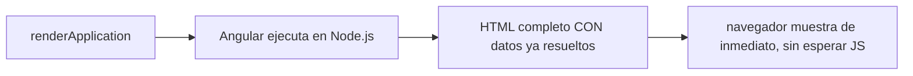
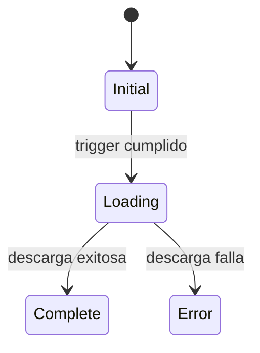
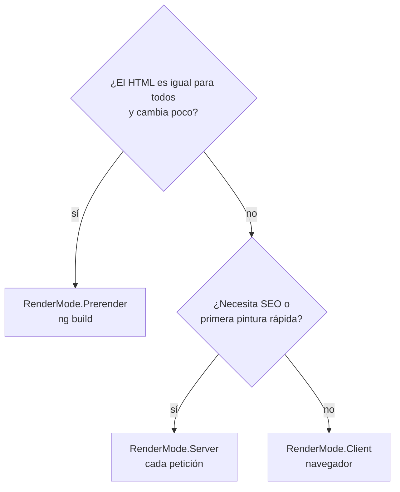
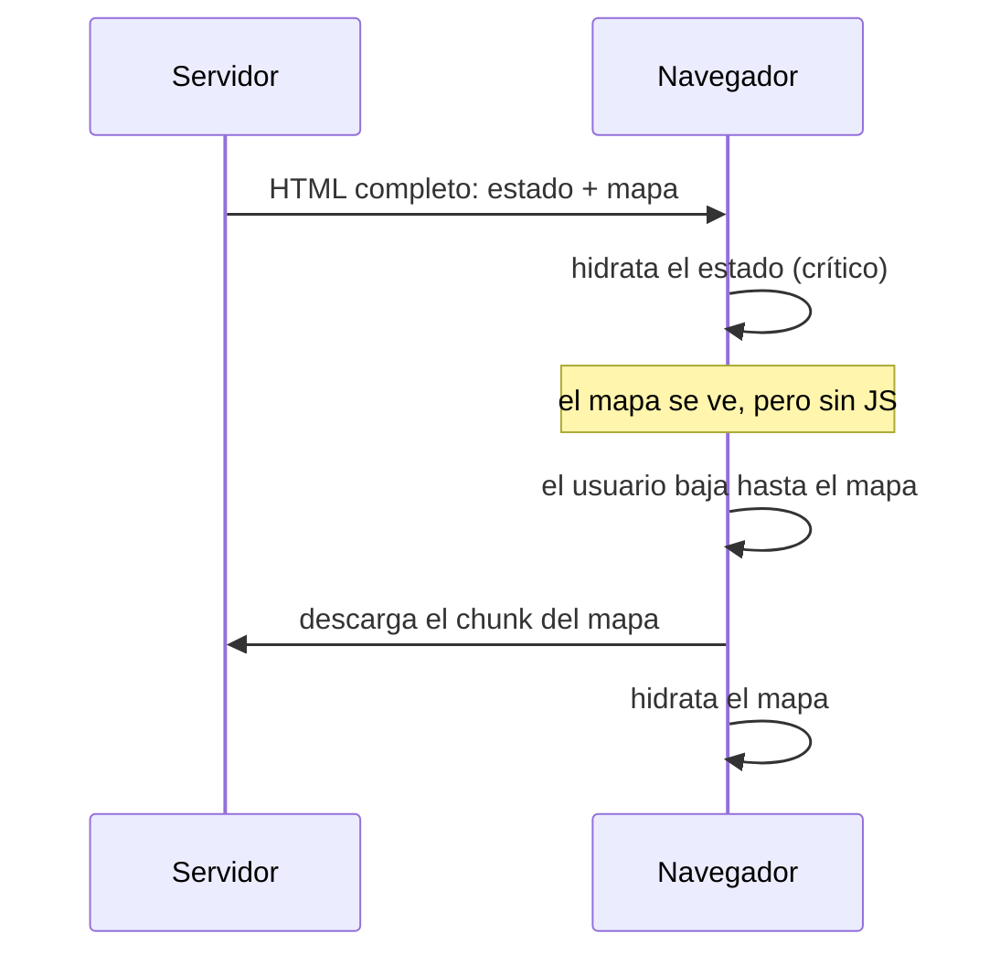

# Módulo 11: Performance, SSR y zoneless


## Aprende construyendo

Cada tema verifica su garantía con la API real correspondiente: `renderApplication` de `@angular/platform-server` para SSR real, un contraste determinista/no-determinista para hidratación, la API oficial de bloques `@defer` (estado `Error`) y `provideZonelessChangeDetection()` real para el modo sin Zone.js.


### Tema 1: Server-Side Rendering · Avanzado · 40 min

<details open>
<summary><strong>Capa 1 — Lectura</strong></summary>

#### ► DE QUÉ TRATA
Al finalizar podrás confirmar, con renderApplication real de @angular/platform-server (la misma API que usa el servidor de SSR de Angular internamente), que el HTML generado contiene el contenido de datos ya resuelto, sin depender de que ningún JavaScript se ejecute en el navegad…

#### ► LA IDEA EN UNA FRASE
**Al finalizar podrás confirmar, con renderApplication real de @angular/platform-server (la misma API que usa el servidor de SSR de Angular internamente), que el HTML generado contiene el contenido de datos ya resuelto, sin depender de que ningún JavaScript se ejecute en el navegador.**

#### ► CÓMO FUNCIONA


</details>

<details>
<summary><strong>Capa 2 — Construcción</strong></summary>

#### Código y verificación

```bash
mkdir demo-ssr
cd demo-ssr
npx -y @angular/cli@22 new . --standalone --style=css --routing=false --skip-git --defaults --ssr
mkdir -p src/app
```

```ts
// src/app/resumen-envio.component.ts
import { Component } from '@angular/core';

@Component({
  selector: 'app-resumen-envio',
  standalone: true,
  template: `<h1>Envío PED-001</h1><p>Estado: en tránsito</p>`,
})
export class ResumenEnvioComponent {}
```

```ts
// src/app/ssr-render.spec.ts
import { renderApplication } from '@angular/platform-server';
import { bootstrapApplication } from '@angular/platform-browser';
import { ResumenEnvioComponent } from './resumen-envio.component';

describe('SSR con renderApplication', () => {
  it('el HTML generado por el servidor ya contiene el contenido, sin ejecutar JS de cliente', async () => {
    const html = await renderApplication(
      // en Angular 22, en el servidor bootstrapApplication debe recibir el BootstrapContext (si no: NG0401)
      (context) => bootstrapApplication(ResumenEnvioComponent, { providers: [] }, context),
      { document: '<app-resumen-envio></app-resumen-envio>' }
    );

    expect(html).toContain('Envío PED-001');
    expect(html).toContain('en tránsito');
  });
});
```

```bash
npx ng test --watch=false
```

```ts
const html = await ____(
  (context) => bootstrapApplication(ResumenEnvioComponent, { providers: [] }, context),
  { document: '<app-resumen-envio></app-resumen-envio>' }
);
```

</details>

### Tema 2: Hidratación · Avanzado · 40 min

<details open>
<summary><strong>Capa 1 — Lectura</strong></summary>

#### ► DE QUÉ TRATA
Al finalizar podrás demostrar, contrastando contenido determinista con no determinista, exactamente por qué el contenido no determinista (como Date.now() o Math.random() sin coordinación) produce una discrepancia entre lo que el servidor renderizó y lo que el cliente renderizaría…

#### ► LA IDEA EN UNA FRASE
**Al finalizar podrás demostrar, contrastando contenido determinista con no determinista, exactamente por qué el contenido no determinista (como Date.now() o Math.random() sin coordinación) produce una discrepancia entre lo que el servidor renderizó y lo que el cliente renderizaría al hidratarse.**

</details>

<details>
<summary><strong>Capa 2 — Construcción</strong></summary>

#### Código de referencia / ejecutable
**Contexto.** Además del contenido no determinista, la otra causa frecuente de fallos de SSR e hidratación es código que usa APIs que solo existen en el navegador (`localStorage`, `window`) mientras se renderiza en el servidor.

**Hazlo tú.** Crea `src/app/preferencias.service.ts`:

```ts
import { Injectable, PLATFORM_ID, inject } from '@angular/core';
import { isPlatformBrowser } from '@angular/common';

@Injectable({ providedIn: 'root' })
export class PreferenciasService {
  private readonly platformId = inject(PLATFORM_ID);

  obtenerTemaGuardado(): string {
    if (!isPlatformBrowser(this.platformId)) {
      return 'claro'; // en el servidor no existe localStorage: valor por defecto
    }
    return localStorage.getItem('tema') ?? 'claro';
  }
}
```

Y `src/app/preferencias.service.spec.ts`, que simula el servidor sobrescribiendo `PLATFORM_ID`:

```ts
import { PLATFORM_ID } from '@angular/core';
import { TestBed } from '@angular/core/testing';
import { PreferenciasService } from './preferencias.service';

describe('PreferenciasService', () => {
  afterEach(() => {
    vi.restoreAllMocks();
    localStorage.clear();
  });

  it('en el servidor no toca localStorage y devuelve el valor por defecto', () => {
    TestBed.configureTestingModule({ providers: [{ provide: PLATFORM_ID, useValue: 'server' }] });
    const leer = vi.spyOn(Storage.prototype, 'getItem');
    localStorage.setItem('tema', 'oscuro');

    const tema = TestBed.inject(PreferenciasService).obtenerTemaGuardado();

    expect(tema).toBe('claro');
    expect(leer).not.toHaveBeenCalled();
  });

  it('en el navegador lee el tema guardado', () => {
    TestBed.configureTestingModule({ providers: [{ provide: PLATFORM_ID, useValue: 'browser' }] });
    localStorage.setItem('tema', 'oscuro');
    expect(TestBed.inject(PreferenciasService).obtenerTemaGuardado()).toBe('oscuro');
  });
});
```

```bash
npx ng test --watch=false
```

**Resultado esperado:** las dos pruebas pasan: con `PLATFORM_ID` igual a `'server'`, el servicio devuelve `'claro'` sin llamar a `localStorage.getItem`, aunque haya un tema guardado; con `'browser'`, devuelve `'oscuro'`.

**Fallo deliberado:** borra el bloque `if (!isPlatformBrowser(...)) { ... }`. **Error esperado:** `AssertionError: expected 'oscuro' to be 'claro'`. **Diagnóstico:** jsdom sí tiene `localStorage`, así que la prueba no explota; lo que detecta es que el servidor produciría un HTML distinto del que el navegador del usuario genera al hidratar (y en un servidor Node real, `localStorage` no existe y el render falla). Restaura el bloque.

**Entiende: la configuración de arranque.** `isPlatformBrowser` protege código puntual; la hidratación se activa al arrancar, en dos archivos que `ng new --ssr` de Angular 22 genera así:

```ts
// src/app/app.config.ts (cliente; el servidor lo reutiliza)
providers: [provideBrowserGlobalErrorListeners(), provideRouter(routes), provideClientHydration()]

// src/app/app.config.server.ts (solo servidor)
const serverConfig: ApplicationConfig = {
  providers: [provideServerRendering(withRoutes(serverRoutes))],
};
export const config = mergeApplicationConfig(appConfig, serverConfig);
```

`provideServerRendering()` (de `@angular/ssr`) renderiza en el servidor con las rutas de `app.routes.server.ts` (Tema 6); `provideClientHydration()` (de `@angular/platform-browser`) hace que el cliente reutilice ese HTML en vez de reconstruirlo. Si quitas `provideClientHydration()`, el cliente vuelve a renderizar todo desde cero sobre el HTML del servidor y pierdes la ventaja de la hidratación.

</details>

### Tema 3: `@defer` — estados reales, incluyendo error · Avanzado · 40 min

<details open>
<summary><strong>Capa 1 — Lectura</strong></summary>

#### ► DE QUÉ TRATA
Al finalizar podrás confirmar, con la API oficial de test de bloques @defer, el estado Error de un bloque diferido — el caso donde la carga del contenido falla — además de los triggers apropiados según el tipo de contenido.

#### ► CÓMO FUNCIONA


</details>

<details>
<summary><strong>Capa 2 — Construcción</strong></summary>

#### Código y verificación


```bash
mkdir -p src/app
```

```ts
// src/app/grafico-diferido.component.ts
import { Component } from '@angular/core';

@Component({
  selector: 'app-grafico-diferido',
  standalone: true,
  template: `
    @defer (on interaction) {
      <section data-testid="grafico">Gráfico de entregas cargado</section>
    } @placeholder {
      <button type="button">Ver gráfico</button>
    } @loading (minimum 200ms) {
      <p data-testid="cargando">Cargando…</p>
    } @error {
      <p data-testid="error-grafico" role="alert">No se pudo cargar el gráfico. Reintenta.</p>
    }
  `,
})
export class GraficoDiferidoComponent {}
```

```ts
// src/app/grafico-diferido.component.spec.ts
import { DeferBlockState, TestBed } from '@angular/core/testing';
import { GraficoDiferidoComponent } from './grafico-diferido.component';

describe('GraficoDiferidoComponent', () => {
  it('el estado Error muestra un mensaje explicito, no un placeholder congelado', async () => {
    await TestBed.configureTestingModule({ imports: [GraficoDiferidoComponent] }).compileComponents();
    const fixture = TestBed.createComponent(GraficoDiferidoComponent);
    fixture.detectChanges();

    const [bloqueDeferido] = await fixture.getDeferBlocks();

    // render(estado) exige el estado: aquí forzamos Error para probar ese camino sin una falla de red real
    await bloqueDeferido.render(DeferBlockState.Error);
    fixture.detectChanges();

    const mensajeError = fixture.nativeElement.querySelector('[data-testid="error-grafico"]');
    expect(mensajeError).not.toBeNull();
    expect(mensajeError.textContent).toContain('No se pudo cargar el gráfico');

    const grafico = fixture.nativeElement.querySelector('[data-testid="grafico"]');
    expect(grafico).toBeNull(); // el contenido real NUNCA se renderizo: la carga fallo
  });
});
```

```bash
npx ng test --watch=false
```

```ts
await bloqueDeferido.render(DeferBlockState.____);
```

</details>

### Tema 4: Zoneless · Avanzado · 40 min

<details open>
<summary><strong>Capa 1 — Lectura</strong></summary>

#### ► DE QUÉ TRATA
Al finalizar podrás confirmar, con provideZonelessChangeDetection() real configurado en TestBed, que actualizar un signal refleja el cambio en el DOM automáticamente tras await fixture.whenStable(), sin depender de Zone.js interceptando operaciones asíncronas.

#### ► LA ANALOGÍA
**Conceptos clave:** `provideZonelessChangeDetection`, precisión de signals, `fixture.whenStable()`.

Cuando el estado de una aplicación está modelado con signals, cada uno notifica exactamente qué vistas dependen de él al cambiar, mediante el sistema de suscripción fina que sustenta `computed()` y los templates reactivos. `provideZonelessChangeDetection()` habilita este modo sin Zone.js; en tests, `await fixture.whenStable()` espera a que la aplicación zoneless termine de procesar cambios pendientes, el equivalente zoneless a `detectChanges()` para escenarios donde el cambio se originó fuera del control directo del test. Zoneless pasó a ser estable a partir de Angular 20.2 y es el valor por defecto para proyectos nuevos generados con `ng new` desde Angular 21: no hace falta llamar `provideZonelessChangeDetection()` a mano en un proyecto nuevo, solo al migrar uno existente que todavía dependa de Zone.js (o, como en este tema, al configurarlo explícitamente dentro de un `TestBed` para un test aislado).

**Analogía:** Zone.js es un guardia que revisa cada habitación de un edificio tras escuchar cualquier ruido en cualquier parte, sin saber de dónde vino; el modelo zoneless con signals es un sistema de sensores específicos que notifican con precisión exacta cuál habitación cambió, sin revisar el resto del edificio.

**Diagrama:**

```
┌── Con Zone.js ─────────────────────┐  cualquier evento async → revisar TODO el árbol (impreciso)
└──────────────────────────────┘
┌── Zoneless (con signals) ──────────┐  un signal cambia → SOLO se actualizan sus vistas dependientes
└──────────────────────────────┘
```

</details>

<details>
<summary><strong>Capa 2 — Construcción</strong></summary>

#### Objetivo observable
Al finalizar podrás confirmar, con `provideZonelessChangeDetection()` real configurado en `TestBed`, que actualizar un `signal` refleja el cambio en el DOM automáticamente tras `await fixture.whenStable()`, sin depender de Zone.js interceptando operaciones asíncronas.

**Conocimiento previo:** Módulo 2 de este track (signals); Módulo 10 Tema 1 (`fixture.whenStable()`).

</details>

### Tema 5: OnPush por defecto (Angular 22): qué se revisa y cuándo usar `Eager` · Avanzado · 40 min

<details open>
<summary><strong>Capa 1 — Lectura</strong></summary>

</details>

<details>
<summary><strong>Capa 2 — Construcción</strong></summary>

#### Código de referencia / ejecutable
**1. Contexto**
Al copiar un componente de un proyecto anterior a Angular 22, encontrarás campos planos que cambian en callbacks (un `setTimeout`, una suscripción de RxJS, una librería de mapas). La mejor corrección es convertirlos en signals; mientras tanto, hay dos salidas.

**2. Hazlo tú**
Crea `src/app/onpush/legado.ts`:

```ts
import { ChangeDetectorRef, Component, inject, input, signal } from '@angular/core';

export interface Envio {
  guia: string;
  estado: string;
}

// Código heredado: un campo plano que cambia fuera de un evento del template.
@Component({
  selector: 'app-estado-legado',
  template: `<p>Legado: {{ estado }}</p>`,
})
export class EstadoLegado {
  private readonly cdr = inject(ChangeDetectorRef);
  estado = 'en ruta';

  actualizar(nuevo: string) {
    this.estado = nuevo;
    this.cdr.markForCheck(); // avisa a Angular de que esta vista cambió
  }
}

@Component({
  selector: 'app-ficha-envio',
  template: `<p>{{ envio().guia }}: {{ envio().estado }}</p>`,
})
export class FichaEnvio {
  readonly envio = input.required<Envio>();
}

@Component({
  selector: 'app-lista-fichas',
  imports: [FichaEnvio],
  template: `
    <app-ficha-envio [envio]="envio()" />
    <button (click)="mutar()">Mutar</button>
    <button (click)="reemplazar()">Reemplazar</button>
  `,
})
export class ListaFichas {
  readonly envio = signal<Envio>({ guia: 'RF-4471', estado: 'en ruta' });

  mutar() {
    this.envio().estado = 'entregado'; // ❌ mismo objeto: el input no cambia
  }

  reemplazar() {
    this.envio.update((e) => ({ ...e, estado: 'entregado' })); // ✅ objeto nuevo
  }
}
```

Agrega al `describe` de `estado-conductor.spec.ts` (importa `EstadoLegado` y `ListaFichas` desde `./legado`):

```ts
  it('markForCheck repinta un componente heredado', async () => {
    const fixture = TestBed.createComponent(EstadoLegado);
    await fixture.whenStable();
    fixture.componentInstance.actualizar('entregado');
    await fixture.whenStable();
    expect(fixture.nativeElement.textContent).toContain('Legado: entregado');
  });
```

**Resultado esperado:** la prueba pasa: `markForCheck()` marca la vista y, en una app zoneless, además programa la pasada de detección.

**Fallo deliberado:** comenta la línea `this.cdr.markForCheck();`. **Error esperado:** `expected 'Legado: en ruta' to contain 'Legado: entregado'`. **Diagnóstico:** sin marca, `OnPush` salta el componente; y en zoneless ni siquiera hay pasada, así que tampoco `Eager` bastaría aquí: nada le avisó a Angular. Restaura la línea.

**3. Entiende**
Orden de preferencia: (1) convierte el estado en `signal` (corrige la causa); (2) si no puedes todavía, llama a `markForCheck()` justo después de cambiar el campo; (3) `changeDetection: ChangeDetectionStrategy.Eager` como solución temporal para un componente que depende de que lo revisen en cada pasada (por ejemplo, porque lo actualiza un padre que sí tiene pasadas). **Límite:** `Eager` hace que el componente y su subárbol se revisen siempre; úsalo por componente, con un comentario que explique por qué, y no como valor general.

**4. Cierra**
Busca en tu proyecto campos planos que cambian fuera del template y clasifícalos: signal, `markForCheck()` o `Eager`.

</details>

### Tema 6: Modos de render por ruta: SSR, prerender (SSG) y CSR con app.routes.server.ts · Avanzado · 45 min

<details open>
<summary><strong>Capa 1 — Lectura</strong></summary>

#### ► DE QUÉ TRATA
Usa Angular 19 o superior con SSR: ng new academia-ssr --ssr o ng add @angular/ssr en un proyecto existente. Trabajarás en src/app/app.routes.server.ts.

#### ► CÓMO FUNCIONA


</details>

<details>
<summary><strong>Capa 2 — Construcción</strong></summary>

#### Código y verificación


```ts
import { RenderMode, ServerRoute } from '@angular/ssr';

export const serverRoutes: ServerRoute[] = [
  { path: '', renderMode: RenderMode.Prerender },
  { path: 'ayuda', renderMode: RenderMode.Prerender },
  {
    path: 'ciudades/:slug',
    renderMode: RenderMode.Prerender,
    // Una página HTML por ciudad, generada en ng build.
    async getPrerenderParams() {
      return [{ slug: 'bogota' }, { slug: 'medellin' }, { slug: 'cali' }];
    },
  },
  { path: 'seguimiento/:codigo', renderMode: RenderMode.Server },
  { path: 'panel/**', renderMode: RenderMode.Client },
  { path: '**', renderMode: RenderMode.Server },
];
```

```ts
import { mergeApplicationConfig, ApplicationConfig } from '@angular/core';
import { provideServerRendering, withRoutes } from '@angular/ssr';
import { appConfig } from './app.config';
import { serverRoutes } from './app.routes.server';

const serverConfig: ApplicationConfig = {
  providers: [provideServerRendering(withRoutes(serverRoutes))],
};

export const config = mergeApplicationConfig(appConfig, serverConfig);
```

```bash
ng build
ls dist/academia-ssr/browser/ciudades
# bogota  cali  medellin   <- cada carpeta tiene su index.html prerenderizado
npm run serve:ssr:academia-ssr
```

```text
ng build termina con una línea «Prerendered N static routes» y crea dist/academia-ssr/browser/ciudades/bogota/index.html, medellin/index.html y cali/index.html.
Al pedir /seguimiento/ENV-42 con el servidor SSR, el HTML de la respuesta ya trae el contenido de la página.
```

</details>

### Tema 7: Hidratación incremental: @defer con hydrate on para despertar solo lo que se usa · Avanzado · 40 min

<details open>
<summary><strong>Capa 1 — Lectura</strong></summary>

#### ► DE QUÉ TRATA
Usa Angular 22 con SSR activo (npx -y @angular/cli@22 new academia-ssr --ssr --defaults --skip-git). Desde Angular 22, la hidratación incremental viene activada por defecto: withIncrementalHydration() está marcado @deprecated («Since v22.0.0, incremental hydration is enabled by d…

#### ► LA ANALOGÍA
**Conceptos clave:** hidratación, hidratación incremental (por defecto en Angular 22), `withNoIncrementalHydration`, `@defer (hydrate on ...)`, `hydrate when`, `hydrate never`, repetición de eventos.

Con SSR, el navegador recibe el HTML ya pintado. **Hidratar** es conectar ese HTML con el JavaScript de Angular para que responda a clics.

Con la hidratación incremental activa (el valor por defecto de `provideClientHydration()` en Angular 22), un bloque `@defer` con disparador `hydrate` se **renderiza en el servidor** (el usuario lo ve) pero su JavaScript se descarga e hidrata solo cuando se cumple el disparador:

| Disparador | Hidrata cuando… |
|---|---|
| `hydrate on viewport` | el bloque entra en pantalla |
| `hydrate on interaction` | el usuario toca o hace clic en el bloque |
| `hydrate on idle` | el navegador está libre |
| `hydrate when condicion` | una expresión se vuelve verdadera |
| `hydrate never` | nunca: queda como HTML estático |

Si el usuario hace clic antes de que el bloque esté hidratado, Angular **guarda el evento y lo repite** al terminar (la repetición de eventos se activa sola con la hidratación incremental).

**Analogía:** la página llega como una casa amoblada con las luces apagadas; la hidratación incremental enciende cada cuarto cuando alguien entra. La analogía falla en que el cuarto ya es visible antes de encender la luz: el HTML del servidor siempre se ve.

**Límite de uso:** no sirve sin SSR: en una app solo de cliente no hay HTML que hidratar. `hydrate never` deja el bloque sin interacción para siempre; úsalo solo en contenido realmente estático.



#### ► CÓMO FUNCIONA


</details>

<details>
<summary><strong>Capa 2 — Construcción</strong></summary>

#### Objetivo observable
Usa Angular 22 con SSR activo (`npx -y @angular/cli@22 new academia-ssr --ssr --defaults --skip-git`). Desde Angular 22, la hidratación incremental viene activada por defecto: `withIncrementalHydration()` está marcado `@deprecated` («Since v22.0.0, incremental hydration is enabled by default with `provideClientHydration`») y se desactiva con `withNoIncrementalHydration()`. Trabajarás en `src/app/app.config.ts` y en la plantilla de la página de seguimiento.

</details>
