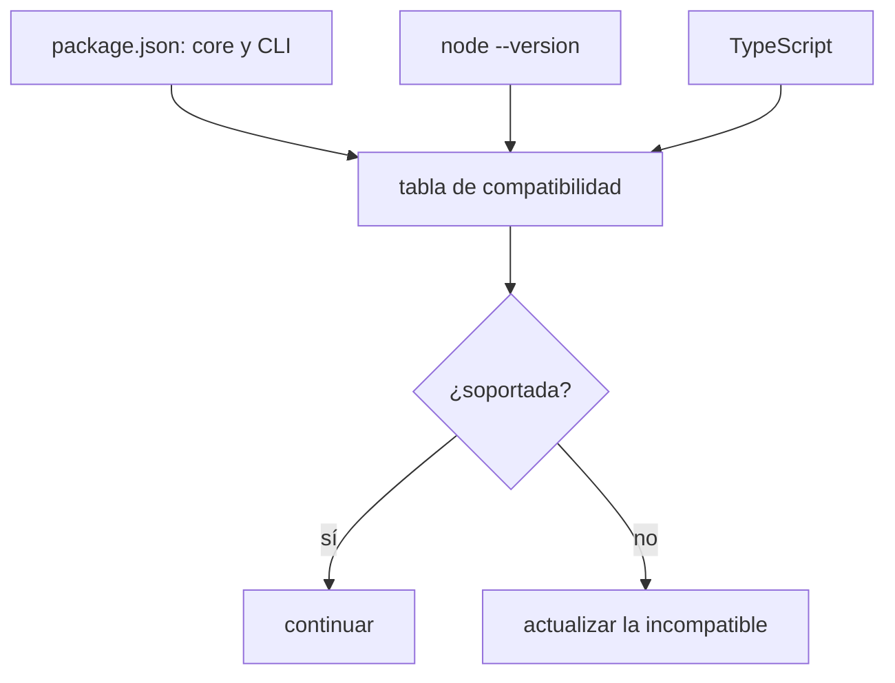
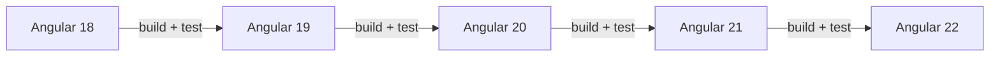

# Módulo 12: Versiones, compatibilidad y migraciones de Angular

Este capítulo enseña a reconocer la época de un proyecto, comprobar compatibilidad y migrar con evidencia. A julio de 2026, Angular 22 está en soporte activo; Angular 21 y 20 permanecen en LTS. No memorices este dato: aprende a comprobarlo en la tabla oficial antes de iniciar una migración.

## Aprende construyendo


### Tema 1: Reconocer la versión y la arquitectura de un proyecto · Avanzado · 40 min

<details open>
<summary><strong>Capa 1 — Lectura</strong></summary>

#### ► DE QUÉ TRATA
Al finalizar podrás identificar la versión real de Angular, Node.js y TypeScript de un proyecto, y distinguir código heredado de una práctica vigente.

#### ► CÓMO FUNCIONA


</details>

<details>
<summary><strong>Capa 2 — Construcción</strong></summary>

#### Código y verificación

```bash
mkdir ejemplo-version-angular
cd ejemplo-version-angular
npm init -y
npm install --save-dev @angular/cli@22
npx ng version
```

```javascript
// La función clasifica la línea mayor; no intenta adivinar compatibilidad.
export function estadoAngular(mayor) {
  if (mayor === 22) return 'activo en julio de 2026';
  if (mayor === 21 || mayor === 20) return 'LTS en julio de 2026';
  return 'consultar tabla oficial: el estado cambia con el tiempo';
}

console.log(estadoAngular(22));
```

```bash
node clasificar-version.mjs
```

</details>

### Tema 2: Leer la guía de actualización antes de modificar archivos · Avanzado · 40 min

<details open>
<summary><strong>Capa 1 — Lectura</strong></summary>

#### ► DE QUÉ TRATA
Al finalizar podrás producir un inventario de migración, ejecutar una simulación y distinguir cambios automáticos de decisiones manuales.

</details>

<details>
<summary><strong>Capa 2 — Construcción</strong></summary>

#### Código y verificación
```bash
npx @angular/cli@21 new ejemplo-update --standalone --routing --style=scss --skip-git
cd ejemplo-update
npx ng build
git init
git add .
git commit -m "linea base Angular 21"
npx ng update @angular/core@22 @angular/cli@22 --dry-run
```

</details>

### Tema 3: Migrar una versión mayor a la vez y verificar cada salto · Avanzado · 40 min

<details open>
<summary><strong>Capa 1 — Lectura</strong></summary>

#### ► DE QUÉ TRATA
Al finalizar podrás dividir una migración grande en saltos consecutivos, verificar cada frontera y revertir un salto sin perder trabajo.

#### ► CÓMO FUNCIONA


</details>

<details>
<summary><strong>Capa 2 — Construcción</strong></summary>

#### Código y verificación


```bash
mkdir plan-migracion
cd plan-migracion
npm init -y
mkdir src
```

```javascript
// Devuelve cada salto consecutivo para poder validarlo por separado.
export function crearPlan(origen, destino) {
  if (!Number.isInteger(origen) || !Number.isInteger(destino) || destino <= origen) {
    throw new Error('El destino debe ser una versión mayor entera');
  }
  return Array.from({ length: destino - origen }, (_, i) => [origen + i, origen + i + 1]);
}

console.log(crearPlan(18, 22).map(([a, b]) => `${a}→${b}`).join(', '));
```

```bash
node src/plan.mjs
```

</details>
