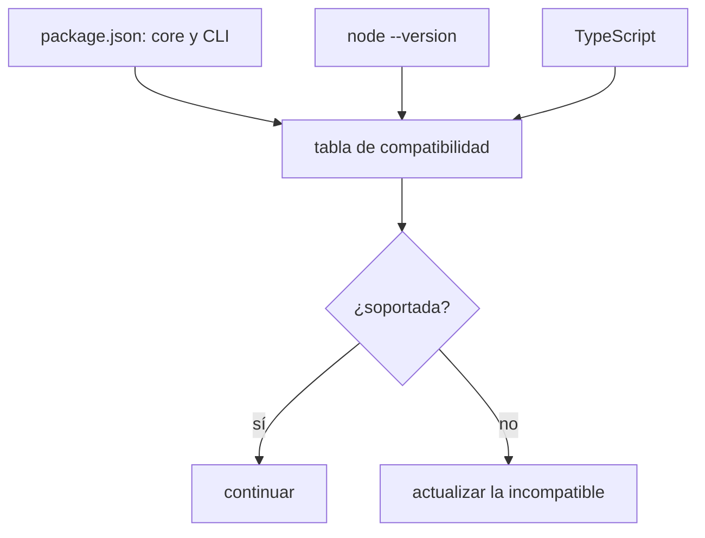
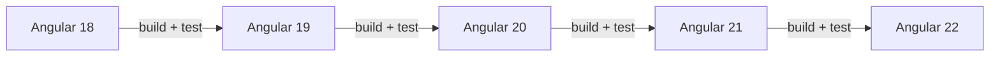

# Módulo 12: Versiones, compatibilidad y migraciones de Angular

Este capítulo enseña a reconocer la época de un proyecto, comprobar compatibilidad y migrar con evidencia. A julio de 2026, Angular 22 está en soporte activo; Angular 21 y 20 permanecen en LTS. No memorices este dato: aprende a comprobarlo en la tabla oficial antes de iniciar una migración.

## Aprende construyendo


### Tema 1: Reconocer la versión y la arquitectura de un proyecto · Avanzado · 40 min

<details open>
<summary><strong>Capa 1 — Lectura</strong></summary>

#### ► DE QUÉ TRATA
Al finalizar podrás identificar la versión real de Angular, Node.js y TypeScript de un proyecto, y distinguir código heredado de una práctica vigente.

#### ► LA IDEA EN UNA FRASE
**Al finalizar podrás identificar la versión real de Angular, Node.js y TypeScript de un proyecto, y distinguir código heredado de una práctica vigente.**

#### ► POR QUÉ EXISTE ESTO
Resuelve un problema real de diseño o implementación y evita decisiones a ciegas.

#### ► LA ANALOGÍA
Piensa en reconocer la versión y la arquitectura de un proyecto como una herramienta de taller: útil cuando conoces su propósito y sus límites.
**Dónde se rompe la analogía:** en software, los efectos dependen del contexto, la escala y los trade-offs.

#### ► CÓMO FUNCIONA


#### ► LO QUE PUEDE SALIR MAL
| Síntoma | Causa probable | Arreglo |
|---|---|---|
| Reconocer la versión y la arquitectura de un proyecto se aplica pero el resultado no mejora | Se usó sin medir el problema real | Mide antes y compara contra la alternativa simple |
| Aparece complejidad inesperada | Se adoptó la técnica sin comprender sus trade-offs | Vuelve a la sección de trade-offs y reduce el alcance |
| Falla en un caso límite | Se asumió un contexto que no se cumple | Prueba el caso límite y documenta cuándo NO usarlo |

#### ► TRADE-OFFS
| Opción | Cuándo usarla | Cuándo NO usarla |
|---|---|---|
| Usar Reconocer la versión y la arquitectura de un proyecto | Cuando el problema coincide con su propósito y el beneficio es observable | Cuando agrega complejidad sin resolver un problema real |
| Alternativa más simple | Cuando el contexto es pequeño, estable o fácil de razonar | Cuando ya demostró no escalar o no cumplir el requisito |
| Postergar la decisión | Cuando falta evidencia del problema | Cuando el costo de esperar es mayor que el costo de probar |

#### ► CUÁNDO NO USAR ESTO
No uses reconocer la versión y la arquitectura de un proyecto por defecto. Aplícalo cuando el problema lo justifique y puedas verificar el beneficio; si una alternativa más simple resuelve igual, prefiérela.

#### ► DE VUELTA A LA ANALOGÍA
Volviendo a la analogía: reconocer la versión y la arquitectura de un proyecto funciona como el modelo inicial, pero recuerda dónde se rompe: en producción importan la evidencia, la escala y el costo de equivocarte.

#### ► LO QUE DEBES RECORDAR
- Reconocer la versión y la arquitectura de un proyecto existe para resolver un problema específico.
- Mide antes de adoptar complejidad.
- Conoce el caso donde NO usarlo.
- Verifica con evidencia observable.

#### ► PREGUNTAS PARA PENSAR
1. ¿Qué problema concreto resuelve reconocer la versión y la arquitectura de un proyecto en tu contexto?
2. ¿Cómo sabrías que reconocer la versión y la arquitectura de un proyecto no está funcionando bien?
3. ¿Qué alternativa más simple considerarías antes de usar reconocer la versión y la arquitectura de un proyecto?

</details>

<details>
<summary><strong>Capa 2 — Construcción</strong></summary>

#### Código y verificación


```bash
mkdir ejemplo-version-angular
cd ejemplo-version-angular
npm init -y
npm install --save-dev @angular/cli@22
npx ng version
```

```javascript
// La función clasifica la línea mayor; no intenta adivinar compatibilidad.
export function estadoAngular(mayor) {
  if (mayor === 22) return 'activo en julio de 2026';
  if (mayor === 21 || mayor === 20) return 'LTS en julio de 2026';
  return 'consultar tabla oficial: el estado cambia con el tiempo';
}

console.log(estadoAngular(22));
```

```bash
node clasificar-version.mjs
```

</details>

### Tema 2: Leer la guía de actualización antes de modificar archivos · Avanzado · 40 min

<details open>
<summary><strong>Capa 1 — Lectura</strong></summary>

#### ► DE QUÉ TRATA
Al finalizar podrás producir un inventario de migración, ejecutar una simulación y distinguir cambios automáticos de decisiones manuales.

#### ► LA IDEA EN UNA FRASE
**Al finalizar podrás producir un inventario de migración, ejecutar una simulación y distinguir cambios automáticos de decisiones manuales.**

#### ► POR QUÉ EXISTE ESTO
Resuelve un problema real de diseño o implementación y evita decisiones a ciegas.

#### ► LA ANALOGÍA
Piensa en leer la guía de actualización antes de modificar archivos como una herramienta de taller: útil cuando conoces su propósito y sus límites.
**Dónde se rompe la analogía:** en software, los efectos dependen del contexto, la escala y los trade-offs.

#### ► CÓMO FUNCIONA
1. Identifica el problema que leer la guía de actualización antes de modificar archivos resuelve.
2. Observa sus componentes y relaciones.
3. Aplica la opción más simple que funcione.
4. Verifica el resultado y los límites.

#### ► LO QUE PUEDE SALIR MAL
| Síntoma | Causa probable | Arreglo |
|---|---|---|
| Leer la guía de actualización antes de modificar archivos se aplica pero el resultado no mejora | Se usó sin medir el problema real | Mide antes y compara contra la alternativa simple |
| Aparece complejidad inesperada | Se adoptó la técnica sin comprender sus trade-offs | Vuelve a la sección de trade-offs y reduce el alcance |
| Falla en un caso límite | Se asumió un contexto que no se cumple | Prueba el caso límite y documenta cuándo NO usarlo |

#### ► TRADE-OFFS
| Opción | Cuándo usarla | Cuándo NO usarla |
|---|---|---|
| Usar Leer la guía de actualización antes de modificar archivos | Cuando el problema coincide con su propósito y el beneficio es observable | Cuando agrega complejidad sin resolver un problema real |
| Alternativa más simple | Cuando el contexto es pequeño, estable o fácil de razonar | Cuando ya demostró no escalar o no cumplir el requisito |
| Postergar la decisión | Cuando falta evidencia del problema | Cuando el costo de esperar es mayor que el costo de probar |

#### ► CUÁNDO NO USAR ESTO
No uses leer la guía de actualización antes de modificar archivos por defecto. Aplícalo cuando el problema lo justifique y puedas verificar el beneficio; si una alternativa más simple resuelve igual, prefiérela.

#### ► DE VUELTA A LA ANALOGÍA
Volviendo a la analogía: leer la guía de actualización antes de modificar archivos funciona como el modelo inicial, pero recuerda dónde se rompe: en producción importan la evidencia, la escala y el costo de equivocarte.

#### ► LO QUE DEBES RECORDAR
- Leer la guía de actualización antes de modificar archivos existe para resolver un problema específico.
- Mide antes de adoptar complejidad.
- Conoce el caso donde NO usarlo.
- Verifica con evidencia observable.

#### ► PREGUNTAS PARA PENSAR
1. ¿Qué problema concreto resuelve leer la guía de actualización antes de modificar archivos en tu contexto?
2. ¿Cómo sabrías que leer la guía de actualización antes de modificar archivos no está funcionando bien?
3. ¿Qué alternativa más simple considerarías antes de usar leer la guía de actualización antes de modificar archivos?

</details>

<details>
<summary><strong>Capa 2 — Construcción</strong></summary>

#### Código y verificación
```bash
npx @angular/cli@21 new ejemplo-update --standalone --routing --style=scss --skip-git
cd ejemplo-update
npx ng build
git init
git add .
git commit -m "linea base Angular 21"
npx ng update @angular/core@22 @angular/cli@22 --dry-run
```

</details>

### Tema 3: Migrar una versión mayor a la vez y verificar cada salto · Avanzado · 40 min

<details open>
<summary><strong>Capa 1 — Lectura</strong></summary>

#### ► DE QUÉ TRATA
Al finalizar podrás dividir una migración grande en saltos consecutivos, verificar cada frontera y revertir un salto sin perder trabajo.

#### ► LA IDEA EN UNA FRASE
**Al finalizar podrás dividir una migración grande en saltos consecutivos, verificar cada frontera y revertir un salto sin perder trabajo.**

#### ► POR QUÉ EXISTE ESTO
Resuelve un problema real de diseño o implementación y evita decisiones a ciegas.

#### ► LA ANALOGÍA
Piensa en migrar una versión mayor a la vez y verificar cada salto como una herramienta de taller: útil cuando conoces su propósito y sus límites.
**Dónde se rompe la analogía:** en software, los efectos dependen del contexto, la escala y los trade-offs.

#### ► CÓMO FUNCIONA


#### ► LO QUE PUEDE SALIR MAL
| Síntoma | Causa probable | Arreglo |
|---|---|---|
| Migrar una versión mayor a la vez y verificar cada salto se aplica pero el resultado no mejora | Se usó sin medir el problema real | Mide antes y compara contra la alternativa simple |
| Aparece complejidad inesperada | Se adoptó la técnica sin comprender sus trade-offs | Vuelve a la sección de trade-offs y reduce el alcance |
| Falla en un caso límite | Se asumió un contexto que no se cumple | Prueba el caso límite y documenta cuándo NO usarlo |

#### ► TRADE-OFFS
| Opción | Cuándo usarla | Cuándo NO usarla |
|---|---|---|
| Usar Migrar una versión mayor a la vez y verificar cada salto | Cuando el problema coincide con su propósito y el beneficio es observable | Cuando agrega complejidad sin resolver un problema real |
| Alternativa más simple | Cuando el contexto es pequeño, estable o fácil de razonar | Cuando ya demostró no escalar o no cumplir el requisito |
| Postergar la decisión | Cuando falta evidencia del problema | Cuando el costo de esperar es mayor que el costo de probar |

#### ► CUÁNDO NO USAR ESTO
No uses migrar una versión mayor a la vez y verificar cada salto por defecto. Aplícalo cuando el problema lo justifique y puedas verificar el beneficio; si una alternativa más simple resuelve igual, prefiérela.

#### ► DE VUELTA A LA ANALOGÍA
Volviendo a la analogía: migrar una versión mayor a la vez y verificar cada salto funciona como el modelo inicial, pero recuerda dónde se rompe: en producción importan la evidencia, la escala y el costo de equivocarte.

#### ► LO QUE DEBES RECORDAR
- Migrar una versión mayor a la vez y verificar cada salto existe para resolver un problema específico.
- Mide antes de adoptar complejidad.
- Conoce el caso donde NO usarlo.
- Verifica con evidencia observable.

#### ► PREGUNTAS PARA PENSAR
1. ¿Qué problema concreto resuelve migrar una versión mayor a la vez y verificar cada salto en tu contexto?
2. ¿Cómo sabrías que migrar una versión mayor a la vez y verificar cada salto no está funcionando bien?
3. ¿Qué alternativa más simple considerarías antes de usar migrar una versión mayor a la vez y verificar cada salto?

</details>

<details>
<summary><strong>Capa 2 — Construcción</strong></summary>

#### Código y verificación


```bash
mkdir plan-migracion
cd plan-migracion
npm init -y
mkdir src
```

```javascript
// Devuelve cada salto consecutivo para poder validarlo por separado.
export function crearPlan(origen, destino) {
  if (!Number.isInteger(origen) || !Number.isInteger(destino) || destino <= origen) {
    throw new Error('El destino debe ser una versión mayor entera');
  }
  return Array.from({ length: destino - origen }, (_, i) => [origen + i, origen + i + 1]);
}

console.log(crearPlan(18, 22).map(([a, b]) => `${a}→${b}`).join(', '));
```

```bash
node src/plan.mjs
```

</details>
