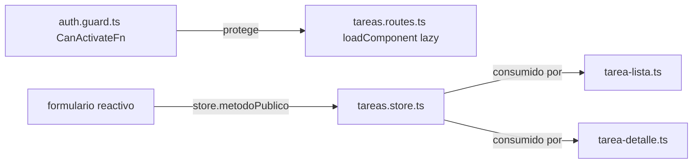

# Módulo 13: Proyecto integrador — aplicación standalone completa


## Aprende construyendo

Cada tema verifica su garantía con pruebas de integración reales: `RouterTestingHarness` oficial de Angular navegando rutas realmente protegidas, la identidad singleton real de un store inyectado en dos componentes distintos, y `HttpTestingController` real interceptando la petición HTTP genuina de `TareasStore`.


### Tema 1: Estructura del proyecto integrador · Avanzado · 45 min

<details open>
<summary><strong>Capa 1 — Lectura</strong></summary>

#### ► DE QUÉ TRATA
Al finalizar podrás confirmar, con RouterTestingHarness (la utilidad oficial de test de router de Angular) navegando realmente entre rutas, que la separación tareas/ / auth/ funciona como puntos de integración explícitos: el guard de auth/ bloquea o permite el acceso a las rutas…

#### ► LA IDEA EN UNA FRASE
**Al finalizar podrás confirmar, con RouterTestingHarness (la utilidad oficial de test de router de Angular) navegando realmente entre rutas, que la separación tareas/ / auth/ funciona como puntos de integración explícitos: el guard de auth/ bloquea o permite el acceso a las rutas de tareas/ según el estado real de sesión.**

#### ► POR QUÉ EXISTE ESTO
Resuelve un problema real de diseño o implementación y evita decisiones a ciegas.

#### ► LA ANALOGÍA
**Conceptos clave:** organización por feature, separación entre `tareas/` y `auth/`, `RouterTestingHarness`.

Siguiendo el principio de organización por feature estudiado en el Módulo 8, el proyecto integrador se estructura en dos features principales claramente separadas: `tareas/`, que agrupa todo lo relacionado con la gestión de tareas (`tarea-lista.ts` para listar, `tarea-detalle.ts` para ver/editar una tarea individual, `tareas.store.ts` como store centralizado de estado, y `tareas.routes.ts` con las rutas específicas de esta feature), y `auth/`, que agrupa todo lo relacionado con autenticación (`auth.guard.ts` como guard funcional de protección de rutas, `auth.interceptor.ts` como interceptor de autenticación HTTP, y `auth.service.ts` como servicio de estado de sesión).

`app.routes.ts` y `app.config.ts` permanecen en la raíz de `src/app/`, actuando como el punto de composición donde se ensamblan las rutas y providers de cada feature individual (mediante `loadChildren` o composición directa de arreglos de rutas, Módulo 4), sin que la raíz de la aplicación necesite conocer los detalles internos de implementación de cada feature, solo su punto de integración público (las rutas que expone, los providers globales que requiere).

Esta separación clara entre `tareas/` y `auth/` refleja además una separación de responsabilidades a nivel de dominio: `auth/` se preocupa exclusivamente por quién es el usuario actual y si tiene permiso para acceder a ciertas rutas, mientras que `tareas/` se preocupa exclusivamente por la lógica de negocio de gestión de tareas en sí, comunicándose entre sí solo a través de puntos de integración explícitos (el guard consultando el estado de autenticación, el interceptor agregando el token a las peticiones de tareas), sin que la lógica de tareas necesite conocer los detalles internos de cómo funciona la autenticación.

**Analogía:** la estructura del proyecto integrador es como un edificio con departamentos claramente delimitados (tareas, autenticación), cada uno con su propia responsabilidad interna bien definida, comunicándose entre sí únicamente a través de puertas y protocolos explícitos (el guard, el interceptor), sin que un departamento necesite conocer el funcionamiento interno completo del otro.

**Diagrama:**

```
┌── src/app/tareas/ ──────────────────┐   ┌── src/app/auth/ ─────────────────┐
│  tarea-lista.ts                     │   │  auth.guard.ts                   │
│  tarea-detalle.ts                   │   │  auth.interceptor.ts             │
│  tareas.store.ts  (signals+computed)│   │  auth.service.ts                 │
│  tareas.routes.ts                   │   └───────────────────────────────────┘
└──────────────────────────────────────┘
┌── src/app/ (raiz) ───────────────────┐
│  app.routes.ts   (compone ambas)     │
│  app.config.ts                       │
└───────────────────────────────────────┘
```

**Dónde se rompe la analogía:** el modelo simplifica la realidad; en producción influyen escala, fallos, costo y contexto.

#### ► CÓMO FUNCIONA
1. Identifica el problema que estructura del proyecto integrador resuelve.
2. Observa sus componentes y relaciones.
3. Aplica la opción más simple que funcione.
4. Verifica el resultado y los límites.

#### ► LO QUE PUEDE SALIR MAL
| Síntoma | Causa probable | Arreglo |
|---|---|---|
| Estructura del proyecto integrador se aplica pero el resultado no mejora | Se usó sin medir el problema real | Mide antes y compara contra la alternativa simple |
| Aparece complejidad inesperada | Se adoptó la técnica sin comprender sus trade-offs | Vuelve a la sección de trade-offs y reduce el alcance |
| Falla en un caso límite | Se asumió un contexto que no se cumple | Prueba el caso límite y documenta cuándo NO usarlo |

#### ► TRADE-OFFS
| Opción | Cuándo usarla | Cuándo NO usarla |
|---|---|---|
| Usar Estructura del proyecto integrador | Cuando el problema coincide con su propósito y el beneficio es observable | Cuando agrega complejidad sin resolver un problema real |
| Alternativa más simple | Cuando el contexto es pequeño, estable o fácil de razonar | Cuando ya demostró no escalar o no cumplir el requisito |
| Postergar la decisión | Cuando falta evidencia del problema | Cuando el costo de esperar es mayor que el costo de probar |

#### ► CUÁNDO NO USAR ESTO
No uses estructura del proyecto integrador por defecto. Aplícalo cuando el problema lo justifique y puedas verificar el beneficio; si una alternativa más simple resuelve igual, prefiérela.

#### ► DE VUELTA A LA ANALOGÍA
Volviendo a la analogía: estructura del proyecto integrador funciona como el modelo inicial, pero recuerda dónde se rompe: en producción importan la evidencia, la escala y el costo de equivocarte.

#### ► LO QUE DEBES RECORDAR
- Estructura del proyecto integrador existe para resolver un problema específico.
- Mide antes de adoptar complejidad.
- Conoce el caso donde NO usarlo.
- Verifica con evidencia observable.

#### ► PREGUNTAS PARA PENSAR
1. ¿Qué problema concreto resuelve estructura del proyecto integrador en tu contexto?
2. ¿Cómo sabrías que estructura del proyecto integrador no está funcionando bien?
3. ¿Qué alternativa más simple considerarías antes de usar estructura del proyecto integrador?

</details>

<details>
<summary><strong>Capa 2 — Construcción</strong></summary>

#### Objetivo observable
Al finalizar podrás confirmar, con `RouterTestingHarness` (la utilidad oficial de test de router de Angular) navegando realmente entre rutas, que la separación `tareas/` / `auth/` funciona como puntos de integración explícitos: el guard de `auth/` bloquea o permite el acceso a las rutas de `tareas/` según el estado real de sesión.

**Conocimiento previo:** Módulo 4 de este track (routing y guards); Módulo 8 (organización por feature).

</details>

### Tema 2: Integrando routing, store y formularios · Avanzado · 45 min

<details open>
<summary><strong>Capa 1 — Lectura</strong></summary>

#### ► DE QUÉ TRATA
Al finalizar podrás confirmar, inyectando TareasStore desde dos componentes distintos dentro del mismo TestBed, que Angular entrega la MISMA instancia singleton a ambos (gracias a providedIn: 'root'), garantizando que ambos vean siempre el mismo estado consistente sin sincronizac…

#### ► LA IDEA EN UNA FRASE
**Al finalizar podrás confirmar, inyectando TareasStore desde dos componentes distintos dentro del mismo TestBed, que Angular entrega la MISMA instancia singleton a ambos (gracias a providedIn: 'root'), garantizando que ambos vean siempre el mismo estado consistente sin sincronización manual.**

#### ► POR QUÉ EXISTE ESTO
Resuelve un problema real de diseño o implementación y evita decisiones a ciegas.

#### ► LA ANALOGÍA
Piensa en integrando routing, store y formularios como una herramienta de taller: útil cuando conoces su propósito y sus límites.
**Dónde se rompe la analogía:** en software, los efectos dependen del contexto, la escala y los trade-offs.

#### ► CÓMO FUNCIONA


#### ► LO QUE PUEDE SALIR MAL
| Síntoma | Causa probable | Arreglo |
|---|---|---|
| Integrando routing, store y formularios se aplica pero el resultado no mejora | Se usó sin medir el problema real | Mide antes y compara contra la alternativa simple |
| Aparece complejidad inesperada | Se adoptó la técnica sin comprender sus trade-offs | Vuelve a la sección de trade-offs y reduce el alcance |
| Falla en un caso límite | Se asumió un contexto que no se cumple | Prueba el caso límite y documenta cuándo NO usarlo |

#### ► TRADE-OFFS
| Opción | Cuándo usarla | Cuándo NO usarla |
|---|---|---|
| Usar Integrando routing, store y formularios | Cuando el problema coincide con su propósito y el beneficio es observable | Cuando agrega complejidad sin resolver un problema real |
| Alternativa más simple | Cuando el contexto es pequeño, estable o fácil de razonar | Cuando ya demostró no escalar o no cumplir el requisito |
| Postergar la decisión | Cuando falta evidencia del problema | Cuando el costo de esperar es mayor que el costo de probar |

#### ► CUÁNDO NO USAR ESTO
No uses integrando routing, store y formularios por defecto. Aplícalo cuando el problema lo justifique y puedas verificar el beneficio; si una alternativa más simple resuelve igual, prefiérela.

#### ► DE VUELTA A LA ANALOGÍA
Volviendo a la analogía: integrando routing, store y formularios funciona como el modelo inicial, pero recuerda dónde se rompe: en producción importan la evidencia, la escala y el costo de equivocarte.

#### ► LO QUE DEBES RECORDAR
- Integrando routing, store y formularios existe para resolver un problema específico.
- Mide antes de adoptar complejidad.
- Conoce el caso donde NO usarlo.
- Verifica con evidencia observable.

#### ► PREGUNTAS PARA PENSAR
1. ¿Qué problema concreto resuelve integrando routing, store y formularios en tu contexto?
2. ¿Cómo sabrías que integrando routing, store y formularios no está funcionando bien?
3. ¿Qué alternativa más simple considerarías antes de usar integrando routing, store y formularios?

</details>

<details>
<summary><strong>Capa 2 — Construcción</strong></summary>

#### Código y verificación


```bash
mkdir -p src/app/tareas
```

```ts
// src/app/tareas/tareas.store.ts
import { Injectable, signal } from '@angular/core';

export interface Tarea { id: number; titulo: string; completada: boolean; }

@Injectable({ providedIn: 'root' })
export class TareasStore {
  private tareas = signal<Tarea[]>([]);
  todas = this.tareas.asReadonly();

  agregar(titulo: string) {
    this.tareas.update((actuales) => [...actuales, { id: actuales.length + 1, titulo, completada: false }]);
  }
}
```

```ts
// src/app/tareas/tareas-store-compartido.spec.ts
import { TestBed } from '@angular/core/testing';
import { Component, inject } from '@angular/core';
import { TareasStore } from './tareas.store';

@Component({ selector: 'app-lista', standalone: true, template: `` })
class ListaComponent {
  store = inject(TareasStore);
}

@Component({ selector: 'app-detalle', standalone: true, template: `` })
class DetalleComponent {
  store = inject(TareasStore);
}

describe('TareasStore como singleton compartido', () => {
  it('dos componentes distintos reciben la MISMA instancia del store', () => {
    TestBed.configureTestingModule({ imports: [ListaComponent, DetalleComponent] });

    const fixtureLista = TestBed.createComponent(ListaComponent);
    const fixtureDetalle = TestBed.createComponent(DetalleComponent);

    expect(fixtureLista.componentInstance.store).toBe(fixtureDetalle.componentInstance.store);
  });

  it('una actualizacion desde un componente se refleja en el otro sin sincronizacion manual', () => {
    TestBed.configureTestingModule({ imports: [ListaComponent, DetalleComponent] });

    const fixtureLista = TestBed.createComponent(ListaComponent);
    const fixtureDetalle = TestBed.createComponent(DetalleComponent);

    fixtureDetalle.componentInstance.store.agregar('Revisar entrega PED-001');

    expect(fixtureLista.componentInstance.store.todas()).toHaveLength(1);
    expect(fixtureLista.componentInstance.store.todas()[0].titulo).toBe('Revisar entrega PED-001');
  });
});
```

```bash
npx ng test --watch=false
```

```ts
@Injectable({ providedIn: '____' })
export class TareasStore { /* ... */ }
```

</details>

### Tema 3: TareasStore — combinando signals, computed y HttpClient · Avanzado · 45 min

<details open>
<summary><strong>Capa 1 — Lectura</strong></summary>

#### ► DE QUÉ TRATA
Al finalizar podrás confirmar, con HttpTestingController real (la utilidad oficial de Angular para interceptar peticiones HTTP en tests), que TareasStore.cargar() realiza realmente la petición GET esperada y que pendientes deriva correctamente su valor mediante computed() a parti…

#### ► LA IDEA EN UNA FRASE
**Al finalizar podrás confirmar, con HttpTestingController real (la utilidad oficial de Angular para interceptar peticiones HTTP en tests), que TareasStore.cargar() realiza realmente la petición GET esperada y que pendientes deriva correctamente su valor mediante computed() a partir de los datos recibidos.**

#### ► POR QUÉ EXISTE ESTO
Resuelve un problema real de diseño o implementación y evita decisiones a ciegas.

#### ► LA ANALOGÍA
Piensa en tareasstore — combinando signals, computed y httpclient como una herramienta de taller: útil cuando conoces su propósito y sus límites.
**Dónde se rompe la analogía:** en software, los efectos dependen del contexto, la escala y los trade-offs.

#### ► CÓMO FUNCIONA
1. Identifica el problema que tareasstore — combinando signals, computed y httpclient resuelve.
2. Observa sus componentes y relaciones.
3. Aplica la opción más simple que funcione.
4. Verifica el resultado y los límites.

#### ► LO QUE PUEDE SALIR MAL
| Síntoma | Causa probable | Arreglo |
|---|---|---|
| TareasStore — combinando signals, computed y HttpClient se aplica pero el resultado no mejora | Se usó sin medir el problema real | Mide antes y compara contra la alternativa simple |
| Aparece complejidad inesperada | Se adoptó la técnica sin comprender sus trade-offs | Vuelve a la sección de trade-offs y reduce el alcance |
| Falla en un caso límite | Se asumió un contexto que no se cumple | Prueba el caso límite y documenta cuándo NO usarlo |

#### ► TRADE-OFFS
| Opción | Cuándo usarla | Cuándo NO usarla |
|---|---|---|
| Usar TareasStore — combinando signals, computed y HttpClient | Cuando el problema coincide con su propósito y el beneficio es observable | Cuando agrega complejidad sin resolver un problema real |
| Alternativa más simple | Cuando el contexto es pequeño, estable o fácil de razonar | Cuando ya demostró no escalar o no cumplir el requisito |
| Postergar la decisión | Cuando falta evidencia del problema | Cuando el costo de esperar es mayor que el costo de probar |

#### ► CUÁNDO NO USAR ESTO
No uses tareasstore — combinando signals, computed y httpclient por defecto. Aplícalo cuando el problema lo justifique y puedas verificar el beneficio; si una alternativa más simple resuelve igual, prefiérela.

#### ► DE VUELTA A LA ANALOGÍA
Volviendo a la analogía: tareasstore — combinando signals, computed y httpclient funciona como el modelo inicial, pero recuerda dónde se rompe: en producción importan la evidencia, la escala y el costo de equivocarte.

#### ► LO QUE DEBES RECORDAR
- TareasStore — combinando signals, computed y HttpClient existe para resolver un problema específico.
- Mide antes de adoptar complejidad.
- Conoce el caso donde NO usarlo.
- Verifica con evidencia observable.

#### ► PREGUNTAS PARA PENSAR
1. ¿Qué problema concreto resuelve tareasstore — combinando signals, computed y httpclient en tu contexto?
2. ¿Cómo sabrías que tareasstore — combinando signals, computed y httpclient no está funcionando bien?
3. ¿Qué alternativa más simple considerarías antes de usar tareasstore — combinando signals, computed y httpclient?

</details>

<details>
<summary><strong>Capa 2 — Construcción</strong></summary>

#### Objetivo observable
Al finalizar podrás confirmar, con `HttpTestingController` real (la utilidad oficial de Angular para interceptar peticiones HTTP en tests), que `TareasStore.cargar()` realiza realmente la petición GET esperada y que `pendientes` deriva correctamente su valor mediante `computed()` a partir de los datos recibidos.

**Conocimiento previo:** Módulo 7 de este track (HttpClient); Temas 1-2 de este módulo.

</details>
