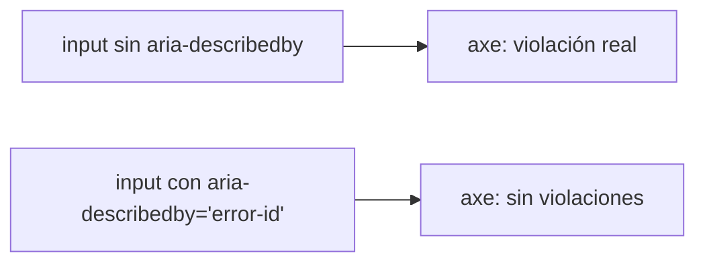
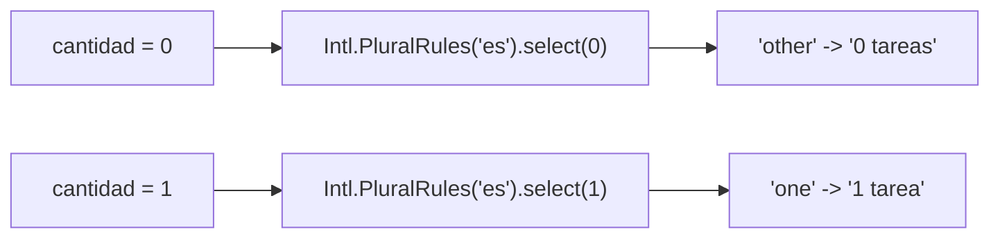
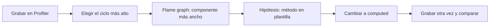
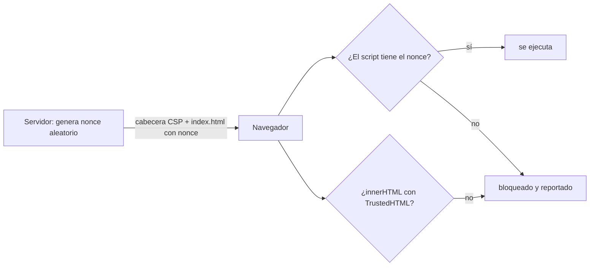

# Módulo 14: Angular en producción — accesibilidad, seguridad e internacionalización

El proyecto anterior demuestra integración técnica, pero una aplicación productiva debe funcionar para personas que navegan con teclado o lector, resistir datos hostiles, expresar correctamente idioma y tiempo y actualizarse sin degradar la experiencia. Este módulo convierte esas cualidades en pruebas y presupuestos automatizados.


## Aprende construyendo

Cada tema verifica su garantía con herramientas reales del ecosistema: `vitest-axe` para accesibilidad automatizada, `DomSanitizer` real de Angular para sanitización, `Intl.PluralRules` real para pluralización correcta, y la API oficial de test de bloques `@defer` para rendimiento diferido.


### Tema 1: Accesibilidad es comportamiento, no una puntuación · Avanzado · 45 min

<details open>
<summary><strong>Capa 1 — Lectura</strong></summary>

#### ► DE QUÉ TRATA
Al finalizar podrás confirmar, con vitest-axe (una auditoría de accesibilidad automatizada real, no una suposición visual), que un formulario con error asociado correctamente vía aria-describedby pasa la auditoría, y que quitar esa asociación produce una violación real detectada.

#### ► LA IDEA EN UNA FRASE
**Al finalizar podrás confirmar, con vitest-axe (una auditoría de accesibilidad automatizada real, no una suposición visual), que un formulario con error asociado correctamente vía aria-describedby pasa la auditoría, y que quitar esa asociación produce una violación real detectada.**

#### ► POR QUÉ EXISTE ESTO
Resuelve un problema real de diseño o implementación y evita decisiones a ciegas.

#### ► LA ANALOGÍA
Piensa en accesibilidad es comportamiento, no una puntuación como una herramienta de taller: útil cuando conoces su propósito y sus límites.
**Dónde se rompe la analogía:** en software, los efectos dependen del contexto, la escala y los trade-offs.

#### ► CÓMO FUNCIONA


#### ► LO QUE PUEDE SALIR MAL
| Síntoma | Causa probable | Arreglo |
|---|---|---|
| Accesibilidad es comportamiento, no una puntuación se aplica pero el resultado no mejora | Se usó sin medir el problema real | Mide antes y compara contra la alternativa simple |
| Aparece complejidad inesperada | Se adoptó la técnica sin comprender sus trade-offs | Vuelve a la sección de trade-offs y reduce el alcance |
| Falla en un caso límite | Se asumió un contexto que no se cumple | Prueba el caso límite y documenta cuándo NO usarlo |

#### ► TRADE-OFFS
| Opción | Cuándo usarla | Cuándo NO usarla |
|---|---|---|
| Usar Accesibilidad es comportamiento, no una puntuación | Cuando el problema coincide con su propósito y el beneficio es observable | Cuando agrega complejidad sin resolver un problema real |
| Alternativa más simple | Cuando el contexto es pequeño, estable o fácil de razonar | Cuando ya demostró no escalar o no cumplir el requisito |
| Postergar la decisión | Cuando falta evidencia del problema | Cuando el costo de esperar es mayor que el costo de probar |

#### ► CUÁNDO NO USAR ESTO
No uses accesibilidad es comportamiento, no una puntuación por defecto. Aplícalo cuando el problema lo justifique y puedas verificar el beneficio; si una alternativa más simple resuelve igual, prefiérela.

#### ► DE VUELTA A LA ANALOGÍA
Volviendo a la analogía: accesibilidad es comportamiento, no una puntuación funciona como el modelo inicial, pero recuerda dónde se rompe: en producción importan la evidencia, la escala y el costo de equivocarte.

#### ► LO QUE DEBES RECORDAR
- Accesibilidad es comportamiento, no una puntuación existe para resolver un problema específico.
- Mide antes de adoptar complejidad.
- Conoce el caso donde NO usarlo.
- Verifica con evidencia observable.

#### ► PREGUNTAS PARA PENSAR
1. ¿Qué problema concreto resuelve accesibilidad es comportamiento, no una puntuación en tu contexto?
2. ¿Cómo sabrías que accesibilidad es comportamiento, no una puntuación no está funcionando bien?
3. ¿Qué alternativa más simple considerarías antes de usar accesibilidad es comportamiento, no una puntuación?

</details>

<details>
<summary><strong>Capa 2 — Construcción</strong></summary>

#### Código y verificación


```bash
mkdir demo-a11y
cd demo-a11y
npx -y @angular/cli@22 new . --standalone --style=css --routing=false --skip-git --defaults
npm install -D vitest-axe axe-core
mkdir -p src/app
```

```ts
// src/app/campo-con-error.component.ts
import { Component, input } from '@angular/core';

@Component({
  selector: 'app-campo-con-error',
  standalone: true,
  template: `
    <label for="destino">Dirección de destino</label>
    <input id="destino" type="text" [attr.aria-describedby]="mostrarError() ? 'destino-error' : null" />
    @if (mostrarError()) {
      <p id="destino-error" role="alert">La dirección es obligatoria</p>
    }
  `,
})
export class CampoConErrorComponent {
  mostrarError = input(false);
}
```

```ts
// src/app/campo-con-error.component.spec.ts
import { TestBed } from '@angular/core/testing';
import { axe } from 'vitest-axe';
import { CampoConErrorComponent } from './campo-con-error.component';

describe('CampoConErrorComponent', () => {
  it('sin errores axe no reporta ninguna violacion de accesibilidad', async () => {
    await TestBed.configureTestingModule({ imports: [CampoConErrorComponent] }).compileComponents();
    const fixture = TestBed.createComponent(CampoConErrorComponent);
    fixture.detectChanges();

    const resultados = await axe(fixture.nativeElement);
    expect(resultados.violations).toEqual([]); // auditoria REAL de axe-core: la lista de violaciones debe quedar vacia
  });

  it('con error visible el mensaje esta asociado correctamente al input', async () => {
    await TestBed.configureTestingModule({ imports: [CampoConErrorComponent] }).compileComponents();
    const fixture = TestBed.createComponent(CampoConErrorComponent);
    fixture.componentRef.setInput('mostrarError', true);
    fixture.detectChanges();

    const input = fixture.nativeElement.querySelector('input');
    const describedBy = input.getAttribute('aria-describedby');
    const mensaje = fixture.nativeElement.querySelector(`#${describedBy}`);

    expect(mensaje.textContent).toContain('La dirección es obligatoria');

    const resultados = await axe(fixture.nativeElement);
    expect(resultados.violations).toEqual([]);
  });
});
```

```bash
npx ng test --watch=false
```

```ts
const resultados = await ____(fixture.nativeElement);
expect(resultados.violations).toEqual([]);
```

</details>

### Tema 2: La seguridad automática tiene fronteras explícitas · Avanzado · 45 min

<details open>
<summary><strong>Capa 1 — Lectura</strong></summary>

#### ► DE QUÉ TRATA
Al finalizar podrás confirmar, con el DomSanitizer real de Angular, que un binding [innerHTML] normal elimina contenido peligroso (como una etiqueta <script>), y contrastarlo con bypassSecurityTrustHtml, que deliberadamente desactiva esa protección.

#### ► LA IDEA EN UNA FRASE
**Al finalizar podrás confirmar, con el DomSanitizer real de Angular, que un binding [innerHTML] normal elimina contenido peligroso (como una etiqueta <script>), y contrastarlo con bypassSecurityTrustHtml, que deliberadamente desactiva esa protección.**

#### ► POR QUÉ EXISTE ESTO
Resuelve un problema real de diseño o implementación y evita decisiones a ciegas.

#### ► LA ANALOGÍA
**Conceptos clave:** `SecurityContext`, sanitización automática, `bypassSecurityTrustHtml`.

Angular trata los valores enlazados como no confiables y sanitiza según el contexto (HTML, URL, etc.); `[innerHTML]` sanitiza automáticamente contenido peligroso como `<script>`. `bypassSecurityTrustHtml(...)` NO "sanitiza mejor": desactiva la protección por completo, afirmando que el valor ya fue revisado — debe usarse únicamente cerca de una fuente controlada, nunca sobre contenido de usuario sin revisión real.

**Analogía:** Angular ofrece un cinturón de seguridad automático; `bypassSecurityTrust...` es desabrocharlo deliberadamente. Puede existir una situación controlada para hacerlo, pero eso no vuelve el choque seguro.

**Diagrama:**

```
┌── [innerHTML] normal ─────────────┐  <script> ELIMINADO automáticamente
└──────────────────────────┘
┌── bypassSecurityTrustHtml ────────┐  <script> PASA sin ninguna protección
└──────────────────────────┘
```

**Dónde se rompe la analogía:** el modelo simplifica la realidad; en producción influyen escala, fallos, costo y contexto.

#### ► CÓMO FUNCIONA
1. Identifica el problema que la seguridad automática tiene fronteras explícitas resuelve.
2. Observa sus componentes y relaciones.
3. Aplica la opción más simple que funcione.
4. Verifica el resultado y los límites.

#### ► LO QUE PUEDE SALIR MAL
| Síntoma | Causa probable | Arreglo |
|---|---|---|
| La seguridad automática tiene fronteras explícitas se aplica pero el resultado no mejora | Se usó sin medir el problema real | Mide antes y compara contra la alternativa simple |
| Aparece complejidad inesperada | Se adoptó la técnica sin comprender sus trade-offs | Vuelve a la sección de trade-offs y reduce el alcance |
| Falla en un caso límite | Se asumió un contexto que no se cumple | Prueba el caso límite y documenta cuándo NO usarlo |

#### ► TRADE-OFFS
| Opción | Cuándo usarla | Cuándo NO usarla |
|---|---|---|
| Usar La seguridad automática tiene fronteras explícitas | Cuando el problema coincide con su propósito y el beneficio es observable | Cuando agrega complejidad sin resolver un problema real |
| Alternativa más simple | Cuando el contexto es pequeño, estable o fácil de razonar | Cuando ya demostró no escalar o no cumplir el requisito |
| Postergar la decisión | Cuando falta evidencia del problema | Cuando el costo de esperar es mayor que el costo de probar |

#### ► CUÁNDO NO USAR ESTO
No uses la seguridad automática tiene fronteras explícitas por defecto. Aplícalo cuando el problema lo justifique y puedas verificar el beneficio; si una alternativa más simple resuelve igual, prefiérela.

#### ► DE VUELTA A LA ANALOGÍA
Volviendo a la analogía: la seguridad automática tiene fronteras explícitas funciona como el modelo inicial, pero recuerda dónde se rompe: en producción importan la evidencia, la escala y el costo de equivocarte.

#### ► LO QUE DEBES RECORDAR
- La seguridad automática tiene fronteras explícitas existe para resolver un problema específico.
- Mide antes de adoptar complejidad.
- Conoce el caso donde NO usarlo.
- Verifica con evidencia observable.

#### ► PREGUNTAS PARA PENSAR
1. ¿Qué problema concreto resuelve la seguridad automática tiene fronteras explícitas en tu contexto?
2. ¿Cómo sabrías que la seguridad automática tiene fronteras explícitas no está funcionando bien?
3. ¿Qué alternativa más simple considerarías antes de usar la seguridad automática tiene fronteras explícitas?

</details>

<details>
<summary><strong>Capa 2 — Construcción</strong></summary>

#### Objetivo observable
Al finalizar podrás confirmar, con el `DomSanitizer` real de Angular, que un binding `[innerHTML]` normal elimina contenido peligroso (como una etiqueta `<script>`), y contrastarlo con `bypassSecurityTrustHtml`, que deliberadamente desactiva esa protección.

**Conocimiento previo:** Módulo 7 de este track (HttpClient, datos externos).

</details>

### Tema 3: Internacionalizar implica significado, no reemplazo de texto · Avanzado · 45 min

<details open>
<summary><strong>Capa 1 — Lectura</strong></summary>

#### ► DE QUÉ TRATA
Al finalizar podrás confirmar, con Intl.PluralRules real (la API estándar del navegador para reglas de pluralización), que un mensaje selecciona la forma gramatical correcta según la cantidad, en vez de concatenar un número con un texto fijo.

#### ► LA IDEA EN UNA FRASE
**Al finalizar podrás confirmar, con Intl.PluralRules real (la API estándar del navegador para reglas de pluralización), que un mensaje selecciona la forma gramatical correcta según la cantidad, en vez de concatenar un número con un texto fijo.**

#### ► POR QUÉ EXISTE ESTO
Resuelve un problema real de diseño o implementación y evita decisiones a ciegas.

#### ► LA ANALOGÍA
Piensa en internacionalizar implica significado, no reemplazo de texto como una herramienta de taller: útil cuando conoces su propósito y sus límites.
**Dónde se rompe la analogía:** en software, los efectos dependen del contexto, la escala y los trade-offs.

#### ► CÓMO FUNCIONA


#### ► LO QUE PUEDE SALIR MAL
| Síntoma | Causa probable | Arreglo |
|---|---|---|
| Internacionalizar implica significado, no reemplazo de texto se aplica pero el resultado no mejora | Se usó sin medir el problema real | Mide antes y compara contra la alternativa simple |
| Aparece complejidad inesperada | Se adoptó la técnica sin comprender sus trade-offs | Vuelve a la sección de trade-offs y reduce el alcance |
| Falla en un caso límite | Se asumió un contexto que no se cumple | Prueba el caso límite y documenta cuándo NO usarlo |

#### ► TRADE-OFFS
| Opción | Cuándo usarla | Cuándo NO usarla |
|---|---|---|
| Usar Internacionalizar implica significado, no reemplazo de texto | Cuando el problema coincide con su propósito y el beneficio es observable | Cuando agrega complejidad sin resolver un problema real |
| Alternativa más simple | Cuando el contexto es pequeño, estable o fácil de razonar | Cuando ya demostró no escalar o no cumplir el requisito |
| Postergar la decisión | Cuando falta evidencia del problema | Cuando el costo de esperar es mayor que el costo de probar |

#### ► CUÁNDO NO USAR ESTO
No uses internacionalizar implica significado, no reemplazo de texto por defecto. Aplícalo cuando el problema lo justifique y puedas verificar el beneficio; si una alternativa más simple resuelve igual, prefiérela.

#### ► DE VUELTA A LA ANALOGÍA
Volviendo a la analogía: internacionalizar implica significado, no reemplazo de texto funciona como el modelo inicial, pero recuerda dónde se rompe: en producción importan la evidencia, la escala y el costo de equivocarte.

#### ► LO QUE DEBES RECORDAR
- Internacionalizar implica significado, no reemplazo de texto existe para resolver un problema específico.
- Mide antes de adoptar complejidad.
- Conoce el caso donde NO usarlo.
- Verifica con evidencia observable.

#### ► PREGUNTAS PARA PENSAR
1. ¿Qué problema concreto resuelve internacionalizar implica significado, no reemplazo de texto en tu contexto?
2. ¿Cómo sabrías que internacionalizar implica significado, no reemplazo de texto no está funcionando bien?
3. ¿Qué alternativa más simple considerarías antes de usar internacionalizar implica significado, no reemplazo de texto?

</details>

<details>
<summary><strong>Capa 2 — Construcción</strong></summary>

#### Código y verificación


```bash
mkdir -p src/app
```

```ts
// src/app/pluralizar-tareas.ts
const reglasEspanol = new Intl.PluralRules('es');

export function pluralizarTareas(cantidad: number): string {
  const categoria = reglasEspanol.select(cantidad); // 'one' | 'other' en español

  switch (categoria) {
    case 'one':
      return `${cantidad} tarea pendiente`;
    case 'other':
      return `${cantidad} tareas pendientes`;
    default:
      return `${cantidad} tareas pendientes`;
  }
}
```

```ts
// src/app/pluralizar-tareas.spec.ts
import { pluralizarTareas } from './pluralizar-tareas';

describe('pluralizarTareas', () => {
  it('usa la forma singular real para exactamente 1', () => {
    expect(pluralizarTareas(1)).toBe('1 tarea pendiente');
  });

  it('usa la forma plural real para 0', () => {
    expect(pluralizarTareas(0)).toBe('0 tareas pendientes'); // en español, 0 usa la forma plural, NO singular
  });

  it('usa la forma plural real para cantidades mayores a 1', () => {
    expect(pluralizarTareas(5)).toBe('5 tareas pendientes');
  });
});
```

```bash
npx ng test --watch=false
```

```ts
const categoria = reglasEspanol.____(cantidad);
```

</details>

### Tema 4: Rendimiento y actualización son contratos de experiencia · Avanzado · 45 min

<details open>
<summary><strong>Capa 1 — Lectura</strong></summary>

#### ► DE QUÉ TRATA
Al finalizar podrás confirmar, con la API oficial de test de bloques @defer de Angular, que el contenido diferido NO se renderiza inicialmente y SÍ se renderiza tras disparar manualmente su condición, verificando en código el beneficio real de rendimiento que @defer promete.

#### ► LA IDEA EN UNA FRASE
**Al finalizar podrás confirmar, con la API oficial de test de bloques @defer de Angular, que el contenido diferido NO se renderiza inicialmente y SÍ se renderiza tras disparar manualmente su condición, verificando en código el beneficio real de rendimiento que @defer promete.**

#### ► POR QUÉ EXISTE ESTO
Resuelve un problema real de diseño o implementación y evita decisiones a ciegas.

#### ► LA ANALOGÍA
Piensa en rendimiento y actualización son contratos de experiencia como una herramienta de taller: útil cuando conoces su propósito y sus límites.
**Dónde se rompe la analogía:** en software, los efectos dependen del contexto, la escala y los trade-offs.

#### ► CÓMO FUNCIONA
1. Identifica el problema que rendimiento y actualización son contratos de experiencia resuelve.
2. Observa sus componentes y relaciones.
3. Aplica la opción más simple que funcione.
4. Verifica el resultado y los límites.

#### ► LO QUE PUEDE SALIR MAL
| Síntoma | Causa probable | Arreglo |
|---|---|---|
| Rendimiento y actualización son contratos de experiencia se aplica pero el resultado no mejora | Se usó sin medir el problema real | Mide antes y compara contra la alternativa simple |
| Aparece complejidad inesperada | Se adoptó la técnica sin comprender sus trade-offs | Vuelve a la sección de trade-offs y reduce el alcance |
| Falla en un caso límite | Se asumió un contexto que no se cumple | Prueba el caso límite y documenta cuándo NO usarlo |

#### ► TRADE-OFFS
| Opción | Cuándo usarla | Cuándo NO usarla |
|---|---|---|
| Usar Rendimiento y actualización son contratos de experiencia | Cuando el problema coincide con su propósito y el beneficio es observable | Cuando agrega complejidad sin resolver un problema real |
| Alternativa más simple | Cuando el contexto es pequeño, estable o fácil de razonar | Cuando ya demostró no escalar o no cumplir el requisito |
| Postergar la decisión | Cuando falta evidencia del problema | Cuando el costo de esperar es mayor que el costo de probar |

#### ► CUÁNDO NO USAR ESTO
No uses rendimiento y actualización son contratos de experiencia por defecto. Aplícalo cuando el problema lo justifique y puedas verificar el beneficio; si una alternativa más simple resuelve igual, prefiérela.

#### ► DE VUELTA A LA ANALOGÍA
Volviendo a la analogía: rendimiento y actualización son contratos de experiencia funciona como el modelo inicial, pero recuerda dónde se rompe: en producción importan la evidencia, la escala y el costo de equivocarte.

#### ► LO QUE DEBES RECORDAR
- Rendimiento y actualización son contratos de experiencia existe para resolver un problema específico.
- Mide antes de adoptar complejidad.
- Conoce el caso donde NO usarlo.
- Verifica con evidencia observable.

#### ► PREGUNTAS PARA PENSAR
1. ¿Qué problema concreto resuelve rendimiento y actualización son contratos de experiencia en tu contexto?
2. ¿Cómo sabrías que rendimiento y actualización son contratos de experiencia no está funcionando bien?
3. ¿Qué alternativa más simple considerarías antes de usar rendimiento y actualización son contratos de experiencia?

</details>

<details>
<summary><strong>Capa 2 — Construcción</strong></summary>

#### Código y verificación
```
┌── Carga inicial ──────────────────┐  contenido crítico + placeholder del @defer
└──────────────────────────┘
┌── Disparador cumplido ────────────┐  Angular carga y renderiza el bloque diferido
└──────────────────────────┘
```

```bash
mkdir -p src/app
```

```ts
// src/app/panel-metricas.component.ts
import { Component } from '@angular/core';

@Component({
  selector: 'app-panel-metricas',
  standalone: true,
  template: `
    <h2>Panel de entregas</h2>
    @defer (on interaction) {
      <section data-testid="metricas-pesadas">Métricas detalladas cargadas</section>
    } @placeholder {
      <button type="button">Ver métricas detalladas</button>
    }
  `,
})
export class PanelMetricasComponent {}
```

```ts
// src/app/panel-metricas.component.spec.ts
import { DeferBlockState, TestBed } from '@angular/core/testing';
import { PanelMetricasComponent } from './panel-metricas.component';

describe('PanelMetricasComponent', () => {
  it('el contenido diferido NO se renderiza en la carga inicial', async () => {
    await TestBed.configureTestingModule({ imports: [PanelMetricasComponent] }).compileComponents();
    const fixture = TestBed.createComponent(PanelMetricasComponent);
    fixture.detectChanges();

    const metricas = fixture.nativeElement.querySelector('[data-testid="metricas-pesadas"]');
    expect(metricas).toBeNull(); // el bloque @defer aun no se disparo: NO esta en el DOM

    const placeholder = fixture.nativeElement.querySelector('button');
    expect(placeholder.textContent).toContain('Ver métricas detalladas');
  });

  it('tras disparar la interaccion, el bloque diferido SI se renderiza', async () => {
    await TestBed.configureTestingModule({ imports: [PanelMetricasComponent] }).compileComponents();
    const fixture = TestBed.createComponent(PanelMetricasComponent);
    fixture.detectChanges();

    // API oficial para inspeccionar y controlar bloques @defer en tests
    const [bloqueDeferido] = await fixture.getDeferBlocks();

    await bloqueDeferido.render(DeferBlockState.Complete); // fuerza el estado "completo" sin esperar el disparador real
    fixture.detectChanges();

    const metricas = fixture.nativeElement.querySelector('[data-testid="metricas-pesadas"]');
    expect(metricas.textContent).toContain('Métricas detalladas cargadas');
  });
});
```

```bash
npx ng test --watch=false
```

```ts
const [bloqueDeferido] = await fixture.getDeferBlocks();
await bloqueDeferido.____();
```

</details>

### Tema 5: Perfilar con Angular DevTools y el panel Performance de Chrome · Avanzado · 40 min

<details open>
<summary><strong>Capa 1 — Lectura</strong></summary>

#### ► DE QUÉ TRATA
Instala la extensión Angular DevTools en Chrome o Firefox. Ejecuta tu aplicación en modo desarrollo (ng serve): el Profiler no funciona sobre un build de producción. Si usas Angular 20 o superior, también puedes llamar enableProfiling() para ver los eventos de Angular en el panel…

#### ► LA IDEA EN UNA FRASE
**Instala la extensión Angular DevTools en Chrome o Firefox.**

#### ► POR QUÉ EXISTE ESTO
Resuelve un problema real de diseño o implementación y evita decisiones a ciegas.

#### ► LA ANALOGÍA
Piensa en perfilar con angular devtools y el panel performance de chrome como una herramienta de taller: útil cuando conoces su propósito y sus límites.
**Dónde se rompe la analogía:** en software, los efectos dependen del contexto, la escala y los trade-offs.

#### ► CÓMO FUNCIONA


#### ► LO QUE PUEDE SALIR MAL
| Síntoma | Causa probable | Arreglo |
|---|---|---|
| Perfilar con Angular DevTools y el panel Performance de Chrome se aplica pero el resultado no mejora | Se usó sin medir el problema real | Mide antes y compara contra la alternativa simple |
| Aparece complejidad inesperada | Se adoptó la técnica sin comprender sus trade-offs | Vuelve a la sección de trade-offs y reduce el alcance |
| Falla en un caso límite | Se asumió un contexto que no se cumple | Prueba el caso límite y documenta cuándo NO usarlo |

#### ► TRADE-OFFS
| Opción | Cuándo usarla | Cuándo NO usarla |
|---|---|---|
| Usar Perfilar con Angular DevTools y el panel Performance de Chrome | Cuando el problema coincide con su propósito y el beneficio es observable | Cuando agrega complejidad sin resolver un problema real |
| Alternativa más simple | Cuando el contexto es pequeño, estable o fácil de razonar | Cuando ya demostró no escalar o no cumplir el requisito |
| Postergar la decisión | Cuando falta evidencia del problema | Cuando el costo de esperar es mayor que el costo de probar |

#### ► CUÁNDO NO USAR ESTO
No uses perfilar con angular devtools y el panel performance de chrome por defecto. Aplícalo cuando el problema lo justifique y puedas verificar el beneficio; si una alternativa más simple resuelve igual, prefiérela.

#### ► DE VUELTA A LA ANALOGÍA
Volviendo a la analogía: perfilar con angular devtools y el panel performance de chrome funciona como el modelo inicial, pero recuerda dónde se rompe: en producción importan la evidencia, la escala y el costo de equivocarte.

#### ► LO QUE DEBES RECORDAR
- Perfilar con Angular DevTools y el panel Performance de Chrome existe para resolver un problema específico.
- Mide antes de adoptar complejidad.
- Conoce el caso donde NO usarlo.
- Verifica con evidencia observable.

#### ► PREGUNTAS PARA PENSAR
1. ¿Qué problema concreto resuelve perfilar con angular devtools y el panel performance de chrome en tu contexto?
2. ¿Cómo sabrías que perfilar con angular devtools y el panel performance de chrome no está funcionando bien?
3. ¿Qué alternativa más simple considerarías antes de usar perfilar con angular devtools y el panel performance de chrome?

</details>

<details>
<summary><strong>Capa 2 — Construcción</strong></summary>

#### Código y verificación


```ts
import { Component, computed, signal } from '@angular/core';

interface Envio { codigo: string; paradas: number[]; }

@Component({
  selector: 'app-lista-envios',
  template: `
    <input (input)="filtro.set($any($event.target).value)" placeholder="Buscar" />
    <!-- ANTES: puntaje(envio) corría en cada ciclo, para cada fila -->
    @for (fila of filas(); track fila.codigo) {
      <p>{{ fila.codigo }} · puntaje {{ fila.puntaje }}</p>
    }
  `,
})
export class ListaEnvios {
  readonly filtro = signal('');
  private readonly envios = signal<Envio[]>(
    Array.from({ length: 500 }, (_, i) => ({ codigo: `ENV-${i}`, paradas: Array.from({ length: 200 }, (_, j) => j * i) })),
  );
  // DESPUÉS: el cálculo se hace una vez por cambio de filtro, no en cada ciclo.
  readonly filas = computed(() =>
    this.envios()
      .filter((e) => e.codigo.includes(this.filtro().toUpperCase()))
      .map((e) => ({ codigo: e.codigo, puntaje: e.paradas.reduce((a, b) => a + Math.sqrt(b), 0).toFixed(0) })),
  );
}
```

```ts
import { enableProfiling } from '@angular/core';
import { bootstrapApplication } from '@angular/platform-browser';
import { appConfig } from './app/app.config';
import { App } from './app/app';

enableProfiling(); // Angular 20+: eventos de Angular en el panel Performance de Chrome
bootstrapApplication(App, appConfig);
```

```bash
ng serve
# 1) abre Angular DevTools > Profiler > Start recording
# 2) escribe "ENV-1" en el buscador y detén la grabación
# 3) elige el ciclo más alto y busca ListaEnvios en el flame graph
```

```text
Antes: el flame graph muestra ListaEnvios como el bloque más ancho de cada ciclo al escribir.
Después: el ciclo al escribir baja de forma visible y ListaEnvios deja de ser el bloque dominante.
```

</details>

### Tema 6: CSP con nonce y Trusted Types en Angular · Experto · 45 min

<details open>
<summary><strong>Capa 1 — Lectura</strong></summary>

#### ► DE QUÉ TRATA
Usa Angular 19 o superior. Para la parte con SSR necesitas un proyecto creado con --ssr. Probarás las cabeceras con las DevTools del navegador (pestañas Network y Console).

#### ► LA IDEA EN UNA FRASE
**Usa Angular 19 o superior.**

#### ► POR QUÉ EXISTE ESTO
Resuelve un problema real de diseño o implementación y evita decisiones a ciegas.

#### ► LA ANALOGÍA
Piensa en csp con nonce y trusted types en angular como una herramienta de taller: útil cuando conoces su propósito y sus límites.
**Dónde se rompe la analogía:** en software, los efectos dependen del contexto, la escala y los trade-offs.

#### ► CÓMO FUNCIONA


#### ► LO QUE PUEDE SALIR MAL
| Síntoma | Causa probable | Arreglo |
|---|---|---|
| CSP con nonce y Trusted Types en Angular se aplica pero el resultado no mejora | Se usó sin medir el problema real | Mide antes y compara contra la alternativa simple |
| Aparece complejidad inesperada | Se adoptó la técnica sin comprender sus trade-offs | Vuelve a la sección de trade-offs y reduce el alcance |
| Falla en un caso límite | Se asumió un contexto que no se cumple | Prueba el caso límite y documenta cuándo NO usarlo |

#### ► TRADE-OFFS
| Opción | Cuándo usarla | Cuándo NO usarla |
|---|---|---|
| Usar CSP con nonce y Trusted Types en Angular | Cuando el problema coincide con su propósito y el beneficio es observable | Cuando agrega complejidad sin resolver un problema real |
| Alternativa más simple | Cuando el contexto es pequeño, estable o fácil de razonar | Cuando ya demostró no escalar o no cumplir el requisito |
| Postergar la decisión | Cuando falta evidencia del problema | Cuando el costo de esperar es mayor que el costo de probar |

#### ► CUÁNDO NO USAR ESTO
No uses csp con nonce y trusted types en angular por defecto. Aplícalo cuando el problema lo justifique y puedas verificar el beneficio; si una alternativa más simple resuelve igual, prefiérela.

#### ► DE VUELTA A LA ANALOGÍA
Volviendo a la analogía: csp con nonce y trusted types en angular funciona como el modelo inicial, pero recuerda dónde se rompe: en producción importan la evidencia, la escala y el costo de equivocarte.

#### ► LO QUE DEBES RECORDAR
- CSP con nonce y Trusted Types en Angular existe para resolver un problema específico.
- Mide antes de adoptar complejidad.
- Conoce el caso donde NO usarlo.
- Verifica con evidencia observable.

#### ► PREGUNTAS PARA PENSAR
1. ¿Qué problema concreto resuelve csp con nonce y trusted types en angular en tu contexto?
2. ¿Cómo sabrías que csp con nonce y trusted types en angular no está funcionando bien?
3. ¿Qué alternativa más simple considerarías antes de usar csp con nonce y trusted types en angular?

</details>

<details>
<summary><strong>Capa 2 — Construcción</strong></summary>

#### Código y verificación
```text
Content-Security-Policy: script-src 'nonce-R4nd0m' 'strict-dynamic'; object-src 'none'; base-uri 'self';
  require-trusted-types-for 'script'; trusted-types angular angular#unsafe-bypass
```


```ts
import { AngularNodeAppEngine, createNodeRequestHandler, writeResponseToNodeResponse } from '@angular/ssr/node';
import express from 'express';
import { randomBytes } from 'node:crypto';

const app = express();
const angularApp = new AngularNodeAppEngine();

app.use(async (req, res, next) => {
  const nonce = randomBytes(16).toString('base64'); // uno distinto por respuesta
  res.setHeader('Content-Security-Policy', [
    `script-src 'nonce-${nonce}' 'strict-dynamic'`,
    "object-src 'none'",
    "base-uri 'self'",
    "require-trusted-types-for 'script'",
    'trusted-types angular angular#unsafe-bypass',
  ].join('; '));
  const respuesta = await angularApp.handle(req);
  if (!respuesta) return next();
  // Reemplaza el marcador del index.html por el nonce real.
  const html = (await respuesta.text()).replaceAll('RANDOM_NONCE', nonce);
  const cabeceras = new Headers(respuesta.headers);
  cabeceras.delete('content-length'); // el tamaño cambió al reemplazar el marcador
  await writeResponseToNodeResponse(new Response(html, { status: respuesta.status, headers: cabeceras }), res);
});

export const reqHandler = createNodeRequestHandler(app);
```

```html
<!doctype html>
<html lang="es">
  <body>
    <!-- Angular usa este nonce para sus estilos en línea. -->
    <app-root ngCspNonce="RANDOM_NONCE"></app-root>
  </body>
</html>
```

```bash
ng build
npm run serve:ssr:academia-ssr
# en DevTools > Network, revisa la cabecera Content-Security-Policy del documento
```

```text
La cabecera Content-Security-Policy del documento muestra un nonce distinto en cada recarga.
La aplicación funciona sin errores de CSP en la consola.
Un <script> inyectado sin nonce aparece en consola como «Refused to execute inline script because it violates the following Content Security Policy directive».
```

</details>

### Angular v22 y adopción según estabilidad

<details open>
<summary><strong>Capa 1 — Lectura</strong></summary>

#### ► DE QUÉ TRATA
Este tema te guía por angular v22 y adopción según estabilidad con foco en comprensión antes de implementación.

#### ► LA IDEA EN UNA FRASE
**Entender angular v22 y adopción según estabilidad te permite tomar mejores decisiones técnicas.**

#### ► POR QUÉ EXISTE ESTO
Resuelve un problema real de diseño o implementación y evita decisiones a ciegas.

#### ► LA ANALOGÍA
Piensa en angular v22 y adopción según estabilidad como una herramienta de taller: útil cuando conoces su propósito y sus límites.
**Dónde se rompe la analogía:** en software, los efectos dependen del contexto, la escala y los trade-offs.

#### ► CÓMO FUNCIONA
1. Identifica el problema que angular v22 y adopción según estabilidad resuelve.
2. Observa sus componentes y relaciones.
3. Aplica la opción más simple que funcione.
4. Verifica el resultado y los límites.

#### ► LO QUE PUEDE SALIR MAL
| Síntoma | Causa probable | Arreglo |
|---|---|---|
| Angular v22 y adopción según estabilidad se aplica pero el resultado no mejora | Se usó sin medir el problema real | Mide antes y compara contra la alternativa simple |
| Aparece complejidad inesperada | Se adoptó la técnica sin comprender sus trade-offs | Vuelve a la sección de trade-offs y reduce el alcance |
| Falla en un caso límite | Se asumió un contexto que no se cumple | Prueba el caso límite y documenta cuándo NO usarlo |

#### ► TRADE-OFFS
| Opción | Cuándo usarla | Cuándo NO usarla |
|---|---|---|
| Usar Angular v22 y adopción según estabilidad | Cuando el problema coincide con su propósito y el beneficio es observable | Cuando agrega complejidad sin resolver un problema real |
| Alternativa más simple | Cuando el contexto es pequeño, estable o fácil de razonar | Cuando ya demostró no escalar o no cumplir el requisito |
| Postergar la decisión | Cuando falta evidencia del problema | Cuando el costo de esperar es mayor que el costo de probar |

#### ► CUÁNDO NO USAR ESTO
No uses angular v22 y adopción según estabilidad por defecto. Aplícalo cuando el problema lo justifique y puedas verificar el beneficio; si una alternativa más simple resuelve igual, prefiérela.

#### ► DE VUELTA A LA ANALOGÍA
Volviendo a la analogía: angular v22 y adopción según estabilidad funciona como el modelo inicial, pero recuerda dónde se rompe: en producción importan la evidencia, la escala y el costo de equivocarte.

#### ► LO QUE DEBES RECORDAR
- Angular v22 y adopción según estabilidad existe para resolver un problema específico.
- Mide antes de adoptar complejidad.
- Conoce el caso donde NO usarlo.
- Verifica con evidencia observable.

#### ► PREGUNTAS PARA PENSAR
1. ¿Qué problema concreto resuelve angular v22 y adopción según estabilidad en tu contexto?
2. ¿Cómo sabrías que angular v22 y adopción según estabilidad no está funcionando bien?
3. ¿Qué alternativa más simple considerarías antes de usar angular v22 y adopción según estabilidad?

</details>

<details>
<summary><strong>Capa 2 — Construcción</strong></summary>

#### Nota de construcción
Este tema es principalmente conceptual en esta versión. La verificación se realiza con las preguntas de comprensión y el criterio de cuándo NO usar angular v22 y adopción según estabilidad.

</details>

### Proyecto: auditoría integral de la aplicación standalone

<details open>
<summary><strong>Capa 1 — Lectura</strong></summary>

#### ► DE QUÉ TRATA
Este tema te guía por proyecto: auditoría integral de la aplicación standalone con foco en comprensión antes de implementación.

#### ► LA IDEA EN UNA FRASE
**Entender proyecto: auditoría integral de la aplicación standalone te permite tomar mejores decisiones técnicas.**

#### ► POR QUÉ EXISTE ESTO
Resuelve un problema real de diseño o implementación y evita decisiones a ciegas.

#### ► LA ANALOGÍA
Piensa en proyecto: auditoría integral de la aplicación standalone como una herramienta de taller: útil cuando conoces su propósito y sus límites.
**Dónde se rompe la analogía:** en software, los efectos dependen del contexto, la escala y los trade-offs.

#### ► CÓMO FUNCIONA
1. Identifica el problema que proyecto: auditoría integral de la aplicación standalone resuelve.
2. Observa sus componentes y relaciones.
3. Aplica la opción más simple que funcione.
4. Verifica el resultado y los límites.

#### ► LO QUE PUEDE SALIR MAL
| Síntoma | Causa probable | Arreglo |
|---|---|---|
| Proyecto: auditoría integral de la aplicación standalone se aplica pero el resultado no mejora | Se usó sin medir el problema real | Mide antes y compara contra la alternativa simple |
| Aparece complejidad inesperada | Se adoptó la técnica sin comprender sus trade-offs | Vuelve a la sección de trade-offs y reduce el alcance |
| Falla en un caso límite | Se asumió un contexto que no se cumple | Prueba el caso límite y documenta cuándo NO usarlo |

#### ► TRADE-OFFS
| Opción | Cuándo usarla | Cuándo NO usarla |
|---|---|---|
| Usar Proyecto: auditoría integral de la aplicación standalone | Cuando el problema coincide con su propósito y el beneficio es observable | Cuando agrega complejidad sin resolver un problema real |
| Alternativa más simple | Cuando el contexto es pequeño, estable o fácil de razonar | Cuando ya demostró no escalar o no cumplir el requisito |
| Postergar la decisión | Cuando falta evidencia del problema | Cuando el costo de esperar es mayor que el costo de probar |

#### ► CUÁNDO NO USAR ESTO
No uses proyecto: auditoría integral de la aplicación standalone por defecto. Aplícalo cuando el problema lo justifique y puedas verificar el beneficio; si una alternativa más simple resuelve igual, prefiérela.

#### ► DE VUELTA A LA ANALOGÍA
Volviendo a la analogía: proyecto: auditoría integral de la aplicación standalone funciona como el modelo inicial, pero recuerda dónde se rompe: en producción importan la evidencia, la escala y el costo de equivocarte.

#### ► LO QUE DEBES RECORDAR
- Proyecto: auditoría integral de la aplicación standalone existe para resolver un problema específico.
- Mide antes de adoptar complejidad.
- Conoce el caso donde NO usarlo.
- Verifica con evidencia observable.

#### ► PREGUNTAS PARA PENSAR
1. ¿Qué problema concreto resuelve proyecto: auditoría integral de la aplicación standalone en tu contexto?
2. ¿Cómo sabrías que proyecto: auditoría integral de la aplicación standalone no está funcionando bien?
3. ¿Qué alternativa más simple considerarías antes de usar proyecto: auditoría integral de la aplicación standalone?

</details>

<details>
<summary><strong>Capa 2 — Construcción</strong></summary>

#### Nota de construcción
Este tema es principalmente conceptual en esta versión. La verificación se realiza con las preguntas de comprensión y el criterio de cuándo NO usar proyecto: auditoría integral de la aplicación standalone.

</details>

### Método de estudio y proyecto de ampliación

<details open>
<summary><strong>Capa 1 — Lectura</strong></summary>

#### ► DE QUÉ TRATA
Este tema te guía por método de estudio y proyecto de ampliación con foco en comprensión antes de implementación.

#### ► LA IDEA EN UNA FRASE
**Entender método de estudio y proyecto de ampliación te permite tomar mejores decisiones técnicas.**

#### ► POR QUÉ EXISTE ESTO
Resuelve un problema real de diseño o implementación y evita decisiones a ciegas.

#### ► LA ANALOGÍA
Piensa en método de estudio y proyecto de ampliación como una herramienta de taller: útil cuando conoces su propósito y sus límites.
**Dónde se rompe la analogía:** en software, los efectos dependen del contexto, la escala y los trade-offs.

#### ► CÓMO FUNCIONA
1. Identifica el problema que método de estudio y proyecto de ampliación resuelve.
2. Observa sus componentes y relaciones.
3. Aplica la opción más simple que funcione.
4. Verifica el resultado y los límites.

#### ► LO QUE PUEDE SALIR MAL
| Síntoma | Causa probable | Arreglo |
|---|---|---|
| Método de estudio y proyecto de ampliación se aplica pero el resultado no mejora | Se usó sin medir el problema real | Mide antes y compara contra la alternativa simple |
| Aparece complejidad inesperada | Se adoptó la técnica sin comprender sus trade-offs | Vuelve a la sección de trade-offs y reduce el alcance |
| Falla en un caso límite | Se asumió un contexto que no se cumple | Prueba el caso límite y documenta cuándo NO usarlo |

#### ► TRADE-OFFS
| Opción | Cuándo usarla | Cuándo NO usarla |
|---|---|---|
| Usar Método de estudio y proyecto de ampliación | Cuando el problema coincide con su propósito y el beneficio es observable | Cuando agrega complejidad sin resolver un problema real |
| Alternativa más simple | Cuando el contexto es pequeño, estable o fácil de razonar | Cuando ya demostró no escalar o no cumplir el requisito |
| Postergar la decisión | Cuando falta evidencia del problema | Cuando el costo de esperar es mayor que el costo de probar |

#### ► CUÁNDO NO USAR ESTO
No uses método de estudio y proyecto de ampliación por defecto. Aplícalo cuando el problema lo justifique y puedas verificar el beneficio; si una alternativa más simple resuelve igual, prefiérela.

#### ► DE VUELTA A LA ANALOGÍA
Volviendo a la analogía: método de estudio y proyecto de ampliación funciona como el modelo inicial, pero recuerda dónde se rompe: en producción importan la evidencia, la escala y el costo de equivocarte.

#### ► LO QUE DEBES RECORDAR
- Método de estudio y proyecto de ampliación existe para resolver un problema específico.
- Mide antes de adoptar complejidad.
- Conoce el caso donde NO usarlo.
- Verifica con evidencia observable.

#### ► PREGUNTAS PARA PENSAR
1. ¿Qué problema concreto resuelve método de estudio y proyecto de ampliación en tu contexto?
2. ¿Cómo sabrías que método de estudio y proyecto de ampliación no está funcionando bien?
3. ¿Qué alternativa más simple considerarías antes de usar método de estudio y proyecto de ampliación?

</details>

<details>
<summary><strong>Capa 2 — Construcción</strong></summary>

#### Nota de construcción
Este tema es principalmente conceptual en esta versión. La verificación se realiza con las preguntas de comprensión y el criterio de cuándo NO usar método de estudio y proyecto de ampliación.

</details>
