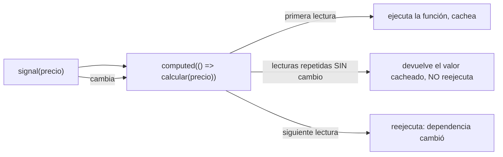
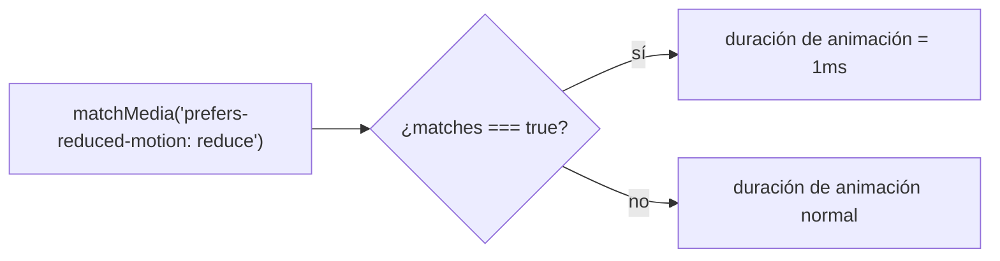
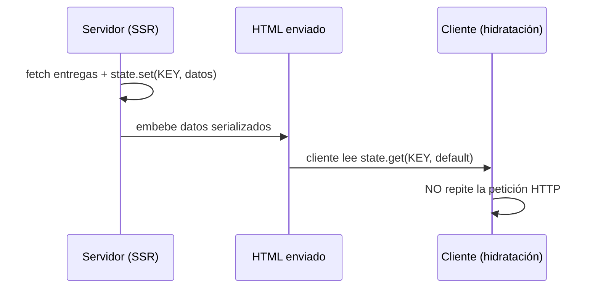

# Módulo 15: Pruebas de signals, E2E, animación y TransferState


## Aprende construyendo

Este módulo reúne cuatro técnicas que no aparecen antes en el curso, cada una verificada con la herramienta real (Vitest, Playwright, transiciones CSS con `prefers-reduced-motion` y `TransferState`). `TestBed` y `ComponentFixture` se enseñan en el Módulo 10, Tema 1; SSR, hidratación e `isPlatformBrowser`, en el Módulo 11, Temas 1 y 2.


### Tema 1: Pruebas de Signals · Avanzado · 45 min

<details open>
<summary><strong>Capa 1 — Lectura</strong></summary>

#### ► DE QUÉ TRATA
Al finalizar podrás confirmar, contando invocaciones reales con un spy, que un computed() memoiza su resultado y solo se recalcula cuando su dependencia real cambia, no en cada lectura.

#### ► LA ANALOGÍA
**Conceptos clave:** memoización de `computed()`, `effect()` dentro de un contexto de inyección, `TestBed.runInInjectionContext`.

`computed(() => ...)` solo reevalúa su función cuando alguna de las señales que lee internamente cambió desde la última evaluación; leerlo repetidamente sin que sus dependencias cambien devuelve el valor cacheado sin re-ejecutar la función. `effect()` necesita un contexto de inyección de Angular para registrarse correctamente; en un test sin componente, `TestBed.runInInjectionContext(() => effect(...))` provee ese contexto.

**Analogía:** un `computed()` es como un asistente que solo recalcula el total de una factura cuando alguna línea de la factura realmente cambió, en vez de repetir la suma completa cada vez que alguien simplemente pregunta el total.

**Diagrama:**



#### ► CÓMO FUNCIONA


</details>

<details>
<summary><strong>Capa 2 — Construcción</strong></summary>

#### Código y verificación

```bash
mkdir -p src/app
```

```ts
// src/app/carrito.signals.spec.ts
import { signal, computed, effect } from '@angular/core';
import { TestBed } from '@angular/core/testing';

describe('computed() memoiza su resultado real', () => {
  it('no reejecuta la función si la dependencia no cambió', () => {
    const calculo = vi.fn((precio: number, cantidad: number) => precio * cantidad);
    const precio = signal(10);
    const cantidad = signal(2);
    const total = computed(() => calculo(precio(), cantidad()));

    expect(total()).toBe(20);
    expect(total()).toBe(20); // segunda lectura, SIN cambiar ninguna dependencia
    expect(total()).toBe(20); // tercera lectura, tampoco cambia nada

    expect(calculo).toHaveBeenCalledTimes(1); // memoización real: la función solo se ejecutó UNA vez
  });

  it('reejecuta solo cuando la dependencia real cambia', () => {
    const calculo = vi.fn((precio: number) => precio * 2);
    const precio = signal(10);
    const doble = computed(() => calculo(precio()));

    expect(doble()).toBe(20);
    precio.set(15); // AHORA sí cambia la dependencia real
    expect(doble()).toBe(30);

    expect(calculo).toHaveBeenCalledTimes(2); // una ejecución por cada cambio real de dependencia
  });

  it('effect() requiere un contexto de inyección real de Angular', () => {
    TestBed.runInInjectionContext(() => {
      const contador = signal(0);
      const valoresObservados: number[] = [];

      effect(() => valoresObservados.push(contador()));

      TestBed.tick();
      contador.set(5);
      TestBed.tick();

      expect(valoresObservados).toEqual([0, 5]);
    });
  });
});
```

```bash
npx ng test --watch=false
```

```ts
expect(calculo).____(1);
```

</details>

### Tema 2: Cypress y Playwright · Avanzado · 45 min

<details open>
<summary><strong>Capa 1 — Lectura</strong></summary>

#### ► DE QUÉ TRATA
Al finalizar podrás escribir un test E2E real con Playwright que navega la aplicación, localiza elementos por rol accesible (no por selector CSS frágil) y confirma un flujo de usuario completo, y explicarás por qué esa elección de selector importa.

</details>

<details>
<summary><strong>Capa 2 — Construcción</strong></summary>

#### Código y verificación
```
┌── Selector CSS frágil ────────────┐  .btn-confirm-3 — se rompe con refactors de estilo
└──────────────────────────┘
┌── Locator accesible ──────────────┐  getByRole('button', {name:'Confirmar'}) — estable
└──────────────────────────┘
```

```bash
npm install -D @playwright/test
mkdir -p e2e
```

```ts
// e2e/confirmar-entrega.spec.ts
import { test, expect } from '@playwright/test';

test('un conductor puede confirmar una entrega desde la interfaz real', async ({ page }) => {
  await page.goto('http://localhost:4200/entregas/PED-001');

  // locator por ROL accesible, no por clase CSS frágil
  const boton = page.getByRole('button', { name: 'Confirmar entrega' });
  await expect(boton).toBeVisible(); // auto-waiting real: espera hasta que sea visible

  await boton.click();

  const estado = page.getByRole('status'); // región con aria-live, anunciada a lectores de pantalla
  await expect(estado).toHaveText('Entrega confirmada');
});
```

```bash
npx playwright test e2e/confirmar-entrega.spec.ts
```

```ts
const boton = page.____('button', { name: 'Confirmar entrega' });
```

</details>

### Tema 3: Animaciones accesibles · Avanzado · 45 min

<details open>
<summary><strong>Capa 1 — Lectura</strong></summary>

#### ► DE QUÉ TRATA
Al finalizar podrás confirmar, con un test real que simula la preferencia prefers-reduced-motion del sistema operativo, que una animación respeta esa preferencia reduciendo su duración a un valor mínimo en vez de ignorarla.

#### ► CÓMO FUNCIONA


</details>

<details>
<summary><strong>Capa 2 — Construcción</strong></summary>

#### Código y verificación


```bash
mkdir -p src/app
```

```ts
// src/app/notificacion-animada.component.ts
import { Component, computed, signal } from '@angular/core';

@Component({
  selector: 'app-notificacion-animada',
  standalone: true,
  template: `<div class="notificacion" [style.transition-duration.ms]="duracionMs()">Entrega confirmada</div>`,
})
export class NotificacionAnimadaComponent {
  private prefiereMovimientoReducido = signal(
    typeof window !== 'undefined' && window.matchMedia
      ? window.matchMedia('(prefers-reduced-motion: reduce)').matches
      : false
  );

  duracionMs = computed(() => (this.prefiereMovimientoReducido() ? 1 : 300));

  // expuesto para testing: permite inyectar la preferencia sin depender del entorno real del navegador de CI
  establecerPreferenciaParaTest(valor: boolean) {
    this.prefiereMovimientoReducido.set(valor);
  }
}
```

```ts
// src/app/notificacion-animada.component.spec.ts
import { TestBed } from '@angular/core/testing';
import { NotificacionAnimadaComponent } from './notificacion-animada.component';

describe('NotificacionAnimadaComponent', () => {
  it('usa una duracion minima cuando el usuario prefiere movimiento reducido', async () => {
    await TestBed.configureTestingModule({ imports: [NotificacionAnimadaComponent] }).compileComponents();
    const fixture = TestBed.createComponent(NotificacionAnimadaComponent);

    fixture.componentInstance.establecerPreferenciaParaTest(true); // simula prefers-reduced-motion: reduce
    fixture.detectChanges();

    expect(fixture.componentInstance.duracionMs()).toBe(1);
  });

  it('usa la duracion normal cuando el usuario NO prefiere movimiento reducido', async () => {
    await TestBed.configureTestingModule({ imports: [NotificacionAnimadaComponent] }).compileComponents();
    const fixture = TestBed.createComponent(NotificacionAnimadaComponent);

    fixture.componentInstance.establecerPreferenciaParaTest(false);
    fixture.detectChanges();

    expect(fixture.componentInstance.duracionMs()).toBe(300);
  });
});
```

```bash
npx ng test --watch=false
```

```ts
window.matchMedia('____').matches
```

</details>

### Tema 4: SSR y TransferState · Avanzado · 45 min

<details open>
<summary><strong>Capa 1 — Lectura</strong></summary>

#### ► DE QUÉ TRATA
Al finalizar podrás confirmar, con un test real de TransferState, que un dato calculado "en el servidor" se transfiere al cliente sin que este necesite repetir la petición HTTP original.

#### ► CÓMO FUNCIONA


</details>

<details>
<summary><strong>Capa 2 — Construcción</strong></summary>

#### Código y verificación


```bash
mkdir -p src/app
```

```ts
// src/app/entregas-transfer-state.spec.ts
import { TestBed } from '@angular/core/testing';
import { TransferState, makeStateKey } from '@angular/core';

const ENTREGAS_KEY = makeStateKey<string[]>('entregas-pendientes');

describe('TransferState evita repetir la peticion HTTP original', () => {
  it('el cliente lee el valor transferido por el servidor sin pedirlo de nuevo', () => {
    TestBed.configureTestingModule({ providers: [TransferState] });
    const state = TestBed.inject(TransferState);

    // simula lo que el servidor habria hecho: guardar el resultado de una peticion HTTP real
    state.set(ENTREGAS_KEY, ['PED-001', 'PED-002']);

    // simula la lectura del cliente al hidratarse: NO hay ninguna llamada HTTP aqui
    const entregasRecibidas = state.get(ENTREGAS_KEY, [] as string[]);

    expect(entregasRecibidas).toEqual(['PED-001', 'PED-002']);
    expect(state.hasKey(ENTREGAS_KEY)).toBe(true);
  });

  it('si la clave nunca fue transferida, get devuelve el valor por defecto explicito', () => {
    TestBed.configureTestingModule({ providers: [TransferState] });
    const state = TestBed.inject(TransferState);

    const CLAVE_INEXISTENTE = makeStateKey<string[]>('nunca-transferida');
    const resultado = state.get(CLAVE_INEXISTENTE, ['valor-por-defecto']);

    expect(resultado).toEqual(['valor-por-defecto']); // el default explicito, no un error ni undefined
  });
});
```

```bash
npx ng test --watch=false
```

```ts
const entregas = state.____(ENTREGAS_KEY, [] as string[]);
```

</details>
