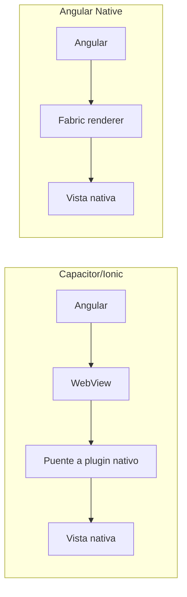
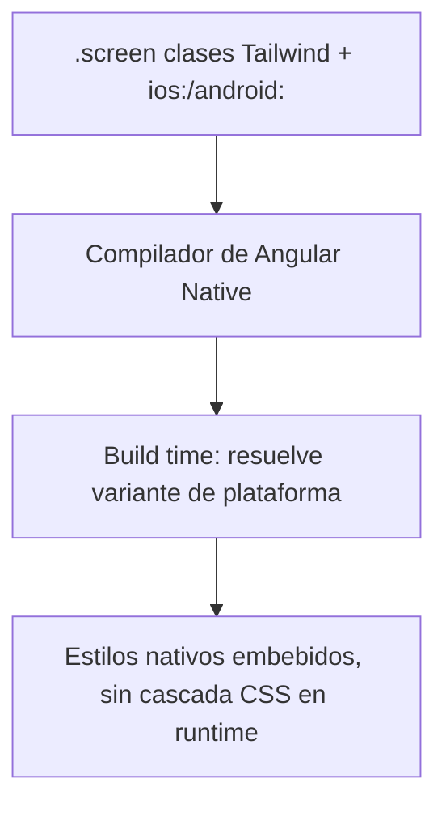
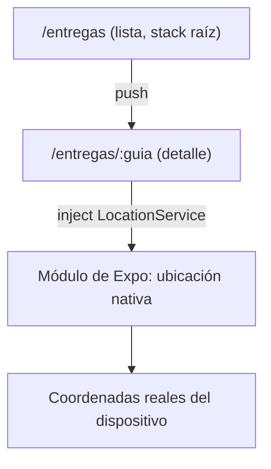
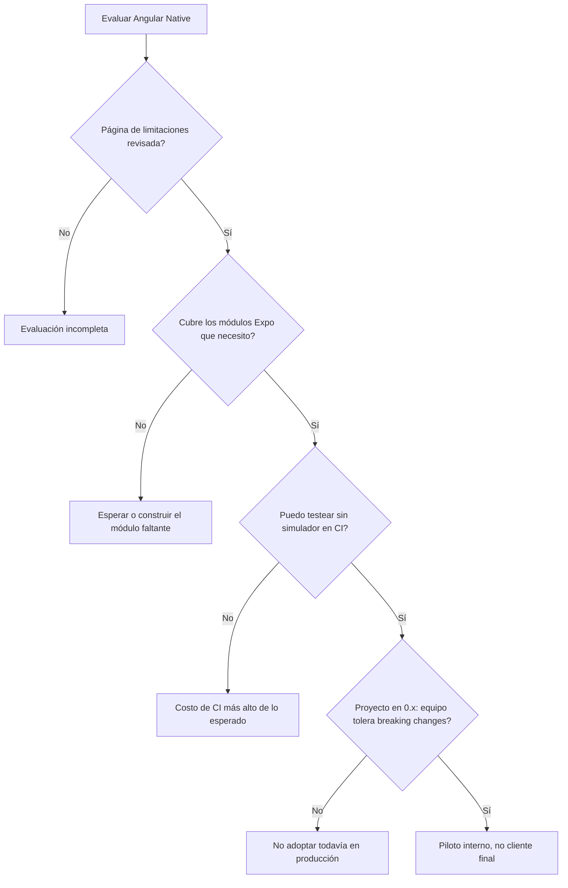

# Módulo 16 (opcional): Angular Native — componentes Angular como vistas nativas reales


## Aprende construyendo

**Módulo opcional.** No forma parte de la ruta principal del curso: la ruta termina en el Módulo 15. Hazlo solo si te interesa evaluar esta tecnología; depende de un proyecto alpha que puede cambiar sin aviso.

Este módulo explora un proyecto experimental del ecosistema (no oficial de Google ni del equipo de Angular) que renderiza componentes Angular directamente como vistas nativas de iOS/Android sobre el renderer Fabric de React Native, sin que React participe en el render. Cada tema usa el código y los requisitos reales del proyecto (alpha, versión `0.x`), sin inflar su madurez ni ocultar sus límites: el objetivo es que evalúes la tecnología con el mismo criterio técnico con el que evaluarías cualquier dependencia nueva para un proyecto real.


### Tema 1: Qué renderiza Angular Native y por qué no es un WebView · Avanzado · 45 min

<details open>
<summary><strong>Capa 1 — Lectura</strong></summary>

#### ► DE QUÉ TRATA
Al finalizar vas a levantar un proyecto nuevo con el template oficial, confirmar en el propio dispositivo/simulador que lo que se ve es una vista nativa (no un WebView embebido), y explicar con precisión en qué se diferencia este enfoque del de Capacitor/Ionic y del de NativeScri…

#### ► LA IDEA EN UNA FRASE
**Al finalizar vas a levantar un proyecto nuevo con el template oficial, confirmar en el propio dispositivo/simulador que lo que se ve es una vista nativa (no un WebView embebido), y explicar con precisión en qué se diferencia este enfoque del de Capacitor/Ionic y del de NativeScript.**

#### ► POR QUÉ EXISTE ESTO
Resuelve un problema real de diseño o implementación y evita decisiones a ciegas.

#### ► LA ANALOGÍA
Piensa en qué renderiza angular native y por qué no es un webview como una herramienta de taller: útil cuando conoces su propósito y sus límites.
**Dónde se rompe la analogía:** en software, los efectos dependen del contexto, la escala y los trade-offs.

#### ► CÓMO FUNCIONA


#### ► LO QUE PUEDE SALIR MAL
| Síntoma | Causa probable | Arreglo |
|---|---|---|
| Qué renderiza Angular Native y por qué no es un WebView se aplica pero el resultado no mejora | Se usó sin medir el problema real | Mide antes y compara contra la alternativa simple |
| Aparece complejidad inesperada | Se adoptó la técnica sin comprender sus trade-offs | Vuelve a la sección de trade-offs y reduce el alcance |
| Falla en un caso límite | Se asumió un contexto que no se cumple | Prueba el caso límite y documenta cuándo NO usarlo |

#### ► TRADE-OFFS
| Opción | Cuándo usarla | Cuándo NO usarla |
|---|---|---|
| Usar Qué renderiza Angular Native y por qué no es un WebView | Cuando el problema coincide con su propósito y el beneficio es observable | Cuando agrega complejidad sin resolver un problema real |
| Alternativa más simple | Cuando el contexto es pequeño, estable o fácil de razonar | Cuando ya demostró no escalar o no cumplir el requisito |
| Postergar la decisión | Cuando falta evidencia del problema | Cuando el costo de esperar es mayor que el costo de probar |

#### ► CUÁNDO NO USAR ESTO
No uses qué renderiza angular native y por qué no es un webview por defecto. Aplícalo cuando el problema lo justifique y puedas verificar el beneficio; si una alternativa más simple resuelve igual, prefiérela.

#### ► DE VUELTA A LA ANALOGÍA
Volviendo a la analogía: qué renderiza angular native y por qué no es un webview funciona como el modelo inicial, pero recuerda dónde se rompe: en producción importan la evidencia, la escala y el costo de equivocarte.

#### ► LO QUE DEBES RECORDAR
- Qué renderiza Angular Native y por qué no es un WebView existe para resolver un problema específico.
- Mide antes de adoptar complejidad.
- Conoce el caso donde NO usarlo.
- Verifica con evidencia observable.

#### ► PREGUNTAS PARA PENSAR
1. ¿Qué problema concreto resuelve qué renderiza angular native y por qué no es un webview en tu contexto?
2. ¿Cómo sabrías que qué renderiza angular native y por qué no es un webview no está funcionando bien?
3. ¿Qué alternativa más simple considerarías antes de usar qué renderiza angular native y por qué no es un webview?

</details>

<details>
<summary><strong>Capa 2 — Construcción</strong></summary>

#### Código y verificación


```bash
npx create-expo-app@latest rutaflow-conductor --template @ng-native/template
cd rutaflow-conductor
npx expo start
```

```ts
// src/app/app.ts
import { Component, signal } from '@angular/core';
import { Pressable, SafeAreaProvider, SafeAreaView, Text } from '@ng-native/components';

@Component({
  selector: 'app-root',
  imports: [SafeAreaProvider, SafeAreaView, Text, Pressable],
  template: `
    <safe-area-provider>
      <safe-area-view class="screen">
        <text class="title">RutaFlow Conductor</text>
        <pressable accessibilityRole="button" class="button" (press)="contador.set(contador() + 1)">
          <text class="label">Entregas confirmadas: {{ contador() }}</text>
        </pressable>
      </safe-area-view>
    </safe-area-provider>
  `,
  styles: `
    :host { flex: 1; }
    .screen { align-items: center; justify-content: center; gap: 16px; padding: 24px; }
    .title { font-size: 20px; font-weight: bold; }
    .button { padding: 12px 20px; border-radius: 8px; background-color: #dd0031; }
    .button:active { opacity: 0.7; }
    .label { color: white; font-weight: 600; }
  `,
})
export class App {
  protected readonly contador = signal(0);
}
```

```ts
@Component({
  selector: 'app-root',
  imports: [____],
  template: `<pressable (press)="contador.set(contador() + 1)"><text>{{ contador() }}</text></pressable>`,
})
```

</details>

### Tema 2: Signals, estilos nativos compilados y el preset de Tailwind · Avanzado · 45 min

<details open>
<summary><strong>Capa 1 — Lectura</strong></summary>

#### ► DE QUÉ TRATA
Al finalizar vas a construir una lista de entregas pendientes con estado derivado por computed(), estilada con el preset de Tailwind de Angular Native, y vas a confirmar qué le ocurre a un selector ios:/android: según la plataforma donde corre.

#### ► LA IDEA EN UNA FRASE
**Al finalizar vas a construir una lista de entregas pendientes con estado derivado por computed(), estilada con el preset de Tailwind de Angular Native, y vas a confirmar qué le ocurre a un selector ios:/android: según la plataforma donde corre.**

#### ► POR QUÉ EXISTE ESTO
Resuelve un problema real de diseño o implementación y evita decisiones a ciegas.

#### ► LA ANALOGÍA
Piensa en signals, estilos nativos compilados y el preset de tailwind como una herramienta de taller: útil cuando conoces su propósito y sus límites.
**Dónde se rompe la analogía:** en software, los efectos dependen del contexto, la escala y los trade-offs.

#### ► CÓMO FUNCIONA


#### ► LO QUE PUEDE SALIR MAL
| Síntoma | Causa probable | Arreglo |
|---|---|---|
| Signals, estilos nativos compilados y el preset de Tailwind se aplica pero el resultado no mejora | Se usó sin medir el problema real | Mide antes y compara contra la alternativa simple |
| Aparece complejidad inesperada | Se adoptó la técnica sin comprender sus trade-offs | Vuelve a la sección de trade-offs y reduce el alcance |
| Falla en un caso límite | Se asumió un contexto que no se cumple | Prueba el caso límite y documenta cuándo NO usarlo |

#### ► TRADE-OFFS
| Opción | Cuándo usarla | Cuándo NO usarla |
|---|---|---|
| Usar Signals, estilos nativos compilados y el preset de Tailwind | Cuando el problema coincide con su propósito y el beneficio es observable | Cuando agrega complejidad sin resolver un problema real |
| Alternativa más simple | Cuando el contexto es pequeño, estable o fácil de razonar | Cuando ya demostró no escalar o no cumplir el requisito |
| Postergar la decisión | Cuando falta evidencia del problema | Cuando el costo de esperar es mayor que el costo de probar |

#### ► CUÁNDO NO USAR ESTO
No uses signals, estilos nativos compilados y el preset de tailwind por defecto. Aplícalo cuando el problema lo justifique y puedas verificar el beneficio; si una alternativa más simple resuelve igual, prefiérela.

#### ► DE VUELTA A LA ANALOGÍA
Volviendo a la analogía: signals, estilos nativos compilados y el preset de tailwind funciona como el modelo inicial, pero recuerda dónde se rompe: en producción importan la evidencia, la escala y el costo de equivocarte.

#### ► LO QUE DEBES RECORDAR
- Signals, estilos nativos compilados y el preset de Tailwind existe para resolver un problema específico.
- Mide antes de adoptar complejidad.
- Conoce el caso donde NO usarlo.
- Verifica con evidencia observable.

#### ► PREGUNTAS PARA PENSAR
1. ¿Qué problema concreto resuelve signals, estilos nativos compilados y el preset de tailwind en tu contexto?
2. ¿Cómo sabrías que signals, estilos nativos compilados y el preset de tailwind no está funcionando bien?
3. ¿Qué alternativa más simple considerarías antes de usar signals, estilos nativos compilados y el preset de tailwind?

</details>

<details>
<summary><strong>Capa 2 — Construcción</strong></summary>

#### Código y verificación


```bash
ng new ejemplo
cd ejemplo
```

```ts
// src/app/lista-entregas.ts
import { Component, signal, computed } from '@angular/core';
import { View, Text } from '@ng-native/components';

interface Entrega { guia: string; urgente: boolean; }

@Component({
  selector: 'app-lista-entregas',
  imports: [View, Text],
  template: `
    @for (e of entregas(); track e.guia) {
      <view class="fila ios:py-3 android:py-2" [class.urgente]="e.urgente">
        <text class="texto">{{ e.guia }}</text>
      </view>
    }
    <text class="resumen">Urgentes: {{ urgentes() }}</text>
  `,
  styles: `
    .fila { padding: 8px 16px; border-bottom-width: 1px; border-bottom-color: #e5e7eb; }
    .urgente { background-color: #fef2f2; }
    .texto { font-size: 16px; }
    .resumen { padding: 12px 16px; font-weight: bold; }
  `,
})
export class ListaEntregas {
  protected readonly entregas = signal<Entrega[]>([
    { guia: 'RF-4471', urgente: true },
    { guia: 'RF-4472', urgente: false },
  ]);
  protected readonly urgentes = computed(() => this.entregas().filter(e => e.urgente).length);
}
```

```bash
npx expo start --ios
```

```ts
protected readonly urgentes = ____(() => this.entregas().filter(e => e.urgente).length);
```

</details>

### Tema 3: Router nativo y servicios de Expo inyectados como servicios Angular · Avanzado · 45 min

<details open>
<summary><strong>Capa 1 — Lectura</strong></summary>

#### ► DE QUÉ TRATA
Al finalizar vas a navegar entre dos pantallas con @angular/router sobre stacks nativos, e inyectar un módulo de Expo (ubicación) como un servicio Angular con inject(), confirmando que el patrón de inyección de dependencias no cambia respecto a Angular web.

#### ► LA IDEA EN UNA FRASE
**Al finalizar vas a navegar entre dos pantallas con @angular/router sobre stacks nativos, e inyectar un módulo de Expo (ubicación) como un servicio Angular con inject(), confirmando que el patrón de inyección de dependencias no cambia respecto a Angular web.**

#### ► POR QUÉ EXISTE ESTO
Resuelve un problema real de diseño o implementación y evita decisiones a ciegas.

#### ► LA ANALOGÍA
Piensa en router nativo y servicios de expo inyectados como servicios angular como una herramienta de taller: útil cuando conoces su propósito y sus límites.
**Dónde se rompe la analogía:** en software, los efectos dependen del contexto, la escala y los trade-offs.

#### ► CÓMO FUNCIONA


#### ► LO QUE PUEDE SALIR MAL
| Síntoma | Causa probable | Arreglo |
|---|---|---|
| Router nativo y servicios de Expo inyectados como servicios Angular se aplica pero el resultado no mejora | Se usó sin medir el problema real | Mide antes y compara contra la alternativa simple |
| Aparece complejidad inesperada | Se adoptó la técnica sin comprender sus trade-offs | Vuelve a la sección de trade-offs y reduce el alcance |
| Falla en un caso límite | Se asumió un contexto que no se cumple | Prueba el caso límite y documenta cuándo NO usarlo |

#### ► TRADE-OFFS
| Opción | Cuándo usarla | Cuándo NO usarla |
|---|---|---|
| Usar Router nativo y servicios de Expo inyectados como servicios Angular | Cuando el problema coincide con su propósito y el beneficio es observable | Cuando agrega complejidad sin resolver un problema real |
| Alternativa más simple | Cuando el contexto es pequeño, estable o fácil de razonar | Cuando ya demostró no escalar o no cumplir el requisito |
| Postergar la decisión | Cuando falta evidencia del problema | Cuando el costo de esperar es mayor que el costo de probar |

#### ► CUÁNDO NO USAR ESTO
No uses router nativo y servicios de expo inyectados como servicios angular por defecto. Aplícalo cuando el problema lo justifique y puedas verificar el beneficio; si una alternativa más simple resuelve igual, prefiérela.

#### ► DE VUELTA A LA ANALOGÍA
Volviendo a la analogía: router nativo y servicios de expo inyectados como servicios angular funciona como el modelo inicial, pero recuerda dónde se rompe: en producción importan la evidencia, la escala y el costo de equivocarte.

#### ► LO QUE DEBES RECORDAR
- Router nativo y servicios de Expo inyectados como servicios Angular existe para resolver un problema específico.
- Mide antes de adoptar complejidad.
- Conoce el caso donde NO usarlo.
- Verifica con evidencia observable.

#### ► PREGUNTAS PARA PENSAR
1. ¿Qué problema concreto resuelve router nativo y servicios de expo inyectados como servicios angular en tu contexto?
2. ¿Cómo sabrías que router nativo y servicios de expo inyectados como servicios angular no está funcionando bien?
3. ¿Qué alternativa más simple considerarías antes de usar router nativo y servicios de expo inyectados como servicios angular?

</details>

<details>
<summary><strong>Capa 2 — Construcción</strong></summary>

#### Código y verificación


```bash
ng new ejemplo
cd ejemplo
```

```ts
// src/app/app.routes.ts
import { Routes } from '@angular/router';
import { ListaEntregas } from './lista-entregas';
import { DetalleEntrega } from './detalle-entrega';

export const routes: Routes = [
  { path: 'entregas', component: ListaEntregas },
  { path: 'entregas/:guia', component: DetalleEntrega },
];
```

```ts
// src/app/detalle-entrega.ts
import { Component, inject, signal } from '@angular/core';
import { ActivatedRoute } from '@angular/router';
import { View, Text, Pressable } from '@ng-native/components';

@Component({
  selector: 'app-detalle-entrega',
  imports: [View, Text, Pressable],
  template: `
    <view class="detalle">
      <text>Guía: {{ guia }}</text>
      <pressable (press)="confirmarConUbicacion()">
        <text>Confirmar entrega con ubicación</text>
      </pressable>
      @if (coordenadas()) {
        <text>Lat: {{ coordenadas()!.lat }}, Lon: {{ coordenadas()!.lon }}</text>
      }
    </view>
  `,
})
export class DetalleEntrega {
  private readonly ruta = inject(ActivatedRoute);
  protected readonly guia = this.ruta.snapshot.paramMap.get('guia');
  protected readonly coordenadas = signal<{ lat: number; lon: number } | null>(null);

  async confirmarConUbicacion() {
    // En el proyecto real, LocationService viene de @ng-native/expo e inyecta
    // el módulo expo-location correspondiente; aquí se asume inyectado como `location`.
    const posicion = await this.location.obtenerPosicionActual();
    this.coordenadas.set({ lat: posicion.lat, lon: posicion.lon });
  }

  private readonly location = inject(LocationService);
}
```

```bash
npx expo start
```

```ts
private readonly ruta = ____(ActivatedRoute);
protected readonly guia = this.ruta.snapshot.paramMap.get('guia');
```

</details>

### Tema 4: Evaluar la madurez de una tecnología alpha con criterio · Avanzado · 45 min

<details open>
<summary><strong>Capa 1 — Lectura</strong></summary>

#### ► DE QUÉ TRATA
Al finalizar vas a producir una checklist de evaluación de madurez tecnológica aplicada específicamente a Angular Native (estado 0.x, página de limitaciones conocidas, testing sin simulador), y vas a decidir, con criterio explícito y no con entusiasmo, si lo adoptarías hoy en un…

#### ► LA IDEA EN UNA FRASE
**Al finalizar vas a producir una checklist de evaluación de madurez tecnológica aplicada específicamente a Angular Native (estado 0.x, página de limitaciones conocidas, testing sin simulador), y vas a decidir, con criterio explícito y no con entusiasmo, si lo adoptarías hoy en un proyecto con usuarios reales.**

#### ► POR QUÉ EXISTE ESTO
Resuelve un problema real de diseño o implementación y evita decisiones a ciegas.

#### ► LA ANALOGÍA
Piensa en evaluar la madurez de una tecnología alpha con criterio como una herramienta de taller: útil cuando conoces su propósito y sus límites.
**Dónde se rompe la analogía:** en software, los efectos dependen del contexto, la escala y los trade-offs.

#### ► CÓMO FUNCIONA


#### ► LO QUE PUEDE SALIR MAL
| Síntoma | Causa probable | Arreglo |
|---|---|---|
| Evaluar la madurez de una tecnología alpha con criterio se aplica pero el resultado no mejora | Se usó sin medir el problema real | Mide antes y compara contra la alternativa simple |
| Aparece complejidad inesperada | Se adoptó la técnica sin comprender sus trade-offs | Vuelve a la sección de trade-offs y reduce el alcance |
| Falla en un caso límite | Se asumió un contexto que no se cumple | Prueba el caso límite y documenta cuándo NO usarlo |

#### ► TRADE-OFFS
| Opción | Cuándo usarla | Cuándo NO usarla |
|---|---|---|
| Usar Evaluar la madurez de una tecnología alpha con criterio | Cuando el problema coincide con su propósito y el beneficio es observable | Cuando agrega complejidad sin resolver un problema real |
| Alternativa más simple | Cuando el contexto es pequeño, estable o fácil de razonar | Cuando ya demostró no escalar o no cumplir el requisito |
| Postergar la decisión | Cuando falta evidencia del problema | Cuando el costo de esperar es mayor que el costo de probar |

#### ► CUÁNDO NO USAR ESTO
No uses evaluar la madurez de una tecnología alpha con criterio por defecto. Aplícalo cuando el problema lo justifique y puedas verificar el beneficio; si una alternativa más simple resuelve igual, prefiérela.

#### ► DE VUELTA A LA ANALOGÍA
Volviendo a la analogía: evaluar la madurez de una tecnología alpha con criterio funciona como el modelo inicial, pero recuerda dónde se rompe: en producción importan la evidencia, la escala y el costo de equivocarte.

#### ► LO QUE DEBES RECORDAR
- Evaluar la madurez de una tecnología alpha con criterio existe para resolver un problema específico.
- Mide antes de adoptar complejidad.
- Conoce el caso donde NO usarlo.
- Verifica con evidencia observable.

#### ► PREGUNTAS PARA PENSAR
1. ¿Qué problema concreto resuelve evaluar la madurez de una tecnología alpha con criterio en tu contexto?
2. ¿Cómo sabrías que evaluar la madurez de una tecnología alpha con criterio no está funcionando bien?
3. ¿Qué alternativa más simple considerarías antes de usar evaluar la madurez de una tecnología alpha con criterio?

</details>

<details>
<summary><strong>Capa 2 — Construcción</strong></summary>

#### Código y verificación


```bash
ng new ejemplo
cd ejemplo
```

```bash
npx expo start --no-dev --minify & sleep 1
npm test -- --testPathPattern=detalle-entrega
```

```ts
// src/app/detalle-entrega.test.ts
import { render, screen, fireEvent } from '@ng-native/testing';
import { DetalleEntrega } from './detalle-entrega';

describe('DetalleEntrega', () => {
  it('muestra la guía recibida por parámetro de ruta', async () => {
    await render(DetalleEntrega, { routeParams: { guia: 'RF-4471' } });
    expect(screen.getByText('Guía: RF-4471')).toBeTruthy();
  });
});
```

```ts
import { ____ , screen } from '@ng-native/testing';
await ____(DetalleEntrega, { routeParams: { guia: 'RF-4471' } });
```

</details>
