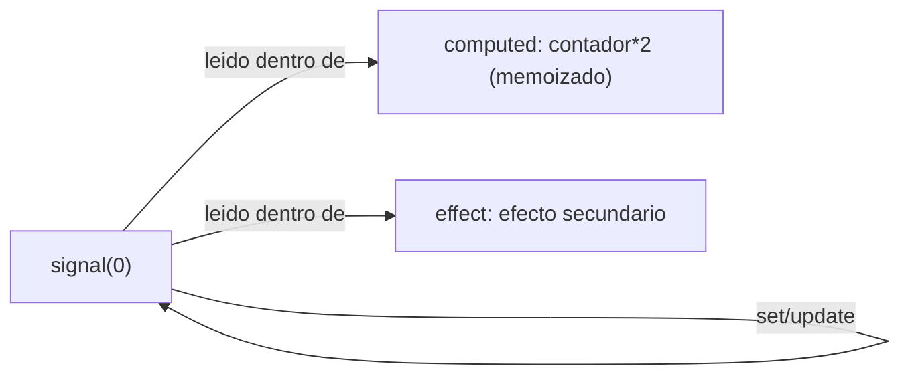
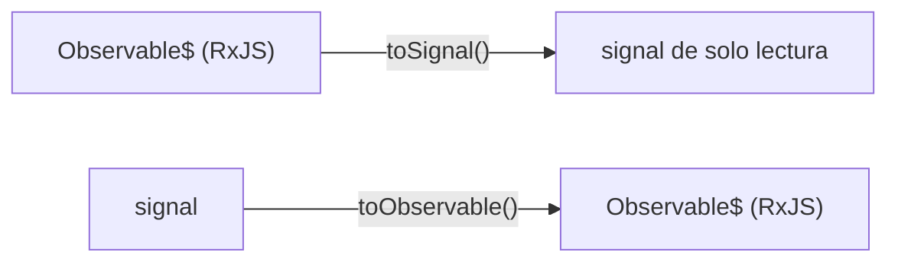
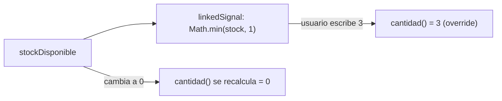
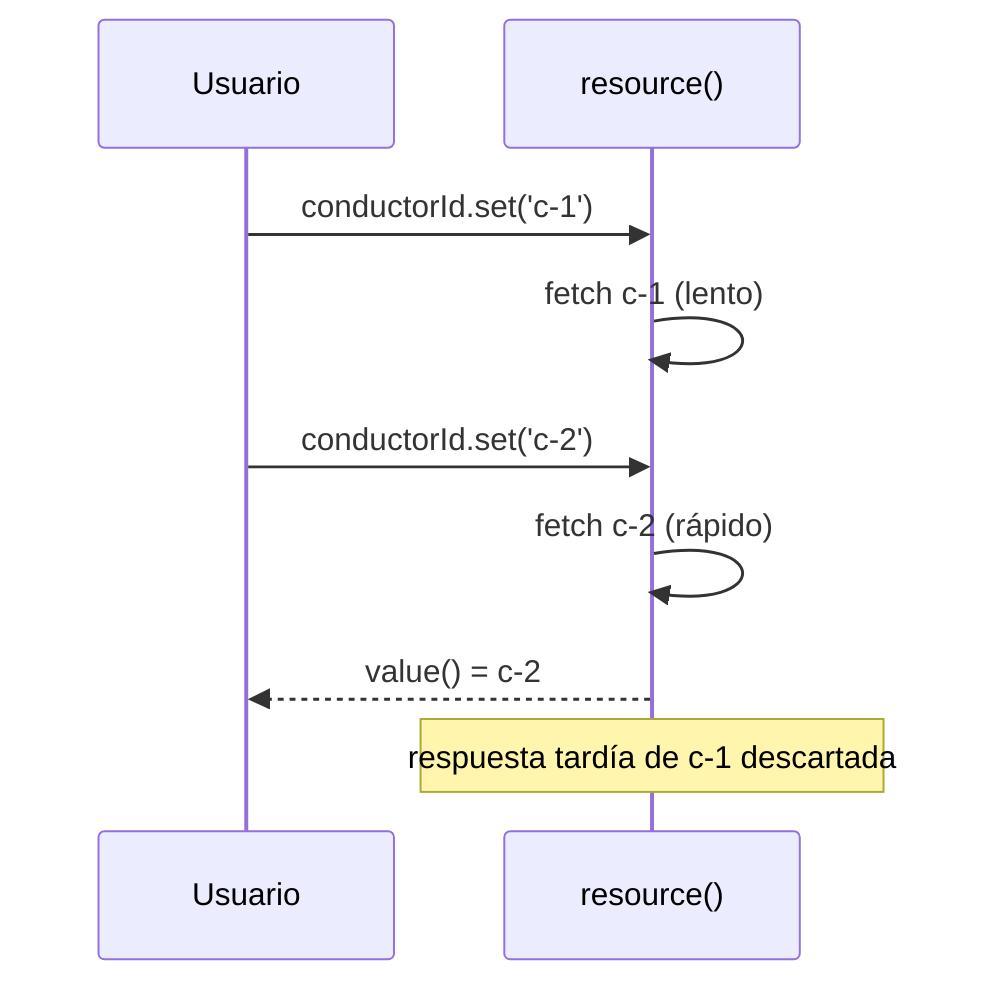

# Módulo 2: Signals — el nuevo modelo de reactividad


## Aprende construyendo

Cada tema verifica su garantía con espías reales contando invocaciones: memoización real de `computed()`, detección real de mutación in-place vs referencia nueva, los puentes oficiales `toSignal`/`toObservable`, y la precisión real del grafo de dependencias que hace viable eliminar Zone.js.


### Tema 1: signal(), computed() y effect() · Básico · 35 min

<details open>
<summary><strong>Capa 1 — Lectura</strong></summary>

#### ► DE QUÉ TRATA
Al finalizar podrás confirmar, con un espía real (vi.fn()) contando invocaciones exactas, que computed() memoiza genuinamente: solo recalcula cuando su dependencia real cambia, nunca en lecturas repetidas sin cambios.

#### ► CÓMO FUNCIONA


</details>

<details>
<summary><strong>Capa 2 — Construcción</strong></summary>

#### Código y verificación

```ts
const contador = signal(0);
const doble = computed(() => contador() * 2); // memoizado, solo recalcula si contador cambia
contador.set(5);
contador.update(v => v + 1);
effect(() => console.log('contador cambió a', contador())); // efecto secundario reactivo
```

```bash
mkdir demo-signals
cd demo-signals
npx -y @angular/cli@22 new . --standalone --style=css --routing=false --skip-git --defaults
```

```ts
// src/app/estado-pedido.ts
import { signal, computed } from '@angular/core';

export function crearEstadoPedido() {
  const paquetes = signal(3);
  const costoEnvio = computed(() => paquetes() * 5); // memoizado: solo recalcula si paquetes cambia
  return { paquetes, costoEnvio };
}
```

```ts
// src/app/estado-pedido.spec.ts
import { signal, computed } from '@angular/core';

describe('computed() memoiza realmente (conteo exacto de invocaciones)', () => {
  it('leer un computed multiples veces sin cambios NO recalcula', () => {
    const calculo = vi.fn((v: number) => v * 5);
    const paquetes = signal(3);
    const costoEnvio = computed(() => calculo(paquetes()));

    costoEnvio();
    costoEnvio();
    costoEnvio();

    expect(calculo).toHaveBeenCalledTimes(1); // memoizado: una sola invocacion real pese a 3 lecturas
  });

  it('cambiar la dependencia recalcula exactamente una vez por cambio', () => {
    const calculo = vi.fn((v: number) => v * 5);
    const paquetes = signal(3);
    const costoEnvio = computed(() => calculo(paquetes()));

    costoEnvio();
    paquetes.set(4);
    costoEnvio();
    paquetes.set(5);
    costoEnvio();

    expect(calculo).toHaveBeenCalledTimes(3); // 1 inicial + 2 cambios reales
  });
});
```

```bash
npx ng test --watch=false --include src/app/estado-pedido.spec.ts
```

</details>

### Tema 2: Mutación frente a actualización inmutable · Básico · 35 min

<details open>
<summary><strong>Capa 1 — Lectura</strong></summary>

#### ► DE QUÉ TRATA
Al finalizar podrás confirmar, con un espía real contando invocaciones, que mutar un array dentro de un signal con push() NO notifica ningún cambio (cero invocaciones adicionales), mientras update() con una nueva referencia SÍ lo notifica correctamente.

#### ► REGLA PRÁCTICA
Un signal detecta cambio por referencia, no por contenido: si llamas a un método que muta el array en el mismo lugar (`push`, `splice`, `sort` in-place), la referencia no cambió y nadie se entera. Siempre reemplaza con una copia nueva (`update(lista => [...lista, x])`) cuando el valor sea un array u objeto dentro de un signal.

</details>

<details>
<summary><strong>Capa 2 — Construcción</strong></summary>

#### Código y verificación
```
┌── tareas().push(x) ────────┐   MISMA referencia de array
└──────────────────────────────┘   → Angular NO detecta cambio (0 notificaciones)
┌── tareas.update(l => [...l, x]) ┐   NUEVA referencia de array
└──────────────────────────────────┘   → Angular SI detecta cambio (notifica)
```

```ts
const tareas = signal<Tarea[]>([]);
// MAL: mutar in-place no notifica a Angular del cambio
tareas().push(nuevaTarea);
// BIEN: nueva referencia, Angular detecta el cambio
tareas.update(lista => [...lista, nuevaTarea]);
```

```bash
mkdir -p src/app
```

```ts
// src/app/lista-paquetes.ts
import { signal, computed } from '@angular/core';

export interface Paquete { id: number; peso: number; }

export function crearListaPaquetes() {
  const paquetes = signal<Paquete[]>([]);
  const cantidad = computed(() => paquetes().length);
  return { paquetes, cantidad };
}
```

```ts
// src/app/lista-paquetes.spec.ts
import { signal, computed } from '@angular/core';
import type { Paquete } from './lista-paquetes';

describe('Mutacion in-place vs actualizacion inmutable (conteo real)', () => {
  it('mutar con push() NO notifica: el computed sigue devolviendo el valor viejo', () => {
    const calculo = vi.fn((lista: Paquete[]) => lista.length);
    const paquetes = signal<Paquete[]>([]);
    const cantidad = computed(() => calculo(paquetes()));

    cantidad(); // primera lectura: 1 invocacion real

    paquetes().push({ id: 1, peso: 2 }); // MUTACION in-place, misma referencia
    const valorTrasMutacion = cantidad();

    expect(calculo).toHaveBeenCalledTimes(1); // NINGUNA invocacion adicional: Angular no detecto cambio
    expect(valorTrasMutacion).toBe(0); // el computed sigue "viendo" la lista vacia original
  });

  it('update() con nueva referencia SI notifica: el computed refleja el cambio real', () => {
    const calculo = vi.fn((lista: Paquete[]) => lista.length);
    const paquetes = signal<Paquete[]>([]);
    const cantidad = computed(() => calculo(paquetes()));

    cantidad();

    paquetes.update((lista) => [...lista, { id: 1, peso: 2 }]); // NUEVA referencia
    const valorTrasUpdate = cantidad();

    expect(calculo).toHaveBeenCalledTimes(2); // 1 inicial + 1 recalculo real por el cambio de referencia
    expect(valorTrasUpdate).toBe(1);
  });
});
```

```bash
npx ng test --watch=false --include src/app/lista-paquetes.spec.ts
```

</details>

### Tema 3: Signals frente a Observables · Básico · 35 min

<details open>
<summary><strong>Capa 1 — Lectura</strong></summary>

#### ► DE QUÉ TRATA
Al finalizar podrás confirmar, con los puentes oficiales toSignal() y toObservable() reales, que un Observable puede leerse de forma síncrona como un signal, y que un signal puede exponerse como un flujo suscribible, integrando ambos modelos sin reescribir la lógica existente.

#### ► CÓMO FUNCIONA


#### ► REGLA PRÁCTICA
Usa un signal para estado síncrono simple que se lee directamente; usa un Observable/RxJS cuando necesites componer tiempo (`debounceTime`, `switchMap`, cancelación). No elijas uno "por estilo": `toSignal()`/`toObservable()` son los puentes oficiales para cruzar entre ambos sin reescribir la lógica existente.

</details>

<details>
<summary><strong>Capa 2 — Construcción</strong></summary>

#### Código y verificación

```ts
// Signal: estado síncrono simple, leído directamente
const seleccionado = signal<Tarea | null>(null);

// RxJS: flujo asíncrono con composición temporal (debounce, cancelación)
busqueda$.pipe(debounceTime(300), switchMap(texto => api.buscar(texto)));

// Puentes bidireccionales:
const resultadosSignal = toSignal(resultados$, { initialValue: [] });
const observableDeVuelta = toObservable(unSignal);
```

```bash
mkdir -p src/app
```

```ts
// src/app/estado-conexion.ts
import { Injectable, Injector, runInInjectionContext } from '@angular/core';
import { toSignal, toObservable } from '@angular/core/rxjs-interop';
import { BehaviorSubject } from 'rxjs';

@Injectable({ providedIn: 'root' })
export class EstadoConexion {
  private estado$ = new BehaviorSubject<'conectado' | 'desconectado'>('desconectado');

  constructor(private injector: Injector) {}

  crearSignalDeConexion() {
    return runInInjectionContext(this.injector, () =>
      toSignal(this.estado$, { initialValue: 'desconectado' as const })
    );
  }

  marcarConectado() {
    this.estado$.next('conectado');
  }
}
```

```ts
// src/app/estado-conexion.spec.ts
import { TestBed } from '@angular/core/testing';
import { EstadoConexion } from './estado-conexion';

describe('toSignal() real puentea un Observable hacia lectura sincrona', () => {
  it('el signal refleja el valor mas reciente del Observable, leido como funcion', () => {
    TestBed.configureTestingModule({});
    const servicio = TestBed.inject(EstadoConexion);

    const estadoSignal = servicio.crearSignalDeConexion();
    expect(estadoSignal()).toBe('desconectado'); // valor inicial, leido sincronamente

    servicio.marcarConectado(); // emite un nuevo valor por el Observable real

    expect(estadoSignal()).toBe('conectado'); // el signal REFLEJA la nueva emision, sin suscripcion manual
  });
});
```

```bash
npx ng test --watch=false
```

</details>

### Tema 4: Hacia zoneless change detection · Básico · 35 min

<details open>
<summary><strong>Capa 1 — Lectura</strong></summary>

#### ► DE QUÉ TRATA
Al finalizar podrás confirmar, con espías reales contando invocaciones sobre DOS signals independientes, que el grafo de dependencias de signals es preciso: un effect() solo se dispara por el signal específico del que depende, nunca por cambios en signals no relacionados — la bas…

#### ► LA IDEA EN UNA FRASE
**Al finalizar podrás confirmar, con espías reales contando invocaciones sobre DOS signals independientes, que el grafo de dependencias de signals es preciso: un effect() solo se dispara por el signal específico del que depende, nunca por cambios en signals no relacionados — la base real que hace viable eliminar Zone.js.**

</details>

<details>
<summary><strong>Capa 2 — Construcción</strong></summary>

#### Código y verificación
```
┌── Con Zone.js (historico) ─────────┐  cualquier evento/timer/peticion
│   revisa TODA la aplicacion         │  → revision de fuerza bruta
└────────────────────────────────────┘
┌── Zoneless (basado en signals) ────┐  un signal especifico cambia
│   actualiza SOLO lo que depende    │  → precision exacta
└────────────────────────────────────┘
```

```bash
mkdir -p src/app
```

```ts
// src/app/estado-independiente.ts
import { signal, effect, Injector, runInInjectionContext } from '@angular/core';

export function crearEstadosIndependientes(
  injector: Injector,
  alCambiarPedido: (pedido: string) => void,
  alCambiarFiltro: (filtro: string) => void,
) {
  const pedido = signal('PED-001');
  const filtroBusqueda = signal('');

  return runInInjectionContext(injector, () => {
    effect(() => alCambiarPedido(pedido()));
    effect(() => alCambiarFiltro(filtroBusqueda()));

    return { pedido, filtroBusqueda };
  });
}
```

```ts
// src/app/estado-independiente.spec.ts
import { TestBed } from '@angular/core/testing';
import { Injector } from '@angular/core';
import { crearEstadosIndependientes } from './estado-independiente';

describe('Precision real del grafo de dependencias de signals', () => {
  it('cambiar un signal dispara SOLO su effect dependiente, nunca el de otro signal', () => {
    TestBed.configureTestingModule({});
    const injector = TestBed.inject(Injector);
    const efectoPedido = vi.fn();
    const efectoFiltro = vi.fn();
    const { pedido } = crearEstadosIndependientes(injector, efectoPedido, efectoFiltro);

    TestBed.tick();
    efectoPedido.mockClear();
    efectoFiltro.mockClear();

    pedido.set('PED-002'); // cambia SOLO el signal pedido
    TestBed.tick();

    expect(efectoPedido).toHaveBeenCalledTimes(1); // su effect SI se disparo
    expect(efectoFiltro).toHaveBeenCalledTimes(0); // el effect NO relacionado nunca se disparo
  });
});
```

```bash
npx ng test --watch=false
```

```ts
TestBed.____();
```

</details>

### Tema 5: linkedSignal — estado derivado que el usuario puede sobrescribir · Básico · 35 min

<details open>
<summary><strong>Capa 1 — Lectura</strong></summary>

#### ► DE QUÉ TRATA
Al finalizar podrás usar linkedSignal() para que una cantidad seleccionada por el usuario se resetee automáticamente al valor calculado cuando cambia el stock disponible, sin perder la capacidad de sobrescribirla manualmente mientras el stock no cambia.

#### ► CÓMO FUNCIONA


</details>

<details>
<summary><strong>Capa 2 — Construcción</strong></summary>

#### Código y verificación


```bash
ng new ejemplo
cd ejemplo
```

```ts
cantidad = linkedSignal(() => Math.min(this.stockDisponible(), 1));
```

```bash
ng serve
```

```html
<input type="number" [value]="cantidad()" (input)="cantidad.set(+$event.target.value)">
```

```ts
cantidad = linkedSignal(____);
```

</details>

### Tema 6: resource() y httpResource — datos asíncronos reactivos · Básico · 35 min

<details open>
<summary><strong>Capa 1 — Lectura</strong></summary>

#### ► DE QUÉ TRATA
Al finalizar podrás usar resource() y su variante httpResource() (integrada con HttpClient) para traer los datos de un conductor de forma reactiva ligada a un signal conductorId, con estado de carga/error automático y sin condición de carrera cuando el id cambia antes de que la p…

#### ► LA IDEA EN UNA FRASE
**Al finalizar podrás usar resource() y su variante httpResource() (integrada con HttpClient) para traer los datos de un conductor de forma reactiva ligada a un signal conductorId, con estado de carga/error automático y sin condición de carrera cuando el id cambia antes de que la petición anterior termine.**

#### ► CÓMO FUNCIONA


</details>

<details>
<summary><strong>Capa 2 — Construcción</strong></summary>

#### Código y verificación


```bash
ng new ejemplo
cd ejemplo
```

```ts
conductorId = signal('c-1');
conductor = resource({
  // params es una función reactiva: se reevalúa cuando conductorId cambia
  // (antes de Angular 20 esta propiedad se llamaba "request"; sigue el mismo rol)
  params: () => this.conductorId(),
  loader: ({ params }) => fetch(`/api/conductores/${params}`).then(r => r.json()),
});
```

```bash
ng serve
```

```html
@if (conductor.isLoading()) { <p>Cargando...</p> }
@if (conductor.value()) { <p>{{ conductor.value().nombre }}</p> }
```

```ts
// src/app/conductor-panel.ts
import { Component, signal } from '@angular/core';
import { httpResource } from '@angular/common/http';

interface Conductor { id: string; nombre: string; }

@Component({
  selector: 'app-conductor-panel',
  template: `
    @if (conductor.isLoading()) { <p>Cargando...</p> }
    @if (conductor.hasValue()) { <p>{{ conductor.value().nombre }}</p> }
    @if (conductor.error()) { <p>Error al cargar</p> }
  `,
})
export class ConductorPanel {
  conductorId = signal('c-1');
  // la función reactiva se re-evalúa cuando conductorId cambia; httpResource
  // cancela la petición anterior en curso antes de emitir la nueva, igual que resource()
  conductor = httpResource<Conductor>(() => `/api/conductores/${this.conductorId()}`);
}
```

</details>
