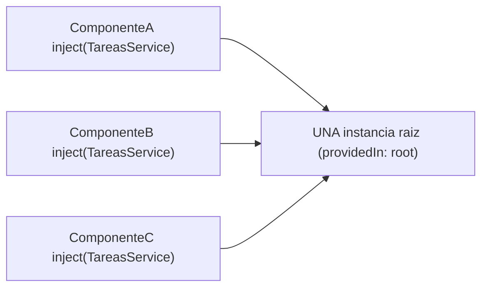
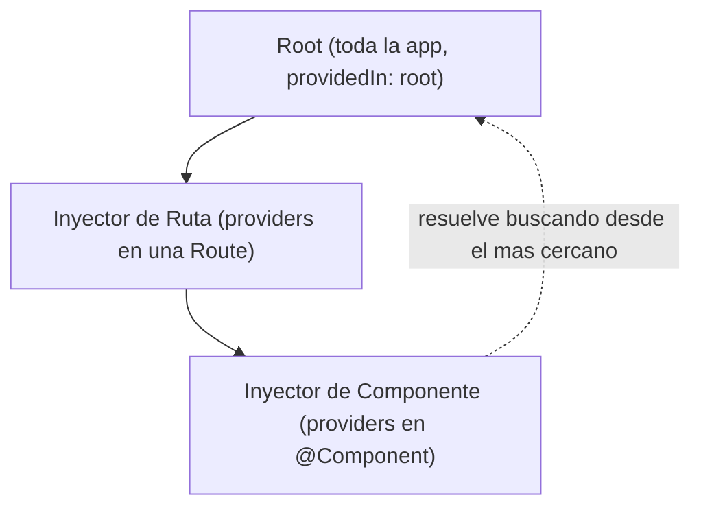
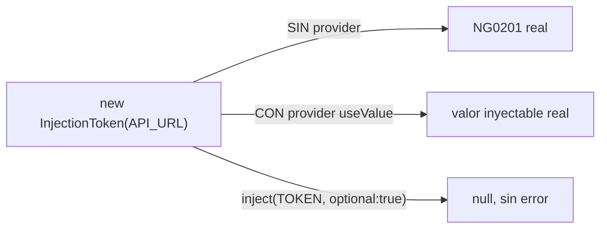

# Módulo 3: Servicios e inyección de dependencias


## Aprende construyendo

Cada tema verifica su garantía con comparaciones reales de identidad de objeto (`toBe`) y errores genuinos de Angular: el singleton real de `providedIn: 'root'`, el error real `NG0203` al usar `inject()` fuera de contexto, la jerarquía real de inyectores con overrides a nivel de componente, y `NG0201` (*No provider found*) real al faltar un `InjectionToken`.


### Tema 1: @Injectable y providedIn: root · Básico · 30 min

<details open>
<summary><strong>Capa 1 — Lectura</strong></summary>

#### ► DE QUÉ TRATA
Al finalizar podrás confirmar, con una comparación real de identidad de objeto (toBe), que providedIn: 'root' garantiza una única instancia singleton compartida entre cualquier número de componentes que inyecten el mismo servicio.

#### ► LA IDEA EN UNA FRASE
**Al finalizar podrás confirmar, con una comparación real de identidad de objeto (toBe), que providedIn: 'root' garantiza una única instancia singleton compartida entre cualquier número de componentes que inyecten el mismo servicio.**

#### ► POR QUÉ EXISTE ESTO
Resuelve un problema real de diseño o implementación y evita decisiones a ciegas.

#### ► LA ANALOGÍA
Piensa en @injectable y providedin: root como una herramienta de taller: útil cuando conoces su propósito y sus límites.
**Dónde se rompe la analogía:** en software, los efectos dependen del contexto, la escala y los trade-offs.

#### ► CÓMO FUNCIONA


#### ► LO QUE PUEDE SALIR MAL
| Síntoma | Causa probable | Arreglo |
|---|---|---|
| @Injectable y providedIn: root se aplica pero el resultado no mejora | Se usó sin medir el problema real | Mide antes y compara contra la alternativa simple |
| Aparece complejidad inesperada | Se adoptó la técnica sin comprender sus trade-offs | Vuelve a la sección de trade-offs y reduce el alcance |
| Falla en un caso límite | Se asumió un contexto que no se cumple | Prueba el caso límite y documenta cuándo NO usarlo |

#### ► TRADE-OFFS
| Opción | Cuándo usarla | Cuándo NO usarla |
|---|---|---|
| Usar @Injectable y providedIn: root | Cuando el problema coincide con su propósito y el beneficio es observable | Cuando agrega complejidad sin resolver un problema real |
| Alternativa más simple | Cuando el contexto es pequeño, estable o fácil de razonar | Cuando ya demostró no escalar o no cumplir el requisito |
| Postergar la decisión | Cuando falta evidencia del problema | Cuando el costo de esperar es mayor que el costo de probar |

#### ► CUÁNDO NO USAR ESTO
No uses @injectable y providedin: root por defecto. Aplícalo cuando el problema lo justifique y puedas verificar el beneficio; si una alternativa más simple resuelve igual, prefiérela.

#### ► DE VUELTA A LA ANALOGÍA
Volviendo a la analogía: @injectable y providedin: root funciona como el modelo inicial, pero recuerda dónde se rompe: en producción importan la evidencia, la escala y el costo de equivocarte.

#### ► LO QUE DEBES RECORDAR
- @Injectable y providedIn: root existe para resolver un problema específico.
- Mide antes de adoptar complejidad.
- Conoce el caso donde NO usarlo.
- Verifica con evidencia observable.

#### ► PREGUNTAS PARA PENSAR
1. ¿Qué problema concreto resuelve @injectable y providedin: root en tu contexto?
2. ¿Cómo sabrías que @injectable y providedin: root no está funcionando bien?
3. ¿Qué alternativa más simple considerarías antes de usar @injectable y providedin: root?

</details>

<details>
<summary><strong>Capa 2 — Construcción</strong></summary>

#### Código y verificación
```ts
@Injectable({ providedIn: 'root' }) // singleton de toda la app, tree-shakeable
export class TareasService {
  private tareas = signal<Tarea[]>([]);
  readonly lista = this.tareas.asReadonly();
  agregar(tarea: Tarea) { this.tareas.update(l => [...l, tarea]); }
}
```


```bash
mkdir demo-di
cd demo-di
npx -y @angular/cli@22 new . --standalone --style=css --routing=false --skip-git --defaults
```

```ts
// src/app/tareas.service.ts
import { Injectable, signal } from '@angular/core';

@Injectable({ providedIn: 'root' })
export class TareasService {
  private tareas = signal<string[]>([]);
  readonly lista = this.tareas.asReadonly();
  agregar(titulo: string) {
    this.tareas.update((l) => [...l, titulo]);
  }
}
```

```ts
// src/app/tareas.service.spec.ts
import { TestBed } from '@angular/core/testing';
import { Component, inject } from '@angular/core';
import { TareasService } from './tareas.service';

@Component({ selector: 'app-a', standalone: true, template: `` })
class ComponenteA {
  servicio = inject(TareasService);
}

@Component({ selector: 'app-b', standalone: true, template: `` })
class ComponenteB {
  servicio = inject(TareasService);
}

describe('providedIn: root garantiza un singleton real', () => {
  it('dos componentes distintos reciben la MISMA instancia del servicio', () => {
    TestBed.configureTestingModule({ imports: [ComponenteA, ComponenteB] });

    const fixtureA = TestBed.createComponent(ComponenteA);
    const fixtureB = TestBed.createComponent(ComponenteB);

    expect(fixtureA.componentInstance.servicio).toBe(fixtureB.componentInstance.servicio);
  });

  it('un cambio desde un componente es visible desde el otro, sin sincronizacion manual', () => {
    TestBed.configureTestingModule({ imports: [ComponenteA, ComponenteB] });

    const fixtureA = TestBed.createComponent(ComponenteA);
    const fixtureB = TestBed.createComponent(ComponenteB);

    fixtureA.componentInstance.servicio.agregar('PED-001');

    expect(fixtureB.componentInstance.servicio.lista()).toEqual(['PED-001']);
  });
});
```

```bash
npx ng test --watch=false
```

</details>

### Tema 2: inject() frente a inyección por constructor · Básico · 30 min

<details open>
<summary><strong>Capa 1 — Lectura</strong></summary>

#### ► DE QUÉ TRATA
Al finalizar podrás confirmar, con el error real NG0203 de Angular, que inject() requiere un contexto de inyección activo, mientras la inyección por constructor está limitada exclusivamente a clases con constructor — la razón real por la que inject() es la única opción viable en…

#### ► LA IDEA EN UNA FRASE
**Al finalizar podrás confirmar, con el error real NG0203 de Angular, que inject() requiere un contexto de inyección activo, mientras la inyección por constructor está limitada exclusivamente a clases con constructor — la razón real por la que inject() es la única opción viable en guards e interceptores funcionales.**

#### ► POR QUÉ EXISTE ESTO
Resuelve un problema real de diseño o implementación y evita decisiones a ciegas.

#### ► LA ANALOGÍA
Piensa en inject() frente a inyección por constructor como una herramienta de taller: útil cuando conoces su propósito y sus límites.
**Dónde se rompe la analogía:** en software, los efectos dependen del contexto, la escala y los trade-offs.

#### ► CÓMO FUNCIONA
1. Identifica el problema que inject() frente a inyección por constructor resuelve.
2. Observa sus componentes y relaciones.
3. Aplica la opción más simple que funcione.
4. Verifica el resultado y los límites.

#### ► LO QUE PUEDE SALIR MAL
| Síntoma | Causa probable | Arreglo |
|---|---|---|
| inject() frente a inyección por constructor se aplica pero el resultado no mejora | Se usó sin medir el problema real | Mide antes y compara contra la alternativa simple |
| Aparece complejidad inesperada | Se adoptó la técnica sin comprender sus trade-offs | Vuelve a la sección de trade-offs y reduce el alcance |
| Falla en un caso límite | Se asumió un contexto que no se cumple | Prueba el caso límite y documenta cuándo NO usarlo |

#### ► TRADE-OFFS
| Opción | Cuándo usarla | Cuándo NO usarla |
|---|---|---|
| Usar inject() frente a inyección por constructor | Cuando el problema coincide con su propósito y el beneficio es observable | Cuando agrega complejidad sin resolver un problema real |
| Alternativa más simple | Cuando el contexto es pequeño, estable o fácil de razonar | Cuando ya demostró no escalar o no cumplir el requisito |
| Postergar la decisión | Cuando falta evidencia del problema | Cuando el costo de esperar es mayor que el costo de probar |

#### ► CUÁNDO NO USAR ESTO
No uses inject() frente a inyección por constructor por defecto. Aplícalo cuando el problema lo justifique y puedas verificar el beneficio; si una alternativa más simple resuelve igual, prefiérela.

#### ► DE VUELTA A LA ANALOGÍA
Volviendo a la analogía: inject() frente a inyección por constructor funciona como el modelo inicial, pero recuerda dónde se rompe: en producción importan la evidencia, la escala y el costo de equivocarte.

#### ► LO QUE DEBES RECORDAR
- inject() frente a inyección por constructor existe para resolver un problema específico.
- Mide antes de adoptar complejidad.
- Conoce el caso donde NO usarlo.
- Verifica con evidencia observable.

#### ► PREGUNTAS PARA PENSAR
1. ¿Qué problema concreto resuelve inject() frente a inyección por constructor en tu contexto?
2. ¿Cómo sabrías que inject() frente a inyección por constructor no está funcionando bien?
3. ¿Qué alternativa más simple considerarías antes de usar inject() frente a inyección por constructor?

</details>

<details>
<summary><strong>Capa 2 — Construcción</strong></summary>

#### Código y verificación
```
┌── constructor(private s: Servicio) ┐  SOLO dentro de una clase con constructor
└──────────────────────────────────────┘  siempre tiene contexto valido (Angular lo provee)
┌── inject(Servicio) ─────────────────┐  funciona en constructor, campo de clase,
└──────────────────────────────────────┘  guard funcional... pero fuera de eso: NG0203
```

```ts
@Component({ /* ... */ })
export class ListaTareas {
  private servicio = inject(TareasService); // más conciso, funciona en cualquier contexto de inyección
  tareas = this.servicio.lista;
}
```

```bash
mkdir -p src/app
```

```ts
// src/app/inject-fuera-de-contexto.ts
import { inject } from '@angular/core';
import { TareasService } from './tareas.service';

// funcion ORDINARIA, sin contexto de inyeccion: NO es un guard, NO es un constructor
export function obtenerServicioFueraDeContexto() {
  return inject(TareasService);
}
```

```ts
// src/app/inject-fuera-de-contexto.spec.ts
import { obtenerServicioFueraDeContexto } from './inject-fuera-de-contexto';

describe('inject() fuera de contexto de inyeccion', () => {
  it('lanza el error real NG0203 al invocarse sin contexto valido', () => {
    expect(() => obtenerServicioFueraDeContexto()).toThrowError(/NG0203|injection context/i);
  });
});
```

```bash
npx ng test --watch=false
```

</details>

### Tema 3: Jerarquía de inyectores · Básico · 30 min

<details open>
<summary><strong>Capa 1 — Lectura</strong></summary>

#### ► DE QUÉ TRATA
Al finalizar podrás confirmar, con una comparación real de identidad de objeto, que un provider registrado a nivel de componente produce una instancia DISTINTA de la instancia raíz, verificando en código la regla real de resolución jerárquica: el nivel más cercano al punto de iny…

#### ► LA IDEA EN UNA FRASE
**Al finalizar podrás confirmar, con una comparación real de identidad de objeto, que un provider registrado a nivel de componente produce una instancia DISTINTA de la instancia raíz, verificando en código la regla real de resolución jerárquica: el nivel más cercano al punto de inyección gana.**

#### ► POR QUÉ EXISTE ESTO
Resuelve un problema real de diseño o implementación y evita decisiones a ciegas.

#### ► LA ANALOGÍA
Piensa en jerarquía de inyectores como una herramienta de taller: útil cuando conoces su propósito y sus límites.
**Dónde se rompe la analogía:** en software, los efectos dependen del contexto, la escala y los trade-offs.

#### ► CÓMO FUNCIONA


#### ► LO QUE PUEDE SALIR MAL
| Síntoma | Causa probable | Arreglo |
|---|---|---|
| Jerarquía de inyectores se aplica pero el resultado no mejora | Se usó sin medir el problema real | Mide antes y compara contra la alternativa simple |
| Aparece complejidad inesperada | Se adoptó la técnica sin comprender sus trade-offs | Vuelve a la sección de trade-offs y reduce el alcance |
| Falla en un caso límite | Se asumió un contexto que no se cumple | Prueba el caso límite y documenta cuándo NO usarlo |

#### ► TRADE-OFFS
| Opción | Cuándo usarla | Cuándo NO usarla |
|---|---|---|
| Usar Jerarquía de inyectores | Cuando el problema coincide con su propósito y el beneficio es observable | Cuando agrega complejidad sin resolver un problema real |
| Alternativa más simple | Cuando el contexto es pequeño, estable o fácil de razonar | Cuando ya demostró no escalar o no cumplir el requisito |
| Postergar la decisión | Cuando falta evidencia del problema | Cuando el costo de esperar es mayor que el costo de probar |

#### ► CUÁNDO NO USAR ESTO
No uses jerarquía de inyectores por defecto. Aplícalo cuando el problema lo justifique y puedas verificar el beneficio; si una alternativa más simple resuelve igual, prefiérela.

#### ► DE VUELTA A LA ANALOGÍA
Volviendo a la analogía: jerarquía de inyectores funciona como el modelo inicial, pero recuerda dónde se rompe: en producción importan la evidencia, la escala y el costo de equivocarte.

#### ► LO QUE DEBES RECORDAR
- Jerarquía de inyectores existe para resolver un problema específico.
- Mide antes de adoptar complejidad.
- Conoce el caso donde NO usarlo.
- Verifica con evidencia observable.

#### ► PREGUNTAS PARA PENSAR
1. ¿Qué problema concreto resuelve jerarquía de inyectores en tu contexto?
2. ¿Cómo sabrías que jerarquía de inyectores no está funcionando bien?
3. ¿Qué alternativa más simple considerarías antes de usar jerarquía de inyectores?

</details>

<details>
<summary><strong>Capa 2 — Construcción</strong></summary>

#### Código y verificación


```bash
mkdir -p src/app
```

```ts
// src/app/contador-intentos.service.ts
import { Injectable, signal } from '@angular/core';

@Injectable({ providedIn: 'root' })
export class ContadorIntentosService {
  private intentos = signal(0);
  readonly valor = this.intentos.asReadonly();
  incrementar() { this.intentos.update((v) => v + 1); }
}
```

```ts
// src/app/contador-intentos.spec.ts
import { TestBed } from '@angular/core/testing';
import { Component, inject } from '@angular/core';
import { ContadorIntentosService } from './contador-intentos.service';

@Component({ selector: 'app-sin-override', standalone: true, template: `` })
class ComponenteSinOverride {
  contador = inject(ContadorIntentosService);
}

@Component({
  selector: 'app-con-override',
  standalone: true,
  providers: [ContadorIntentosService], // override LOCAL: gana sobre la raiz
  template: ``,
})
class ComponenteConOverride {
  contador = inject(ContadorIntentosService);
}

describe('Jerarquia real de inyectores: el mas cercano gana', () => {
  it('un componente SIN provider local recibe la instancia raiz compartida', () => {
    TestBed.configureTestingModule({ imports: [ComponenteSinOverride] });
    const raiz = TestBed.inject(ContadorIntentosService);
    const fixture = TestBed.createComponent(ComponenteSinOverride);

    expect(fixture.componentInstance.contador).toBe(raiz);
  });

  it('un componente CON provider local recibe una instancia DISTINTA de la raiz', () => {
    TestBed.configureTestingModule({ imports: [ComponenteConOverride] });
    const raiz = TestBed.inject(ContadorIntentosService);
    const fixture = TestBed.createComponent(ComponenteConOverride);

    expect(fixture.componentInstance.contador).not.toBe(raiz);
  });
});
```

```bash
npx ng test --watch=false
```

```ts
@Component({ selector: 'app-con-override', ____: [ContadorIntentosService], template: `` })
```

</details>

### Tema 4: Tokens de inyección y decoradores de resolución · Básico · 30 min

<details open>
<summary><strong>Capa 1 — Lectura</strong></summary>

#### ► DE QUÉ TRATA
Al finalizar podrás confirmar, con el error real NG0201 de Angular, que un InjectionToken sin ningún provider registrado produce un fallo explícito al inyectarlo, y que @Optional() cambia genuinamente ese comportamiento a null en vez de un error.

#### ► LA IDEA EN UNA FRASE
**Al finalizar podrás confirmar, con el error real NG0201 de Angular, que un InjectionToken sin ningún provider registrado produce un fallo explícito al inyectarlo, y que @Optional() cambia genuinamente ese comportamiento a null en vez de un error.**

#### ► POR QUÉ EXISTE ESTO
Resuelve un problema real de diseño o implementación y evita decisiones a ciegas.

#### ► LA ANALOGÍA
Piensa en tokens de inyección y decoradores de resolución como una herramienta de taller: útil cuando conoces su propósito y sus límites.
**Dónde se rompe la analogía:** en software, los efectos dependen del contexto, la escala y los trade-offs.

#### ► CÓMO FUNCIONA


#### ► LO QUE PUEDE SALIR MAL
| Síntoma | Causa probable | Arreglo |
|---|---|---|
| Tokens de inyección y decoradores de resolución se aplica pero el resultado no mejora | Se usó sin medir el problema real | Mide antes y compara contra la alternativa simple |
| Aparece complejidad inesperada | Se adoptó la técnica sin comprender sus trade-offs | Vuelve a la sección de trade-offs y reduce el alcance |
| Falla en un caso límite | Se asumió un contexto que no se cumple | Prueba el caso límite y documenta cuándo NO usarlo |

#### ► TRADE-OFFS
| Opción | Cuándo usarla | Cuándo NO usarla |
|---|---|---|
| Usar Tokens de inyección y decoradores de resolución | Cuando el problema coincide con su propósito y el beneficio es observable | Cuando agrega complejidad sin resolver un problema real |
| Alternativa más simple | Cuando el contexto es pequeño, estable o fácil de razonar | Cuando ya demostró no escalar o no cumplir el requisito |
| Postergar la decisión | Cuando falta evidencia del problema | Cuando el costo de esperar es mayor que el costo de probar |

#### ► CUÁNDO NO USAR ESTO
No uses tokens de inyección y decoradores de resolución por defecto. Aplícalo cuando el problema lo justifique y puedas verificar el beneficio; si una alternativa más simple resuelve igual, prefiérela.

#### ► DE VUELTA A LA ANALOGÍA
Volviendo a la analogía: tokens de inyección y decoradores de resolución funciona como el modelo inicial, pero recuerda dónde se rompe: en producción importan la evidencia, la escala y el costo de equivocarte.

#### ► LO QUE DEBES RECORDAR
- Tokens de inyección y decoradores de resolución existe para resolver un problema específico.
- Mide antes de adoptar complejidad.
- Conoce el caso donde NO usarlo.
- Verifica con evidencia observable.

#### ► PREGUNTAS PARA PENSAR
1. ¿Qué problema concreto resuelve tokens de inyección y decoradores de resolución en tu contexto?
2. ¿Cómo sabrías que tokens de inyección y decoradores de resolución no está funcionando bien?
3. ¿Qué alternativa más simple considerarías antes de usar tokens de inyección y decoradores de resolución?

</details>

<details>
<summary><strong>Capa 2 — Construcción</strong></summary>

#### Código y verificación


```ts
export const API_URL = new InjectionToken<string>('API_URL');
// en la configuración de la app:
providers: [{ provide: API_URL, useValue: 'https://api.miapp.com' }]
// en cualquier servicio/componente:
private apiUrl = inject(API_URL);
```

```bash
mkdir -p src/app
```

```ts
// src/app/api-url.token.ts
import { InjectionToken } from '@angular/core';

export const API_URL = new InjectionToken<string>('API_URL');
```

```ts
// src/app/api-url.spec.ts
import { TestBed } from '@angular/core/testing';
import { Component, inject, Optional } from '@angular/core';
import { API_URL } from './api-url.token';

@Component({ selector: 'app-config-obligatoria', standalone: true, template: `` })
class ConfigObligatoriaComponent {
  apiUrl = inject(API_URL); // SIN @Optional: obligatorio
}

@Component({ selector: 'app-config-opcional', standalone: true, template: `` })
class ConfigOpcionalComponent {
  apiUrl = inject(API_URL, { optional: true }); // CON optional: no lanza error
}

describe('InjectionToken sin provider (NG0201 real)', () => {
  it('inyectar API_URL sin provider registrado lanza NG0201 real', () => {
    TestBed.configureTestingModule({ imports: [ConfigObligatoriaComponent] });

    expect(() => TestBed.createComponent(ConfigObligatoriaComponent)).toThrowError(/NG0201/);
  });

  it('con optional:true, la ausencia de provider resuelve a null, sin error', () => {
    TestBed.configureTestingModule({ imports: [ConfigOpcionalComponent] });

    const fixture = TestBed.createComponent(ConfigOpcionalComponent);
    expect(fixture.componentInstance.apiUrl).toBeNull();
  });
});
```

```bash
npx ng test --watch=false
```

</details>
