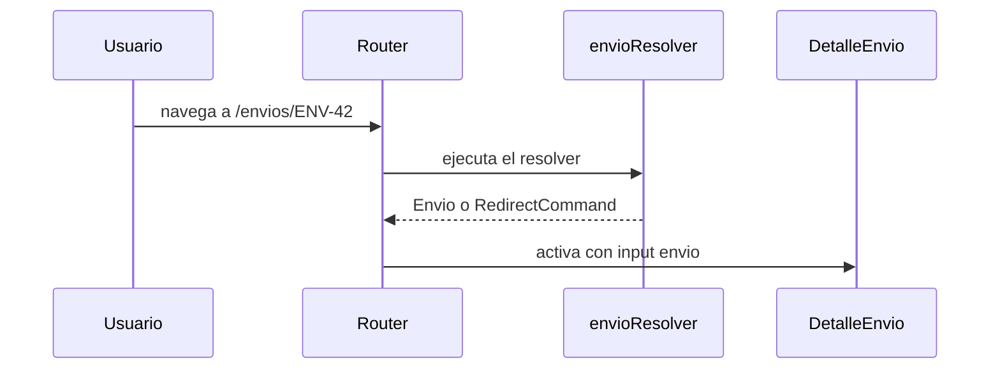

# Módulo 4: Routing y navegación


## Aprende construyendo

Cada tema verifica su garantía con navegación real (`RouterTestingHarness` oficial de Angular): el orden real del array de rutas, la invocación directa de un guard como función pura, un espía real confirmando que `loadComponent` no descarga hasta navegar, y el input binding real de parámetros de ruta.


### Tema 1: Router config con rutas standalone · Intermedio · 25 min

<details open>
<summary><strong>Capa 1 — Lectura</strong></summary>

#### ► DE QUÉ TRATA
Al finalizar podrás confirmar, con navegación real vía RouterTestingHarness, que el orden del array Routes determina qué ruta se activa: una ruta comodín colocada antes de una ruta específica la intercepta indebidamente, un bug real y reproducible, no solo una regla teórica.

#### ► LA IDEA EN UNA FRASE
**Al finalizar podrás confirmar, con navegación real vía RouterTestingHarness, que el orden del array Routes determina qué ruta se activa: una ruta comodín colocada antes de una ruta específica la intercepta indebidamente, un bug real y reproducible, no solo una regla teórica.**

#### ► POR QUÉ EXISTE ESTO
Resuelve un problema real de diseño o implementación y evita decisiones a ciegas.

#### ► LA ANALOGÍA
Piensa en router config con rutas standalone como una herramienta de taller: útil cuando conoces su propósito y sus límites.
**Dónde se rompe la analogía:** en software, los efectos dependen del contexto, la escala y los trade-offs.

#### ► CÓMO FUNCIONA
1. Identifica el problema que router config con rutas standalone resuelve.
2. Observa sus componentes y relaciones.
3. Aplica la opción más simple que funcione.
4. Verifica el resultado y los límites.

#### ► LO QUE PUEDE SALIR MAL
| Síntoma | Causa probable | Arreglo |
|---|---|---|
| Router config con rutas standalone se aplica pero el resultado no mejora | Se usó sin medir el problema real | Mide antes y compara contra la alternativa simple |
| Aparece complejidad inesperada | Se adoptó la técnica sin comprender sus trade-offs | Vuelve a la sección de trade-offs y reduce el alcance |
| Falla en un caso límite | Se asumió un contexto que no se cumple | Prueba el caso límite y documenta cuándo NO usarlo |

#### ► TRADE-OFFS
| Opción | Cuándo usarla | Cuándo NO usarla |
|---|---|---|
| Usar Router config con rutas standalone | Cuando el problema coincide con su propósito y el beneficio es observable | Cuando agrega complejidad sin resolver un problema real |
| Alternativa más simple | Cuando el contexto es pequeño, estable o fácil de razonar | Cuando ya demostró no escalar o no cumplir el requisito |
| Postergar la decisión | Cuando falta evidencia del problema | Cuando el costo de esperar es mayor que el costo de probar |

#### ► CUÁNDO NO USAR ESTO
No uses router config con rutas standalone por defecto. Aplícalo cuando el problema lo justifique y puedas verificar el beneficio; si una alternativa más simple resuelve igual, prefiérela.

#### ► DE VUELTA A LA ANALOGÍA
Volviendo a la analogía: router config con rutas standalone funciona como el modelo inicial, pero recuerda dónde se rompe: en producción importan la evidencia, la escala y el costo de equivocarte.

#### ► LO QUE DEBES RECORDAR
- Router config con rutas standalone existe para resolver un problema específico.
- Mide antes de adoptar complejidad.
- Conoce el caso donde NO usarlo.
- Verifica con evidencia observable.

#### ► PREGUNTAS PARA PENSAR
1. ¿Qué problema concreto resuelve router config con rutas standalone en tu contexto?
2. ¿Cómo sabrías que router config con rutas standalone no está funcionando bien?
3. ¿Qué alternativa más simple considerarías antes de usar router config con rutas standalone?

</details>

<details>
<summary><strong>Capa 2 — Construcción</strong></summary>

#### Objetivo observable
Al finalizar podrás confirmar, con navegación real vía `RouterTestingHarness`, que el orden del array `Routes` determina qué ruta se activa: una ruta comodín `**` colocada antes de una ruta específica la intercepta indebidamente, un bug real y reproducible, no solo una regla teórica.

**Conocimiento previo:** Módulo 3 de este track (inyección de dependencias); Módulo 8 (standalone y `provideRouter`).

</details>

### Tema 2: Guards funcionales · Intermedio · 25 min

<details open>
<summary><strong>Capa 1 — Lectura</strong></summary>

#### ► DE QUÉ TRATA
Al finalizar podrás confirmar, invocando un guard funcional DIRECTAMENTE como una función pura (sin TestBed.createComponent ni navegación completa), la ventaja real de testabilidad que distingue a los guards funcionales de los guards de clase históricos.

#### ► LA IDEA EN UNA FRASE
**Al finalizar podrás confirmar, invocando un guard funcional DIRECTAMENTE como una función pura (sin TestBed.createComponent ni navegación completa), la ventaja real de testabilidad que distingue a los guards funcionales de los guards de clase históricos.**

#### ► POR QUÉ EXISTE ESTO
Resuelve un problema real de diseño o implementación y evita decisiones a ciegas.

#### ► LA ANALOGÍA
Piensa en guards funcionales como una herramienta de taller: útil cuando conoces su propósito y sus límites.
**Dónde se rompe la analogía:** en software, los efectos dependen del contexto, la escala y los trade-offs.

#### ► CÓMO FUNCIONA
1. Identifica el problema que guards funcionales resuelve.
2. Observa sus componentes y relaciones.
3. Aplica la opción más simple que funcione.
4. Verifica el resultado y los límites.

#### ► LO QUE PUEDE SALIR MAL
| Síntoma | Causa probable | Arreglo |
|---|---|---|
| Guards funcionales se aplica pero el resultado no mejora | Se usó sin medir el problema real | Mide antes y compara contra la alternativa simple |
| Aparece complejidad inesperada | Se adoptó la técnica sin comprender sus trade-offs | Vuelve a la sección de trade-offs y reduce el alcance |
| Falla en un caso límite | Se asumió un contexto que no se cumple | Prueba el caso límite y documenta cuándo NO usarlo |

#### ► TRADE-OFFS
| Opción | Cuándo usarla | Cuándo NO usarla |
|---|---|---|
| Usar Guards funcionales | Cuando el problema coincide con su propósito y el beneficio es observable | Cuando agrega complejidad sin resolver un problema real |
| Alternativa más simple | Cuando el contexto es pequeño, estable o fácil de razonar | Cuando ya demostró no escalar o no cumplir el requisito |
| Postergar la decisión | Cuando falta evidencia del problema | Cuando el costo de esperar es mayor que el costo de probar |

#### ► CUÁNDO NO USAR ESTO
No uses guards funcionales por defecto. Aplícalo cuando el problema lo justifique y puedas verificar el beneficio; si una alternativa más simple resuelve igual, prefiérela.

#### ► DE VUELTA A LA ANALOGÍA
Volviendo a la analogía: guards funcionales funciona como el modelo inicial, pero recuerda dónde se rompe: en producción importan la evidencia, la escala y el costo de equivocarte.

#### ► LO QUE DEBES RECORDAR
- Guards funcionales existe para resolver un problema específico.
- Mide antes de adoptar complejidad.
- Conoce el caso donde NO usarlo.
- Verifica con evidencia observable.

#### ► PREGUNTAS PARA PENSAR
1. ¿Qué problema concreto resuelve guards funcionales en tu contexto?
2. ¿Cómo sabrías que guards funcionales no está funcionando bien?
3. ¿Qué alternativa más simple considerarías antes de usar guards funcionales?

</details>

<details>
<summary><strong>Capa 2 — Construcción</strong></summary>

#### Código y verificación
```typescript
export const authGuard: CanActivateFn = () => {
  const auth = inject(AuthService);
  return auth.estaAutenticado() ? true : inject(Router).parseUrl("/login");
};
```

```
navegación → /admin
      │
      ▼
┌───────────────┐   false/UrlTree   ┌──────────────────┐
│  authGuard()   │ ─────────────────▶│ redirige a /login │
└───────────────┘                    └──────────────────┘
      │ true
      ▼
┌───────────────┐
│ ruta activada  │
└───────────────┘
```

```bash
mkdir -p src/app
```

```ts
// src/app/auth.guard.ts
import { inject, Injectable, signal } from '@angular/core';
import { CanActivateFn, Router } from '@angular/router';

@Injectable({ providedIn: 'root' })
export class AuthService {
  private sesionActiva = signal(false);
  estaAutenticado = this.sesionActiva.asReadonly();
  iniciarSesion() { this.sesionActiva.set(true); }
}

export const authGuard: CanActivateFn = () => {
  const auth = inject(AuthService);
  const router = inject(Router);
  return auth.estaAutenticado() ? true : router.parseUrl('/login');
};
```

```ts
// src/app/auth.guard.spec.ts
import { TestBed } from '@angular/core/testing';
import { authGuard, AuthService } from './auth.guard';

describe('authGuard invocado directamente como funcion pura (sin componente ni router completo)', () => {
  it('SIN sesion, el guard devuelve una UrlTree hacia /login', () => {
    TestBed.configureTestingModule({});

    const resultado = TestBed.runInInjectionContext(() => authGuard({} as any, {} as any));

    expect(resultado).not.toBe(true);
    expect((resultado as any).toString()).toContain('/login');
  });

  it('CON sesion activa, el guard devuelve true', () => {
    TestBed.configureTestingModule({});
    const auth = TestBed.inject(AuthService);
    auth.iniciarSesion();

    const resultado = TestBed.runInInjectionContext(() => authGuard({} as any, {} as any));

    expect(resultado).toBe(true);
  });
});
```

```bash
npx ng test --watch=false
```

</details>

### Tema 3: Lazy loading con loadComponent · Intermedio · 25 min

<details open>
<summary><strong>Capa 1 — Lectura</strong></summary>

#### ► DE QUÉ TRATA
Al finalizar podrás confirmar, con un espía real envolviendo la función de importación dinámica, que loadComponent NO descarga su chunk hasta que la navegación hacia esa ruta específica efectivamente ocurre — el equivalente automatizable a inspeccionar la pestaña Network del nave…

#### ► LA IDEA EN UNA FRASE
**Al finalizar podrás confirmar, con un espía real envolviendo la función de importación dinámica, que loadComponent NO descarga su chunk hasta que la navegación hacia esa ruta específica efectivamente ocurre — el equivalente automatizable a inspeccionar la pestaña Network del navegador.**

#### ► POR QUÉ EXISTE ESTO
Resuelve un problema real de diseño o implementación y evita decisiones a ciegas.

#### ► LA ANALOGÍA
Piensa en lazy loading con loadcomponent como una herramienta de taller: útil cuando conoces su propósito y sus límites.
**Dónde se rompe la analogía:** en software, los efectos dependen del contexto, la escala y los trade-offs.

#### ► CÓMO FUNCIONA
1. Identifica el problema que lazy loading con loadcomponent resuelve.
2. Observa sus componentes y relaciones.
3. Aplica la opción más simple que funcione.
4. Verifica el resultado y los límites.

#### ► LO QUE PUEDE SALIR MAL
| Síntoma | Causa probable | Arreglo |
|---|---|---|
| Lazy loading con loadComponent se aplica pero el resultado no mejora | Se usó sin medir el problema real | Mide antes y compara contra la alternativa simple |
| Aparece complejidad inesperada | Se adoptó la técnica sin comprender sus trade-offs | Vuelve a la sección de trade-offs y reduce el alcance |
| Falla en un caso límite | Se asumió un contexto que no se cumple | Prueba el caso límite y documenta cuándo NO usarlo |

#### ► TRADE-OFFS
| Opción | Cuándo usarla | Cuándo NO usarla |
|---|---|---|
| Usar Lazy loading con loadComponent | Cuando el problema coincide con su propósito y el beneficio es observable | Cuando agrega complejidad sin resolver un problema real |
| Alternativa más simple | Cuando el contexto es pequeño, estable o fácil de razonar | Cuando ya demostró no escalar o no cumplir el requisito |
| Postergar la decisión | Cuando falta evidencia del problema | Cuando el costo de esperar es mayor que el costo de probar |

#### ► CUÁNDO NO USAR ESTO
No uses lazy loading con loadcomponent por defecto. Aplícalo cuando el problema lo justifique y puedas verificar el beneficio; si una alternativa más simple resuelve igual, prefiérela.

#### ► DE VUELTA A LA ANALOGÍA
Volviendo a la analogía: lazy loading con loadcomponent funciona como el modelo inicial, pero recuerda dónde se rompe: en producción importan la evidencia, la escala y el costo de equivocarte.

#### ► LO QUE DEBES RECORDAR
- Lazy loading con loadComponent existe para resolver un problema específico.
- Mide antes de adoptar complejidad.
- Conoce el caso donde NO usarlo.
- Verifica con evidencia observable.

#### ► PREGUNTAS PARA PENSAR
1. ¿Qué problema concreto resuelve lazy loading con loadcomponent en tu contexto?
2. ¿Cómo sabrías que lazy loading con loadcomponent no está funcionando bien?
3. ¿Qué alternativa más simple considerarías antes de usar lazy loading con loadcomponent?

</details>

<details>
<summary><strong>Capa 2 — Construcción</strong></summary>

#### Código y verificación
```
carga inicial de la app
      │
      ▼
┌─────────────┐        usuario navega a /admin        ┌───────────────────┐
│ bundle base  │ ─────────────────────────────────────▶│ se descarga chunk │
│ (sin admin)  │                                        │ admin.js recién   │
└─────────────┘                                         │ en este momento   │
                                                          └───────────────────┘
```

```ts
{ path: 'tareas', loadComponent: () => import('./tareas/lista').then(m => m.Lista) }
// verificar en DevTools → Network: el chunk de "lista" solo se descarga al navegar a /tareas
```

```bash
mkdir -p src/app
```

```ts
// src/app/lazy-demo.ts
import { Component } from '@angular/core';
import { Routes } from '@angular/router';

@Component({ selector: 'app-inicio-lazy', standalone: true, template: 'Inicio' })
export class InicioLazyComponent {}

@Component({ selector: 'app-admin-lazy', standalone: true, template: 'Panel admin' })
export class AdminLazyComponent {}

export function crearRutasLazy(cargarAdmin: () => Promise<{ default: any } | any>): Routes {
  return [
    { path: '', component: InicioLazyComponent },
    { path: 'admin', loadComponent: cargarAdmin },
  ];
}
```

```ts
// src/app/lazy-demo.spec.ts
import { TestBed } from '@angular/core/testing';
import { provideRouter } from '@angular/router';
import { RouterTestingHarness } from '@angular/router/testing';
import { AdminLazyComponent, crearRutasLazy } from './lazy-demo';

describe('loadComponent invoca el import dinamico solo al navegar', () => {
  it('NO invoca el factory antes de navegar, y lo invoca UNA vez al navegar a /admin', async () => {
    const factorySpy = vi.fn(() => Promise.resolve({ AdminLazyComponent }));

    TestBed.configureTestingModule({
      providers: [provideRouter(crearRutasLazy(() => factorySpy().then((m: any) => m.AdminLazyComponent)))],
    });

    expect(factorySpy).not.toHaveBeenCalled();

    const harness = await RouterTestingHarness.create();
    await harness.navigateByUrl('/');
    expect(factorySpy).not.toHaveBeenCalled();

    await harness.navigateByUrl('/admin');
    expect(factorySpy).toHaveBeenCalledTimes(1);
  });
});
```

```bash
npx ng test --watch=false
```

</details>

### Tema 4: Parámetros de ruta, query params y capacidades avanzadas de routing · Intermedio · 25 min

<details open>
<summary><strong>Capa 1 — Lectura</strong></summary>

#### ► DE QUÉ TRATA
Al finalizar podrás confirmar, navegando con RouterTestingHarness hacia una URL con un parámetro dinámico, que Angular llena automáticamente un input() del componente de destino con el valor real de ese parámetro — sin ninguna suscripción manual a ActivatedRoute.

#### ► LA IDEA EN UNA FRASE
**Al finalizar podrás confirmar, navegando con RouterTestingHarness hacia una URL con un parámetro dinámico, que Angular llena automáticamente un input() del componente de destino con el valor real de ese parámetro — sin ninguna suscripción manual a ActivatedRoute.**

#### ► POR QUÉ EXISTE ESTO
Resuelve un problema real de diseño o implementación y evita decisiones a ciegas.

#### ► LA ANALOGÍA
**Conceptos clave:** input binding de rutas, `ActivatedRoute`, `CanDeactivateFn`, `ResolveFn`.

Los parámetros de ruta dinámicos (`:id` en `path: "tareas/:id"`) pueden leerse de dos formas: la forma clásica inyecta `ActivatedRoute` y suscribe (o convierte con `toSignal`, Módulo 6) al observable `paramMap`; la forma moderna y más concisa usa "input binding de rutas", donde simplemente declarar `id = input<string>();` en el componente hace que Angular llene automáticamente ese input con el valor del parámetro de ruta `:id` correspondiente, sin ninguna suscripción manual necesaria, una integración directa entre el sistema de routing y el modelo de inputs basados en signals estudiado en el Módulo 1.

Los query params (`?estado=pendiente`), a diferencia de los parámetros de ruta (que son parte de la estructura jerárquica de la URL), representan filtros o modificadores opcionales que no cambian qué componente se activa, sino que proporcionan información adicional que ese componente puede leer para ajustar su comportamiento (por ejemplo, qué filtro aplicar sobre una lista mostrada). Sincronizar un query param con un signal del componente permite que el estado del filtro sea reflejado en la URL (haciendo esa vista filtrada compartible mediante un enlace directo, y preservada correctamente ante recargas de página o el uso del botón de retroceso del navegador).

`CanDeactivateFn` protege contra la navegación fuera de una ruta actual (útil para advertir al usuario si intenta abandonar un formulario con cambios sin guardar); `CanMatchFn` decide si una ruta puede considerarse una coincidencia en absoluto antes incluso de intentar activarla (útil, por ejemplo, para mostrar una ruta alternativa completamente distinta según una condición, en vez de simplemente bloquear el acceso a la misma ruta); `canActivateChild` aplica un guard a todas las rutas hijas de una ruta padre de una sola vez, evitando declarar el mismo guard repetidamente en cada ruta hija individual; y `ResolveFn` permite precargar datos necesarios para una vista antes de que esa vista termine de activarse, garantizando que el componente ya tenga los datos disponibles inmediatamente al renderizarse, en vez de mostrar primero un estado de carga y solicitar los datos después de que el componente ya esté visible.

**Analogía:** los parámetros de ruta son como el número de habitación específico dentro de un hotel (parte de la dirección estructural); los query params son como instrucciones adicionales de servicio para esa habitación específica (limpieza extra, no molestar), que no cambian cuál habitación es pero sí modifican cómo se atiende. `CanDeactivateFn` es como preguntar "¿está seguro de que quiere salir de la habitación sin llevar sus pertenencias?" antes de permitir la salida; `ResolveFn` es como tener la habitación completamente preparada y lista antes de que el huésped llegue, en vez de empezar a prepararla justo cuando él ya está entrando.

**Diagrama — de la URL al input del componente:**

```
URL: /pedidos/42
          │
          ▼
┌───────────────────┐   withComponentInputBinding()   ┌────────────────────┐
│ Angular Router     │ ────────────────────────────────▶│ id = input<string>()│
│ extrae :id = "42"  │                                   │ recibe "42"         │
└───────────────────┘                                    └────────────────────┘
```

**Código del ejemplo:**

```ts
@Component({ /* ... */ })
export class Detalle {
  id = input<string>(); // Angular lo llena automáticamente desde :id de la ruta
}
```

**Dónde se rompe la analogía:** el modelo simplifica la realidad; en producción influyen escala, fallos, costo y contexto.

#### ► CÓMO FUNCIONA
1. Identifica el problema que parámetros de ruta, query params y capacidades avanzadas de routing resuelve.
2. Observa sus componentes y relaciones.
3. Aplica la opción más simple que funcione.
4. Verifica el resultado y los límites.

#### ► LO QUE PUEDE SALIR MAL
| Síntoma | Causa probable | Arreglo |
|---|---|---|
| Parámetros de ruta, query params y capacidades avanzadas de routing se aplica pero el resultado no mejora | Se usó sin medir el problema real | Mide antes y compara contra la alternativa simple |
| Aparece complejidad inesperada | Se adoptó la técnica sin comprender sus trade-offs | Vuelve a la sección de trade-offs y reduce el alcance |
| Falla en un caso límite | Se asumió un contexto que no se cumple | Prueba el caso límite y documenta cuándo NO usarlo |

#### ► TRADE-OFFS
| Opción | Cuándo usarla | Cuándo NO usarla |
|---|---|---|
| Usar Parámetros de ruta, query params y capacidades avanzadas de routing | Cuando el problema coincide con su propósito y el beneficio es observable | Cuando agrega complejidad sin resolver un problema real |
| Alternativa más simple | Cuando el contexto es pequeño, estable o fácil de razonar | Cuando ya demostró no escalar o no cumplir el requisito |
| Postergar la decisión | Cuando falta evidencia del problema | Cuando el costo de esperar es mayor que el costo de probar |

#### ► CUÁNDO NO USAR ESTO
No uses parámetros de ruta, query params y capacidades avanzadas de routing por defecto. Aplícalo cuando el problema lo justifique y puedas verificar el beneficio; si una alternativa más simple resuelve igual, prefiérela.

#### ► DE VUELTA A LA ANALOGÍA
Volviendo a la analogía: parámetros de ruta, query params y capacidades avanzadas de routing funciona como el modelo inicial, pero recuerda dónde se rompe: en producción importan la evidencia, la escala y el costo de equivocarte.

#### ► LO QUE DEBES RECORDAR
- Parámetros de ruta, query params y capacidades avanzadas de routing existe para resolver un problema específico.
- Mide antes de adoptar complejidad.
- Conoce el caso donde NO usarlo.
- Verifica con evidencia observable.

#### ► PREGUNTAS PARA PENSAR
1. ¿Qué problema concreto resuelve parámetros de ruta, query params y capacidades avanzadas de routing en tu contexto?
2. ¿Cómo sabrías que parámetros de ruta, query params y capacidades avanzadas de routing no está funcionando bien?
3. ¿Qué alternativa más simple considerarías antes de usar parámetros de ruta, query params y capacidades avanzadas de routing?

</details>

<details>
<summary><strong>Capa 2 — Construcción</strong></summary>

#### Objetivo observable
Al finalizar podrás confirmar, navegando con `RouterTestingHarness` hacia una URL con un parámetro dinámico, que Angular llena automáticamente un `input()` del componente de destino con el valor real de ese parámetro — sin ninguna suscripción manual a `ActivatedRoute`.

**Conocimiento previo:** Tema 1 de este módulo (`RouterTestingHarness`); Módulo 1 de este track (`input()`).

</details>

### Tema 5: CanDeactivate: proteger un borrador sin confundir navegación con autorización · Intermedio · 25 min

<details open>
<summary><strong>Capa 1 — Lectura</strong></summary>

#### ► DE QUÉ TRATA
Al finalizar protegerás texto sin guardar al navegar a otra ruta y comprobarás las dos decisiones de salida. Prerrequisitos: componentes standalone, signals, eventos y Router. Node compatible con Angular 21 y npm. Es un ejemplo independiente desde un proyecto nuevo.

#### ► LA IDEA EN UNA FRASE
**Al finalizar protegerás texto sin guardar al navegar a otra ruta y comprobarás las dos decisiones de salida.**

#### ► POR QUÉ EXISTE ESTO
Resuelve un problema real de diseño o implementación y evita decisiones a ciegas.

#### ► LA ANALOGÍA
Piensa en candeactivate: proteger un borrador sin confundir navegación con autorización como una herramienta de taller: útil cuando conoces su propósito y sus límites.
**Dónde se rompe la analogía:** en software, los efectos dependen del contexto, la escala y los trade-offs.

#### ► CÓMO FUNCIONA
1. Identifica el problema que candeactivate: proteger un borrador sin confundir navegación con autorización resuelve.
2. Observa sus componentes y relaciones.
3. Aplica la opción más simple que funcione.
4. Verifica el resultado y los límites.

#### ► LO QUE PUEDE SALIR MAL
| Síntoma | Causa probable | Arreglo |
|---|---|---|
| CanDeactivate: proteger un borrador sin confundir navegación con autorización se aplica pero el resultado no mejora | Se usó sin medir el problema real | Mide antes y compara contra la alternativa simple |
| Aparece complejidad inesperada | Se adoptó la técnica sin comprender sus trade-offs | Vuelve a la sección de trade-offs y reduce el alcance |
| Falla en un caso límite | Se asumió un contexto que no se cumple | Prueba el caso límite y documenta cuándo NO usarlo |

#### ► TRADE-OFFS
| Opción | Cuándo usarla | Cuándo NO usarla |
|---|---|---|
| Usar CanDeactivate: proteger un borrador sin confundir navegación con autorización | Cuando el problema coincide con su propósito y el beneficio es observable | Cuando agrega complejidad sin resolver un problema real |
| Alternativa más simple | Cuando el contexto es pequeño, estable o fácil de razonar | Cuando ya demostró no escalar o no cumplir el requisito |
| Postergar la decisión | Cuando falta evidencia del problema | Cuando el costo de esperar es mayor que el costo de probar |

#### ► CUÁNDO NO USAR ESTO
No uses candeactivate: proteger un borrador sin confundir navegación con autorización por defecto. Aplícalo cuando el problema lo justifique y puedas verificar el beneficio; si una alternativa más simple resuelve igual, prefiérela.

#### ► DE VUELTA A LA ANALOGÍA
Volviendo a la analogía: candeactivate: proteger un borrador sin confundir navegación con autorización funciona como el modelo inicial, pero recuerda dónde se rompe: en producción importan la evidencia, la escala y el costo de equivocarte.

#### ► LO QUE DEBES RECORDAR
- CanDeactivate: proteger un borrador sin confundir navegación con autorización existe para resolver un problema específico.
- Mide antes de adoptar complejidad.
- Conoce el caso donde NO usarlo.
- Verifica con evidencia observable.

#### ► PREGUNTAS PARA PENSAR
1. ¿Qué problema concreto resuelve candeactivate: proteger un borrador sin confundir navegación con autorización en tu contexto?
2. ¿Cómo sabrías que candeactivate: proteger un borrador sin confundir navegación con autorización no está funcionando bien?
3. ¿Qué alternativa más simple considerarías antes de usar candeactivate: proteger un borrador sin confundir navegación con autorización?

</details>

<details>
<summary><strong>Capa 2 — Construcción</strong></summary>

#### Código y verificación
```bash
npx @angular/cli@21 new borrador-demo --standalone --routing --style=css --skip-tests --skip-git --defaults
cd borrador-demo
```

```typescript
import { Component, signal } from '@angular/core';
import { bootstrapApplication } from '@angular/platform-browser';
import { CanDeactivateFn, provideRouter, RouterLink, RouterOutlet } from '@angular/router';

@Component({ selector: 'app-editor', standalone: true, imports: [RouterLink], template: `
  <h1>Observación de la entrega</h1>
  <label for="nota">Nota</label>
  <textarea id="nota" [value]="text()" (input)="edit($event)"></textarea>
  <button (click)="saved.set(text())">Guardar en esta sesión</button>
  <p>{{ text() !== saved() ? 'Cambios sin guardar' : 'Sin cambios pendientes' }}</p>
  <a routerLink="/salir">Ir al listado</a>` })
class Editor {
  text = signal('');
  saved = signal('');
  edit(event: Event) { this.text.set((event.target as HTMLTextAreaElement).value); }
}
const confirmExit: CanDeactivateFn<Editor> = editor =>
  editor.text() === editor.saved() || confirm('Hay cambios sin guardar. ¿Salir?');

@Component({ selector: 'app-listado', standalone: true, imports: [RouterLink],
  template: '<h1>Listado</h1><a routerLink="/">Volver al editor</a>' })
class Listado {}
@Component({ selector: 'app-root', standalone: true, imports: [RouterOutlet],
  template: '<main><router-outlet /></main>' })
class App {}
bootstrapApplication(App, { providers: [provideRouter([
  { path: '', component: Editor, canDeactivate: [confirmExit] },
  { path: 'salir', component: Listado }
])] }).catch(console.error);
```

```bash
npm start
```

</details>

### Tema 6: Resolvers funcionales: datos listos antes de mostrar la ruta · Intermedio · 40 min

<details open>
<summary><strong>Capa 1 — Lectura</strong></summary>

#### ► DE QUÉ TRATA
Usa un proyecto Angular 18 o superior (ng new academia-ng --routing). Crea la carpeta src/app/envios. El ejemplo usa un servicio en memoria para no depender de un backend.

#### ► LA IDEA EN UNA FRASE
**Usa un proyecto Angular 18 o superior (ng new academia-ng --routing).**

#### ► POR QUÉ EXISTE ESTO
Resuelve un problema real de diseño o implementación y evita decisiones a ciegas.

#### ► LA ANALOGÍA
**Conceptos clave:** `ResolveFn`, `resolve` en la ruta, `withComponentInputBinding`, `RedirectCommand`, navegación cancelada.

Un **resolver** es una función que el router ejecuta **antes** de activar la ruta. Puede devolver un valor, una promesa o un observable. Cuando termina, el router guarda el resultado en los datos de la ruta con la clave que elegiste.

Con `withComponentInputBinding()`, ese dato llega al componente como un `input()` con el mismo nombre. Si el resolver devuelve un `RedirectCommand`, el router cancela la navegación y va a otra URL.

| Usa resolver cuando | Evítalo cuando |
|---|---|
| la pantalla no tiene sentido sin el dato | la carga es lenta y conviene mostrar algo parcial |
| quieres un único lugar para «no encontrado» | el dato cambia en vivo mientras miras la pantalla |

**Analogía:** el resolver es el mesero que trae los cubiertos antes de servir el plato: no te sientas a una mesa vacía. La analogía falla en que, si la cocina tarda, el resolver también te deja esperando en la puerta.

**Límite de uso:** la navegación espera al resolver: una petición lenta deja al usuario sin respuesta visible. Para cargas largas, prefiere `resource()` o `httpResource` dentro del componente con un estado de carga.



**Dónde se rompe la analogía:** el modelo simplifica la realidad; en producción influyen escala, fallos, costo y contexto.

#### ► CÓMO FUNCIONA


#### ► LO QUE PUEDE SALIR MAL
| Síntoma | Causa probable | Arreglo |
|---|---|---|
| Resolvers funcionales: datos listos antes de mostrar la ruta se aplica pero el resultado no mejora | Se usó sin medir el problema real | Mide antes y compara contra la alternativa simple |
| Aparece complejidad inesperada | Se adoptó la técnica sin comprender sus trade-offs | Vuelve a la sección de trade-offs y reduce el alcance |
| Falla en un caso límite | Se asumió un contexto que no se cumple | Prueba el caso límite y documenta cuándo NO usarlo |

#### ► TRADE-OFFS
| Opción | Cuándo usarla | Cuándo NO usarla |
|---|---|---|
| Usar Resolvers funcionales: datos listos antes de mostrar la ruta | Cuando el problema coincide con su propósito y el beneficio es observable | Cuando agrega complejidad sin resolver un problema real |
| Alternativa más simple | Cuando el contexto es pequeño, estable o fácil de razonar | Cuando ya demostró no escalar o no cumplir el requisito |
| Postergar la decisión | Cuando falta evidencia del problema | Cuando el costo de esperar es mayor que el costo de probar |

#### ► CUÁNDO NO USAR ESTO
No uses resolvers funcionales: datos listos antes de mostrar la ruta por defecto. Aplícalo cuando el problema lo justifique y puedas verificar el beneficio; si una alternativa más simple resuelve igual, prefiérela.

#### ► DE VUELTA A LA ANALOGÍA
Volviendo a la analogía: resolvers funcionales: datos listos antes de mostrar la ruta funciona como el modelo inicial, pero recuerda dónde se rompe: en producción importan la evidencia, la escala y el costo de equivocarte.

#### ► LO QUE DEBES RECORDAR
- Resolvers funcionales: datos listos antes de mostrar la ruta existe para resolver un problema específico.
- Mide antes de adoptar complejidad.
- Conoce el caso donde NO usarlo.
- Verifica con evidencia observable.

#### ► PREGUNTAS PARA PENSAR
1. ¿Qué problema concreto resuelve resolvers funcionales: datos listos antes de mostrar la ruta en tu contexto?
2. ¿Cómo sabrías que resolvers funcionales: datos listos antes de mostrar la ruta no está funcionando bien?
3. ¿Qué alternativa más simple considerarías antes de usar resolvers funcionales: datos listos antes de mostrar la ruta?

</details>

<details>
<summary><strong>Capa 2 — Construcción</strong></summary>

#### Código y verificación


```ts
import { Injectable } from '@angular/core';
import { of, delay } from 'rxjs';

export interface Envio { codigo: string; destino: string; estado: string; }

@Injectable({ providedIn: 'root' })
export class EnviosService {
  private readonly datos: Envio[] = [{ codigo: 'ENV-42', destino: 'Calle 26', estado: 'EN_RUTA' }];
  obtener(codigo: string) {
    return of(this.datos.find((e) => e.codigo === codigo) ?? null).pipe(delay(300));
  }
}
```

```ts
import { inject } from '@angular/core';
import { RedirectCommand, ResolveFn, Router } from '@angular/router';
import { map } from 'rxjs';
import { Envio, EnviosService } from './envios.service';

export const envioResolver: ResolveFn<Envio> = (route) => {
  const router = inject(Router);
  const codigo = route.paramMap.get('codigo')!;
  return inject(EnviosService).obtener(codigo).pipe(
    map((envio) => envio ?? new RedirectCommand(router.parseUrl('/no-encontrado'))),
  );
};
```

```ts
import { Component, input } from '@angular/core';
import { Envio } from './envios.service';

@Component({
  selector: 'app-detalle-envio',
  template: `<h2>{{ envio().codigo }}</h2><p>{{ envio().destino }} · {{ envio().estado }}</p>`,
})
export class DetalleEnvio {
  readonly envio = input.required<Envio>(); // llega desde el resolver
}
```

```ts
import { Routes } from '@angular/router';
import { DetalleEnvio } from './envios/detalle-envio';
import { envioResolver } from './envios/envio.resolver';

export const routes: Routes = [
  { path: 'envios/:codigo', component: DetalleEnvio, resolve: { envio: envioResolver } },
  { path: 'no-encontrado', loadComponent: () => import('./no-encontrado').then((m) => m.NoEncontrado) },
];
// En app.config.ts: provideRouter(routes, withComponentInputBinding())
```

```bash
ng serve
# abre http://localhost:4200/envios/ENV-42 y luego /envios/ENV-99
```

</details>
