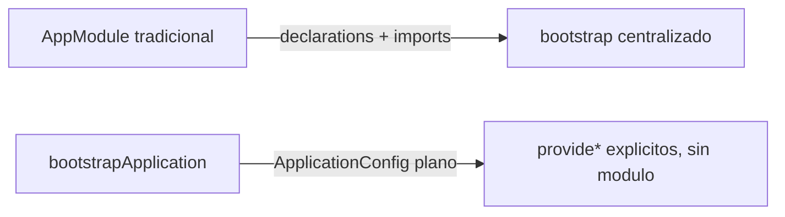
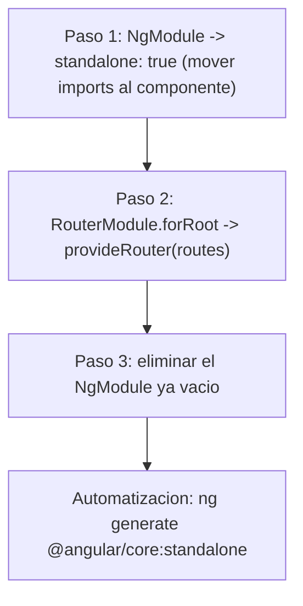
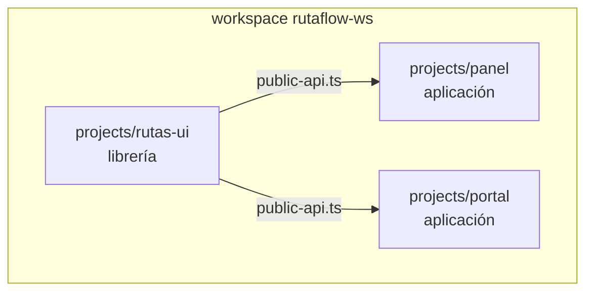
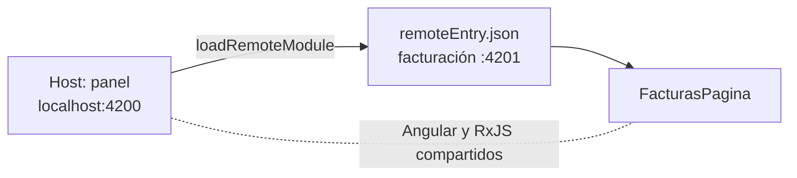

# Módulo 8: Standalone components y arquitectura sin NgModules


## Aprende construyendo

Cada tema verifica su garantía con código real: un error de DI genuino de Angular al faltar un provider, un script Node con `fs` real que audita cohesión de carpetas, y el esquema oficial `ng generate @angular/core:standalone` junto con un error real de plantilla al migrar de forma incompleta.

### Tema 1: Bootstrap sin NgModules

#### Paso 1 · Objetivo y preparación

Al finalizar podrás confirmar, con un error real de inyección de dependencias de Angular (`NG0201`), que `bootstrapApplication` y `ApplicationConfig` reemplazan completamente al `AppModule`: sin ningún módulo central que "arrastre" providers implícitamente, cada provider debe declararse explícitamente o la aplicación falla al iniciar.

**Conocimiento previo:** Módulo 0 de este track (standalone components); Módulo 4 (providers e inyección de dependencias).

#### Paso 2 · Contexto y caso real

**¿Por qué es importante?** Una app de entregas que crece por funcionalidades necesita saber, sin ambigüedad, qué providers están disponibles en cada punto: sin un `AppModule` central, esa configuración vive explícitamente en `app.config.ts`, y omitir un provider ahí produce un fallo real y diagnosticable al arrancar, no un comportamiento silencioso.

#### Paso 3 · Teoría con analogía

**Conceptos clave:** `bootstrapApplication`, ausencia de `AppModule`, `ApplicationConfig`, `NG0201`.

Antes de que existieran los standalone components (Módulo 0), toda aplicación Angular requería un `AppModule` raíz decorado con `@NgModule({ declarations: [...], imports: [...], bootstrap: [AppComponent] })`, que actuaba como el punto de entrada obligatorio de la aplicación, declarando explícitamente qué componentes pertenecían a ese módulo y qué otros módulos importaba. Con `bootstrapApplication(App, appConfig)` en `main.ts`, ese `AppModule` raíz desaparece por completo: el componente raíz se arranca directamente, y su configuración global (proveedores de routing, HTTP, animaciones, etc.) se declara en un objeto `ApplicationConfig` plano (típicamente en `app.config.ts`), sin ninguna clase de módulo de por medio.

`app.config.ts` centraliza el arreglo `providers` que anteriormente estaría distribuido entre el `AppModule` y potencialmente varios módulos de features (`imports: [RouterModule.forRoot(routes), HttpClientModule]`), reemplazándolo por funciones `provide*()` explícitas (`provideRouter(routes)`, `provideHttpClient()`), cada una responsable de configurar exactamente un aspecto concreto de la aplicación, en vez de un módulo monolítico que agrupaba configuración heterogénea bajo una única declaración `imports`.

Sin `AppModule`, tampoco existen `declarations` ni el concepto de "módulo de features" que agrupa componentes relacionados bajo un `NgModule` dedicado: cada componente standalone declara directamente, en su propio decorador `@Component({ imports: [...] })` (Módulo 0), exactamente qué otros componentes, directivas y pipes necesita, haciendo explícitas sus propias dependencias sin depender de qué módulo lo "envuelva" externamente.

**Analogía:** el `AppModule` tradicional era como un directorio telefónico central que había que consultar y mantener actualizado para saber qué partes de la aplicación existían y cómo se relacionaban entre sí; con standalone components, cada componente lleva consigo su propia lista de contactos directos, sin depender de un directorio centralizado externo.

**Código del ejemplo:**

```ts
// main.ts
bootstrapApplication(App, appConfig);

// app.config.ts
export const appConfig: ApplicationConfig = {
  providers: [provideRouter(routes), provideHttpClient()],
};
// No existe AppModule, ni declarations, ni imports de módulo.
```

**Diagrama:**



#### Paso 4 · Demostración guiada desde cero

Parte de una carpeta vacía:

```bash
mkdir demo-standalone
cd demo-standalone
npx -y @angular/cli@22 new . --standalone --style=css --routing=false --skip-git --defaults
```

> **Angular 21+:** `HttpClient` ya se puede inyectar sin declarar `provideHttpClient()`; esa función sigue sirviendo para **configurarlo** (`withInterceptors`…; `withFetch` ya no hace falta en Angular 22, porque fetch es el transporte por defecto). Por eso este ejemplo usa un servicio propio sin `providedIn`, que sí exige un provider explícito (fuente: https://angular.dev/guide/http/setup).

Crea `src/app/panel-entregas.component.ts`, que depende de un servicio sin `providedIn` para confirmar que la inyección de dependencias real requiere el provider explícito:

```ts
// src/app/panel-entregas.component.ts
import { Component, Injectable, inject } from '@angular/core';

@Injectable() // sin providedIn: alguien debe declararlo en providers
export class TarifasService {
  base = 4500;
}

@Component({
  selector: 'app-panel-entregas',
  standalone: true,
  template: `<p>Panel de entregas listo</p>`,
})
export class PanelEntregasComponent {
  private tarifas = inject(TarifasService); // requiere TarifasService en ApplicationConfig
}
```

Confirma con un test real que, sin `TarifasService` en los providers, Angular lanza el error de inyección `NG0201` al intentar crear el componente:

```ts
// src/app/panel-entregas.component.spec.ts
import { TestBed } from '@angular/core/testing';
import { PanelEntregasComponent, TarifasService } from './panel-entregas.component';

describe('PanelEntregasComponent y ApplicationConfig', () => {
  it('SIN el provider, crear el componente lanza NG0201 real', () => {
    TestBed.configureTestingModule({ imports: [PanelEntregasComponent], providers: [] });

    expect(() => TestBed.createComponent(PanelEntregasComponent)).toThrowError(/NG0201/);
  });

  it('CON el provider explicito, el componente se crea sin errores', () => {
    TestBed.configureTestingModule({
      imports: [PanelEntregasComponent],
      providers: [TarifasService],
    });

    expect(() => TestBed.createComponent(PanelEntregasComponent)).not.toThrow();
  });
});
```

```bash
npx ng test --watch=false
```

**Resultado esperado:** ambos tests pasan; el primero confirma que Angular lanza `NG0201: No provider found for ...` (con el nombre de la clase; en las pruebas puede verse como `_TarifasService` por cómo el empaquetador renombra clases) cuando falta `TarifasService` en los providers, exactamente el mismo tipo de error que aparecería en producción sin ese provider — sin ningún `AppModule` que "recuerde" configurarlo implícitamente. El segundo confirma que declararlo explícitamente resuelve el error.

**Fallo deliberado:** en el segundo test, quita `TarifasService` de los `providers` (dejando el array vacío) y ejecuta de nuevo. La aserción `.not.toThrow()` FALLA porque ahora sí se lanza `NG0201` — diagnostica confirmando que, sin `AppModule` central, Angular NUNCA "adivina" ni provee configuración implícita: cada dependencia debe declararse explícitamente en `ApplicationConfig`, o el fallo es inmediato y explícito en tiempo de creación del componente. Restaura `TarifasService` en `providers` antes de continuar.

#### Paso 5 · Práctica guiada — repetición progresiva

1. Agrega un segundo servicio sin `providedIn` (por ejemplo `ZonasService`) y escribe un test que confirme que su ausencia también produce `NG0201`.
2. Documenta, en un comentario, la diferencia entre un `NG0201` (falta un provider) y un error de compilación de plantilla (falta un `import` en `@Component`).
3. Escribe un test que confirme que dos componentes distintos, ambos dependientes de `TarifasService`, comparten la MISMA instancia inyectada cuando el servicio se declara una sola vez en los providers raíz (confirmando el alcance singleton del provider raíz).
4. Escribe de memoria (sin mirar) un componente con una dependencia inyectada y un test que confirme el `NG0201` real al omitir su provider. Compara después contra el patrón del Paso 4.

**Pista:** el mensaje exacto de `NG0201` incluye el nombre del token que Angular no pudo resolver (`No provider found for ...TarifasService`) — leer ese mensaje con atención evita adivinar qué provider falta.

#### Paso 6 · Práctica independiente

**Completa el código:** rellena el espacio con la función real que configura `HttpClient` (por ejemplo, para agregarle interceptores) en un `ApplicationConfig` standalone:

```ts
providers: [provideRouter(routes), ____()],
```

**Reto de memoria sin mirar:** cierra este documento y escribe, solo de memoria, un `ApplicationConfig` con dos providers y un test que confirme el `NG0201` real al quitar uno de ellos. Compara después contra el patrón del Paso 4.

#### Paso 7 · Cierre

Ya confirmas, con un `NG0201` real y reproducible, que `bootstrapApplication` y `ApplicationConfig` reemplazan por completo al `AppModule`, sin proveer nada de forma implícita. El siguiente tema aplica un script Node real para auditar que la organización por feature mantiene junto lo que cambia junto. Fuentes oficiales: [Angular — Standalone components](https://angular.dev/guide/standalone-components), [Angular — Application configuration](https://angular.dev/reference/configs/application-structure).

**Errores comunes:** asumir que un provider usado en desarrollo seguirá funcionando en producción sin declararlo explícitamente; confundir un `NG0201` (falta un provider) con un error de plantilla (falta un import en el componente).

**Cuándo no usarlo:** para un prototipo descartable de una sola pantalla sin llamadas HTTP ni routing, declarar `ApplicationConfig` completo con múltiples providers puede ser trabajo innecesario frente a un `bootstrapApplication` con providers mínimos.

**Transferencia al proyecto integrador «Centro de control logístico»:** Arranca el panel con bootstrapApplication y providers explícitos. El build y una prueba de navegación directa deben funcionar sin depender de un AppModule residual.

### Tema 2: Organización por feature

#### Paso 1 · Objetivo y preparación

Al finalizar podrás auditar, con un script Node real basado en `fs` (sin simular su lógica con otro lenguaje), que una carpeta de feature mantiene junto todo lo que cambia junto: componente, servicio y rutas, en vez de dispersarlos por tipo de archivo.

**Conocimiento previo:** Tema 1 de este módulo.

#### Paso 2 · Contexto y caso real

**¿Por qué es importante?** Una app de entregas que crece por funcionalidades necesita que agregar o eliminar una feature completa sea una operación de una sola carpeta, no una búsqueda dispersa entre `components/`, `services/` y `guards/` para encontrar todo lo relacionado.

#### Paso 3 · Teoría con analogía

**Conceptos clave:** cohesión, agrupación por funcionalidad frente a agrupación por tipo.

Un enfoque común pero problemático a gran escala organiza el código por tipo de archivo (`components/`, `services/`, `pipes/`, `guards/`), lo cual dispersa todo lo relacionado con una única funcionalidad concreta (por ejemplo, "tareas") a través de múltiples carpetas distantes entre sí, obligando a saltar entre `components/tarea-lista/`, `services/tareas.service.ts` y `guards/tarea.guard.ts` para entender o modificar completamente esa funcionalidad, incluso cuando esos archivos casi siempre cambian juntos.

Organizar por feature en cambio agrupa bajo una única carpeta (`tareas/`) todos los archivos relacionados con esa funcionalidad concreta: sus componentes (`tarea-lista.ts`, `tarea-detalle.ts`), su servicio o store (`tareas.service.ts`), y sus rutas (`tareas.routes.ts`), maximizando la cohesión (Módulo 3 del track de JavaScript, principio de responsabilidad única aplicado a nivel de organización de archivos, no solo de funciones individuales): todo lo que cambia junto vive junto, y eliminar completamente una funcionalidad de la aplicación se reduce a eliminar una única carpeta, en vez de rastrear y eliminar archivos dispersos entre múltiples carpetas por tipo.

**Analogía:** organizar por tipo es como guardar todas las herramientas de un mismo material en un cajón (todos los destornilladores juntos, todos los martillos juntos), obligando a abrir varios cajones distintos para ensamblar un mueble completo; organizar por feature es como tener una caja de herramientas dedicada específicamente a ensamblar ese mueble en particular, con todo lo necesario junto en un mismo lugar.

**Diagrama:**

```
┌── src/app/tareas/ ─────────────┐   ← todo lo relacionado con "tareas" vive junto
│  tarea-lista.ts                │
│  tarea-detalle.ts              │
│  tareas.service.ts             │
│  tareas.routes.ts              │
└─────────────────────────────────┘
┌── src/app/usuarios/ ───────────┐
│  ...                            │
└─────────────────────────────────┘
```

#### Paso 4 · Demostración guiada desde cero

Continuando en `demo-standalone` (o, si prefieres un ejemplo independiente, parte de una carpeta vacía con `npx -y @angular/cli@22 new demo-features --standalone --skip-git --defaults` y luego `cd demo-features`), crea la carpeta de la feature `entregas` con sus tres archivos relacionados:

```bash
mkdir -p src/app/entregas
```

Crea `src/app/entregas/entregas.service.ts`, `src/app/entregas/entregas-lista.component.ts` y `src/app/entregas/entregas.routes.ts`:

```ts
// src/app/entregas/entregas.service.ts
import { Injectable, signal } from '@angular/core';

@Injectable({ providedIn: 'root' })
export class EntregasService {
  entregas = signal<string[]>(['PED-001', 'PED-002']);
}
```

Escribe un script Node real (usando el módulo `fs` nativo, sin simular su lógica con otro lenguaje) que audita que la carpeta de la feature contiene los tres tipos de archivo relacionados:

```ts
// scripts/verificar-cohesion.mjs
import { readdirSync } from 'node:fs';

export function auditarCohesion(rutaFeature) {
  const archivos = readdirSync(rutaFeature);
  const tieneServicio = archivos.some((f) => f.endsWith('.service.ts'));
  const tieneComponente = archivos.some((f) => f.endsWith('.component.ts'));
  const tieneRutas = archivos.some((f) => f.endsWith('.routes.ts'));
  return { tieneServicio, tieneComponente, tieneRutas, completa: tieneServicio && tieneComponente && tieneRutas };
}
```

```ts
// scripts/verificar-cohesion.spec.mjs
import { describe, it, expect } from 'vitest';
import { mkdirSync, writeFileSync, rmSync } from 'node:fs';
import { auditarCohesion } from './verificar-cohesion.mjs';

describe('auditarCohesion (fs real, sin simulacion)', () => {
  it('una carpeta con los tres archivos relacionados esta completa', () => {
    mkdirSync('tmp-entregas', { recursive: true });
    writeFileSync('tmp-entregas/entregas.service.ts', '');
    writeFileSync('tmp-entregas/entregas-lista.component.ts', '');
    writeFileSync('tmp-entregas/entregas.routes.ts', '');

    const resultado = auditarCohesion('tmp-entregas');
    expect(resultado.completa).toBe(true);

    rmSync('tmp-entregas', { recursive: true, force: true });
  });
});
```

```bash
npx vitest run scripts/verificar-cohesion.spec.mjs
```

**Resultado esperado:** el test pasa; `readdirSync` (una llamada REAL al sistema de archivos, no una simulación de su comportamiento) confirma que los tres archivos relacionados con la feature "entregas" viven juntos en la misma carpeta, la garantía estructural que la organización por feature promete.

**Fallo deliberado:** en el test, no crees `entregas.routes.ts` (comenta esa línea) y ejecuta de nuevo. La aserción `expect(resultado.completa).toBe(true)` FALLA, mostrando `tieneRutas: false` — diagnostica confirmando que el script detecta REALMENTE, mediante una lectura genuina del sistema de archivos, cuándo una feature quedó incompleta o dispersa, no solo en teoría sino de forma verificable en el filesystem real. Restaura la creación de `entregas.routes.ts` antes de continuar.

#### Paso 5 · Práctica guiada — repetición progresiva

1. Extiende `auditarCohesion` para también verificar la presencia de un archivo `.spec.ts` por feature, y agrega un test que confirme la detección de su ausencia.
2. Documenta, en un comentario, por qué revisar la cohesión con un script automatizado (ejecutable en CI) es más confiable que una revisión manual ocasional.
3. Aplica `auditarCohesion` a una carpeta con archivos de DOS features mezclados (por ejemplo, `entregas.service.ts` y `usuarios.service.ts` en la misma carpeta) y documenta cómo extenderías el script para detectar esa mezcla específica.
4. Escribe de memoria (sin mirar) un script Node con `fs.readdirSync` que audite la presencia de archivos relacionados en una carpeta, y un test que confirme su detección de una carpeta incompleta. Compara después contra el patrón del Paso 4.

**Pista:** `readdirSync` lee el contenido REAL de una carpeta en el momento de la ejecución — a diferencia de una lista hardcodeada de archivos esperados, detecta automáticamente cambios reales en el filesystem, incluyendo archivos agregados o eliminados después de escribir el script.

#### Paso 6 · Práctica independiente

**Completa el código:** rellena el espacio con la función real de Node.js que lee el contenido de una carpeta de forma síncrona:

```ts
const archivos = ____(rutaFeature);
```

**Reto de memoria sin mirar:** cierra este documento y escribe, solo de memoria, un script Node con `fs.readdirSync` que audite cohesión de una carpeta de feature, y un test que confirme la detección de una carpeta incompleta. Compara después contra el patrón del Paso 4.

#### Paso 7 · Cierre

Ya confirmas, con un script Node real basado en `fs`, que una carpeta de feature mantiene junto todo lo que cambia junto, y que su ausencia es detectable de forma automatizada y verificable. El siguiente tema aplica el esquema oficial de migración de Angular y un error real de plantilla para confirmar una migración incompleta. Fuentes oficiales: [Angular — Application project structure](https://angular.dev/reference/configs/application-structure).

**Errores comunes:** organizar por tipo de archivo en carpetas globales (`components/`, `services/`) para proyectos que crecen más allá de un tamaño trivial; crear features nuevas sin agrupar sus archivos relacionados desde el inicio, dejando la reorganización para "después".

**Cuándo no usarlo:** para una aplicación con solo 2-3 componentes en total, sin ninguna funcionalidad claramente separable, imponer una estructura de carpetas por feature puede ser una capa de organización innecesaria frente a una carpeta `app/` plana.

**Transferencia al proyecto integrador «Centro de control logístico»:** Agrupa lista, detalle y asignación dentro de la funcionalidad de entregas. Revisa imports: una pantalla de perfil no debe acceder a archivos internos del store de esa funcionalidad.

### Tema 3: Migración desde NgModules

#### Paso 1 · Objetivo y preparación

Al finalizar podrás aplicar el esquema oficial `ng generate @angular/core:standalone` y confirmar, con un error real de plantilla del compilador de Angular (`NG8001`, "is not a known element"), por qué una migración incompleta —donde un componente se convierte a standalone pero olvida declarar una dependencia en su propio `imports`— produce un fallo real y diagnosticable, no un comportamiento silencioso.

**Conocimiento previo:** Temas 1-2 de este módulo.

#### Paso 2 · Contexto y caso real

**¿Por qué es importante?** Migrar un proyecto grande de NgModules a standalone de una sola vez es arriesgado; hacerlo componente por componente, apoyado por el esquema automático del CLI, permite modernizar gradualmente sin detener el desarrollo, pero cada paso de la migración debe verificarse porque un `import` olvidado en el componente produce un error real inmediato.

#### Paso 3 · Teoría con analogía

**Conceptos clave:** conversión gradual, `ng generate @angular/core:standalone`, compatibilidad durante la transición, `NG8001`.

Migrar un proyecto existente basado en NgModules hacia standalone components es un proceso incremental, no un "big bang" que deba completarse de una sola vez: el primer paso consiste en convertir cada componente declarado en un `NgModule` a `standalone: true`, moviendo sus dependencias desde el arreglo `imports` del módulo contenedor hacia el propio decorador `@Component` de cada componente individual, un cambio que puede hacerse componente por componente mientras el resto de la aplicación sigue usando NgModules normalmente (Angular soporta la coexistencia de componentes standalone y basados en módulos durante la transición).

El segundo paso reemplaza `RouterModule.forRoot(routes)` (la configuración tradicional de routing dentro de un `NgModule`) por `provideRouter(routes)` dentro de `bootstrapApplication`, moviendo la configuración de rutas desde el sistema de módulos hacia el sistema de providers standalone (Módulo 4). El tercer paso, una vez que todos los componentes de un `NgModule` ya son standalone y ya no queda ningún `declarations` con contenido real, elimina ese `NgModule` ahora vacío por completo, dado que ya no cumple ninguna función.

El CLI de Angular incluye `ng generate @angular/core:standalone`, un esquema de migración automática (Módulo 12) que analiza el proyecto existente y aplica gran parte de estos tres pasos automáticamente, reduciendo significativamente el trabajo manual necesario para una migración completa, aunque revisar manualmente el resultado sigue siendo necesario para casos especiales que el esquema automático no cubre perfectamente.

**Analogía:** migrar de NgModules a standalone es como remodelar una casa habitada habitación por habitación en vez de demoler la casa entera y reconstruirla de cero: cada habitación (componente) se puede actualizar de forma independiente mientras el resto de la casa sigue siendo habitable y funcional durante todo el proceso.

**Diagrama:**



#### Paso 4 · Demostración guiada desde cero

Continuando en `demo-standalone` (o, si prefieres un ejemplo independiente, parte de una carpeta vacía con `npx -y @angular/cli@22 new demo-migracion --skip-git --defaults` sin `--standalone`, generando un proyecto clásico con NgModules para migrar), crea un componente declarado en un `NgModule`:

```bash
npx ng generate module legacy --routing=false
npx ng generate component legacy/tarjeta --module=legacy
```

`--module` es la bandera que le dice al CLI en qué `NgModule` declarar el componente generado, en vez del comportamiento standalone por defecto.

Aplica el esquema oficial de migración automática del CLI:

```bash
npx ng generate @angular/core:standalone
```

Comprueba qué pasa cuando, tras convertir el componente a standalone, olvidas mover una dependencia que su plantilla usa al `imports` propio del componente. Crea primero el componente que la tarjeta necesita, `src/app/legacy/badge.component.ts`:

```ts
// src/app/legacy/badge.component.ts
import { Component } from '@angular/core';

@Component({
  selector: 'app-badge',
  template: `<span class="badge">Nuevo</span>`,
})
export class BadgeComponent {}
```

Y deja `src/app/legacy/tarjeta.component.ts` como quedaría tras una migración incompleta:

```ts
// src/app/legacy/tarjeta.component.ts (tras una migracion INCOMPLETA)
import { Component } from '@angular/core';

@Component({
  selector: 'app-tarjeta',
  standalone: true,
  imports: [], // migracion incompleta: falta declarar lo que el template usa
  template: `<app-badge></app-badge>`, // <app-badge> no esta declarado en imports
})
export class TarjetaComponent {}
```

```ts
// src/app/legacy/tarjeta.component.spec.ts
import { TestBed } from '@angular/core/testing';
import { TarjetaComponent } from './tarjeta.component';

describe('Migracion NgModule -> standalone', () => {
  it('la tarjeta migrada renderiza su badge', () => {
    const fixture = TestBed.createComponent(TarjetaComponent);
    fixture.detectChanges();

    expect((fixture.nativeElement as HTMLElement).textContent).toContain('Nuevo');
  });
});
```

```bash
npx ng test --watch=false
```

**Resultado esperado:** ninguna prueba llega a ejecutarse. El compilador AOT detiene el build con el error de plantilla:

```text
✘ [ERROR] NG8001: 'app-badge' is not a known element:
1. If 'app-badge' is an Angular component, then verify that it is included in the '@Component.imports' of this component.
```

Es el error genuino y específico de una migración a standalone incompleta, y aparece en **compilación** (`ng test` y `ng build`), no al renderizar. Por eso la prueba no puede «esperar» el error con `toThrowError`: el compilador AOT lo detiene antes.

**Corrección:** importa `BadgeComponent` en `tarjeta.component.ts` y declara `imports: [BadgeComponent]`. Ejecuta de nuevo: compila y la prueba `la tarjeta migrada renderiza su badge` pasa — declarar explícitamente cada dependencia en el propio componente (el paso que el esquema automático del CLI facilita, pero no siempre completa) es lo que resuelve el error.

**Fallo deliberado:** vuelve a dejar `imports: []` y comprueba que reaparece `NG8001`; después restaura `imports: [BadgeComponent]`.

#### Paso 5 · Práctica guiada — repetición progresiva

1. Repite la migración con un componente que use una `pipe` personalizada (en vez de un componente hijo) y confirma el mismo tipo de error real si la pipe no se agrega a `imports`.
2. Documenta, en un comentario, qué hace exactamente `ng generate @angular/core:standalone` de forma automática y qué debe revisarse manualmente después.
3. Escribe un test que confirme que, una vez completada la migración (todos los `imports` correctos), el `NgModule` original queda con `declarations: []` vacío, y por tanto es seguro eliminarlo.
4. Escribe de memoria (sin mirar) un componente migrado incompletamente a standalone y confirma con `npx ng build` el error `NG8001` al faltar un import. Compara después contra el patrón del Paso 4.

**Pista:** el esquema `ng generate @angular/core:standalone` automatiza gran parte del trabajo mecánico, pero SIEMPRE ejecuta los tests después de aplicarlo — el error `NG8001` es la señal más clara y rápida de una dependencia que el esquema no logró migrar automáticamente.

#### Paso 6 · Práctica independiente

**Completa el código:** rellena el espacio con el comando real del CLI de Angular que ejecuta la migración automática a standalone components:

```bash
npx ng generate @angular/core:____
```

**Reto de memoria sin mirar:** cierra este documento y escribe, solo de memoria, un componente migrado incompletamente a standalone (con un `imports` vacío que debería tener contenido) y confirma con `npx ng build` el error `NG8001`. Compara después contra el patrón del Paso 4.

#### Paso 7 · Cierre

Ya aplicas el esquema oficial de migración y confirmas, con un error real y específico del compilador de Angular (`NG8001`), exactamente qué falla cuando una migración a standalone queda incompleta. Esto cierra el módulo de standalone components y arquitectura sin NgModules; como siguiente paso, continúa con el módulo 13 de este track. Fuentes oficiales: [Angular — Migrating to standalone](https://angular.dev/reference/migrations/standalone).

**Errores comunes:** ejecutar el esquema automático y asumir que la migración quedó completa sin correr los tests; migrar toda la aplicación de una sola vez en vez de componente por componente.

**Cuándo no usarlo:** para un proyecto ya completamente standalone desde su creación (generado con `ng new --standalone` desde el inicio), no existe ningún `NgModule` legado que migrar.

---

**Transferencia al proyecto integrador «Centro de control logístico»:** Migra una pantalla heredada de seguimiento a standalone manteniendo su prueba de usuario. Compara rutas, providers y carga diferida antes y después para detectar cambios de alcance involuntarios.

### Tema 4: Librerías y monorepos con Angular CLI: un workspace, varias aplicaciones y código compartido · Avanzado · 45 min

**Prerrequisito:** tema «Organización por feature» de este módulo.

**Al finalizar podrás:** crear un workspace con dos aplicaciones y una librería compartida, exponer su API pública con `public-api.ts` y compilarla de forma independiente.

**¿Por qué es importante?** Cuando el panel interno y el portal de clientes copian el mismo componente de tarjeta de envío, cada arreglo hay que hacerlo dos veces. Una librería en el mismo workspace mantiene una sola versión y deja claro qué es público.

#### Paso 1 · Objetivo y preparación

Usa Angular CLI 18 o superior. Trabajarás en una carpeta nueva `rutaflow-ws`. El workspace se crea sin aplicación inicial para agregar las piezas una por una.

#### Paso 2 · Contexto y caso real

RutaFlow tiene un panel de operación y un portal de clientes. Los dos muestran la «tarjeta de envío». Cuando cambió el formato del código de envío, solo se actualizó el panel, y el portal mostró códigos mal formateados durante una semana.

#### Paso 3 · Teoría, modelo mental y analogía

**Conceptos clave:** workspace, proyecto, aplicación, librería, `public-api.ts`, `ng-packagr`, ruta de importación (`paths`), monorepo.

Un **workspace** de Angular puede tener varios **proyectos**, definidos en `angular.json`. Hay dos tipos:

- **Aplicación:** se compila y se despliega (`ng build panel`).
- **Librería:** se compila con `ng-packagr` para que otros proyectos la usen (`ng build rutas-ui`).

La librería expone solo lo que exporta `public-api.ts`. Al generarla, el CLI agrega a `tsconfig.json` una ruta de importación (`"rutas-ui": ["./dist/rutas-ui"]`), así las aplicaciones importan con `import { TarjetaEnvio } from 'rutas-ui'` igual que un paquete de npm.

Un **monorepo** es tener varios proyectos en un solo repositorio. El CLI cubre lo básico; herramientas como Nx agregan caché de builds y la regla «solo compila lo afectado por el cambio» cuando el repositorio crece mucho.

**Analogía:** la librería es la cocina central de una cadena de restaurantes: cada local (aplicación) recibe la misma salsa y no la inventa por su cuenta. `public-api.ts` es la ventanilla: solo sale lo que se entrega por ahí. La analogía falla en que, si cambias la salsa, todos los locales la reciben en el siguiente build, para bien o para mal.

**Límite de uso:** no conviertas en librería algo que usa una sola aplicación: agregas compilación y versiones sin beneficio. Si las aplicaciones tienen ritmos de despliegue muy distintos, compartir código fuerza a coordinar cambios.



#### Paso 4 · Demostración guiada desde cero

Archivo `rutaflow-ws/projects/rutas-ui/src/lib/tarjeta-envio.ts`:

```ts
import { Component, computed, input } from '@angular/core';

@Component({
  selector: 'rf-tarjeta-envio',
  template: `<article><strong>{{ codigoFormateado() }}</strong> · {{ estado() }}</article>`,
})
export class TarjetaEnvio {
  readonly codigo = input.required<string>();
  readonly estado = input('CREADO');
  // Regla compartida: un solo lugar para el formato del código.
  readonly codigoFormateado = computed(() => this.codigo().toUpperCase().replace(/^ENV(\d+)$/, 'ENV-$1'));
}
```

Archivo `rutaflow-ws/projects/rutas-ui/src/public-api.ts`:

```ts
// Solo lo exportado aquí es parte de la API pública de la librería.
export * from './lib/tarjeta-envio';
```

Archivo `rutaflow-ws/projects/panel/src/app/app.ts`:

```ts
import { Component } from '@angular/core';
import { TarjetaEnvio } from 'rutas-ui'; // se importa como un paquete

@Component({
  selector: 'app-root',
  imports: [TarjetaEnvio],
  template: `<rf-tarjeta-envio codigo="env42" estado="EN_RUTA" />`,
})
export class App {}
```

Ejecútalo:

```bash
ng new rutaflow-ws --no-create-application
cd rutaflow-ws
ng generate library rutas-ui --prefix rf
ng generate application panel
ng generate application portal
ng build rutas-ui
ng serve panel
```

**Explicación por bloques:** `--no-create-application` crea el workspace vacío. `ng generate library` crea `projects/rutas-ui` y agrega la ruta `rutas-ui` en `tsconfig.json`. La tarjeta concentra la regla de formato del código en un `computed`. `public-api.ts` exporta solo la tarjeta. La aplicación `panel` la importa como si fuera un paquete. Hay que compilar la librería (`ng build rutas-ui`) antes de servir la aplicación, porque la ruta apunta a `dist/rutas-ui`.

**Resultado esperado:**

```text
ng build rutas-ui termina con «Built rutas-ui» y crea dist/rutas-ui.
ng serve panel muestra «ENV-42 · EN_RUTA» en http://localhost:4200.
```

**Fallo deliberado:** borra la línea de `public-api.ts` y vuelve a compilar la librería. **Error esperado:** al servir el panel, `Module '"rutas-ui"' has no exported member 'TarjetaEnvio'`. **Diagnóstico:** el componente existe, pero no es público. Todo lo que otra aplicación use debe salir por `public-api.ts`.

#### Paso 5 · Práctica guiada

1. **Reproducción:** crea el workspace y lista los proyectos en `angular.json`.
2. **Variación:** usa la tarjeta también en `portal` y cambia el formato del código una sola vez.
3. **Diagnóstico:** reproduce el fallo deliberado y lee el mensaje de TypeScript.
4. **Integración:** agrega `ng build rutas-ui --watch` en una terminal y `ng serve panel` en otra, y comprueba que un cambio en la librería llega al panel.
5. **Diseño:** escribe qué partes de RutaFlow merecen librería y cuáles deberían seguir dentro de cada aplicación.

**Pista:** si una importación de la librería falla, revisa primero si está en `public-api.ts` y si compilaste la librería.

#### Paso 6 · Práctica independiente

Agrega a la librería un pipe `estadoLegible` (por ejemplo, `EN_RUTA` -> «En ruta») con su prueba unitaria, expórtalo y úsalo en las dos aplicaciones.

#### Paso 7 · Cierre

- [ ] Explicas la diferencia entre aplicación y librería en un workspace.
- [ ] El panel muestra la tarjeta importada desde `rutas-ui`.
- [ ] Reprodujiste el error de un miembro no exportado.
- [ ] Sabes cuándo no vale la pena crear una librería.

Si fallas dos o más, vuelve al Paso 3. **Errores comunes:** exportar todo desde `public-api.ts`, olvidar compilar la librería antes de servir y crear librerías para código de una sola aplicación. **Siguiente paso:** el tema siguiente evalúa cuándo separar aplicaciones en microfrontends desplegados por separado.

**Transferencia al proyecto integrador «RutaFlow»:** en RutaFlow, mueve la tarjeta de envío y el pipe de estados a la librería `rutas-ui` y úsala desde el panel y el portal.

**Fuente oficial:** [Angular — Creating libraries](https://angular.dev/tools/libraries/creating-libraries) y [Angular — Workspace and project file structure](https://angular.dev/reference/configs/file-structure).

### Tema 5: Microfrontends con criterio: Native Federation y cuándo no usarlos · Experto · 50 min

**Prerrequisito:** tema «Librerías y monorepos con Angular CLI» de este módulo.

**Al finalizar podrás:** cargar en tiempo de ejecución una pantalla que otro equipo despliega por separado, con Native Federation, y decidir con una lista de criterios si tu caso lo justifica.

**¿Por qué es importante?** Los microfrontends permiten que equipos distintos desplieguen partes de la interfaz sin coordinarse. También agregan versiones duplicadas, más infraestructura y errores en tiempo de ejecución. Elegirlos sin criterio empeora el producto.

#### Paso 1 · Objetivo y preparación

Necesitas dos proyectos Angular 18 o superior: un **host** (el panel) y un **remoto** (la pantalla de envíos). Usarás el paquete `@angular-architects/native-federation`.

#### Paso 2 · Contexto y caso real

En RutaFlow, el equipo de facturación despliega dos veces al día y el equipo de operación una vez por semana. Los dos editan el mismo panel y cada despliegue espera al otro. Separar la pantalla de facturación como remoto permite desplegarla sola.

#### Paso 3 · Teoría, modelo mental y analogía

**Conceptos clave:** microfrontend, host, remoto, `remoteEntry.json`, dependencias compartidas, carga en tiempo de ejecución, contrato entre equipos.

Un **microfrontend** es una parte de la interfaz que se construye y despliega por separado. El **host** decide dónde mostrarla y la descarga **en tiempo de ejecución** desde la URL del **remoto**.

Native Federation usa módulos ES estándar: el remoto publica un archivo `remoteEntry.json` con lo que expone, y el host lo carga con `loadRemoteModule`. Las dependencias marcadas como **compartidas** (Angular, RxJS) se descargan una sola vez si las versiones son compatibles.

| Criterio | Señal a favor | Señal en contra |
|---|---|---|
| Equipos | varios equipos con ritmos distintos | un solo equipo |
| Despliegue | necesitan desplegar sin coordinarse | despliegan juntos |
| Dominio | fronteras claras (facturación, operación) | pantallas que comparten mucho estado |
| Costo | pueden mantener la infraestructura extra | no hay quién la mantenga |

Si la mayoría de las respuestas están en la columna «en contra», una librería en un monorepo es mejor.

**Analogía:** los microfrontends son locales independientes dentro de un centro comercial: cada uno abre y remodela sin cerrar el centro. La analogía falla en que el cliente espera que todos se vean y se comporten igual: eso exige acuerdos de diseño entre equipos.

**Límite de uso:** no los uses para un equipo pequeño ni para «organizar mejor el código»: para eso están las librerías. Las versiones distintas de Angular entre host y remoto causan errores difíciles; mantén un acuerdo de versiones.



#### Paso 4 · Demostración guiada desde cero

Archivo `facturacion/federation.config.js`:

```js
const { withNativeFederation, shareAll } = require('@angular-architects/native-federation/config');

module.exports = withNativeFederation({
  name: 'facturacion',
  exposes: {
    './Pagina': './src/app/facturas-pagina.ts', // lo único que ve el host
  },
  shared: {
    ...shareAll({ singleton: true, strictVersion: true, requiredVersion: 'auto' }),
  },
});
```

Archivo `panel/src/app/app.routes.ts`:

```ts
import { Routes } from '@angular/router';
import { loadRemoteModule } from '@angular-architects/native-federation';

export const routes: Routes = [
  {
    path: 'facturas',
    // Se descarga en tiempo de ejecución desde el despliegue de facturación.
    loadComponent: () => loadRemoteModule('facturacion', './Pagina').then((m) => m.FacturasPagina),
  },
];
```

Ejecútalo:

```bash
ng add @angular-architects/native-federation --project facturacion --port 4201 --type remote
ng add @angular-architects/native-federation --project panel --port 4200 --type dynamic-host
# registra el remoto en panel/public/federation.manifest.json:
#   { "facturacion": "http://localhost:4201/remoteEntry.json" }
ng serve facturacion   # terminal 1
ng serve panel         # terminal 2
```

**Explicación por bloques:** En el remoto, `exposes` publica solo `./Pagina` y `shared` pide compartir Angular y RxJS como una sola copia. El comando `ng add` con `--type dynamic-host` hace que el panel lea la URL de cada remoto desde `federation.manifest.json`, así puedes cambiarla sin recompilar. La ruta `facturas` usa `loadRemoteModule` dentro de `loadComponent`: el código de facturación no está en el build del panel, se descarga al navegar.

**Resultado esperado:**

```text
Al abrir http://localhost:4200/facturas, la pestaña Network muestra la descarga de remoteEntry.json desde el puerto 4201 y luego la página de facturas.
Si cambias el texto de la página en el remoto y recargas, el panel muestra el cambio sin recompilar el panel.
```

**Fallo deliberado:** detén `ng serve facturacion` y navega a `/facturas`. **Error esperado:** la navegación falla con un error de carga de `remoteEntry.json` y la pantalla queda en blanco. **Diagnóstico:** el remoto es una dependencia en tiempo de ejecución. Agrega un `catch` en `loadComponent` que devuelva una página «Facturación no disponible» para degradar con elegancia.

#### Paso 5 · Práctica guiada

1. **Reproducción:** levanta los dos proyectos y comprueba en Network de dónde viene cada archivo.
2. **Variación:** cambia la página del remoto y verifica que el panel la ve sin recompilar.
3. **Diagnóstico:** reproduce el fallo deliberado y agrega la página de respaldo.
4. **Integración:** actualiza solo en el remoto una versión menor de una dependencia compartida y observa qué avisa la consola con `strictVersion`.
5. **Diseño:** completa la tabla de criterios para RutaFlow y decide si facturación debe ser remoto o librería.

**Pista:** si algo falla solo en producción, revisa la URL del manifiesto y que las versiones compartidas coincidan.

#### Paso 6 · Práctica independiente

Escribe un ADR (registro de decisión) de una página que diga si RutaFlow adopta microfrontends, con la tabla de criterios llena, los costos y qué pasa si se revierte la decisión.

#### Paso 7 · Cierre

- [ ] Explicas qué es host, remoto y dependencia compartida.
- [ ] El panel carga la página de facturación desde el puerto 4201.
- [ ] Tu panel degrada con elegancia si el remoto está caído.
- [ ] Decides con criterios, no por moda.

Si fallas dos o más, vuelve al Paso 3. **Errores comunes:** adoptar microfrontends con un solo equipo, no planear qué pasa si un remoto falla y permitir versiones distintas de Angular sin control. **Siguiente paso:** el tema «Migración desde NgModules» deja el código listo para cualquiera de las dos arquitecturas.

**Transferencia al proyecto integrador «RutaFlow»:** en RutaFlow, escribe el ADR de microfrontends y, si la decisión es positiva, separa facturación como remoto con página de respaldo.

**Fuente oficial:** [Angular Architects — Native Federation](https://www.npmjs.com/package/@angular-architects/native-federation) y [Martin Fowler — Micro Frontends](https://martinfowler.com/articles/micro-frontends.html).

## Laboratorio práctico

**Objetivo del laboratorio:** migrar un componente NgModule a standalone y reorganizar el proyecto por feature.

**Requisitos previos:** Módulos 0-7 completados.

| Paso | Acción | Código | Explicación |
|---|---|---|---|
| 1 | Identificar un componente en un NgModule | — | Revisa sus dependencias declaradas en `imports` del módulo |
| 2 | Convertirlo a standalone | `standalone: true` + `imports: [...]` propios | Mueve las dependencias al propio componente |
| 3 | Reemplazar `RouterModule.forRoot` | `provideRouter(routes)` | En `bootstrapApplication` |
| 4 | Eliminar el NgModule vacío | — | Verifica que no quede nada en `declarations` |
| 5 | Reorganizar por feature | Ver Tema 2 | Agrupa componentes, servicio y rutas relacionados |

**Verificación:** el laboratorio se considera exitoso si la aplicación compila y funciona igual después de la migración, sin ningún `NgModule` de features restante, y con el código reorganizado en carpetas por feature.

**Errores comunes y soluciones**

- **Intentar migrar toda la aplicación de una sola vez.** Migra componente por componente; Angular soporta coexistencia durante la transición.
- **Olvidar mover una dependencia del módulo al componente.** Verifica en tiempo de compilación qué falta declarando explícitamente en `imports` del componente.
- **Dejar un NgModule vacío sin eliminar.** Elimínalo una vez que ya no declare ningún componente real.

---
