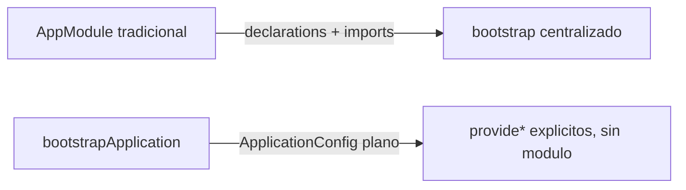
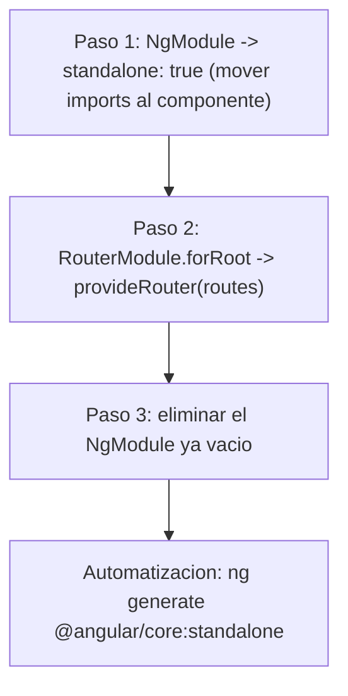
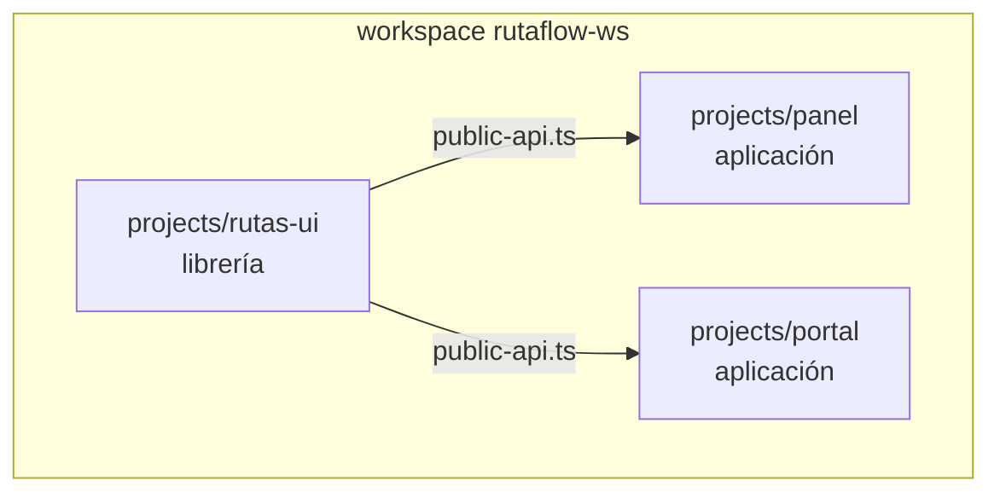
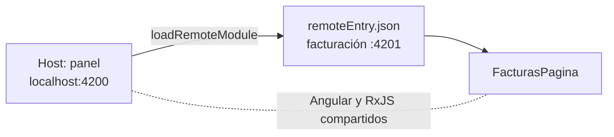

# Módulo 8: Standalone components y arquitectura sin NgModules


## Aprende construyendo

Cada tema verifica su garantía con código real: un error de DI genuino de Angular al faltar un provider, un script Node con `fs` real que audita cohesión de carpetas, y el esquema oficial `ng generate @angular/core:standalone` junto con un error real de plantilla al migrar de forma incompleta.


### Tema 1: Bootstrap sin NgModules · Avanzado · 25 min

<details open>
<summary><strong>Capa 1 — Lectura</strong></summary>

#### ► DE QUÉ TRATA
Al finalizar podrás confirmar, con un error real de inyección de dependencias de Angular (NG0201), que bootstrapApplication y ApplicationConfig reemplazan completamente al AppModule: sin ningún módulo central que "arrastre" providers implícitamente, cada provider debe declararse…

#### ► LA IDEA EN UNA FRASE
**Al finalizar podrás confirmar, con un error real de inyección de dependencias de Angular (NG0201), que bootstrapApplication y ApplicationConfig reemplazan completamente al AppModule: sin ningún módulo central que "arrastre" providers implícitamente, cada provider debe declararse explícitamente o la aplicación falla al iniciar.**

#### ► POR QUÉ EXISTE ESTO
Resuelve un problema real de diseño o implementación y evita decisiones a ciegas.

#### ► LA ANALOGÍA
**Conceptos clave:** `bootstrapApplication`, ausencia de `AppModule`, `ApplicationConfig`, `NG0201`.

Antes de que existieran los standalone components (Módulo 0), toda aplicación Angular requería un `AppModule` raíz decorado con `@NgModule({ declarations: [...], imports: [...], bootstrap: [AppComponent] })`, que actuaba como el punto de entrada obligatorio de la aplicación, declarando explícitamente qué componentes pertenecían a ese módulo y qué otros módulos importaba. Con `bootstrapApplication(App, appConfig)` en `main.ts`, ese `AppModule` raíz desaparece por completo: el componente raíz se arranca directamente, y su configuración global (proveedores de routing, HTTP, animaciones, etc.) se declara en un objeto `ApplicationConfig` plano (típicamente en `app.config.ts`), sin ninguna clase de módulo de por medio.

`app.config.ts` centraliza el arreglo `providers` que anteriormente estaría distribuido entre el `AppModule` y potencialmente varios módulos de features (`imports: [RouterModule.forRoot(routes), HttpClientModule]`), reemplazándolo por funciones `provide*()` explícitas (`provideRouter(routes)`, `provideHttpClient()`), cada una responsable de configurar exactamente un aspecto concreto de la aplicación, en vez de un módulo monolítico que agrupaba configuración heterogénea bajo una única declaración `imports`.

Sin `AppModule`, tampoco existen `declarations` ni el concepto de "módulo de features" que agrupa componentes relacionados bajo un `NgModule` dedicado: cada componente standalone declara directamente, en su propio decorador `@Component({ imports: [...] })` (Módulo 0), exactamente qué otros componentes, directivas y pipes necesita, haciendo explícitas sus propias dependencias sin depender de qué módulo lo "envuelva" externamente.

**Analogía:** el `AppModule` tradicional era como un directorio telefónico central que había que consultar y mantener actualizado para saber qué partes de la aplicación existían y cómo se relacionaban entre sí; con standalone components, cada componente lleva consigo su propia lista de contactos directos, sin depender de un directorio centralizado externo.

**Código del ejemplo:**

```ts
// main.ts
bootstrapApplication(App, appConfig);

// app.config.ts
export const appConfig: ApplicationConfig = {
  providers: [provideRouter(routes), provideHttpClient()],
};
// No existe AppModule, ni declarations, ni imports de módulo.
```

**Diagrama:**



**Dónde se rompe la analogía:** el modelo simplifica la realidad; en producción influyen escala, fallos, costo y contexto.

#### ► CÓMO FUNCIONA


#### ► LO QUE PUEDE SALIR MAL
| Síntoma | Causa probable | Arreglo |
|---|---|---|
| Bootstrap sin NgModules se aplica pero el resultado no mejora | Se usó sin medir el problema real | Mide antes y compara contra la alternativa simple |
| Aparece complejidad inesperada | Se adoptó la técnica sin comprender sus trade-offs | Vuelve a la sección de trade-offs y reduce el alcance |
| Falla en un caso límite | Se asumió un contexto que no se cumple | Prueba el caso límite y documenta cuándo NO usarlo |

#### ► TRADE-OFFS
| Opción | Cuándo usarla | Cuándo NO usarla |
|---|---|---|
| Usar Bootstrap sin NgModules | Cuando el problema coincide con su propósito y el beneficio es observable | Cuando agrega complejidad sin resolver un problema real |
| Alternativa más simple | Cuando el contexto es pequeño, estable o fácil de razonar | Cuando ya demostró no escalar o no cumplir el requisito |
| Postergar la decisión | Cuando falta evidencia del problema | Cuando el costo de esperar es mayor que el costo de probar |

#### ► CUÁNDO NO USAR ESTO
No uses bootstrap sin ngmodules por defecto. Aplícalo cuando el problema lo justifique y puedas verificar el beneficio; si una alternativa más simple resuelve igual, prefiérela.

#### ► DE VUELTA A LA ANALOGÍA
Volviendo a la analogía: bootstrap sin ngmodules funciona como el modelo inicial, pero recuerda dónde se rompe: en producción importan la evidencia, la escala y el costo de equivocarte.

#### ► LO QUE DEBES RECORDAR
- Bootstrap sin NgModules existe para resolver un problema específico.
- Mide antes de adoptar complejidad.
- Conoce el caso donde NO usarlo.
- Verifica con evidencia observable.

#### ► PREGUNTAS PARA PENSAR
1. ¿Qué problema concreto resuelve bootstrap sin ngmodules en tu contexto?
2. ¿Cómo sabrías que bootstrap sin ngmodules no está funcionando bien?
3. ¿Qué alternativa más simple considerarías antes de usar bootstrap sin ngmodules?

</details>

<details>
<summary><strong>Capa 2 — Construcción</strong></summary>

#### Objetivo observable
Al finalizar podrás confirmar, con un error real de inyección de dependencias de Angular (`NG0201`), que `bootstrapApplication` y `ApplicationConfig` reemplazan completamente al `AppModule`: sin ningún módulo central que "arrastre" providers implícitamente, cada provider debe declararse explícitamente o la aplicación falla al iniciar.

**Conocimiento previo:** Módulo 0 de este track (standalone components); Módulo 4 (providers e inyección de dependencias).

</details>

### Tema 2: Organización por feature · Avanzado · 25 min

<details open>
<summary><strong>Capa 1 — Lectura</strong></summary>

#### ► DE QUÉ TRATA
Al finalizar podrás auditar, con un script Node real basado en fs (sin simular su lógica con otro lenguaje), que una carpeta de feature mantiene junto todo lo que cambia junto: componente, servicio y rutas, en vez de dispersarlos por tipo de archivo.

#### ► LA IDEA EN UNA FRASE
**Al finalizar podrás auditar, con un script Node real basado en fs (sin simular su lógica con otro lenguaje), que una carpeta de feature mantiene junto todo lo que cambia junto: componente, servicio y rutas, en vez de dispersarlos por tipo de archivo.**

#### ► POR QUÉ EXISTE ESTO
Resuelve un problema real de diseño o implementación y evita decisiones a ciegas.

#### ► LA ANALOGÍA
Piensa en organización por feature como una herramienta de taller: útil cuando conoces su propósito y sus límites.
**Dónde se rompe la analogía:** en software, los efectos dependen del contexto, la escala y los trade-offs.

#### ► CÓMO FUNCIONA
1. Identifica el problema que organización por feature resuelve.
2. Observa sus componentes y relaciones.
3. Aplica la opción más simple que funcione.
4. Verifica el resultado y los límites.

#### ► LO QUE PUEDE SALIR MAL
| Síntoma | Causa probable | Arreglo |
|---|---|---|
| Organización por feature se aplica pero el resultado no mejora | Se usó sin medir el problema real | Mide antes y compara contra la alternativa simple |
| Aparece complejidad inesperada | Se adoptó la técnica sin comprender sus trade-offs | Vuelve a la sección de trade-offs y reduce el alcance |
| Falla en un caso límite | Se asumió un contexto que no se cumple | Prueba el caso límite y documenta cuándo NO usarlo |

#### ► TRADE-OFFS
| Opción | Cuándo usarla | Cuándo NO usarla |
|---|---|---|
| Usar Organización por feature | Cuando el problema coincide con su propósito y el beneficio es observable | Cuando agrega complejidad sin resolver un problema real |
| Alternativa más simple | Cuando el contexto es pequeño, estable o fácil de razonar | Cuando ya demostró no escalar o no cumplir el requisito |
| Postergar la decisión | Cuando falta evidencia del problema | Cuando el costo de esperar es mayor que el costo de probar |

#### ► CUÁNDO NO USAR ESTO
No uses organización por feature por defecto. Aplícalo cuando el problema lo justifique y puedas verificar el beneficio; si una alternativa más simple resuelve igual, prefiérela.

#### ► DE VUELTA A LA ANALOGÍA
Volviendo a la analogía: organización por feature funciona como el modelo inicial, pero recuerda dónde se rompe: en producción importan la evidencia, la escala y el costo de equivocarte.

#### ► LO QUE DEBES RECORDAR
- Organización por feature existe para resolver un problema específico.
- Mide antes de adoptar complejidad.
- Conoce el caso donde NO usarlo.
- Verifica con evidencia observable.

#### ► PREGUNTAS PARA PENSAR
1. ¿Qué problema concreto resuelve organización por feature en tu contexto?
2. ¿Cómo sabrías que organización por feature no está funcionando bien?
3. ¿Qué alternativa más simple considerarías antes de usar organización por feature?

</details>

<details>
<summary><strong>Capa 2 — Construcción</strong></summary>

#### Código y verificación
```
┌── src/app/tareas/ ─────────────┐   ← todo lo relacionado con "tareas" vive junto
│  tarea-lista.ts                │
│  tarea-detalle.ts              │
│  tareas.service.ts             │
│  tareas.routes.ts              │
└─────────────────────────────────┘
┌── src/app/usuarios/ ───────────┐
│  ...                            │
└─────────────────────────────────┘
```

```bash
mkdir -p src/app/entregas
```

```ts
// src/app/entregas/entregas.service.ts
import { Injectable, signal } from '@angular/core';

@Injectable({ providedIn: 'root' })
export class EntregasService {
  entregas = signal<string[]>(['PED-001', 'PED-002']);
}
```

```ts
// scripts/verificar-cohesion.mjs
import { readdirSync } from 'node:fs';

export function auditarCohesion(rutaFeature) {
  const archivos = readdirSync(rutaFeature);
  const tieneServicio = archivos.some((f) => f.endsWith('.service.ts'));
  const tieneComponente = archivos.some((f) => f.endsWith('.component.ts'));
  const tieneRutas = archivos.some((f) => f.endsWith('.routes.ts'));
  return { tieneServicio, tieneComponente, tieneRutas, completa: tieneServicio && tieneComponente && tieneRutas };
}
```

```ts
// scripts/verificar-cohesion.spec.mjs
import { describe, it, expect } from 'vitest';
import { mkdirSync, writeFileSync, rmSync } from 'node:fs';
import { auditarCohesion } from './verificar-cohesion.mjs';

describe('auditarCohesion (fs real, sin simulacion)', () => {
  it('una carpeta con los tres archivos relacionados esta completa', () => {
    mkdirSync('tmp-entregas', { recursive: true });
    writeFileSync('tmp-entregas/entregas.service.ts', '');
    writeFileSync('tmp-entregas/entregas-lista.component.ts', '');
    writeFileSync('tmp-entregas/entregas.routes.ts', '');

    const resultado = auditarCohesion('tmp-entregas');
    expect(resultado.completa).toBe(true);

    rmSync('tmp-entregas', { recursive: true, force: true });
  });
});
```

```bash
npx vitest run scripts/verificar-cohesion.spec.mjs
```

</details>

### Tema 3: Migración desde NgModules · Avanzado · 25 min

<details open>
<summary><strong>Capa 1 — Lectura</strong></summary>

#### ► DE QUÉ TRATA
Al finalizar podrás aplicar el esquema oficial ng generate @angular/core:standalone y confirmar, con un error real de plantilla del compilador de Angular (NG8001, "is not a known element"), por qué una migración incompleta —donde un componente se convierte a standalone pero olvid…

#### ► LA IDEA EN UNA FRASE
**Al finalizar podrás aplicar el esquema oficial ng generate @angular/core:standalone y confirmar, con un error real de plantilla del compilador de Angular (NG8001, "is not a known element"), por qué una migración incompleta —donde un componente se convierte a standalone pero olvida declarar una dependencia en su propio imports— produce un fallo real y diagnosticable, no un comportamiento silencioso.**

#### ► POR QUÉ EXISTE ESTO
Resuelve un problema real de diseño o implementación y evita decisiones a ciegas.

#### ► LA ANALOGÍA
**Conceptos clave:** conversión gradual, `ng generate @angular/core:standalone`, compatibilidad durante la transición, `NG8001`.

Migrar un proyecto existente basado en NgModules hacia standalone components es un proceso incremental, no un "big bang" que deba completarse de una sola vez: el primer paso consiste en convertir cada componente declarado en un `NgModule` a `standalone: true`, moviendo sus dependencias desde el arreglo `imports` del módulo contenedor hacia el propio decorador `@Component` de cada componente individual, un cambio que puede hacerse componente por componente mientras el resto de la aplicación sigue usando NgModules normalmente (Angular soporta la coexistencia de componentes standalone y basados en módulos durante la transición).

El segundo paso reemplaza `RouterModule.forRoot(routes)` (la configuración tradicional de routing dentro de un `NgModule`) por `provideRouter(routes)` dentro de `bootstrapApplication`, moviendo la configuración de rutas desde el sistema de módulos hacia el sistema de providers standalone (Módulo 4). El tercer paso, una vez que todos los componentes de un `NgModule` ya son standalone y ya no queda ningún `declarations` con contenido real, elimina ese `NgModule` ahora vacío por completo, dado que ya no cumple ninguna función.

El CLI de Angular incluye `ng generate @angular/core:standalone`, un esquema de migración automática (Módulo 12) que analiza el proyecto existente y aplica gran parte de estos tres pasos automáticamente, reduciendo significativamente el trabajo manual necesario para una migración completa, aunque revisar manualmente el resultado sigue siendo necesario para casos especiales que el esquema automático no cubre perfectamente.

**Analogía:** migrar de NgModules a standalone es como remodelar una casa habitada habitación por habitación en vez de demoler la casa entera y reconstruirla de cero: cada habitación (componente) se puede actualizar de forma independiente mientras el resto de la casa sigue siendo habitable y funcional durante todo el proceso.

**Diagrama:**



**Dónde se rompe la analogía:** el modelo simplifica la realidad; en producción influyen escala, fallos, costo y contexto.

#### ► CÓMO FUNCIONA


#### ► LO QUE PUEDE SALIR MAL
| Síntoma | Causa probable | Arreglo |
|---|---|---|
| Migración desde NgModules se aplica pero el resultado no mejora | Se usó sin medir el problema real | Mide antes y compara contra la alternativa simple |
| Aparece complejidad inesperada | Se adoptó la técnica sin comprender sus trade-offs | Vuelve a la sección de trade-offs y reduce el alcance |
| Falla en un caso límite | Se asumió un contexto que no se cumple | Prueba el caso límite y documenta cuándo NO usarlo |

#### ► TRADE-OFFS
| Opción | Cuándo usarla | Cuándo NO usarla |
|---|---|---|
| Usar Migración desde NgModules | Cuando el problema coincide con su propósito y el beneficio es observable | Cuando agrega complejidad sin resolver un problema real |
| Alternativa más simple | Cuando el contexto es pequeño, estable o fácil de razonar | Cuando ya demostró no escalar o no cumplir el requisito |
| Postergar la decisión | Cuando falta evidencia del problema | Cuando el costo de esperar es mayor que el costo de probar |

#### ► CUÁNDO NO USAR ESTO
No uses migración desde ngmodules por defecto. Aplícalo cuando el problema lo justifique y puedas verificar el beneficio; si una alternativa más simple resuelve igual, prefiérela.

#### ► DE VUELTA A LA ANALOGÍA
Volviendo a la analogía: migración desde ngmodules funciona como el modelo inicial, pero recuerda dónde se rompe: en producción importan la evidencia, la escala y el costo de equivocarte.

#### ► LO QUE DEBES RECORDAR
- Migración desde NgModules existe para resolver un problema específico.
- Mide antes de adoptar complejidad.
- Conoce el caso donde NO usarlo.
- Verifica con evidencia observable.

#### ► PREGUNTAS PARA PENSAR
1. ¿Qué problema concreto resuelve migración desde ngmodules en tu contexto?
2. ¿Cómo sabrías que migración desde ngmodules no está funcionando bien?
3. ¿Qué alternativa más simple considerarías antes de usar migración desde ngmodules?

</details>

<details>
<summary><strong>Capa 2 — Construcción</strong></summary>

#### Código y verificación


```bash
npx ng generate module legacy --routing=false
npx ng generate component legacy/tarjeta --module=legacy
```

```bash
npx ng generate @angular/core:standalone
```

```ts
// src/app/legacy/badge.component.ts
import { Component } from '@angular/core';

@Component({
  selector: 'app-badge',
  template: `<span class="badge">Nuevo</span>`,
})
export class BadgeComponent {}
```

```ts
// src/app/legacy/tarjeta.component.ts (tras una migracion INCOMPLETA)
import { Component } from '@angular/core';

@Component({
  selector: 'app-tarjeta',
  standalone: true,
  imports: [], // migracion incompleta: falta declarar lo que el template usa
  template: `<app-badge></app-badge>`, // <app-badge> no esta declarado en imports
})
export class TarjetaComponent {}
```

```ts
// src/app/legacy/tarjeta.component.spec.ts
import { TestBed } from '@angular/core/testing';
import { TarjetaComponent } from './tarjeta.component';

describe('Migracion NgModule -> standalone', () => {
  it('la tarjeta migrada renderiza su badge', () => {
    const fixture = TestBed.createComponent(TarjetaComponent);
    fixture.detectChanges();

    expect((fixture.nativeElement as HTMLElement).textContent).toContain('Nuevo');
  });
});
```

</details>

### Tema 4: Librerías y monorepos con Angular CLI: un workspace, varias aplicaciones y código compartido · Avanzado · 45 min

<details open>
<summary><strong>Capa 1 — Lectura</strong></summary>

#### ► DE QUÉ TRATA
Usa Angular CLI 18 o superior. Trabajarás en una carpeta nueva rutaflow-ws. El workspace se crea sin aplicación inicial para agregar las piezas una por una.

#### ► LA IDEA EN UNA FRASE
**Usa Angular CLI 18 o superior.**

#### ► POR QUÉ EXISTE ESTO
Resuelve un problema real de diseño o implementación y evita decisiones a ciegas.

#### ► LA ANALOGÍA
Piensa en librerías y monorepos con angular cli: un workspace, varias aplicaciones y código compartido como una herramienta de taller: útil cuando conoces su propósito y sus límites.
**Dónde se rompe la analogía:** en software, los efectos dependen del contexto, la escala y los trade-offs.

#### ► CÓMO FUNCIONA


#### ► LO QUE PUEDE SALIR MAL
| Síntoma | Causa probable | Arreglo |
|---|---|---|
| Librerías y monorepos con Angular CLI: un workspace, varias aplicaciones y código compartido se aplica pero el resultado no mejora | Se usó sin medir el problema real | Mide antes y compara contra la alternativa simple |
| Aparece complejidad inesperada | Se adoptó la técnica sin comprender sus trade-offs | Vuelve a la sección de trade-offs y reduce el alcance |
| Falla en un caso límite | Se asumió un contexto que no se cumple | Prueba el caso límite y documenta cuándo NO usarlo |

#### ► TRADE-OFFS
| Opción | Cuándo usarla | Cuándo NO usarla |
|---|---|---|
| Usar Librerías y monorepos con Angular CLI: un workspace, varias aplicaciones y código compartido | Cuando el problema coincide con su propósito y el beneficio es observable | Cuando agrega complejidad sin resolver un problema real |
| Alternativa más simple | Cuando el contexto es pequeño, estable o fácil de razonar | Cuando ya demostró no escalar o no cumplir el requisito |
| Postergar la decisión | Cuando falta evidencia del problema | Cuando el costo de esperar es mayor que el costo de probar |

#### ► CUÁNDO NO USAR ESTO
No uses librerías y monorepos con angular cli: un workspace, varias aplicaciones y código compartido por defecto. Aplícalo cuando el problema lo justifique y puedas verificar el beneficio; si una alternativa más simple resuelve igual, prefiérela.

#### ► DE VUELTA A LA ANALOGÍA
Volviendo a la analogía: librerías y monorepos con angular cli: un workspace, varias aplicaciones y código compartido funciona como el modelo inicial, pero recuerda dónde se rompe: en producción importan la evidencia, la escala y el costo de equivocarte.

#### ► LO QUE DEBES RECORDAR
- Librerías y monorepos con Angular CLI: un workspace, varias aplicaciones y código compartido existe para resolver un problema específico.
- Mide antes de adoptar complejidad.
- Conoce el caso donde NO usarlo.
- Verifica con evidencia observable.

#### ► PREGUNTAS PARA PENSAR
1. ¿Qué problema concreto resuelve librerías y monorepos con angular cli: un workspace, varias aplicaciones y código compartido en tu contexto?
2. ¿Cómo sabrías que librerías y monorepos con angular cli: un workspace, varias aplicaciones y código compartido no está funcionando bien?
3. ¿Qué alternativa más simple considerarías antes de usar librerías y monorepos con angular cli: un workspace, varias aplicaciones y código compartido?

</details>

<details>
<summary><strong>Capa 2 — Construcción</strong></summary>

#### Código y verificación


```ts
import { Component, computed, input } from '@angular/core';

@Component({
  selector: 'rf-tarjeta-envio',
  template: `<article><strong>{{ codigoFormateado() }}</strong> · {{ estado() }}</article>`,
})
export class TarjetaEnvio {
  readonly codigo = input.required<string>();
  readonly estado = input('CREADO');
  // Regla compartida: un solo lugar para el formato del código.
  readonly codigoFormateado = computed(() => this.codigo().toUpperCase().replace(/^ENV(\d+)$/, 'ENV-$1'));
}
```

```ts
// Solo lo exportado aquí es parte de la API pública de la librería.
export * from './lib/tarjeta-envio';
```

```ts
import { Component } from '@angular/core';
import { TarjetaEnvio } from 'rutas-ui'; // se importa como un paquete

@Component({
  selector: 'app-root',
  imports: [TarjetaEnvio],
  template: `<rf-tarjeta-envio codigo="env42" estado="EN_RUTA" />`,
})
export class App {}
```

```bash
ng new rutaflow-ws --no-create-application
cd rutaflow-ws
ng generate library rutas-ui --prefix rf
ng generate application panel
ng generate application portal
ng build rutas-ui
ng serve panel
```

```text
ng build rutas-ui termina con «Built rutas-ui» y crea dist/rutas-ui.
ng serve panel muestra «ENV-42 · EN_RUTA» en http://localhost:4200.
```

</details>

### Tema 5: Microfrontends con criterio: Native Federation y cuándo no usarlos · Avanzado · 25 min

<details open>
<summary><strong>Capa 1 — Lectura</strong></summary>

#### ► DE QUÉ TRATA
Necesitas dos proyectos Angular 18 o superior: un host (el panel) y un remoto (la pantalla de envíos). Usarás el paquete @angular-architects/native-federation.

#### ► LA IDEA EN UNA FRASE
**Necesitas dos proyectos Angular 18 o superior: un host (el panel) y un remoto (la pantalla de envíos).**

#### ► POR QUÉ EXISTE ESTO
Resuelve un problema real de diseño o implementación y evita decisiones a ciegas.

#### ► LA ANALOGÍA
Piensa en microfrontends con criterio: native federation y cuándo no usarlos como una herramienta de taller: útil cuando conoces su propósito y sus límites.
**Dónde se rompe la analogía:** en software, los efectos dependen del contexto, la escala y los trade-offs.

#### ► CÓMO FUNCIONA


#### ► LO QUE PUEDE SALIR MAL
| Síntoma | Causa probable | Arreglo |
|---|---|---|
| Microfrontends con criterio: Native Federation y cuándo no usarlos se aplica pero el resultado no mejora | Se usó sin medir el problema real | Mide antes y compara contra la alternativa simple |
| Aparece complejidad inesperada | Se adoptó la técnica sin comprender sus trade-offs | Vuelve a la sección de trade-offs y reduce el alcance |
| Falla en un caso límite | Se asumió un contexto que no se cumple | Prueba el caso límite y documenta cuándo NO usarlo |

#### ► TRADE-OFFS
| Opción | Cuándo usarla | Cuándo NO usarla |
|---|---|---|
| Usar Microfrontends con criterio: Native Federation y cuándo no usarlos | Cuando el problema coincide con su propósito y el beneficio es observable | Cuando agrega complejidad sin resolver un problema real |
| Alternativa más simple | Cuando el contexto es pequeño, estable o fácil de razonar | Cuando ya demostró no escalar o no cumplir el requisito |
| Postergar la decisión | Cuando falta evidencia del problema | Cuando el costo de esperar es mayor que el costo de probar |

#### ► CUÁNDO NO USAR ESTO
No uses microfrontends con criterio: native federation y cuándo no usarlos por defecto. Aplícalo cuando el problema lo justifique y puedas verificar el beneficio; si una alternativa más simple resuelve igual, prefiérela.

#### ► DE VUELTA A LA ANALOGÍA
Volviendo a la analogía: microfrontends con criterio: native federation y cuándo no usarlos funciona como el modelo inicial, pero recuerda dónde se rompe: en producción importan la evidencia, la escala y el costo de equivocarte.

#### ► LO QUE DEBES RECORDAR
- Microfrontends con criterio: Native Federation y cuándo no usarlos existe para resolver un problema específico.
- Mide antes de adoptar complejidad.
- Conoce el caso donde NO usarlo.
- Verifica con evidencia observable.

#### ► PREGUNTAS PARA PENSAR
1. ¿Qué problema concreto resuelve microfrontends con criterio: native federation y cuándo no usarlos en tu contexto?
2. ¿Cómo sabrías que microfrontends con criterio: native federation y cuándo no usarlos no está funcionando bien?
3. ¿Qué alternativa más simple considerarías antes de usar microfrontends con criterio: native federation y cuándo no usarlos?

</details>

<details>
<summary><strong>Capa 2 — Construcción</strong></summary>

#### Código y verificación


```js
const { withNativeFederation, shareAll } = require('@angular-architects/native-federation/config');

module.exports = withNativeFederation({
  name: 'facturacion',
  exposes: {
    './Pagina': './src/app/facturas-pagina.ts', // lo único que ve el host
  },
  shared: {
    ...shareAll({ singleton: true, strictVersion: true, requiredVersion: 'auto' }),
  },
});
```

```ts
import { Routes } from '@angular/router';
import { loadRemoteModule } from '@angular-architects/native-federation';

export const routes: Routes = [
  {
    path: 'facturas',
    // Se descarga en tiempo de ejecución desde el despliegue de facturación.
    loadComponent: () => loadRemoteModule('facturacion', './Pagina').then((m) => m.FacturasPagina),
  },
];
```

```bash
ng add @angular-architects/native-federation --project facturacion --port 4201 --type remote
ng add @angular-architects/native-federation --project panel --port 4200 --type dynamic-host
# registra el remoto en panel/public/federation.manifest.json:
#   { "facturacion": "http://localhost:4201/remoteEntry.json" }
ng serve facturacion   # terminal 1
ng serve panel         # terminal 2
```

```text
Al abrir http://localhost:4200/facturas, la pestaña Network muestra la descarga de remoteEntry.json desde el **puerto** 4201 (número que identifica un servicio en la máquina) y luego la página de facturas.
Si cambias el texto de la página en el remoto y recargas, el panel muestra el cambio sin recompilar el panel.
```

</details>
