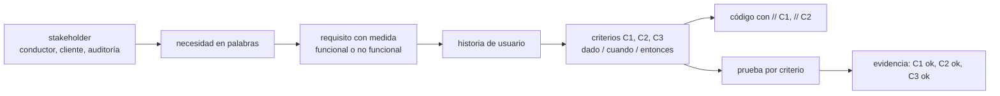
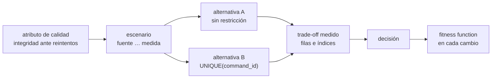
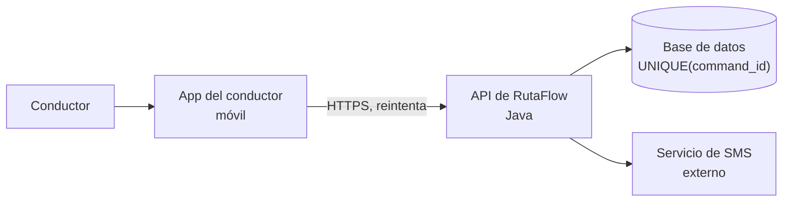
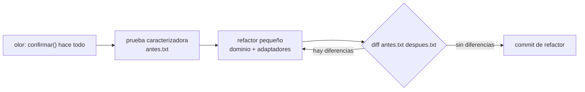
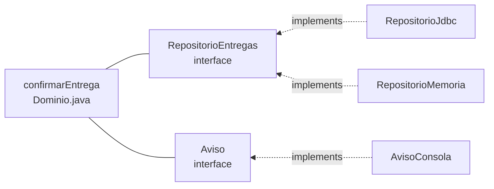
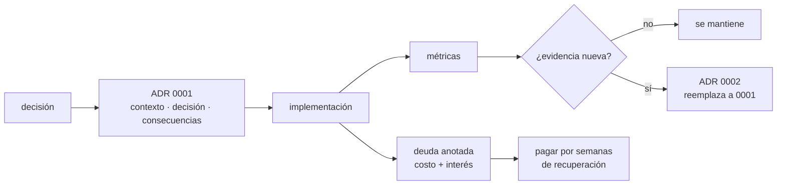
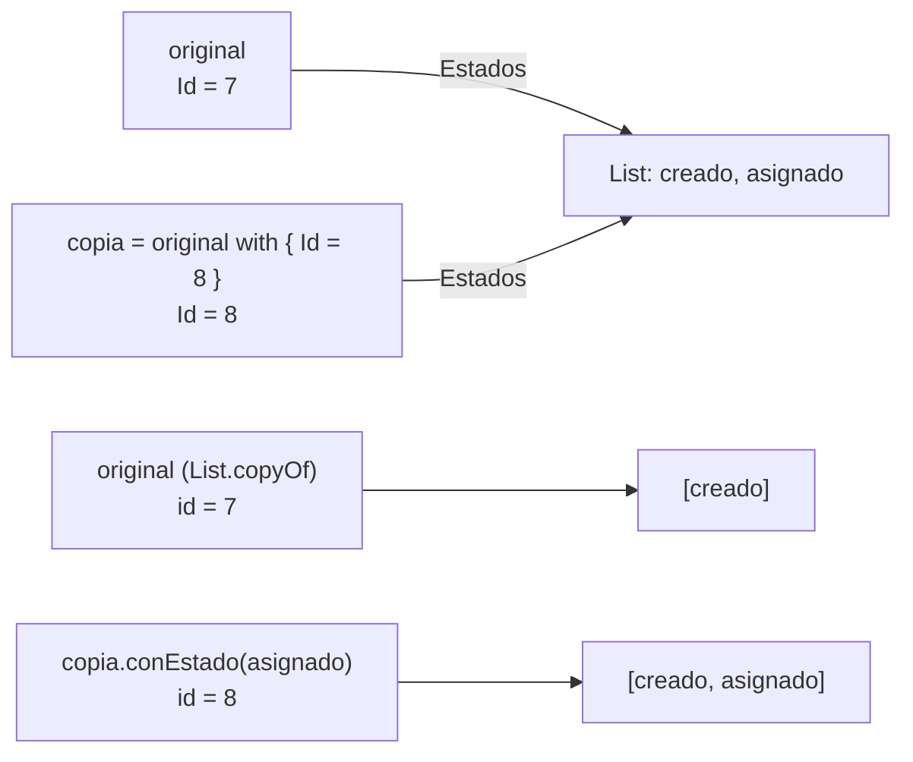
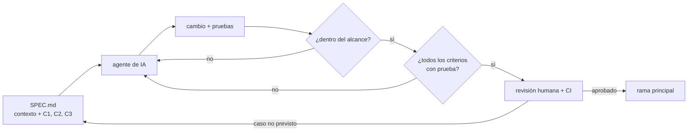
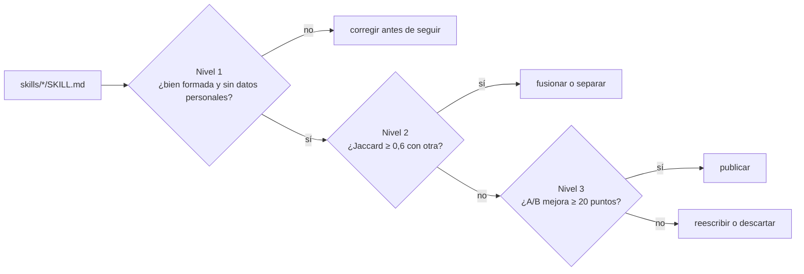

# Módulo 0: Requisitos, diseño, arquitectura y mantenimiento

> **Requisitos de este curso:** [Java](/curso/java), [SQL](/curso/sql). Lo que esos cursos enseñan aquí se usa sin volver a explicarlo; si algo no te suena, vuelve a su capítulo antes de seguir.

**Entorno comprobado para esta edición (2026-11-24):** OpenJDK 25.0.5.1 en Linux x86_64 (Ubuntu 24.04), Node.js 22.23.5 y Git 2.43.0. Todas las transcripciones son literales de esa ejecución, en la carpeta de práctica `/home/estudiante/labs/arquitectura` (tu `~/labs/arquitectura`). Los programas Java se ejecutan con `java Archivo.java`, como en el curso de Java; los que usan base de datos llevan H2 2.3.232 en `~/herramientas`, y el Tema 6 usa Gradle 8.14.3 con JUnit 5.13.4. El TypeScript del Tema 3 se ejecutó con Node.js 22.23.5, que ya quita los tipos sin compilar; con Node.js 24 funciona igual. El programa C# del Tema 5 **no se ejecutó**: el equipo no tenía el SDK de .NET. Su comportamiento se describe y se comprueba con un programa Java equivalente, con records, que sí se ejecutó.

## Apertura del módulo

Al terminar este módulo podrás:
- convertir una necesidad vaga en requisitos y criterios de aceptación que un programa comprueba;
- justificar una decisión de arquitectura con un escenario de calidad medible;
- separar una regla de negocio de la base de datos con un puerto y dos adaptadores;
- refactorizar con una prueba caracterizadora que demuestre que nada cambió;
- registrar decisiones en ADR y priorizar la deuda técnica con números;
- trabajar con un agente de IA contra una especificación y comprobar su alcance y cobertura.

**Esquema del módulo:** Tema 1, requisitos; Tema 2, arquitectura; Tema 3, diseño modular y refactorización; Tema 4,
decisiones y deuda; Tema 5, igualdad e inmutabilidad en records de C#; Tema 6, especificación para agentes de IA;
Tema 7, evaluación de skills de agente; Proyecto 7.

**Qué necesitas saber antes:** de Fundamentos, algoritmo, caso de prueba y excepción (Módulo 1, Tema 1); métodos
(Módulo 1, Tema 4); clase, objeto y método (Módulo 1, Tema 6); composición, interfaz y polimorfismo (Módulo 1,
Tema 7); bases de datos con H2 y JDBC (Módulo 4); prueba unitaria, doble de prueba, prueba de regresión, commit,
pull request y revisión de código (Módulo 5). Del curso de Java, records, colecciones y `java Archivo.java`.


## Aprende construyendo

### Tema 1: Requisitos, stakeholders y criterios verificables · Avanzado · 50 min

<details open>
<summary><strong>Capa 1 — Lectura</strong></summary>

#### Objetivos
Al terminar este tema podrás:
- identificar a los stakeholders de una funcionalidad y anotar quién pidió cada requisito;
- distinguir un requisito funcional de uno no funcional y reescribir uno vago con una medida;
- redactar una historia de usuario con criterios de aceptación «dado, cuando, entonces»;
- comprobar con un programa que cada criterio está escrito bien y que el código lo cumple.

**Conceptos clave:** stakeholder, requisito funcional, requisito no funcional, historia de usuario, criterio de aceptación, trazabilidad

Este tema usa lo que ya conoces: **caso de prueba** y **excepción** tienen su ficha en el Módulo 1, Tema 1 de
Fundamentos. Aquí no se redefinen.

#### El problema
La coordinadora de RutaFlow escribe en el chat: «confirmar una entrega debe ser rápido y seguro». El conductor
entiende «un botón». El cliente entiende «que nadie reciba mi paquete por mí». Auditoría entiende «que quede registro».
Nadie puede probar si el sistema cumple, porque «rápido» y «seguro» no tienen medida. ¿Cómo conviertes esa frase en
algo que un programa comprueba?

#### Glosario del tema

**stakeholder**
- **Definición técnica:** persona o grupo que afecta al sistema o se ve afectado por él, y cuyas necesidades originan requisitos.
- **En palabras sencillas:** cada persona a la que le importa cómo funciona la confirmación de entregas.
- **Dónde se rompe la comparación:** no es solo quien usa la pantalla: auditoría nunca la abre y aun así impone reglas.
- **Ejemplo:** en `RevisarRequisitos.java`, cada requisito «después» lleva su stakeholder: conductor, cliente o auditoría.
- **Error típico:** escribir requisitos sin dueño; la salida «antes» marca R2 con `nadie lo pidió`.

**requisito funcional**
- **Definición técnica:** enunciado de un comportamiento que el sistema debe ofrecer: una entrada, una acción y un resultado observable.
- **En palabras sencillas:** algo que el sistema **hace**: confirmar, rechazar, guardar.
- **Dónde se rompe la comparación:** «hacer» incluye negarse: rechazar un PIN corto también es un comportamiento exigido.
- **Ejemplo:** «el conductor confirma la entrega con el PIN de 6 dígitos del destinatario» → la salida dice `[funcional]`.
- **Error típico:** dejar el dato sin forma: «con el PIN» no dice cuántos dígitos ni qué pasa si está mal.

**requisito no funcional**
- **Definición técnica:** restricción sobre **cómo** se comporta el sistema (tiempo de respuesta, seguridad, disponibilidad), expresada con una medida.
- **En palabras sencillas:** qué tan bien lo hace: qué tan rápido, qué tan protegido, cuántas veces falla.
- **Dónde se rompe la comparación:** «bien» no sirve hasta tener número; «rápido» es una opinión, «menos de 2 segundos» es un requisito.
- **Ejemplo:** «el 95 % de las confirmaciones responde en menos de 2 segundos» → `[no funcional] ... verificable`.
- **Error típico:** usar adjetivos sin medida: la salida «antes» marca `adjetivo sin medida`.

**historia de usuario**
- **Definición técnica:** descripción breve de una necesidad con la forma «como *rol*, quiero *acción*, para *beneficio*», que agrupa criterios de aceptación.
- **En palabras sencillas:** la necesidad contada desde quien la tiene, en una sola frase.
- **Dónde se rompe la comparación:** la historia no es el contrato: sin criterios, cada persona la entiende a su manera.
- **Ejemplo:** «Como conductor, quiero confirmar la entrega con el PIN del destinatario, para dejar evidencia de que llegó a la persona correcta».
- **Error típico:** escribir la solución técnica («quiero un endpoint POST») en lugar de la necesidad.

**criterio de aceptación**
- **Definición técnica:** condición verificable que la historia debe cumplir para darse por terminada; se escribe como «dado *contexto*, cuando *acción*, entonces *resultado*».
- **En palabras sencillas:** un ejemplo concreto con la respuesta correcta, acordado antes de programar.
- **Dónde se rompe la comparación:** se parece a un caso de prueba, pero lo escribe y lo entiende alguien que no programa.
- **Ejemplo:** `C2: Dado un PIN de 4 dígitos, cuando se confirma, entonces se rechaza con IllegalArgumentException y el estado no cambia.`
- **Error típico:** escribirlo sin «dado/cuando/entonces»; `VerificarCriterios.java` responde `falta dado/cuando/entonces`.

**trazabilidad**
- **Definición técnica:** capacidad de seguir cada requisito hasta el código que lo implementa y la prueba que lo comprueba, y de vuelta.
- **En palabras sencillas:** poder señalar, para cada criterio, la línea que lo cumple y la prueba que lo demuestra.
- **Dónde se rompe la comparación:** no es un archivo aparte: vive en nombres y comentarios compartidos (`C1`, `C2`, `C3`).
- **Ejemplo:** el comentario `// C2: PIN de 6 dígitos` en `Entregas.java` y la línea `C2 ok` de `PruebaCriterios.java`.
- **Error típico:** cambiar un criterio sin buscar su prueba: la prueba sigue verde comprobando una regla vieja.

#### ► CÓMO FUNCIONA
Un requisito nace de un stakeholder, no de quien programa. Se escribe primero en palabras y luego se le pone medida.
La historia de usuario agrupa la necesidad; los criterios de aceptación la vuelven comprobable. Cada criterio se
vuelve una prueba, y la prueba deja evidencia.



La regla práctica: si dos personas pueden discutir si el sistema cumple, el requisito todavía no está terminado.

#### Problema resuelto 1.1
Revisa los requisitos de la confirmación de entregas. Marca de qué tipo es cada uno, quién lo pidió y si se puede verificar.

**Razonamiento:**
1. Un requisito sin stakeholder no tiene a quién preguntarle qué significa.
2. Un adjetivo de calidad («rápido», «seguro») sin número no se puede medir.
3. Se reescribe cada frase vaga con una medida concreta y un dueño.

```java
// RevisarRequisitos.java — clasifica requisitos y marca los que no se pueden verificar
import java.util.regex.Pattern;

record Requisito(String stakeholder, String texto) {}

final List<String> VAGOS = List.of("rápido", "seguro", "fácil", "estable", "cómodo");
final List<String> CALIDADES = List.of("segundos", "%", "disponible", "cifrad", "intentos");
final Pattern NUMERO = Pattern.compile("\\d");

String[] revisar(Requisito requisito) {
    String texto = requisito.texto().toLowerCase();
    boolean deCalidad = Stream.concat(CALIDADES.stream(), VAGOS.stream()).anyMatch(texto::contains);
    String tipo = deCalidad ? "no funcional" : "funcional";
    List<String> problemas = new ArrayList<>();
    if (requisito.stakeholder().isEmpty()) problemas.add("nadie lo pidió");
    if (VAGOS.stream().anyMatch(texto::contains) && !NUMERO.matcher(texto).find()) problemas.add("adjetivo sin medida");
    return new String[] {tipo, problemas.isEmpty() ? "verificable" : String.join("; ", problemas)};
}

void main() {
    List<Requisito> antes = List.of(
            new Requisito("coordinadora", "El conductor confirma la entrega con el PIN del destinatario."),
            new Requisito("", "Confirmar una entrega debe ser rápido y seguro."));
    List<Requisito> despues = List.of(
            new Requisito("conductor", "El conductor confirma la entrega con el PIN de 6 dígitos del destinatario."),
            new Requisito("cliente", "El 95 % de las confirmaciones responde en menos de 2 segundos."),
            new Requisito("auditoría", "Tras 3 intentos con PIN errado, el envío se bloquea 15 minutos."));
    for (var grupo : List.of(Map.entry("ANTES", antes), Map.entry("DESPUÉS", despues))) {
        IO.println(grupo.getKey());
        int numero = 1;
        for (Requisito requisito : grupo.getValue()) {
            String[] resultado = revisar(requisito);
            String quien = requisito.stakeholder().isEmpty() ? "?" : requisito.stakeholder();
            IO.println("  R%d [%s] pedido por %s: %s".formatted(numero++, resultado[0], quien, resultado[1]));
        }
    }
}
```

```text
$ java RevisarRequisitos.java
ANTES
  R1 [funcional] pedido por coordinadora: verificable
  R2 [no funcional] pedido por ?: nadie lo pidió; adjetivo sin medida
DESPUÉS
  R1 [funcional] pedido por conductor: verificable
  R2 [no funcional] pedido por cliente: verificable
  R3 [no funcional] pedido por auditoría: verificable
```

**Explicación por partes.**
- Líneas 6–7: palabras que delatan un requisito no funcional; `VAGOS` son las que no traen medida por sí solas.
- Líneas 12–13: si el texto habla de calidad, se clasifica como no funcional; si no, como funcional.
- Líneas 15–16: dos problemas posibles: nadie lo pidió, o hay un adjetivo sin ningún número (`\\d` busca un dígito).
- Líneas 21–23: la versión «antes»; R2 junta dos defectos y la salida muestra ambos.
- Líneas 24–27: la versión «después»; la frase vaga se volvió dos requisitos medibles, cada uno con dueño.

> **Error común.** Creer que el verificador prueba que el requisito es **bueno**. Solo detecta señales de vaguedad. El
> R1 de «antes» sale `verificable` aunque no dice cuántos dígitos tiene el PIN: eso lo encuentra una persona.

> **Buena práctica.** Cuando un stakeholder diga «rápido», pregunta «¿cuánto, para qué porcentaje de casos y medido
> dónde?». La respuesta es el requisito; el adjetivo era solo la intención.

#### Problema resuelto 1.2
Escribe la historia de usuario del conductor con tres criterios de aceptación. Comprueba la redacción y luego que el
código cumple cada criterio.

**Razonamiento:**
1. Historia: «Como conductor, quiero confirmar la entrega con el PIN del destinatario, para dejar evidencia de que llegó a la persona correcta».
2. Cada criterio necesita las tres palabras: dado (contexto), cuando (acción), entonces (resultado).
3. Cada criterio lleva un identificador (`C1`, `C2`, `C3`) que se repite en el código y en la prueba: eso es trazabilidad.

Primero, el borrador que llegó y la versión corregida:

```markdown
- Confirmar una entrega debe ser seguro.
- Dado un PIN correcto, cuando se confirma, entonces el envío queda entregado.
```

```markdown
- C1: Dado un envío "pendiente" y un PIN de 6 dígitos correcto, cuando se confirma, entonces queda "entregado".
- C2: Dado un PIN de 4 dígitos, cuando se confirma, entonces se rechaza con IllegalArgumentException y el estado no cambia.
- C3: Dado un comando ya procesado, cuando se reenvía, entonces se devuelve el resultado anterior sin confirmar de nuevo.
```

El verificador de redacción:

```java
// VerificarCriterios.java — comprueba que cada criterio sea verificable
import java.nio.file.Files;
import java.nio.file.Path;
import java.util.regex.Pattern;

final List<String> VAGOS = List.of("rápido", "rapido", "lento", "seguro", "fácil", "facil", "cómodo", "comodo", "estable");

void main(String[] args) throws Exception {
    String archivo = args.length > 0 ? args[0] : "criterios.md";
    List<String> lineas = Files.readAllLines(Path.of(archivo)).stream().map(String::strip).filter(l -> !l.isEmpty()).toList();
    List<String> fallos = new ArrayList<>();
    for (int numero = 1; numero <= lineas.size(); numero++) {
        String texto = lineas.get(numero - 1).toLowerCase();
        if (!(texto.contains("dado") && texto.contains("cuando") && texto.contains("entonces"))) {
            fallos.add("criterio " + numero + ": falta dado/cuando/entonces");
        } else if (VAGOS.stream().anyMatch(texto::contains) && !Pattern.compile("\\d").matcher(texto).find()) {
            fallos.add("criterio " + numero + ": adjetivo sin medida numérica");
        }
    }
    IO.println("criterios: " + lineas.size());
    IO.println("verificables: " + (lineas.size() - fallos.size()));
    if (lineas.stream().noneMatch(l -> l.contains("6 dígitos"))) fallos.add("falta la regla del PIN de 6 dígitos");
    for (String fallo : fallos) IO.println("fallo: " + fallo);
    System.exit(fallos.isEmpty() ? 0 : 1);
}
```

```text
$ java VerificarCriterios.java criterios_antes.md; echo "salida: $?"
criterios: 2
verificables: 1
fallo: criterio 1: falta dado/cuando/entonces
fallo: falta la regla del PIN de 6 dígitos
salida: 1
```

```text
$ java VerificarCriterios.java; echo "salida: $?"
criterios: 3
verificables: 3
salida: 0
```

Después, el código y una prueba por criterio. `Envio` es un record; confirmar devuelve un envío nuevo:

```java
// Envio.java — un envío con su estado y el PIN del destinatario
record Envio(String guia, String estado, String pin) {
    Envio conEstado(String nuevo) {
        return new Envio(guia, nuevo, pin);
    }
}
```

```java
// Entregas.java — regla de confirmación de entregas de RutaFlow
import java.util.Map;

class Entregas {
    static Envio confirmarEntrega(Envio envio, String pin, String comandoId, Map<String, Envio> procesados) {
        if (procesados.containsKey(comandoId)) {               // C3: el reintento no repite
            return procesados.get(comandoId);
        }
        if (pin.length() != 6 || !pin.chars().allMatch(Character::isDigit)) {   // C2: PIN de 6 dígitos
            throw new IllegalArgumentException("el PIN debe tener 6 dígitos");
        }
        if (!pin.equals(envio.pin())) {
            throw new IllegalArgumentException("PIN incorrecto");
        }
        Envio resultado = envio.conEstado("entregado");       // C1: queda entregado
        procesados.put(comandoId, resultado);
        return resultado;
    }
}
```

```java
// PruebaCriterios.java — una prueba por criterio de aceptación
void comprobar(boolean condicion, String criterio) {
    if (!condicion) throw new AssertionError(criterio + " FALLA");
}

void main() {
    Envio envio = new Envio("RF-4471", "pendiente", "482913");

    // C1
    Map<String, Envio> procesados = new HashMap<>();
    comprobar(Entregas.confirmarEntrega(envio, "482913", "cmd-1", procesados).estado().equals("entregado"), "C1");
    IO.println("C1 ok: PIN correcto deja el envío entregado");

    // C2
    try {
        Entregas.confirmarEntrega(envio, "4829", "cmd-2", new HashMap<>());
        IO.println("C2 FALLA: debía rechazar el PIN corto");
    } catch (IllegalArgumentException error) {
        comprobar(envio.estado().equals("pendiente"), "C2");
        IO.println("C2 ok: " + error.getMessage() + " | estado sigue " + envio.estado());
    }

    // C3
    Envio primero = Entregas.confirmarEntrega(envio, "482913", "cmd-3", procesados);
    Envio segundo = Entregas.confirmarEntrega(envio, "000000", "cmd-3", procesados);
    comprobar(segundo == primero && procesados.size() == 2, "C3");
    IO.println("C3 ok: el reintento devuelve el mismo resultado; confirmaciones: " + procesados.size());
}
```

```text
$ java PruebaCriterios.java
C1 ok: PIN correcto deja el envío entregado
C2 ok: el PIN debe tener 6 dígitos | estado sigue pendiente
C3 ok: el reintento devuelve el mismo resultado; confirmaciones: 2
```

**Explicación por partes.**
- `VerificarCriterios.java`, líneas 12–19: revisa cada línea; primero la forma (dado/cuando/entonces), luego los adjetivos sin número.
- Líneas 20–21: los verificables son los criterios sin fallo propio. En el borrador, el segundo sí lo era.
- Línea 22: una regla del caso: el PIN de 6 dígitos debe aparecer en algún criterio.
- Línea 24: `System.exit(1)` deja código de salida 1 si hay fallos; por eso la primera ejecución muestra `salida: 1`.
- `Entregas.java`, líneas 6, 9 y 15: los comentarios `// C3`, `// C2`, `// C1` apuntan al criterio que cumple cada línea.
- `PruebaCriterios.java`, líneas 2–4: `comprobar` lanza un `AssertionError` con el criterio si la condición falla.
  No se usa `assert` porque Java lo ignora sin `java -ea`.
- Líneas 9, 14 y 23: un bloque por criterio; si una comprobación falla, sabes qué criterio se rompió.
- Líneas 24–26: el reintento con el mismo `cmd-3` devuelve el **mismo** objeto (`==`) y no agrega una tercera confirmación.

Si ejecutas el verificador en una carpeta sin `criterios.md`, la primera línea del error es esta:

```text
$ java VerificarCriterios.java
Exception in thread "main" java.nio.file.NoSuchFileException: criterios.md
```

> **Error común.** Ejecutar el verificador desde otra carpeta. Java termina con
> `java.nio.file.NoSuchFileException: criterios.md`. El archivo que faltó es `criterios.md`, buscado en la carpeta
> actual. Comprueba con `pwd` y `ls` antes de culpar al programa.

> **Prevenir errores.** Escribe los criterios **antes** del código y numéralos. Un criterio sin número no se puede
> citar en una prueba, y uno sin prueba es una promesa que nadie comprueba.

#### Checkpoint 1.1
¿Por qué «la confirmación debe ser segura» no es un criterio de aceptación, aunque todos estén de acuerdo con ella?

Respuesta: porque no dice qué situación revisar ni qué resultado esperar. «Tras 3 intentos con PIN errado, el envío se bloquea 15 minutos» sí se puede comprobar.

</details>

<details>
<summary><strong>Capa 2 — Construcción</strong></summary>

#### Paso 1 · Prepara la carpeta
Crea `~/labs/arquitectura/requisitos` y entra con `cd ~/labs/arquitectura/requisitos`.

#### Paso 2 · Lista stakeholders y requisitos
Escribe `RevisarRequisitos.java` y ejecútalo. Agrega un requisito tuyo del cliente sin medida y comprueba que sale `adjetivo sin medida`.

#### Paso 3 · Escribe historia y criterios
Crea `criterios_antes.md` y `criterios.md` como en el Problema resuelto 1.2. Ejecuta el verificador con cada uno y anota el código de salida.

#### Paso 4 · Conecta criterios y código
Escribe `Envio.java`, `Entregas.java` y `PruebaCriterios.java`. Cambia el `6` de la línea 9 de `Entregas.java` por `4` y observa qué criterio falla.

#### Resumen
- Un **stakeholder** es quien origina o sufre un requisito; todo requisito tiene dueño.
- Un **requisito funcional** dice qué hace el sistema; uno **no funcional** dice qué tan bien, con un número.
- Una **historia de usuario** cuenta la necesidad como «como, quiero, para».
- Un **criterio de aceptación** usa «dado, cuando, entonces» y se comprueba con un programa.
- La **trazabilidad** une criterio, código y prueba con el mismo identificador.

#### Ejercicio verificable 1
Básico. Clasifica: «el sistema guarda la foto de la firma» y «la foto pesa menos de 500 KB».

Respuesta esperada: la primera es funcional (algo que el sistema hace); la segunda es no funcional (una restricción con medida).

#### Ejercicio verificable 2
Intermedio. Agrega a `criterios.md` el criterio C4 para el bloqueo tras 3 intentos fallidos y ejecuta el verificador.

Respuesta esperada: `C4: Dado un envío con 3 intentos fallidos, cuando se confirma con un PIN correcto, entonces se rechaza durante 15 minutos.` La salida muestra `criterios: 4`, `verificables: 4` y `salida: 0`.

#### Ejercicio verificable 3
Reto. Implementa C4 en `Entregas.java` y agrega su bloque en `PruebaCriterios.java`, sin romper C1 a C3.

Respuesta esperada: un contador de intentos por guía (un `Map<String, Integer>`) que lanza `new IllegalArgumentException("envío bloqueado")` al cuarto intento. La salida muestra `C1 ok`, `C2 ok`, `C3 ok` y `C4 ok`.

#### En el trabajo
En un equipo, la historia llega como ticket y los criterios se acuerdan en el refinamiento, antes de estimar. Los
criterios numerados se vuelven pruebas automáticas que corren en CI (Módulo 5). Cuando producto cambia una regla, la
búsqueda de `C2` en el repositorio muestra al instante qué código y qué pruebas hay que tocar.

</details>

### Tema 2: Arquitectura guiada por atributos de calidad · Avanzado · 50 min

<details open>
<summary><strong>Capa 1 — Lectura</strong></summary>

#### Objetivos
Al terminar este tema podrás:
- describir la arquitectura de RutaFlow como componentes, dependencias y límites, en un diagrama C4;
- escribir un escenario de calidad con sus seis partes y medir su respuesta;
- explicar el trade-off de una decisión: qué ganas y qué pagas;
- automatizar una regla de arquitectura con una fitness function que falle en CI.

**Conceptos clave:** arquitectura, componente, dependencia, atributo de calidad, escenario de calidad, trade-off, modelo C4, fitness function

Este tema usa **requisito no funcional** y **criterio de aceptación** (Tema 1 de este módulo), **módulo** (Módulo 1,
Tema 4) y la restricción `UNIQUE` en H2 (Fundamentos, Módulo 4, Tema 3).

#### El problema
El conductor de RutaFlow confirma una entrega en una zona con mala señal. La app no recibe respuesta y reintenta.
El servidor recibe **dos veces** el mismo comando. Si guarda dos confirmaciones, el reporte de auditoría queda mal y
el cliente recibe dos avisos. ¿Qué parte del sistema debe impedirlo, y cómo demuestras que lo impide?

#### Glosario del tema

**arquitectura**
- **Definición técnica:** conjunto de decisiones estructurales de un sistema (sus partes, sus responsabilidades y cómo se comunican) que son costosas de cambiar después.
- **En palabras sencillas:** los planos del edificio: dónde van los muros de carga, no de qué color se pintan.
- **Dónde se rompe la comparación:** un edificio no cambia de planos cada mes; el software sí evoluciona, y la arquitectura debe permitirlo.
- **Ejemplo:** decidir que la regla de confirmación no habla directo con la base de datos, sino con un repositorio (`despues/Dominio.java`).
- **Error típico:** llamar arquitectura a un diagrama bonito que nadie puede comprobar contra el código.

**componente y dependencia**
- **Definición técnica:** un componente es una parte del sistema con una responsabilidad y una interfaz; una dependencia existe cuando un componente necesita a otro para funcionar (lo importa o lo llama).
- **En palabras sencillas:** los componentes son las piezas; las dependencias son las flechas «yo necesito a ese».
- **Dónde se rompe la comparación:** la flecha tiene dirección: si el dominio importa `java.sql`, cambiar la base obliga a tocar el dominio.
- **Ejemplo:** `antes/Dominio.java importa: [java.sql.Connection, …]` (dependencia hacia la infraestructura); `despues/Dominio.java importa: nada`.
- **Error típico:** dibujar flechas en ambos sentidos «por si acaso»; dos componentes que se necesitan mutuamente ya son uno solo.

**atributo de calidad**
- **Definición técnica:** propiedad medible del sistema que los stakeholders valoran, como disponibilidad, rendimiento, seguridad, mantenibilidad o facilidad de prueba.
- **En palabras sencillas:** las «-idades» que hacen que el sistema sea bueno, más allá de que funcione.
- **Dónde se rompe la comparación:** no todos pesan igual en cada sistema; mejorar uno casi siempre empeora otro.
- **Ejemplo:** en el problema de este tema, el atributo es la **integridad** de los datos frente a reintentos.
- **Error típico:** querer todos al máximo; sin prioridad, el atributo que gana es el que defiende la persona más ruidosa.

**escenario de calidad**
- **Definición técnica:** enunciado de seis partes (fuente, estímulo, artefacto, entorno, respuesta y medida) que vuelve verificable un atributo de calidad.
- **En palabras sencillas:** una historia corta de «qué pasa cuando algo sale mal» con un número para saber si se cumplió.
- **Dónde se rompe la comparación:** a diferencia de una historia de usuario, aquí el protagonista suele ser un fallo, no una persona.
- **Ejemplo:** `escenario.txt` y su comprobación `campos del escenario: 6/6`.
- **Error típico:** omitir la medida; sin ella, el escenario vuelve a ser un deseo como «debe ser confiable».

**trade-off**
- **Definición técnica:** compromiso entre atributos de calidad: la decisión que mejora uno tiene un costo medible en otro.
- **En palabras sencillas:** no hay almuerzo gratis; cada ventaja se paga con algo.
- **Dónde se rompe la comparación:** a veces el costo es tan pequeño que no importa; igual se nombra, para decidir con datos.
- **Ejemplo:** `UNIQUE` deja `1` fila en vez de `2`, pero H2 crea un índice extra: `COMANDO_UNICO_INDEX_7`.
- **Error típico:** presentar una decisión solo con sus ventajas; quien la revise después no sabrá qué se aceptó perder.

**modelo C4**
- **Definición técnica:** forma de documentar la arquitectura en cuatro niveles de zoom: contexto, contenedores, componentes y código.
- **En palabras sencillas:** un mapa con zoom: primero el país, luego la ciudad, luego el barrio.
- **Dónde se rompe la comparación:** «contenedor» en C4 es algo que se ejecuta o guarda datos (una app, una base), no un contenedor Docker.
- **Ejemplo:** el diagrama de contenedores de «Cómo funciona»: app del conductor, API, base de datos y servicio de SMS.
- **Error típico:** mezclar niveles en un solo dibujo: personas, tablas y clases juntas no explican nada.

**fitness function**
- **Definición técnica:** prueba automática que comprueba que el sistema conserva una propiedad de arquitectura, como una regla de dependencias o un tiempo máximo.
- **En palabras sencillas:** un guardia que revisa en cada cambio que nadie rompió una regla de los planos.
- **Dónde se rompe la comparación:** no prueba que el negocio funcione; prueba la forma del sistema.
- **Ejemplo:** `java FitnessDependencias.java antes` termina con `salida: 1`; con `despues`, con `salida: 0`.
- **Error típico:** escribir la regla en un documento y no en código: el primer cambio apurado la rompe sin que nadie lo note.

#### ► CÓMO FUNCIONA
Primero se eligen los atributos de calidad que más importan. Cada uno se escribe como escenario con medida. Después se
comparan alternativas por su trade-off, se decide y se deja una fitness function que vigile la decisión.



El nivel de contenedores del modelo C4 para la confirmación muestra dónde vive cada decisión:



Dentro de la API, las dependencias apuntan hacia el dominio. El dominio no conoce la base de datos: la recibe.

#### Problema resuelto 2.1
Escribe el escenario de calidad del reintento y mide qué pasa con y sin la restricción `UNIQUE(command_id)`.

**Razonamiento:**
1. Fuente y estímulo: la red del conductor reenvía el mismo comando.
2. Medida: cero confirmaciones duplicadas. Se cuenta con `SELECT COUNT(*)`.
3. Se miden dos alternativas en una base H2 en memoria; también se lista qué índices creó H2, para ver el costo.

```text
Fuente: red inestable del conductor
Estímulo: el mismo comando "confirmar entrega" se reenvía dos veces (reintento automático)
Artefacto: Entregas.confirmar() + repositorio
Entorno: operación normal con conexión intermitente
Respuesta: la segunda llamada devuelve el resultado ya guardado, sin confirmar de nuevo
Medida: cero entregas duplicadas, verificable con UNIQUE(command_id) en la base real
```

```java
// EscenarioUnique.java — valida el escenario y mide su respuesta en H2
import java.sql.*;

static final List<String> CAMPOS =
        List.of("Fuente:", "Estímulo:", "Artefacto:", "Entorno:", "Respuesta:", "Medida:");

void main() throws Exception {
    String texto = Files.readString(Path.of("escenario.txt"));
    List<String> faltan = CAMPOS.stream().filter(campo -> !texto.contains(campo)).toList();
    IO.println("campos del escenario: " + (CAMPOS.size() - faltan.size()) + "/" + CAMPOS.size());
    if (!faltan.isEmpty()) {
        IO.println("faltan: " + faltan);
        System.exit(1);
    }
    IO.println("ANTES (sin restricción): " + medir(false));
    IO.println("DESPUÉS (UNIQUE): " + medir(true));
}

String medir(boolean conRestriccion) throws SQLException {
    try (Connection conexion = DriverManager.getConnection("jdbc:h2:mem:")) {
        Statement sentencia = conexion.createStatement();
        String sufijo = conRestriccion ? " CONSTRAINT comando_unico UNIQUE" : "";
        sentencia.execute("CREATE TABLE confirmacion(id INT AUTO_INCREMENT PRIMARY KEY,"
                + " command_id VARCHAR(20)" + sufijo + ")");
        for (int intento = 0; intento < 2; intento++) { // el mismo comando llega dos veces
            try {
                sentencia.execute("INSERT INTO confirmacion(command_id) VALUES ('cmd-1')");
            } catch (SQLIntegrityConstraintViolationException error) {
                IO.println("  segundo intento rechazado: " + error.getMessage().split("; SQL")[0]);
            }
        }
        ResultSet cuenta = sentencia.executeQuery("SELECT COUNT(*) FROM confirmacion");
        cuenta.next();
        int filas = cuenta.getInt(1);
        List<String> indices = new ArrayList<>();
        ResultSet filasIndice = sentencia.executeQuery(
                "SELECT INDEX_NAME FROM INFORMATION_SCHEMA.INDEXES"
                + " WHERE TABLE_NAME = 'CONFIRMACION' AND INDEX_TYPE_NAME <> 'PRIMARY KEY'");
        while (filasIndice.next()) {
            indices.add(filasIndice.getString(1));
        }
        return "(" + filas + ", " + indices + ")";
    }
}
```

```text
$ java -cp ~/herramientas/h2-2.3.232.jar EscenarioUnique.java
campos del escenario: 6/6
ANTES (sin restricción): (2, [])
  segundo intento rechazado: Unique index or primary key violation: "PUBLIC.COMANDO_UNICO_INDEX_7 ON PUBLIC.CONFIRMACION(COMMAND_ID NULLS FIRST) VALUES ( /* 1 */ 'cmd-1' )"
DESPUÉS (UNIQUE): (1, [COMANDO_UNICO_INDEX_7])
```

**Explicación por partes.**
- Líneas 8–14: si al escenario le falta alguna de las seis partes, el programa se detiene con código 1.
- Líneas 22–24: la tabla se crea con o sin `UNIQUE` según el parámetro; la restricción lleva nombre, `comando_unico`.
- Líneas 25–31: el mismo `cmd-1` se inserta dos veces; con `UNIQUE`, H2 rechaza el segundo con
  `SQLIntegrityConstraintViolationException`. Línea 29: se muestra el mensaje hasta `; SQL` para no imprimir la sentencia.
- Líneas 36–41: `INFORMATION_SCHEMA.INDEXES` lista los índices de la tabla (sin el de la clave primaria); el que creó
  la restricción es su precio.
- Salida: «antes» deja `2` filas; «después» deja `1` y un índice. Ese es el trade-off, medido.

> **Error común.** Confiar en que la app «no reintenta». Los reintentos los hacen también la red, el sistema operativo
> y las librerías. Sin la restricción, la base acepta el duplicado en silencio: `(2, [])`.
>
> Si olvidas `-cp ~/herramientas/h2-2.3.232.jar`, Java no encuentra el controlador y termina con
> `java.sql.SQLException: No suitable driver found for jdbc:h2:mem:`.

> **Ingeniería de software.** La restricción vive en la base de datos, no solo en el código. Si mañana otro servicio
> escribe en la misma tabla, la regla lo protege también.

#### Problema resuelto 2.2
Convierte la regla «el dominio no importa infraestructura» en una fitness function y aplícala a dos versiones del dominio.

**Razonamiento:**
1. La regla se puede comprobar sin ejecutar el dominio: basta leer sus `import`.
2. El propio compilador de Java (`javax.tools` y `com.sun.source`) convierte el archivo en un árbol de sintaxis y permite
   recorrer sus `import` sin compilarlo ni ejecutarlo.
3. Si aparece un módulo prohibido, el programa termina con código 1 para que CI lo marque en rojo.

```java
// antes/Dominio.java — la regla de negocio abre la base de datos ella misma
import java.sql.Connection;
import java.sql.DriverManager;
import java.sql.SQLException;

class Dominio {
    static void confirmarEntrega(String guia, String pin) throws SQLException {
        if (pin.length() != 6) {
            throw new IllegalArgumentException("el PIN debe tener 6 dígitos");
        }
        Connection conexion = DriverManager.getConnection("jdbc:h2:./rutaflow");
        conexion.createStatement().execute("UPDATE envio SET estado = 'entregado' WHERE guia = '" + guia + "'");
    }
}
```

En la versión «después», el dominio declara la interfaz que necesita y la infraestructura la implementa:

```java
// despues/Repositorio.java — el contrato que el dominio necesita, sin decir cómo se guarda
interface Repositorio {
    void marcarEntregado(String guia);
}
```

```java
// despues/Dominio.java — la regla solo conoce un repositorio que recibe de afuera
class Dominio {
    static void confirmarEntrega(String guia, String pin, Repositorio repositorio) {
        if (pin.length() != 6) {
            throw new IllegalArgumentException("el PIN debe tener 6 dígitos");
        }
        repositorio.marcarEntregado(guia);
    }
}
```

```java
// despues/RepositorioJdbc.java — la infraestructura sí puede usar java.sql
import java.sql.Connection;
import java.sql.PreparedStatement;
import java.sql.SQLException;

class RepositorioJdbc implements Repositorio {
    private final Connection conexion;

    RepositorioJdbc(Connection conexion) {
        this.conexion = conexion;
    }

    @Override
    public void marcarEntregado(String guia) {
        try (PreparedStatement sentencia =
                conexion.prepareStatement("UPDATE envio SET estado = 'entregado' WHERE guia = ?")) {
            sentencia.setString(1, guia);
            sentencia.executeUpdate();
        } catch (SQLException error) {
            throw new IllegalStateException("no se pudo marcar " + guia, error);
        }
    }
}
```

```java
// FitnessDependencias.java — regla de arquitectura: el dominio no importa infraestructura
import com.sun.source.tree.CompilationUnitTree;
import com.sun.source.tree.ImportTree;
import com.sun.source.util.JavacTask;
import javax.tools.ToolProvider;

static final List<String> PROHIBIDOS = List.of("java.sql", "javax.sql", "java.net", "org.h2");

void main(String[] args) throws Exception {
    Path archivo = Path.of(args[0], "Dominio.java");
    var compilador = ToolProvider.getSystemJavaCompiler();
    var archivos = compilador.getStandardFileManager(null, null, null).getJavaFileObjects(archivo);
    var tarea = (JavacTask) compilador.getTask(null, null, null, null, null, archivos);
    Set<String> importados = new TreeSet<>();
    for (CompilationUnitTree unidad : tarea.parse()) {
        for (ImportTree importacion : unidad.getImports()) {
            importados.add(importacion.getQualifiedIdentifier().toString());
        }
    }
    List<String> violaciones = importados.stream()
            .filter(nombre -> PROHIBIDOS.stream().anyMatch(prefijo -> nombre.startsWith(prefijo + ".")))
            .toList();
    IO.println(archivo + " importa: " + (importados.isEmpty() ? "nada" : importados));
    IO.println("violaciones: " + (violaciones.isEmpty() ? "ninguna" : violaciones));
    System.exit(violaciones.isEmpty() ? 0 : 1);
}
```

```text
$ java FitnessDependencias.java antes; echo "salida: $?"
antes/Dominio.java importa: [java.sql.Connection, java.sql.DriverManager, java.sql.SQLException]
violaciones: [java.sql.Connection, java.sql.DriverManager, java.sql.SQLException]
salida: 1
```

```text
$ java FitnessDependencias.java despues; echo "salida: $?"
despues/Dominio.java importa: nada
violaciones: ninguna
salida: 0
```

**Explicación por partes.**
- Línea 7: los paquetes de infraestructura que el dominio no puede importar.
- Líneas 11–13: se pide al compilador una tarea sobre `Dominio.java`; `JavacTask` da acceso al árbol.
- Líneas 15–19: `parse()` solo lee la sintaxis; no compila ni ejecuta. Se recoge cada `import`.
- Líneas 20–22: quedan las importaciones que empiezan por un paquete prohibido.
- Línea 25: el código de salida es lo que lee CI; `1` bloquea el cambio.

Si olvidas el argumento con la carpeta, la primera línea del error es esta:

```text
$ java FitnessDependencias.java
Exception in thread "main" java.lang.ArrayIndexOutOfBoundsException: Index 0 out of bounds for length 0
```

> **Error común.** Ejecutar `java FitnessDependencias.java` sin carpeta termina con
> `ArrayIndexOutOfBoundsException: Index 0 out of bounds for length 0`. El arreglo `args` está vacío; la posición `0`
> no existe. Pasa la carpeta: `antes` o `despues`.

> **Buena práctica.** Toda regla de arquitectura que se pueda comprobar con un programa se comprueba con un programa.
> Lo que queda en un documento se cumple mientras alguien se acuerde.

#### Checkpoint 2.1
En el escenario de este tema, ¿qué parte cambia si la medida pasa de «cero duplicados» a «máximo 1 duplicado por cada 10 000 confirmaciones»?

Respuesta: solo la medida. Fuente, estímulo, artefacto, entorno y respuesta siguen iguales. Con una medida más laxa, quizás ya no hace falta la restricción, y cambia el trade-off.

</details>

<details>
<summary><strong>Capa 2 — Construcción</strong></summary>

#### Paso 1 · Prepara la carpeta
Crea `~/labs/arquitectura/arquitectura` con las subcarpetas `antes` y `despues`.

#### Paso 2 · Escribe y mide el escenario
Crea `escenario.txt` y `EscenarioUnique.java`. Borra la línea `Medida:` y comprueba que sale `campos del escenario: 5/6` y `faltan: [Medida:]`.

#### Paso 3 · Dibuja el C4
Copia el diagrama de contenedores y agrega un contenedor «Panel de auditoría» que lee la base de datos.

#### Paso 4 · Automatiza la regla
Escribe los dos `Dominio.java`, `Repositorio.java`, `RepositorioJdbc.java` y `FitnessDependencias.java`. Ejecuta la función con ambas carpetas y anota los códigos de salida.

#### Resumen
- La **arquitectura** son las decisiones estructurales costosas de cambiar, no el dibujo.
- **Componentes** y **dependencias** se leen en el código: una dependencia es un `import` o una llamada.
- Un **atributo de calidad** se vuelve verificable con un **escenario de calidad** de seis partes.
- Todo **trade-off** se nombra y, si se puede, se mide: aquí, una fila menos a cambio de un índice más.
- El **modelo C4** documenta con niveles de zoom; el de contenedores muestra dónde vive cada decisión.
- Una **fitness function** vigila en cada cambio que la arquitectura siga cumpliendo sus reglas.

#### Ejercicio verificable 1
Básico. Ordena estas palabras en las seis partes del escenario: «base de datos caída», «API», «operación nocturna», «responder 503 con reintento», «monitor», «en menos de 1 s».

Respuesta esperada: fuente: monitor; estímulo: base de datos caída; artefacto: API; entorno: operación nocturna; respuesta: responder 503 con reintento; medida: en menos de 1 s.

#### Ejercicio verificable 2
Intermedio. Agrega la línea `import java.net.http.HttpClient;` al inicio de `despues/Dominio.java` y ejecuta la fitness function.

Respuesta esperada: `despues/Dominio.java importa: [java.net.http.HttpClient]`, `violaciones: [java.net.http.HttpClient]` y `salida: 1`.

#### Ejercicio verificable 3
Reto. Amplía la fitness function para que también revise que `RepositorioJdbc.java` no use la clase `Dominio`.

Respuesta esperada: un segundo `parse()` sobre ese archivo que busque el identificador `Dominio` en el árbol (por ejemplo con un `TreeScanner` que visite los `IdentifierTree`). Con los archivos del tema, la salida sigue siendo `0`.

#### En el trabajo
Los equipos escriben sus escenarios de calidad en el documento de arquitectura y los revisan cuando cambia el tráfico
o el negocio. Las fitness functions corren en el pipeline junto a las pruebas: en Java, ArchUnit automatiza reglas de
dependencias como la de este tema dentro de JUnit.

</details>

### Tema 3: Diseño modular, principios, patrones y refactoring · Avanzado · 60 min

<details open>
<summary><strong>Capa 1 — Lectura</strong></summary>

#### Objetivos
Al terminar este tema podrás:
- reconocer baja cohesión y alto acoplamiento en una función real y medirlos por sus `import`;
- definir una interfaz de Java e invertir la dependencia entre la regla y la base de datos;
- aplicar los patrones Repository y Adapter, y decir cuándo sobran;
- refactorizar con una prueba caracterizadora que demuestre que el comportamiento no cambió.

**Conceptos clave:** cohesión, acoplamiento, interfaz, principios SOLID, inversión de dependencias, patrón de diseño, Repository, Adapter, refactorización, prueba caracterizadora

Ya los conoces y no se repiten: **módulo** (Módulo 1, Tema 4); **composición**, **interfaz** como tipo y **polimorfismo**
(Fundamentos, Módulo 1, Tema 7); **doble de prueba** (Módulo 5, Tema 2); **componente** y **dependencia** (Tema 2 de este módulo).
El catálogo completo de patrones está en el Módulo 13, y la técnica completa de refactorización en el Módulo 14.

#### El problema
El método `confirmar` de RutaFlow valida el PIN, abre la base de datos, guarda y manda el SMS, todo junto. Producto pide
avisar por correo en vez de SMS. Pruebas pide verificar la regla del PIN sin crear una base de datos. Las dos cosas
obligan a tocar la misma función, que además ya funciona. ¿Cómo la reorganizas sin romper nada?

#### Glosario del tema

**cohesión**
- **Definición técnica:** grado en que los elementos de un módulo o función contribuyen a una sola responsabilidad.
- **En palabras sencillas:** qué tan relacionadas están las cosas que viven juntas.
- **Dónde se rompe la comparación:** alta cohesión no es «una línea por función»: es una sola **razón para cambiar**.
- **Ejemplo:** `antes/Entregas.java` mezcla PIN, SQL y SMS (baja); `despues/Dominio.java` solo tiene la regla (alta).
- **Error típico:** partir una función en trozos por tamaño, no por responsabilidad: quedan piezas que siempre cambian juntas.

**acoplamiento**
- **Definición técnica:** grado en que un módulo depende de los detalles internos de otro; a más acoplamiento, más cambios en cadena.
- **En palabras sencillas:** cuántos hilos te atan a otras piezas; si una se mueve, tú te mueves.
- **Dónde se rompe la comparación:** algo de acoplamiento es inevitable; el problema es depender de detalles que cambian.
- **Ejemplo:** `antes/Entregas.java importa [java.sql.*]`; `despues/Dominio.java importa []`, nada de infraestructura.
- **Error típico:** creer que separar en archivos reduce el acoplamiento; si el archivo nuevo importa al viejo, siguen atados.

**interfaz**
- **Definición técnica:** conjunto de operaciones (nombres, parámetros y resultado) que un componente ofrece, sin decir cómo las implementa; en Java se declara con `interface`.
- **En palabras sencillas:** el enchufe: dice qué forma tiene la conexión, no qué aparato hay detrás.
- **Dónde se rompe la comparación:** el compilador la revisa: una clase que dice `implements` y le falta un método no compila.
- **Ejemplo:** `interface RepositorioEntregas { void marcarEntregado(String guia); }`.
- **Error típico:** pasar un objeto equivocado: `incompatible types: RepositorioMemoria cannot be converted to Aviso`.

**principios SOLID**
- **Definición técnica:** cinco guías de diseño orientado a objetos: responsabilidad única, abierto/cerrado, sustitución de Liskov, segregación de interfaces e inversión de dependencias.
- **En palabras sencillas:** cinco preguntas para revisar si una clase será fácil de cambiar mañana.
- **Dónde se rompe la comparación:** son guías, no leyes; aplicarlas donde nada cambia agrega capas sin beneficio.
- **Ejemplo:** responsabilidad única: `Dominio` cambia si cambia la regla del PIN; los adaptadores, si cambia la base o el canal.
- **Error típico:** crear una interfaz por cada clase «por SOLID», aunque solo exista una implementación posible.

**inversión de dependencias**
- **Definición técnica:** principio por el que los módulos de alto nivel (reglas) no dependen de los de bajo nivel (infraestructura); ambos dependen de una abstracción que define el de alto nivel.
- **En palabras sencillas:** la regla dice «necesito algo que guarde»; quien la usa le entrega el que quiera.
- **Dónde se rompe la comparación:** se invierte la dirección del `import`, no la del flujo: los datos siguen yendo hacia la base.
- **Ejemplo:** `confirmarEntrega(guia, pin, repositorio, aviso)` recibe sus dependencias como parámetros.
- **Error típico:** olvidar pasar una: el compilador responde `method confirmarEntrega in class Dominio cannot be applied to given types`.

**patrón de diseño**
- **Definición técnica:** solución con nombre a un problema de diseño que se repite, descrita por su intención, su estructura y sus consecuencias.
- **En palabras sencillas:** una receta conocida con nombre propio, para no reinventarla y para hablar rápido con el equipo.
- **Dónde se rompe la comparación:** la receta no se copia igual siempre; se adapta, y a veces la solución simple es mejor.
- **Ejemplo:** decir «aquí usamos un Repository» explica en tres palabras lo que hace `RepositorioJdbc`.
- **Error típico:** elegir el patrón antes de tener el problema; el código se llena de piezas que nadie necesita.

**Repository**
- **Definición técnica:** patrón que ofrece al dominio una interfaz tipo colección para guardar y recuperar objetos, ocultando el mecanismo de almacenamiento.
- **En palabras sencillas:** un archivador: le pides guardar o buscar, y no te importa si es papel, H2 o la nube.
- **Dónde se rompe la comparación:** no es un envoltorio de cada consulta SQL; sus métodos hablan el idioma del negocio (`marcarEntregado`).
- **Ejemplo:** `RepositorioJdbc` y `RepositorioMemoria` implementan la misma interfaz `RepositorioEntregas`.
- **Error típico:** exponer métodos como `ejecutarSql(consulta)`: el dominio vuelve a saber de SQL.

**Adapter**
- **Definición técnica:** patrón que convierte la interfaz de una pieza concreta (JDBC, un proveedor de SMS) en la interfaz que espera el cliente.
- **En palabras sencillas:** el adaptador de viaje: el enchufe del hotel es distinto, pero tu cargador funciona.
- **Dónde se rompe la comparación:** aquí el «enchufe» lo define tu dominio, no el fabricante.
- **Ejemplo:** `AvisoConsola` adapta `System.out.println` al contrato `Aviso`; mañana `AvisoCorreo` adaptará un servidor de correo.
- **Error típico:** meter reglas de negocio en el adaptador (por ejemplo, validar el PIN en `RepositorioJdbc`).

**refactorización**
- **Definición técnica:** cambio en la estructura interna del código que no altera su comportamiento observable, hecho en pasos pequeños y verificados.
- **En palabras sencillas:** ordenar el cuarto sin botar nada: todo sigue ahí, pero ahora encuentras las cosas.
- **Dónde se rompe la comparación:** si cambia lo que el programa responde, ya no es refactorización: es un cambio funcional.
- **Ejemplo:** `despues/Entregas.java` conserva la firma `confirmar(urlBase, guia, pin)`; `diff antes.txt despues.txt` no muestra diferencias.
- **Error típico:** mezclar en el mismo commit la refactorización y la funcionalidad nueva; si algo falla, no sabes cuál de las dos fue.

**prueba caracterizadora**
- **Definición técnica:** prueba que registra el comportamiento actual de un código, correcto o no, para detectar cualquier cambio durante una refactorización.
- **En palabras sencillas:** una foto del «antes» para compararla con el «después».
- **Dónde se rompe la comparación:** no dice si el comportamiento es bueno; solo si cambió.
- **Ejemplo:** `Caracterizar.java` imprime las respuestas y el contenido de la base para tres casos; la salida se guarda en `antes.txt`.
- **Error típico:** «corregir» de paso lo que la foto muestra raro; primero se refactoriza igual, después se corrige con su propia prueba.

#### ► CÓMO FUNCIONA
Se empieza con una foto del comportamiento actual. Luego se separan las responsabilidades: la regla va al dominio con
sus interfaces; la base de datos y el aviso van a adaptadores. La función vieja queda como fachada con la misma firma. Al
final se repite la foto: si es idéntica, la refactorización es segura.



Después de la refactorización, las dependencias apuntan hacia el dominio:



#### Problema resuelto 3.1
Toma una foto del comportamiento de la función actual antes de tocarla.

**Razonamiento:**
1. El método devuelve un texto, imprime un SMS y escribe en la base: la foto debe capturar las tres cosas.
2. Se prueban tres casos: PIN válido, PIN con letra y PIN corto.
3. Se usa una base H2 en memoria, nueva en cada ejecución, para que la foto no dependa de datos viejos.
4. La misma foto debe servir para «antes» y «después». Por eso se compila cada versión con `javac` en su propia
   carpeta de clases y se elige cuál usar con `-cp`.

```java
// antes/Entregas.java — un solo método valida, guarda y avisa
import java.sql.*;

class Entregas {
    static String confirmar(String urlBase, String guia, String pin) throws SQLException {
        if (pin.length() != 6 || !pin.chars().allMatch(Character::isDigit)) {
            return "error: PIN inválido";
        }
        try (Connection conexion = DriverManager.getConnection(urlBase)) {
            conexion.createStatement().execute(
                    "CREATE TABLE IF NOT EXISTS envio(guia VARCHAR(20) PRIMARY KEY, estado VARCHAR(20))");
            PreparedStatement guardar = conexion.prepareStatement("MERGE INTO envio VALUES (?, 'entregado')");
            guardar.setString(1, guia);
            guardar.executeUpdate();
        }
        System.out.println("SMS al cliente: su envío " + guia + " fue entregado");
        return "ok";
    }
}
```

```java
// Caracterizar.java — registra lo que hace hoy Entregas.confirmar(), sin juzgar si está bien
import java.sql.*;

static final String[][] CASOS = {{"RF-1", "123456"}, {"RF-2", "12a456"}, {"RF-3", "1234"}};

void main() throws Exception {
    String url = "jdbc:h2:mem:foto;DB_CLOSE_DELAY=-1"; // base nueva en cada ejecución
    for (String[] caso : CASOS) {
        IO.println(caso[0] + " " + caso[1] + " -> " + Entregas.confirmar(url, caso[0], caso[1]));
    }
    try (Connection conexion = DriverManager.getConnection(url)) {
        ResultSet filas = conexion.createStatement().executeQuery("SELECT guia, estado FROM envio");
        List<String> guardado = new ArrayList<>();
        while (filas.next()) {
            guardado.add(filas.getString(1) + "=" + filas.getString(2));
        }
        IO.println("en la base: " + guardado);
    }
}
```

```text
$ javac -d clases/antes antes/*.java Caracterizar.java
$ java -cp clases/antes:~/herramientas/h2-2.3.232.jar Caracterizar | tee antes.txt
SMS al cliente: su envío RF-1 fue entregado
RF-1 123456 -> ok
RF-2 12a456 -> error: PIN inválido
RF-3 1234 -> error: PIN inválido
en la base: [RF-1=entregado]
```

**Explicación por partes.**
- `antes/Entregas.java`, línea 2: el `import java.sql.*` ata la regla a JDBC (acoplamiento).
- Líneas 6–8, 9–15 y 16: tres responsabilidades en un método: validar, guardar y avisar (baja cohesión).
- `Caracterizar.java`, línea 9: llama a `Entregas.confirmar` sin saber de qué carpeta viene la clase; eso lo decide `-cp`.
- Línea 7: `jdbc:h2:mem:foto` es una base en memoria; `DB_CLOSE_DELAY=-1` la mantiene viva entre conexiones mientras
  corre el programa, y desaparece al terminar.
- Líneas 11–17: la foto incluye lo que quedó guardado, no solo lo que se imprimió.
- `tee antes.txt` muestra la salida y además la guarda en un archivo para compararla después.

> **Error común.** Ejecutar `java Caracterizar.java` en modo archivo fuente con `-cp clases/antes`. El lanzador carga
> `Caracterizar` con otro cargador de clases y Java responde
> `IllegalAccessError: failed to access class Entregas from class Caracterizar`. Compila todo con `javac`, como arriba.

> **Buena práctica.** Guarda la foto en un archivo antes de cambiar una sola línea. Si la tomas a mitad de la
> refactorización, ya no es el «antes».

#### Problema resuelto 3.2
Separa la regla de la infraestructura con interfaces, repositorios y adaptadores. Conserva la firma pública y demuestra que nada cambió.

**Razonamiento:**
1. La regla (PIN válido → guardar → avisar) va a `Dominio.java`, que define lo que necesita con dos `interface`.
2. JDBC y la consola van a adaptadores; también un repositorio y un aviso en memoria, para probar sin base.
3. `Entregas.java` conserva `confirmar(urlBase, guia, pin)` y solo conecta las piezas.
4. Se toma la foto otra vez y se compara con `diff`.

```java
// despues/RepositorioEntregas.java — contrato que define el dominio
interface RepositorioEntregas {
    void marcarEntregado(String guia);
}
```

```java
// despues/Aviso.java — contrato que define el dominio
interface Aviso {
    void enviar(String mensaje);
}
```

```java
// despues/Dominio.java — la regla de negocio; no conoce la base de datos ni el SMS
class Dominio {
    static boolean pinValido(String pin) {
        return pin.length() == 6 && pin.chars().allMatch(Character::isDigit);
    }

    static String confirmarEntrega(String guia, String pin, RepositorioEntregas repositorio, Aviso aviso) {
        if (!pinValido(pin)) {
            return "error: PIN inválido";
        }
        repositorio.marcarEntregado(guia);
        aviso.enviar("SMS al cliente: su envío " + guia + " fue entregado");
        return "ok";
    }
}
```

Los adaptadores reales y los dobles de prueba implementan esas interfaces:

```java
// despues/RepositorioJdbc.java — adaptador del contrato a una base JDBC
import java.sql.*;

class RepositorioJdbc implements RepositorioEntregas {
    private final String urlBase;

    RepositorioJdbc(String urlBase) {
        this.urlBase = urlBase;
    }

    @Override
    public void marcarEntregado(String guia) {
        try (Connection conexion = DriverManager.getConnection(urlBase)) {
            conexion.createStatement().execute(
                    "CREATE TABLE IF NOT EXISTS envio(guia VARCHAR(20) PRIMARY KEY, estado VARCHAR(20))");
            PreparedStatement guardar = conexion.prepareStatement("MERGE INTO envio VALUES (?, 'entregado')");
            guardar.setString(1, guia);
            guardar.executeUpdate();
        } catch (SQLException error) {
            throw new IllegalStateException("no se pudo guardar " + guia, error);
        }
    }
}
```

```java
// despues/AvisoConsola.java — adaptador del contrato a la consola
class AvisoConsola implements Aviso {
    @Override
    public void enviar(String mensaje) {
        System.out.println(mensaje);
    }
}
```

```java
// despues/RepositorioMemoria.java — doble de prueba: guarda en un mapa
import java.util.Map;
import java.util.TreeMap;

class RepositorioMemoria implements RepositorioEntregas {
    final Map<String, String> estados = new TreeMap<>();

    @Override
    public void marcarEntregado(String guia) {
        estados.put(guia, "entregado");
    }
}
```

```java
// despues/AvisoMemoria.java — doble de prueba: recuerda los avisos
import java.util.ArrayList;
import java.util.List;

class AvisoMemoria implements Aviso {
    final List<String> enviados = new ArrayList<>();

    @Override
    public void enviar(String mensaje) {
        enviados.add(mensaje);
    }
}
```

```java
// despues/Entregas.java — misma firma de antes; ahora solo conecta las piezas
class Entregas {
    static String confirmar(String urlBase, String guia, String pin) {
        return Dominio.confirmarEntrega(guia, pin, new RepositorioJdbc(urlBase), new AvisoConsola());
    }
}
```

```text
$ javac -d clases/despues despues/*.java Caracterizar.java PruebaDominio.java
$ java -cp clases/despues:~/herramientas/h2-2.3.232.jar Caracterizar > despues.txt; diff antes.txt despues.txt; echo "diff: $?"
diff: 0
```

`diff` no imprime nada y termina con `0`: las dos fotos son idénticas. Ahora la regla se prueba sin base de datos:

```java
// PruebaDominio.java — prueba la regla sin base de datos ni consola
void main() {
    var repositorio = new RepositorioMemoria();
    var aviso = new AvisoMemoria();
    IO.println(Dominio.confirmarEntrega("RF-9", "654321", repositorio, aviso));
    IO.println(Dominio.confirmarEntrega("RF-8", "65432", repositorio, aviso));
    IO.println("guardado: " + repositorio.estados);
    IO.println("avisos: " + aviso.enviados);
}
```

```text
$ java -cp clases/despues PruebaDominio
ok
error: PIN inválido
guardado: {RF-9=entregado}
avisos: [SMS al cliente: su envío RF-9 fue entregado]
```

Y el acoplamiento se ve en los `import` de cada archivo:

```java
// Acoplamiento.java — lista qué importa y qué define cada archivo
import com.sun.source.tree.ClassTree;
import com.sun.source.tree.CompilationUnitTree;
import com.sun.source.util.JavacTask;
import javax.tools.ToolProvider;

void main(String[] args) {
    var compilador = ToolProvider.getSystemJavaCompiler();
    var gestor = compilador.getStandardFileManager(null, null, null);
    for (String ruta : args) {
        var tarea = (JavacTask) compilador.getTask(null, gestor, null, null, null,
                gestor.getJavaFileObjects(ruta));
        for (CompilationUnitTree unidad : parsear(tarea)) {
            List<String> importa = unidad.getImports().stream()
                    .map(i -> i.getQualifiedIdentifier().toString()).toList();
            List<String> define = unidad.getTypeDecls().stream()
                    .map(t -> ((ClassTree) t).getSimpleName().toString()).toList();
            IO.println("%-32s importa %s  define %s".formatted(ruta, importa, define));
        }
    }
}

Iterable<? extends CompilationUnitTree> parsear(JavacTask tarea) {
    try {
        return tarea.parse();
    } catch (java.io.IOException error) {
        throw new UncheckedIOException(error);
    }
}
```

```text
$ java Acoplamiento.java antes/Entregas.java despues/Dominio.java despues/RepositorioJdbc.java despues/Entregas.java
antes/Entregas.java              importa [java.sql.*]  define [Entregas]
despues/Dominio.java             importa []  define [Dominio]
despues/RepositorioJdbc.java     importa [java.sql.*]  define [RepositorioJdbc]
despues/Entregas.java            importa []  define [Entregas]
```

**Explicación por partes.**
- `RepositorioEntregas.java` y `Aviso.java`: dos interfaces. Dicen **qué** necesita la regla, no **cómo** se hace.
- `Dominio.java`, línea 7: el método recibe repositorio y aviso como parámetros: eso es la inversión de dependencias.
- `RepositorioJdbc.java`: el adaptador JDBC; el `try` con recursos cierra la conexión, y el `SQLException` se
  envuelve para que el contrato no hable de SQL.
- `RepositorioMemoria.java` y `AvisoMemoria.java`: dobles de prueba en memoria que implementan las mismas interfaces.
- `despues/Entregas.java`, línea 4: la fachada arma las piezas reales; quien la llamaba antes no nota el cambio.
- `Acoplamiento.java`: lee los `import` con el árbol del compilador. Solo `RepositorioJdbc` importa `java.sql`; el
  dominio quedó libre de infraestructura.

Si llamas la regla sin uno de sus colaboradores:

```java
// ErrorSinAviso.java — olvidar inyectar una dependencia
void main() {
    IO.println(Dominio.confirmarEntrega("RF-9", "654321", new RepositorioMemoria()));
}
```

```text
$ javac -cp clases/despues -d /tmp/x ErrorSinAviso.java; echo "salida: $?"
salida: 1
ErrorSinAviso.java:3: error: method confirmarEntrega in class Dominio cannot be applied to given types;
    IO.println(Dominio.confirmarEntrega("RF-9", "654321", new RepositorioMemoria()));
                      ^
  required: String,String,RepositorioEntregas,Aviso
  found:    String,String,RepositorioMemoria
  reason: actual and formal argument lists differ in length
1 error
```

> **Error común.** Olvidar inyectar una dependencia ya no llega a ejecutarse: el compilador responde
> `method confirmarEntrega in class Dominio cannot be applied to given types` y muestra `required` frente a `found`.
> Pasa un objeto que implemente `Aviso`, como `new AvisoMemoria()`. Por eso `ErrorSinAviso.java` vive fuera de
> `despues/`: si estuviera dentro, `javac despues/*.java` fallaría.

> **Error común.** Aplicar Repository y Adapter a todo. Si un script de 20 líneas solo escribirá siempre en un
> archivo, la interfaz extra solo agrega lectura. Usa estos patrones en los límites que cambian o que pruebas aparte.

> **Prevenir errores.** Separa en dos commits: primero la refactorización con `diff` vacío; después el cambio
> funcional (por ejemplo, `AvisoCorreo`) con su propia prueba.

#### Checkpoint 3.1
Producto pide avisar por correo. ¿Qué archivos tocas en la versión «después» y cuáles no?

Respuesta: agregas una clase `AvisoCorreo implements Aviso` y la usas en `Entregas.java`. `Dominio.java` no cambia: depende de `Aviso`, no de un canal concreto.

</details>

<details>
<summary><strong>Capa 2 — Construcción</strong></summary>

#### Paso 1 · Prepara la carpeta
Crea `~/labs/arquitectura/diseno` con las subcarpetas `antes`, `despues` y `ts`.

#### Paso 2 · Toma la foto
Escribe `antes/Entregas.java` y `Caracterizar.java`. Compila con `javac -d clases/antes antes/*.java Caracterizar.java` y ejecuta `java -cp clases/antes:~/herramientas/h2-2.3.232.jar Caracterizar | tee antes.txt`.

#### Paso 3 · Refactoriza en pasos pequeños
Escribe las dos interfaces y `Dominio.java`, luego los adaptadores, luego la fachada `Entregas.java`. Cuando compile, compara la foto con `diff`.

#### Paso 4 · Prueba sin infraestructura
Ejecuta `PruebaDominio` y `Acoplamiento.java`. Comprueba que solo `RepositorioJdbc.java` importa `java.sql`.

#### Paso 5 · El mismo puerto en TypeScript
El mismo diseño se escribe en TypeScript con un puerto `DeliveryRepository`. En `ts/` crea `confirm-delivery.ts`:

```typescript
export type DeliveryCommand = Readonly<{
  commandId: string;
  shipmentId: string;
  occurredAt: string;
  recipientPin: string;
}>;

export interface DeliveryRepository {
  findCommandResult(commandId: string): Promise<DeliveryResult | null>;
  confirm(command: DeliveryCommand): Promise<DeliveryResult>;
}

export type DeliveryResult = Readonly<{ shipmentId: string; status: 'delivered' }>;

export async function confirmDelivery(
  command: DeliveryCommand,
  repository: DeliveryRepository,
): Promise<DeliveryResult> {
  if (!command.commandId || !command.shipmentId) throw new TypeError('command identifiers are required');
  if (!/^\d{6}$/.test(command.recipientPin)) throw new TypeError('recipientPin must contain six digits');

  const previousResult = await repository.findCommandResult(command.commandId);
  if (previousResult) return previousResult;

  // Una implementación SQL debe insertar commandId y cambiar el envío en una
  // única transacción con restricción UNIQUE(command_id).
  return repository.confirm(command);
}
```

Agrega un segundo adaptador, en memoria, sin tocar `confirmDelivery`:

```typescript
// main.ts — segundo adaptador del puerto, en memoria, sin tocar confirmDelivery
import { confirmDelivery } from './confirm-delivery.ts';
import type { DeliveryCommand, DeliveryRepository, DeliveryResult } from './confirm-delivery.ts';

class InMemoryDeliveryRepository implements DeliveryRepository {
  results = new Map<string, DeliveryResult>();

  async findCommandResult(commandId: string): Promise<DeliveryResult | null> {
    return this.results.get(commandId) ?? null;
  }

  async confirm(command: DeliveryCommand): Promise<DeliveryResult> {
    const result: DeliveryResult = { shipmentId: command.shipmentId, status: 'delivered' };
    this.results.set(command.commandId, result);
    return result;
  }
}

const repository = new InMemoryDeliveryRepository();
const command = { commandId: 'cmd-1', shipmentId: 'RF-4471', occurredAt: '2026-11-24T10:00:00Z', recipientPin: '482913' };
console.log(await confirmDelivery(command, repository));
console.log(await confirmDelivery(command, repository));
console.log('confirmaciones guardadas:', repository.results.size);
try {
  await confirmDelivery({ ...command, commandId: 'cmd-2', recipientPin: '4829' }, repository);
} catch (error) {
  console.log(`${(error as Error).name}: ${(error as Error).message}`);
}
```

Ejecútalo con Node.js. En la versión comprobada (22.23.5), `node` quita los tipos sin compilar:

```text
$ node main.ts; echo "salida: $?"
{ shipmentId: 'RF-4471', status: 'delivered' }
{ shipmentId: 'RF-4471', status: 'delivered' }
confirmaciones guardadas: 1
TypeError: recipientPin must contain six digits
salida: 0
```

La segunda llamada con `cmd-1` devuelve el resultado guardado y no agrega otra confirmación (línea 22). El PIN corto
se rechaza con `TypeError` (línea 25). Comprueba el puerto con un programa Java en la misma carpeta `ts/`:

```java
// VerificarPuerto.java — el puerto tiene dos métodos y ninguna palabra de infraestructura
import java.util.regex.Pattern;

void main() throws IOException {
    String fuente = Files.readString(Path.of("confirm-delivery.ts"));
    var bloque = Pattern.compile("export interface DeliveryRepository \\{(.*?)\\n\\}", Pattern.DOTALL)
            .matcher(fuente);
    if (!bloque.find()) {
        IO.println("no se encontró DeliveryRepository");
        System.exit(1);
    }
    String cuerpo = bloque.group(1);
    List<String> metodos = Pattern.compile("^\\s{2}(\\w+)\\(", Pattern.MULTILINE).matcher(cuerpo)
            .results().map(m -> m.group(1)).toList();
    long infra = Pattern.compile("(?i)\\b(sqlite|sql|http|fetch|dynamodb|aws)\\b").matcher(cuerpo)
            .results().count();
    IO.println("métodos: " + String.join(", ", metodos));
    IO.println("métodos esperados: " + (metodos.size() == 2));
    IO.println("referencias de infraestructura: " + infra);
}
```

```text
$ java VerificarPuerto.java
métodos: findCommandResult, confirm
métodos esperados: true
referencias de infraestructura: 0
```

#### Resumen
- **Cohesión** alta: cada módulo tiene una razón para cambiar; **acoplamiento** bajo: depende de pocos detalles ajenos.
- Una **interfaz** (`interface`) declara qué se necesita; la **inversión de dependencias** hace que la regla la reciba de afuera.
- Los **principios SOLID** guían el diseño; se aplican donde hay cambio real.
- Un **patrón de diseño** es una solución con nombre: **Repository** oculta el almacenamiento y **Adapter** traduce piezas concretas.
- Una **refactorización** cambia la estructura sin cambiar el comportamiento; la **prueba caracterizadora** lo demuestra.

#### Ejercicio verificable 1
Básico. En `antes/Entregas.java`, señala las líneas de cada responsabilidad.

Respuesta esperada: validar el PIN, líneas 6–8; guardar en la base, líneas 9–15; avisar al cliente, línea 16.

#### Ejercicio verificable 2
Intermedio. Agrega `despues/AvisoCorreo.java`, que imprima `Correo: ...`, y úsalo en un programa con `RepositorioMemoria`.

Respuesta esperada: `Correo: SMS al cliente: su envío RF-9 fue entregado` y `ok`. `Dominio.java` no se modificó.

#### Ejercicio verificable 3
Reto. Cambia en `Dominio.java` el texto `"error: PIN inválido"` por `"PIN inválido"`, recompila y repite la foto.

Respuesta esperada: `diff` muestra dos líneas cambiadas (RF-2 y RF-3) y termina con `diff: 1`. Ya no es refactorización: es un cambio de comportamiento que necesita su propio criterio.

#### En el trabajo
Este patrón se llama arquitectura hexagonal o de puertos y adaptadores, y es común en backends de Java, Node.js y
otros lenguajes. En sistemas heredados sin pruebas, la prueba caracterizadora es el primer paso de cualquier cambio: primero se
fija lo que hace hoy y después se mejora. Los equipos lo revisan en el pull request mirando que el `diff` del commit de
refactor no toque pruebas.

</details>

### Tema 4: Decisiones, documentación, deuda y evolución · Avanzado · 50 min

<details open>
<summary><strong>Capa 1 — Lectura</strong></summary>

#### Objetivos
Al terminar este tema podrás:
- registrar una decisión de arquitectura en un ADR con contexto, decisión, consecuencias y estado;
- comprobar con un programa que un ADR está completo;
- priorizar la deuda técnica por su costo y su interés, con números;
- evolucionar una función sin romper a quien la usa, con un aviso de deprecación.

**Conceptos clave:** decisión de arquitectura, ADR, deuda técnica, interés de la deuda, cambio compatible, deprecación

Este tema usa **trade-off** y **escenario de calidad** (Tema 2), **refactorización** (Tema 3), y **commit** y
**pull request** (Módulo 5, Temas 3 y 4).

#### El problema
Una desarrolladora nueva llega a RutaFlow y pregunta: «¿por qué los eventos de envío están en DynamoDB y no en
PostgreSQL como todo lo demás?». Nadie recuerda la razón: quien decidió ya no está. Además, la lista de «cosas que
arreglar algún día» tiene 40 entradas sin orden. ¿Cómo dejas memoria de las decisiones y cómo eliges qué deuda pagar primero?

#### Glosario del tema

**decisión de arquitectura**
- **Definición técnica:** elección que afecta la estructura o los atributos de calidad del sistema y que sería costosa de revertir.
- **En palabras sencillas:** una elección que, si sale mal, cuesta semanas deshacer.
- **Dónde se rompe la comparación:** no toda elección técnica lo es; el nombre de una variable se cambia en un minuto.
- **Ejemplo:** guardar `ShipmentEvents` en DynamoDB con clave `shipment_id` y orden `occurred_at`.
- **Error típico:** tomarla en una reunión y no escribirla; seis meses después parece un capricho.

**ADR**
- **Definición técnica:** *Architecture Decision Record*: documento corto y numerado que registra una decisión con su contexto, la decisión, sus consecuencias y su estado.
- **En palabras sencillas:** el acta de una decisión: por qué, qué se eligió y qué se aceptó perder.
- **Dónde se rompe la comparación:** un acta no se edita; un ADR tampoco: si la decisión cambia, se escribe uno nuevo que lo reemplaza.
- **Ejemplo:** `docs/adr/0001-shipment-events-dynamodb.md` → `secciones 3/3`, `estado: aceptado`.
- **Error típico:** omitir las consecuencias negativas; el borrador sale con `falta: ## Consecuencias`.

**deuda técnica**
- **Definición técnica:** costo futuro de trabajo adicional que se acumula al elegir hoy una solución más rápida o menos limpia que la adecuada.
- **En palabras sencillas:** un préstamo: ganas tiempo hoy y lo pagas después, con intereses.
- **Dónde se rompe la comparación:** a veces la deuda no se paga nunca porque el código se borra; entonces era la decisión correcta.
- **Ejemplo:** `Entregas.confirmar() mezcla regla, SQL y SMS` (la versión «antes» del Tema 3).
- **Error típico:** llamar deuda a todo lo que no te gusta; sin costo estimado, la lista no sirve para decidir.

**interés de la deuda**
- **Definición técnica:** costo recurrente que la deuda impone mientras no se paga, como horas extra por semana en cambios, fallos o esperas.
- **En palabras sencillas:** lo que te cobra cada semana no haber arreglado el problema.
- **Dónde se rompe la comparación:** el interés no es fijo: crece si esa parte del código se toca más seguido.
- **Ejemplo:** el índice faltante cuesta 1 h arreglarlo y 1.5 h por semana no hacerlo: se recupera en `0.7 sem`.
- **Error típico:** priorizar por lo que más molesta; la salida «después» muestra que lo molesto (nombres mezclados) tarda `20.0 sem` en pagarse.

**cambio compatible**
- **Definición técnica:** modificación de una interfaz pública tras la cual el código que ya la usaba sigue funcionando sin cambios.
- **En palabras sencillas:** mejorar la herramienta sin obligar a nadie a cambiar cómo la usa.
- **Dónde se rompe la comparación:** compatible no es idéntico: la función puede hacer más, pero lo viejo debe seguir igual.
- **Ejemplo:** la sobrecarga `calcularTarifa(double pesoKg)` llama a `calcularTarifa(pesoKg, false)`: las llamadas viejas con solo el peso siguen dando `10500.0`.
- **Error típico:** agregar un parámetro obligatorio sin sobrecarga: el código de otros deja de compilar con `method calcularTarifa in class Tarifas cannot be applied to given types`.

**deprecación**
- **Definición técnica:** marca formal de que una interfaz será retirada en una versión futura; sigue funcionando, pero avisa y señala la alternativa.
- **En palabras sencillas:** el aviso de «este puente se cierra en marzo; use el nuevo».
- **Dónde se rompe la comparación:** en Java el aviso lo da el compilador, no el programa al ejecutarse; quien no lee las advertencias de compilación no lo ve.
- **Ejemplo:** `@Deprecated(since = "2", forRemoval = true)` sobre `tarifa()` produce `warning: [removal] tarifa(double) in Tarifas has been deprecated and marked for removal`.
- **Error típico:** borrar la función vieja sin aviso previo; el código de otros equipos se rompe el día del despliegue.

#### ► CÓMO FUNCIONA
Cada decisión importante se escribe como ADR al tomarla. Se implementa, se mide y, si llega evidencia nueva, se
revisa con un ADR que reemplaza al anterior. La deuda se anota con costo e interés y se paga en orden de
recuperación. Los cambios públicos pasan por una etapa de deprecación antes de retirar lo viejo.



#### Problema resuelto 4.1
Escribe el ADR de los eventos de envío y comprueba con un programa que está completo.

**Razonamiento:**
1. Contexto: los datos que obligaron a decidir (volumen, forma de consulta), no opiniones.
2. Decisión: qué se elige y qué se descarta, en una o dos frases.
3. Consecuencias: una positiva, una negativa y la condición para revisar la decisión.
4. Estado: propuesto, aceptado, reemplazado u obsoleto.

```markdown
# ADR 0001: Guardar ShipmentEvents en DynamoDB

## Contexto
Cada envío produce entre 5 y 12 eventos de seguimiento y se consultan siempre por guía.

## Decisión
Usaremos DynamoDB con clave de partición `shipment_id` y clave de orden `occurred_at`.
```

```markdown
# ADR 0001: Guardar ShipmentEvents en DynamoDB

Estado: aceptado · Fecha: 2026-11-24

## Contexto
Cada envío produce entre 5 y 12 eventos de seguimiento y se consultan siempre por guía.
En temporada alta llegan 300 eventos por segundo y nunca se hacen uniones con otras tablas.

## Decisión
Usaremos DynamoDB con clave de partición `shipment_id` y clave de orden `occurred_at`.
Descartamos PostgreSQL para esta tabla: daría uniones que no necesitamos y exige dimensionar el servidor.

## Consecuencias
- Positiva: leer el historial de una guía es una sola consulta por clave.
- Negativa: un reporte «eventos por ciudad» necesita otra tabla o un índice secundario.
- Revisión: si aparecen 3 o más consultas que no usan `shipment_id`, se reabre esta decisión.
```

```java
// VerificarAdr.java — un ADR completo tiene estado y las tres secciones
import java.util.regex.Pattern;

static final List<String> SECCIONES = List.of("## Contexto", "## Decisión", "## Consecuencias");
static final Pattern ESTADO =
        Pattern.compile("^Estado: (propuesto|aceptado|reemplazado|obsoleto)", Pattern.MULTILINE);

void main(String[] args) throws IOException {
    Path ruta = Path.of(args[0]);
    String texto = Files.readString(ruta);
    List<String> faltan = SECCIONES.stream().filter(s -> !texto.contains(s)).toList();
    var estado = ESTADO.matcher(texto);
    boolean hayEstado = estado.find();
    IO.println(ruta.getFileName() + ": secciones " + (SECCIONES.size() - faltan.size()) + "/" + SECCIONES.size());
    IO.println("estado: " + (hayEstado ? estado.group(1) : "FALTA"));
    for (String seccion : faltan) {
        IO.println("falta: " + seccion);
    }
    System.exit(faltan.isEmpty() && hayEstado ? 0 : 1);
}
```

```text
$ java VerificarAdr.java docs/adr/0001-borrador.md; echo "salida: $?"
0001-borrador.md: secciones 2/3
estado: FALTA
falta: ## Consecuencias
salida: 1
```

```text
$ java VerificarAdr.java docs/adr/0001-shipment-events-dynamodb.md; echo "salida: $?"
0001-shipment-events-dynamodb.md: secciones 3/3
estado: aceptado
salida: 0
```

**Explicación por partes.**
- Línea 4: las tres secciones obligatorias, con su título exacto en Markdown.
- Líneas 5–6: el estado debe ser una de cuatro palabras, al inicio de una línea; `Pattern.MULTILINE` hace que `^` marque cada línea.
- Línea 11: lista las secciones que no aparecen en el texto.
- Línea 19: falta una sección **o** el estado → código 1.
- El ADR completo nombra lo que se pierde («reportes por ciudad necesitan otra tabla»): ese es el trade-off escrito.

> **Error común.** Escribir el título con otra forma, como `## Consecuencia` o `## consecuencias`. El verificador
> busca el texto exacto y responde `falta: ## Consecuencias`. Usa una plantilla de ADR y no la edites a mano.

> **Buena práctica.** Guarda los ADR junto al código, en `docs/adr/`, y agrégalos en el mismo pull request que
> implementa la decisión. Así la revisión discute la razón y el código a la vez.

#### Problema resuelto 4.2
Prioriza la deuda técnica de RutaFlow y evoluciona la función de tarifas sin romper a quien la usa.

**Razonamiento:**
1. Cada deuda lleva dos números: horas para arreglarla y horas que cuesta por semana.
2. Semanas de recuperación = costo ÷ interés. Se paga primero lo que se recupera antes.
3. Para la tarifa, Java no tiene valores por defecto: se agrega una **sobrecarga** con la firma vieja, y el método
   viejo se marca como deprecado para que el compilador avise antes de que desaparezca.

```java
// Deuda.java — registro de deuda técnica priorizado por cuánto tarda en pagarse
record Item(String descripcion, int costoHoras, double interesHorasSemana) {
    double semanasRecuperacion() {
        return costoHoras / interesHorasSemana;
    }
}

static final List<Item> DEUDA = List.of(
        new Item("Entregas.confirmar() mezcla regla, SQL y SMS", 6, 3.0),
        new Item("pruebas lentas: 4 min por ejecución", 16, 2.0),
        new Item("nombres en inglés y español mezclados", 10, 0.5),
        new Item("sin índice en envio.guia", 1, 1.5));

void main() {
    IO.println("ANTES: orden en que se anotó");
    for (Item item : DEUDA) {
        IO.println("  " + item.descripcion());
    }
    IO.println("DESPUÉS: orden por semanas para recuperar la inversión");
    DEUDA.stream()
            .sorted(Comparator.comparingDouble(Item::semanasRecuperacion))
            .forEach(item -> IO.println(String.format(Locale.ROOT, "  %5.1f sem  %s (%d h, %s h/sem)",
                    item.semanasRecuperacion(), item.descripcion(), item.costoHoras(), item.interesHorasSemana())));
}
```

```text
$ java Deuda.java
ANTES: orden en que se anotó
  Entregas.confirmar() mezcla regla, SQL y SMS
  pruebas lentas: 4 min por ejecución
  nombres en inglés y español mezclados
  sin índice en envio.guia
DESPUÉS: orden por semanas para recuperar la inversión
    0.7 sem  sin índice en envio.guia (1 h, 1.5 h/sem)
    2.0 sem  Entregas.confirmar() mezcla regla, SQL y SMS (6 h, 3.0 h/sem)
    8.0 sem  pruebas lentas: 4 min por ejecución (16 h, 2.0 h/sem)
   20.0 sem  nombres en inglés y español mezclados (10 h, 0.5 h/sem)
```

Primero, la versión 2 **incompatible**, en la carpeta `rota/`, con el código de otro equipo que la usa:

```java
// rota/Tarifas.java — versión 2 incompatible: el parámetro nuevo es obligatorio
class Tarifas {
    static double calcularTarifa(double pesoKg, boolean urgente) {
        double base = 4200 * pesoKg;
        return urgente ? base + 3000 : base;
    }
}
```

```java
// rota/UsoTarifas.java — código de otro equipo, escrito contra la versión 1
void main() {
    IO.println("llamada de la versión 1: " + Tarifas.calcularTarifa(2.5));
}
```

```text
$ cd rota && java UsoTarifas.java; echo "salida: $?"
UsoTarifas.java:3: error: method calcularTarifa in class Tarifas cannot be applied to given types;
    IO.println("llamada de la versión 1: " + Tarifas.calcularTarifa(2.5));
                                                    ^
  required: double,boolean
  found:    double
  reason: actual and formal argument lists differ in length
1 error
error: compilation failed
salida: 1
```

Ahora la versión 2 compatible, con deprecación de la versión 1, en la carpeta `adr/`:

```java
// Tarifas.java — versión 2: agrega el recargo sin romper a quien usa la versión 1
class Tarifas {
    /** Versión 2. */
    static double calcularTarifa(double pesoKg, boolean urgente) {
        double base = 4200 * pesoKg;
        return urgente ? base + 3000 : base;
    }

    /** Sobrecarga: las llamadas viejas, con solo el peso, siguen sirviendo. */
    static double calcularTarifa(double pesoKg) {
        return calcularTarifa(pesoKg, false);
    }

    /** Versión 1. Se conserva un tiempo y avisa que será retirada. */
    @Deprecated(since = "2", forRemoval = true)
    static double tarifa(double pesoKg) {
        return calcularTarifa(pesoKg);
    }
}
```

```java
// UsoTarifas.java — código de otro equipo que todavía usa la versión 1
void main() {
    IO.println("v1: " + Tarifas.tarifa(2.5));
    IO.println("v2: " + Tarifas.calcularTarifa(2.5));
    IO.println("v2 urgente: " + Tarifas.calcularTarifa(2.5, true));
}
```

```text
$ java UsoTarifas.java; echo "salida: $?"
UsoTarifas.java:3: warning: [removal] tarifa(double) in Tarifas has been deprecated and marked for removal
    IO.println("v1: " + Tarifas.tarifa(2.5));
                               ^
1 warning
v1: 10500.0
v2: 10500.0
v2 urgente: 13500.0
salida: 0
```

**Explicación por partes.**
- `Deuda.java`, líneas 2–6: cada deuda es un record con su costo, su interés y un método que calcula las semanas.
- Líneas 20–21: `Comparator.comparingDouble` ordena por costo ÷ interés; la deuda más barata de recuperar va primero.
  `Locale.ROOT` fija el punto decimal, sin importar el idioma del sistema.
- `rota/Tarifas.java`, línea 3: solo existe la firma con `urgente`; la llamada vieja con un solo argumento no compila.
- `Tarifas.java`, líneas 10–12: la sobrecarga conserva la firma de la versión 1 y elige `false`, el comportamiento anterior.
- Líneas 15–18: `@Deprecated(since = "2", forRemoval = true)` marca `tarifa`. El aviso lo da el compilador en la línea
  de **quien llamó** (`UsoTarifas.java:3`), no dentro de `Tarifas`; el programa igual se ejecuta.

> **Error común.** Cambiar la firma de un método público sin dejar la vieja. El código de otros equipos deja de
> compilar con `cannot be applied to given types` y el mensaje muestra `required: double,boolean` frente a
> `found: double`. Agrega una sobrecarga que conserve el comportamiento anterior.

> **Prevenir errores.** Compila en CI con `-Xlint:removal -Werror`. Así cualquier uso de un método marcado para
> retiro falla antes de que lo retiren:

```text
$ javac -d /tmp/clases-adr -Xlint:removal -Werror Tarifas.java UsoTarifas.java; echo "salida: $?"
UsoTarifas.java:3: warning: [removal] tarifa(double) in Tarifas has been deprecated and marked for removal
    IO.println("v1: " + Tarifas.tarifa(2.5));
                               ^
error: warnings found and -Werror specified
1 error
1 warning
salida: 1
```


#### Checkpoint 4.1
Dentro de un año, RutaFlow necesita reportes por ciudad todos los días. ¿Editas el ADR 0001?

Respuesta: no. Escribes un ADR 0002 con el contexto nuevo y la decisión nueva, y cambias el estado del 0001 a `reemplazado`. El 0001 queda como historia de por qué se decidió así en su momento.

</details>

<details>
<summary><strong>Capa 2 — Construcción</strong></summary>

#### Paso 1 · Prepara la carpeta
Crea `~/labs/arquitectura/adr/docs/adr` y entra en `~/labs/arquitectura/adr`.

#### Paso 2 · Escribe y verifica el ADR
Crea el borrador y el ADR completo. Ejecuta `VerificarAdr.java` con ambos y anota los códigos de salida.

#### Paso 3 · Registra tu deuda
Escribe `Deuda.java` con cuatro deudas de tu propio proyecto, cada una con costo e interés, y ejecútalo.

#### Paso 4 · Evoluciona sin romper
Ejecuta `rota/UsoTarifas.java` para ver el fallo y luego `UsoTarifas.java`. Repite con `javac -d /tmp/clases-adr -Xlint:removal -Werror Tarifas.java UsoTarifas.java` y observa que el aviso se vuelve error.

#### Resumen
- Una **decisión de arquitectura** es costosa de revertir; por eso se escribe.
- Un **ADR** tiene contexto, decisión, consecuencias y estado; no se edita, se reemplaza.
- La **deuda técnica** es trabajo futuro aceptado hoy; su **interés** es lo que cuesta cada semana sin pagarla.
- Se paga primero la deuda con menos semanas de recuperación (costo ÷ interés).
- Un **cambio compatible** no rompe a quien ya usaba la interfaz; la **deprecación** avisa antes de retirar lo viejo.

#### Ejercicio verificable 1
Básico. Quita la línea `Estado:` del ADR completo y ejecuta el verificador.

Respuesta esperada: `secciones 3/3`, `estado: FALTA` y `salida: 1`.

#### Ejercicio verificable 2
Intermedio. Agrega a `Deuda.java` la deuda «sin respaldo de la base», con 4 h de costo y 4.0 h por semana de interés. ¿En qué posición queda?

Respuesta esperada: `1.0 sem`, en segundo lugar, después del índice (`0.7 sem`) y antes de `Entregas.confirmar()` (`2.0 sem`).

#### Ejercicio verificable 3
Reto. Escribe el ADR 0002 que reemplaza al 0001 por la necesidad de reportes por ciudad, y cambia el estado del 0001.

Respuesta esperada: el 0002 pasa el verificador con `estado: aceptado` y su contexto cita al 0001; el 0001 pasa con `estado: reemplazado`.

#### En el trabajo
Muchos equipos guardan sus ADR en el repositorio y los revisan en el mismo pull request que el código. La deuda se
registra en el gestor de tareas con una etiqueta propia y se reserva un porcentaje fijo de cada iteración para
pagarla. En librerías y APIs públicas, la deprecación dura al menos una versión mayor y se anuncia en el CHANGELOG.

</details>

### Tema 5: Records de Java y C#: igualdad por valor no implica inmutabilidad profunda · Avanzado · 45 min

<details open>
<summary><strong>Capa 1 — Lectura</strong></summary>

#### Objetivos
Al terminar este tema podrás:
- explicar qué compara la igualdad por valor de un record y en qué se diferencia de la identidad;
- crear una copia con `with` en C# y con un método «con» (`conId`) en un record de Java;
- demostrar que una lista dentro de un objeto «inmutable» se puede modificar y se comparte entre copias;
- lograr inmutabilidad profunda con colecciones no modificables (`List.copyOf` en Java, `ImmutableList` en C#).

**Conceptos clave:** record, igualdad por valor, identidad, expresión `with`, constructor compacto, inmutabilidad superficial, inmutabilidad profunda

Este tema usa **clase** y **objeto** (Fundamentos, Módulo 1, Tema 6), los records del curso de Java y **cambio
compatible** (Tema 4 de este módulo). Es una comparación de diseño, no un curso de C#: el ejemplo C# se explica y se
comprueba con su equivalente en Java, que sí se ejecutó.

#### El problema
RutaFlow guarda el historial de estados de cada envío en un objeto `Registro` que el equipo creía inmutable. Para
crear la versión 8 copian la 7 y le agregan «asignado». Al rato, la versión 7 también dice «asignado»: el historial
de auditoría cambió sin que nadie lo tocara. ¿Por qué una copia de un objeto «inmutable» modifica el original?

#### Glosario del tema

**record**
- **Definición técnica:** tipo declarado con `record` para el que el compilador genera constructor, igualdad por valor (`equals` y `hashCode` en Java, `Equals` en C#) y `toString`/`ToString`. En Java sus campos son `final`; en C#, en la forma posicional, sus propiedades son de solo inicialización.
- **En palabras sencillas:** una clase pensada para guardar datos, con la comparación ya hecha.
- **Dónde se rompe la comparación:** `final` protege el campo, no el objeto al que apunta: la lista sigue siendo modificable.
- **Ejemplo:** `record Registro(int id, List<String> estados)` en Java; `public record Registro(int Id, List<string> Estados);` en C#.
- **Error típico:** asignar después de crear (`registro.id = 8`): `error: cannot assign a value to final variable id`.

**igualdad por valor**
- **Definición técnica:** criterio por el que dos objetos son iguales si todos sus campos son iguales, aunque sean objetos distintos en memoria.
- **En palabras sencillas:** dos billetes de 10 000 valen lo mismo aunque sean papeles distintos.
- **Dónde se rompe la comparación:** compara los campos con su propia igualdad; dos listas iguales en contenido dan `true` en Java (`List.equals` compara elementos), pero en C# `List<T>` compara referencias.
- **Ejemplo:** `new Registro(4, List.of("a")).equals(new Registro(4, List.of("a")))` → `igualdad por valor: true`.
- **Error típico:** usar como clave de `HashMap` un record con una lista modificable y cambiar la lista: la entrada sigue ahí, pero `get` devuelve `null`.

**identidad**
- **Definición técnica:** propiedad de ser el mismo objeto en memoria; en Java se compara con `==` entre referencias, en C# con `ReferenceEquals`.
- **En palabras sencillas:** no «iguales», sino **el mismo**: tu billete, no uno igual.
- **Dónde se rompe la comparación:** dos objetos pueden ser iguales por valor y distintos en identidad, como en la salida.
- **Ejemplo:** dos `new Registro(4, List.of("a"))` dan `misma identidad: false`; `original.estados() == copia.estados()` da `true`.
- **Error típico:** comparar records con `==` cuando quieres saber si los datos coinciden; usa `equals`.

**expresión `with`**
- **Definición técnica:** en C#, `original with { Id = 8 }` crea un record nuevo copiando los campos del original y reemplazando los indicados; es una copia **superficial**. Java 25 no tiene `with` para records: se escribe un método que llama al constructor.
- **En palabras sencillas:** fotocopiar una ficha y cambiarle un dato a la copia.
- **Dónde se rompe la comparación:** en una fotocopia, la lista impresa es otra hoja; aquí la copia apunta a **la misma** lista.
- **Ejemplo:** en Java, el equivalente es `original.conId(8)` (líneas 3–5 de `RegistroAntes.java`).
- **Error típico:** modificar la lista de la copia creyendo que el original queda intacto: `original.estados: [creado, asignado]`.

**constructor compacto**
- **Definición técnica:** constructor de un record de Java escrito sin parámetros (`Registro { ... }`); recibe los mismos parámetros que el record y puede validarlos o reemplazarlos antes de que se asignen a los campos.
- **En palabras sencillas:** la puerta de entrada del record: lo que pase por ahí queda revisado y guardado a tu manera.
- **Dónde se rompe la comparación:** no se ejecuta cuando alguien modifica la lista **después**; por eso se guarda una copia que no se puede modificar.
- **Ejemplo:** `estados = List.copyOf(estados);` en `RegistroDespues.java`, línea 4.
- **Error típico:** asignar `this.estados = ...` dentro del constructor compacto; ahí se reasigna el **parámetro**, sin `this`.

**inmutabilidad superficial**
- **Definición técnica:** garantía de que los campos de un objeto no se pueden reasignar, sin garantía sobre el estado interno de los objetos a los que apuntan.
- **En palabras sencillas:** la caja está sellada, pero dentro hay una bolsa abierta.
- **Dónde se rompe la comparación:** desde fuera parece todo protegido; el cambio entra por la referencia compartida.
- **Ejemplo:** `copia.estados().add("asignado")` funciona aunque `Registro` sea un record.
- **Error típico:** documentar un tipo como «inmutable» solo porque es record.

**inmutabilidad profunda**
- **Definición técnica:** garantía de que ni el objeto ni nada alcanzable desde él puede cambiar; se logra usando solo tipos inmutables en todos sus campos.
- **En palabras sencillas:** sellada la caja y sellado todo lo que hay dentro.
- **Dónde se rompe la comparación:** cuesta más: cada cambio crea objetos nuevos en lugar de modificar los existentes.
- **Ejemplo:** con `List.copyOf`, la versión 7 conserva `[creado]`, la 8 tiene `[creado, asignado]` y `add` lanza `UnsupportedOperationException`.
- **Error típico:** declarar el campo como `List` y guardar la lista que te pasaron sin copiarla: quien la creó todavía la puede modificar.

#### ► CÓMO FUNCIONA
Copiar un record copia sus **campos**. Si un campo es un número, la copia tiene su propio número. Si el campo es una
lista, la copia guarda la **misma referencia**: las dos versiones apuntan a una sola lista. Para que no se compartan
cambios, la lista debe ser de un tipo que no se pueda modificar.



#### Problema resuelto 5.1
Muestra en C# que la copia con `with` comparte la lista, y comprueba lo mismo en Java con un record.

**Razonamiento:**
1. Se crea un registro con `Id = 7` y una lista, y una copia con `Id = 8`.
2. Se agrega un estado a la lista de la copia y se revisa la del original.
3. Se comparan dos registros iguales por valor y por identidad.

El programa C# y su proyecto:

```xml
<Project Sdk="Microsoft.NET.Sdk"><PropertyGroup><OutputType>Exe</OutputType><TargetFramework>net10.0</TargetFramework><ImplicitUsings>enable</ImplicitUsings><Nullable>enable</Nullable></PropertyGroup></Project>
```

```csharp
using System;
using System.Collections.Generic;

var original = new Registro(7, new List<string> { "creado" });
var copia = original with { Id = 8 };
copia.Estados.Add("asignado");
if (original.Id != 7 || copia.Id != 8) throw new Exception("Copia escalar incorrecta");
if (original.Estados.Count != 2) throw new Exception("Se esperaba referencia compartida");
Console.WriteLine("IDs independientes; lista compartida");
var a = new Punto(4, 5);
var b = new Punto(4, 5);
if (a != b) throw new Exception("Se esperaba igualdad por valor");
Console.WriteLine("Records con valores iguales comparan igual");
public record Registro(int Id, List<string> Estados);
public record Punto(int X, int Y);
```

Con el SDK de .NET 10 se ejecuta con `dotnet run --project Records.csproj`. Si las tres comprobaciones se cumplen, el
programa escribe dos líneas: «IDs independientes; lista compartida» y «Records con valores iguales comparan igual». Si
alguna falla, termina con la excepción de esa línea. Este programa C# no se ejecutó en esta edición (ver el entorno).

El mismo experimento en Java, ejecutado:

```java
// RegistroAntes.java — copia de un record y una lista compartida
record Registro(int id, List<String> estados) {
    Registro conId(int nuevoId) { // como `original with { Id = 8 }` en C#
        return new Registro(nuevoId, estados);
    }
}

void main() {
    var original = new Registro(7, new ArrayList<>(List.of("creado")));
    var copia = original.conId(8);
    copia.estados().add("asignado");

    IO.println("ids: " + original.id() + " " + copia.id());
    IO.println("original.estados: " + original.estados());
    IO.println("misma lista: " + (original.estados() == copia.estados()));
    IO.println("igualdad por valor: " + new Registro(4, List.of("a")).equals(new Registro(4, List.of("a"))));
    IO.println("misma identidad: " + (new Registro(4, List.of("a")) == new Registro(4, List.of("a"))));
    IO.println("toString: " + original);
}
```

```text
$ java RegistroAntes.java
ids: 7 8
original.estados: [creado, asignado]
misma lista: true
igualdad por valor: true
misma identidad: false
toString: Registro[id=7, estados=[creado, asignado]]
```

**Explicación por partes.**
- `Program.cs`, línea 5: `with` copia los campos y cambia solo `Id`.
- Línea 6: se agrega a la lista **de la copia**; la línea 8 comprueba que el original también tiene 2 estados.
- Líneas 10–12: dos `Punto` creados por separado son iguales con `!=`/`==`, porque el record compara por valor.
- `RegistroAntes.java`, líneas 3–5: `conId` hace en Java lo mismo que `with`: copia el campo `estados` tal cual.
- Línea 11: se agrega a la lista **de la copia**; la salida muestra que el original también la tiene.
- Línea 15: `==` entre las dos listas confirma que son la **misma**.
- Líneas 16–17: iguales por valor (`true`), distintas en identidad (`false`). A diferencia de C#, en Java las listas
  `List.of("a")` se comparan por contenido.
- Línea 18: el `toString` generado muestra todos los campos.

> **Error común.** Creer que un record congela todo. Solo impide reasignar campos; reasignar uno ni siquiera compila,
> pero `copia.estados().add(...)` funciona sin aviso.

```java
// ErrorAsignar.java — los campos de un record son final
record Registro(int id) {
}

void main() {
    var registro = new Registro(7);
    registro.id = 8;
}
```

```text
$ java ErrorAsignar.java
ErrorAsignar.java:7: error: cannot assign a value to final variable id
    registro.id = 8;
            ^
1 error
error: compilation failed
```

#### Problema resuelto 5.2
Corrige el registro para que cada versión tenga su propio historial y sirva como clave de un `HashMap`.

**Razonamiento:**
1. `List.copyOf` devuelve una lista que no se puede modificar y que no depende de la lista recibida.
2. Un método `conEstado` devuelve un registro nuevo con una lista nueva; el original nunca cambia.
3. Si todos los campos son inmutables, el `hashCode` de la clave no cambia nunca y el objeto sirve como clave.

```java
// RegistroDespues.java — una lista no modificable hace la inmutabilidad profunda
record Registro(int id, List<String> estados) {
    Registro {
        estados = List.copyOf(estados); // copia defensiva y no modificable
    }

    Registro conId(int nuevoId) {
        return new Registro(nuevoId, estados);
    }

    Registro conEstado(String estado) {
        var nuevos = new ArrayList<>(estados);
        nuevos.add(estado);
        return new Registro(id, nuevos);
    }
}

void main() {
    var original = new Registro(7, List.of("creado"));
    var copia = original.conId(8).conEstado("asignado");

    IO.println("ids: " + original.id() + " " + copia.id());
    IO.println("original.estados: " + original.estados());
    IO.println("copia.estados: " + copia.estados());
    try {
        original.estados().add("perdido");
    } catch (UnsupportedOperationException error) {
        IO.println("modificar original.estados: " + error.getClass().getSimpleName());
    }
    Map<Registro, String> indice = new HashMap<>(Map.of(original, "versión 1"));
    IO.println("sirve como clave: " + indice.get(new Registro(7, List.of("creado"))));
}
```

```text
$ java RegistroDespues.java
ids: 7 8
original.estados: [creado]
copia.estados: [creado, asignado]
modificar original.estados: UnsupportedOperationException
sirve como clave: versión 1
```

**Explicación por partes.**
- Líneas 3–5: el constructor compacto reemplaza la lista recibida por una copia no modificable.
- Líneas 11–15: `conEstado` copia a una `ArrayList`, agrega y crea un registro nuevo; el constructor compacto vuelve a
  sellar la lista.
- Línea 20: copia con otro `id` y luego con un estado más; el original queda `[creado]`.
- Líneas 25–29: modificar la lista del original lanza `UnsupportedOperationException`: el error aparece en el momento
  del intento, no semanas después en la auditoría.
- Líneas 30–31: un registro **igual** (no el mismo) encuentra la entrada: igualdad por valor más `hashCode`.

Con la versión de lista modificable, Java sí acepta el registro como clave, pero falla en silencio al cambiar la lista:

```java
// ErrorClave.java — un record con lista modificable como clave de HashMap
record Registro(int id, List<String> estados) {
}

void main() {
    var estados = new ArrayList<>(List.of("creado"));
    Map<Registro, String> indice = new HashMap<>();
    indice.put(new Registro(7, estados), "versión 1");
    IO.println("antes de modificar: " + indice.get(new Registro(7, List.of("creado"))));

    estados.add("asignado"); // cambia el hashCode de la clave ya guardada
    IO.println("buscar la clave nueva: " + indice.get(new Registro(7, List.of("creado", "asignado"))));
    IO.println("buscar la clave vieja: " + indice.get(new Registro(7, List.of("creado"))));
    IO.println("entradas en el mapa: " + indice.size());
}
```

```text
$ java ErrorClave.java
antes de modificar: versión 1
buscar la clave nueva: null
buscar la clave vieja: null
entradas en el mapa: 1
```

> **Error común.** Usar como clave un objeto con un campo lista modificable. Java no avisa: al cambiar la lista cambia
> el `hashCode`, la entrada queda en el cajón viejo del `HashMap` y ninguna búsqueda la encuentra (`null`), aunque
> `size()` dice que sigue ahí. Una clave debe ser inmutable en profundidad.

> **Buena práctica.** En C#, declara la colección como `IReadOnlyList<string>` y guarda una `ImmutableList<string>`
> (de `System.Collections.Immutable`); así el tipo dice la verdad sobre lo que se puede modificar.

> **Rendimiento.** La inmutabilidad profunda copia en cada cambio. Con historiales de pocos estados, como aquí, el
> costo no importa; con miles de elementos se usan colecciones inmutables que comparten estructura.

#### Checkpoint 5.1
En `RegistroAntes.java`, ¿qué imprimiría `original.equals(copia)` después del `add`?

Respuesta: `false`, porque los `id` son distintos (7 y 8). Las listas sí son iguales: son la misma.

</details>

<details>
<summary><strong>Capa 2 — Construcción</strong></summary>

#### Paso 1 · Prepara la carpeta
Crea `~/labs/arquitectura/records` y entra en ella.

#### Paso 2 · Reproduce el problema en Java
Escribe `RegistroAntes.java`, ejecútalo y confirma `misma lista: true`.

#### Paso 3 · Corrígelo
Escribe `RegistroDespues.java` y comprueba que el original conserva `[creado]`. Ejecuta también `ErrorClave.java`.

#### Paso 4 · Compara con C#
Si tienes el SDK de .NET 10 (`dotnet --version`), crea `Records.csproj` y `Program.cs` y ejecuta `dotnet run --project Records.csproj`. Compara lo que ves con la descripción del Problema resuelto 5.1.

#### Resumen
- Un **record** de Java o de C# guarda datos con igualdad y `toString` generados.
- La **igualdad por valor** compara campos; la **identidad** pregunta si es el mismo objeto.
- La **expresión `with`** de C# (y un método `conId` en Java) hace una copia superficial: las referencias se comparten.
- El **constructor compacto** es el lugar para copiar y sellar las colecciones que recibe el record.
- La **inmutabilidad superficial** impide reasignar campos; la **inmutabilidad profunda** exige que todo lo alcanzable sea inmutable.
- Un objeto usable como clave necesita igualdad por valor y campos inmutables.

#### Ejercicio verificable 1
Básico. En Java, ¿qué imprime `List.of(2).equals(List.of(2))` y qué imprime `List.of(2) == List.of(2)`?

Respuesta esperada: `true` y `false`. Las listas son iguales por valor, pero son dos objetos distintos.

#### Ejercicio verificable 2
Intermedio. En `RegistroAntes.java`, cambia la línea 10 por `var copia = new Registro(8, new ArrayList<>(original.estados()));` y ejecuta.

Respuesta esperada: `original.estados: [creado]` y `misma lista: false`. La copia ahora tiene su propia lista, pero sigue siendo modificable.

#### Ejercicio verificable 3
Reto. En una copia de `RegistroDespues.java`, borra la línea 4 (`List.copyOf`) y crea el original con una lista
externa: `var lista = new ArrayList<>(List.of("creado"));`, `new Registro(7, lista)` y después `lista.add("asignado")`.

Respuesta esperada: `original.estados: [creado, asignado]`, el `add("perdido")` ya no lanza excepción y
`sirve como clave: null`. Sin la copia defensiva, quien creó la lista sigue controlando el «historial inmutable».

#### En el trabajo
Los records se usan para eventos, mensajes y objetos de valor en el dominio. Un evento de auditoría que
cambia después de guardado es un fallo grave de cumplimiento. Por eso los equipos revisan en el pull request que los
tipos «inmutables» no tengan listas ni mapas modificables dentro.

</details>

### Tema 6: Desarrollo guiado por especificación con agentes de IA · Avanzado · 50 min

<details open>
<summary><strong>Capa 1 — Lectura</strong></summary>

#### Objetivos
Al terminar este tema podrás:
- escribir una especificación corta con contexto, restricciones y criterios numerados;
- pedir a un agente de IA un cambio contra esa especificación, no contra una conversación;
- comprobar con un programa que cada criterio tiene prueba y que el cambio no salió de su alcance;
- devolver a la especificación los casos no previstos que aparecen en la revisión.

**Conceptos clave:** especificación, agente de IA, restricción de alcance, cobertura de criterios

Este tema usa **criterio de aceptación** y **trazabilidad** (Tema 1 de este módulo), **prueba unitaria** (Módulo 5,
Tema 2), las pruebas con JUnit y Gradle (Fundamentos, Módulo 10), y **pull request**, **revisión de código** e **integración continua** (Módulo 5, Tema 4).

#### El problema
Un desarrollador de RutaFlow le pide a un agente de IA: «agrega validación del PIN a confirmar». El agente entrega un
cambio que valida el PIN, agrega una dependencia nueva y deja un caso sin probar. Todo «parece funcionar». ¿Cómo
sabes qué pediste exactamente, si el agente lo cumplió y si tocó algo que no debía?

#### Glosario del tema

**especificación**
- **Definición técnica:** documento que fija qué debe hacer un cambio (criterios verificables), en qué contexto y con qué restricciones, y que sirve de fuente de verdad para implementarlo y revisarlo.
- **En palabras sencillas:** el encargo por escrito, tan claro que dos personas distintas construirían lo mismo.
- **Dónde se rompe la comparación:** no se escribe una vez y se olvida: cada caso no previsto vuelve a ella como criterio nuevo.
- **Ejemplo:** `SPEC.md`, con su línea `Contexto:` y los criterios `C1`, `C2` y `C3`.
- **Error típico:** pedir el cambio en un chat y no guardar el texto; después nadie puede revisar contra qué se hizo.

**agente de IA**
- **Definición técnica:** programa basado en un modelo de lenguaje que lee archivos, propone cambios y ejecuta comandos para cumplir una tarea, iterando con lo que observa.
- **En palabras sencillas:** un asistente que escribe código rápido, pero solo sabe lo que le escribiste y lo que ve en el repositorio.
- **Dónde se rompe la comparación:** a diferencia de un colega, no recuerda acuerdos de pasillo ni pregunta si algo le parece raro, salvo que se lo pidas.
- **Ejemplo:** el cambio de este tema: una prueba `C3_...` nueva y una dependencia en `build.gradle.kts` que nadie pidió.
- **Error típico:** aceptar el cambio porque «las pruebas pasan», sin revisar qué archivos tocó.

**restricción de alcance**
- **Definición técnica:** límite explícito de qué partes del sistema puede modificar un cambio, comprobable con la lista de archivos modificados.
- **En palabras sencillas:** «puedes pintar esta pared y nada más».
- **Dónde se rompe la comparación:** algunos archivos siempre pueden cambiar con el código, como las pruebas; la regla los nombra.
- **Ejemplo:** `Contexto: solo se modifica src/main/java/Entregas.java; no se agregan dependencias.` → `fuera de alcance: [build.gradle.kts]`.
- **Error típico:** escribir la restricción solo en el mensaje al agente; si no se comprueba, se ignora sin que nadie lo note.

**cobertura de criterios**
- **Definición técnica:** proporción de criterios de la especificación que tienen al menos una prueba que dice verificarlos.
- **En palabras sencillas:** cuántas promesas de la especificación tienen quién las compruebe.
- **Dónde se rompe la comparación:** no es la cobertura de líneas del Módulo 5: puedes cubrir el 100 % de líneas y dejar un criterio sin probar.
- **Ejemplo:** antes, `criterios: 3  cubiertos: 2` y `sin prueba: C3`; después, `cubiertos: 3`.
- **Error típico:** nombrar la prueba con otro formato (`c3_...`) y que el verificador no la reconozca.

#### ► CÓMO FUNCIONA
La especificación es la fuente de verdad. El agente recibe la especificación, no una idea suelta. Su cambio pasa
por dos comprobaciones automáticas (alcance y cobertura), por las pruebas y por una revisión humana. Si la revisión
encuentra un caso no previsto, se agrega como criterio y el ciclo se repite.



#### Problema resuelto 6.1
Escribe la especificación de la confirmación y comprueba qué criterios tienen prueba en la versión actual.

**Razonamiento:**
1. Cada criterio lleva un identificador `C<n>:` al inicio de la línea.
2. Cada prueba JUnit lleva el identificador al inicio de su nombre: `C1_...`.
3. Un programa compara los dos conjuntos: lo que falta y lo que sobra.

```markdown
# Confirmar entrega
Contexto: solo se modifica src/main/java/Entregas.java; no se agregan dependencias.
C1: Dado un PIN de 6 dígitos, cuando se confirma, entonces el estado es "delivered".
C2: Dado un PIN con menos o más de 6 dígitos, cuando se confirma, entonces se lanza IllegalArgumentException y el estado no cambia.
C3: Dado un PIN con letras, cuando se confirma, entonces se lanza IllegalArgumentException.
```

```java
// src/main/java/Entregas.java — confirma un envío; devuelve uno nuevo y no cambia el original
public final class Entregas {
    public record Envio(String guia, String estado) {
    }

    private Entregas() {
    }

    public static Envio confirmar(Envio envio, String pin) {
        if (pin.length() != 6 || !pin.chars().allMatch(Character::isDigit)) {
            throw new IllegalArgumentException("recipientPin debe tener exactamente 6 dígitos");
        }
        return new Envio(envio.guia(), "delivered");
    }
}
```

La prueba inicial, con dos de los tres criterios:

```java
// src/test/java/EntregasTest.java — una prueba por criterio, con el criterio en el nombre
import static org.junit.jupiter.api.Assertions.assertEquals;
import static org.junit.jupiter.api.Assertions.assertThrows;

import org.junit.jupiter.api.Test;

class EntregasTest {
    private final Entregas.Envio pendiente = new Entregas.Envio("RF-1", "pending");

    @Test
    void C1_pinValidoConfirma() {
        assertEquals("delivered", Entregas.confirmar(pendiente, "123456").estado());
    }

    @Test
    void C2_pinCortoRechazaSinCambiar() {
        assertThrows(IllegalArgumentException.class, () -> Entregas.confirmar(pendiente, "1234"));
        assertEquals("pending", pendiente.estado());
    }

}
```

```java
// VerificarCobertura.java — cada criterio de SPEC.md tiene al menos una prueba
import java.util.regex.Pattern;

Set<String> buscar(String regex, String archivo) throws IOException {
    var coincidencias = Pattern.compile(regex, Pattern.MULTILINE).matcher(Files.readString(Path.of(archivo)));
    return coincidencias.results().map(m -> m.group(1)).collect(Collectors.toCollection(TreeSet::new));
}

void main() throws IOException {
    // Criterios declarados en la especificación: C1, C2, ...
    Set<String> criterios = buscar("^(C\\d+):", "SPEC.md");
    // Criterios que alguna prueba dice verificar: void C1_..., void C2_...
    Set<String> cubiertos = buscar("void (C\\d+)_", "src/test/java/EntregasTest.java");

    Set<String> ambos = new TreeSet<>(criterios);
    ambos.retainAll(cubiertos);
    IO.println("criterios: " + criterios.size() + "  cubiertos: " + ambos.size());
    criterios.stream().filter(c -> !cubiertos.contains(c)).forEach(c -> IO.println("sin prueba: " + c));
    cubiertos.stream().filter(c -> !criterios.contains(c)).forEach(c -> IO.println("prueba sin criterio: " + c));
    System.exit(criterios.equals(cubiertos) ? 0 : 1);
}
```

```text
$ java VerificarCobertura.java; echo "salida: $?"
criterios: 3  cubiertos: 2
sin prueba: C3
salida: 1
```

**Explicación por partes.**
- `VerificarCobertura.java`, líneas 4–7: `buscar` devuelve el grupo 1 de cada coincidencia, ordenado en un `TreeSet`.
- Línea 11: `^(C\d+):` toma los identificadores al inicio de cada línea de `SPEC.md`.
- Línea 13: `void (C\d+)_` toma el identificador del nombre de cada método de prueba.
- Líneas 15–16: `retainAll` deja la intersección: criterios que sí tienen prueba.
- Líneas 18–19: lo que falta (criterio sin prueba) y lo que sobra (prueba sin criterio).
- Línea 20: si los conjuntos no son iguales, código 1. C3 no tiene prueba aunque el código ya lo cumpla.

> **Buena práctica.** Pide al agente que nombre cada prueba con el criterio que comprueba. La trazabilidad del Tema 1
> se vuelve automática.

#### Problema resuelto 6.2
El agente entrega su cambio. Comprueba su alcance y su cobertura antes de revisarlo.

**Razonamiento:**
1. `git status --short` lista lo modificado (`M`) y lo nuevo (`??`) desde el último commit.
2. La especificación permite tocar `src/main/java/Entregas.java` y las pruebas; cualquier otro archivo está fuera de alcance.
3. Si está fuera de alcance, se rechaza esa parte y se vuelve a comprobar.

La prueba que agregó el agente:

```java
// src/test/java/EntregasTest.java — una prueba por criterio, con el criterio en el nombre
import static org.junit.jupiter.api.Assertions.assertEquals;
import static org.junit.jupiter.api.Assertions.assertThrows;

import org.junit.jupiter.api.Test;

class EntregasTest {
    private final Entregas.Envio pendiente = new Entregas.Envio("RF-1", "pending");

    @Test
    void C1_pinValidoConfirma() {
        assertEquals("delivered", Entregas.confirmar(pendiente, "123456").estado());
    }

    @Test
    void C2_pinCortoRechazaSinCambiar() {
        assertThrows(IllegalArgumentException.class, () -> Entregas.confirmar(pendiente, "1234"));
        assertEquals("pending", pendiente.estado());
    }

    @Test
    void C3_pinConLetrasRechaza() {
        assertThrows(IllegalArgumentException.class, () -> Entregas.confirmar(pendiente, "12a456"));
    }
}
```

Lo que cambió en el repositorio:

```text
$ git status --short
 M build.gradle.kts
 M src/test/java/EntregasTest.java
```

El agente, además, agregó una librería que nadie pidió:

```text
$ git diff build.gradle.kts
diff --git a/build.gradle.kts b/build.gradle.kts
index f9dd0b2..a34def8 100644
--- a/build.gradle.kts
+++ b/build.gradle.kts
@@ -13,6 +13,7 @@ java {
 }
 
 dependencies {
+    implementation("org.apache.commons:commons-lang3:3.17.0")
     testImplementation(platform("org.junit:junit-bom:5.13.4"))
     testImplementation("org.junit.jupiter:junit-jupiter")
     testRuntimeOnly("org.junit.platform:junit-platform-launcher")
```

```java
// VerificarAlcance.java — el cambio solo toca los archivos que permite SPEC.md
import java.util.regex.Pattern;

void main() throws Exception {
    var contexto = Pattern.compile("^Contexto: solo se modifica (.+?);", Pattern.MULTILINE)
            .matcher(Files.readString(Path.of("SPEC.md")));
    if (!contexto.find()) {
        throw new IllegalStateException("SPEC.md no tiene la línea Contexto");
    }
    Set<String> permitidos = new TreeSet<>();
    for (String nombre : contexto.group(1).split(",")) {
        permitidos.add(nombre.strip());
    }
    permitidos.add("src/test/java/EntregasTest.java"); // las pruebas siempre pueden crecer

    Process git = new ProcessBuilder("git", "status", "--porcelain", "--untracked-files=all")
            .redirectErrorStream(true).start();
    List<String> lineas = git.inputReader().lines().toList();
    if (git.waitFor() != 0) {
        throw new IllegalStateException("git status terminó con " + git.exitValue() + ": " + lineas);
    }
    Set<String> cambiados = new TreeSet<>();
    for (String linea : lineas) {
        cambiados.add(linea.substring(3)); // modificados y nuevos
    }
    IO.println("cambiados: " + cambiados);
    List<String> fuera = cambiados.stream().filter(c -> !permitidos.contains(c)).toList();
    IO.println("fuera de alcance: " + (fuera.isEmpty() ? "ninguno" : fuera));
    System.exit(fuera.isEmpty() ? 0 : 1);
}
```

```text
$ java VerificarAlcance.java; echo "salida: $?"
cambiados: [build.gradle.kts, src/test/java/EntregasTest.java]
fuera de alcance: [build.gradle.kts]
salida: 1
```

Se descarta el cambio que nadie pidió con `git restore` y se repiten las comprobaciones:

```text
$ git restore build.gradle.kts && java VerificarAlcance.java; echo "salida: $?"
cambiados: [src/test/java/EntregasTest.java]
fuera de alcance: ninguno
salida: 0
```

```text
$ java VerificarCobertura.java; echo "salida: $?"
criterios: 3  cubiertos: 3
salida: 0
```

```text
$ gradle clean test
> Task :compileJava
> Task :processResources NO-SOURCE
> Task :classes
> Task :compileTestJava
> Task :processTestResources NO-SOURCE
> Task :testClasses

> Task :test

EntregasTest > C1_pinValidoConfirma() PASSED

EntregasTest > C3_pinConLetrasRechaza() PASSED

EntregasTest > C2_pinCortoRechazaSinCambiar() PASSED

BUILD SUCCESSFUL in 3s
3 actionable tasks: 3 executed
```

**Explicación por partes.**
- `VerificarAlcance.java`, líneas 5–12: lee de `SPEC.md` la lista de archivos permitidos, entre «solo se modifica» y el punto y coma.
- Línea 13: las pruebas siempre se pueden tocar; la regla lo dice en el código, no en la memoria de alguien.
- Líneas 15–20: `ProcessBuilder` ejecuta `git status --porcelain`, que da una línea por archivo; si `git` falla, el
  programa se detiene con su mensaje.
- Líneas 21–24: desde la posición 3 de cada línea está el nombre del archivo.
- Línea 26: quedan solo los archivos no permitidos.
- Gradle muestra cada prueba con su nombre: la evidencia nombra los criterios. El orden de ejecución de JUnit no es
  el del archivo; por eso C3 aparece antes que C2.

Si ejecutas el verificador en una carpeta con `SPEC.md` que no es un repositorio Git, la primera línea del error es esta:

```text
$ java VerificarAlcance.java
Exception in thread "main" java.lang.IllegalStateException: git status terminó con 128: [fatal: not a git repository (or any of the parent directories): .git]
```

> **Error común.** Ejecutar el verificador fuera del repositorio. El código 128 es la respuesta de `git` cuando no
> encuentra un repositorio, y el mensaje lo dice: `fatal: not a git repository`. Entra en la carpeta del proyecto y
> repite.

> **Prevenir errores.** Ejecuta las dos comprobaciones en CI en cada pull request, también en los que abre un agente.
> Lo que se revisa a ojo se revisa bien un día y mal al siguiente.

#### Checkpoint 6.1
Si el agente renombra la prueba a `c3_pinConLetrasRechaza`, ¿qué responde `VerificarCobertura.java`?

Respuesta: `cubiertos: 2` y `sin prueba: C3`, con salida 1. La expresión busca `C` mayúscula; la prueba existe, pero perdió su trazabilidad.

</details>

<details>
<summary><strong>Capa 2 — Construcción</strong></summary>

#### Paso 1 · Prepara el repositorio
Crea `~/labs/arquitectura/spec` con el `build.gradle.kts` y el `settings.gradle.kts` del proyecto `codigo-limpio` de Fundamentos (Módulo 10; cambia `rootProject.name` a `"spec"`). Escribe `SPEC.md`, `Entregas.java`, la prueba con C1 y C2, los dos verificadores y un `.gitignore` con `build/` y `.gradle/`. Haz `git init` y un primer commit.

#### Paso 2 · Mide la cobertura inicial
Ejecuta `java VerificarCobertura.java` y confirma `sin prueba: C3`.

#### Paso 3 · Pide el cambio
Entrega `SPEC.md` completo a tu agente de IA y pídele: «agrega las pruebas que faltan para cumplir la especificación». Si no usas un agente, escribe tú la prueba `C3_...`.

#### Paso 4 · Comprueba alcance y cobertura
Ejecuta `git status --short`, `java VerificarAlcance.java`, `java VerificarCobertura.java` y `gradle clean test`. Descarta lo que esté fuera de alcance y repite.

#### Resumen
- Una **especificación** escrita es la fuente de verdad del cambio, para quien lo hace y para quien lo revisa.
- Un **agente de IA** cumple lo que está escrito y ve en el repositorio; lo demás lo adivina.
- La **restricción de alcance** se comprueba con la lista de archivos que cambiaron.
- La **cobertura de criterios** exige al menos una prueba por criterio, unidas por el identificador.
- Los casos no previstos vuelven a la especificación como criterios nuevos.

#### Ejercicio verificable 1
Básico. Después del Problema resuelto 6.2, agrega a `SPEC.md` el criterio `C4: Dado un PIN vacío, cuando se confirma, entonces se lanza IllegalArgumentException.` y ejecuta `VerificarCobertura.java`.

Respuesta esperada: `criterios: 4  cubiertos: 3`, `sin prueba: C4` y `salida: 1`.

#### Ejercicio verificable 2
Intermedio. Crea un archivo `notas.txt` en el repositorio y ejecuta `VerificarAlcance.java`.

Respuesta esperada: `fuera de alcance: [notas.txt]` y `salida: 1`.

#### Ejercicio verificable 3
Reto. Después de `gradle test`, crea este programa **fuera** del repositorio (por ejemplo en `/tmp`, para no
cambiar el alcance) y ejecútalo desde la carpeta del repositorio:

```java
// ProbarPin.java — un PIN con un dígito que no es 0-9
void main() {
    IO.println(Entregas.confirmar(new Entregas.Envio("RF-1", "pending"), "12345٣"));
}
```

```text
$ java -cp build/classes/java/main /tmp/ProbarPin.java
Envio[guia=RF-1, estado=delivered]
```

El PIN `12345٣` termina en el dígito arábigo-índico tres, no en un dígito de 0 a 9, y aun así se confirmó:
`Character.isDigit` acepta los dígitos de cualquier sistema de escritura. Agrega el criterio, la prueba y la corrección.

Respuesta esperada: `C5: Dado un PIN con caracteres que no son 0-9, cuando se confirma, entonces se lanza IllegalArgumentException.` La corrección cambia la condición por `!pin.matches("[0-9]{6}")`; `C5_...` pasa y la cobertura queda `5/5` si también cubriste C4.

#### En el trabajo
Los equipos que trabajan con agentes guardan las especificaciones en el repositorio, junto al código. El agente abre
un pull request como cualquier persona, y CI ejecuta las mismas comprobaciones de alcance, cobertura y pruebas. La
revisión humana se concentra en lo que una máquina no ve: si la especificación pedía lo correcto.

</details>

### Tema 7: Evaluar una skill de agente antes de usarla: validar, deduplicar y medir · Avanzado · 45 min

<details open>
<summary><strong>Capa 1 — Lectura</strong></summary>

#### Objetivos
Al terminar este tema podrás:
- validar que una skill está bien formada y no contiene datos personales;
- detectar skills duplicadas midiendo el parecido de sus descripciones con el índice de Jaccard;
- decidir con una prueba A/B si una skill mejora el resultado frente a no usarla;
- leer el veredicto de un evaluador de tres niveles y corregir lo que marca.

**Conceptos clave:** skill de agente, cabecera YAML, datos personales, índice de Jaccard, prueba A/B

Este tema usa **agente de IA** y **especificación** (Tema 6 de este módulo), y **pull request** (Módulo 5, Tema 4).

#### El problema
El equipo de RutaFlow tiene una carpeta `skills/` con instrucciones reutilizables para su agente de IA. Cada persona
agregó las suyas. Hay dos que hacen casi lo mismo, una tiene el correo y la cédula de un revisor, y nadie sabe si
alguna mejora algo. ¿Cómo decides cuáles se quedan antes de que el agente las use en todos los pull requests?

#### Glosario del tema

**skill de agente**
- **Definición técnica:** paquete de instrucciones reutilizables (una carpeta con un `SKILL.md`) que un agente de IA carga cuando su descripción coincide con la tarea.
- **En palabras sencillas:** una receta guardada que el agente saca del cajón cuando la necesita.
- **Dónde se rompe la comparación:** el agente elige la receta por su descripción; si dos descripciones se parecen, puede sacar la equivocada.
- **Ejemplo:** `skills/generar-changelog/SKILL.md`, con nombre, descripción y tres pasos.
- **Error típico:** escribir una descripción genérica («ayuda con PRs»); el agente no sabe cuándo usarla.

**cabecera YAML**
- **Definición técnica:** bloque entre dos líneas `---` al inicio de un archivo Markdown, con pares `clave: valor` (formato YAML) que describen el archivo.
- **En palabras sencillas:** la etiqueta de la receta: cómo se llama y para qué sirve.
- **Dónde se rompe la comparación:** este evaluador lee solo pares simples `clave: valor`; un YAML con listas o varias líneas necesita un lector completo.
- **Ejemplo:** `name: revisar-pr` y `description: Revisa un pull request de RutaFlow ...`.
- **Error típico:** olvidar las líneas `---`; el evaluador responde `sin cabecera YAML`.

**datos personales**
- **Definición técnica:** información que identifica o hace identificable a una persona, como correo, número de documento o teléfono (en inglés, *PII*).
- **En palabras sencillas:** cualquier dato que diga quién es alguien.
- **Dónde se rompe la comparación:** una expresión regular encuentra formas típicas, no todos los casos; la revisión humana sigue siendo necesaria.
- **Ejemplo:** `soporte@rutaflow.co` y `1020304050` en `resumir-pr` → `contiene datos personales`.
- **Error típico:** dejar datos reales «de ejemplo» en una skill; el agente los copia en textos que verá mucha gente.

**índice de Jaccard**
- **Definición técnica:** medida de parecido entre dos conjuntos: tamaño de la intersección dividido por tamaño de la unión; va de 0 (nada en común) a 1 (iguales).
- **En palabras sencillas:** de todas las palabras que usan las dos descripciones, qué parte comparten.
- **Dónde se rompe la comparación:** compara palabras, no significado: «revisar» y «auditar» cuentan como distintas.
- **Ejemplo:** las descripciones de `resumir-pr` y `revisar-pr` comparten casi todo → `se parecen 91%`.
- **Error típico:** dividir sin revisar que la unión no esté vacía; dos descripciones vacías darían división por cero.

**prueba A/B**
- **Definición técnica:** experimento que ejecuta las mismas tareas con dos variantes (A sin la skill, B con ella) y compara una métrica de éxito.
- **En palabras sencillas:** probar con y sin la receta, en las mismas condiciones, y contar cuántas veces sale bien.
- **Dónde se rompe la comparación:** con 10 tareas, una diferencia pequeña puede ser azar; el Módulo 9 explica cuánta evidencia hace falta.
- **Ejemplo:** `éxito 40% sin la skill -> 80% con ella (aporta)`.
- **Error típico:** medir con tareas distintas en cada variante; la diferencia ya no se puede atribuir a la skill.

#### ► CÓMO FUNCIONA
Cada skill pasa por tres niveles en orden. El primero revisa forma y seguridad. El segundo busca duplicados contra
las demás. El tercero mide si mejora el resultado. Una falla en el nivel 1 o un duplicado bloquea la publicación.



#### Problema resuelto 7.1
Evalúa las tres skills del equipo y los resultados de la prueba A/B de `generar-changelog`.

**Razonamiento:**
1. Nivel 1: el nombre coincide con la carpeta, la descripción tiene entre 20 y 1024 caracteres y no hay datos personales.
2. Nivel 2: para cada par, el índice de Jaccard de sus descripciones; desde 0,6 se marca.
3. Nivel 3: tasa de éxito con y sin la skill en las mismas 10 tareas.

```markdown
---
name: resumir-pr
description: Revisa un pull request de RutaFlow buscando errores de lógica y pruebas faltantes en el diff.
---
1. Lee el diff.
2. Resume los cambios. Contacto del equipo: soporte@rutaflow.co, cédula del revisor 1020304050.
```

```markdown
---
name: revisar-pr
description: Revisa un pull request de RutaFlow buscando errores de lógica y pruebas faltantes en el diff del cambio.
---
1. Lee el diff completo.
2. Marca cada error de lógica con archivo y línea.
3. Lista las pruebas que faltan para los casos nuevos.
```

```markdown
---
name: generar-changelog
description: Redacta la entrada del CHANGELOG a partir de los commits fusionados desde la última versión publicada.
---
1. Lista los commits desde la última etiqueta.
2. Agrúpalos en Agregado, Cambiado y Corregido.
3. Escribe una línea por cambio, en pasado y sin jerga interna.
```

```json
{
  "skill": "generar-changelog",
  "tareas": 10,
  "sin_skill": [1, 0, 1, 0, 0, 1, 0, 1, 0, 0],
  "con_skill": [1, 1, 1, 1, 0, 1, 1, 1, 1, 0]
}
```

El archivo JSON es tan simple que el evaluador lo lee con expresiones regulares; en un proyecto real se usaría una
librería como Jackson.

```java
// EvaluarSkill.java — evalúa skills de agentes en tres niveles
// Nivel 1: ¿está bien formada y es segura?  Nivel 2: ¿ya existe otra igual?
// Nivel 3: ¿mejora el resultado frente a no usarla (prueba A/B)?
import java.util.regex.Pattern;

static final Pattern PII = Pattern.compile("[\\w.-]+@[\\w-]+\\.\\w+|\\b\\d{8,10}\\b"); // correos y cédulas
static final Pattern CABECERA = Pattern.compile("---\\n(.*?)\\n---\\n(.*)", Pattern.DOTALL);
static final Pattern CAMPO = Pattern.compile("^(\\w+):\\s*(.+)$", Pattern.MULTILINE);
static final Pattern PALABRA = Pattern.compile("\\w+", Pattern.UNICODE_CHARACTER_CLASS);
static final double UMBRAL_DUPLICADO = 0.6; // parecido a partir del cual se revisa a mano
static final double MEJORA_MINIMA = 0.2;    // la skill debe subir la tasa de éxito al menos 20 puntos

record Skill(String nombre, String descripcion, String cuerpo, String carpeta, String error) {
}

Skill leer(Path ruta) throws IOException {
    String texto = Files.readString(ruta);
    String carpeta = ruta.getParent().getFileName().toString();
    var cabecera = CABECERA.matcher(texto);
    if (!cabecera.matches()) {
        return new Skill(carpeta, "", texto, carpeta, "sin cabecera YAML");
    }
    Map<String, String> campos = new HashMap<>();
    CAMPO.matcher(cabecera.group(1)).results().forEach(m -> campos.put(m.group(1), m.group(2)));
    return new Skill(campos.getOrDefault("name", ""), campos.getOrDefault("description", ""),
            cabecera.group(2), carpeta, null);
}

List<String> nivel1(Skill skill) {
    if (skill.error() != null) {
        return List.of(skill.error());
    }
    List<String> problemas = new ArrayList<>();
    if (!skill.nombre().equals(skill.carpeta())) {
        problemas.add("el nombre no coincide con la carpeta");
    }
    int largo = skill.descripcion().length();
    if (largo < 20 || largo > 1024) {
        problemas.add("la descripción debe tener entre 20 y 1024 caracteres");
    }
    if (PII.matcher(skill.cuerpo()).find()) {
        problemas.add("contiene datos personales");
    }
    return problemas;
}

Set<String> palabras(String texto) {
    return PALABRA.matcher(texto.toLowerCase(Locale.ROOT)).results()
            .map(MatchResult::group).filter(p -> p.length() > 3).collect(Collectors.toSet());
}

double parecido(String a, String b) { // índice de Jaccard
    Set<String> union = new HashSet<>(palabras(a));
    union.addAll(palabras(b));
    Set<String> comunes = new HashSet<>(palabras(a));
    comunes.retainAll(palabras(b));
    return union.isEmpty() ? 0.0 : (double) comunes.size() / union.size();
}

List<String> nivel2(List<Skill> skills) {
    List<String> avisos = new ArrayList<>();
    for (int i = 0; i < skills.size(); i++) {
        for (int j = i + 1; j < skills.size(); j++) {
            double valor = parecido(skills.get(i).descripcion(), skills.get(j).descripcion());
            if (valor >= UMBRAL_DUPLICADO) {
                avisos.add(skills.get(i).nombre() + " y " + skills.get(j).nombre() + " se parecen " + pct(valor));
            }
        }
    }
    return avisos;
}

String nivel3(Path ruta) throws IOException {
    String json = Files.readString(ruta);
    String skill = campo(json, "\"skill\":\\s*\"([^\"]+)\"");
    int tareas = Integer.parseInt(campo(json, "\"tareas\":\\s*(\\d+)"));
    double sin = (double) exitos(campo(json, "\"sin_skill\":\\s*\\[([^]]*)]")) / tareas;
    double con = (double) exitos(campo(json, "\"con_skill\":\\s*\\[([^]]*)]")) / tareas;
    String veredicto = con - sin >= MEJORA_MINIMA ? "aporta" : "no aporta lo suficiente";
    return skill + ": éxito " + pct(sin) + " sin la skill -> " + pct(con) + " con ella (" + veredicto + ")";
}

String campo(String json, String regex) {
    var m = Pattern.compile(regex).matcher(json);
    if (!m.find()) {
        throw new IllegalArgumentException("falta en resultados-ab.json: " + regex);
    }
    return m.group(1);
}

int exitos(String lista) {
    return Arrays.stream(lista.split(",")).map(String::strip).mapToInt(Integer::parseInt).sum();
}

String pct(double valor) {
    return String.format(Locale.ROOT, "%.0f%%", valor * 100);
}

void main() throws IOException {
    List<Skill> skills = new ArrayList<>();
    try (var rutas = Files.newDirectoryStream(Path.of("skills"))) {
        for (Path carpeta : rutas) {
            if (Files.exists(carpeta.resolve("SKILL.md"))) {
                skills.add(leer(carpeta.resolve("SKILL.md")));
            }
        }
    }
    skills.sort(Comparator.comparing(Skill::carpeta));
    int fallas = 0;
    IO.println("Nivel 1 · validación");
    for (Skill skill : skills) {
        List<String> problemas = nivel1(skill);
        fallas += problemas.isEmpty() ? 0 : 1;
        IO.println("  %-18s %s".formatted(skill.nombre(), problemas.isEmpty() ? "ok" : String.join("; ", problemas)));
    }
    IO.println("Nivel 2 · duplicados");
    List<String> duplicados = nivel2(skills);
    (duplicados.isEmpty() ? List.of("sin duplicados") : duplicados).forEach(a -> IO.println("  " + a));
    IO.println("Nivel 3 · prueba A/B");
    IO.println("  " + nivel3(Path.of("resultados-ab.json")));
    System.exit(fallas > 0 || !duplicados.isEmpty() ? 1 : 0);
}
```

```text
$ java EvaluarSkill.java; echo "salida: $?"
Nivel 1 · validación
  generar-changelog  ok
  resumir-pr         contiene datos personales
  revisar-pr         ok
Nivel 2 · duplicados
  resumir-pr y revisar-pr se parecen 91%
Nivel 3 · prueba A/B
  generar-changelog: éxito 40% sin la skill -> 80% con ella (aporta)
salida: 1
```

**Explicación por partes.**
- Línea 6: la expresión busca correos (`algo@dominio.ext`) y números de 8 a 10 cifras, como una cédula.
- Línea 9: `UNICODE_CHARACTER_CLASS` hace que `\w` acepte letras con tilde; sin esa opción, «lógica» se partiría en
  «l» y «gica».
- Líneas 16–26: `matches` separa la cabecera del cuerpo; la línea 24 lee sus pares `clave: valor`.
- Líneas 47–50: las palabras de más de 3 letras, en minúscula, sin repetir.
- Líneas 52–58: el índice de Jaccard; si las dos descripciones están vacías, devuelve `0.0` en lugar de dividir por cero.
- Líneas 62–63: compara cada par una sola vez (`j` empieza en `i + 1`).
- Líneas 77–79: tasas de éxito y veredicto según la mejora mínima.
- Línea 121: cualquier falla del nivel 1 o un duplicado dejan código de salida 1.

> **Ingeniería de software.** El evaluador es una fitness function (Tema 2) para skills: corre en CI y bloquea el
> pull request que agrega una skill duplicada o con datos personales.

#### Problema resuelto 7.2
Corrige lo que marcó el evaluador y vuelve a ejecutarlo.

**Razonamiento:**
1. `resumir-pr` tiene datos personales **y** duplica a `revisar-pr`, que es más completa.
2. Se fusiona: se conserva `revisar-pr` y `resumir-pr` sale de `skills/`, sin borrarla, a una carpeta aparte.
3. Se repite la evaluación completa.

```text
$ mkdir -p descartadas && mv skills/resumir-pr descartadas/ && java EvaluarSkill.java; echo "salida: $?"
Nivel 1 · validación
  generar-changelog  ok
  revisar-pr         ok
Nivel 2 · duplicados
  sin duplicados
Nivel 3 · prueba A/B
  generar-changelog: éxito 40% sin la skill -> 80% con ella (aporta)
salida: 0
```

**Explicación por partes.**
- `mv skills/resumir-pr descartadas/`: la carpeta sale de `skills/` y el evaluador ya no la recorre.
- El nivel 1 queda en `ok` para las dos skills restantes; el nivel 2 responde `sin duplicados`.
- El nivel 3 no cambia: la prueba A/B es de `generar-changelog`, que sigue aportando.

Si el archivo de resultados tiene `"tareas": 0`, no hay error: las dos últimas líneas son estas:

```text
$ java EvaluarSkill.java | tail -2
Nivel 3 · prueba A/B
  generar-changelog: éxito Infinity% sin la skill -> Infinity% con ella (no aporta lo suficiente)
```

> **Error común.** Un experimento sin tareas. Como la división es entre `double` (línea 77), Java no lanza
> excepción: 4 ÷ 0 da `Infinity` y el informe sigue como si nada. No hay tasa de éxito sin tareas: valida que
> `tareas` sea mayor que cero y lanza `IllegalArgumentException` si no lo es.

> **Buena práctica.** Guarda los resultados A/B en el repositorio junto a la skill. Si alguien cambia la skill, se
> repite la prueba y se compara con el número anterior.

#### Checkpoint 7.1
Si `revisar-pr` tuviera la descripción «Revisa pruebas del pedido» y otra skill «Revisa pruebas del envío», ¿las marca el nivel 2?

Respuesta: no. Las palabras de más de 3 letras son {revisa, pruebas, pedido} y {revisa, pruebas, envío}: comparten 2 de 4, índice 0,5, por debajo de 0,6.

</details>

<details>
<summary><strong>Capa 2 — Construcción</strong></summary>

#### Paso 1 · Prepara la carpeta
Crea `~/labs/arquitectura/evaluar-skills` con `skills/generar-changelog`, `skills/resumir-pr` y `skills/revisar-pr`, cada una con su `SKILL.md`.

#### Paso 2 · Agrega los resultados A/B
Crea `resultados-ab.json` con las 10 tareas de cada variante.

#### Paso 3 · Evalúa
Escribe `EvaluarSkill.java` y ejecútalo. Anota cada problema que marca y su nivel.

#### Paso 4 · Corrige y repite
Mueve `resumir-pr` a `descartadas/` y repite hasta obtener `salida: 0`.

#### Resumen
- Una **skill de agente** es una carpeta con un `SKILL.md`; el agente la elige por su descripción.
- La **cabecera YAML** entre `---` da nombre y descripción; sin ella la skill no pasa el nivel 1.
- Los **datos personales** no van en una skill; una expresión regular encuentra los casos típicos.
- El **índice de Jaccard** mide cuántas palabras comparten dos descripciones; desde 0,6 se revisa a mano.
- Una **prueba A/B** con las mismas tareas decide si la skill mejora el resultado.

#### Ejercicio verificable 1
Básico. Crea `skills/notas/SKILL.md` con una sola línea, `1. Toma notas.`, sin cabecera, y ejecuta el evaluador.

Respuesta esperada: en el nivel 1, la línea de `notas` dice `sin cabecera YAML`, y el programa termina con `salida: 1`.

#### Ejercicio verificable 2
Intermedio. Cambia `con_skill` a `[1, 0, 1, 0, 0, 1, 0, 1, 1, 0]` y ejecuta.

Respuesta esperada: `generar-changelog: éxito 40% sin la skill -> 50% con ella (no aporta lo suficiente)`. La mejora es de 10 puntos, menos que los 20 exigidos.

#### Ejercicio verificable 3
Reto. Amplía el nivel 1 para que también marque números de teléfono celular colombianos de 10 cifras que empiezan por 3.

Respuesta esperada: la expresión actual ya los encuentra, porque `\b\d{8,10}\b` incluye 10 cifras. Para distinguirlos agrega un `Pattern` propio, `\\b3\\d{9}\\b` dentro del texto Java, con el mensaje «contiene un teléfono».

#### En el trabajo
Los equipos que usan agentes mantienen sus skills como código: en un repositorio, con revisión y con evaluación
automática en CI. Una skill con datos personales es un incidente de privacidad, aunque nadie la haya usado todavía.
Antes de publicar una skill para toda la organización, se exige evidencia A/B, igual que con cualquier cambio que
promete mejorar un resultado.

</details>

### Proyecto 7: inventario modular con especificación, ADR y plan de mantenimiento

<details open>
<summary><strong>Capa 1 — Lectura</strong></summary>

El proyecto aplica los temas al inventario que vienes construyendo desde el Módulo 4. No hay técnicas nuevas: cada
entregable remite al tema donde se explicó y se comprueba con uno de los programas de este módulo.

#### Autoevaluación del módulo
1. ¿Qué vuelve verificable a un requisito?
   Respuesta: tener un dueño, un contexto, una acción y un resultado con medida, escritos como «dado, cuando, entonces» (Tema 1).
2. ¿Por qué una arquitectura depende de atributos de calidad?
   Respuesta: porque las alternativas se diferencian en qué atributo mejoran y cuál empeoran; sin escenarios medibles no hay forma de elegir (Tema 2).
3. ¿Cuándo un patrón mejora el diseño y cuándo añade complejidad accidental?
   Respuesta: mejora en los límites que cambian o que se prueban aparte, como el almacenamiento; sobra cuando existe una sola implementación posible y nada que aislar (Tema 3).

</details>

<details>
<summary><strong>Capa 2 — Construcción</strong></summary>

#### Entregables
1. **Especificación.** Una historia de usuario del inventario con al menos tres criterios `C<n>` que pasen `VerificarCriterios.java` (Tema 1).
2. **Arquitectura.** Un diagrama C4 de contenedores, un escenario de calidad de seis partes y una fitness function de dependencias en CI (Tema 2).
3. **Diseño.** El caso de uso «retirar stock» separado de la persistencia con un puerto y dos adaptadores, JDBC con H2 y memoria, con prueba caracterizadora y `diff` vacío (Tema 3).
4. **Decisiones.** Dos ADR que pasen `VerificarAdr.java`, un registro de deuda priorizado y un método público evolucionado con sobrecarga y `@Deprecated` (Tema 4).
5. **Cambio con agente.** Un cambio pedido contra la especificación, con `VerificarAlcance.java` y `VerificarCobertura.java` en verde (Tema 6).

#### Criterio de terminado
Un clon limpio del repositorio pasa las pruebas, la fitness function y los verificadores de criterios, ADR, alcance
y cobertura, sin pasos manuales adicionales.

</details>
