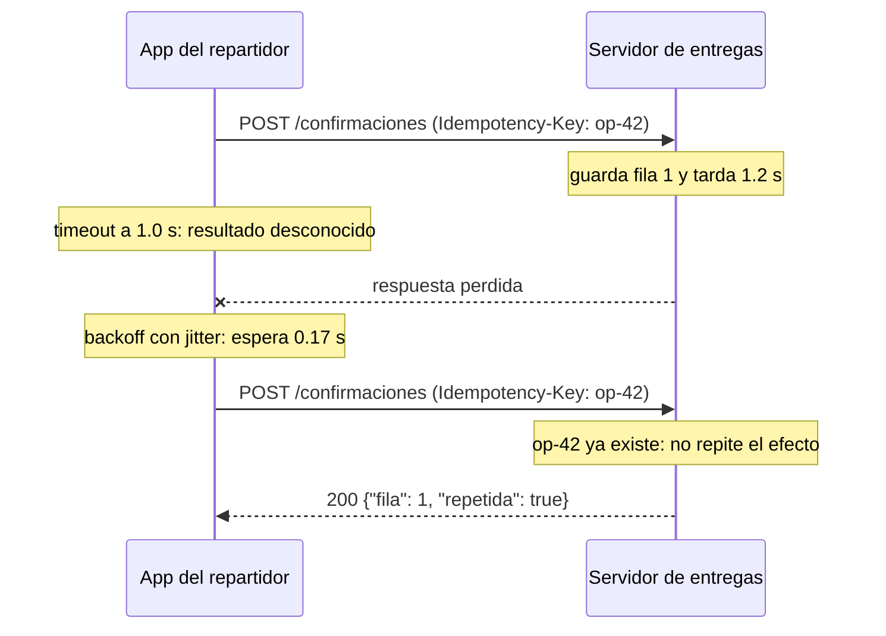
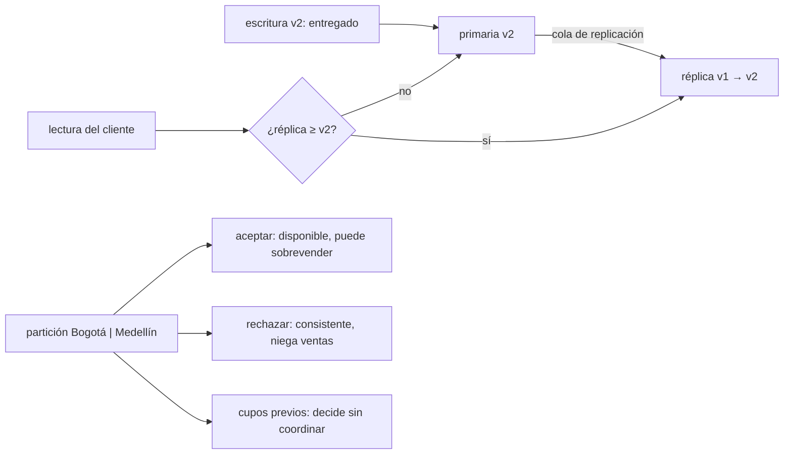
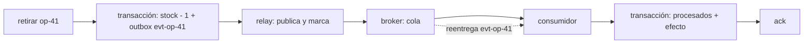
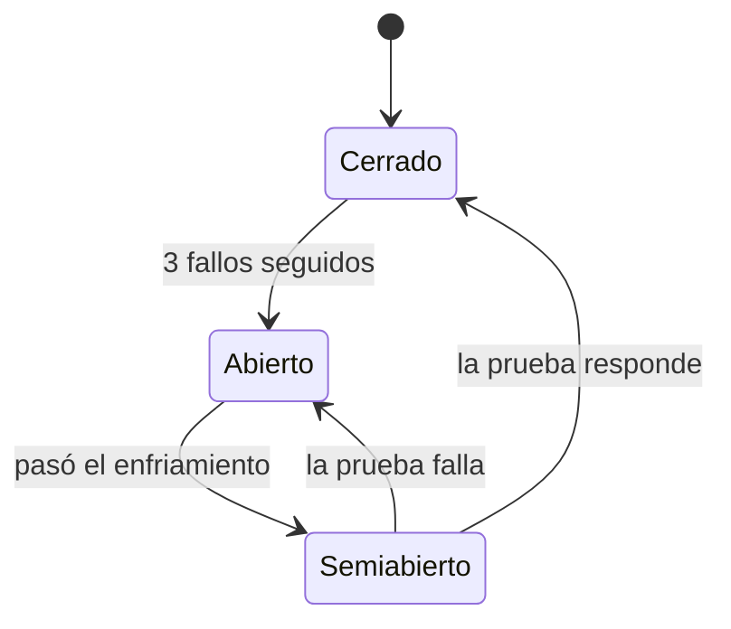
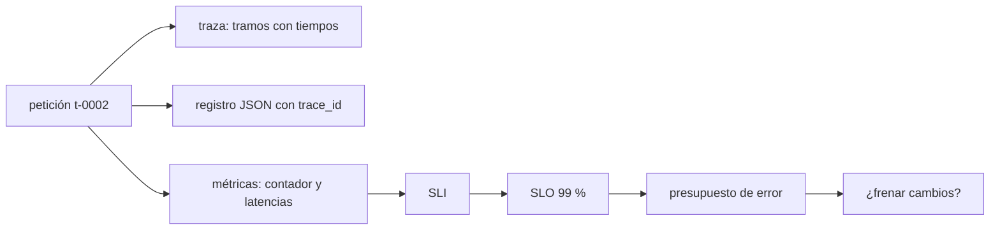
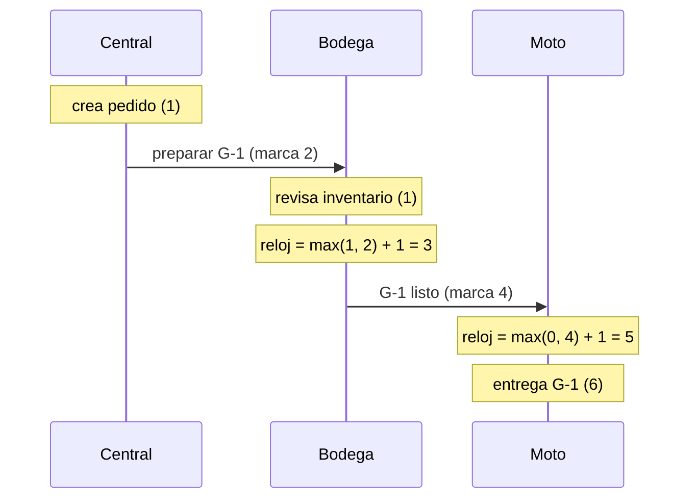
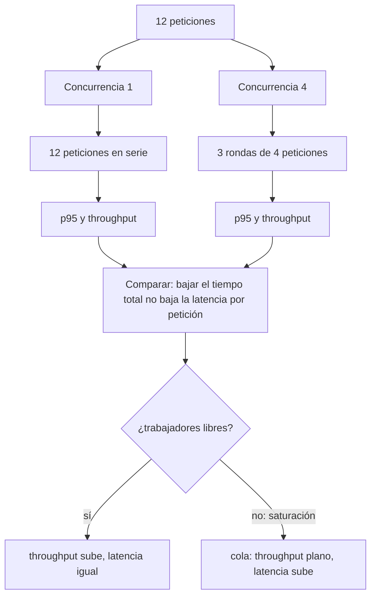
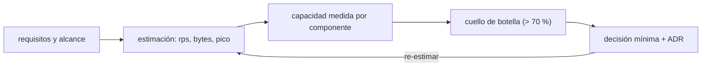

# Módulo 1: Sistemas distribuidos, resiliencia y observabilidad

**Entorno comprobado para esta edición (2026-11-24):** Python 3.13.18 en Linux x86_64, solo con la biblioteca
estándar: `http.server`, `urllib.request`, `sqlite3` (SQLite 3.53.1), `concurrent.futures`, `logging` y `statistics`.
Todas las salidas de este módulo se obtuvieron ejecutando el código mostrado ese día. Los servicios se simulan con
procesos e hilos locales en `127.0.0.1` y con fallos controlados escritos en el propio código. Las cifras de tiempo
(milisegundos, peticiones por segundo) cambiarán un poco en tu equipo; los conteos y las decisiones no. Las versiones
anteriores de este módulo traían ejemplos en TypeScript y JavaScript; aquí se tradujeron a Python con la misma lógica.
Docker Compose, mencionado en el proyecto, **no se ejecutó** en esta edición.

Una aplicación local puede asumir que una llamada termina bien o falla de forma visible. Cuando dos procesos se
comunican por red aparece una tercera posibilidad: el resultado es **desconocido**. La respuesta puede perderse después
de que el servidor guardó la entrega; un mensaje puede llegar dos veces; dos réplicas pueden ver datos distintos. Este
módulo enseña a razonar bajo esa incertidumbre sin prometer garantías que el sistema no puede cumplir.

**Al terminar este módulo podrás:**
- provocar un timeout real y explicar por qué no demuestra que la operación falló;
- reintentar con backoff y clave de idempotencia sin duplicar efectos;
- elegir entre consistencia fuerte y eventual según el invariante de cada operación;
- publicar eventos con outbox y consumirlos de forma idempotente;
- proteger el sistema de una dependencia lenta con un circuit breaker;
- definir un SLI y un SLO y medir cuánto presupuesto de error se consume;
- ordenar eventos con relojes de Lamport y explicar el commit en dos fases;
- medir latencia y throughput, y estimar capacidad antes de agregar componentes.

**Esquema del módulo:** Tema 1 (la red y la incertidumbre) → Tema 2 (réplicas y consistencia) → Tema 3 (mensajes y
efectos una sola vez) → Tema 4 (resiliencia y observabilidad) → Tema 5 (tiempo y acuerdo) → Proyecto 10 → Tema 6
(latencia y throughput) → Tema 7 (estimación de capacidad).

**Qué necesitas saber antes:** procesos y terminal (Módulo 0); funciones, clases, excepciones y `__name__`
(Módulo 1); cola FIFO y `perf_counter` (Módulo 2, Tema 2); cliente y servidor, puerto y `localhost` (Módulo 3,
Tema 1); HTTP, petición, respuesta, código de estado e idempotencia (Módulo 3, Tema 2); SQL básico con SQLite
(Módulo 4); registro con `logging` (Módulo 5, Tema 1). Comprueba `python3 --version` antes de empezar.


## Aprende construyendo


### Tema 1: La red convierte el resultado en una incertidumbre · Avanzado · 60 min

<details open>
<summary><strong>Capa 1 — Lectura</strong></summary>

#### Objetivos
Al terminar este tema podrás:
- provocar un timeout real contra un servidor HTTP local y leer el error que produce;
- explicar por qué un timeout deja el resultado de la operación en estado desconocido;
- demostrar con un conteo que un reintento ingenuo duplica el efecto en el servidor;
- reintentar con backoff exponencial, jitter y clave de idempotencia sin duplicar nada.

**Conceptos clave:** sistema distribuido, fallo parcial, latencia, timeout, resultado desconocido, reintento, backoff exponencial, jitter, clave de idempotencia

#### El problema
El repartidor de RutaFlow pulsa «Confirmar entrega» de la guía RF-4471. La app espera un segundo y muestra «sin
respuesta». El repartidor pulsa otra vez, y otra. Al final de la tarde, la central ve **tres** confirmaciones de la
misma entrega y el cliente recibió tres mensajes. ¿La primera confirmación falló o no? ¿Cómo reintentas sin repetir
el efecto?

Este tema usa lo que ya conoces: **cliente y servidor**, **puerto** y **localhost** tienen su ficha en el Módulo 3,
Tema 1; **petición**, **cabecera**, **código de estado** e **idempotencia**, en el Módulo 3, Tema 2. Aquí no se
redefinen: se aplican.

#### Glosario del tema

**sistema distribuido**
- **Definición técnica:** conjunto de procesos en distintas máquinas o puertos que cooperan intercambiando mensajes por red y no comparten memoria.
- **En palabras sencillas:** varios programas que trabajan juntos hablándose por la red, como sucursales que se llaman por teléfono.
- **Dónde se rompe la comparación:** por teléfono oyes si la otra persona colgó; por red no sabes si el otro proceso murió o solo va lento.
- **Ejemplo:** `cliente_ingenuo.py` y `servidor_entregas.py` son dos procesos que solo se comunican por HTTP en el puerto 8010.
- **Error típico:** programar la llamada remota como si fuera una función local que siempre devuelve algo o lanza un error claro.

**fallo parcial**
- **Definición técnica:** situación en la que una parte del sistema falla (un proceso, un enlace, una respuesta) mientras las demás siguen funcionando.
- **En palabras sencillas:** se cae una pieza, no todo; y quien depende de ella a veces no se entera.
- **Dónde se rompe la comparación:** en un programa local, si algo falla, todo el proceso suele terminar; aquí el servidor sigue vivo y guardó el dato.
- **Ejemplo:** en el Problema resuelto 1.1 el servidor guarda la fila 1, pero su respuesta se pierde porque el cliente ya colgó.
- **Error típico:** asumir «si no me respondió, no hizo nada».

**latencia**
- **Definición técnica:** tiempo que transcurre entre enviar una petición y recibir la respuesta completa; se mide en milisegundos.
- **En palabras sencillas:** cuánto esperas desde que preguntas hasta que te contestan.
- **Dónde se rompe la comparación:** la latencia no es fija: la misma petición puede tardar 5 ms ahora y 1200 ms dentro de un minuto.
- **Ejemplo:** el servidor del tema tarda 1.2 s en responder las dos primeras confirmaciones nuevas y unos milisegundos las demás.
- **Error típico:** medir una sola petición y tomarla como la latencia «del servicio».

**timeout (tiempo límite)**
- **Definición técnica:** plazo máximo que el cliente espera una respuesta; al vencerse, abandona la espera y lanza un error.
- **En palabras sencillas:** «si en un segundo no me contestas, cuelgo».
- **Dónde se rompe la comparación:** colgar el teléfono no deshace lo que el otro ya hizo; el servidor puede terminar el trabajo después.
- **Ejemplo:** `urllib.request.urlopen(peticion, timeout=1.0)` lanza `TimeoutError: timed out` si pasa un segundo sin respuesta.
- **Error típico:** no poner timeout: sin plazo, `urlopen` puede esperar indefinidamente y bloquear al usuario.

**resultado desconocido**
- **Definición técnica:** estado de una operación remota cuando el cliente no recibió respuesta: pudo no llegar, llegar y fallar, o llegar y tener éxito.
- **En palabras sencillas:** enviaste la carta y no llegó acuse de recibo; no sabes si se perdió la carta o el acuse.
- **Dónde se rompe la comparación:** con una carta puedes llamar a preguntar; un cliente automático necesita un mecanismo previsto para preguntar o repetir sin daño.
- **Ejemplo:** tras el primer `TimeoutError`, el servidor ya tenía `filas=1`; el cliente no lo sabía.
- **Error típico:** mostrar «la entrega falló» al usuario cuando lo correcto es «no sabemos todavía».

**reintento**
- **Definición técnica:** volver a enviar una petición después de un error que puede ser transitorio, como un timeout o una conexión rechazada.
- **En palabras sencillas:** volver a llamar cuando la línea estaba ocupada.
- **Dónde se rompe la comparación:** si la primera llamada sí llegó, repetirla puede repetir el efecto: dos confirmaciones, dos cobros.
- **Ejemplo:** `cliente_ingenuo.py` reintenta tres veces y el servidor termina con tres filas `RF-4471`.
- **Error típico:** reintentar una operación que no es idempotente sin darle una identidad.

**backoff exponencial**
- **Definición técnica:** política que duplica la espera antes de cada reintento: base, 2 × base, 4 × base, y así hasta un máximo.
- **En palabras sencillas:** si la puerta no abre, esperas un poco; si sigue cerrada, esperas el doble.
- **Dónde se rompe la comparación:** esperar más no garantiza éxito; solo evita saturar a un servidor que ya está en problemas.
- **Ejemplo:** con base 0.25 s, las esperas son 0.25, 0.50, 1.00, 2.00 y 4.00 s.
- **Error típico:** reintentar de inmediato en un bucle; mil clientes así convierten una lentitud en una caída.

**jitter**
- **Definición técnica:** componente aleatorio que se suma o se resta a la espera del backoff para que los clientes no reintenten sincronizados.
- **En palabras sencillas:** que no todos vuelvan a tocar la puerta en el mismo segundo.
- **Dónde se rompe la comparación:** el azar hace la espera impredecible; en pruebas se fija la semilla para obtener siempre la misma salida.
- **Ejemplo:** con `random.seed(7)` el primer intento espera 0.17 s en lugar de 0.25 s.
- **Error típico:** usar backoff sin jitter: todos los clientes que fallaron juntos vuelven a fallar juntos.

**clave de idempotencia**
- **Definición técnica:** identificador único que el cliente genera para una operación y repite en cada reintento; el servidor guarda el resultado por clave y no repite el efecto.
- **En palabras sencillas:** el número de radicado de un trámite: si lo presentas dos veces, la ventanilla ve que ya existe.
- **Dónde se rompe la comparación:** el servidor debe guardar la clave **en el mismo momento** que el efecto; si los guarda por separado, puede perder uno de los dos.
- **Ejemplo:** la cabecera `Idempotency-Key: op-42` hace que el segundo intento responda `200` con `"repetida": true`.
- **Error típico:** generar una clave nueva en cada reintento; así cada intento parece una operación distinta.

#### ► CÓMO FUNCIONA
Cuando el cliente envía la confirmación hay tres caminos. La petición se pierde y el servidor no hace nada. La
petición llega, el servidor guarda y la respuesta se pierde. O todo llega bien. Desde el cliente, los dos primeros
caminos se ven **idénticos**: un timeout. Por eso el reintento debe ser seguro en los tres casos.

La solución tiene dos piezas. La **clave de idempotencia** le da identidad a la operación: el servidor reconoce el
segundo intento y devuelve el resultado guardado. El **backoff con jitter** separa los intentos para no empeorar a un
servidor lento.



#### Problema resuelto 1.1
Simula el fallo: un servidor que guarda la confirmación y responde tarde, y un cliente que reintenta sin identidad.
Cuenta cuántas filas quedan.

**Razonamiento:**
1. El servidor necesita un fallo controlado: las dos primeras confirmaciones nuevas tardan 1.2 s, más que el timeout del cliente.
2. El efecto (agregar una fila) ocurre **antes** de la espera, como en un servidor real que guarda y luego responde.
3. El cliente usa `urllib.request`, el cliente HTTP de la biblioteca estándar: `Request` arma la petición y `urlopen` la envía.
4. Al final, una petición `GET` pregunta cuántas filas hay. Ese número es la evidencia.

```python
# servidor_entregas.py — confirma entregas de RutaFlow con lentitud controlada
import json
import sys
import time
from http.server import BaseHTTPRequestHandler, HTTPServer

LENTAS = int(sys.argv[1]) if len(sys.argv) > 1 else 2  # respuestas iniciales que tardan
CONFIRMACIONES = []   # efecto real: una fila por cada confirmación guardada
RESULTADOS = {}       # clave de idempotencia -> resultado ya producido
nuevas = 0            # confirmaciones nuevas atendidas


class Manejador(BaseHTTPRequestHandler):
    def responder(self, codigo, datos):
        cuerpo = json.dumps(datos).encode("utf-8")
        self.send_response(codigo)
        self.send_header("Content-Type", "application/json")
        self.send_header("Content-Length", str(len(cuerpo)))
        self.end_headers()
        self.wfile.write(cuerpo)

    def do_GET(self):
        self.responder(200, {"confirmaciones": CONFIRMACIONES})

    def do_POST(self):
        global nuevas
        datos = json.loads(self.rfile.read(int(self.headers["Content-Length"])))
        clave = self.headers.get("Idempotency-Key")
        if clave in RESULTADOS:                    # ya se hizo: repite la respuesta
            self.responder(200, RESULTADOS[clave] | {"repetida": True})
            return
        CONFIRMACIONES.append(datos["guia"])       # el efecto ocurre aquí
        resultado = {"guia": datos["guia"], "fila": len(CONFIRMACIONES)}
        if clave:
            RESULTADOS[clave] = resultado
        nuevas += 1
        if nuevas <= LENTAS:
            time.sleep(1.2)                        # fallo controlado: respuesta lenta
        try:
            self.responder(201, resultado)
        except OSError:                            # el cliente ya colgó
            print("[servidor] respuesta perdida: el cliente cerró la conexión", flush=True)

    def log_message(self, formato, *args):
        clave = self.headers.get("Idempotency-Key", "-")
        print(f"[servidor] {self.command} clave={clave} filas={len(CONFIRMACIONES)}", flush=True)


HTTPServer(("127.0.0.1", 8010), Manejador).serve_forever()
```

```python
# cliente_ingenuo.py — reintenta de inmediato y sin clave de idempotencia
import json
import time
import urllib.request

URL = "http://127.0.0.1:8010/confirmaciones"


def confirmar(guia, clave=None, timeout=1.0):
    cabeceras = {"Content-Type": "application/json"}
    if clave:
        cabeceras["Idempotency-Key"] = clave
    cuerpo = json.dumps({"guia": guia}).encode("utf-8")
    peticion = urllib.request.Request(URL, data=cuerpo, headers=cabeceras, method="POST")
    with urllib.request.urlopen(peticion, timeout=timeout) as respuesta:
        return respuesta.status, json.loads(respuesta.read())


def filas_guardadas():
    with urllib.request.urlopen(URL, timeout=2) as respuesta:
        return json.loads(respuesta.read())["confirmaciones"]


if __name__ == "__main__":
    inicio = time.perf_counter()
    for intento in range(1, 4):
        t = time.perf_counter() - inicio
        try:
            estado, datos = confirmar("RF-4471")
            print(f"{t:4.1f} s  intento {intento}: {estado} {datos}")
            break
        except TimeoutError as error:
            print(f"{t:4.1f} s  intento {intento}: TimeoutError: {error} -> resultado desconocido")
    print("filas en el servidor:", filas_guardadas())
```

Ejecuta el servidor en una terminal y el cliente en otra:

```text
$ python3 servidor_entregas.py
```

```text
$ python3 cliente_ingenuo.py
 0.0 s  intento 1: TimeoutError: timed out -> resultado desconocido
 1.0 s  intento 2: TimeoutError: timed out -> resultado desconocido
 2.0 s  intento 3: 201 {'guia': 'RF-4471', 'fila': 3}
filas en el servidor: ['RF-4471', 'RF-4471', 'RF-4471']
```

La terminal del servidor muestra qué pasó del otro lado:

```text
[servidor] POST clave=- filas=1
[servidor] respuesta perdida: el cliente cerró la conexión
[servidor] POST clave=- filas=2
[servidor] respuesta perdida: el cliente cerró la conexión
[servidor] POST clave=- filas=3
[servidor] GET clave=- filas=3
```

**Explicación por partes.**
- Servidor, líneas 7–10: `LENTAS` define cuántas confirmaciones nuevas tardan; `CONFIRMACIONES` es el efecto que contamos.
- Servidor, línea 32: el efecto ocurre aquí, antes de la espera de la línea 38. Por eso el dato queda guardado aunque nadie reciba la respuesta.
- Servidor, líneas 39–42: cuando el cliente ya colgó, escribir la respuesta lanza un `OSError`; el servidor lo anota como «respuesta perdida».
- Cliente, línea 15: `timeout=timeout` fija el plazo de un segundo; si vence, `urlopen` lanza `TimeoutError`.
- Cliente, líneas 26–33: cada intento manda una petición nueva, sin clave. Para el servidor son tres confirmaciones distintas.
- La salida lo prueba: dos timeouts, un `201` con `'fila': 3` y tres filas `RF-4471`. El cliente creyó fallar dos veces; el servidor acertó tres.

#### Problema resuelto 1.2
Corrige el cliente: mismo identificador en todos los intentos y espera creciente entre ellos.

**Razonamiento:**
1. La clave `op-42` se crea **una vez**, fuera del bucle, y viaja en la cabecera `Idempotency-Key` (líneas 11–12 del cliente ingenuo ya lo permiten).
2. El servidor ya sabe deduplicar: si la clave existe en `RESULTADOS`, responde lo guardado sin tocar `CONFIRMACIONES`.
3. Entre intentos, la espera es `techo / 2` más un valor aleatorio hasta `techo / 2`, con `techo` duplicándose.
4. Un `for … else` avisa si se agotan los intentos: en ese caso el estado sigue desconocido y hay que decirlo.

```python
# cliente_seguro.py — reintenta con la misma clave y con backoff exponencial
import random
import time

from cliente_ingenuo import confirmar, filas_guardadas

random.seed(7)                 # semilla fija: el jitter sale igual en cada ejecución
BASE_S = 0.25                  # espera inicial del backoff
MAX_INTENTOS = 4


def espera_backoff(intento):
    techo = BASE_S * 2 ** (intento - 1)            # 0.25, 0.5, 1.0 ...
    return techo / 2 + random.uniform(0, techo / 2)  # jitter: entre la mitad y el techo


inicio = time.perf_counter()
clave = "op-42"                # identidad de la operación, igual en todos los intentos
for intento in range(1, MAX_INTENTOS + 1):
    t = time.perf_counter() - inicio
    try:
        estado, datos = confirmar("RF-4471", clave=clave)
        print(f"{t:4.1f} s  intento {intento}: {estado} {datos}")
        break
    except TimeoutError as error:
        pausa = espera_backoff(intento)
        print(f"{t:4.1f} s  intento {intento}: TimeoutError: {error} -> espero {pausa:.2f} s")
        time.sleep(pausa)
else:
    print("se agotaron los intentos: el estado sigue desconocido")
print("filas en el servidor:", filas_guardadas())
```

Reinicia el servidor (Ctrl + C y `python3 servidor_entregas.py`) para empezar sin filas, y ejecuta:

```text
$ python3 cliente_seguro.py
 0.0 s  intento 1: TimeoutError: timed out -> espero 0.17 s
 1.2 s  intento 2: 200 {'guia': 'RF-4471', 'fila': 1, 'repetida': True}
filas en el servidor: ['RF-4471']
```

```text
[servidor] POST clave=op-42 filas=1
[servidor] respuesta perdida: el cliente cerró la conexión
[servidor] POST clave=op-42 filas=1
[servidor] GET clave=- filas=1
```

Para ver cómo crece la espera sin depender del servidor:

```python
# calendario_backoff.py — compara las esperas de 5 reintentos con y sin jitter
import random

random.seed(7)
BASE_S = 0.25
for intento in range(1, 6):
    techo = BASE_S * 2 ** (intento - 1)
    con_jitter = techo / 2 + random.uniform(0, techo / 2)
    print(f"intento {intento}: sin jitter {techo:5.2f} s | con jitter {con_jitter:5.2f} s")
```

```text
$ python3 calendario_backoff.py
intento 1: sin jitter  0.25 s | con jitter  0.17 s
intento 2: sin jitter  0.50 s | con jitter  0.29 s
intento 3: sin jitter  1.00 s | con jitter  0.83 s
intento 4: sin jitter  2.00 s | con jitter  1.07 s
intento 5: sin jitter  4.00 s | con jitter  3.07 s
```

**Explicación por partes.**
- Línea 5: reutiliza `confirmar` y `filas_guardadas`. El `if __name__ == "__main__":` del cliente ingenuo evita que su bucle se ejecute al importarlo.
- Líneas 12–14: `espera_backoff` calcula el techo exponencial y le aplica jitter; la semilla de la línea 7 hace la salida repetible.
- Línea 18: la clave se crea antes del bucle; todos los intentos la comparten.
- Líneas 25–28: tras un timeout, espera y vuelve a intentar. El segundo intento recibe `200` con `'repetida': True` y `'fila': 1`.
- La terminal del servidor confirma `filas=1` en ambos `POST`: el efecto ocurrió una sola vez.
- En `calendario_backoff.py`, la columna «con jitter» siempre queda entre la mitad del techo y el techo.

> **Error común.** Tratar igual un timeout y una conexión rechazada. Con el servidor apagado, `cliente_ingenuo.py`
> termina con `urllib.error.URLError: <urlopen error [Errno 111] Connection refused>`: la petición **no llegó** y
> reintentar es seguro. En cambio, `TimeoutError: timed out` significa «no sé»: la petición pudo llegar y guardarse.

> **Error común.** Llamar a `confirmar` sin `try`. El programa se detiene con `TimeoutError: timed out` y el usuario
> ve un traceback. Atrapa `TimeoutError`, decide si reintentas y muestra «estado desconocido», no «falló».

> **Buena práctica.** Toda operación con efecto que se pueda reintentar lleva clave de idempotencia. El estándar de
> facto es la cabecera `Idempotency-Key`, que usan pasarelas de pago y APIs públicas.

> **Prevenir errores.** Pon siempre un timeout y un número máximo de intentos. Sin el primero, el cliente puede
> esperar para siempre; sin el segundo, un servidor caído recibe reintentos infinitos.

#### Checkpoint 1.1
Si el servidor arranca con `python3 servidor_entregas.py 0` (ninguna respuesta lenta), ¿cuántas filas deja
`cliente_ingenuo.py`?

Respuesta: una. Sin lentitud, el primer intento recibe `201` antes del timeout y el bucle termina con `break`. El
defecto del cliente sigue ahí: solo aparece cuando la red falla, por eso hay que provocarlo para verlo.

</details>

<details>
<summary><strong>Capa 2 — Construcción</strong></summary>

#### Paso 1 · Prepara la carpeta
Crea `mkdir -p ~/labs/m10-red && cd ~/labs/m10-red` y copia `servidor_entregas.py`, `cliente_ingenuo.py` y
`cliente_seguro.py`.

#### Paso 2 · Provoca el duplicado
Arranca el servidor en una terminal y ejecuta `python3 cliente_ingenuo.py` en otra. Comprueba que la última línea
diga `filas en el servidor: ['RF-4471', 'RF-4471', 'RF-4471']`.

#### Paso 3 · Corrige con la clave
Reinicia el servidor y ejecuta `python3 cliente_seguro.py`. La última línea debe decir `filas en el servidor: ['RF-4471']`.

#### Paso 4 · Distingue los dos errores
Detén el servidor con Ctrl + C y ejecuta `python3 cliente_ingenuo.py`. Lee el `Connection refused` y anota por qué
ese error sí permite reintentar sin riesgo.

#### Paso 5 · Agota los intentos
Cambia el `1.2` de la línea 38 del servidor por `10` y arráncalo con `python3 servidor_entregas.py 9`. Ejecuta
`cliente_seguro.py`: verás cuatro timeouts y `se agotaron los intentos: el estado sigue desconocido`. Después, la
consulta final también termina en `TimeoutError: timed out`, porque el servidor sigue ocupado con la primera petición.

#### Resumen
- Un **sistema distribuido** es un grupo de procesos que solo se comunican por red; cada uno puede fallar por separado (**fallo parcial**).
- La **latencia** varía; el **timeout** corta la espera, pero no deshace lo que el servidor ya hizo.
- Tras un timeout, el **resultado es desconocido**: no es éxito ni fracaso.
- Un **reintento** sin identidad repite el efecto; la **clave de idempotencia** lo evita.
- El **backoff exponencial** con **jitter** separa los intentos y no satura al servidor.
- `Connection refused` dice «no llegó»; `TimeoutError` dice «no sé».

#### Ejercicio verificable 1
Básico. Sin ejecutar, ¿cuántas filas deja `cliente_ingenuo.py` si el servidor arranca con `python3 servidor_entregas.py 1`?

Respuesta esperada: dos. El primer intento guarda la fila 1 y vence el timeout; el segundo guarda la fila 2 y
responde rápido (ya no quedan respuestas lentas), así que el bucle termina en el intento 2.

#### Ejercicio verificable 2
Intermedio. Agrega a `calendario_backoff.py` un techo máximo de 2 s (`techo = min(techo, 2.0)`). ¿Qué esperas sin
jitter para los intentos 4 y 5?

Respuesta esperada: `2.00 s` en ambos. Sin el límite, el intento 5 esperaría `4.00 s`; el máximo evita que la espera
crezca sin control.

#### Ejercicio verificable 3
Reto. Haz que `cliente_seguro.py` acepte la clave por argumento (`sys.argv[1]`) y ejecútalo dos veces con `op-50`
contra el mismo servidor. ¿Cuántas filas hay al final?

Respuesta esperada: una sola fila, `['RF-4471']`. La primera ejecución guarda la fila tras un timeout; la segunda
recibe `200 {'guia': 'RF-4471', 'fila': 1, 'repetida': True}` desde el primer intento y el conteo no cambia.

#### En el trabajo
Las pasarelas de pago exigen una clave de idempotencia en cada cobro: un reintento por timeout nunca cobra dos
veces. Las librerías cliente de los proveedores de nube aplican backoff exponencial con jitter por defecto. En una
revisión de código, la pregunta obligatoria ante una llamada remota es: «¿qué pasa si se repite?».

</details>

### Tema 2: Replicación, consistencia y decisiones explícitas · Avanzado · 55 min

<details open>
<summary><strong>Capa 1 — Lectura</strong></summary>

#### Objetivos
Al terminar este tema podrás:
- simular una réplica asíncrona y provocar una lectura obsoleta real;
- evitar la lectura obsoleta exigiendo una versión mínima al leer;
- comparar con un conteo qué pasa con el stock durante una partición de red según la política elegida;
- escribir el invariante de una operación y decidir qué consistencia necesita.

**Conceptos clave:** réplica, replicación asíncrona, retraso de replicación, lectura obsoleta, consistencia fuerte, consistencia eventual, partición de red, invariante de negocio

#### El problema
La moto confirma la entrega de `env-4471` y la base principal de RutaFlow ya dice `entregado`. Un segundo después, el
cliente abre el seguimiento y ve `en_ruta`. Llama a reclamar. Al mismo tiempo, Bogotá y Medellín venden el producto 7
mientras el enlace entre las dos sedes está caído. Al reconectar, se vendieron más unidades de las que había. ¿Qué
copia de los datos dice la verdad y qué debe hacer cada sede cuando no puede hablar con la otra?

Este tema usa la **cola FIFO** del Módulo 2, Tema 2, y la **latencia** del Tema 1 de este módulo.

#### Glosario del tema

**réplica**
- **Definición técnica:** copia de los datos de un nodo que vive en otro proceso o máquina; la copia que recibe las escrituras se llama **primaria**.
- **En palabras sencillas:** una fotocopia del cuaderno original que guardas en otra oficina.
- **Dónde se rompe la comparación:** la fotocopia se hace una vez; la réplica se actualiza todo el tiempo, y en cada instante puede ir atrasada.
- **Ejemplo:** en `replicas.py`, `primaria` y `replica` son dos objetos `Nodo` con su propio diccionario `datos`.
- **Error típico:** escribir en la réplica: queda un dato que la primaria no conoce y que la siguiente replicación pisa.

**replicación asíncrona**
- **Definición técnica:** forma de replicar en la que la primaria confirma la escritura al cliente sin esperar a que las réplicas la apliquen.
- **En palabras sencillas:** la oficina principal anota el cambio y te dice «listo»; las copias se enteran después.
- **Dónde se rompe la comparación:** «después» no tiene plazo garantizado: puede ser un milisegundo o varios minutos.
- **Ejemplo:** la línea 22 de `replicas.py` deja el cambio en `pendientes`; solo `replicar()` lo aplica.
- **Error típico:** asumir que la escritura ya está en todas las copias cuando la primaria respondió.

**retraso de replicación**
- **Definición técnica:** diferencia, en versiones o en tiempo, entre la última escritura de la primaria y la última aplicada por una réplica.
- **En palabras sencillas:** cuántos cambios le faltan a la copia para estar al día.
- **Dónde se rompe la comparación:** no es constante: crece con la carga y con los problemas de red.
- **Ejemplo:** la salida `réplica  v1: en_ruta  (retraso: 1)` indica que falta una escritura.
- **Error típico:** medirlo solo en reposo; el retraso que importa es el de las horas pico.

**lectura obsoleta**
- **Definición técnica:** lectura que devuelve un valor que ya fue reemplazado por una escritura confirmada.
- **En palabras sencillas:** leer la fotocopia vieja cuando el original ya cambió.
- **Dónde se rompe la comparación:** el valor obsoleto fue cierto en su momento; no es un dato corrupto, es un dato viejo.
- **Ejemplo:** `lectura cualquiera     : ('en_ruta', 'réplica')` mientras la primaria ya dice `entregado`.
- **Error típico:** «arreglarla» con una pausa fija (`sleep(1)`); el retraso puede superar cualquier pausa.

**consistencia fuerte**
- **Definición técnica:** garantía de que toda lectura ve la última escritura confirmada, como si existiera una sola copia de los datos.
- **En palabras sencillas:** todos miran el mismo cuaderno original, nunca una copia atrasada.
- **Dónde se rompe la comparación:** cuesta latencia y disponibilidad: si no puedes hablar con quien tiene la última versión, debes esperar o rechazar.
- **Ejemplo:** `leer_estado("env-4471", version_minima=v)` va a la primaria si la réplica no alcanzó la versión `v`.
- **Error típico:** exigirla en todas las lecturas, incluidas las de reportes que toleran minutos de atraso.

**consistencia eventual**
- **Definición técnica:** garantía de que, si dejan de llegar escrituras, todas las réplicas convergen al mismo valor en algún momento.
- **En palabras sencillas:** las copias se ponen al día solas, pero no prometen cuándo.
- **Dónde se rompe la comparación:** «eventual» no dice cuánto tarda ni qué ves mientras tanto; solo promete el final.
- **Ejemplo:** tras `replicar()`, la salida muestra `('entregado', 'réplica') réplica v2`: las copias convergieron.
- **Error típico:** aplicar los cambios en desorden; la réplica «converge» a un valor equivocado.

**partición de red**
- **Definición técnica:** fallo en el que dos grupos de nodos siguen funcionando pero no pueden comunicarse entre sí.
- **En palabras sencillas:** se cae el teléfono entre dos sedes; las dos siguen atendiendo clientes.
- **Dónde se rompe la comparación:** cada lado no sabe si el otro se cayó o solo quedó incomunicado; desde adentro se ve igual.
- **Ejemplo:** en `particion.py`, Medellín no puede hablar con la autoridad central de Bogotá.
- **Error típico:** diseñar como si nunca ocurriera; durante una partición tienes que elegir entre responder o ser consistente.

**invariante de negocio**
- **Definición técnica:** condición sobre los datos que el negocio exige que sea cierta siempre, sin importar fallos ni concurrencia.
- **En palabras sencillas:** la regla que nunca se puede romper, pase lo que pase.
- **Dónde se rompe la comparación:** a diferencia del invariante de ciclo del Módulo 2, Tema 3, este no vive en un bucle: vive en todo el sistema.
- **Ejemplo:** «ninguna ubicación vende más unidades de las asignadas»: `vendidas <= STOCK`.
- **Error típico:** no escribirlo; sin invariante explícito no hay criterio para elegir la consistencia de cada operación.

#### ► CÓMO FUNCIONA
Una escritura llega a la primaria, que la aplica y responde. El cambio viaja a la réplica por una cola y se aplica
después. Entre esos dos instantes, leer la réplica da un dato viejo. Para cada lectura decides: ¿tolera ese atraso?
Si no lo tolera, exiges una versión mínima o lees de la primaria.

Durante una partición, cada sede tiene tres caminos. Aceptar con su copia local (disponible, pero puede romper el
invariante). Rechazar lo que no puede coordinar (consistente, pero niega ventas). O repartir el stock **antes** de la
partición en cupos, para decidir sin coordinar.



#### Problema resuelto 2.1
Simula una primaria y una réplica asíncrona. Provoca una lectura obsoleta del envío `env-4471` y evítala.

**Razonamiento:**
1. Cada nodo guarda sus datos y el número de la última versión aplicada.
2. Escribir aplica en la primaria y deja el cambio en la cola `pendientes` de la réplica; replicar los aplica en orden.
3. Leer va a la réplica por defecto. Si quien lee exige una versión mayor que la de la réplica, se lee de la primaria.
4. El cliente que acaba de confirmar conoce la versión de su escritura: esa es su versión mínima.

```python
# replicas.py — una primaria, una réplica asíncrona y una lectura obsoleta
class Nodo:
    def __init__(self, nombre):
        self.nombre = nombre
        self.datos = {}
        self.version = 0        # número de la última escritura aplicada
        self.pendientes = []    # cambios que viajan por la red y aún no se aplican

    def aplicar(self, version, clave, valor):
        self.datos[clave] = valor
        self.version = version


primaria, replica = Nodo("primaria"), Nodo("réplica")
ultima = 0


def escribir(clave, valor):
    global ultima
    ultima += 1
    primaria.aplicar(ultima, clave, valor)
    replica.pendientes.append((ultima, clave, valor))  # llega a la réplica después
    return ultima


def replicar():
    while replica.pendientes:
        replica.aplicar(*replica.pendientes.pop(0))


def leer_estado(shipment_id, version_minima=0):
    if replica.version >= version_minima:
        return replica.datos.get(shipment_id), "réplica"
    return primaria.datos.get(shipment_id), "primaria"   # la réplica va atrasada


escribir("env-4471", "en_ruta")
replicar()
v = escribir("env-4471", "entregado")                    # la moto confirma la entrega
print(f"primaria v{primaria.version}: {primaria.datos['env-4471']}")
print(f"réplica  v{replica.version}: {replica.datos['env-4471']}  (retraso: {v - replica.version})")
print("lectura cualquiera     :", leer_estado("env-4471"))
print(f"lectura que exige v{v}  :", leer_estado("env-4471", version_minima=v))
replicar()
print("tras replicar          :", leer_estado("env-4471"), f"réplica v{replica.version}")
```

```text
$ python3 replicas.py
primaria v2: entregado
réplica  v1: en_ruta  (retraso: 1)
lectura cualquiera     : ('en_ruta', 'réplica')
lectura que exige v2  : ('entregado', 'primaria')
tras replicar          : ('entregado', 'réplica') réplica v2
```

**Explicación por partes.**
- Líneas 9–11: aplicar un cambio actualiza el dato y la versión del nodo.
- Líneas 18–23: la escritura se confirma en la primaria y queda **pendiente** en la réplica: eso es replicación asíncrona.
- Líneas 26–28: `pop(0)` saca el cambio más antiguo; los cambios se aplican en el orden en que ocurrieron.
- Líneas 31–34: la lectura con `version_minima` decide a qué copia ir. Es consistencia fuerte solo para quien la pide.
- Línea 42: sin condición, la lectura devuelve `en_ruta`: lectura obsoleta.
- Línea 43: con `version_minima=2`, la réplica (v1) no sirve y se lee la primaria: `entregado`.
- Línea 45: después de replicar, la réplica sirve el dato correcto: consistencia eventual.

#### Problema resuelto 2.2
Bogotá y Medellín quedan incomunicadas. Hay 3 unidades del producto 7 y cada sede recibe 2 pedidos. Compara tres
políticas y verifica el invariante.

**Razonamiento:**
1. Invariante fuerte: ninguna ubicación vende más unidades de las asignadas (`vendidas <= STOCK`).
2. Opción A, «disponible»: cada sede vende con su copia local del stock.
3. Opción B, «consistente»: coordinar cada venta con la autoridad central (Bogotá); Medellín, aislada, rechaza.
4. Opción C, «cupos»: reservar cupos por ubicación antes de la partición (Bogotá 2, Medellín 1) y reconciliar transferencias después.

```python
# particion.py — tres políticas para vender durante una partición de red
STOCK = 3                                   # unidades asignadas del producto 7
PEDIDOS = {"bogota": 2, "medellin": 2}      # unidades que piden en cada ubicación


def simular(politica):
    vendidas, rechazadas = 0, 0
    copia = {"bogota": STOCK, "medellin": STOCK}   # cada lado ve su copia
    cupos = {"bogota": 2, "medellin": 1}           # reparto previo del stock
    for lugar, pedido in PEDIDOS.items():
        for _ in range(pedido):
            if politica == "disponible":            # acepta con su copia local
                ok = copia[lugar] > 0
                copia[lugar] -= ok
            elif politica == "consistente":         # exige hablar con la autoridad
                ok = lugar == "bogota" and vendidas < STOCK   # medellín quedó aislada
            else:                                   # "cupos": decide sin coordinar
                ok = cupos[lugar] > 0
                cupos[lugar] -= ok
            vendidas += ok
            rechazadas += not ok
    invariante = "se cumple" if vendidas <= STOCK else f"ROTO: sobreventa de {vendidas - STOCK}"
    print(f"{politica:<11} vendidas={vendidas} rechazadas={rechazadas} invariante {invariante}")


for politica in ("disponible", "consistente", "cupos"):
    simular(politica)
```

```text
$ python3 particion.py
disponible  vendidas=4 rechazadas=0 invariante ROTO: sobreventa de 1
consistente vendidas=2 rechazadas=2 invariante se cumple
cupos       vendidas=3 rechazadas=1 invariante se cumple
```

**Explicación por partes.**
- Línea 8: en la política «disponible», cada sede cree que hay 3 unidades. Vende 2 cada una: 4 en total.
- Líneas 15–16: en «consistente», solo vende quien alcanza a la autoridad. Medellín rechaza sus 2 pedidos aunque había stock.
- Líneas 17–19: con cupos, cada sede decide sola dentro de su reparto. Vende 3 y rechaza 1: el invariante se cumple sin coordinar.
- Línea 22: la verificación del invariante es parte del programa, no una revisión manual.
- Ninguna política es «la correcta» en general: la decide el invariante. Para el estado de un envío, una lectura vieja es molesta; para el stock, una sobreventa es dinero.

> **Error común.** Aplicar la cola de replicación al revés. Si en la línea 28 cambias `pop(0)` por `pop()` y llegan
> juntas las dos escrituras, la réplica aplica `entregado` y luego `en_ruta`. Una verificación
> `assert replica.datos == primaria.datos, f"réplica divergió: {replica.datos}"` termina con
> `AssertionError: réplica divergió: {'env-4471': 'en_ruta'}`. Sin orden, «eventual» converge al valor equivocado.

> **Buena práctica.** Escribe en el diseño, junto a cada operación, su invariante y la consistencia que necesita:
> «confirmar entrega: lectura propia con versión mínima»; «vender: cupos por sede»; «reporte diario: eventual».

> **Prevenir errores.** Prueba cada operación con la réplica atrasada a propósito, como en las líneas 39–43. Si el
> resultado viola el invariante, lo ves en la prueba y no en producción.

#### Checkpoint 2.1
Si inviertes los cupos (`{"bogota": 1, "medellin": 2}`), ¿cuántas ventas y rechazos da la política «cupos»?

Respuesta: `vendidas=3 rechazadas=1`. Ahora Bogotá vende 1 y rechaza 1, y Medellín vende sus 2. El total sigue
limitado por la suma de cupos, que es 3.

</details>

<details>
<summary><strong>Capa 2 — Construcción</strong></summary>

#### Paso 1 · Prepara la carpeta
Crea `mkdir -p ~/labs/m10-replicas && cd ~/labs/m10-replicas` y copia `replicas.py` y `particion.py`.

#### Paso 2 · Provoca la lectura obsoleta
Ejecuta `python3 replicas.py` y señala la línea de la salida donde la réplica devuelve `en_ruta`.

#### Paso 3 · Rompe el orden
Copia las líneas 1–34 en `desorden.py` y cambia `pop(0)` por `pop()`. Al final agrega
`escribir("env-4471", "en_ruta")`, `escribir("env-4471", "entregado")`, `replicar()` y el `assert` del error común.
Ejecuta y comprueba el `AssertionError`.

#### Paso 4 · Compara las políticas
Ejecuta `python3 particion.py`. Anota, para cada política, cuántos clientes quedaron sin venta y cuántas unidades se
sobrevendieron.

#### Paso 5 · Escribe la decisión
En `decision.md`, escribe el invariante del stock, la política elegida y qué haces al reconectar (por ejemplo,
transferir el cupo sobrante de una sede a la otra).

#### Resumen
- Una **réplica** es una copia de los datos; con **replicación asíncrona**, la primaria responde antes de que la copia se actualice.
- El **retraso de replicación** produce **lecturas obsoletas**: datos viejos, no corruptos.
- La **consistencia fuerte** garantiza ver la última escritura; la **consistencia eventual** solo garantiza converger.
- Exigir una versión mínima da consistencia fuerte a quien la necesita, sin imponerla a todos.
- Durante una **partición de red**, cada sede elige entre responder y arriesgar el **invariante de negocio**, o rechazar.
- Los cupos repartidos antes de la partición permiten decidir sin coordinar y sin romper el invariante.

#### Ejercicio verificable 1
Básico. Antes del segundo `replicar()`, ¿qué devuelve `leer_estado("env-4471", version_minima=1)`?

Respuesta esperada: `('en_ruta', 'réplica')`. La réplica está en v1 y cumple la condición, pero v1 no incluye la
entrega. La versión mínima debe ser la de **tu** escritura (v2), no cualquiera.

#### Ejercicio verificable 2
Intermedio. Cambia `STOCK = 3` por `STOCK = 4` y ejecuta `particion.py`. ¿Qué dice la política «disponible»?

Respuesta esperada: `disponible  vendidas=4 rechazadas=0 invariante se cumple`. Con 4 unidades y 4 pedidos no hay
sobreventa; el riesgo existe, pero esta vez la demanda no lo activó.

#### Ejercicio verificable 3
Reto. Agrega Cali con 1 pedido, su copia del stock y cupos `{"bogota": 1, "medellin": 1, "cali": 1}`. ¿Qué muestran
«disponible» y «cupos»?

Respuesta esperada: `disponible  vendidas=5 rechazadas=0 invariante ROTO: sobreventa de 2` y
`cupos       vendidas=3 rechazadas=2 invariante se cumple`. Cada sede nueva con copia local aumenta la sobreventa
posible; los cupos la mantienen en cero.

#### En el trabajo
Las bases de datos administradas ofrecen réplicas de lectura con retraso medible, y los equipos deciden qué consultas
van a ellas. El patrón «leer tus propias escrituras» con versión o marca de tiempo es común en apps de seguimiento.
En comercio electrónico, los cupos por bodega son una forma estándar de vender durante fallos sin sobrevender.

</details>

### Tema 3: Mensajes que se procesan con efectos exactamente una vez · Avanzado · 60 min

<details open>
<summary><strong>Capa 1 — Lectura</strong></summary>

#### Objetivos
Al terminar este tema podrás:
- demostrar con un conteo cómo se pierde un evento al escribir en la base y en el broker por separado;
- provocar una reentrega real y ver el efecto duplicado de un consumidor ingenuo;
- publicar eventos con el patrón outbox dentro de una transacción de SQLite;
- escribir un consumidor idempotente que logre el efecto exactamente una vez sobre entrega al menos una vez.

**Conceptos clave:** mensaje, broker, productor y consumidor, ack, entrega al menos una vez, entrega como máximo una vez, transacción, patrón outbox, consumidor idempotente, efecto exactamente una vez

#### El problema
Cuando sale una unidad del producto 7, el inventario de RutaFlow descuenta el stock y avisa a la bodega con un
mensaje. Un día el proceso muere entre los dos pasos: el stock bajó y la bodega nunca se enteró. Otro día la bodega
procesa el aviso, se cae antes de confirmarlo y lo recibe de nuevo: prepara dos despachos. ¿Cómo garantizas que
cada retiro produzca **un** aviso y **un** despacho, aunque los procesos mueran en el peor momento?

Este tema aplica la **cola FIFO** (Módulo 2, Tema 2) y la **idempotencia** (Módulo 3, Tema 2), y continúa la
**clave de idempotencia** del Tema 1 de este módulo. Las órdenes SQL (`CREATE TABLE`, `INSERT`, `UPDATE`, `SELECT`)
vienen del Módulo 4.

#### Glosario del tema

**mensaje**
- **Definición técnica:** unidad de datos con identificador propio que un proceso envía a otro de forma asíncrona, sin esperar a que el receptor lo procese.
- **En palabras sencillas:** una nota que dejas en un buzón para que alguien la lea cuando pueda.
- **Dónde se rompe la comparación:** la nota física existe una vez; un mensaje puede copiarse y llegar dos veces.
- **Ejemplo:** `{"id": "evt-op-41", "producto": 7}` avisa que salió una unidad del producto 7.
- **Error típico:** enviar mensajes sin `id`; sin identidad, el receptor no puede reconocer un duplicado.

**broker**
- **Definición técnica:** proceso intermediario que recibe mensajes, los guarda en colas y los entrega a los consumidores, con reglas de reentrega.
- **En palabras sencillas:** la oficina de correo: recibe, guarda y reparte, y vuelve a intentar si nadie firma.
- **Dónde se rompe la comparación:** el correo rara vez entrega dos veces; un broker lo hace a propósito cuando no recibe confirmación.
- **Ejemplo:** la clase `Broker` de `broker.py` guarda mensajes en una `deque` y reentrega los que no reciben ack. En producción se usan RabbitMQ o Kafka.
- **Error típico:** pedir un mensaje a una cola vacía sin comprobarlo: `IndexError: pop from an empty deque`.

**productor y consumidor**
- **Definición técnica:** el productor es el proceso que publica mensajes en el broker; el consumidor es el que los recibe y aplica su efecto.
- **En palabras sencillas:** quien escribe la nota y quien la lee y actúa.
- **Dónde se rompe la comparación:** no se conocen entre sí; solo conocen el broker y la forma del mensaje.
- **Ejemplo:** `retirar()` y el `relay()` producen; `consumir()` consume.
- **Error típico:** que el productor espere la respuesta del consumidor; eso los acopla y anula la ventaja del broker.

**ack (confirmación de recepción)**
- **Definición técnica:** señal que el consumidor envía al broker para indicar que terminó de procesar un mensaje; el broker entonces lo borra.
- **En palabras sencillas:** firmar el recibido del paquete.
- **Dónde se rompe la comparación:** si mueres después de abrir el paquete y antes de firmar, el correo te lo vuelve a traer.
- **Ejemplo:** `broker.ack("evt-op-41")` borra el mensaje de `en_vuelo`.
- **Error típico:** hacer ack **antes** de aplicar el efecto; si el proceso cae en medio, el mensaje se pierde.

**entrega al menos una vez**
- **Definición técnica:** garantía de que cada mensaje se entrega una o más veces; se logra reentregando todo lo que no recibió ack.
- **En palabras sencillas:** «te llegará seguro, quizás repetido».
- **Dónde se rompe la comparación:** no impide duplicados: los produce cuando el consumidor procesa y cae antes del ack.
- **Ejemplo:** `broker.vencer_plazos()` devuelve a la cola el mensaje sin ack y el consumidor lo recibe otra vez.
- **Error típico:** creer que el broker evita duplicados; esa tarea es del consumidor.

**entrega como máximo una vez**
- **Definición técnica:** garantía de que cada mensaje se entrega cero o una vez; nunca se reentrega, aunque se pierda.
- **En palabras sencillas:** «si llega, llega una vez; si se pierde, se perdió».
- **Dónde se rompe la comparación:** evita duplicados a costa de perder mensajes; sirve para métricas, no para dinero ni stock.
- **Ejemplo:** en `ingenuo.py`, el evento `evt-op-42` nunca se publicó: el stock bajó sin aviso.
- **Error típico:** elegirla sin saberlo, al publicar después del commit sin reintentar.

**transacción**
- **Definición técnica:** grupo de operaciones sobre una base de datos que se aplica completo (`COMMIT`) o no se aplica (`ROLLBACK`); nunca a medias.
- **En palabras sencillas:** todo o nada: o se guardan todos los cambios o ninguno.
- **Dónde se rompe la comparación:** solo cubre **una** base de datos; no incluye al broker ni a otro servicio.
- **Ejemplo:** `BEGIN`, `UPDATE productos …`, `INSERT INTO outbox …`, `COMMIT` guarda stock y evento juntos.
- **Error típico:** mezclar el modo por defecto de `sqlite3`, que abre transacciones solo, con un `BEGIN` manual. En `outbox.py` sin `isolation_level=None` aparece `sqlite3.OperationalError: cannot start a transaction within a transaction`.

**patrón outbox**
- **Definición técnica:** técnica que guarda el evento en una tabla `outbox` dentro de la misma transacción que el cambio de negocio; un proceso aparte (*relay*) lo publica después.
- **En palabras sencillas:** en vez de llamar al correo en el momento, dejas la carta en la bandeja de salida junto con el cambio; un mensajero la lleva.
- **Dónde se rompe la comparación:** el mensajero puede llevar la misma carta dos veces si cae antes de marcarla como enviada.
- **Ejemplo:** la tabla `outbox (event_id, payload, publicado)` de `outbox.py`.
- **Error típico:** publicar en el broker dentro de la transacción; si la transacción falla, el mensaje ya salió.

**consumidor idempotente**
- **Definición técnica:** consumidor que registra el `id` de cada mensaje procesado en la misma transacción que su efecto, y omite el efecto si el `id` ya existe.
- **En palabras sencillas:** la bodega guarda la lista de avisos ya atendidos y tacha los repetidos.
- **Dónde se rompe la comparación:** la lista y el efecto deben guardarse juntos; si se guardan por separado, vuelve el problema.
- **Ejemplo:** `INSERT OR IGNORE INTO procesados` devuelve `rowcount` 0 cuando el evento ya estaba.
- **Error típico:** usar `INSERT` sin `OR IGNORE`: el duplicado lanza `sqlite3.IntegrityError: UNIQUE constraint failed: procesados.event_id`.

**efecto exactamente una vez**
- **Definición técnica:** resultado observable de procesar cada mensaje una sola vez, logrado combinando entrega al menos una vez con deduplicación idempotente.
- **En palabras sencillas:** el mensaje puede llegar varias veces, pero el despacho se prepara una sola.
- **Dónde se rompe la comparación:** la **entrega** exactamente una vez no existe en una red con fallos; lo que se garantiza es el **efecto**.
- **Ejemplo:** `evt-op-41` llega tres veces y la tabla `avisos` lo contiene una vez.
- **Error típico:** comprar una herramienta que promete «exactly once» y no deduplicar; la promesa casi siempre se limita al interior del broker.

#### ► CÓMO FUNCIONA
El retiro y su evento se guardan en la **misma transacción**: el stock baja y la fila de `outbox` aparece, o no pasa
nada. Después, el relay lee las filas no publicadas, las envía al broker y las marca. Si cae entre enviar y marcar,
la próxima vuelta las envía otra vez: hay duplicados, pero ninguno se pierde.

El broker entrega al menos una vez. El consumidor abre una transacción, intenta registrar el `id` en `procesados` y,
solo si es nuevo, aplica el efecto. Luego hace ack. Si cae antes del ack, la reentrega encuentra el `id` y no repite.



#### Problema resuelto 3.1
Construye un broker mínimo y reproduce los dos fallos: un evento perdido por doble escritura y un efecto duplicado
por reentrega.

**Razonamiento:**
1. El broker necesita una cola, un registro de mensajes «en vuelo» y una forma de reentregar los que no reciben ack.
2. Doble escritura: `retirar` hace `commit` en la base y luego publica; un fallo controlado entre ambos pasos simula la caída.
3. Reentrega: el consumidor aplica el efecto y cae antes del ack; el broker vence el plazo y lo entrega otra vez.
4. Se cuentan el stock, los mensajes en la cola y los avisos a la bodega.

```python
# broker.py — broker mínimo con entrega al menos una vez
from collections import deque


class Broker:
    def __init__(self):
        self.cola = deque()
        self.en_vuelo = {}                    # mensajes entregados sin confirmar

    def publicar(self, mensaje):
        self.cola.append(mensaje)

    def recibir(self):
        mensaje = self.cola.popleft()
        self.en_vuelo[mensaje["id"]] = mensaje
        return mensaje

    def ack(self, id_mensaje):                # el consumidor confirma: se borra
        del self.en_vuelo[id_mensaje]

    def vencer_plazos(self):                  # sin ack a tiempo: vuelve a la cola
        for mensaje in self.en_vuelo.values():
            self.cola.append(mensaje)
        self.en_vuelo.clear()
```

```python
# ingenuo.py — doble escritura y consumidor sin deduplicación
import sqlite3

from broker import Broker

db = sqlite3.connect(":memory:")
db.execute("CREATE TABLE productos (id INTEGER PRIMARY KEY, stock INTEGER)")
db.execute("INSERT INTO productos VALUES (7, 5)")
db.commit()
broker = Broker()
avisos_bodega = []                            # efecto del consumidor


def retirar(id_operacion, falla_antes_de_publicar=False):
    db.execute("UPDATE productos SET stock = stock - 1 WHERE id = 7 AND stock >= 1")
    db.commit()                               # escritura 1: la base
    if falla_antes_de_publicar:
        raise RuntimeError("el proceso murió entre el commit y la publicación")
    broker.publicar({"id": f"evt-{id_operacion}", "producto": 7})  # escritura 2: el broker


def consumir(falla_antes_del_ack=False):
    mensaje = broker.recibir()
    avisos_bodega.append(mensaje["id"])       # efecto: avisar a la bodega
    if falla_antes_del_ack:
        return                                # murió: el ack nunca sale
    broker.ack(mensaje["id"])


retirar("op-41")
try:
    retirar("op-42", falla_antes_de_publicar=True)
except RuntimeError as error:
    print("fallo:", error)
stock = db.execute("SELECT stock FROM productos WHERE id = 7").fetchone()[0]
print(f"stock={stock} (bajó 2) | mensajes en la cola={len(broker.cola)} (falta evt-op-42)")

consumir(falla_antes_del_ack=True)            # procesa evt-op-41 y cae
broker.vencer_plazos()                        # el broker lo reentrega
consumir()
print("avisos a bodega:", avisos_bodega)
```

```text
$ python3 ingenuo.py
fallo: el proceso murió entre el commit y la publicación
stock=3 (bajó 2) | mensajes en la cola=1 (falta evt-op-42)
avisos a bodega: ['evt-op-41', 'evt-op-41']
```

**Explicación por partes.**
- `broker.py`, líneas 13–16: `recibir` saca el mensaje de la cola y lo guarda en `en_vuelo` hasta el ack.
- `broker.py`, líneas 21–24: lo que sigue en vuelo vuelve a la cola. Así funciona la entrega al menos una vez.
- `ingenuo.py`, líneas 15–19: dos escrituras separadas. El `commit` de la línea 16 ya es definitivo cuando la línea 18 simula la caída.
- La salida `stock=3 (bajó 2) | mensajes en la cola=1` prueba el evento perdido: dos retiros, un aviso.
- `ingenuo.py`, líneas 22–27: el efecto ocurre en la línea 24 y el ack en la 27. La caída entre ambas provoca la reentrega.
- `avisos a bodega: ['evt-op-41', 'evt-op-41']` prueba el efecto duplicado.

#### Problema resuelto 3.2
Corrige los dos fallos con outbox y un consumidor idempotente. Inyecta tres caídas: antes del commit, entre publicar
y marcar, y antes del ack.

**Razonamiento:**
1. El retiro escribe stock y evento en una transacción; una caída antes del `COMMIT` hace `ROLLBACK` y no deja rastro.
2. El relay publica lo pendiente y lo marca. Una caída entre ambos pasos produce un duplicado, no una pérdida.
3. El consumidor registra el `id` y aplica el efecto en una transacción; el ack va después.
4. Se esperan: stock 3 (dos retiros confirmados), y un aviso por cada evento confirmado.

```python
# outbox.py — publicación transaccional con outbox y consumidor idempotente
import json
import sqlite3

from broker import Broker

db = sqlite3.connect(":memory:", isolation_level=None)   # BEGIN/COMMIT explícitos
db.executescript("""
CREATE TABLE productos (id INTEGER PRIMARY KEY, stock INTEGER);
CREATE TABLE outbox (event_id TEXT PRIMARY KEY, payload TEXT, publicado INTEGER DEFAULT 0);
CREATE TABLE procesados (event_id TEXT PRIMARY KEY);
CREATE TABLE avisos (event_id TEXT);
INSERT INTO productos VALUES (7, 5);
""")
broker = Broker()


def retirar(id_operacion, falla_antes_del_commit=False):
    db.execute("BEGIN")
    db.execute("UPDATE productos SET stock = stock - 1 WHERE id = 7 AND stock >= 1")
    db.execute("INSERT INTO outbox (event_id, payload) VALUES (?, ?)",
               (f"evt-{id_operacion}", json.dumps({"producto": 7})))
    if falla_antes_del_commit:
        db.execute("ROLLBACK")                # muere: no queda ni stock ni evento
        return
    db.execute("COMMIT")                      # stock y evento, juntos o ninguno


def relay(falla_antes_de_marcar=False):
    for event_id, payload in db.execute(
            "SELECT event_id, payload FROM outbox WHERE publicado = 0").fetchall():
        broker.publicar({"id": event_id, **json.loads(payload)})
        if falla_antes_de_marcar:
            return                            # publicó pero no marcó: lo repetirá
        db.execute("UPDATE outbox SET publicado = 1 WHERE event_id = ?", (event_id,))


def consumir(falla_antes_del_ack=False):
    mensaje = broker.recibir()
    db.execute("BEGIN")
    nuevo = db.execute("INSERT OR IGNORE INTO procesados VALUES (?)", (mensaje["id"],)).rowcount
    if nuevo:                                 # 0 filas insertadas = ya se procesó
        db.execute("INSERT INTO avisos VALUES (?)", (mensaje["id"],))
    db.execute("COMMIT")                      # deduplicación y efecto, juntos
    print(f"  consumidor: {mensaje['id']} {'aplicado' if nuevo else 'duplicado, se ignora'}")
    if not falla_antes_del_ack:
        broker.ack(mensaje["id"])


retirar("op-41")
retirar("op-42", falla_antes_del_commit=True)
retirar("op-43")
relay(falla_antes_de_marcar=True)             # publica evt-op-41 y cae
relay()                                       # vuelve a publicar evt-op-41 y sigue
print("cola del broker:", [m["id"] for m in broker.cola])
consumir(falla_antes_del_ack=True)            # aplica evt-op-41 y cae sin ack
broker.vencer_plazos()                        # el broker lo reentrega al final
while broker.cola:
    consumir()
stock = db.execute("SELECT stock FROM productos").fetchone()[0]
avisos = [fila[0] for fila in db.execute("SELECT event_id FROM avisos")]
print(f"stock={stock} | avisos={avisos}")
```

```text
$ python3 outbox.py
cola del broker: ['evt-op-41', 'evt-op-41', 'evt-op-43']
  consumidor: evt-op-41 aplicado
  consumidor: evt-op-41 duplicado, se ignora
  consumidor: evt-op-43 aplicado
  consumidor: evt-op-41 duplicado, se ignora
stock=3 | avisos=['evt-op-41', 'evt-op-43']
```

**Explicación por partes.**
- Línea 7: `isolation_level=None` desactiva las transacciones automáticas de `sqlite3`; así `BEGIN` y `COMMIT` quedan bajo tu control.
- Líneas 18–26: stock y outbox en una sola transacción. `op-42` hace `ROLLBACK`: ni baja el stock ni aparece su evento.
- Líneas 29–35: el relay publica (línea 32) y marca (línea 35). La caída de la línea 53 deja `evt-op-41` sin marcar.
- La salida `cola del broker: ['evt-op-41', 'evt-op-41', 'evt-op-43']` muestra el duplicado del relay.
- Líneas 40–44: `INSERT OR IGNORE` y el efecto van en la misma transacción. `rowcount` vale 1 si el `id` es nuevo y 0 si ya existía.
- Línea 56: el primer consumo aplica y cae sin ack; la línea 57 lo reentrega al final de la cola.
- Resultado: `evt-op-41` llega tres veces y produce un aviso. `stock=3` y dos avisos coinciden con los dos retiros confirmados.

#### Problema resuelto 3.3
La misma idea protege un comando: la app reenvía «confirmar entrega» con el mismo `command_id`. Haz que el segundo
envío devuelva el mismo resultado sin repetir la confirmación.

**Razonamiento:**
1. Validar primero: identificadores presentes y PIN del destinatario de seis dígitos.
2. Buscar el resultado guardado por `command_id`; si existe, devolverlo tal cual.
3. Si no existe, ejecutar el efecto, guardar el resultado y devolverlo.

```python
# confirmar_entrega.py — el mismo comando dos veces produce un solo efecto
import re

resultados = {}          # command_id -> resultado ya producido
confirmaciones = 0       # cuántas veces se ejecutó el efecto de verdad


def confirmar_entrega(comando):
    if not comando.get("command_id") or not comando.get("shipment_id"):
        raise ValueError("faltan los identificadores del comando")
    if not re.fullmatch(r"\d{6}", comando["recipient_pin"]):
        raise ValueError("recipient_pin debe tener seis dígitos")
    previo = resultados.get(comando["command_id"])
    if previo:
        return previo                      # ya se confirmó: misma respuesta, sin efecto
    global confirmaciones
    confirmaciones += 1
    resultado = {"shipment_id": comando["shipment_id"], "status": "delivered"}
    resultados[comando["command_id"]] = resultado
    return resultado


comando = {"command_id": "cmd-1", "shipment_id": "env-4471",
           "occurred_at": "2026-10-05", "recipient_pin": "837201"}
print(confirmar_entrega(comando))
print(confirmar_entrega(comando))          # mismo command_id, reenviado
print("confirmaciones reales:", confirmaciones)
```

```text
$ python3 confirmar_entrega.py
{'shipment_id': 'env-4471', 'status': 'delivered'}
{'shipment_id': 'env-4471', 'status': 'delivered'}
confirmaciones reales: 1
```

**Explicación por partes.**
- Líneas 9–12: la validación va antes de todo. `re.fullmatch(r"\d{6}", …)` comprueba que el PIN sean exactamente seis dígitos.
- Líneas 13–15: si el comando ya se procesó, devuelve el resultado guardado y no toca `confirmaciones`.
- Líneas 17–19: el efecto y el registro del resultado. En producción, ambos irían en una transacción como en `outbox.py`.
- La salida muestra dos respuestas iguales y `confirmaciones reales: 1`.

> **Error común.** Deduplicar con `INSERT` simple. Si en la línea 41 de `outbox.py` quitas `OR IGNORE`, el primer
> duplicado detiene el consumidor con `sqlite3.IntegrityError: UNIQUE constraint failed: procesados.event_id`. La
> restricción de clave primaria detectó el duplicado; falta decirle a SQLite que lo ignore.

> **Error común.** Enviar un PIN de cinco dígitos. `confirmar_entrega` lanza
> `ValueError: recipient_pin debe tener seis dígitos` antes de buscar o guardar nada: un comando inválido no deja rastro.

> **Buena práctica.** Haz ack siempre **después** de confirmar la transacción del efecto. Si el orden es al revés, una
> caída entre ambos pasos pierde el mensaje para siempre.

> **Ingeniería de software.** La tabla `procesados` crece sin límite. En producción se borran las filas más antiguas
> que la ventana máxima de reentrega del broker (por ejemplo, siete días).

#### Checkpoint 3.1
Si el consumidor de `outbox.py` aplicara el efecto sin mirar `procesados` (la línea 42 con `if True:`), ¿cuántos
avisos de `evt-op-41` habría?

Respuesta: tres. La salida sería `avisos=['evt-op-41', 'evt-op-41', 'evt-op-43', 'evt-op-41']`: uno por cada
entrega del broker. Sin deduplicación, entrega al menos una vez significa efecto al menos una vez.

</details>

<details>
<summary><strong>Capa 2 — Construcción</strong></summary>

#### Paso 1 · Prepara la carpeta
Crea `mkdir -p ~/labs/m10-mensajes && cd ~/labs/m10-mensajes` y copia `broker.py`, `ingenuo.py`, `outbox.py` y
`confirmar_entrega.py`.

#### Paso 2 · Reproduce los dos fallos
Ejecuta `python3 ingenuo.py`. Anota el stock, los mensajes en la cola y los avisos. Explica con tus palabras cuál es
la pérdida y cuál el duplicado.

#### Paso 3 · Aplica outbox y deduplicación
Ejecuta `python3 outbox.py`. Comprueba que cada evento confirmado aparece una sola vez en `avisos`.

#### Paso 4 · Quita la protección
Borra `OR IGNORE` de la línea 41, ejecuta y lee el `IntegrityError`. Restaura la línea.

#### Paso 5 · Prueba el comando repetido
Ejecuta `python3 confirmar_entrega.py` y cambia el PIN a `"83720"` para ver el `ValueError`.

#### Resumen
- Un **mensaje** con `id` viaja por un **broker** desde el **productor** hasta el **consumidor**.
- El **ack** confirma el procesamiento; sin ack, el broker reentrega: **entrega al menos una vez**.
- Escribir en la base y en el broker por separado puede perder eventos: **entrega como máximo una vez** sin quererlo.
- El **patrón outbox** guarda el cambio y el evento en una **transacción**; el relay los publica después.
- El **consumidor idempotente** registra el `id` y aplica el efecto en la misma transacción.
- Lo alcanzable es el **efecto exactamente una vez**, no la entrega exactamente una vez.

#### Ejercicio verificable 1
Básico. Si borras la línea 53 de `outbox.py` (la caída del relay), ¿qué muestra la línea `cola del broker`?

Respuesta esperada: `cola del broker: ['evt-op-41', 'evt-op-43']`. Sin esa caída, el relay publica cada evento una
vez; el único duplicado restante es la reentrega por la caída del consumidor.

#### Ejercicio verificable 2
Intermedio. Después del programa de `confirmar_entrega.py`, envía el mismo comando con `command_id` `"cmd-2"`.
¿Cuántas confirmaciones reales hay?

Respuesta esperada: `confirmaciones reales: 2`. La deduplicación es por comando, no por envío: un `command_id`
distinto es una operación nueva. Si el negocio exige una sola confirmación por envío, ese es otro invariante y se
valida aparte.

#### Ejercicio verificable 3
Reto. Al final de `outbox.py`, agrega `retirar("op-44")` y consulta `SELECT event_id, publicado FROM outbox`. Luego
ejecuta `relay()` y muestra la cola.

Respuesta esperada: `[('evt-op-41', 1), ('evt-op-43', 1), ('evt-op-44', 0)]` y después `['evt-op-44']`. El evento
queda guardado aunque nadie lo haya publicado todavía: si el proceso muere aquí, el siguiente relay lo envía.

#### En el trabajo
El patrón outbox es la forma habitual de publicar eventos desde un servicio con base relacional; herramientas como
Debezium leen la tabla outbox y la llevan a Kafka. Los equipos de pagos guardan la tabla de mensajes procesados con
el mismo cuidado que el saldo: es lo que impide cobrar dos veces.

</details>

### Tema 4: Resiliencia y observabilidad orientadas a objetivos · Avanzado · 65 min

<details open>
<summary><strong>Capa 1 — Lectura</strong></summary>

#### Objetivos
Al terminar este tema podrás:
- medir cuánto tiempo pierde un servicio esperando a una dependencia caída, con y sin circuit breaker;
- escribir registros estructurados con un ID de correlación y reconstruir la traza de una petición;
- calcular percentiles y mostrar por qué el promedio oculta a los usuarios lentos;
- definir un SLI y un SLO para confirmar entregas y medir cuánto presupuesto de error se consumió.

**Conceptos clave:** dependencia, circuit breaker, registro estructurado, ID de correlación, traza, span, métrica, percentil, SLI, SLO, presupuesto de error

#### El problema
El proveedor de SMS de RutaFlow se cae seis segundos. Cada confirmación de entrega espera 0.8 s por un SMS que no
sale, y la app del repartidor se congela. En el registro solo aparece `ERROR falló el SMS`, sin guía ni duración. El
jefe pregunta: «¿estamos bien esta semana?». Nadie sabe responder con un número. ¿Cómo dejas de esperar a quien no
responde, cómo encuentras qué petición falló y cómo mides «bien»?

Este tema usa el **registro** con `logging` (Módulo 5, Tema 1), el **timeout** y la **latencia** del Tema 1, y la
**cola FIFO** del Módulo 2, Tema 2.

#### Glosario del tema

**dependencia**
- **Definición técnica:** servicio externo del que tu servicio necesita una respuesta para completar una operación.
- **En palabras sencillas:** alguien de quien dependes para terminar tu trabajo.
- **Dónde se rompe la comparación:** puedes llamar a otra persona si la primera no contesta; un servicio solo puede esperar, reintentar o seguir sin ella.
- **Ejemplo:** el proveedor de SMS es una dependencia de «confirmar entrega».
- **Error típico:** tratar todas las dependencias como obligatorias; el SMS puede quedar en cola sin bloquear la entrega.

**circuit breaker (cortacircuitos)**
- **Definición técnica:** componente que cuenta fallos de una dependencia y, al superar un umbral, rechaza las llamadas sin intentarlas durante un enfriamiento; luego deja pasar una prueba (estado semiabierto).
- **En palabras sencillas:** el breaker de la casa: si hay cortocircuito, corta la corriente para no quemar más cosas.
- **Dónde se rompe la comparación:** el de la casa lo subes tú; este se reintenta solo, con una llamada de prueba.
- **Ejemplo:** con umbral 3 y enfriamiento 3 s, la espera total bajó de `5.00 s` a `3.30 s` en la misma caída.
- **Error típico:** abrir el breaker y devolver error al usuario; lo correcto es una alternativa (aquí, dejar el SMS en cola).

**registro estructurado**
- **Definición técnica:** registro en el que cada línea es un objeto con campos con nombre (normalmente JSON), en vez de una frase libre.
- **En palabras sencillas:** una ficha con casillas fijas en lugar de una nota escrita a mano.
- **Dónde se rompe la comparación:** la ficha la lee una persona; el registro estructurado lo filtran programas por campo.
- **Ejemplo:** `{"evento": "entrega_confirmada", "trace_id": "t-0002", "guia": "RF-4472", "sms": "error", "duracion_ms": 321}`.
- **Error típico:** registrar frases como `falló el SMS`; no dicen qué guía, qué petición ni cuánto tardó.

**ID de correlación**
- **Definición técnica:** identificador único que se asigna a una petición al entrar y se propaga a todos los registros y servicios que la atienden.
- **En palabras sencillas:** el número de radicado que se escribe en cada papel del mismo trámite.
- **Dónde se rompe la comparación:** en papel lo copias a mano; en software, si un servicio no lo propaga, la cadena se rompe sin aviso.
- **Ejemplo:** `trace_id: "t-0002"` aparece en el registro y en los tres tramos de la traza.
- **Error típico:** generar un ID nuevo en cada servicio; así no puedes unir los pasos de la misma petición.

**traza**
- **Definición técnica:** registro del recorrido completo de una petición a través de los componentes, formado por tramos con inicio, fin y relación padre-hijo.
- **En palabras sencillas:** el historial de un paquete: dónde estuvo y cuánto tiempo en cada sitio.
- **Dónde se rompe la comparación:** el historial del paquete es una lista; la traza es un árbol, porque un paso puede llamar a varios.
- **Ejemplo:** la traza `t-0002` muestra que `sms.enviar` ocupó 300 de los 321 ms.
- **Error típico:** buscar la causa de una petición lenta en los registros sueltos; la traza dice dónde se fue el tiempo.

**span (tramo)**
- **Definición técnica:** unidad de una traza: una operación con nombre, inicio, fin, estado y referencia a su tramo padre.
- **En palabras sencillas:** una etapa del viaje del paquete: «en bodega de 8:00 a 8:20».
- **Dónde se rompe la comparación:** las etapas de un paquete no se solapan; los tramos hijos pueden ejecutarse en paralelo.
- **Ejemplo:** `{"span": "sms.enviar", "padre": "confirmar-entrega", "inicio_ms": 21, "fin_ms": 321, "estado": "error"}`.
- **Error típico:** olvidar cerrar el tramo cuando hay una excepción; la función `tramo` lo cierra en ambos casos.

**métrica**
- **Definición técnica:** valor numérico agregado en el tiempo, como un contador de peticiones o una distribución de latencias, que se consulta sin leer cada evento.
- **En palabras sencillas:** el marcador del partido, no la repetición de cada jugada.
- **Dónde se rompe la comparación:** el marcador no te dice quién falló; para eso vuelves a los registros y las trazas.
- **Ejemplo:** `métricas: peticiones=1000 errores=2`.
- **Error típico:** poner la guía o el usuario como etiqueta de una métrica; cada valor distinto crea una serie nueva y el sistema de métricas colapsa.

**percentil**
- **Definición técnica:** el percentil p es el valor por debajo del cual queda el p % de las observaciones ordenadas; p50 es la mediana, p95 deja fuera al 5 % más lento.
- **En palabras sencillas:** «el 95 % de las confirmaciones tardó esto o menos».
- **Dónde se rompe la comparación:** dos percentiles no se promedian: el p95 de una semana no es el promedio de los p95 diarios.
- **Ejemplo:** `promedio=162 ms  p50=147 ms  p95=216 ms  p99=930 ms`: el 1 % más lento espera casi un segundo.
- **Error típico:** reportar solo el promedio; esconde la cola lenta que sí siente el usuario.

**SLI (indicador de nivel de servicio)**
- **Definición técnica:** proporción de eventos buenos sobre eventos válidos, medida desde la experiencia del usuario.
- **En palabras sencillas:** de cada 100 confirmaciones, cuántas salieron bien y rápido.
- **Dónde se rompe la comparación:** «bien» se define por adelantado (estado `ok` y 300 ms o menos), no después de ver los datos.
- **Ejemplo:** `SLI con 3 eventos: 0.6666666666666666`: dos de tres confirmaciones fueron buenas.
- **Error típico:** medir el uso de CPU como SLI; al usuario no le importa la CPU, le importa que la entrega se confirme.

**SLO (objetivo de nivel de servicio)**
- **Definición técnica:** meta para un SLI en una ventana de tiempo, por ejemplo «99 % de confirmaciones buenas en 7 días».
- **En palabras sencillas:** la nota mínima que te pones para aprobar la semana.
- **Dónde se rompe la comparación:** un 100 % no es una meta ambiciosa: es imposible y deja sin margen para cambiar nada.
- **Ejemplo:** `SLI=0.9799  SLO=0.99  cumple=False`.
- **Error típico:** definir el SLO sin ventana; «99 %» sin «en 7 días» no se puede verificar.

**presupuesto de error**
- **Definición técnica:** cantidad de eventos malos que el SLO permite en la ventana: `(1 − SLO) × eventos válidos`.
- **En palabras sencillas:** cuántos errores te puedes permitir esta semana antes de reprobar.
- **Dónde se rompe la comparación:** no es una cuota para gastar: es la señal para frenar cambios riesgosos cuando se agota.
- **Ejemplo:** `presupuesto de error=10 eventos  consumido=20 (200%)`.
- **Error típico:** alertar por cada error suelto; se alerta cuando el ritmo de consumo agotaría el presupuesto antes de tiempo.

#### ► CÓMO FUNCIONA
La resiliencia empieza por no esperar a quien no responde. El circuit breaker cuenta fallos seguidos; al llegar al
umbral se abre y rechaza al instante, y el servicio usa una alternativa. Tras el enfriamiento deja pasar una prueba:
si sale bien, se cierra; si falla, vuelve a abrirse.

La observabilidad responde tres preguntas. Las **métricas** dicen *si* algo va mal (el SLI cae). Las **trazas** dicen
*dónde* (qué tramo consumió el tiempo). Los **registros estructurados** dicen *qué* pasó en esa petición. El ID de
correlación une las tres.





#### Problema resuelto 4.1
El proveedor de SMS no responde entre t = 0 s y t = 6 s. Llega una confirmación por segundo. Compara el tiempo total
de espera sin breaker y con un breaker de umbral 3 y enfriamiento 3 s.

**Razonamiento:**
1. Para que la salida sea repetible, el tiempo es simulado: cada llamada fallida «cuesta» 0.8 s y cada éxito 0.05 s.
2. El breaker tiene tres estados: cerrado (llama), abierto (rechaza sin llamar) y semiabierto (una llamada de prueba).
3. Cuando el SMS no sale, la alternativa es dejarlo en cola; la entrega se confirma igual.
4. Se comparan dos números: llamadas al proveedor y espera total.

```python
# circuit_breaker.py — dejar de esperar a una dependencia que está fallando
CAIDO_HASTA = 6.0      # el proveedor de SMS no responde entre t=0 s y t=6 s
TIMEOUT_S = 0.8        # cada llamada fallida cuesta 0.8 s de espera


def llamar_proveedor(t):
    if t < CAIDO_HASTA:
        return False, TIMEOUT_S                 # timeout: falló y te hizo esperar
    return True, 0.05                           # respondió rápido


class CircuitBreaker:
    def __init__(self, umbral=3, enfriamiento_s=3.0):
        self.estado, self.fallos, self.abierto_desde = "cerrado", 0, 0.0
        self.umbral, self.enfriamiento_s = umbral, enfriamiento_s

    def llamar(self, t):
        if self.estado == "abierto":
            if t - self.abierto_desde < self.enfriamiento_s:
                return False, 0.0, "rechazo inmediato"   # ni siquiera intenta
            self.estado = "semiabierto"                  # deja pasar una prueba
        ok, espera = llamar_proveedor(t)
        if ok:
            self.estado, self.fallos = "cerrado", 0
        else:
            self.fallos += 1
            if self.estado == "semiabierto" or self.fallos >= self.umbral:
                self.estado, self.abierto_desde = "abierto", t
        return ok, espera, "llamó al proveedor"


for con_breaker in (False, True):
    breaker, total_espera, llamadas = CircuitBreaker(), 0.0, 0
    print("CON circuit breaker" if con_breaker else "SIN circuit breaker")
    for t in range(10):                                   # una confirmación por segundo
        if con_breaker:
            ok, espera, accion = breaker.llamar(float(t))
            llamadas += accion == "llamó al proveedor"
        else:
            (ok, espera), accion = llamar_proveedor(float(t)), "llamó al proveedor"
            llamadas += 1
        total_espera += espera
        estado = breaker.estado if con_breaker else "-"
        print(f"  t={t} {'SMS enviado' if ok else 'SMS a la cola':<13} espera={espera:.2f} s "
              f"{accion:<18} breaker={estado}")
    print(f"  llamadas al proveedor={llamadas} espera total={total_espera:.2f} s\n")
```

```text
$ python3 circuit_breaker.py
SIN circuit breaker
  t=0 SMS a la cola espera=0.80 s llamó al proveedor breaker=-
  t=1 SMS a la cola espera=0.80 s llamó al proveedor breaker=-
  t=2 SMS a la cola espera=0.80 s llamó al proveedor breaker=-
  t=3 SMS a la cola espera=0.80 s llamó al proveedor breaker=-
  t=4 SMS a la cola espera=0.80 s llamó al proveedor breaker=-
  t=5 SMS a la cola espera=0.80 s llamó al proveedor breaker=-
  t=6 SMS enviado   espera=0.05 s llamó al proveedor breaker=-
  t=7 SMS enviado   espera=0.05 s llamó al proveedor breaker=-
  t=8 SMS enviado   espera=0.05 s llamó al proveedor breaker=-
  t=9 SMS enviado   espera=0.05 s llamó al proveedor breaker=-
  llamadas al proveedor=10 espera total=5.00 s

CON circuit breaker
  t=0 SMS a la cola espera=0.80 s llamó al proveedor breaker=cerrado
  t=1 SMS a la cola espera=0.80 s llamó al proveedor breaker=cerrado
  t=2 SMS a la cola espera=0.80 s llamó al proveedor breaker=abierto
  t=3 SMS a la cola espera=0.00 s rechazo inmediato  breaker=abierto
  t=4 SMS a la cola espera=0.00 s rechazo inmediato  breaker=abierto
  t=5 SMS a la cola espera=0.80 s llamó al proveedor breaker=abierto
  t=6 SMS a la cola espera=0.00 s rechazo inmediato  breaker=abierto
  t=7 SMS a la cola espera=0.00 s rechazo inmediato  breaker=abierto
  t=8 SMS enviado   espera=0.05 s llamó al proveedor breaker=cerrado
  t=9 SMS enviado   espera=0.05 s llamó al proveedor breaker=cerrado
  llamadas al proveedor=6 espera total=3.30 s
```

**Explicación por partes.**
- Líneas 6–9: la dependencia simulada. Mientras está caída, cada llamada falla tras 0.8 s de espera.
- Líneas 18–21: con el breaker abierto y el enfriamiento sin cumplir, rechaza en 0 s; cumplido, pasa a semiabierto.
- Líneas 26–28: el tercer fallo seguido abre el breaker; un fallo en semiabierto lo reabre.
- En t = 5 la prueba falla y se reabre; en t = 8 la prueba responde y se cierra. El estado semiabierto dura una sola llamada, por eso no aparece en la columna.
- Resultado: 6 llamadas en vez de 10 y 3.30 s de espera en vez de 5.00 s. El costo: el breaker detecta la recuperación en t = 8, dos segundos tarde.

#### Problema resuelto 4.2
Registra dos confirmaciones con un ID de correlación cada una. La segunda sufre un SMS lento. Reconstruye su traza.

**Razonamiento:**
1. Primero, el registro plano que no sirve: `logging.error("falló el SMS")`.
2. Cada operación se envuelve en `tramo`, que mide inicio y fin y guarda el estado aunque haya excepción.
3. Al terminar, se escribe una línea JSON con `trace_id`, guía, estado y duración.
4. Para reconstruir la traza se filtran los tramos por `trace_id` y se ordenan por inicio, padre primero.

```python
# observabilidad.py — registro estructurado, ID de correlación y traza de una petición
import json
import logging
import time

logging.basicConfig(level=logging.INFO, format="%(levelname)s %(message)s")
log = logging.getLogger("rutaflow")
SPANS = []                                    # tramos terminados de todas las trazas
INICIO = time.perf_counter()


def ms():
    return round((time.perf_counter() - INICIO) * 1000)


def tramo(trace_id, nombre, padre, trabajo):
    inicio = ms()
    try:
        trabajo()
        estado = "ok"
    except TimeoutError:
        estado = "error"
    SPANS.append({"trace_id": trace_id, "span": nombre, "padre": padre,
                  "inicio_ms": inicio, "fin_ms": ms(), "estado": estado})
    return estado


def enviar_sms(lento):
    time.sleep(0.30 if lento else 0.02)
    if lento:
        raise TimeoutError


def confirmar_entrega(guia, trace_id, sms_lento):
    inicio = ms()
    tramo(trace_id, "inventario.reservar", "confirmar-entrega", lambda: time.sleep(0.02))
    estado = tramo(trace_id, "sms.enviar", "confirmar-entrega", lambda: enviar_sms(sms_lento))
    SPANS.append({"trace_id": trace_id, "span": "confirmar-entrega", "padre": None,
                  "inicio_ms": inicio, "fin_ms": ms(), "estado": estado})
    nivel = logging.ERROR if estado == "error" else logging.INFO
    log.log(nivel, json.dumps({"evento": "entrega_confirmada", "trace_id": trace_id,
                                "guia": guia, "sms": estado, "duracion_ms": ms() - inicio}))


logging.error("falló el SMS")                 # registro plano: ¿de qué guía?, ¿cuánto tardó?
confirmar_entrega("RF-4471", "t-0001", sms_lento=False)
confirmar_entrega("RF-4472", "t-0002", sms_lento=True)

print("\ntraza t-0002 reconstruida desde los tramos:")
tramos = [s for s in SPANS if s["trace_id"] == "t-0002"]       # filtra por ID de correlación
base = min(s["inicio_ms"] for s in tramos)
for s in sorted(tramos, key=lambda s: (s["inicio_ms"], s["padre"] is not None)):
    sangria = "  " if s["padre"] else ""                       # los hijos van indentados
    print(f"  {sangria}{s['span']:<21} {s['inicio_ms'] - base:>4} -> {s['fin_ms'] - base:>4} ms  {s['estado']}")
```

```text
$ python3 observabilidad.py
ERROR falló el SMS
INFO {"evento": "entrega_confirmada", "trace_id": "t-0001", "guia": "RF-4471", "sms": "ok", "duracion_ms": 40}
ERROR {"evento": "entrega_confirmada", "trace_id": "t-0002", "guia": "RF-4472", "sms": "error", "duracion_ms": 321}

traza t-0002 reconstruida desde los tramos:
  confirmar-entrega        0 ->  321 ms  error
    inventario.reservar      0 ->   21 ms  ok
    sms.enviar              21 ->  321 ms  error
```

**Explicación por partes.**
- Línea 6: el formato `%(levelname)s %(message)s` deja el nivel y el mensaje; el mensaje es el JSON.
- Líneas 16–25: `tramo` ejecuta el trabajo, atrapa el `TimeoutError` y siempre guarda el tramo con su estado.
- Líneas 34–42: la petición crea dos tramos hijos, su tramo raíz y una línea de registro con el `trace_id`.
- Línea 45: el registro plano produce `ERROR falló el SMS`. Compáralo con las líneas JSON: solo estas dicen qué guía y cuánto tardó.
- Líneas 50–54: filtrar por `t-0002` reconstruye la traza. `sms.enviar` ocupa de 21 a 321 ms: ahí se fue el tiempo.
- Los milisegundos cambian levemente entre ejecuciones; la forma de la traza no.

#### Problema resuelto 4.3
Define el SLI de «confirmar entrega», mide una semana simulada de 1000 confirmaciones y decide si se cumple un SLO
del 99 %.

**Razonamiento:**
1. Un evento es válido si la petición estaba bien formada; es bueno si terminó en `ok` y en 300 ms o menos.
2. Primero se prueba el SLI con tres eventos a mano: uno lento debe bajar el SLI a 2/3.
3. La semana usa `random.seed(10)`: un 2 % de llamadas con SMS lento, cinco peticiones inválidas.
4. Se reportan promedio y percentiles, y luego SLI, SLO y presupuesto.

```python
# slo.py — métricas, percentiles, SLI, SLO y presupuesto de error
import math
import random
import statistics


def sli_confirmaciones(eventos):
    elegibles = [e for e in eventos if e["valido"]]
    buenos = [e for e in elegibles if e["estado"] == "ok" and e["ms"] <= 300]
    return len(buenos) / len(elegibles) if elegibles else 1.0


def percentil(valores, p):
    ordenados = sorted(valores)
    return ordenados[math.ceil(p / 100 * len(ordenados)) - 1]   # método del rango más cercano


eventos = [
    {"valido": True, "estado": "ok", "ms": 120},
    {"valido": True, "estado": "ok", "ms": 280},
    {"valido": True, "estado": "ok", "ms": 900},  # el proveedor de SMS respondió lento
]
print("SLI con 3 eventos:", sli_confirmaciones(eventos))

random.seed(10)                                    # semana simulada, reproducible
semana = []
for i in range(1000):
    lenta = i % 50 == 0 or random.random() < 0.01  # 2 % de llamadas con SMS lento
    ms = random.randint(700, 1200) if lenta else random.randint(60, 220)
    semana.append({"valido": i % 200 != 0, "estado": "ok" if ms < 1100 else "error", "ms": ms})

latencias = [e["ms"] for e in semana]
contador_errores = sum(e["estado"] == "error" for e in semana)
print(f"métricas: peticiones={len(semana)} errores={contador_errores}")
print(f"promedio={statistics.mean(latencias):.0f} ms  p50={percentil(latencias, 50)} ms  "
      f"p95={percentil(latencias, 95)} ms  p99={percentil(latencias, 99)} ms")

SLO = 0.99                                         # 99 % de confirmaciones buenas
sli = sli_confirmaciones(semana)
elegibles = sum(e["valido"] for e in semana)
presupuesto = round((1 - SLO) * elegibles)         # eventos malos permitidos
malos = round((1 - sli) * elegibles)
print(f"SLI={sli:.4f}  SLO={SLO}  cumple={sli >= SLO}")
print(f"presupuesto de error={presupuesto} eventos  consumido={malos} ({malos / presupuesto:.0%})")
```

```text
$ python3 slo.py
SLI con 3 eventos: 0.6666666666666666
métricas: peticiones=1000 errores=2
promedio=162 ms  p50=147 ms  p95=216 ms  p99=930 ms
SLI=0.9799  SLO=0.99  cumple=False
presupuesto de error=10 eventos  consumido=20 (200%)
```

**Explicación por partes.**
- Líneas 7–10: el SLI cuenta solo los eventos válidos; si no hay ninguno, devuelve 1.0 para no dividir por cero.
- Líneas 13–15: percentil por rango más cercano: ordena y toma la posición `ceil(p/100 × n)`.
- Línea 23: con tres eventos, el lento de 900 ms deja el SLI en `0.6666666666666666`.
- Líneas 27–30: cada 50 peticiones hay una lenta, más un 1 % al azar; las que pasan de 1100 ms terminan en error.
- La salida de percentiles muestra el problema del promedio: 162 ms parece excelente, pero el p99 es 930 ms.
- Líneas 38–44: el presupuesto es el 1 % de 995 eventos válidos, unos 10. Se consumieron 20: el doble de lo permitido.

> **Error común.** Calcular el percentil con `int` en lugar de `ceil … - 1`. Con `ordenados[int(p / 100 * len(ordenados))]`,
> pedir el p100 termina en `IndexError: list index out of range`: la posición `len` no existe en una lista.

> **Error común.** Escribir el registro como frase. `ERROR falló el SMS` no tiene guía, petición ni duración; con mil
> peticiones por minuto, esa línea no sirve para diagnosticar nada.

> **Buena práctica.** Define el SLI desde la experiencia del usuario («la confirmación se guardó en 300 ms o menos»)
> y no desde la máquina («CPU por debajo del 80 %»).

> **Prevenir errores.** Prueba el SLI con eventos escritos a mano antes de usar datos reales, como en la línea 23. Si
> tres eventos no dan el valor que calculaste en papel, la fórmula está mal.

#### Checkpoint 4.1
Con `umbral=2` en el breaker, ¿cuántas llamadas al proveedor hay y cuánta espera total?

Respuesta: `llamadas al proveedor=6 espera total=2.55 s`. Se abre en t = 1, la prueba de t = 4 falla y la de t = 7
sale bien. Espera menos, pero un umbral muy bajo abre el breaker por fallos sueltos que no eran una caída.

</details>

<details>
<summary><strong>Capa 2 — Construcción</strong></summary>

#### Paso 1 · Prepara la carpeta
Crea `mkdir -p ~/labs/m10-observabilidad && cd ~/labs/m10-observabilidad` y copia `circuit_breaker.py`,
`observabilidad.py` y `slo.py`.

#### Paso 2 · Mide la caída
Ejecuta `python3 circuit_breaker.py` y escribe, en una línea, cuánto tiempo ahorró el breaker y cuánto tardó en
detectar la recuperación.

#### Paso 3 · Sigue una petición
Ejecuta `python3 observabilidad.py`. Busca `t-0002` en la salida y señala qué tramo explica la duración total.

#### Paso 4 · Mide la semana
Ejecuta `python3 slo.py`. Escribe en `slo.md` el SLI, el SLO, la ventana (7 días) y el porcentaje de presupuesto consumido.

#### Paso 5 · Decide
Con el presupuesto al 200 %, escribe en `slo.md` qué cambio frenarías y qué arreglo priorizarías (por ejemplo, el
breaker para el proveedor de SMS).

#### Resumen
- Una **dependencia** caída hace esperar a todos; el **circuit breaker** deja de llamarla y usa una alternativa.
- El **registro estructurado** con **ID de correlación** permite filtrar todo lo de una petición.
- Una **traza** está hecha de **spans**: dice en qué paso se fue el tiempo.
- Una **métrica** agrega; el **percentil** muestra la cola lenta que el promedio esconde.
- El **SLI** mide eventos buenos sobre válidos; el **SLO** fija la meta y la ventana.
- El **presupuesto de error** dice cuántos fallos caben; agotado, se frenan los cambios riesgosos.

#### Ejercicio verificable 1
Básico. Calcula a mano `percentil([120, 280, 900], 50)` y `percentil([120, 280, 900], 95)`.

Respuesta esperada: `280` y `900`. Para p50, `ceil(0.5 × 3) - 1 = 1`; para p95, `ceil(2.85) - 1 = 2`. Con pocos
datos, el p95 es el máximo.

#### Ejercicio verificable 2
Intermedio. Cambia `SLO = 0.99` por `SLO = 0.98` en `slo.py`. ¿Se cumple? ¿Cuánto presupuesto se consumió?

Respuesta esperada: `SLI=0.9799  SLO=0.98  cumple=False` y `presupuesto de error=20 eventos  consumido=20 (100%)`. El
SLI queda a una centésima de punto; bajar la meta no basta, hay que arreglar el proveedor lento.

#### Ejercicio verificable 3
Reto. Cambia el enfriamiento del breaker a 2 s (`enfriamiento_s=2.0`). Compara llamadas, espera y momento de
recuperación con la versión de 3 s.

Respuesta esperada: `llamadas al proveedor=8 espera total=3.40 s` y el SMS vuelve a salir en t = 6, no en t = 8. Un
enfriamiento corto detecta antes la recuperación, pero gasta más llamadas contra una dependencia caída.

#### En el trabajo
Los equipos de operación definen SLO por servicio y revisan el presupuesto de error cada semana. Las librerías como
Resilience4j (Java) o Polly (.NET) implementan circuit breakers listos. OpenTelemetry es el estándar abierto para
emitir trazas, métricas y registros con el mismo identificador.

</details>

### Tema 5: Tiempo, coordinación y acuerdo: Lamport, elección de líder y commit en dos fases · Avanzado · 60 min

<details open>
<summary><strong>Capa 1 — Lectura</strong></summary>

#### Objetivos
Al terminar este tema podrás:
- mostrar con una salida real por qué ordenar eventos por la hora de cada máquina da un orden falso;
- ordenar eventos de tres nodos con relojes lógicos de Lamport y explicar sus empates;
- elegir un nuevo coordinador con el algoritmo del matón cuando el anterior cae;
- explicar cómo el commit en dos fases logra «todos confirman o nadie» y por qué se bloquea si cae el coordinador.

**Conceptos clave:** reloj físico, deriva de reloj, relación sucedió-antes, reloj de Lamport, coordinador, elección de líder, algoritmo del matón, commit en dos fases

#### El problema
La central de RutaFlow arma la historia del pedido G-1 juntando los registros de la central, la bodega y la moto,
ordenados por hora. El reporte dice que la moto **entregó** G-1 antes de que la central lo **creara**. Además, el
servidor que coordina los despachos se apagó y nadie asume su papel. Y un pedido quedó cobrado pero sin despacho.
¿Cómo ordenas eventos sin un reloj común, quién toma el mando y cómo logras que tres servicios decidan lo mismo?

Este tema usa el **mensaje** y la **transacción** del Tema 3, y la **partición de red** del Tema 2.

#### Glosario del tema

**reloj físico y deriva de reloj**
- **Definición técnica:** el reloj físico es el reloj de hardware de cada máquina; la deriva es la diferencia que acumula respecto a la hora real, porque cada oscilador avanza a ritmo distinto.
- **En palabras sencillas:** cada nodo tiene su propio reloj de pared, y cada uno se adelanta o se atrasa un poco.
- **Dónde se rompe la comparación:** sincronizar con NTP reduce la deriva a milisegundos, pero nunca a cero; y un ajuste puede hacer que el reloj **retroceda**.
- **Ejemplo:** el reloj de la moto marca `09:59:58.900` cuando en realidad ya pasaron las 10:00:02.
- **Error típico:** ordenar eventos de varias máquinas por su hora local y confiar en el resultado.

**relación sucedió-antes**
- **Definición técnica:** orden parcial entre eventos: A sucedió antes que B si están en el mismo nodo y A fue primero, o si A es el envío de un mensaje y B su recepción, o por transitividad.
- **En palabras sencillas:** A va antes que B si A pudo influir en B.
- **Dónde se rompe la comparación:** dos eventos sin mensaje que los conecte son **concurrentes**: ninguno va antes que el otro, aunque uno ocurra un segundo antes.
- **Ejemplo:** «central envía preparar G-1» sucedió antes que «bodega recibe preparar G-1»; «bodega revisa inventario» y «central crea pedido» son concurrentes.
- **Error típico:** creer que todo par de eventos tiene un orden real; muchos no lo tienen.

**reloj de Lamport**
- **Definición técnica:** contador entero por nodo que suma 1 en cada evento, viaja en cada mensaje y, al recibir, se ajusta a `max(local, recibido) + 1`.
- **En palabras sencillas:** un número de turno que cada nodo lleva y que se actualiza con los números de los demás.
- **Dónde se rompe la comparación:** si A sucedió antes que B, la marca de A es menor; pero una marca menor **no** prueba que A haya ido antes.
- **Ejemplo:** la bodega tenía 1 y recibe un mensaje con marca 2: su reloj pasa a `max(1, 2) + 1 = 3`.
- **Error típico:** olvidar el `max` al recibir; entonces una recepción puede quedar con marca menor que su envío.

**coordinador y elección de líder**
- **Definición técnica:** el coordinador (o líder) es el nodo que toma decisiones por el grupo; la elección de líder es el protocolo que escoge uno nuevo cuando el actual falla.
- **En palabras sencillas:** el jefe de turno, y la regla para nombrar otro cuando el jefe no llega.
- **Dónde se rompe la comparación:** en una oficina todos ven si el jefe faltó; en red, un líder lento parece caído y pueden aparecer dos líderes.
- **Ejemplo:** cae el servidor 5 y la elección deja como líder al servidor 4.
- **Error típico:** no tener elección automática: si el coordinador cae, el sistema se detiene hasta que alguien lo reinicie a mano.

**algoritmo del matón (bully)**
- **Definición técnica:** algoritmo de elección en el que el nodo que detecta la caída pregunta a los de identificador mayor; si alguno responde, ese toma la elección; si nadie responde, el que pregunta gana.
- **En palabras sencillas:** gana el de número más alto que siga vivo.
- **Dónde se rompe la comparación:** supone que se puede saber quién está vivo; con una partición de red, cada lado puede elegir su propio líder.
- **Ejemplo:** `bully([1, 2, 3, 4], 2)` pasa la elección al 3, luego al 4, y devuelve `4`.
- **Error típico:** usarlo en redes con particiones frecuentes; ahí se usan protocolos con mayoría, como Raft.

**commit en dos fases (2PC)**
- **Definición técnica:** protocolo atómico entre varios participantes: en la fase 1 el coordinador pide «prepárate» y cada uno vota; en la fase 2 decide COMMIT si todos votaron sí, o ABORT si alguno votó no.
- **En palabras sencillas:** el sacerdote pregunta a los dos novios; solo si ambos dicen «sí» los declara casados.
- **Dónde se rompe la comparación:** si el coordinador cae después de recibir los votos, los participantes quedan esperando con sus recursos bloqueados.
- **Ejemplo:** `votos={'inventario': True, 'pagos': False, 'despacho': True} -> ABORT`.
- **Error típico:** usar 2PC entre microservicios para cada operación; su bloqueo y su latencia lo hacen frágil. El Tema 3 (outbox) es la alternativa habitual.

#### ► CÓMO FUNCIONA
Sin reloj común, el orden se construye con mensajes. Cada nodo numera sus eventos. Cada mensaje lleva el número del
emisor. Quien recibe salta por encima de ese número. Así, una causa siempre tiene un número menor que su efecto.

Cuando el coordinador cae, otro debe asumir. El algoritmo del matón elige al mayor vivo. Para decidir algo entre
varios servicios, 2PC separa «¿puedes?» de «hazlo»: nadie confirma hasta que todos pudieron.



#### Problema resuelto 5.1
Reproduce los dos fallos del problema: el orden falso por relojes físicos y el bloqueo de 2PC cuando cae el coordinador.

**Razonamiento:**
1. Tres eventos en su orden real, cada uno con la hora que marcó el reloj de su nodo; la moto va 3 s atrasada.
2. Ordenar por hora es lo que haría un reporte ingenuo.
3. Para 2PC: los tres participantes ya votaron «sí» y están preparados; el coordinador escribió su decisión en su registro y cayó antes de enviarla.
4. Un participante preparado no puede decidir solo: si confirma y otro abortó, se rompe la atomicidad.

```python
# fallos_coordinacion.py — dos fallos que el Tema 5 resuelve
# --- 1. Relojes físicos con deriva: el orden por hora miente
eventos = [  # (hora que marca el reloj del nodo, nodo, evento) en el orden real
    ("10:00:00.000", "central", "crea pedido G-1"),
    ("10:00:01.200", "bodega", "recibe preparar G-1"),
    ("09:59:58.900", "moto", "entrega G-1"),      # el reloj de la moto va 3 s atrasado
]
print("Orden por hora física:")
for hora, nodo, texto in sorted(eventos):
    print(f"  {hora} {nodo:<8} {texto}")

# --- 2. Commit en dos fases: el coordinador cae después de recibir los votos
participantes = {"inventario": "preparado", "pagos": "preparado", "despacho": "preparado"}
registro_coordinador = ["votos: todos sí", "decisión: COMMIT"]   # escrito antes de caer
print("\nCoordinador caído antes de enviar la decisión:")
for nombre, estado in participantes.items():
    print(f"  {nombre:<10} {estado}: retiene el bloqueo y no puede decidir solo")
decision = registro_coordinador[-1].split(": ")[1]                # el coordinador se recupera
for nombre in participantes:
    participantes[nombre] = "confirmado" if decision == "COMMIT" else "abortado"
print("Coordinador recuperado, relee su registro y reenvía:", decision, participantes)
```

```text
$ python3 fallos_coordinacion.py
Orden por hora física:
  09:59:58.900 moto     entrega G-1
  10:00:00.000 central  crea pedido G-1
  10:00:01.200 bodega   recibe preparar G-1

Coordinador caído antes de enviar la decisión:
  inventario preparado: retiene el bloqueo y no puede decidir solo
  pagos      preparado: retiene el bloqueo y no puede decidir solo
  despacho   preparado: retiene el bloqueo y no puede decidir solo
Coordinador recuperado, relee su registro y reenvía: COMMIT {'inventario': 'confirmado', 'pagos': 'confirmado', 'despacho': 'confirmado'}
```

**Explicación por partes.**
- Líneas 3–7: la lista está en el orden real; la hora de la moto (línea 6) es la de su reloj atrasado.
- Líneas 8–10: `sorted` ordena por hora y pone «entrega G-1» primero: el reporte imposible del problema.
- Líneas 13–17: preparados y sin decisión, los participantes retienen el stock, el cobro y el despacho bloqueados.
- Líneas 18–21: al recuperarse, el coordinador relee su decisión y la reenvía. Por eso la escribe **antes** de enviarla.

#### Problema resuelto 5.2
Ordena los eventos del pedido G-1 con relojes de Lamport, elige un líder cuando cae el servidor 5 y ejecuta dos
transacciones con 2PC.

**Razonamiento:**
1. Cada nodo es un objeto con su reloj y su registro; `enviar` devuelve el mensaje con la marca.
2. Al recibir, `max(local, marca) + 1`. Para el reporte, se ordena por `(marca, nodo)`.
3. La elección es recursiva: el iniciador busca mayores vivos; el menor de ellos continúa; si no hay mayores, gana.
4. 2PC: cada participante vota con una función; `random.seed(3)` hace repetible el voto de `pagos`.

```python
# distribuidos.py — Lamport, elección de líder (bully) y commit en dos fases
import random

# --- 1. Relojes lógicos de Lamport: ordenar eventos sin un reloj global
class Nodo:
    def __init__(self, nombre):
        self.nombre, self.reloj, self.log = nombre, 0, []
    def evento(self, texto):
        self.reloj += 1
        self.log.append((self.reloj, self.nombre, texto))
    def enviar(self, texto):
        self.evento(f"envía {texto}")
        return (self.reloj, texto)
    def recibir(self, mensaje):
        marca, texto = mensaje
        self.reloj = max(self.reloj, marca) + 1          # regla de Lamport
        self.log.append((self.reloj, self.nombre, f"recibe {texto}"))

central, bodega, moto = Nodo("central"), Nodo("bodega"), Nodo("moto")
central.evento("crea pedido G-1")
m1 = central.enviar("preparar G-1")
bodega.evento("revisa inventario")
bodega.recibir(m1)
m2 = bodega.enviar("G-1 listo")
moto.recibir(m2)
moto.evento("entrega G-1")
print("Orden por reloj de Lamport:")
for marca, nodo, texto in sorted(central.log + bodega.log + moto.log):
    print(f"  {marca:>2} {nodo:<8} {texto}")

# --- 2. Elección de líder con el algoritmo del matón (bully)
def bully(vivos, iniciador):
    mayores = [n for n in vivos if n > iniciador]
    if not mayores:
        return iniciador                                 # nadie mayor respondió: gana
    return bully(vivos, min(mayores))                    # el siguiente mayor toma la elección
servidores = [1, 2, 3, 4, 5]
caido = 5
vivos = [s for s in servidores if s != caido]
print(f"\nCayó el coordinador {caido}; el nodo 2 inicia la elección -> nuevo líder: {bully(vivos, 2)}")

# --- 3. Commit en dos fases (2PC): todos confirman o nadie confirma
def dos_fases(participantes):
    votos = {nombre: voto() for nombre, voto in participantes.items()}   # fase 1: preparar
    decision = "COMMIT" if all(votos.values()) else "ABORT"             # fase 2: decidir
    return votos, decision
random.seed(3)
for intento in range(1, 3):
    votos, decision = dos_fases({
        "inventario": lambda: True,
        "pagos": lambda: random.random() > 0.4,
        "despacho": lambda: True,
    })
    print(f"Transacción {intento}: votos={votos} -> {decision}")
```

```text
$ python3 distribuidos.py
Orden por reloj de Lamport:
   1 bodega   revisa inventario
   1 central  crea pedido G-1
   2 central  envía preparar G-1
   3 bodega   recibe preparar G-1
   4 bodega   envía G-1 listo
   5 moto     recibe G-1 listo
   6 moto     entrega G-1

Cayó el coordinador 5; el nodo 2 inicia la elección -> nuevo líder: 4
Transacción 1: votos={'inventario': True, 'pagos': False, 'despacho': True} -> ABORT
Transacción 2: votos={'inventario': True, 'pagos': True, 'despacho': True} -> COMMIT
```

**Explicación por partes.**
- Líneas 8–10: cada evento local suma 1 y queda registrado con su marca.
- Línea 16: la regla de Lamport. La bodega recibe la marca 2 con su reloj en 1: queda en 3.
- Líneas 28–29: el orden por marca respeta la causalidad: crear, enviar, recibir, enviar, recibir, entregar.
- En la salida hay dos eventos con marca 1. Son concurrentes: el empate se rompe por el nombre del nodo, no por el tiempo.
- Líneas 32–36: `bully(vivos, 2)` pasa a 3, luego a 4; el 4 no encuentra mayores vivos y gana.
- Líneas 43–46: fase 1, votos; fase 2, `all(votos.values())`. Un solo «no» de `pagos` produce ABORT para todos.

> **Error común.** Olvidar el `max` al recibir. Si la línea 16 fuera `self.reloj += 1`, la salida mostraría
> `1 moto     recibe G-1 listo` antes de `3 bodega   envía G-1 listo`: una recepción antes de su envío. Ningún error
> de Python lo avisa; solo lo detecta revisar el orden.

> **Buena práctica.** En los registros distribuidos, guarda la marca lógica junto con la hora física. La hora sirve a
> las personas; la marca sirve para ordenar causas y efectos.

> **Ingeniería de software.** El algoritmo del matón y 2PC enseñan el problema, pero en producción la elección de líder
> la resuelven sistemas como etcd o ZooKeeper, basados en mayorías (Raft, Zab), que toleran particiones.

#### Checkpoint 5.1
Si caen los servidores 4 y 5, y el nodo 1 inicia la elección, ¿quién queda de líder?

Respuesta: el 3. El 1 encuentra mayores vivos (2 y 3), pasa al 2; el 2 pasa al 3; el 3 no tiene mayores vivos y gana.

</details>

<details>
<summary><strong>Capa 2 — Construcción</strong></summary>

#### Paso 1 · Prepara la carpeta
Crea `mkdir -p ~/labs/m10-coordinacion && cd ~/labs/m10-coordinacion` y copia `fallos_coordinacion.py` y
`distribuidos.py`.

#### Paso 2 · Ve el orden falso
Ejecuta `python3 fallos_coordinacion.py` y marca el evento que quedó fuera de lugar.

#### Paso 3 · Ordena con Lamport
Ejecuta `python3 distribuidos.py`. Dibuja en papel el diagrama de mensajes y escribe la marca de cada evento.

#### Paso 4 · Rompe la regla
Cambia la línea 16 por `self.reloj += 1`, ejecuta y encuentra la recepción que quedó antes de su envío. Restaura la línea.

#### Paso 5 · Prueba la elección y el voto
Cambia `caido = 5` por otros valores y anota el líder. Después, haz que `despacho` vote `False` y comprueba que ambas
transacciones terminan en ABORT.

#### Resumen
- El **reloj físico** de cada máquina sufre **deriva**: ordenar por hora local puede invertir causa y efecto.
- La **relación sucedió-antes** define el orden que importa; los eventos sin mensaje que los una son concurrentes.
- El **reloj de Lamport** suma 1 por evento y salta a `max + 1` al recibir: la causa siempre tiene marca menor.
- Un **coordinador** caído se reemplaza con una **elección de líder**; el **algoritmo del matón** elige al mayor vivo.
- El **commit en dos fases** separa votar de decidir: todos confirman o nadie.
- Si el coordinador cae tras los votos, 2PC se bloquea hasta que vuelve y relee su decisión.

#### Ejercicio verificable 1
Básico. Agrega `moto.evento("carga gasolina")` justo antes de `moto.recibir(m2)`. ¿Qué marca tiene «recibe G-1 listo»?

Respuesta esperada: `5`, igual que antes. «carga gasolina» recibe la marca 1, y la recepción calcula
`max(1, 4) + 1 = 5`. El evento nuevo es concurrente con los de la central y la bodega.

#### Ejercicio verificable 2
Intermedio. Cambia el bucle de 2PC a `range(1, 4)`. ¿Qué decide la transacción 3?

Respuesta esperada: `Transacción 3: votos={'inventario': True, 'pagos': False, 'despacho': True} -> ABORT`. Con la
misma semilla, las dos primeras no cambian; la tercera vuelve a recibir «no» de `pagos`.

#### Ejercicio verificable 3
Reto. ¿Qué devuelve `bully([1, 2, 3, 4], 4)` y por qué es correcto aunque nadie «compitió»?

Respuesta esperada: `4`. No hay vivos mayores que 4, así que el iniciador gana de inmediato. Es el caso en que el
siguiente en la lista detecta la caída del líder: no necesita preguntar a nadie.

#### En el trabajo
Las bases de datos distribuidas usan relojes lógicos o híbridos (marca física más contador) para ordenar escrituras.
Kubernetes guarda su estado en etcd, que elige líder con Raft. Las transacciones XA entre bases y colas son 2PC; muchos
equipos las evitan y prefieren outbox y sagas por el riesgo de bloqueo.

</details>

### Proyecto 10: inventario distribuido mínimo y observable

<details open>
<summary><strong>Capa 1 — Lectura</strong></summary>

Vas a unir los Temas 1 a 5 en un inventario de RutaFlow con dos procesos: un **servicio de inventario** HTTP con
SQLite y un **consumidor** de bodega. Entre ellos viaja un evento por cada retiro. El objetivo no es que nunca falle:
es que cada fallo inyectado deje el inventario correcto y deje evidencia.

**Qué debe cumplir:**
- `POST /retiros` exige la cabecera `Idempotency-Key`; repetirla devuelve el mismo resultado y no descuenta dos veces (Tema 1).
- El invariante `stock >= 0` se valida dentro de la transacción del retiro (Tema 2).
- Cada retiro escribe su evento en `outbox` en la misma transacción; un relay lo publica y el consumidor deduplica por `event_id` (Tema 3).
- Cada petición registra una línea JSON con `trace_id`; el SLI es «retiros `ok` en 300 ms o menos» y el SLO, 99 % (Tema 4).
- Cada evento lleva una marca de Lamport y el consumidor la registra (Tema 5).

</details>

<details>
<summary><strong>Capa 2 — Construcción</strong></summary>

**Fallos que debes inyectar y su evidencia esperada:**

| Fallo inyectado | Cómo | Evidencia de que el sistema resistió |
|---|---|---|
| Respuesta lenta | `time.sleep` mayor que el timeout del cliente | el cliente reintenta con la misma clave; una sola fila de retiro |
| Caída antes del commit | excepción entre `UPDATE` y `COMMIT` | ni stock descontado ni fila en `outbox` |
| Caída del relay | salir después de publicar y antes de marcar | el evento llega dos veces; un solo aviso en bodega |
| Caída del consumidor | salir antes del ack | reentrega; `procesados` evita el segundo efecto |
| Dependencia lenta | consumidor que tarda 900 ms | el SLI baja y el informe muestra el presupuesto consumido |

**Entregables:** el código de los dos procesos; un `runbook.md` con los pasos para diagnosticar «retiros lentos»
(qué métrica mirar, cómo filtrar por `trace_id`); y un `postmortem.md` sin culpables de uno de los fallos: qué pasó,
cómo se detectó, qué se cambió. Si ya dominas el Módulo 8, puedes empaquetar los dos procesos con Docker Compose; no
es obligatorio.

</details>

### Tema 6: Latencia y throughput: medir concurrencia sin confundirla con capacidad ilimitada · Avanzado · 55 min

<details open>
<summary><strong>Capa 1 — Lectura</strong></summary>

#### Objetivos
Al terminar este tema podrás:
- medir latencia p95 y peticiones por segundo contra un servidor HTTP local con dos niveles de concurrencia;
- explicar por qué más concurrencia sube el throughput sin bajar la latencia de cada petición;
- demostrar con una medición que un servidor saturado no da más throughput y sí más latencia;
- comprobar la ley de Little con tus propios números.

**Conceptos clave:** throughput, concurrencia, hilo, saturación, ley de Little

#### El problema
El reporte de fin de día de RutaFlow consulta 12 envíos, uno tras otro, y tarda demasiado. Alguien propone: «lancemos
las consultas en paralelo; con 100 a la vez irá 100 veces más rápido». Otro responde: «el servidor tiene dos
trabajadores; más paralelo solo hará fila». ¿Quién tiene razón y cómo lo demuestras con una medición?

Este tema usa la **latencia** del Tema 1, el **percentil** del Tema 4, la **cola FIFO** y `perf_counter` del Módulo 2,
Tema 2, y el servidor `http.server` del Módulo 3, Tema 2.

#### Glosario del tema

**throughput (rendimiento)**
- **Definición técnica:** cantidad de operaciones completadas por unidad de tiempo; en servicios web, peticiones por segundo.
- **En palabras sencillas:** cuántos clientes atiende la ventanilla por hora.
- **Dónde se rompe la comparación:** atender más clientes por hora no hace que cada uno salga antes; latencia y throughput son medidas distintas.
- **Ejemplo:** `"peticiones_por_s": 45` con concurrencia 1 y `162` con concurrencia 4, contra el mismo servidor.
- **Error típico:** decir «el sistema es rápido» por un throughput alto; la latencia de cada usuario puede ser mala.

**concurrencia**
- **Definición técnica:** número de operaciones en curso al mismo tiempo, iniciadas antes de que terminen las anteriores.
- **En palabras sencillas:** cuántas personas están siendo atendidas o esperando a la vez.
- **Dónde se rompe la comparación:** que haya muchas en curso no significa que avancen todas: si solo hay dos ventanillas, las demás esperan.
- **Ejemplo:** `ThreadPoolExecutor(max_workers=4)` mantiene cuatro peticiones en curso.
- **Error típico:** confundirla con paralelismo real; el servidor decide cuántas atiende de verdad a la vez.

**hilo**
- **Definición técnica:** secuencia de ejecución dentro de un proceso; varios hilos comparten la memoria del proceso y el sistema operativo los alterna. En Python, `threading.Thread` crea uno y `ThreadPoolExecutor` administra un grupo.
- **En palabras sencillas:** varios trabajadores dentro de la misma oficina que comparten los mismos archivadores.
- **Dónde se rompe la comparación:** en CPython, mientras un hilo ejecuta código Python, los demás esperan; los hilos rinden cuando esperan red o disco, como aquí.
- **Ejemplo:** `ThreadingHTTPServer` atiende cada petición en un hilo distinto; `HTTPServer` las atiende de a una.
- **Error típico:** usar `HTTPServer` creyendo que atiende en paralelo: con concurrencia 4 el throughput no sube.

**saturación**
- **Definición técnica:** estado en el que la demanda iguala o supera la capacidad de un recurso; desde ahí, el trabajo extra espera en cola y el throughput deja de crecer.
- **En palabras sencillas:** todas las ventanillas ocupadas: quien llega hace fila.
- **Dónde se rompe la comparación:** en una fila ves cuánta gente hay; en un servidor, la cola está oculta y solo se nota en la latencia.
- **Ejemplo:** con 2 trabajadores de 20 ms, el máximo es 100 peticiones por segundo; con concurrencia 8 el p95 sube a 81.9 ms.
- **Error típico:** subir la concurrencia del cliente para «ir más rápido» contra un servidor saturado: solo alarga la fila.

**ley de Little**
- **Definición técnica:** en un sistema estable, el número medio de elementos dentro (L) es igual al throughput (λ) por el tiempo medio que pasa cada uno (W): `L = λ · W`.
- **En palabras sencillas:** si atiendes 100 por segundo y cada uno se queda 0.08 s, adentro hay 8 en promedio.
- **Dónde se rompe la comparación:** solo vale en promedio y en régimen estable; no describe un pico de un segundo.
- **Ejemplo:** `throughput= 98.4/s` y latencia media de unos 75 ms dan `L=λ·W=7.4`, cerca de los 8 hilos del cliente.
- **Error típico:** usar el p95 como W; la ley usa la **media**.

#### ► CÓMO FUNCIONA
Con concurrencia 1, el cliente envía, espera, recibe y envía la siguiente. Si cada petición tarda 22 ms, salen unas
45 por segundo. Con concurrencia 4 hay cuatro peticiones en curso: si el servidor atiende las cuatro a la vez, salen
cuatro veces más por segundo y cada una sigue tardando lo mismo.

Eso funciona mientras el servidor tenga capacidad libre. Si solo tiene 2 trabajadores, desde 2 peticiones en curso
está saturado. Las demás esperan en cola: el throughput queda en el máximo y la latencia crece en proporción.



#### Problema resuelto 6.1
Mide p95 y peticiones por segundo con concurrencia 1 y 4, con el mismo total de 12 peticiones, contra un servidor
local que tarda 20 ms por respuesta.

**Razonamiento:**
1. El servidor corre en un hilo del mismo proceso; `ThreadingHTTPServer` atiende cada petición en su propio hilo.
2. El puerto 0 le pide al sistema un puerto libre; así el ejemplo no choca con otros servidores.
3. Cada petición mide su latencia con `perf_counter`; el throughput es 12 dividido entre el tiempo total.
4. `assert` comprueba que llegaron las 12 respuestas y que cada una dice `ok`.

```python
# medir.py — latencia p95 y throughput con concurrencia 1 y 4 (12 peticiones cada vez)
import json
import math
import threading
import time
import urllib.request
from concurrent.futures import ThreadPoolExecutor
from http.server import BaseHTTPRequestHandler, ThreadingHTTPServer

TOTAL = 12


class Lento(BaseHTTPRequestHandler):
    def do_GET(self):
        time.sleep(0.020)                              # cada respuesta tarda 20 ms
        self.send_response(200)
        self.send_header("Content-Length", "2")
        self.end_headers()
        self.wfile.write(b"ok")

    def log_message(self, *args):
        pass                                           # sin registro por petición


def una_peticion(url):
    inicio = time.perf_counter()
    with urllib.request.urlopen(url, timeout=5) as respuesta:
        assert respuesta.read() == b"ok"
    return (time.perf_counter() - inicio) * 1000      # milisegundos


def p95(valores):
    ordenados = sorted(valores)
    return ordenados[math.ceil(0.95 * len(ordenados)) - 1]


if __name__ == "__main__":
    servidor = ThreadingHTTPServer(("127.0.0.1", 0), Lento)   # puerto 0: el sistema elige uno libre
    threading.Thread(target=servidor.serve_forever, daemon=True).start()
    url = f"http://127.0.0.1:{servidor.server_address[1]}/"
    try:
        for concurrencia in (1, 4):
            inicio = time.perf_counter()
            with ThreadPoolExecutor(max_workers=concurrencia) as hilos:
                latencias = list(hilos.map(una_peticion, [url] * TOTAL))
            transcurrido = time.perf_counter() - inicio
            assert len(latencias) == TOTAL
            print(json.dumps({"concurrencia": concurrencia, "peticiones": len(latencias),
                              "p95_ms": round(p95(latencias)),
                              "peticiones_por_s": round(TOTAL / transcurrido)}))
    finally:
        servidor.shutdown()
```

```text
$ python3 medir.py
{"concurrencia": 1, "peticiones": 12, "p95_ms": 33, "peticiones_por_s": 45}
{"concurrencia": 4, "peticiones": 12, "p95_ms": 31, "peticiones_por_s": 162}
```

**Explicación por partes.**
- Líneas 13–19: cada respuesta duerme 20 ms y devuelve `ok`; la línea 22 silencia el registro de `http.server`.
- Líneas 25–29: la latencia se mide desde antes de abrir la conexión hasta leer el cuerpo.
- Líneas 32–34: el p95 por rango más cercano, el mismo método del Tema 4.
- Línea 39: `daemon=True` hace que el hilo del servidor no impida terminar el programa.
- Líneas 44–45: `hilos.map` reparte las 12 peticiones entre `concurrencia` hilos y devuelve las latencias en orden.
- Resultado: con 4 hilos el throughput sube de 45 a 162 por segundo; el p95 se queda en unos 30 ms. Cada petición no se volvió más rápida.

#### Problema resuelto 6.2
Simula un servidor con solo 2 trabajadores de 20 ms. Sube la concurrencia del cliente a 1, 2, 4 y 8 y comprueba
dónde se satura. Verifica la ley de Little.

**Razonamiento:**
1. Capacidad teórica: 2 trabajadores ÷ 0.020 s = 100 peticiones por segundo.
2. El servidor es un `ThreadPoolExecutor` de 2 hilos: lo que no cabe espera en su cola FIFO.
3. El cliente es otro grupo de hilos; cada uno envía una tarea y espera su resultado con `.result()`.
4. Por cada nivel se reportan throughput, p95 y `L = λ · W` con la latencia media.

```python
# capacidad.py — un servidor con 2 trabajadores: más concurrencia ya no da más throughput
import statistics
import time
from concurrent.futures import ThreadPoolExecutor

from medir import p95  # reutiliza la función del Problema resuelto 6.1

SERVIDOR = ThreadPoolExecutor(max_workers=2)   # capacidad real: 2 trabajadores, cola FIFO
SERVICIO_S = 0.020                             # cada petición ocupa 20 ms a un trabajador
TOTAL = 40


def atender():
    llegada = time.perf_counter()
    SERVIDOR.submit(time.sleep, SERVICIO_S).result()   # espera en la cola si no hay trabajador
    return (time.perf_counter() - llegada) * 1000


for concurrencia in (1, 2, 4, 8):
    inicio = time.perf_counter()
    with ThreadPoolExecutor(max_workers=concurrencia) as hilos:
        latencias = list(hilos.map(lambda _: atender(), range(TOTAL)))
    throughput = TOTAL / (time.perf_counter() - inicio)
    en_sistema = throughput * statistics.mean(latencias) / 1000   # ley de Little: L = λ · W
    print(f"concurrencia={concurrencia}  throughput={throughput:5.1f}/s  "
          f"p95={p95(latencias):5.1f} ms  L=λ·W={en_sistema:.1f}")
```

```text
$ python3 capacidad.py
concurrencia=1  throughput= 49.0/s  p95= 20.6 ms  L=λ·W=1.0
concurrencia=2  throughput= 97.9/s  p95= 20.7 ms  L=λ·W=2.0
concurrencia=4  throughput= 98.8/s  p95= 40.7 ms  L=λ·W=3.9
concurrencia=8  throughput= 98.4/s  p95= 81.9 ms  L=λ·W=7.4
```

**Explicación por partes.**
- Línea 6: reutiliza `p95` de `medir.py`; el `if __name__ == "__main__":` de ese archivo evita que se ejecute su medición.
- Línea 8: dos hilos son toda la capacidad del «servidor».
- Línea 15: `submit` pone la tarea en la cola; `.result()` espera a que un trabajador la termine. La latencia incluye la fila.
- Con concurrencia 1 y 2, el p95 es unos 20 ms: nadie hace fila.
- Con 4 y 8, el throughput se queda en unos 98 por segundo y el p95 sube a 40 y 82 ms: la fila crece, la capacidad no.
- La columna `L=λ·W` reproduce la concurrencia del cliente: 1.0, 2.0, 3.9 y 7.4. La ley de Little se cumple con tus mediciones.

> **Error común.** Usar `HTTPServer` en lugar de `ThreadingHTTPServer` en la línea 38 de `medir.py`. No hay mensaje de
> error: la medición da `{"concurrencia": 4, "peticiones": 12, "p95_ms": 82, "peticiones_por_s": 49}`. El servidor
> atiende de a una, así que cuatro hilos del cliente solo hacen fila: la latencia se multiplica y el throughput no sube.

> **Buena práctica.** Reporta siempre las dos cifras juntas: throughput **y** p95, con la concurrencia usada. Una sola
> cifra oculta el costo de la otra.

> **Rendimiento.** Calienta antes de medir. La primera petición abre conexiones y carga código; por eso el p95 con
> concurrencia 1 sale algo mayor que 20 ms. En mediciones serias se descartan las primeras peticiones.

#### Checkpoint 6.1
Sin ejecutar: con 2 trabajadores de 20 ms y 8 peticiones siempre en curso, ¿qué latencia media predice la ley de Little?

Respuesta: unos 80 ms. El throughput máximo es 100 por segundo; `W = L / λ = 8 / 100 = 0.08 s`. La medición dio un
p95 de 81.9 ms, coherente con esa predicción.

</details>

<details>
<summary><strong>Capa 2 — Construcción</strong></summary>

#### Paso 1 · Prepara la carpeta
Crea `mkdir -p ~/labs/m10-capacidad && cd ~/labs/m10-capacidad` y copia `medir.py` y `capacidad.py`.

#### Paso 2 · Mide dos niveles
Ejecuta `python3 medir.py` tres veces. Anota el rango de p95 y de throughput; las cifras varían un poco entre ejecuciones.

#### Paso 3 · Quita los hilos del servidor
Cambia `ThreadingHTTPServer` por `HTTPServer` en las líneas 8 y 38. Ejecuta y compara el throughput con concurrencia 4.
Restaura el archivo.

#### Paso 4 · Encuentra la saturación
Ejecuta `python3 capacidad.py`. Marca la fila en la que el throughput deja de crecer y explica por qué ahí.

#### Paso 5 · Verifica Little
Para la fila de concurrencia 8, multiplica tú el throughput por la latencia media que calculaste con Little y compara
con la columna `L`.

#### Resumen
- La **latencia** es lo que espera cada petición; el **throughput** es cuántas terminan por segundo.
- La **concurrencia** sube el throughput solo mientras el servidor tenga capacidad libre.
- Un **hilo** permite que varias peticiones esperen la red a la vez dentro de un proceso.
- En **saturación**, el trabajo extra hace fila: el throughput queda plano y la latencia sube.
- La **ley de Little** (`L = λ · W`) conecta concurrencia, throughput y latencia media.
- Una medición honesta reporta concurrencia, throughput y p95 juntos.

#### Ejercicio verificable 1
Básico. Con 3 trabajadores de 20 ms, ¿cuál es el throughput máximo teórico? Cambia `max_workers=2` por `3` en la línea
8 y compruébalo.

Respuesta esperada: 150 por segundo. La medición da unos 141 con concurrencia 4 y 8 (`throughput=141.0/s` y
`140.6/s`): por debajo del máximo por el costo de los propios hilos.

#### Ejercicio verificable 2
Intermedio. El servidor da 98 peticiones por segundo y quieres que la latencia media no pase de 40 ms. ¿Cuántas
peticiones en curso, como máximo, debe mantener el cliente?

Respuesta esperada: unas 4. Por Little, `L = 98 × 0.040 ≈ 3.9`. La fila de concurrencia 4 de `capacidad.py` lo
confirma: p95 de 40.7 ms.

#### Ejercicio verificable 3
Reto. Cambia `SERVICIO_S = 0.020` por `0.010` en `capacidad.py`. ¿Dónde está ahora el techo de throughput y qué pasa
con el p95 en concurrencia 8?

Respuesta esperada: techo cerca de 200 por segundo (`throughput=195.1/s` con 8) y p95 de unos 41 ms. Hacer cada
petición el doble de rápida duplica la capacidad y reduce a la mitad la fila; agregar hilos al cliente no lo habría
logrado.

#### En el trabajo
Antes de un lanzamiento, los equipos hacen pruebas de carga con herramientas como k6 o Locust y grafican throughput y
p95 contra concurrencia. El punto donde el throughput se aplana y el p95 se dispara es la capacidad real. Los
autoescaladores de la nube usan esa cifra para decidir cuándo agregar instancias.

</details>

### Tema 7: Diseño de sistemas: de requisitos a estimación de capacidad y cuello de botella · Avanzado · 55 min

<details open>
<summary><strong>Capa 1 — Lectura</strong></summary>

#### Objetivos
Al terminar este tema podrás:
- convertir requisitos de uso en peticiones por segundo en hora pico y en almacenamiento anual;
- calcular la utilización de cada componente e identificar cuál se satura primero;
- justificar una decisión de diseño con la estimación y registrarla en un ADR;
- volver a estimar después de la decisión y comprobar que el cuello de botella desapareció.

**Conceptos clave:** requisito no funcional, estimación de capacidad, rps, factor de pico, utilización, cuello de botella, ADR

#### El problema
El inventario de RutaFlow funciona con 2000 usuarios al día. Marketing anuncia una campaña que llevará a 60 000. El
equipo discute: «agreguemos Kafka», «pongamos una caché», «partamos la base en tres». Nadie tiene un número. ¿Qué
componente se satura primero, y cuál es el cambio **mínimo** que lo resuelve?

Este tema usa el **throughput** y la **saturación** del Tema 6, y la **réplica** y la **lectura obsoleta** del Tema 2.
El código de salida de un programa (`sys.exit`) tiene su ficha en el Módulo 0.

#### Glosario del tema

**requisito no funcional**
- **Definición técnica:** requisito que fija **cómo** debe comportarse el sistema (carga, latencia, disponibilidad, retención de datos) en lugar de **qué** hace.
- **En palabras sencillas:** no es «mostrar el stock», es «mostrarlo a 60 000 personas al día en menos de 300 ms».
- **Dónde se rompe la comparación:** suele llegar escrito como un deseo («que sea rápido»); el trabajo es convertirlo en un número verificable.
- **Ejemplo:** `"usuarios_activos_dia": 60000` y `"consultas_por_usuario": 40` en `campana.json`.
- **Error típico:** diseñar sin él; cualquier arquitectura parece buena si no hay carga que cumplir.

**estimación de capacidad**
- **Definición técnica:** cálculo aproximado de la carga esperada (peticiones, bytes, crecimiento) a partir de supuestos explícitos, para compararla con la capacidad medida de cada componente.
- **En palabras sencillas:** una cuenta en servilleta, con los supuestos escritos, antes de comprar o construir.
- **Dónde se rompe la comparación:** la servilleta se tira; los supuestos se guardan en un archivo para revisarlos cuando cambien.
- **Ejemplo:** `estimar.py` lee `supuestos.json` y calcula lecturas pico, escrituras pico y GB por año.
- **Error típico:** buscar precisión de decimales; importa el orden de magnitud: ¿2 %, 74 % o 300 %?

**rps (peticiones por segundo)**
- **Definición técnica:** unidad de carga de un servicio: cantidad de peticiones que recibe o atiende en un segundo.
- **En palabras sencillas:** cuántas preguntas llegan cada segundo.
- **Dónde se rompe la comparación:** un promedio diario en rps esconde las horas pico; por eso se multiplica por un factor.
- **Ejemplo:** `2000 × 40 / 86 400 ≈ 0.93` rps de lecturas en promedio; con factor 4, `3.7` rps en pico.
- **Error típico:** dividir entre 86 400 y olvidar el pico; el sistema aguanta el promedio y cae a las 9 de la mañana.

**factor de pico**
- **Definición técnica:** cociente entre la carga de la hora más ocupada y la carga promedio; convierte un promedio diario en la carga que hay que soportar.
- **En palabras sencillas:** cuántas veces más gente llega a la hora del almuerzo que en una hora cualquiera.
- **Dónde se rompe la comparación:** no es una constante de la naturaleza: se mide en los registros reales o se supone y se revisa.
- **Ejemplo:** `"factor_pico": 4`.
- **Error típico:** omitirlo en el archivo de supuestos: `estimar.py` termina con `KeyError: 'factor_pico'`.

**utilización**
- **Definición técnica:** fracción de la capacidad de un componente que consume la carga: `carga pico / capacidad medida`.
- **En palabras sencillas:** qué tan lleno está el bus en hora pico.
- **Dónde se rompe la comparación:** el bus lleno al 100 % sigue andando; un servidor cerca del 100 % forma colas y su latencia se dispara (Tema 6).
- **Ejemplo:** `uso lecturas: 74%` con 111.1 rps contra una capacidad de 150 rps.
- **Error típico:** planear para el 100 %; se deja margen y se fija un umbral, aquí 70 %.

**cuello de botella**
- **Definición técnica:** componente cuya utilización limita la capacidad de todo el sistema; mejorar cualquier otro no aumenta el throughput total.
- **En palabras sencillas:** el tramo más angosto de la carretera.
- **Dónde se rompe la comparación:** cuando ensanchas ese tramo, el cuello se mueve al siguiente; hay que volver a medir.
- **Ejemplo:** `cuello de botella: lecturas` con la campaña; las escrituras, al 35 %, no son el problema.
- **Error típico:** optimizar lo que está a la vista (las escrituras, Kafka) en lugar de lo que está saturado.

**ADR (registro de decisión de arquitectura)**
- **Definición técnica:** documento corto que registra una decisión de arquitectura con su contexto, la decisión, las alternativas descartadas y las consecuencias.
- **En palabras sencillas:** el acta de la reunión donde se decidió, con el porqué.
- **Dónde se rompe la comparación:** un acta se archiva; un ADR se versiona junto al código y se reemplaza con otro ADR cuando cambia la decisión.
- **Ejemplo:** «ADR-007: réplica de lectura para consultas de stock», con la estimación antes y después.
- **Error típico:** escribir solo la decisión; sin contexto ni números, nadie sabrá cuándo deja de ser válida.

#### ► CÓMO FUNCIONA
Escribes los requisitos como supuestos numéricos. Calculas la carga promedio y la multiplicas por el factor de pico.
Divides entre la capacidad **medida** de cada componente (Tema 6). El que pase del umbral es el cuello de botella.
Eliges el cambio mínimo que lo resuelve, vuelves a estimar y registras la decisión con sus números.



#### Problema resuelto 7.1
Estima la carga del inventario con los supuestos actuales y decide si hace falta algún componente nuevo.

**Razonamiento:**
1. Lecturas pico = usuarios × consultas por usuario ÷ 86 400 s × factor de pico. Igual para escrituras con los movimientos.
2. Almacenamiento anual = usuarios × movimientos × bytes por movimiento × 365, en GB.
3. Utilización = carga pico ÷ capacidad medida. Umbral: 70 %.
4. El programa termina con código 1 si hay cuello de botella, para usarlo en un script o en CI (Módulo 5).

```json
{
  "usuarios_activos_dia": 2000,
  "consultas_por_usuario": 40,
  "movimientos_por_usuario": 5,
  "factor_pico": 4,
  "bytes_por_movimiento": 300,
  "capacidad_lecturas_rps": 150,
  "capacidad_escrituras_rps": 40
}
```

```python
# estimar.py — convierte supuestos de negocio en carga pico y uso por componente
import json
import sys
from pathlib import Path

SEGUNDOS_DIA = 86_400
UMBRAL = 0.70  # por encima de este uso, el componente se considera cuello de botella

s = json.loads(Path(sys.argv[1] if len(sys.argv) > 1 else "supuestos.json").read_text(encoding="utf-8"))

lecturas_pico = s["usuarios_activos_dia"] * s["consultas_por_usuario"] / SEGUNDOS_DIA * s["factor_pico"]
escrituras_pico = s["usuarios_activos_dia"] * s["movimientos_por_usuario"] / SEGUNDOS_DIA * s["factor_pico"]
gb_anuales = s["usuarios_activos_dia"] * s["movimientos_por_usuario"] * s["bytes_por_movimiento"] * 365 / 1e9

uso = {
    "lecturas": lecturas_pico / s["capacidad_lecturas_rps"],
    "escrituras": escrituras_pico / s["capacidad_escrituras_rps"],
}
print(f"lecturas pico: {lecturas_pico:.1f} rps  escrituras pico: {escrituras_pico:.2f} rps")
print(f"almacenamiento anual: {gb_anuales:.2f} GB")
for nombre, valor in uso.items():
    print(f"uso {nombre}: {valor:.0%}")
cuellos = [n for n, v in uso.items() if v > UMBRAL]
print("cuello de botella:", ", ".join(cuellos) if cuellos else "ninguno; no agregues componentes")
sys.exit(1 if cuellos else 0)
```

```text
$ python3 estimar.py; echo "salida: $?"
lecturas pico: 3.7 rps  escrituras pico: 0.46 rps
almacenamiento anual: 1.09 GB
uso lecturas: 2%
uso escrituras: 1%
cuello de botella: ninguno; no agregues componentes
salida: 0
```

**Explicación por partes.**
- Línea 9: lee el archivo indicado como argumento o, si no hay, `supuestos.json`.
- Líneas 11–13: las tres fórmulas del razonamiento. `86_400` se escribe con guion bajo para leerlo mejor; vale 86400.
- Líneas 15–18: la utilización de cada componente.
- Líneas 23–25: los componentes por encima del 70 % son cuellos de botella; el código de salida lo resume.
- Con 2000 usuarios, todo está por debajo del 3 %. La salida lo dice explícitamente: no agregues componentes.

#### Problema resuelto 7.2
Estima la campaña de 60 000 usuarios. Encuentra el cuello de botella, elige el cambio mínimo y vuelve a estimar.

**Razonamiento:**
1. Solo cambia `usuarios_activos_dia`; el resto de supuestos queda igual, para aislar el efecto.
2. Si las lecturas se saturan, la opción mínima es una réplica de lectura (Tema 2), medida en 150 rps adicionales.
3. La réplica trae una consecuencia: lecturas obsoletas. Para «consultar estado después de confirmar», se exige versión mínima.
4. Se re-estima con `capacidad_lecturas_rps: 300` y se escribe el ADR.

```json
{
  "usuarios_activos_dia": 60000,
  "consultas_por_usuario": 40,
  "movimientos_por_usuario": 5,
  "factor_pico": 4,
  "bytes_por_movimiento": 300,
  "capacidad_lecturas_rps": 150,
  "capacidad_escrituras_rps": 40
}
```

```text
$ python3 estimar.py campana.json; echo "salida: $?"
lecturas pico: 111.1 rps  escrituras pico: 13.89 rps
almacenamiento anual: 32.85 GB
uso lecturas: 74%
uso escrituras: 35%
cuello de botella: lecturas
salida: 1
```

`campana_replica.json` es igual a `campana.json`, con `"capacidad_lecturas_rps": 300`:

```text
$ python3 estimar.py campana_replica.json; echo "salida: $?"
lecturas pico: 111.1 rps  escrituras pico: 13.89 rps
almacenamiento anual: 32.85 GB
uso lecturas: 37%
uso escrituras: 35%
cuello de botella: ninguno; no agregues componentes
salida: 0
```

El ADR resultante:

```text
ADR-007: réplica de lectura para consultas de stock
Contexto: campaña de 60 000 usuarios/día; lecturas pico 111.1 rps = 74 % de 150 rps.
Decisión: una réplica de lectura; capacidad de lecturas 300 rps (uso 37 %).
Descartado: Kafka (escrituras al 35 %, no son el cuello); particionar la base (excesivo).
Consecuencias: lecturas obsoletas posibles; la consulta tras confirmar exige versión mínima (Tema 2).
Revisar si: usuarios > 120 000/día o escrituras > 70 %.
```

**Explicación por partes.**
- La campaña multiplica la carga por 30: lecturas de 3.7 a 111.1 rps.
- Lecturas al 74 % superan el umbral; escrituras al 35 % no. El código de salida es 1.
- Kafka habría actuado sobre las escrituras, que no son el problema: la estimación descarta esa propuesta con un número.
- Con la réplica, las lecturas bajan al 37 % y la salida vuelve a 0.
- El almacenamiento (32.85 GB por año) no cambia con la réplica: cada copia guarda los mismos datos, y eso también va al ADR como costo.

> **Error común.** Un archivo de supuestos incompleto. Sin `"factor_pico"`, la línea 11 termina con
> `KeyError: 'factor_pico'` y el programa sale con código 1, **el mismo** que un cuello de botella. Antes de leer el
> código de salida, mira si la última línea es un traceback.

> **Buena práctica.** Guarda los supuestos en un archivo versionado, no dentro del código. Cuando marketing cambie la
> cifra, cambias un número y vuelves a ejecutar.

> **Prevenir errores.** Usa capacidades **medidas** (como en el Tema 6), no las del folleto del proveedor. Una capacidad
> inventada convierte la estimación en una opinión con decimales.

#### Checkpoint 7.1
En la campaña con réplica, ¿qué pasa si cada usuario hace 10 movimientos en lugar de 5?

Respuesta: las escrituras suben a 27.78 rps, `uso escrituras: 69%`. Quedan justo por debajo del umbral y la salida es
0, pero el margen es mínimo: es la condición de revisión que dejó el ADR.

</details>

<details>
<summary><strong>Capa 2 — Construcción</strong></summary>

#### Paso 1 · Prepara la carpeta
Crea `mkdir -p ~/labs/m10-diseno && cd ~/labs/m10-diseno` y copia `supuestos.json` y `estimar.py`.

#### Paso 2 · Estima el presente
Ejecuta `python3 estimar.py; echo "salida: $?"` y comprueba que la salida sea 0.

#### Paso 3 · Estima la campaña
Copia `supuestos.json` como `campana.json`, cambia los usuarios a 60000 y ejecuta. Anota el cuello de botella.

#### Paso 4 · Decide y re-estima
Crea `campana_replica.json` con `capacidad_lecturas_rps` en 300. Ejecuta y comprueba que la salida vuelva a 0.

#### Paso 5 · Escribe el ADR
Escribe `adr-007.md` con contexto, decisión, descartes, consecuencias y condición de revisión, usando tus números.

#### Resumen
- Un **requisito no funcional** se vuelve útil cuando se escribe como número.
- La **estimación de capacidad** parte de supuestos explícitos y busca el orden de magnitud.
- Las **rps** promedio se multiplican por el **factor de pico** para obtener la carga a soportar.
- La **utilización** compara esa carga con la capacidad medida; por encima del umbral hay **cuello de botella**.
- El cambio mínimo ataca solo el cuello de botella; después se vuelve a estimar.
- Un **ADR** guarda la decisión con su contexto, sus números y la condición para revisarla.

#### Ejercicio verificable 1
Básico. Calcula a mano las lecturas pico de la campaña: 60 000 usuarios, 40 consultas, factor 4.

Respuesta esperada: `60 000 × 40 / 86 400 × 4 ≈ 111.1` rps, igual a la primera línea de la salida de `campana.json`.

#### Ejercicio verificable 2
Intermedio. En `campana_replica.json`, cambia el factor de pico a 6. ¿Hay cuello de botella?

Respuesta esperada: no. `lecturas pico: 166.7 rps  escrituras pico: 20.83 rps`, `uso lecturas: 56%`,
`uso escrituras: 52%`, salida 0. El pico más alto sube ambos usos, pero ninguno pasa del 70 %.

#### Ejercicio verificable 3
Reto. Con la réplica, ¿qué pasa con 125 000 usuarios al día? ¿Basta otra réplica?

Respuesta esperada: `uso lecturas: 77%`, `uso escrituras: 72%` y `cuello de botella: lecturas, escrituras`, salida 1.
Otra réplica solo resuelve las lecturas; las escrituras van a la primaria, y ese es un nuevo ADR (por ejemplo, agrupar
escrituras o particionar por bodega).

#### En el trabajo
Las entrevistas de diseño de sistemas empiezan con esta misma estimación en el tablero. En los equipos, la planeación
de capacidad se hace cada trimestre con las métricas reales del Tema 4. Los ADR se guardan en la carpeta `docs/adr` del
repositorio, y una revisión de arquitectura pregunta primero: «¿qué número justifica este componente?».

</details>
