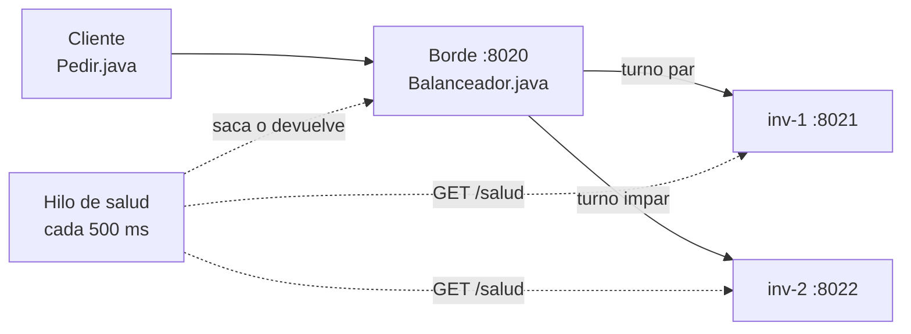
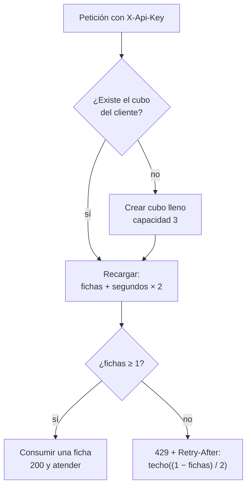
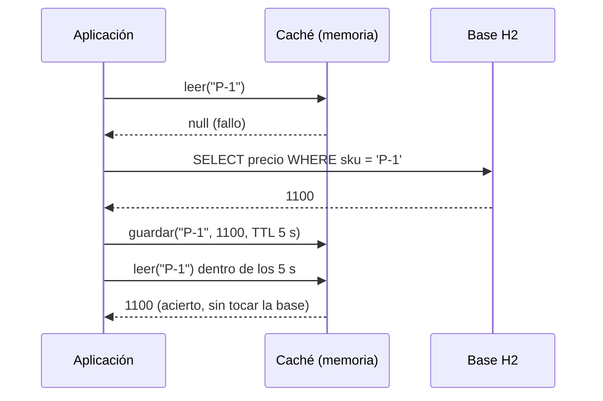
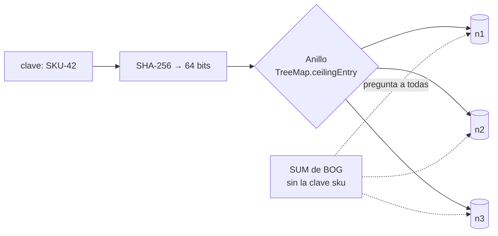

# Módulo 2: Diseño de sistemas distribuidos: borde, límites, caché y particiones

**Entorno comprobado para esta edición (2026-11-24):** OpenJDK 25.0.5.1 en Linux x86_64, solo con el JDK y con H2
2.3.232 para las bases de datos: `com.sun.net.httpserver.HttpServer`, `java.net.http.HttpClient`, JDBC con H2 en
memoria, `java.security.MessageDigest` y `java.util.concurrent`. Todas las salidas de este módulo se obtuvieron
ejecutando el código mostrado ese día. Las instancias, el balanceador y las particiones son procesos y bases H2 locales
en `127.0.0.1`. Los tiempos cambiarán un poco en tu equipo; los conteos, los porcentajes y las decisiones no, porque
los programas que dependen del azar usan semilla fija o reloj simulado. Las configuraciones de nginx de las secciones
«Del laboratorio a producción» se muestran como referencia y **no se ejecutaron** en esta edición.

En el Módulo 1 el inventario aprendió a sobrevivir a una red que falla: timeouts, reintentos idempotentes, outbox,
circuit breaker y SLO. Ahora el problema es de tamaño. Una sola instancia ya no alcanza, los clientes mandan ráfagas,
la base repite mil veces la misma consulta y una sola base no cabe en una máquina. Este módulo construye, pieza por
pieza, las cuatro herramientas clásicas para crecer: repartir la carga, limitarla, evitar trabajo repetido y dividir
los datos. Cada una tiene un costo, y el módulo lo hace visible con un número.

**Al terminar este módulo podrás:**
- poner un proxy inverso delante de dos instancias, repartir con round robin y retirar una instancia caída;
- distinguir chequeos de salud activos y pasivos, y explicar cuándo el borde puede reintentar en otra instancia;
- limitar la tasa por cliente con un cubo de fichas y responder `429` con `Retry-After`;
- explicar por qué una ventana fija deja pasar el doble de peticiones en el borde entre dos segundos;
- aplicar cache-aside con TTL, medir la tasa de aciertos y decidir entre esperar el TTL o invalidar;
- evitar una estampida de caché con una sola carga compartida;
- revalidar respuestas HTTP con `ETag`, `If-None-Match` y `304 Not Modified`;
- elegir una clave de partición, enrutar con hash consistente y medir cuántos datos se mueven al agregar un nodo.

**Esquema del módulo:** Tema 1 (proxy inverso y balanceo) → Tema 2 (límites de tasa) → Tema 3 (caché y CDN) →
Tema 4 (particionado) → Proyecto 15 (el borde del inventario).

**Qué necesitas saber antes:** del Módulo 1 de este curso, **timeout**, **reintento** e **idempotencia** (Tema 1),
**réplica** y **consistencia eventual** (Tema 2), **SLO** (Tema 4), **latencia** y **throughput** (Tema 6) y
**estimación de capacidad** (Tema 7). De Fundamentos, **tabla hash** (Módulo 2, Tema 6), HTTP, **cabecera** y
**código de estado** (Módulo 3, Tema 2), **hilo** y **condición de carrera** (Módulo 5, Tema 2). Del curso SQL,
**índice** (Módulo 0, Tema 3) y la elección entre SQL y NoSQL (Módulo 0, Tema 4). Los programas se ejecutan con
`java Programa.java`; los que usan base de datos, con `java -cp ~/herramientas/h2-2.3.232.jar Programa.java`.

**Qué no se repite aquí:** los índices compuestos y los planes de consulta están en el curso SQL (Módulo 0, Tema 3);
las réplicas de lectura y la lectura obsoleta, en el Tema 2 del Módulo 1; la idempotencia de cobros, en los Temas 1 y 3
del Módulo 1; y la medición de latencia por percentiles y las pruebas de carga, en los Temas 4 y 6 del Módulo 1. Este
módulo las usa sin volver a explicarlas.


## Aprende construyendo


### Tema 1: El borde: proxy inverso, balanceo de carga y chequeos de salud · Avanzado · 60 min

<details open>
<summary><strong>Capa 1 — Lectura</strong></summary>

#### Objetivos
Al terminar este tema podrás:
- construir un proxy inverso en Java que reparte peticiones entre dos instancias con round robin;
- provocar la caída de una instancia y medir cuántas peticiones fallan sin chequeos de salud;
- retirar una instancia caída con un chequeo activo y con un chequeo pasivo, y devolverla cuando se recupera;
- explicar por qué el borde solo reintenta en otra instancia las peticiones idempotentes.

**Conceptos clave:** proxy inverso, balanceador de carga, round robin, instancia, chequeo de salud activo, chequeo de salud pasivo, 502 Bad Gateway, X-Forwarded-For

#### El problema
El servicio de inventario recibe más consultas de las que una instancia atiende, así que el equipo arranca una segunda
copia en otro puerto. Ahora las apps tendrían que conocer dos direcciones y decidir a cuál llamar. Además, el martes a
las 10:05 se cae la segunda copia y la mitad de las consultas empieza a fallar, aunque la primera sigue sana. ¿Quién
reparte la carga, y quién se entera de que una copia murió?

Este tema usa lo que ya conoces: **puerto** y **localhost** (Fundamentos, Módulo 3, Tema 1), **código de estado** e
**idempotencia** (Fundamentos, Módulo 3, Tema 2) y **timeout** (Módulo 1, Tema 1, de este curso). Aquí no se
redefinen: se aplican.

#### Glosario del tema

**proxy inverso**
- **Definición técnica:** servidor que recibe las peticiones de los clientes en nombre de uno o más servidores internos, las reenvía y devuelve sus respuestas; el cliente solo conoce la dirección del proxy.
- **En palabras sencillas:** la recepción de un edificio: el visitante habla con la recepción y la recepción llama a la oficina que toca.
- **Dónde se rompe la comparación:** la recepción puede decir «no está»; el proxy además decide **a cuál** de varias oficinas iguales llamar, y puede repetir la llamada en otra.
- **Ejemplo:** `Balanceador.java` escucha en el puerto 8020 y reenvía cada `GET /inventario/A-1` a 8021 o a 8022.
- **Error típico:** confundirlo con un proxy de salida (el de una empresa para navegar): ese representa a los clientes; el inverso representa a los servidores.

**balanceador de carga**
- **Definición técnica:** componente que distribuye las peticiones entre varias instancias equivalentes según un algoritmo (round robin, menos conexiones, hash del cliente) y solo entre las que considera sanas.
- **En palabras sencillas:** quien reparte los turnos entre varias cajas de un banco.
- **Dónde se rompe la comparación:** en el banco ves que una caja está cerrada; el balanceador solo lo sabe si pregunta o si una petición falla.
- **Ejemplo:** con las dos instancias arriba, cuatro peticiones quedan `{200 inv-1=2, 200 inv-2=2}`.
- **Error típico:** creer que balancear aumenta la capacidad sin límite: si las dos instancias comparten una base saturada, el cuello de botella sigue ahí (Módulo 1, Tema 7).

**round robin**
- **Definición técnica:** algoritmo que asigna la petición *n* a la instancia `n mod k`, donde *k* es el número de instancias disponibles.
- **En palabras sencillas:** por turnos: uno, dos, uno, dos.
- **Dónde se rompe la comparación:** los turnos son justos en número, no en trabajo: una petición pesada y una liviana cuentan igual.
- **Ejemplo:** `Math.floorMod(TURNO.getAndIncrement(), candidatas.size())` en la línea 43 de `Balanceador.java`.
- **Error típico:** usar un `int` normal como contador con varios hilos; dos peticiones simultáneas pueden leer el mismo turno. `AtomicInteger` lo evita.

**instancia**
- **Definición técnica:** cada proceso en ejecución de un mismo servicio, con el mismo código y la misma configuración, que atiende en su propia dirección y puerto.
- **En palabras sencillas:** cada copia del mismo programa que está corriendo.
- **Dónde se rompe la comparación:** las copias son iguales en código, no en estado: si cada una guarda datos en memoria, dejan de ser intercambiables.
- **Ejemplo:** `java Instancia.java inv-1 8021` y `java Instancia.java inv-2 8022` son dos instancias del inventario.
- **Error típico:** guardar la sesión del usuario en la memoria de una instancia: la siguiente petición cae en la otra y la sesión «desaparece».

**chequeo de salud activo**
- **Definición técnica:** petición periódica que el balanceador envía a una ruta de salud (por ejemplo `/salud`) de cada instancia; si falla o no responde a tiempo, la instancia sale de la rotación, y vuelve cuando responde bien.
- **En palabras sencillas:** pasar lista cada medio segundo.
- **Dónde se rompe la comparación:** entre dos listas puede caerse alguien; durante ese intervalo el balanceador todavía cree que está.
- **Ejemplo:** con `java Balanceador.java salud`, el borde imprime `[salud] 8022 sale de la rotación` y, al volver la instancia, `[salud] 8022 vuelve a la rotación`.
- **Error típico:** una ruta `/salud` que responde `200` aunque la instancia no pueda leer su base: el chequeo pasa y las peticiones reales fallan.

**chequeo de salud pasivo**
- **Definición técnica:** el balanceador observa las peticiones reales y retira una instancia cuando una de ellas falla (conexión rechazada, timeout, cierto número de `5xx`).
- **En palabras sencillas:** no pasas lista: notas la ausencia cuando le pides algo a alguien y no contesta.
- **Dónde se rompe la comparación:** solo detecta el fallo después de que una petición real lo sufrió; por eso se combina con un reintento seguro.
- **Ejemplo:** con chequeo activo cada 30 s, el log muestra `-> 8022 ConnectException` y la misma petición termina en `-> 8021 200`.
- **Error típico:** usar solo chequeo pasivo: una instancia retirada no vuelve nunca, porque ya no le llega tráfico que demuestre que se recuperó.

**502 Bad Gateway**
- **Definición técnica:** código de estado que devuelve un proxy o pasarela cuando no obtuvo una respuesta válida del servidor interno.
- **En palabras sencillas:** la recepción te dice «la oficina no contesta».
- **Dónde se rompe la comparación:** no dice si la oficina hizo o no el trabajo; para un `GET` da igual, para un `POST` no (Módulo 1, Tema 1).
- **Ejemplo:** sin chequeos, `{"error":"ninguna instancia respondió"}` con estado `502` en las peticiones 2 y 4.
- **Error típico:** devolver `500` en el borde: `500` culpa al propio servidor, `502` dice que falló el de atrás, y eso orienta el diagnóstico.

**X-Forwarded-For**
- **Definición técnica:** cabecera que agrega un proxy con la dirección IP del cliente original, porque la instancia ve como origen la IP del proxy.
- **En palabras sencillas:** la recepción anota quién vino de verdad antes de pasar la llamada.
- **Dónde se rompe la comparación:** cualquier cliente puede enviar esa cabecera inventada; la instancia solo debe creerla si viene de su propio proxy.
- **Ejemplo:** la línea 57 de `Balanceador.java` la agrega con `ex.getRemoteAddress()`.
- **Error típico:** limitar la tasa por IP en la instancia sin leer esta cabecera: todos los clientes parecen uno solo, el proxy (Tema 2).

#### ► CÓMO FUNCIONA
El cliente solo conoce `127.0.0.1:8020`. El borde mantiene una lista de instancias y un conjunto de **sanas**. Para
cada petición elige la siguiente instancia sana por turno, reenvía la ruta y copia la respuesta. Si la conexión es
rechazada, la instancia sale del conjunto y, como `GET` es idempotente, el borde reintenta una vez en otra. En paralelo,
un hilo pregunta `/salud` a todas cada cierto tiempo para sacar a las caídas y devolver a las recuperadas.



#### Problema resuelto 1.1
Pon un borde delante de dos instancias, comprueba el reparto y detén una instancia para ver qué pasa sin chequeos.

**Razonamiento:**
1. Cada instancia responde con su nombre (`"instancia":"inv-1"`), así el reparto se ve en la respuesta.
2. Las instancias son procesos separados para poder detener una con `kill`, como en una caída real.
3. El borde usa `HttpServer` para recibir y `HttpClient` para reenviar; atiende cada petición en un hilo virtual
   (línea 33) para no bloquear a los demás mientras espera a una instancia.
4. El cliente manda varias consultas seguidas y resume quién respondió y con qué código.

```java
// Instancia.java — una copia del servicio de inventario que responde con su nombre
import com.sun.net.httpserver.HttpExchange;
import com.sun.net.httpserver.HttpServer;
import java.net.InetSocketAddress;

static final Map<String, Integer> STOCK = Map.of("A-1", 40, "B-7", 12, "C-3", 0);
static String nombre;

void main(String[] args) throws IOException {
    nombre = args[0];
    int puerto = Integer.parseInt(args[1]);
    HttpServer servidor = HttpServer.create(new InetSocketAddress("127.0.0.1", puerto), 0);
    servidor.createContext("/salud", ex -> responder(ex, 200, "{\"instancia\":\"" + nombre + "\",\"estado\":\"ok\"}"));
    servidor.createContext("/inventario/", this::inventario);
    servidor.start();
    IO.println(nombre + " escuchando en 127.0.0.1:" + puerto);
}

void inventario(HttpExchange ex) throws IOException {
    String sku = ex.getRequestURI().getPath().substring("/inventario/".length());
    Integer stock = STOCK.get(sku);
    if (stock == null) {
        responder(ex, 404, "{\"error\":\"sku desconocido\",\"instancia\":\"" + nombre + "\"}");
        return;
    }
    responder(ex, 200, "{\"sku\":\"" + sku + "\",\"stock\":" + stock + ",\"instancia\":\"" + nombre + "\"}");
}

void responder(HttpExchange ex, int codigo, String json) throws IOException {
    byte[] bytes = json.getBytes(StandardCharsets.UTF_8);
    ex.getResponseHeaders().set("Content-Type", "application/json");
    ex.sendResponseHeaders(codigo, bytes.length);
    try (var salida = ex.getResponseBody()) {
        salida.write(bytes);
    }
}
```

```java
// Balanceador.java — proxy inverso con reparto round robin y, opcionalmente, chequeos de salud
import com.sun.net.httpserver.HttpExchange;
import com.sun.net.httpserver.HttpServer;
import java.net.ConnectException;
import java.net.InetSocketAddress;
import java.net.URI;
import java.net.http.HttpClient;
import java.net.http.HttpRequest;
import java.net.http.HttpResponse;
import java.time.Duration;
import java.util.concurrent.ConcurrentHashMap;
import java.util.concurrent.Executors;
import java.util.concurrent.TimeUnit;
import java.util.concurrent.atomic.AtomicInteger;

static final HttpClient CLIENTE = HttpClient.newBuilder()
        .version(HttpClient.Version.HTTP_1_1).connectTimeout(Duration.ofMillis(500)).build();
static final List<String> INSTANCIAS = List.of("http://127.0.0.1:8021", "http://127.0.0.1:8022");
static final Set<String> SANAS = ConcurrentHashMap.newKeySet(); // instancias que pasan el chequeo
static final AtomicInteger TURNO = new AtomicInteger();          // contador del round robin
static boolean conSalud;

void main(String[] args) throws IOException {
    conSalud = args.length > 0 && args[0].equals("salud");
    SANAS.addAll(INSTANCIAS);
    long intervalo = args.length > 1 ? Long.parseLong(args[1]) : 500;  // milisegundos entre chequeos
    if (conSalud) {
        var chequeo = Executors.newSingleThreadScheduledExecutor();
        chequeo.scheduleAtFixedRate(this::chequear, 0, intervalo, TimeUnit.MILLISECONDS);
    }
    HttpServer borde = HttpServer.create(new InetSocketAddress("127.0.0.1", 8020), 0);
    borde.createContext("/", this::reenviar);
    borde.setExecutor(Executors.newVirtualThreadPerTaskExecutor());
    borde.start();
    IO.println("borde en 127.0.0.1:8020, modo " + (conSalud ? "salud" : "ingenuo"));
}

String elegir() {
    List<String> candidatas = INSTANCIAS.stream().filter(SANAS::contains).toList();
    if (candidatas.isEmpty()) {
        return null;
    }
    return candidatas.get(Math.floorMod(TURNO.getAndIncrement(), candidatas.size()));
}

void reenviar(HttpExchange ex) throws IOException {
    String ruta = ex.getRequestURI().toString();
    int intentos = conSalud ? 2 : 1;               // GET es idempotente: se puede repetir en otra instancia
    for (int i = 1; i <= intentos; i++) {
        String destino = elegir();
        if (destino == null) {
            break;
        }
        try {
            var peticion = HttpRequest.newBuilder(URI.create(destino + ruta))
                    .timeout(Duration.ofSeconds(1))
                    .header("X-Forwarded-For", ex.getRemoteAddress().getAddress().getHostAddress())
                    .GET().build();
            var respuesta = CLIENTE.send(peticion, HttpResponse.BodyHandlers.ofString());
            IO.println("[borde] GET " + ruta + " -> " + destino.substring(17) + " " + respuesta.statusCode());
            responder(ex, respuesta.statusCode(), respuesta.body());
            return;
        } catch (ConnectException error) {
            IO.println("[borde] GET " + ruta + " -> " + destino.substring(17) + " ConnectException");
            if (conSalud) {
                SANAS.remove(destino);                  // chequeo pasivo: se retira al primer fallo
            }
        } catch (InterruptedException error) {
            Thread.currentThread().interrupt();
            break;
        }
    }
    responder(ex, 502, "{\"error\":\"ninguna instancia respondió\"}");
}

void chequear() {
    for (String instancia : INSTANCIAS) {
        boolean sana;
        try {
            var peticion = HttpRequest.newBuilder(URI.create(instancia + "/salud"))
                    .timeout(Duration.ofMillis(300)).GET().build();
            sana = CLIENTE.send(peticion, HttpResponse.BodyHandlers.discarding()).statusCode() == 200;
        } catch (IOException | InterruptedException error) {
            sana = false;
        }
        boolean cambio = sana ? SANAS.add(instancia) : SANAS.remove(instancia);
        if (cambio) {
            IO.println("[salud] " + instancia.substring(17) + (sana ? " vuelve a la rotación" : " sale de la rotación"));
        }
    }
}

void responder(HttpExchange ex, int codigo, String json) throws IOException {
    byte[] bytes = json.getBytes(StandardCharsets.UTF_8);
    ex.getResponseHeaders().set("Content-Type", "application/json");
    ex.sendResponseHeaders(codigo, bytes.length);
    try (var salida = ex.getResponseBody()) {
        salida.write(bytes);
    }
}
```

```java
// Pedir.java — envía N consultas al borde y resume quién respondió
import java.net.URI;
import java.net.http.HttpClient;
import java.net.http.HttpRequest;
import java.net.http.HttpResponse;
import java.time.Duration;
import java.util.regex.Pattern;

static final Pattern INSTANCIA = Pattern.compile("\"instancia\":\"([^\"]+)\"");

void main(String[] args) throws Exception {
    int total = args.length > 0 ? Integer.parseInt(args[0]) : 6;
    var cliente = HttpClient.newHttpClient();
    Map<String, Integer> conteo = new TreeMap<>();
    for (int i = 1; i <= total; i++) {
        var peticion = HttpRequest.newBuilder(URI.create("http://127.0.0.1:8020/inventario/A-1"))
                .timeout(Duration.ofSeconds(3)).GET().build();
        var respuesta = cliente.send(peticion, HttpResponse.BodyHandlers.ofString());
        var m = INSTANCIA.matcher(respuesta.body());
        String quien = m.find() ? m.group(1) : "-";
        IO.println("petición " + i + ": " + respuesta.statusCode() + " " + respuesta.body());
        conteo.merge(respuesta.statusCode() + " " + quien, 1, Integer::sum);
    }
    IO.println("resumen: " + conteo);
}
```

Arranca las dos instancias y el borde, cada uno en su terminal (o con `&` al final para dejarlos en segundo plano):

```text
$ java Instancia.java inv-1 8021
inv-1 escuchando en 127.0.0.1:8021
$ java Instancia.java inv-2 8022
inv-2 escuchando en 127.0.0.1:8022
$ java Balanceador.java
borde en 127.0.0.1:8020, modo ingenuo
```

```text
$ java Pedir.java 4
petición 1: 200 {"sku":"A-1","stock":40,"instancia":"inv-1"}
petición 2: 200 {"sku":"A-1","stock":40,"instancia":"inv-2"}
petición 3: 200 {"sku":"A-1","stock":40,"instancia":"inv-1"}
petición 4: 200 {"sku":"A-1","stock":40,"instancia":"inv-2"}
resumen: {200 inv-1=2, 200 inv-2=2}
```

Ahora detén `inv-2` (Ctrl + C en su terminal, o `kill` con su número de proceso) y repite:

```text
$ java Pedir.java 4
petición 1: 200 {"sku":"A-1","stock":40,"instancia":"inv-1"}
petición 2: 502 {"error":"ninguna instancia respondió"}
petición 3: 200 {"sku":"A-1","stock":40,"instancia":"inv-1"}
petición 4: 502 {"error":"ninguna instancia respondió"}
resumen: {200 inv-1=2, 502 -=2}
```

El registro del borde cuenta las dos rondas:

```text
[borde] GET /inventario/A-1 -> 8021 200
[borde] GET /inventario/A-1 -> 8022 200
[borde] GET /inventario/A-1 -> 8021 200
[borde] GET /inventario/A-1 -> 8022 200
[borde] GET /inventario/A-1 -> 8021 200
[borde] GET /inventario/A-1 -> 8022 ConnectException
[borde] GET /inventario/A-1 -> 8021 200
[borde] GET /inventario/A-1 -> 8022 ConnectException
```

**Explicación por partes.**
- `Instancia.java`, líneas 13–14: dos rutas, `/salud` para el balanceador e `/inventario/` para los clientes. El
  nombre de la instancia viaja en cada respuesta solo para que el reparto sea visible en el laboratorio.
- `Balanceador.java`, líneas 18–20: la lista fija de instancias, el conjunto de sanas (seguro para varios hilos) y el
  contador del turno.
- Líneas 38–44: `elegir` filtra las sanas y aplica round robin sobre ellas. Si no hay ninguna, devuelve `null`.
- Líneas 55–61: arma la misma ruta contra la instancia elegida, con timeout de 1 s y la cabecera `X-Forwarded-For`, y
  copia código y cuerpo de la respuesta.
- Líneas 63–67: `ConnectException` significa «no hay nadie escuchando en ese puerto»: la petición **no llegó**.
- En modo ingenuo, `intentos` vale 1 (línea 48) y nadie retira a `inv-2`: el turno sigue cayendo en ella y la mitad
  de las peticiones termina en `502`, aunque `inv-1` estaba libre.

#### Problema resuelto 1.2
Corrige el borde: chequeo activo de salud, retiro pasivo al primer fallo y un reintento en otra instancia.

**Razonamiento:**
1. El chequeo activo (líneas 76–91) pregunta `/salud` con un timeout corto (300 ms) y actualiza el conjunto de sanas.
   Solo imprime cuando el estado **cambia**, para no llenar el registro.
2. El chequeo pasivo (línea 66) retira la instancia en cuanto una petición real recibe `ConnectException`.
3. Como `GET /inventario/A-1` no cambia nada, repetirlo en otra instancia es seguro: `intentos` vale 2 en modo salud.
4. Para ver el chequeo pasivo hay que evitar que el activo se adelante: el segundo argumento fija el intervalo en
   milisegundos.

Con las dos instancias arriba, arranca el borde con chequeos cada 500 ms. Detén `inv-2`, consulta, arráncala otra vez y
vuelve a consultar:

```text
$ java Balanceador.java salud
borde en 127.0.0.1:8020, modo salud
$ java Pedir.java 4          # con inv-2 detenida
petición 1: 200 {"sku":"A-1","stock":40,"instancia":"inv-1"}
petición 2: 200 {"sku":"A-1","stock":40,"instancia":"inv-1"}
petición 3: 200 {"sku":"A-1","stock":40,"instancia":"inv-1"}
petición 4: 200 {"sku":"A-1","stock":40,"instancia":"inv-1"}
resumen: {200 inv-1=4}
$ java Pedir.java 4          # con inv-2 arrancada otra vez
petición 1: 200 {"sku":"A-1","stock":40,"instancia":"inv-1"}
petición 2: 200 {"sku":"A-1","stock":40,"instancia":"inv-2"}
petición 3: 200 {"sku":"A-1","stock":40,"instancia":"inv-1"}
petición 4: 200 {"sku":"A-1","stock":40,"instancia":"inv-2"}
resumen: {200 inv-1=2, 200 inv-2=2}
```

```text
[salud] 8022 sale de la rotación
[borde] GET /inventario/A-1 -> 8021 200
[borde] GET /inventario/A-1 -> 8021 200
[borde] GET /inventario/A-1 -> 8021 200
[borde] GET /inventario/A-1 -> 8021 200
[salud] 8022 vuelve a la rotación
[borde] GET /inventario/A-1 -> 8021 200
[borde] GET /inventario/A-1 -> 8022 200
[borde] GET /inventario/A-1 -> 8021 200
[borde] GET /inventario/A-1 -> 8022 200
```

Para ver el chequeo **pasivo**, arranca el borde con chequeos cada 30 s, haz una consulta con las dos instancias
arriba, detén `inv-2` y consulta enseguida:

```text
$ java Balanceador.java salud 30000
$ java Pedir.java 4
petición 1: 200 {"sku":"A-1","stock":40,"instancia":"inv-1"}
petición 2: 200 {"sku":"A-1","stock":40,"instancia":"inv-1"}
petición 3: 200 {"sku":"A-1","stock":40,"instancia":"inv-1"}
petición 4: 200 {"sku":"A-1","stock":40,"instancia":"inv-1"}
resumen: {200 inv-1=4}
```

```text
[borde] GET /inventario/A-1 -> 8021 200
[borde] GET /inventario/A-1 -> 8022 ConnectException
[borde] GET /inventario/A-1 -> 8021 200
[borde] GET /inventario/A-1 -> 8021 200
[borde] GET /inventario/A-1 -> 8021 200
[borde] GET /inventario/A-1 -> 8021 200
```

**Explicación por partes.**
- Con chequeo activo, `inv-2` sale de la rotación antes de recibir tráfico y las cuatro consultas van a `inv-1`. Al
  volver, el chequeo la detecta y el reparto se equilibra otra vez: `{200 inv-1=2, 200 inv-2=2}`.
- Con chequeo pasivo, una petición real sí tocó la instancia caída (`-> 8022 ConnectException`), pero el borde la
  retiró y repitió la consulta en `8021`. El cliente vio cuatro `200`: el fallo quedó escondido en el borde.
- El costo del reintento es latencia: esa petición hizo dos viajes. Por eso el número de intentos es bajo (2).
- Con el intervalo de 30 s, `inv-2` tardará hasta 30 s en volver a la rotación aunque ya esté arriba: el chequeo
  pasivo saca, el activo devuelve.

> **Error común.** Reintentar en otra instancia cualquier petición. Si el borde repite un `POST /retiros` después de
> un **timeout**, la primera instancia pudo descontar el stock y la segunda lo descuenta otra vez. Reintenta solo
> métodos idempotentes (`GET`, `PUT`, `DELETE`) o peticiones con clave de idempotencia (Módulo 1, Tema 1), y solo
> ante `ConnectException`, que garantiza que la petición no llegó.

> **Error común.** Una ruta de salud que solo dice «estoy vivo». Si `/salud` devuelve `200` sin comprobar la base,
> una instancia sin conexión a la base sigue en la rotación y devuelve errores a la mitad de los usuarios. La ruta
> debe comprobar lo que la instancia necesita para atender, con su propio timeout corto.

> **Buena práctica.** Separa **vida** (*liveness*: el proceso responde) de **disponibilidad** (*readiness*: puede
> atender tráfico). Kubernetes usa las dos: la primera reinicia el proceso; la segunda solo lo saca del balanceo.

> **Prevenir errores.** Pon timeout de conexión en el borde (línea 17: 500 ms). Sin él, una instancia que acepta la
> conexión pero no responde retiene los hilos del borde y lo vuelve lento para todos.

#### Del laboratorio a producción
En producción el borde no se escribe a mano: se usa nginx, HAProxy, Envoy o el balanceador de la nube. Esta
configuración de nginx (no ejecutada en esta edición) expresa lo mismo que `Balanceador.java` en modo salud:

```text
upstream inventario {
    server 127.0.0.1:8021 max_fails=1 fail_timeout=30s;   # chequeo pasivo: un fallo la retira 30 s
    server 127.0.0.1:8022 max_fails=1 fail_timeout=30s;
}
server {
    listen 8020;
    location /inventario/ {
        proxy_pass http://inventario;                      # round robin por defecto
        proxy_connect_timeout 500ms;
        proxy_next_upstream error;                          # reintenta en otra solo si no pudo conectar
        proxy_next_upstream_tries 2;
        proxy_set_header X-Forwarded-For $proxy_add_x_forwarded_for;
    }
}
```

nginx de código abierto solo hace chequeos pasivos: tras `fail_timeout` vuelve a probar la instancia con tráfico real.
Los chequeos activos están en NGINX Plus, HAProxy (`check` en cada `server`) y Envoy.

#### Checkpoint 1.1
Con el borde en modo ingenuo y las dos instancias arriba, ¿qué devuelve `java Pedir.java 3` en la tercera petición si
antes nadie había consultado?

Respuesta: `200` de `inv-1`. El turno empieza en 0: 0 → `inv-1`, 1 → `inv-2`, 2 → `inv-1`. El contador no se
reinicia entre clientes: si otro cliente consultó antes, la tercera puede caer en `inv-2`.

</details>

<details>
<summary><strong>Capa 2 — Construcción</strong></summary>

#### Paso 1 · Prepara la carpeta
Crea `mkdir -p ~/labs/arquitectura/borde && cd ~/labs/arquitectura/borde` y copia `Instancia.java`,
`Balanceador.java` y `Pedir.java`.

#### Paso 2 · Comprueba el reparto
Arranca las dos instancias y `java Balanceador.java`. Ejecuta `java Pedir.java 4` y comprueba que la última línea diga
`resumen: {200 inv-1=2, 200 inv-2=2}`.

#### Paso 3 · Provoca la caída
Detén `inv-2` y repite. Comprueba `resumen: {200 inv-1=2, 502 -=2}` y lee en el registro del borde las dos líneas
`ConnectException`.

#### Paso 4 · Activa los chequeos
Reinicia el borde con `java Balanceador.java salud`. Con `inv-2` detenida, el resumen debe ser `{200 inv-1=4}`.
Arranca `inv-2`, espera un segundo y comprueba que el reparto vuelve a dos y dos.

#### Paso 5 · Observa el chequeo pasivo
Arranca el borde con `java Balanceador.java salud 30000`, haz una consulta, detén `inv-2` y ejecuta `java Pedir.java 4`.
Comprueba cuatro `200` en el cliente y una línea `ConnectException` seguida de `-> 8021 200` en el borde.

#### Resumen
- Un **proxy inverso** da a los clientes una sola dirección y decide a qué **instancia** enviar cada petición.
- El **balanceador de carga** reparte con un algoritmo; **round robin** reparte por turnos entre las sanas.
- Sin chequeos, una instancia caída recibe su turno y el cliente ve **502 Bad Gateway**.
- El **chequeo activo** pregunta `/salud` cada cierto tiempo; el **chequeo pasivo** reacciona a fallos reales.
- El borde solo reintenta en otra instancia lo que es idempotente o lo que no llegó.
- **X-Forwarded-For** conserva la IP del cliente original detrás del proxy.

#### Ejercicio verificable 1
Básico. Agrega una tercera instancia `inv-3` en el puerto 8023 a la lista `INSTANCIAS`, arráncala y ejecuta
`java Pedir.java 6` con el borde recién iniciado. ¿Qué resumen esperas?

Respuesta esperada: `resumen: {200 inv-1=2, 200 inv-2=2, 200 inv-3=2}`. Round robin con tres instancias sanas reparte
seis peticiones en partes iguales.

#### Ejercicio verificable 2
Intermedio. En modo ingenuo, con `inv-2` detenida y tres instancias en la lista (8021, 8022, 8023), ¿cuántas de seis
peticiones fallan?

Respuesta esperada: dos. El turno recorre 8021, 8022, 8023 dos veces; las dos que caen en 8022 devuelven `502`.
Un tercio de los errores corresponde al tercio de instancias caídas, aunque las otras dos tengan capacidad de sobra.

#### Ejercicio verificable 3
Reto. Cambia `/salud` de `Instancia.java` para que responda `503` si existe un archivo con el nombre de la
instancia: `Files.exists(Path.of("mantenimiento-" + nombre))`. Con tres instancias y el borde en modo salud, ejecuta
`touch mantenimiento-inv-2`, espera un segundo y ejecuta `java Pedir.java 4`. ¿Qué pasa, y para qué sirve?

Respuesta esperada: `resumen: {200 inv-1=2, 200 inv-3=2}` y en el borde `[salud] 8022 sale de la rotación`, aunque el
proceso siga vivo. Al borrar el archivo, vuelve. Es la forma de **drenar** una instancia antes de actualizarla sin
cortar peticiones. Si usas un solo nombre de archivo (`mantenimiento`) y las tres instancias corren en la misma
carpeta, las tres lo ven, salen juntas y el cliente recibe `502` en todo: la marca debe ser de cada instancia.

#### En el trabajo
Todo sistema con más de una instancia tiene un balanceador delante: un Application Load Balancer de la nube, un
Ingress de Kubernetes o un nginx. En una revisión de diseño se pregunta qué comprueba la ruta de salud, cada cuánto
se ejecuta, qué peticiones se reintentan y con qué timeout. En un incidente, la primera señal de una instancia
enferma suele ser un aumento de `502` en el balanceador.

</details>

### Tema 2: Límites de tasa: ventana fija, cubo de fichas y la respuesta 429 · Avanzado · 50 min

<details open>
<summary><strong>Capa 1 — Lectura</strong></summary>

#### Objetivos
Al terminar este tema podrás:
- implementar un límite de tasa con ventana fija y con cubo de fichas, y compararlos con la misma ráfaga;
- explicar por qué la ventana fija deja pasar casi el doble del límite en el cambio de segundo;
- responder `429 Too Many Requests` con `Retry-After`, con un cubo por cliente;
- decidir qué identifica a un cliente (clave de API o IP) y qué cambia cuando hay varias instancias.

**Conceptos clave:** límite de tasa, ventana fija, cubo de fichas, ráfaga, tasa sostenida, 429 Too Many Requests, Retry-After, clave de API

#### El problema
Una integración de un cliente tiene un error: un bucle consulta el stock del mismo SKU cien veces por segundo. Las
dos instancias del Tema 1 se llenan con esas consultas, y la app de los vendedores, que hace cinco consultas por
minuto, empieza a recibir timeouts. Nadie hizo nada malo a propósito, pero un solo cliente está consumiendo la
capacidad de todos. ¿Cómo frenas a ese cliente sin castigar a los demás?

Este tema usa **cabecera** y **código de estado** (Fundamentos, Módulo 3, Tema 2), **tabla hash** (Fundamentos,
Módulo 2, Tema 6), **condición de carrera** (Fundamentos, Módulo 5, Tema 2) y el **proxy inverso** del Tema 1.

#### Glosario del tema

**límite de tasa (*rate limit*)**
- **Definición técnica:** regla que acota cuántas peticiones acepta un servicio de un mismo cliente por unidad de tiempo; las que exceden se rechazan sin ejecutarse.
- **En palabras sencillas:** «máximo cinco por segundo por persona».
- **Dónde se rompe la comparación:** «por persona» hay que definirlo: un cliente puede ser una clave, una IP o un usuario, y cada elección tiene huecos.
- **Ejemplo:** `ServidorLimitado.java` permite una ráfaga de 3 y 2 por segundo sostenidas por cada `X-Api-Key`.
- **Error típico:** poner un único límite global: el cliente con el error agota el cupo y bloquea a todos los demás igual.

**ventana fija**
- **Definición técnica:** algoritmo que cuenta las peticiones dentro de intervalos alineados al reloj (por ejemplo, cada segundo exacto) y reinicia el contador al comenzar el siguiente.
- **En palabras sencillas:** cinco fichas por segundo de reloj; al cambiar el segundo te dan cinco nuevas aunque acabes de gastar las anteriores.
- **Dónde se rompe la comparación:** el reloj no sabe cuándo gastaste: cinco a las 0.9 s y cinco a las 1.1 s son diez en 0.2 s.
- **Ejemplo:** en `Comparar.java`, `ventana fija   ✓✓✓✓✓·✓✓✓✓✓·  aceptadas 10 de 12 en 0.2 s`.
- **Error típico:** creer que «5 por segundo» con ventana fija garantiza nunca más de 5 en cualquier segundo.

**cubo de fichas (*token bucket*)**
- **Definición técnica:** algoritmo con un depósito de capacidad *C* que se recarga a ritmo *r* fichas por segundo; cada petición consume una ficha y se rechaza si no hay.
- **En palabras sencillas:** una alcancía que se llena sola de a poco; cada consulta cuesta una moneda.
- **Dónde se rompe la comparación:** la alcancía no guarda más de *C*: si no consultas en una hora, no acumulas una hora de monedas.
- **Ejemplo:** `CuboFichas(5, 5, 0)` acepta 5 de golpe y luego una cada 0.2 s: en la ráfaga de `Comparar.java` acepta 6.
- **Error típico:** recargar con un temporizador aparte; basta calcular las fichas al llegar cada petición, como en la línea 17.

**ráfaga (*burst*)**
- **Definición técnica:** número máximo de peticiones que el límite acepta seguidas sin espera; en el cubo de fichas es la capacidad *C*.
- **En palabras sencillas:** cuánto aguanta de golpe.
- **Dónde se rompe la comparación:** una ráfaga generosa es cómoda para el cliente, pero es carga que el servidor debe absorber de golpe.
- **Ejemplo:** con capacidad 3, `app-movil` recibe `200 200 200` y después `429`.
- **Error típico:** fijar la ráfaga en 1: una app que abre tres pantallas a la vez recibe `429` en uso normal.

**tasa sostenida**
- **Definición técnica:** ritmo de recarga *r* del cubo; a largo plazo, el promedio de peticiones aceptadas no supera *r* por segundo.
- **En palabras sencillas:** cuántas puedes hacer por segundo si consultas sin parar.
- **Dónde se rompe la comparación:** «2 por segundo» no significa una cada medio segundo exacto: con fichas guardadas, dos pueden llegar juntas.
- **Ejemplo:** `new CuboFichas(3, 2, ahora)`: tras agotar la ráfaga, cada ficha nueva tarda 0.5 s.
- **Error típico:** fijar la tasa sin medir: debe salir de la capacidad estimada del servicio (Módulo 1, Tema 7) dividida entre los clientes.

**429 Too Many Requests**
- **Definición técnica:** código de estado HTTP que indica que el cliente envió demasiadas peticiones en un tiempo dado; la petición no se procesó.
- **En palabras sencillas:** «ahora no, vuelve en un momento».
- **Dónde se rompe la comparación:** «vuelve en un momento» es vago; el servidor debería decir **cuándo**.
- **Ejemplo:** `{"error":"demasiadas peticiones"}` con estado `429` desde la cuarta petición seguida.
- **Error típico:** devolver `503` o `500`: el cliente cree que el servidor está caído y reintenta más, justo lo contrario de lo que se busca.

**Retry-After**
- **Definición técnica:** cabecera de respuesta que indica cuántos segundos debe esperar el cliente antes de volver a intentar (o una fecha HTTP).
- **En palabras sencillas:** el turno que te dan en la fila: «vuelve en un segundo».
- **Dónde se rompe la comparación:** el valor va en segundos enteros; el cubo calcula fracciones, por eso el servidor redondea hacia arriba (línea 24).
- **Ejemplo:** `Retry-After: 1`; tras esperar ese segundo, `app-movil` vuelve a recibir `200`.
- **Error típico:** que el cliente ignore la cabecera y reintente de inmediato con backoff propio de milisegundos.

**clave de API**
- **Definición técnica:** identificador secreto que el cliente envía en cada petición (aquí, la cabecera `X-Api-Key`) para que el servicio sepa qué integración hace la llamada.
- **En palabras sencillas:** el carné de la empresa que llama.
- **Dónde se rompe la comparación:** un carné identifica, pero no demuestra por sí solo quién lo porta: si se filtra, otro lo usa (Seguridad, Módulo 0, Tema 2).
- **Ejemplo:** `app-movil` y `panel-web` tienen cubos separados: el primero recibe `429` y el segundo `200` en el mismo instante.
- **Error típico:** limitar solo por IP: detrás de una red corporativa cien personas salen con la misma IP y comparten el cupo.

#### ► CÓMO FUNCIONA
Cada cliente tiene su propio cubo en un mapa concurrente. Cuando llega una petición, el cubo calcula cuántas fichas se
recargaron desde la última vez (segundos transcurridos × tasa, sin pasar de la capacidad). Si hay al menos una, la
consume y la petición sigue. Si no, calcula cuánto falta para la próxima ficha, responde `429` y lo dice en
`Retry-After`. El trabajo real nunca se ejecuta para la petición rechazada: ese es el ahorro.



#### Problema resuelto 2.1
Compara la ventana fija y el cubo de fichas con la misma ráfaga: seis peticiones a los 0.90 s y otras seis a los
1.10 s, con un límite de cinco por segundo.

**Razonamiento:**
1. Para que el resultado no dependa de la velocidad de tu equipo, los dos algoritmos reciben el instante como
   parámetro (nanosegundos) en lugar de leer el reloj: es un **reloj inyectable**.
2. La ventana fija convierte el instante en un número de segundo (`ahoraNanos / 1_000_000_000`) y reinicia el contador
   cuando ese número cambia.
3. El cubo recarga en proporción al tiempo transcurrido y nunca pasa de la capacidad.
4. Cada resultado se marca con `✓` (aceptada) o `·` (rechazada) para ver **cuáles** pasan, no solo cuántas.

```java
// VentanaFija.java — límite de tasa que cuenta peticiones por segundo de reloj
class VentanaFija {
    private final int limite;
    private long ventana = -1;   // número de segundo actual
    private int usadas;

    VentanaFija(int limite) {
        this.limite = limite;
    }

    boolean intentar(long ahoraNanos) {
        long segundo = ahoraNanos / 1_000_000_000L;
        if (segundo != ventana) {   // empieza un segundo nuevo: el contador vuelve a cero
            ventana = segundo;
            usadas = 0;
        }
        if (usadas < limite) {
            usadas++;
            return true;
        }
        return false;
    }
}
```

```java
// CuboFichas.java — límite de tasa por cubo de fichas (token bucket) con reloj explícito
class CuboFichas {
    private final double capacidad;     // ráfaga máxima permitida
    private final double fichasPorSeg;  // ritmo sostenido de recarga
    private double fichas;
    private long ultimoNanos;

    CuboFichas(double capacidad, double fichasPorSeg, long ahoraNanos) {
        this.capacidad = capacidad;
        this.fichasPorSeg = fichasPorSeg;
        this.fichas = capacidad;        // empieza lleno
        this.ultimoNanos = ahoraNanos;
    }

    private void recargar(long ahoraNanos) {
        double segundos = (ahoraNanos - ultimoNanos) / 1e9;
        fichas = Math.min(capacidad, fichas + segundos * fichasPorSeg);
        ultimoNanos = ahoraNanos;
    }

    /** Devuelve 0 si la petición pasa; si no, los segundos que faltan para la siguiente ficha. */
    synchronized double intentar(long ahoraNanos) {
        recargar(ahoraNanos);
        if (fichas >= 1) {
            fichas -= 1;
            return 0;
        }
        return (1 - fichas) / fichasPorSeg;
    }
}
```

```java
// Comparar.java — la misma ráfaga contra ventana fija y cubo de fichas (límite: 5 por segundo)
void main() {
    // 6 peticiones a los 0.90 s y otras 6 a los 1.10 s: 12 peticiones en 0.2 s
    List<Long> instantes = new ArrayList<>();
    for (int i = 0; i < 6; i++) instantes.add(900_000_000L);
    for (int i = 0; i < 6; i++) instantes.add(1_100_000_000L);

    var ventana = new VentanaFija(5);
    var cubo = new CuboFichas(5, 5, 0);
    int okVentana = 0;
    int okCubo = 0;
    StringBuilder trazaV = new StringBuilder();
    StringBuilder trazaC = new StringBuilder();
    for (long t : instantes) {
        boolean v = ventana.intentar(t);
        boolean c = cubo.intentar(t) == 0;
        okVentana += v ? 1 : 0;
        okCubo += c ? 1 : 0;
        trazaV.append(v ? "✓" : "·");
        trazaC.append(c ? "✓" : "·");
    }
    IO.println("ventana fija   " + trazaV + "  aceptadas " + okVentana + " de 12 en 0.2 s");
    IO.println("cubo de fichas " + trazaC + "  aceptadas " + okCubo + " de 12 en 0.2 s");
}
```

```text
$ java Comparar.java
ventana fija   ✓✓✓✓✓·✓✓✓✓✓·  aceptadas 10 de 12 en 0.2 s
cubo de fichas ✓✓✓✓✓·✓·····  aceptadas 6 de 12 en 0.2 s
```

**Explicación por partes.**
- `VentanaFija.java`, líneas 12–16: a los 0.90 s el segundo es 0; a los 1.10 s es 1, y el contador vuelve a cero.
  Por eso acepta cinco del primer grupo y cinco del segundo: diez en 0.2 s, el doble del límite.
- `CuboFichas.java`, líneas 15–19: la recarga es `segundos × fichasPorSeg`, acotada con `Math.min` a la capacidad.
  Entre 0.90 s y 1.10 s pasan 0.2 s: se recarga **una** ficha. Acepta cinco, luego una más, y rechaza el resto.
- Línea 28: si no hay ficha, devuelve cuánto falta para la próxima: `(1 − fichas) / fichasPorSeg` segundos.
- Línea 22: `synchronized` porque dos hilos del servidor pueden consultar el mismo cubo a la vez; sin él, los dos
  leerían `fichas = 1` y ambos pasarían.
- `Comparar.java`: el cubo empieza lleno en `t = 0` y a los 0.90 s ya tenía las 5 fichas (no acumula más).

#### Problema resuelto 2.2
Lleva el cubo a un servidor HTTP: un cubo por clave de API, `429` con `Retry-After` y un cliente que respeta la espera.

**Razonamiento:**
1. El mapa `CUBOS` es un `ConcurrentHashMap`; `computeIfAbsent` crea el cubo de un cliente nuevo una sola vez aunque
   lleguen dos peticiones suyas a la vez.
2. Si la petición no trae `X-Api-Key`, el cliente se identifica por su IP: peor, pero mejor que nada.
3. La espera se redondea hacia arriba porque `Retry-After` va en segundos enteros; redondear hacia abajo invitaría a
   volver demasiado pronto.
4. El cliente manda seis peticiones seguidas con `app-movil`, una con `panel-web`, espera lo que indica
   `Retry-After` y prueba otra vez.

```java
// ServidorLimitado.java — responde 429 con Retry-After cuando un cliente agota su cubo
import com.sun.net.httpserver.HttpExchange;
import com.sun.net.httpserver.HttpServer;
import java.net.InetSocketAddress;
import java.util.concurrent.ConcurrentHashMap;

static final Map<String, CuboFichas> CUBOS = new ConcurrentHashMap<>(); // un cubo por cliente

void main() throws IOException {
    HttpServer servidor = HttpServer.create(new InetSocketAddress("127.0.0.1", 8030), 0);
    servidor.createContext("/inventario", this::atender);
    servidor.start();
    IO.println("límite: ráfaga de 3, recarga de 2 por segundo, por cliente");
}

void atender(HttpExchange ex) throws IOException {
    String cliente = ex.getRequestHeaders().getFirst("X-Api-Key");
    if (cliente == null) {
        cliente = ex.getRemoteAddress().getAddress().getHostAddress(); // sin clave: por IP
    }
    long ahora = System.nanoTime();
    double espera = CUBOS.computeIfAbsent(cliente, c -> new CuboFichas(3, 2, ahora)).intentar(ahora);
    if (espera > 0) {
        long segundos = (long) Math.ceil(espera);                    // Retry-After va en segundos enteros
        ex.getResponseHeaders().set("Retry-After", String.valueOf(segundos));
        responder(ex, 429, "{\"error\":\"demasiadas peticiones\"}");
        return;
    }
    responder(ex, 200, "{\"cliente\":\"" + cliente + "\",\"stock\":40}");
}

void responder(HttpExchange ex, int codigo, String json) throws IOException {
    byte[] bytes = json.getBytes(StandardCharsets.UTF_8);
    ex.getResponseHeaders().set("Content-Type", "application/json");
    ex.sendResponseHeaders(codigo, bytes.length);
    try (var salida = ex.getResponseBody()) {
        salida.write(bytes);
    }
}
```

```java
// Rafaga.java — un cliente insistente, otro tranquilo y un reintento que respeta Retry-After
import java.net.URI;
import java.net.http.HttpClient;
import java.net.http.HttpRequest;
import java.net.http.HttpResponse;

static final HttpClient CLIENTE = HttpClient.newHttpClient();

HttpResponse<String> pedir(String clave) throws Exception {
    var peticion = HttpRequest.newBuilder(URI.create("http://127.0.0.1:8030/inventario"))
            .header("X-Api-Key", clave).GET().build();
    return CLIENTE.send(peticion, HttpResponse.BodyHandlers.ofString());
}

void main() throws Exception {
    StringBuilder estados = new StringBuilder();
    HttpResponse<String> ultima = null;
    for (int i = 0; i < 6; i++) {
        ultima = pedir("app-movil");
        estados.append(ultima.statusCode()).append(' ');
    }
    IO.println("app-movil, 6 seguidas: " + estados.toString().trim());
    String retry = ultima.headers().firstValue("Retry-After").orElse("-");
    IO.println("última respuesta: " + ultima.body() + "  Retry-After: " + retry);
    IO.println("panel-web, 1 petición: " + pedir("panel-web").statusCode());
    Thread.sleep(Long.parseLong(retry) * 1000);
    IO.println("app-movil tras esperar " + retry + " s: " + pedir("app-movil").statusCode());
}
```

```text
$ java ServidorLimitado.java
límite: ráfaga de 3, recarga de 2 por segundo, por cliente
```

```text
$ java Rafaga.java
app-movil, 6 seguidas: 200 200 200 429 429 429
última respuesta: {"error":"demasiadas peticiones"}  Retry-After: 1
panel-web, 1 petición: 200
app-movil tras esperar 1 s: 200
```

**Explicación por partes.**
- `ServidorLimitado.java`, líneas 17–20: la identidad del cliente; sin cabecera, la IP de `getRemoteAddress()`.
- Línea 22: crea o recupera el cubo y lo consulta con `System.nanoTime()`, el reloj real.
- Líneas 23–27: el rechazo no ejecuta nada: responde `429` con `Retry-After` y termina. Las primeras tres pasan
  (ráfaga), las otras tres llegan en milisegundos y encuentran el cubo vacío.
- `panel-web` recibe `200` en ese mismo momento: su cubo es otro. El cliente ruidoso no afecta al tranquilo.
- `Rafaga.java`, línea 26: espera exactamente lo que dijo el servidor y la petición siguiente pasa.

> **Error común.** Limitar en cada instancia con cubos en memoria. Con dos instancias detrás del borde del Tema 1 y
> round robin, cada una ve la mitad de las peticiones de `app-movil` y le da su propia ráfaga de 3: el límite real se
> duplica. Las soluciones son limitar en el borde (un solo lugar ve todo) o guardar los cubos en un almacén
> compartido como Redis con una operación atómica.

> **Error común.** Confiar en `X-Forwarded-For` que llega de internet para limitar por IP. Cualquier cliente puede
> inventar esa cabecera y cambiar de «IP» en cada petición. Solo vale la que agregó **tu** proxy.

> **Buena práctica.** Informa el límite en cada respuesta, no solo al rechazar. Muchas APIs públicas envían
> cabeceras como `RateLimit-Limit` y `RateLimit-Remaining` (borrador de la IETF) para que el cliente se frene antes.

> **Prevenir errores.** Prueba el límite con un reloj simulado (como `Comparar.java`) además del real. Con
> `System.nanoTime()` la prueba depende de la velocidad del equipo y puede pasar o fallar según el día.

#### Del laboratorio a producción
nginx limita con `limit_req`, que implementa un **cubo con fuga** (*leaky bucket*): las peticiones salen a ritmo
constante y la ráfaga es una cola. Esta configuración (no ejecutada en esta edición) equivale a la del tema, por IP:

```text
limit_req_zone $binary_remote_addr zone=inventario:10m rate=2r/s;   # tasa sostenida por IP
server {
    location /inventario/ {
        limit_req zone=inventario burst=3 nodelay;                   # ráfaga de 3 sin hacer esperar
        limit_req_status 429;                                         # por defecto nginx responde 503
        proxy_pass http://inventario;
    }
}
```

Para limitar por clave de API en nginx se usa `$http_x_api_key` en lugar de `$binary_remote_addr`. Las pasarelas de
API (Kong, AWS API Gateway, Spring Cloud Gateway) ofrecen el cubo de fichas por cliente con almacenamiento compartido.

#### Checkpoint 2.1
Con `CuboFichas(3, 2, t)`, un cliente agota sus 3 fichas en `t = 0` y vuelve a los 0.75 s. ¿Pasa?

Respuesta: sí. En 0.75 s se recargan `0.75 × 2 = 1.5` fichas; hay al menos una, la consume y quedan 0.5. Si vuelve
otra vez enseguida, no pasa y debe esperar `(1 − 0.5) / 2 = 0.25 s`.

</details>

<details>
<summary><strong>Capa 2 — Construcción</strong></summary>

#### Paso 1 · Prepara la carpeta
Crea `mkdir -p ~/labs/arquitectura/limites && cd ~/labs/arquitectura/limites` y copia `VentanaFija.java`,
`CuboFichas.java`, `Comparar.java`, `ServidorLimitado.java` y `Rafaga.java`.

#### Paso 2 · Compara los algoritmos
Ejecuta `java Comparar.java` y comprueba `aceptadas 10 de 12` para la ventana fija y `aceptadas 6 de 12` para el cubo.

#### Paso 3 · Limita por cliente
Arranca `java ServidorLimitado.java` y ejecuta `java Rafaga.java`. Comprueba la secuencia `200 200 200 429 429 429` y
que `panel-web` reciba `200`.

#### Paso 4 · Mira las cabeceras
Con el servidor arriba, ejecuta cuatro veces seguidas
`curl -s -i -H 'X-Api-Key: prueba' http://127.0.0.1:8030/inventario | head -1` y después una vez
`curl -s -i -H 'X-Api-Key: prueba' http://127.0.0.1:8030/inventario | grep -i retry-after`:

```text
HTTP/1.1 200 OK
HTTP/1.1 200 OK
HTTP/1.1 200 OK
HTTP/1.1 429 
Retry-after: 1
```

Dos detalles del `HttpServer` del JDK: no conoce el texto del código 429 y deja la frase vacía (nginx escribe
`429 Too Many Requests`), y normaliza el nombre de la cabecera a `Retry-after`. Los dos son válidos: los clientes leen
el número, y los nombres de cabecera en HTTP no distinguen mayúsculas de minúsculas.

#### Paso 5 · Prueba sin clave
Ejecuta `curl -s http://127.0.0.1:8030/inventario`. La respuesta muestra `"cliente":"127.0.0.1"`: sin clave, el cubo
es el de la IP.

#### Resumen
- Un **límite de tasa** protege la capacidad compartida de un cliente que consume de más.
- La **ventana fija** es simple, pero en el cambio de intervalo deja pasar hasta el doble del límite.
- El **cubo de fichas** acepta una **ráfaga** de hasta *C* y luego la **tasa sostenida** *r*.
- El rechazo responde **429 Too Many Requests** con **Retry-After**, sin ejecutar el trabajo.
- El cliente se identifica mejor con una **clave de API** que con la IP.
- Con varias instancias, el límite debe vivir en el borde o en un almacén compartido.

#### Ejercicio verificable 1
Básico. En `Comparar.java`, cambia el cubo a `new CuboFichas(10, 5, 0)` (ráfaga de 10, misma tasa). ¿Cuántas acepta?

Respuesta esperada: `cubo de fichas ✓✓✓✓✓✓✓✓✓✓✓·  aceptadas 11 de 12 en 0.2 s`. Las 10 fichas iniciales más 1 recargada
en 0.2 s. La ráfaga decide cuánto aguanta de golpe; la tasa, el promedio.

#### Ejercicio verificable 2
Intermedio. En `ServidorLimitado.java`, cambia el cubo a `new CuboFichas(5, 2, ahora)` y repite `java Rafaga.java`.
¿Qué secuencia esperas para `app-movil`?

Respuesta esperada: `app-movil, 6 seguidas: 200 200 200 200 200 429`, con `Retry-After: 1`. La quinta todavía tiene
ficha; la sexta no.

#### Ejercicio verificable 3
Reto. Pon dos copias de `ServidorLimitado.java` (puertos 8031 y 8032) detrás de un balanceador round robin como el
del Tema 1, cada una con sus cubos en memoria. ¿Cuántas de las seis peticiones seguidas de `app-movil` reciben `200`?

Respuesta esperada: las seis. Round robin envía tres a cada copia y cada copia le da su propia ráfaga de 3. El límite
de 3 se volvió 6 sin que nadie cambiara la configuración. Se corrige moviendo el límite al borde o compartiendo los
cubos.

#### En el trabajo
Todas las APIs públicas grandes publican sus límites y responden `429` con `Retry-After`; los SDK de los proveedores
de nube respetan esa cabecera al reintentar. En el diseño de un servicio se decide el límite por cliente a partir de
la capacidad medida y el número de clientes, se documenta en el contrato de la API y se alerta cuando un cliente
pasa mucho tiempo limitado: suele ser un error de integración, no un ataque.

</details>

### Tema 3: Caché: cache-aside, TTL, estampidas y revalidación HTTP con ETag · Avanzado · 60 min

<details open>
<summary><strong>Capa 1 — Lectura</strong></summary>

#### Objetivos
Al terminar este tema podrás:
- aplicar el patrón cache-aside con un tiempo de vida (TTL) y medir la tasa de aciertos;
- mostrar con un ejemplo que una caché puede servir un dato viejo, y elegir entre esperar el TTL o invalidar;
- provocar una estampida de caché con 50 lecturas simultáneas y evitarla con una sola carga compartida;
- revalidar una respuesta HTTP con `ETag`, `If-None-Match` y `304 Not Modified`, y leer `Cache-Control`.

**Conceptos clave:** caché, cache-aside, acierto y fallo, tasa de aciertos, TTL, invalidación, dato obsoleto, estampida de caché, Cache-Control, ETag, 304 Not Modified, CDN

#### El problema
El catálogo de precios se consulta 1000 veces en diez segundos y casi siempre se piden los mismos cuatro productos.
Cada consulta va a la base, que responde lo mismo una y otra vez. Cuando el equipo agrega una copia en memoria, la
base descansa, pero aparecen dos quejas nuevas: un precio cambiado sigue saliendo viejo durante unos segundos, y al
reiniciar el servicio la base recibe de golpe cincuenta consultas idénticas. ¿Cómo guardas copias sin mentir y sin
tumbar la base?

Este tema usa **tabla hash** (Fundamentos, Módulo 2, Tema 6), **hilo** y **condición de carrera** (Fundamentos,
Módulo 5, Tema 2), **consulta parametrizada** (SQL, Módulo 0, Tema 2), las cabeceras HTTP (Fundamentos, Módulo 3,
Tema 2), el **hash criptográfico** (Seguridad, Módulo 0, Tema 2) y la **consistencia eventual** del Módulo 1, Tema 2.

#### Glosario del tema

**caché**
- **Definición técnica:** almacenamiento rápido que guarda copias de datos cuya fuente es más lenta o costosa, para responder lecturas repetidas sin volver a la fuente.
- **En palabras sencillas:** la libreta junto al teléfono con los números que más marcas.
- **Dónde se rompe la comparación:** si un número cambia, la libreta no se entera sola: la copia puede quedar vieja.
- **Ejemplo:** `CacheTtl.java` guarda precios en un `ConcurrentHashMap` en memoria; la fuente es la tabla `producto` de H2.
- **Error típico:** tratar la caché como fuente de verdad: si se borra o se reinicia, los datos deben poder reconstruirse desde la base.

**cache-aside (carga bajo demanda)**
- **Definición técnica:** patrón en el que la aplicación consulta primero la caché; si no está el dato, lo lee de la fuente, lo guarda en la caché y lo devuelve. Las escrituras van a la fuente.
- **En palabras sencillas:** buscas en la libreta; si no está, llamas a información y lo anotas.
- **Dónde se rompe la comparación:** la aplicación es responsable de anotar y de borrar; nadie lo hace por ella.
- **Ejemplo:** `precioConCache` en las líneas 4–11 de `CacheAside.java`.
- **Error típico:** escribir en la base y olvidar invalidar la copia, o invalidarla **antes** de escribir: otra lectura puede volver a cargar el valor viejo entre las dos operaciones.

**acierto y fallo (*hit* y *miss*)**
- **Definición técnica:** un acierto es una lectura resuelta por la caché; un fallo es una lectura que no encontró una copia vigente y tuvo que ir a la fuente.
- **En palabras sencillas:** estaba en la libreta, o no estaba.
- **Dónde se rompe la comparación:** un dato que está pero venció cuenta como fallo.
- **Ejemplo:** `aciertos: 963  fallos: 37`, y los 37 fallos coinciden con `consultas a la base: 37`.
- **Error típico:** no medir los fallos: sin ese número no sabes si la caché sirve o solo agrega complejidad.

**tasa de aciertos (*hit ratio*)**
- **Definición técnica:** aciertos divididos entre lecturas totales, en porcentaje.
- **En palabras sencillas:** de cada 100 consultas, cuántas se ahorraron.
- **Dónde se rompe la comparación:** un 96 % no dice cuánto se ahorró en tiempo: si las consultas que fallan son las más caras, el ahorro es menor.
- **Ejemplo:** `tasa de aciertos: 96.3 %` con TTL de 5 s; baja a `82.6 %` con TTL de 0.5 s.
- **Error típico:** cachear datos que casi no se repiten: la tasa queda baja y la memoria se llena de copias que nadie vuelve a leer.

**TTL (tiempo de vida)**
- **Definición técnica:** tiempo máximo durante el que una copia se considera válida; al vencer, la siguiente lectura es un fallo y se vuelve a la fuente.
- **En palabras sencillas:** fecha de vencimiento de la copia.
- **Dónde se rompe la comparación:** es un compromiso: un TTL largo ahorra más y miente más tiempo; uno corto, al revés.
- **Ejemplo:** `new CacheTtl<>(5_000, () -> ahora)`: cada precio vale 5 s desde que se guardó.
- **Error típico:** elegir el TTL sin preguntar al negocio cuánto tiempo es aceptable mostrar un precio viejo.

**invalidación**
- **Definición técnica:** borrar explícitamente una entrada de la caché cuando la fuente cambia, para que la siguiente lectura cargue el valor nuevo.
- **En palabras sencillas:** tachar el número en la libreta en cuanto sabes que cambió.
- **Dónde se rompe la comparación:** solo funciona si quien cambia el dato sabe que existe una copia y dónde; con varias instancias, cada una tiene la suya.
- **Ejemplo:** `cache.invalidar("P-2")` después de `cambiarPrecio`: la lectura siguiente da `7777`.
- **Error típico:** invalidar solo en la instancia que hizo la escritura; las demás siguen con el valor viejo hasta su TTL.

**dato obsoleto (*stale*)**
- **Definición técnica:** valor servido desde la caché que ya no coincide con la fuente porque esta cambió después de copiarlo.
- **En palabras sencillas:** el número viejo de la libreta.
- **Dónde se rompe la comparación:** a veces es aceptable (un catálogo), a veces no (el saldo de una cuenta): depende del invariante (Módulo 1, Tema 2).
- **Ejemplo:** `t+0 s  P-1 = 1100` aunque la base ya dice `9999`; a los 5 s, `9999`.
- **Error típico:** cachear datos que alimentan una decisión crítica, como el stock antes de confirmar un retiro.

**estampida de caché (*cache stampede*)**
- **Definición técnica:** situación en la que muchas peticiones simultáneas encuentran la misma entrada vacía o vencida y todas van a la fuente a la vez.
- **En palabras sencillas:** cincuenta personas ven la libreta vacía al mismo tiempo y las cincuenta llaman a información.
- **Dónde se rompe la comparación:** información atiende a todos; una base con capacidad limitada se satura justo cuando la caché debía protegerla.
- **Ejemplo:** `caché ingenua : 50 lecturas, 50 consultas a la base,  10.1 s`.
- **Error típico:** creer que una caché siempre baja la carga: en el arranque o al vencer una clave popular, puede multiplicarla.

**Cache-Control**
- **Definición técnica:** cabecera HTTP con directivas de caché; `max-age=60` permite reutilizar la respuesta 60 s sin preguntar, y `public` permite guardarla en cachés compartidas como una CDN.
- **En palabras sencillas:** la etiqueta que dice «esta copia sirve por un minuto y la puede guardar cualquiera».
- **Dónde se rompe la comparación:** la etiqueta la pone el servidor, pero la respetan los clientes y las cachés intermedias; el servidor no puede retirar una copia que ya entregó.
- **Ejemplo:** `Cache-Control=public, max-age=60` en todas las respuestas de `ServidorCatalogo.java`.
- **Error típico:** marcar `public` una respuesta con datos de un usuario: una CDN puede servírsela a otro. Para eso existe `private`.

**ETag**
- **Definición técnica:** cabecera con un identificador de la versión de un recurso; el cliente lo devuelve en `If-None-Match` para preguntar si cambió.
- **En palabras sencillas:** el número de edición del catálogo impreso.
- **Dónde se rompe la comparación:** el número lo inventa el servidor; aquí son los primeros 8 bytes del SHA-256 del cuerpo, así que cambia si cambia cualquier precio.
- **Ejemplo:** `ETag="08c8c4673ee740c6"` antes del cambio y `ETag="670370b0df14dbd9"` después.
- **Error típico:** calcular el ETag con la hora de la respuesta: cambia siempre y nunca se aprovecha.

**304 Not Modified**
- **Definición técnica:** respuesta a una petición condicional cuando la versión del cliente sigue vigente; no lleva cuerpo y el cliente usa su copia.
- **En palabras sencillas:** «tu edición es la última, no te mando otra».
- **Dónde se rompe la comparación:** el viaje de ida y vuelta se hace igual; se ahorran los bytes del cuerpo, no la latencia.
- **Ejemplo:** `2. revalidación  : 304  bytes=0` frente a `bytes=586` de la primera vez.
- **Error típico:** responder `304` sin haber recibido `If-None-Match`: el cliente no tiene copia que usar.

**CDN (red de distribución de contenido)**
- **Definición técnica:** red de servidores de caché distribuidos geográficamente que guardan respuestas HTTP cacheables cerca de los usuarios, según `Cache-Control`, y revalidan con el origen usando `ETag`.
- **En palabras sencillas:** sucursales con copias del catálogo en cada ciudad.
- **Dónde se rompe la comparación:** cambiar el catálogo no actualiza las sucursales al instante: esperan su TTL o una purga explícita.
- **Ejemplo:** con `public, max-age=60`, una CDN puede servir el catálogo 60 s sin tocar `ServidorCatalogo.java`.
- **Error típico:** poner un TTL de un día a un recurso que cambia y no tener forma de purgarlo; por eso los archivos estáticos llevan la versión en el nombre (`app.3f2a1c.js`).

#### ► CÓMO FUNCIONA
Hay dos niveles de caché en este tema. Dentro del servicio, **cache-aside**: la aplicación busca el precio en memoria;
si falta o venció, lo lee de la base y lo guarda con su TTL. Para no saturar la base cuando muchas lecturas fallan a la
vez, la primera crea una **carga en vuelo** y las demás la esperan. Fuera del servicio, **HTTP**: el servidor etiqueta
cada respuesta con `Cache-Control` y un `ETag`; el cliente o la CDN reutilizan la copia mientras es fresca y después
preguntan con `If-None-Match`; si nada cambió, reciben `304` sin cuerpo.



#### Problema resuelto 3.1
Mide cuánto ahorra una caché con TTL en 1000 lecturas, y muestra el precio viejo que sobrevive a un cambio.

**Razonamiento:**
1. La base es H2 en memoria con 20 productos; `Catalogo.precio` cuenta cada consulta. La demora es configurable
   (aquí 0 ms, en el Problema resuelto 3.2, 200 ms).
2. La caché recibe un **reloj inyectable**: en vez de esperar 10 s reales, el programa avanza una variable `ahora`.
   Así la salida es la misma en cualquier equipo.
3. Las lecturas imitan el tráfico real: el 80 % va a cuatro productos populares (con `Random(5)` la secuencia es
   siempre la misma).
4. Después se cambia un precio sin invalidar y otro invalidando, para comparar.

```java
// Catalogo.java — la fuente de verdad: precios en H2 con una consulta deliberadamente lenta
import java.sql.Connection;
import java.sql.DriverManager;
import java.sql.SQLException;
import java.util.concurrent.atomic.AtomicInteger;

class Catalogo {
    final AtomicInteger consultas = new AtomicInteger();  // cuántas veces se tocó la base
    private final Connection conexion;
    private final long demoraMs;

    Catalogo(long demoraMs) throws SQLException {
        this.demoraMs = demoraMs;
        conexion = DriverManager.getConnection("jdbc:h2:mem:catalogo" + System.nanoTime());
        try (var st = conexion.createStatement()) {
            st.execute("CREATE TABLE producto (sku VARCHAR(10) PRIMARY KEY, precio INT NOT NULL)");
            for (int i = 1; i <= 20; i++) {
                st.execute("INSERT INTO producto VALUES ('P-" + i + "', " + (1000 + i * 100) + ")");
            }
        }
    }

    synchronized int precio(String sku) throws SQLException, InterruptedException {
        consultas.incrementAndGet();
        Thread.sleep(demoraMs);                         // simula una consulta costosa
        try (var ps = conexion.prepareStatement("SELECT precio FROM producto WHERE sku = ?")) {
            ps.setString(1, sku);
            try (var rs = ps.executeQuery()) {
                rs.next();
                return rs.getInt(1);
            }
        }
    }

    synchronized void cambiarPrecio(String sku, int precio) throws SQLException {
        try (var ps = conexion.prepareStatement("UPDATE producto SET precio = ? WHERE sku = ?")) {
            ps.setInt(1, precio);
            ps.setString(2, sku);
            ps.executeUpdate();
        }
    }
}
```

```java
// CacheTtl.java — caché en memoria con tiempo de vida (TTL) y reloj inyectable
import java.util.Map;
import java.util.concurrent.ConcurrentHashMap;
import java.util.function.LongSupplier;

class CacheTtl<K, V> {
    private record Entrada<V>(V valor, long venceNanos) {
    }

    private final Map<K, Entrada<V>> datos = new ConcurrentHashMap<>();
    private final long ttlNanos;
    private final LongSupplier reloj;
    int aciertos;
    int fallos;

    CacheTtl(long ttlMs, LongSupplier reloj) {
        this.ttlNanos = ttlMs * 1_000_000L;
        this.reloj = reloj;
    }

    /** Devuelve el valor vigente o null si no está o ya venció. */
    V leer(K clave) {
        Entrada<V> e = datos.get(clave);
        if (e != null && reloj.getAsLong() < e.venceNanos()) {
            aciertos++;
            return e.valor();
        }
        fallos++;
        return null;
    }

    void guardar(K clave, V valor) {
        datos.put(clave, new Entrada<>(valor, reloj.getAsLong() + ttlNanos));
    }

    void invalidar(K clave) {
        datos.remove(clave);
    }
}
```

```java
// CacheAside.java — 1000 lecturas con y sin caché, y el precio viejo que sobrevive al cambio
static long ahora = 0;   // reloj simulado en nanosegundos: la salida no depende de tu equipo

int precioConCache(CacheTtl<String, Integer> cache, Catalogo catalogo, String sku) throws Exception {
    Integer precio = cache.leer(sku);
    if (precio == null) {                 // fallo: se va a la base y se guarda la copia
        precio = catalogo.precio(sku);
        cache.guardar(sku, precio);
    }
    return precio;
}

void main() throws Exception {
    var catalogo = new Catalogo(0);
    var cache = new CacheTtl<String, Integer>(5_000, () -> ahora);
    var azar = new Random(5);
    for (int i = 0; i < 1000; i++) {
        // 80 % de las lecturas van a 4 productos populares; el resto se reparte entre los 20
        String sku = azar.nextDouble() < 0.8 ? "P-" + (1 + azar.nextInt(4)) : "P-" + (1 + azar.nextInt(20));
        precioConCache(cache, catalogo, sku);
        ahora += 10_000_000L;             // una lectura cada 10 ms: 10 s en total
    }
    IO.println("lecturas: 1000  aciertos: " + cache.aciertos + "  fallos: " + cache.fallos
            + "  consultas a la base: " + catalogo.consultas.get());
    IO.println(String.format(Locale.ROOT, "tasa de aciertos: %.1f %%", 100.0 * cache.aciertos / 1000));

    IO.println("-- cambio de precio de P-1 a 9999 sin invalidar");
    catalogo.cambiarPrecio("P-1", 9999);
    IO.println("t+0 s  P-1 = " + precioConCache(cache, catalogo, "P-1"));
    ahora += 5_000_000_000L;
    IO.println("t+5 s  P-1 = " + precioConCache(cache, catalogo, "P-1"));

    IO.println("-- cambio de precio de P-2 a 7777 invalidando la copia");
    IO.println("antes  P-2 = " + precioConCache(cache, catalogo, "P-2"));   // queda en caché
    catalogo.cambiarPrecio("P-2", 7777);
    cache.invalidar("P-2");
    IO.println("t+0 s  P-2 = " + precioConCache(cache, catalogo, "P-2"));
}
```

```text
$ java -cp ~/herramientas/h2-2.3.232.jar CacheAside.java
lecturas: 1000  aciertos: 963  fallos: 37  consultas a la base: 37
tasa de aciertos: 96.3 %
-- cambio de precio de P-1 a 9999 sin invalidar
t+0 s  P-1 = 1100
t+5 s  P-1 = 9999
-- cambio de precio de P-2 a 7777 invalidando la copia
antes  P-2 = 1200
t+0 s  P-2 = 7777
```

**Explicación por partes.**
- `CacheTtl.java`, líneas 7–8: cada entrada guarda el valor y el instante en que vence.
- Líneas 21–29: `leer` devuelve el valor solo si el reloj todavía no llegó al vencimiento; si no, cuenta un fallo.
- `CacheAside.java`, líneas 4–11: el patrón completo en siete líneas. La base solo se toca en la línea 7.
- La primera línea de la salida cuadra: 37 fallos y 37 consultas. Los productos populares se recargan cada vez que
  vence su copia; los poco leídos, cuando aparecen. Las otras 963 lecturas no tocaron la base.
- Líneas 27–31: tras `cambiarPrecio("P-1", 9999)`, la caché sigue devolviendo `1100` hasta que vence la copia. A los
  5 s el fallo lleva a la base y aparece `9999`. Eso es **consistencia eventual** con un retraso máximo igual al TTL.
- Líneas 33–37: `P-2` se lee (queda `1200` en caché), se cambia y se **invalida**: la lectura siguiente es un fallo y
  trae `7777` de inmediato.

#### Problema resuelto 3.2
Provoca una estampida: 50 lecturas simultáneas de un producto que no está en caché, con una base que tarda 200 ms por
consulta. Después, evítala.

**Razonamiento:**
1. Los 50 lectores son hilos virtuales que esperan en un `CountDownLatch` y arrancan juntos al bajar la barrera.
2. `Catalogo.precio` está marcado `synchronized`: atiende una consulta a la vez, como una base saturada con una
   conexión. Así se ve el costo de las consultas repetidas.
3. La corrección guarda en el mapa la **carga en curso** (`CompletableFuture`), no el valor. `computeIfAbsent` es
   atómico en `ConcurrentHashMap`: solo el primero crea la carga; los demás reciben la misma y esperan con `join()`.

```java
// Estampida.java — 50 lecturas simultáneas de un producto que no está en caché
import java.util.concurrent.CompletableFuture;
import java.util.concurrent.ConcurrentHashMap;
import java.util.concurrent.CountDownLatch;
import java.util.concurrent.Executors;

void main() throws Exception {
    var ingenuo = new Catalogo(200);                         // cada consulta tarda 200 ms
    Map<String, Integer> cacheIngenua = new ConcurrentHashMap<>();
    medir("caché ingenua ", ingenuo, () -> {
        Integer p = cacheIngenua.get("P-7");
        if (p == null) {                                     // los 50 ven el hueco a la vez
            p = ingenuo.precio("P-7");
            cacheIngenua.put("P-7", p);
        }
        return p;
    });

    var protegido = new Catalogo(200);
    Map<String, CompletableFuture<Integer>> enVuelo = new ConcurrentHashMap<>();
    medir("una sola carga", protegido, () -> enVuelo.computeIfAbsent("P-7", sku ->
            CompletableFuture.supplyAsync(() -> {               // solo el primero crea la carga
                try {
                    return protegido.precio(sku);
                } catch (Exception error) {
                    throw new RuntimeException(error);
                }
            })).join());                                     // los demás esperan esa misma carga
}

interface Lectura {
    int leer() throws Exception;
}

void medir(String nombre, Catalogo catalogo, Lectura lectura) throws Exception {
    var salida = new CountDownLatch(1);
    Set<Integer> valores = ConcurrentHashMap.newKeySet();
    long inicio = System.nanoTime();
    try (var hilos = Executors.newVirtualThreadPerTaskExecutor()) {
        for (int i = 0; i < 50; i++) {
            hilos.submit(() -> {
                salida.await();                              // todos arrancan al mismo tiempo
                valores.add(lectura.leer());
                return null;
            });
        }
        salida.countDown();
    }
    IO.println(String.format(Locale.ROOT, "%s: 50 lecturas, %2d consultas a la base, %5.1f s, valores %s",
            nombre, catalogo.consultas.get(), (System.nanoTime() - inicio) / 1e9, valores));
}
```

```text
$ java -cp ~/herramientas/h2-2.3.232.jar Estampida.java
caché ingenua : 50 lecturas, 50 consultas a la base,  10.1 s, valores [1700]
una sola carga: 50 lecturas,  1 consultas a la base,   0.2 s, valores [1700]
```

**Explicación por partes.**
- Líneas 10–17: el chequeo `get` y la carga `put` están separados. Los 50 hilos hacen `get` antes de que el primero
  termine `put`, así que los 50 van a la base: 50 × 200 ms en fila = 10 s.
- Líneas 21–28: `computeIfAbsent` crea **una** carga para `P-7`. Las 49 lecturas restantes encuentran esa misma carga
  y esperan su resultado. Una consulta, 0.2 s.
- Los dos casos devuelven el mismo valor (`[1700]`): la estampida no da un resultado distinto, da el mismo resultado
  50 veces más caro.
- Línea 26: `supplyAsync` no admite excepciones comprobadas; se envuelven en `RuntimeException`.

#### Problema resuelto 3.3
Usa la caché de HTTP: el servidor marca el catálogo con `Cache-Control` y `ETag`, y el cliente revalida su copia.

**Razonamiento:**
1. El ETag es una huella del cuerpo: los primeros 8 bytes del SHA-256 en hexadecimal. Si cambia un precio, cambia la
   huella.
2. Si la petición trae `If-None-Match` igual al ETag actual, el servidor responde `304` sin cuerpo (`-1` en
   `sendResponseHeaders` significa «sin cuerpo»).
3. El cliente guarda el ETag de la última respuesta `200` y lo envía en las siguientes.
4. Una ruta `/admin/precio` cambia el precio de `P-1` para probar que el ETag cambia.

```java
// ServidorCatalogo.java — catálogo HTTP con Cache-Control y ETag para cachés intermedias
import com.sun.net.httpserver.HttpExchange;
import com.sun.net.httpserver.HttpServer;
import java.net.InetSocketAddress;
import java.security.MessageDigest;
import java.util.HexFormat;

static volatile String catalogo = construir(1100);

static String construir(int precioP1) {
    StringBuilder json = new StringBuilder("{\"productos\":[");
    for (int i = 1; i <= 20; i++) {
        int precio = i == 1 ? precioP1 : 1000 + i * 100;
        json.append(i > 1 ? "," : "").append("{\"sku\":\"P-").append(i).append("\",\"precio\":").append(precio).append('}');
    }
    return json.append("]}").toString();
}

void main() throws IOException {
    HttpServer servidor = HttpServer.create(new InetSocketAddress("127.0.0.1", 8040), 0);
    servidor.createContext("/catalogo", this::catalogo);
    servidor.createContext("/admin/precio", ex -> {          // cambia el precio de P-1 para la prueba
        catalogo = construir(9999);
        ex.sendResponseHeaders(204, -1);
        ex.close();
    });
    servidor.start();
}

void catalogo(HttpExchange ex) throws IOException {
    byte[] cuerpo = catalogo.getBytes(StandardCharsets.UTF_8);
    String etag = "\"" + huella(cuerpo) + "\"";
    ex.getResponseHeaders().set("ETag", etag);
    ex.getResponseHeaders().set("Cache-Control", "public, max-age=60");
    if (etag.equals(ex.getRequestHeaders().getFirst("If-None-Match"))) {
        ex.sendResponseHeaders(304, -1);                     // no cambió: sin cuerpo
        ex.close();
        IO.println("[catalogo] 304 bytes=0");
        return;
    }
    ex.getResponseHeaders().set("Content-Type", "application/json");
    ex.sendResponseHeaders(200, cuerpo.length);
    try (var salida = ex.getResponseBody()) {
        salida.write(cuerpo);
    }
    IO.println("[catalogo] 200 bytes=" + cuerpo.length);
}

static String huella(byte[] datos) {
    try {
        byte[] hash = MessageDigest.getInstance("SHA-256").digest(datos);
        return HexFormat.of().formatHex(hash, 0, 8);         // 16 caracteres bastan como versión
    } catch (Exception error) {
        throw new IllegalStateException(error);
    }
}
```

```java
// ClienteCondicional.java — revalida su copia con If-None-Match en lugar de descargarla otra vez
import java.net.URI;
import java.net.http.HttpClient;
import java.net.http.HttpRequest;
import java.net.http.HttpResponse;

static final HttpClient CLIENTE = HttpClient.newHttpClient();
static final URI CATALOGO = URI.create("http://127.0.0.1:8040/catalogo");
static String etag;

void pedir(String paso) throws Exception {
    var peticion = HttpRequest.newBuilder(CATALOGO).GET();
    if (etag != null) {
        peticion.header("If-None-Match", etag);
    }
    var r = CLIENTE.send(peticion.build(), HttpResponse.BodyHandlers.ofString());
    IO.println(paso + ": " + r.statusCode() + "  bytes=" + r.body().length()
            + "  ETag=" + r.headers().firstValue("ETag").orElse("-")
            + "  Cache-Control=" + r.headers().firstValue("Cache-Control").orElse("-"));
    if (r.statusCode() == 200) {
        etag = r.headers().firstValue("ETag").orElse(null);
    }
}

void main() throws Exception {
    pedir("1. primera vez   ");
    pedir("2. revalidación  ");
    CLIENTE.send(HttpRequest.newBuilder(URI.create("http://127.0.0.1:8040/admin/precio"))
            .POST(HttpRequest.BodyPublishers.noBody()).build(), HttpResponse.BodyHandlers.discarding());
    pedir("3. tras el cambio");
    pedir("4. revalidación  ");
}
```

```text
$ java ServidorCatalogo.java
```

```text
$ java ClienteCondicional.java
1. primera vez   : 200  bytes=586  ETag="08c8c4673ee740c6"  Cache-Control=public, max-age=60
2. revalidación  : 304  bytes=0  ETag="08c8c4673ee740c6"  Cache-Control=public, max-age=60
3. tras el cambio: 200  bytes=586  ETag="670370b0df14dbd9"  Cache-Control=public, max-age=60
4. revalidación  : 304  bytes=0  ETag="670370b0df14dbd9"  Cache-Control=public, max-age=60
```

En la terminal del servidor:

```text
[catalogo] 200 bytes=586
[catalogo] 304 bytes=0
[catalogo] 200 bytes=586
[catalogo] 304 bytes=0
```

**Explicación por partes.**
- `ServidorCatalogo.java`, líneas 32–34: cada respuesta lleva su ETag y `Cache-Control: public, max-age=60`.
- Líneas 35–40: si el cliente ya tiene esta versión, `304` y cero bytes.
- La revalidación 2 ahorra los 586 bytes; tras el cambio (paso 3), el ETag es otro y el cuerpo viaja completo; la
  revalidación 4 vuelve a ahorrar.
- `ClienteCondicional.java` no aprovecha `max-age`: revalida siempre. Un navegador o una CDN usarían la copia sin
  preguntar durante 60 s y solo después revalidarían. Durante ese minuto, el cambio del paso 3 no se vería.

> **Error común.** Cachear el resultado de una consulta que valida una regla. Si el retiro de stock consulta una
> copia de hace 4 s, puede vender unidades que ya no existen. Las decisiones que protegen un invariante leen la
> fuente dentro de la transacción (SQL, Módulo 0, Tema 4); la caché es para mostrar.

> **Error común.** Guardar en la caché también los errores. Si la base falla y el valor guardado es una excepción o un
> `null`, la caché repite el error durante todo el TTL. En `Estampida.java`, una carga que falla debe quitarse de
> `enVuelo` para que la siguiente lectura lo intente otra vez.

> **Buena práctica.** Pon un TTL incluso cuando invalidas. La invalidación puede perderse (una instancia caída, un
> mensaje que no llegó); el TTL es el límite de cuánto puede durar el error.

> **Prevenir errores.** Agrega un pequeño valor aleatorio al TTL (por ejemplo, 5 s ± 10 %) cuando muchas claves se
> cargan a la vez, como al arrancar: si todas vencen en el mismo instante, provocan su propia estampida.

#### Del laboratorio a producción
En producción, la caché de aplicación suele ser Caffeine (en memoria, con carga única por clave incorporada) o Redis
(compartida entre instancias, lo que resuelve la invalidación en una sola de ellas). En Spring Boot, `@Cacheable`
aplica cache-aside sobre cualquiera de las dos. En el borde, nginx puede actuar como caché HTTP (configuración no
ejecutada en esta edición):

```text
proxy_cache_path /var/cache/nginx keys_zone=catalogo:10m max_size=100m;
server {
    location /catalogo {
        proxy_cache catalogo;              # respeta Cache-Control: max-age del origen
        proxy_cache_revalidate on;         # al vencer, pregunta con If-None-Match
        proxy_cache_lock on;               # una sola carga por clave: evita la estampida
        add_header X-Cache $upstream_cache_status;
        proxy_pass http://127.0.0.1:8040;
    }
}
```

#### Checkpoint 3.1
Con TTL de 5 s, el precio de `P-3` se guarda en `t = 2 s` y cambia en la base en `t = 3 s`. ¿Hasta qué instante como
máximo se sirve el precio viejo si nadie invalida?

Respuesta: hasta justo antes de `t = 7 s`. El vencimiento se cuenta desde que se **guardó** la copia (2 + 5), no
desde que cambió la base. El retraso máximo de un cambio es el TTL completo.

</details>

<details>
<summary><strong>Capa 2 — Construcción</strong></summary>

#### Paso 1 · Prepara la carpeta
Crea `mkdir -p ~/labs/arquitectura/cache && cd ~/labs/arquitectura/cache` y copia `Catalogo.java`, `CacheTtl.java`,
`CacheAside.java`, `Estampida.java`, `ServidorCatalogo.java` y `ClienteCondicional.java`.

#### Paso 2 · Mide la tasa de aciertos
Ejecuta `java -cp ~/herramientas/h2-2.3.232.jar CacheAside.java` y comprueba `tasa de aciertos: 96.3 %`,
`t+0 s  P-1 = 1100` y `t+0 s  P-2 = 7777`.

#### Paso 3 · Provoca la estampida
Ejecuta `java -cp ~/herramientas/h2-2.3.232.jar Estampida.java`. La primera línea debe tardar unos 10 s y mostrar 50
consultas; la segunda, una consulta.

#### Paso 4 · Revalida con ETag
Arranca `java ServidorCatalogo.java` y ejecuta `java ClienteCondicional.java`. Comprueba la secuencia `200`, `304`,
`200`, `304` y que el ETag cambie en el paso 3.

#### Paso 5 · Prueba con curl
Con el servidor arriba, ejecuta `curl -s -i http://127.0.0.1:8040/catalogo | grep -i etag` y repite con
`curl -s -i -H 'If-None-Match: <el ETag con comillas>' http://127.0.0.1:8040/catalogo | head -1`. La segunda orden
debe mostrar `HTTP/1.1 304 Not Modified`.

#### Resumen
- Una **caché** guarda copias para no repetir lecturas costosas; la fuente de verdad sigue siendo la base.
- **Cache-aside**: leer de la caché, y si hay **fallo**, ir a la fuente y guardar la copia.
- La **tasa de aciertos** mide el ahorro; el **TTL** decide cuánto puede durar un **dato obsoleto**.
- La **invalidación** borra la copia al cambiar la fuente; el TTL es la red de seguridad.
- Una **estampida de caché** multiplica la carga; una sola carga compartida por clave la evita.
- En HTTP, **Cache-Control** dice cuánto reutilizar; **ETag** e `If-None-Match` permiten responder **304 Not
  Modified** sin cuerpo; una **CDN** aplica esas reglas cerca de los usuarios.

#### Ejercicio verificable 1
Básico. En `CacheAside.java`, cambia el TTL de `5_000` a `500` ms. ¿Qué tasa de aciertos esperas: más alta o más baja?
Ejecútalo.

Respuesta esperada: más baja. `lecturas: 1000  aciertos: 826  fallos: 174  consultas a la base: 174` y
`tasa de aciertos: 82.6 %`. Las copias vencen antes, así que hay más fallos, pero un precio cambiado se ve en medio
segundo en lugar de cinco.

#### Ejercicio verificable 2
Intermedio. Comenta la línea 36 (`cache.invalidar("P-2");`) y ejecuta otra vez. ¿Qué precio muestra `t+0 s  P-2`?

Respuesta esperada: `t+0 s  P-2 = 1200`. Sin invalidación, la copia leída en la línea 34 sigue vigente y oculta el
cambio a `7777` hasta que venza.

#### Ejercicio verificable 3
Reto. En `Estampida.java`, el mapa `enVuelo` nunca borra la carga de `P-7`. ¿Qué devolvería si el precio cambiara en
la base un minuto después, y cómo lo corriges?

Respuesta esperada: devolvería `1700` para siempre: el `CompletableFuture` terminado se comporta como una caché sin
TTL. La corrección es quitar la entrada de `enVuelo` cuando la carga termina (con éxito o con error, por ejemplo con
`whenComplete((v, e) -> enVuelo.remove(sku))`) y guardar el valor en una caché con TTL como `CacheTtl`. Así,
`enVuelo` solo agrupa lecturas **simultáneas**.

#### En el trabajo
Casi todo servicio con lecturas repetidas tiene una caché, y casi todo incidente de caché es uno de los tres de este
tema: un dato viejo que alguien vio, una estampida al reiniciar o una respuesta privada servida por una CDN a otro
usuario. En una revisión de diseño se pregunta qué se cachea, con qué TTL, quién invalida y qué pasa si la caché está
vacía. En el frontend, el ETag y `Cache-Control` deciden si una página carga en 50 ms o en 2 s.

</details>

### Tema 4: Particionado: clave de partición, hash consistente y consultas que cruzan particiones · Avanzado · 60 min

<details open>
<summary><strong>Capa 1 — Lectura</strong></summary>

#### Objetivos
Al terminar este tema podrás:
- repartir datos entre varias bases con una clave de partición y un enrutador;
- medir cuántos datos se mueven al agregar un nodo con `hash mod N` y con hash consistente;
- explicar para qué sirven los nodos virtuales y comprobarlo con un conteo;
- elegir una clave de partición mirando la cardinalidad, el sesgo y las consultas que más se usan.

**Conceptos clave:** particionado, partición, clave de partición, enrutador, hash mod N, hash consistente, nodo virtual, cardinalidad, sesgo y clave caliente, consulta dispersa (scatter-gather), rebalanceo

#### El problema
La estimación del Módulo 1, Tema 7, terminó con un aviso: con 125 000 usuarios al día, las **escrituras** pasan del
umbral y otra réplica no ayuda, porque todas las escrituras van a la primaria. La salida que quedó anotada fue
«particionar por bodega». Antes de hacerlo, el equipo quiere saber dos cosas: si «por bodega» reparte bien la carga,
y qué pasa el día que haya que agregar un servidor más. ¿Cómo divides los datos sin crear un problema peor?

Este tema usa **tabla hash** y **colisión** (Fundamentos, Módulo 2, Tema 6), **hash criptográfico** (Seguridad,
Módulo 0, Tema 2), `TreeMap` y las consultas `SELECT` con `SUM` y `COUNT` (SQL, Módulo 0, Tema 2) y la **réplica** del
Módulo 1, Tema 2. No confundas particionar con replicar: la réplica copia **todos** los datos en otro nodo; la
partición reparte **distintos** datos en cada nodo.

#### Glosario del tema

**particionado (*sharding*)**
- **Definición técnica:** división horizontal de un conjunto de datos en subconjuntos disjuntos, cada uno almacenado y atendido por un nodo distinto, para repartir almacenamiento y escrituras.
- **En palabras sencillas:** en lugar de un archivador gigante, varios archivadores, y cada ficha va solo en uno.
- **Dónde se rompe la comparación:** buscar una ficha sin saber en qué archivador está obliga a abrirlos todos.
- **Ejemplo:** `Enrutador.java` reparte 600 filas de stock entre tres bases H2: `n1`, `n2` y `n3`.
- **Error típico:** particionar antes de agotar las opciones simples (índices, réplicas, caché): multiplica la complejidad de cada consulta.

**partición (*shard*)**
- **Definición técnica:** cada uno de los subconjuntos de datos resultantes, con su propio almacenamiento; puede tener a su vez réplicas.
- **En palabras sencillas:** cada archivador.
- **Dónde se rompe la comparación:** un archivador se puede llenar más que otro si las fichas no se reparten parejo.
- **Ejemplo:** con clave `sku`, `filas por nodo {n1=189, n2=239, n3=172}`.
- **Error típico:** asumir que todas las particiones reciben la misma carga porque tienen la misma cantidad de filas: unas filas se consultan mucho más que otras.

**clave de partición**
- **Definición técnica:** atributo (o combinación de atributos) de cada registro cuyo valor determina en qué partición se guarda.
- **En palabras sencillas:** la regla para decidir el archivador: «por apellido», «por ciudad».
- **Dónde se rompe la comparación:** cambiar la regla después obliga a mover casi todas las fichas.
- **Ejemplo:** en `Enrutador.java`, la clave es `bodega` en la primera prueba y `sku` en la segunda.
- **Error típico:** elegirla por intuición sin mirar las consultas más frecuentes: una consulta que no incluye la clave tiene que preguntar a todas las particiones.

**enrutador**
- **Definición técnica:** componente que, dada la clave de un registro o de una consulta, calcula a qué partición dirigirla.
- **En palabras sencillas:** quien te dice «esa ficha está en el archivador 3».
- **Dónde se rompe la comparación:** el enrutador no sabe dónde está algo si la consulta no trae la clave.
- **Ejemplo:** `f -> anillo.nodoDe(f.sku())` en la línea 22 de `Enrutador.java`.
- **Error típico:** que cada servicio calcule el enrutamiento con su propia copia de la fórmula; si una cambia, escriben en particiones distintas.

**hash mod N**
- **Definición técnica:** enrutamiento que calcula `hash(clave) mod N`, donde *N* es el número de particiones.
- **En palabras sencillas:** reparto por residuo, como contar «uno, dos, tres, uno, dos, tres».
- **Dónde se rompe la comparación:** si *N* cambia, cambia el residuo de casi todas las claves.
- **Ejemplo:** al pasar de 3 a 4 nodos, `hash mod N:       se mueven  7458 de 10000 (74.6 %)`.
- **Error típico:** usarlo cuando el número de nodos va a crecer: cada crecimiento es una migración casi total.

**hash consistente**
- **Definición técnica:** esquema que ubica nodos y claves en el mismo espacio circular de valores hash; cada clave pertenece al primer nodo que encuentra en sentido horario. Al agregar un nodo, solo se mueven las claves del tramo que el nuevo nodo ocupa.
- **En palabras sencillas:** un reloj donde cada nodo tiene su hora; cada clave camina hasta el siguiente nodo.
- **Dónde se rompe la comparación:** con un solo punto por nodo los tramos son muy desiguales: un nodo puede cubrir medio reloj.
- **Ejemplo:** de 3 a 4 nodos, `hash consistente: se mueven  2484 de 10000 (24.8 %)`, cerca del mínimo teórico de 1/4.
- **Error típico:** pensar que elimina las migraciones: las reduce al mínimo, pero las claves movidas hay que copiarlas igual.

**nodo virtual**
- **Definición técnica:** cada una de las múltiples posiciones que ocupa un mismo nodo físico en el anillo de hash consistente; suaviza el reparto.
- **En palabras sencillas:** en lugar de una hora en el reloj, cada nodo tiene cien horas repartidas.
- **Dónde se rompe la comparación:** más posiciones dan mejor reparto, pero ocupan memoria en el enrutador.
- **Ejemplo:** con 100 virtuales, `{n1=2581, n2=2445, n3=2490, n4=2484}`; con 1, `{n1=3229, n2=726, n3=3680, n4=2365}`.
- **Error típico:** usar un solo punto por nodo y concluir que el hash consistente «reparte mal».

**cardinalidad**
- **Definición técnica:** número de valores distintos que toma un atributo en los datos.
- **En palabras sencillas:** cuántas opciones distintas hay.
- **Dónde se rompe la comparación:** muchos valores distintos no bastan si casi todo el tráfico va a uno de ellos.
- **Ejemplo:** `bodega` tiene 6 valores; `sku`, 600. Con 6 valores y 3 nodos, `n2` se quedó sin ninguno.
- **Error típico:** particionar por un atributo de baja cardinalidad (país, estado, tipo): el número de nodos útiles queda limitado por el número de valores.

**sesgo y clave caliente (*skew*, *hot key*)**
- **Definición técnica:** sesgo es el reparto desigual de datos o de tráfico entre particiones; una clave caliente es un valor que concentra una fracción grande de ese tráfico.
- **En palabras sencillas:** un archivador lleno mientras otros están vacíos; una ficha que todos piden.
- **Dónde se rompe la comparación:** agregar nodos no arregla una clave caliente: sigue en una sola partición.
- **Ejemplo:** la mitad del inventario es de `BOG`; con clave `bodega`, `n3` tiene 546 de 600 filas.
- **Error típico:** medir el reparto con datos de prueba uniformes; los datos reales casi nunca lo son.

**consulta dispersa (*scatter-gather*)**
- **Definición técnica:** consulta que el enrutador envía a todas las particiones porque no puede acotar la clave, para luego combinar los resultados parciales.
- **En palabras sencillas:** preguntar en todos los archivadores y sumar las respuestas.
- **Dónde se rompe la comparación:** la respuesta tarda lo que tarda la partición **más lenta**, y si una no responde, el total está incompleto.
- **Ejemplo:** con clave `sku`, `total BOG = 7950: 3 partición(es)`.
- **Error típico:** que la consulta más frecuente del sistema sea dispersa: el particionado no reduce su carga, la multiplica.

**rebalanceo**
- **Definición técnica:** proceso de mover datos entre particiones cuando cambia el número de nodos o el reparto, manteniendo el servicio disponible.
- **En palabras sencillas:** redistribuir fichas entre archivadores mientras la oficina sigue atendiendo.
- **Dónde se rompe la comparación:** mientras se mueve una ficha, hay que saber dónde leerla y dónde escribirla.
- **Ejemplo:** agregar `n4` obliga a copiar 2484 SKU desde los otros tres nodos al nuevo.
- **Error típico:** cambiar la fórmula del enrutador antes de copiar los datos: durante la copia, las lecturas no encuentran nada.

#### ► CÓMO FUNCIONA
El enrutador convierte la clave en un número con un hash y decide el nodo. Con `hash mod N`, la decisión depende de
*N*: si *N* cambia, casi todo cambia. Con **hash consistente**, cada nodo ocupa muchos puntos (nodos virtuales) en un
círculo de valores; la clave va al primer punto que encuentra al avanzar. Un nodo nuevo solo «roba» los tramos que
quedan justo antes de sus puntos, así que solo se mueven las claves de esos tramos, y todas van al nodo nuevo.



#### Problema resuelto 4.1
Mide cuántas de 10 000 claves cambian de nodo al pasar de 3 a 4 nodos, con `hash mod N` y con hash consistente.

**Razonamiento:**
1. El hash debe ser estable entre ejecuciones y entre máquinas. `String.hashCode()` lo es, pero reparte mal claves
   parecidas como `SKU-1`, `SKU-2`; se usan los primeros 8 bytes del SHA-256 como un `long`.
2. El anillo es un `TreeMap<Long, String>`: ordena las posiciones y `ceilingEntry(h)` encuentra la primera posición
   mayor o igual que `h`. Si no hay ninguna, se da la vuelta con `firstEntry()`.
3. Cada nodo físico se inserta 100 veces con nombres `n1#0`, `n1#1`, ... para ocupar 100 posiciones.
4. Se cuenta cuántas claves cambian de nodo y cómo queda la carga.

```java
// Anillo.java — hash consistente con nodos virtuales sobre un TreeMap
import java.nio.charset.StandardCharsets;
import java.security.MessageDigest;
import java.util.List;
import java.util.TreeMap;

class Anillo {
    private final TreeMap<Long, String> posiciones = new TreeMap<>();

    Anillo(List<String> nodos, int virtuales) {
        for (String nodo : nodos) {
            for (int v = 0; v < virtuales; v++) {
                posiciones.put(hash(nodo + "#" + v), nodo);    // cada nodo aparece muchas veces en el anillo
            }
        }
    }

    String nodoDe(String clave) {
        var entrada = posiciones.ceilingEntry(hash(clave));    // primer nodo en sentido horario
        return (entrada != null ? entrada : posiciones.firstEntry()).getValue();
    }

    static long hash(String texto) {
        try {
            byte[] d = MessageDigest.getInstance("SHA-256").digest(texto.getBytes(StandardCharsets.UTF_8));
            long h = 0;
            for (int i = 0; i < 8; i++) {
                h = (h << 8) | (d[i] & 0xff);
            }
            return h;
        } catch (Exception error) {
            throw new IllegalStateException(error);
        }
    }
}
```

```java
// Redistribuir.java — cuántas claves cambian de nodo al pasar de 3 a 4 nodos
void main() {
    List<String> skus = new ArrayList<>();
    for (int i = 1; i <= 10_000; i++) skus.add("SKU-" + i);

    int movidasModulo = 0;
    for (String sku : skus) {
        long h = Anillo.hash(sku);
        if (Math.floorMod(h, 3) != Math.floorMod(h, 4)) movidasModulo++;   // nodo = hash mod N
    }

    var antes = new Anillo(List.of("n1", "n2", "n3"), 100);
    var despues = new Anillo(List.of("n1", "n2", "n3", "n4"), 100);
    int movidasAnillo = 0;
    Map<String, Integer> carga = new TreeMap<>();
    for (String sku : skus) {
        if (!antes.nodoDe(sku).equals(despues.nodoDe(sku))) movidasAnillo++;
        carga.merge(despues.nodoDe(sku), 1, Integer::sum);
    }
    IO.println(String.format(Locale.ROOT, "hash mod N:       se mueven %5d de 10000 (%.1f %%)", movidasModulo, movidasModulo / 100.0));
    IO.println(String.format(Locale.ROOT, "hash consistente: se mueven %5d de 10000 (%.1f %%)", movidasAnillo, movidasAnillo / 100.0));
    IO.println("carga después del cambio: " + carga);
}
```

```text
$ java Redistribuir.java
hash mod N:       se mueven  7458 de 10000 (74.6 %)
hash consistente: se mueven  2484 de 10000 (24.8 %)
carga después del cambio: {n1=2581, n2=2445, n3=2490, n4=2484}
```

**Explicación por partes.**
- `Anillo.java`, líneas 10–16: 3 nodos × 100 virtuales = 300 posiciones en el anillo.
- Líneas 18–21: la búsqueda en el `TreeMap` es O(log n): con 300 posiciones, unas 9 comparaciones por clave.
- Líneas 23–34: se arma un `long` con los 8 primeros bytes del hash. `& 0xff` evita que un byte negativo llene de
  unos el número al desplazarlo.
- `Redistribuir.java`, línea 9: con `mod 3` frente a `mod 4`, una clave se queda en su nodo solo si los dos residuos
  coinciden; eso ocurre para una de cada cuatro claves aproximadamente, así que se mueve cerca del 75 %.
- Con el anillo se mueven 2484, y la carga de `n4` es exactamente 2484: **todas** las claves movidas fueron al nodo
  nuevo. Ninguna se movió entre los nodos viejos.
- El mínimo teórico al pasar de 3 a 4 es 1/4 = 25 %: el nodo nuevo debe recibir su parte, y nada más.

#### Problema resuelto 4.2
Guarda 600 filas de stock en tres particiones H2 con dos claves distintas (`bodega` y `sku`) y compara el reparto y el
costo de dos consultas: el stock de un SKU y el total de la bodega de Bogotá.

**Razonamiento:**
1. Los datos tienen sesgo deliberado: con `Random(11)`, la mitad de las filas son de `BOG`.
2. Cada partición es una base H2 en memoria con su propia tabla `stock`; el enrutador decide en cuál se inserta cada fila.
3. Para cada consulta, si la clave de partición está en la consulta, se pregunta a un nodo; si no, a todos.
4. El resultado de las consultas debe ser el mismo con las dos claves: lo que cambia es cuántas particiones se tocan.

```java
// Enrutador.java — tres particiones H2: la clave de partición decide la carga y el costo de cada consulta
import java.sql.Connection;
import java.sql.DriverManager;
import java.util.function.Function;

static final List<String> NODOS = List.of("n1", "n2", "n3");
static final List<String> BODEGAS = List.of("BOG", "MED", "CAL", "BAQ", "BUC", "PER");

record Fila(String bodega, String sku, int cantidad) {
}

void main() throws Exception {
    List<Fila> filas = new ArrayList<>();
    var azar = new Random(11);
    for (int i = 1; i <= 600; i++) {
        // la mitad del inventario está en Bogotá; el resto se reparte en 5 ciudades
        String bodega = azar.nextBoolean() ? "BOG" : BODEGAS.get(1 + azar.nextInt(5));
        filas.add(new Fila(bodega, "SKU-" + i, 1 + azar.nextInt(50)));
    }
    var anillo = new Anillo(NODOS, 100);
    probar("bodega", filas, f -> anillo.nodoDe(f.bodega()));
    probar("sku   ", filas, f -> anillo.nodoDe(f.sku()));
}

void probar(String clave, List<Fila> filas, Function<Fila, String> enrutar) throws Exception {
    Map<String, Connection> particiones = new TreeMap<>();
    for (String nodo : NODOS) {
        var c = DriverManager.getConnection("jdbc:h2:mem:" + clave.trim() + "_" + nodo);
        c.createStatement().execute("CREATE TABLE stock (bodega VARCHAR(3), sku VARCHAR(10) PRIMARY KEY, cantidad INT)");
        particiones.put(nodo, c);
    }
    for (Fila f : filas) {
        try (var ps = particiones.get(enrutar.apply(f)).prepareStatement("INSERT INTO stock VALUES (?, ?, ?)")) {
            ps.setString(1, f.bodega());
            ps.setString(2, f.sku());
            ps.setInt(3, f.cantidad());
            ps.executeUpdate();
        }
    }
    Map<String, Integer> filasPorNodo = new TreeMap<>();
    for (var p : particiones.entrySet()) {
        try (var rs = p.getValue().createStatement().executeQuery("SELECT COUNT(*) FROM stock")) {
            rs.next();
            filasPorNodo.put(p.getKey(), rs.getInt(1));
        }
    }
    // consulta 1: stock de un SKU; consulta 2: stock total de BOG
    Fila buscada = filas.get(41);
    String nodoSku = clave.trim().equals("sku") ? enrutar.apply(buscada) : null; // con la clave: un solo nodo
    int tocadasSku = 0;
    int cantidadSku = -1;
    for (var p : particiones.entrySet()) {
        if (nodoSku != null && !p.getKey().equals(nodoSku)) continue;
        tocadasSku++;                                    // sin la clave: hay que preguntar a todas
        try (var ps = p.getValue().prepareStatement("SELECT cantidad FROM stock WHERE sku = ?")) {
            ps.setString(1, buscada.sku());
            try (var rs = ps.executeQuery()) {
                if (rs.next()) cantidadSku = rs.getInt(1);
            }
        }
    }
    String nodoBog = clave.trim().equals("bodega") ? enrutar.apply(new Fila("BOG", "", 0)) : null;
    int total = 0;
    int tocadasBog = 0;
    for (var p : particiones.entrySet()) {
        if (nodoBog != null && !p.getKey().equals(nodoBog)) continue;
        tocadasBog++;
        try (var rs = p.getValue().createStatement()
                .executeQuery("SELECT COALESCE(SUM(cantidad), 0) FROM stock WHERE bodega = 'BOG'")) {
            rs.next();
            total += rs.getInt(1);
        }
    }
    IO.println("clave " + clave + " | filas por nodo " + filasPorNodo);
    IO.println("             | " + buscada.sku() + " = " + cantidadSku + ": " + tocadasSku + " partición(es)"
            + " | total BOG = " + total + ": " + tocadasBog + " partición(es)");
}
```

```text
$ java -cp ~/herramientas/h2-2.3.232.jar Enrutador.java
clave bodega | filas por nodo {n1=54, n2=0, n3=546}
             | SKU-42 = 41: 3 partición(es) | total BOG = 7950: 1 partición(es)
clave sku    | filas por nodo {n1=189, n2=239, n3=172}
             | SKU-42 = 41: 1 partición(es) | total BOG = 7950: 3 partición(es)
```

**Explicación por partes.**
- Líneas 15–19: el generador de datos; `nextBoolean()` decide si la fila es de `BOG` (la mitad) o de una de las otras
  cinco ciudades.
- Líneas 21–22: la misma función `probar` con dos enrutadores; solo cambia el atributo que entra al anillo.
- Con clave `bodega`: `n3` guarda 546 filas y `n2`, ninguna. Seis valores distintos no alcanzan para repartir en tres
  nodos, y `BOG` (la clave caliente) cae entera en uno. La consulta de un SKU no trae la bodega y toca las 3
  particiones; el total de `BOG` toca solo una.
- Con clave `sku`: el reparto es parejo (189, 239, 172). La consulta de un SKU toca una partición; el total de `BOG`
  es disperso y toca las 3.
- Líneas 49–61: cuando no se conoce el nodo, el bucle pregunta a todos; `tocadasSku` cuenta las consultas reales.
- Los dos totales coinciden (`7950`) y el SKU vale `41` en los dos casos: la clave no cambia el resultado, cambia el
  costo y el reparto.

> **Error común.** Elegir la clave por la consulta más visible en lugar de la más frecuente. Si el 95 % de las
> operaciones son lecturas y retiros por SKU, particionar por bodega hace dispersa casi toda la carga para que un
> reporte diario sea barato. Ordena las consultas por frecuencia antes de decidir.

> **Error común.** Usar un autoincremental de la base como identificador cuando hay varias particiones: cada
> partición genera su propio `1, 2, 3...` y los identificadores chocan. Usa identificadores que no dependan de la
> partición, como UUID, o claves de negocio como el SKU.

> **Buena práctica.** Si necesitas las dos consultas baratas, usa una **clave compuesta** que empiece por la más
> frecuente, o mantén una vista agregada por bodega que se actualiza con eventos (Módulo 1, Tema 3): una tabla
> pequeña `stock_por_bodega` que se consulta sin dispersar.

> **Prevenir errores.** Simula el particionado con datos que tengan el sesgo real antes de migrar. Un generador
> uniforme habría mostrado un reparto perfecto con clave `bodega` si hubiera muchas bodegas del mismo tamaño.

#### Del laboratorio a producción
No escribas el enrutador desde cero para una base de producción. Cassandra y DynamoDB particionan con hash
consistente sobre la clave de partición que declaras en la tabla; PostgreSQL ofrece particionado declarativo de
tablas en un mismo servidor (`PARTITION BY HASH`, `PARTITION BY LIST`) y extensiones como Citus para repartirlas en
varios servidores; MongoDB reparte por la *shard key* de cada colección. En todos, la decisión que no se puede
deshacer barato es la misma de este tema: qué clave usar.

#### Checkpoint 4.1
Con hash consistente y 4 nodos, agregas un quinto. Aproximadamente, ¿qué fracción de las claves se mueve, y a qué nodo
van?

Respuesta: cerca de 1/5 = 20 %, y todas van al nodo nuevo. Con `hash mod N`, pasar de 4 a 5 movería alrededor del 80 %.

</details>

<details>
<summary><strong>Capa 2 — Construcción</strong></summary>

#### Paso 1 · Prepara la carpeta
Crea `mkdir -p ~/labs/arquitectura/particion && cd ~/labs/arquitectura/particion` y copia `Anillo.java`,
`Redistribuir.java` y `Enrutador.java`.

#### Paso 2 · Mide las claves movidas
Ejecuta `java Redistribuir.java`. Comprueba `74.6 %` con `hash mod N` y `24.8 %` con hash consistente, y que la carga
de `n4` sea igual al número de claves movidas.

#### Paso 3 · Compara las claves de partición
Ejecuta `java -cp ~/herramientas/h2-2.3.232.jar Enrutador.java`. Comprueba `n2=0` con clave `bodega` y el reparto
`{n1=189, n2=239, n3=172}` con clave `sku`.

#### Paso 4 · Encuentra la causa del nodo vacío
Agrega al final de `main` en `Enrutador.java` un bucle que imprima `bodega + " -> " + anillo.nodoDe(bodega)` para las
seis bodegas. Explica con esa salida por qué `n2` quedó vacío.

#### Paso 5 · Escribe la decisión
Escribe `adr-008.md` con la clave elegida para el inventario, las dos consultas más frecuentes y su costo en
particiones, el sesgo medido y qué harías con la consulta dispersa.

#### Resumen
- El **particionado** reparte datos distintos en nodos distintos; la réplica copia los mismos datos.
- La **clave de partición** decide el reparto y qué consultas son baratas; el **enrutador** la aplica.
- Con **hash mod N**, agregar un nodo mueve casi todas las claves; con **hash consistente**, solo la fracción mínima.
- Los **nodos virtuales** reparten parejo los tramos del anillo.
- Baja **cardinalidad** y **claves calientes** producen **sesgo**; más nodos no lo arreglan.
- Una consulta sin la clave es una **consulta dispersa**; el **rebalanceo** copia datos antes de cambiar el enrutador.

#### Ejercicio verificable 1
Básico. En `Redistribuir.java`, cambia los dos `100` (líneas 12 y 13) por `1`: un solo punto por nodo. ¿Qué pasa con
la carga?

Respuesta esperada: `hash consistente: se mueven  2365 de 10000 (23.7 %)` y
`carga después del cambio: {n1=3229, n2=726, n3=3680, n4=2365}`. Siguen moviéndose pocas claves, pero el reparto es
muy desigual: `n3` tiene cinco veces más claves que `n2`. Los nodos virtuales son los que reparten parejo.

#### Ejercicio verificable 2
Intermedio. Cambia la línea 9 a `Math.floorMod(h, 6)` y la línea 13 a seis nodos (`"n1"` a `"n6"`). Antes de
ejecutar, predice qué fracción debería moverse como mínimo. Luego compara.

Respuesta esperada: el mínimo es 1 − 3/6 = 50 %. La salida da `hash mod N:       se mueven  4942 de 10000 (49.4 %)`
y `hash consistente: se mueven  4809 de 10000 (48.1 %)`. Aquí `mod N` no sale mal porque 6 es múltiplo de 3: cada
nodo viejo se parte en dos. La ventaja del hash consistente aparece cuando el número de nodos crece de uno en uno.

#### Ejercicio verificable 3
Reto. Con el bucle del Paso 4, ¿a qué nodo va cada bodega? ¿Qué cambiarías para que el particionado por bodega usara
los tres nodos?

Respuesta esperada: `BOG -> n3`, `MED -> n1`, `CAL -> n3`, `BAQ -> n3`, `BUC -> n3`, `PER -> n3`. Con seis valores, el
azar del hash puede dejar un nodo sin ninguno, y `BOG` concentra la mitad de las filas. Agregar nodos no arregla la
clave caliente. Las salidas son una clave compuesta (`bodega` + `sku`, que reparte `BOG` entre todos los nodos pero
hace dispersa la consulta por bodega) o asignar las bodegas a nodos con una tabla explícita, revisada cuando cambie el
volumen.

#### En el trabajo
Particionar es una de las decisiones de arquitectura más caras de deshacer. En una revisión de diseño, la discusión
gira en torno a tres preguntas de este tema: cuál es la clave, cuáles consultas quedan dispersas y cómo se agrega un
nodo sin detener el servicio. En las entrevistas de diseño de sistemas, el hash consistente aparece en casi todos los
problemas de almacenamiento y de cachés distribuidas.

</details>

### Proyecto 15: el borde del inventario

<details open>
<summary><strong>Capa 1 — Lectura</strong></summary>

Vas a unir los Temas 1 a 4 en un **borde** escrito en Java que se pone delante del inventario. Detrás hay dos
instancias del servicio y, detrás de ellas, tres particiones H2 por SKU. El objetivo es que un cliente ruidoso, una
instancia caída o un pico de lecturas del mismo producto no se noten en los demás clientes, y que cada protección deje
evidencia en el registro.

**Qué debe cumplir:**
- El borde escucha en el puerto 8020 y reparte con round robin entre dos instancias; un chequeo activo cada 500 ms y
  el retiro pasivo al primer `ConnectException` sacan a la instancia caída; solo los `GET` se reintentan en otra
  instancia (Tema 1).
- Cada cliente se identifica con `X-Api-Key` y tiene su propio cubo de fichas (ráfaga 5, 2 por segundo); al agotarlo
  recibe `429` con `Retry-After`, sin que la petición llegue a las instancias (Tema 2).
- Los `GET /inventario/{sku}` se guardan en una caché del borde con TTL de 2 s, con una sola carga por clave; la
  respuesta lleva `X-Cache: HIT` o `X-Cache: MISS` y un `ETag`, y el borde responde `304` a `If-None-Match` (Tema 3).
- Un `POST /retiros` invalida la entrada de caché del SKU retirado antes de responder (Tema 3).
- Las instancias enrutan cada SKU a una de tres particiones con el `Anillo` de 100 nodos virtuales (Tema 4).

</details>

<details>
<summary><strong>Capa 2 — Construcción</strong></summary>

**Pruebas que debes ejecutar y su evidencia esperada:**

| Prueba | Cómo | Evidencia de que el borde resistió |
|---|---|---|
| Reparto | 10 `GET` de SKU distintos con las dos instancias arriba | el registro del borde muestra 5 peticiones por instancia, todas `MISS` |
| Instancia caída | detener una instancia y enviar 10 `GET` de SKU distintos | 10 respuestas `200`; a lo sumo una línea `ConnectException` en el borde |
| Cliente ruidoso | 20 `GET` seguidos con `X-Api-Key: ruidoso` y 1 con `X-Api-Key: tranquilo` | `ruidoso` recibe `429` desde la sexta; `tranquilo` recibe `200` |
| Estampida | 50 `GET` simultáneos del mismo SKU con la caché vacía | 50 respuestas `200` y una sola consulta a la partición en el registro de las instancias |
| Revalidación | `GET` con el `ETag` recibido en `If-None-Match` | `304` sin cuerpo |
| Invalidación | `POST /retiros` de un SKU y `GET` inmediato | el `GET` es `MISS` y muestra el stock nuevo |
| Particiones | consultar 30 SKU distintos | cada partición recibió consultas; ningún SKU aparece en dos particiones |

**Entregables:** el código del borde y de las instancias; un archivo `pruebas.md` con la salida real de cada prueba
de la tabla; y un `adr-009.md` que registre los cuatro números elegidos (intervalo de salud, ráfaga, tasa y TTL), por
qué y qué métrica del Módulo 1, Tema 4, te avisaría de que hay que cambiarlos. Si ya dominas Docker, puedes poner un
nginx con la configuración de las secciones «Del laboratorio a producción» delante de tus instancias y comparar los
resultados; no es obligatorio.

</details>
