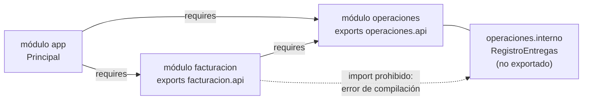
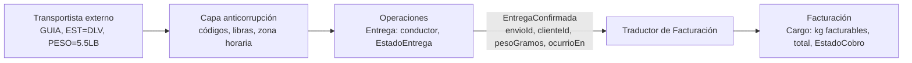
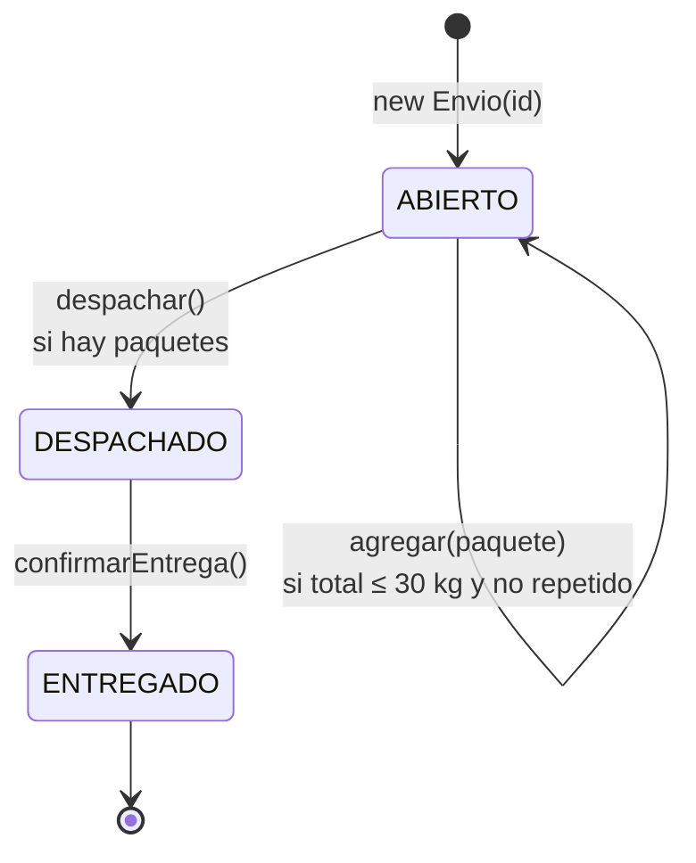
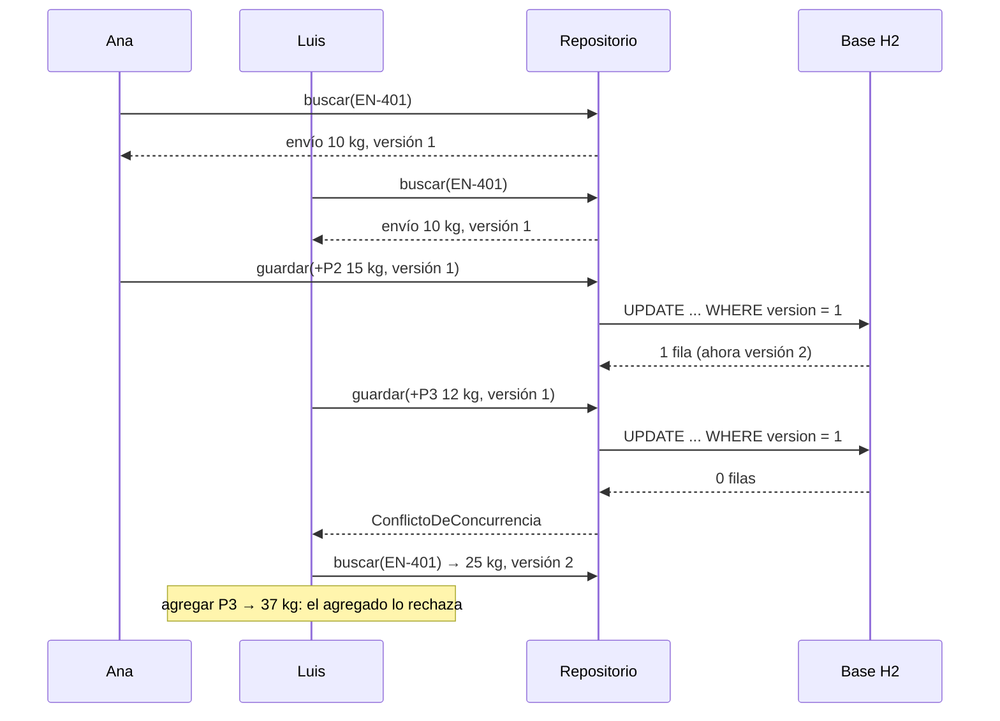

# Módulo 3: Diseño guiado por el dominio: módulos, contextos, agregados y repositorios

**Entorno comprobado para esta edición (2026-11-24):** OpenJDK 25.0.5.1 en Linux x86_64, solo con el JDK y con H2
2.3.232 para la base de datos: módulos de Java (JPMS) con `javac --module-source-path`, `jdeps`, records, interfaces
selladas, `BigDecimal`, `java.time` y JDBC con H2 en memoria. Todas las salidas y todos los errores de compilación de
este módulo se obtuvieron ejecutando el código mostrado ese día. Las fechas de los eventos son fijas en el código para
que tus salidas coincidan con las del libro.

Los Módulos 1 y 2 respondieron preguntas de **infraestructura**: qué pasa cuando la red falla, cómo se reparte la
carga, cómo se dividen los datos. Este módulo responde la pregunta anterior a todas ellas: **dónde termina una parte
del sistema y empieza otra**. Esa frontera no la decide el número de repositorios ni de servidores, sino el lenguaje
del negocio, las reglas que no se pueden romper y lo que cuesta cambiar cada parte. El diseño guiado por el dominio
(DDD, por *Domain-Driven Design*) da nombres y herramientas para tomar esa decisión, y Java da mecanismos para que el
compilador la haga cumplir.

**Al terminar este módulo podrás:**
- construir un monolito modular con módulos de Java que el compilador obliga a respetar;
- explicar por qué un monolito modular suele ser el paso correcto antes de un microservicio;
- separar dos contextos delimitados que usan la misma palabra con significados distintos;
- traducir un formato ajeno con una capa anticorrupción que rechaza lo que no entiende;
- diseñar un agregado con objetos de valor que proteja sus invariantes y registre eventos de dominio;
- guardar un agregado con un repositorio y evitar actualizaciones perdidas con control de concurrencia optimista.

**Esquema del módulo:** Tema 1 (monolito modular) → Tema 2 (lenguaje ubicuo y contextos delimitados) → Tema 3
(agregados, invariantes y eventos) → Tema 4 (repositorios y concurrencia optimista) → Proyecto 16 (el contexto de
devoluciones).

**Qué necesitas saber antes:** de este curso, **módulo**, **acoplamiento**, **cohesión**, **ADR** y **fitness
function** (Módulo 0, Temas 2 a 4), la **inmutabilidad profunda** de los records (Módulo 0, Tema 5) y el **outbox** y
el consumidor idempotente (Módulo 1, Tema 3). De Fundamentos, clases, herencia e interfaces (Módulo 1, Temas 6 y 7) y
**excepción** (Módulo 1, Tema 1). Del curso de Java, records (Módulo 1, Tema 5), interfaces `sealed` (Módulo 7, Tema 1) y
`module-info.java` (Módulo 10, Tema 1). Del curso SQL, **transacción** y **bloqueo** (Módulo 0, Tema 4). Los programas se ejecutan con
`java Programa.java`; el del Tema 4, con `java -cp ~/herramientas/h2-2.3.232.jar Programa.java`.

**Qué no se repite aquí:** cómo escribir un ADR y una fitness function con el árbol de sintaxis de `javac` está en el
Módulo 0, Temas 2 y 4; la publicación confiable de eventos con outbox, en el Módulo 1, Tema 3. Este módulo los usa.


## Aprende construyendo


### Tema 1: Límites y monolito modular: cuándo un microservicio no es la respuesta · Avanzado · 60 min

<details open>
<summary><strong>Capa 1 — Lectura</strong></summary>

#### Objetivos
Al terminar este tema podrás:
- organizar una aplicación en módulos de Java con una API pública y paquetes internos;
- provocar y leer el error del compilador cuando un módulo usa el interior de otro;
- detectar una dependencia circular entre módulos antes de ejecutar nada;
- argumentar con criterios cuándo conviene extraer un módulo como servicio y cuándo no.

**Conceptos clave:** límite, monolito modular, módulo de Java, API pública de un módulo, paquete interno, dependencia circular, grafo de módulos, microservicio

#### El problema
El sistema de envíos tiene dos áreas que cambian por motivos distintos: Operaciones (la ruta, el conductor, la
entrega) y Facturación (los cargos y los cobros). Hoy viven en el mismo proyecto y cualquier clase puede usar
cualquier otra. El mes pasado, Facturación leyó directamente la lista interna de entregas de Operaciones; cuando
Operaciones cambió esa lista por una tabla, Facturación dejó de compilar el día del cierre. Alguien propone
separarlos en dos microservicios. ¿Hace falta una red para tener una frontera?

Este tema usa **paquete**, **interfaz** y **visibilidad** `public` (Fundamentos, Módulo 1, Temas 6 y 7), **módulo**,
**acoplamiento** y **fitness function** (Módulo 0, Temas 3 y 2, de este curso). Aquí no se redefinen: se aplican.

#### Glosario del tema

**límite (*boundary*)**
- **Definición técnica:** frontera entre dos partes de un sistema a través de la cual solo pasan las operaciones y los datos declarados en un contrato; todo lo demás queda oculto.
- **En palabras sencillas:** la ventanilla de una oficina: entregas el formulario por la ventanilla, no entras a revolver los archivadores.
- **Dónde se rompe la comparación:** una ventanilla se ve; en el código, el límite es invisible hasta que una herramienta lo hace cumplir.
- **Ejemplo:** Facturación solo puede usar `operaciones.api`; el paquete `operaciones.interno` está detrás del límite.
- **Error típico:** dibujar el límite en un diagrama y no hacerlo cumplir: a los seis meses, el código lo cruza por todas partes.

**monolito modular**
- **Definición técnica:** aplicación que se despliega como un solo proceso pero está dividida en módulos con interfaces explícitas y dependencias controladas, de modo que cada módulo podría separarse después con poco esfuerzo.
- **En palabras sencillas:** una casa con habitaciones de paredes de verdad, en lugar de un salón enorme con muebles mezclados.
- **Dónde se rompe la comparación:** las habitaciones comparten techo: si el proceso se cae, se caen todas, y se despliegan juntas.
- **Ejemplo:** los módulos `operaciones`, `facturacion` y `app` se compilan por separado y se ejecutan con un solo `java -p out -m app/app.Principal`.
- **Error típico:** llamar «monolito modular» a un proyecto con carpetas bien nombradas pero sin ninguna regla que impida cruzarlas.

**módulo de Java**
- **Definición técnica:** unidad del sistema de módulos de la plataforma (JPMS) descrita en `module-info.java`: declara su nombre, qué paquetes exporta y de qué módulos depende (`requires`). El compilador y la JVM hacen cumplir esa declaración.
- **En palabras sencillas:** una caja con etiqueta que dice qué se puede sacar y qué necesita de otras cajas.
- **Dónde se rompe la comparación:** la etiqueta no es un adorno: si sacas algo que no está en ella, el compilador se niega.
- **Ejemplo:** `module operaciones { exports operaciones.api; }`.
- **Error típico:** confundirlo con un módulo de Gradle o de Maven: esos organizan la compilación, pero no impiden usar un paquete de otro.

**API pública de un módulo**
- **Definición técnica:** conjunto de tipos de los paquetes exportados, que son los únicos que otros módulos pueden nombrar.
- **En palabras sencillas:** el menú de la ventanilla.
- **Dónde se rompe la comparación:** lo que pones en el menú es una promesa: cambiarlo obliga a avisar a todos los que lo usan.
- **Ejemplo:** `Entregas` (interfaz) y `EntregaConfirmada` (record) en `operaciones.api`.
- **Error típico:** exportar todo «por si acaso»: la API se vuelve todo el código y el límite desaparece.

**paquete interno**
- **Definición técnica:** paquete de un módulo que no aparece en ningún `exports`; sus tipos, aunque sean `public`, no son accesibles desde otros módulos.
- **En palabras sencillas:** la trastienda.
- **Dónde se rompe la comparación:** dentro del mismo módulo sí se usa libremente; la trastienda es privada para los de afuera, no para los empleados.
- **Ejemplo:** `operaciones.interno.RegistroEntregas` es `public`, pero `facturacion` no puede importarla.
- **Error típico:** creer que `public` significa «cualquiera puede usarla»: con módulos, `public` solo llega hasta el borde del módulo.

**dependencia circular**
- **Definición técnica:** situación en la que el módulo A depende de B y B depende de A, directa o indirectamente; los módulos de Java la prohíben.
- **En palabras sencillas:** dos oficinas que no pueden abrir hasta que la otra abra.
- **Dónde se rompe la comparación:** entre clases del mismo módulo Java sí permite ciclos; la prohibición es entre módulos.
- **Ejemplo:** agregar `requires facturacion;` a `operaciones` produce `error: cyclic dependence involving operaciones`.
- **Error típico:** resolver el ciclo moviendo todo a un módulo «común» que termina conteniendo medio sistema.

**grafo de módulos**
- **Definición técnica:** grafo dirigido cuyos nodos son módulos y cuyas aristas son relaciones `requires`; se inspecciona con `jdeps` o `java --describe-module`.
- **En palabras sencillas:** el mapa de quién necesita a quién.
- **Dónde se rompe la comparación:** el mapa muestra dependencias de compilación, no cuántas llamadas hay ni cuánto pesan.
- **Ejemplo:** `jdeps -s` muestra `facturacion -> operaciones` y ninguna flecha de vuelta.
- **Error típico:** no mirarlo nunca: los grafos crecen solos, una dependencia a la vez.

**microservicio**
- **Definición técnica:** servicio desplegable de forma independiente, con su propio proceso y sus propios datos, que se comunica con otros solo por red mediante contratos (HTTP, mensajes).
- **En palabras sencillas:** una habitación convertida en casa propia, con su propia dirección.
- **Dónde se rompe la comparación:** entre casas no hay pasillo: cada visita es un viaje por la red, con timeouts, reintentos y fallos parciales (Módulo 1).
- **Ejemplo:** si Facturación se volviera microservicio, `entregas.confirmadas()` pasaría a ser una llamada HTTP o un evento.
- **Error típico:** separar en microservicios para «ordenar» el código: el desorden viaja con él y ahora además hay red.

#### ► CÓMO FUNCIONA
Cada módulo declara en `module-info.java` qué exporta y qué requiere. El compilador arma el grafo de módulos y lo
revisa antes de compilar una sola clase: si un módulo importa un paquete que otro no exporta, o si hay un ciclo, la
compilación falla. Así el límite deja de ser una convención y pasa a ser una regla que nadie puede saltarse sin
editar el `module-info.java`, que es un cambio visible en una revisión de código.



#### Problema resuelto 1.1
Organiza Operaciones y Facturación como módulos de Java: cada uno con su API pública y Operaciones con un paquete
interno. Compila, ejecuta y mira el grafo.

**Razonamiento:**
1. La estructura de carpetas sigue la convención de `--module-source-path`: `src/<módulo>/module-info.java` y debajo
   los paquetes.
2. Operaciones expone una interfaz (`Entregas`) y un hecho (`EntregaConfirmada`). La implementación con la lista
   en memoria queda en `operaciones.interno`; la interfaz la crea con un método `static`, así nadie de afuera
   necesita conocer la clase concreta.
3. Facturación requiere a Operaciones y solo usa su API.
4. El módulo `app` arma todo y tiene el `main`. Como las clases están en paquetes con nombre, se escriben como clases
   normales (no archivos compactos) y usan `System.out`.

```text
monolito/
└── src/
    ├── operaciones/
    │   ├── module-info.java
    │   └── operaciones/
    │       ├── api/Entregas.java
    │       ├── api/EntregaConfirmada.java
    │       └── interno/RegistroEntregas.java
    ├── facturacion/
    │   ├── module-info.java
    │   └── facturacion/api/Facturador.java
    └── app/
        ├── module-info.java
        └── app/Principal.java
```

```java
// module-info.java de Operaciones: solo el paquete api es visible para otros módulos
module operaciones {
    exports operaciones.api;
}
```

```java
package operaciones.api;

import operaciones.interno.RegistroEntregas;
import java.util.List;

/** Puerta de entrada pública del módulo Operaciones. */
public interface Entregas {
    void confirmar(String envioId, int pesoGramos);

    List<EntregaConfirmada> confirmadas();

    static Entregas crear() {
        return new RegistroEntregas();   // la implementación queda escondida en el paquete interno
    }
}
```

```java
package operaciones.api;

/** Hecho publicado por Operaciones: lo único que otros módulos pueden saber de una entrega. */
public record EntregaConfirmada(String envioId, int pesoGramos) {
}
```

```java
package operaciones.interno;

import operaciones.api.EntregaConfirmada;
import operaciones.api.Entregas;
import java.util.ArrayList;
import java.util.List;

/** Detalle interno: hoy una lista en memoria; mañana, una tabla. Nadie de afuera debe depender de esto. */
public class RegistroEntregas implements Entregas {
    public final List<EntregaConfirmada> filas = new ArrayList<>();

    @Override
    public void confirmar(String envioId, int pesoGramos) {
        filas.add(new EntregaConfirmada(envioId, pesoGramos));
    }

    @Override
    public List<EntregaConfirmada> confirmadas() {
        return List.copyOf(filas);
    }
}
```

```java
// module-info.java de Facturación: usa la API de Operaciones y publica la suya
module facturacion {
    requires operaciones;
    exports facturacion.api;
}
```

```java
package facturacion.api;

import operaciones.api.EntregaConfirmada;
import operaciones.api.Entregas;

/** Facturación lee las entregas confirmadas solo a través de la API pública de Operaciones. */
public class Facturador {
    private static final int PESOS_POR_KG = 1500;

    public int totalPorCobrar(Entregas entregas) {
        int total = 0;
        for (EntregaConfirmada e : entregas.confirmadas()) {
            total += Math.ceilDiv(e.pesoGramos(), 1000) * PESOS_POR_KG;   // kg completos o fracción
        }
        return total;
    }
}
```

```java
// module-info.java de la aplicación: arma los módulos y arranca
module app {
    requires operaciones;
    requires facturacion;
}
```

```java
package app;

import facturacion.api.Facturador;
import operaciones.api.Entregas;

public class Principal {
    public static void main(String[] args) {
        Entregas entregas = Entregas.crear();
        entregas.confirmar("EN-101", 2300);
        entregas.confirmar("EN-102", 800);
        System.out.println("entregas confirmadas: " + entregas.confirmadas());
        System.out.println("total por cobrar: " + new Facturador().totalPorCobrar(entregas));
    }
}
```

Compila todos los módulos de una vez y ejecuta el módulo `app`:

```text
$ javac -d out --module-source-path "src/*" $(find src -name '*.java')
$ java -p out -m app/app.Principal
entregas confirmadas: [EntregaConfirmada[envioId=EN-101, pesoGramos=2300], EntregaConfirmada[envioId=EN-102, pesoGramos=800]]
total por cobrar: 6000
```

```text
$ jdeps --module-path out -s -m app
app -> facturacion
app -> java.base
app -> operaciones
$ java --module-path out --describe-module operaciones
operaciones file:///home/estudiante/labs/arquitectura/ddd/monolito/out/operaciones/
exports operaciones.api
requires java.base mandated
contains operaciones.interno
```

**Explicación por partes.**
- `--module-source-path "src/*"` le dice a `javac` que cada carpeta bajo `src` es un módulo; `-d out` deja una
  carpeta compilada por módulo. `java -p out` (ruta de módulos) y `-m app/app.Principal` indican módulo y clase.
- `Entregas.java`, líneas 12–14: el método `static crear()` devuelve la implementación interna detrás de la interfaz.
  El módulo puede usar su propio paquete interno; los demás, no.
- `Facturador.java`: calcula 3 kg + 1 kg (redondeando hacia arriba con `Math.ceilDiv`) × 1500 = 6000, usando solo
  `entregas.confirmadas()`.
- `RegistroEntregas.java`: el campo `filas` es `public` a propósito, para mostrar que `public` no basta para cruzar el
  límite de un módulo.
- `--describe-module` lo dice en una línea: `exports operaciones.api` y `contains operaciones.interno`. `jdeps -s`
  confirma que nadie depende de `app` y que la flecha entre los dos dominios va en un solo sentido.

#### Problema resuelto 1.2
Intenta saltarte el límite de dos formas: un atajo que lee la lista interna de Operaciones, y una dependencia de
Operaciones hacia Facturación. Compara con lo que pasa sin módulos.

**Razonamiento:**
1. El atajo convierte la interfaz en la clase concreta y lee `filas`: compila en un proyecto sin módulos porque todo
   es `public`.
2. Con módulos, el `import` del paquete interno ya es un error.
3. Para el ciclo basta una línea en `module-info.java` de Operaciones.
4. Para comparar, se compila el mismo código en el *classpath*, sin los `module-info.java`.

```java
package facturacion.api;

import operaciones.api.Entregas;
import operaciones.interno.RegistroEntregas;

/** Atajo prohibido: lee la lista interna de Operaciones en lugar de usar su API. */
public class FacturadorAtajo {
    public int entregasSinCobrar(Entregas entregas) {
        return ((RegistroEntregas) entregas).filas.size();
    }
}
```

Guarda el atajo como `src/facturacion/facturacion/api/FacturadorAtajo.java` y compila:

```text
$ javac -d out --module-source-path "src/*" $(find src -name '*.java')
src/facturacion/facturacion/api/FacturadorAtajo.java:4: error: package operaciones.interno is not visible
import operaciones.interno.RegistroEntregas;
                  ^
  (package operaciones.interno is declared in module operaciones, which does not export it)
1 error
$ echo $?
1
```

Sin módulos (compilando en el *classpath* y dejando fuera los `module-info.java`), el mismo atajo compila:

```text
$ javac -d out-cp $(find src -name '*.java' ! -name module-info.java)
$ echo $?
0
```

Borra el atajo y agrega `requires facturacion;` dentro de `module operaciones { ... }`:

```text
$ javac -d out --module-source-path "src/*" $(find src -name '*.java')
src/facturacion/module-info.java:3: error: cyclic dependence involving operaciones
    requires operaciones;
             ^
src/operaciones/module-info.java:3: error: cyclic dependence involving facturacion
    requires facturacion;
             ^
2 errors
```

**Explicación por partes.**
- El primer error señala la línea del `import` y explica la causa: el paquete existe, pero el módulo `operaciones` no
  lo exporta. El límite se hace cumplir antes de que el atajo llegue a producción.
- En el *classpath* no hay módulos: los paquetes son solo nombres y `public` llega a todas partes. Por eso un proyecto
  con carpetas `api` e `interno`, pero sin `module-info.java`, no tiene límites de verdad.
- El ciclo aparece en los dos `module-info.java`. La solución nunca es quitar la verificación: es decidir qué
  dirección tiene sentido. Si Operaciones necesita saber algo de Facturación, Facturación publica un hecho
  (Tema 2) o el dato se mueve de módulo.

> **Error común.** Exportar el paquete interno para «arreglar» el error de compilación. `exports operaciones.interno;`
> hace desaparecer el error y el límite al mismo tiempo. Si un módulo de verdad necesita algo interno, agrega ese
> algo a la API con un nombre y un contrato, o usa una exportación calificada (`exports ... to facturacion;`) y
> regístrala en un ADR.

> **Error común.** Separar en microservicios para resolver un ciclo. Si Operaciones y Facturación se llaman entre sí en
> los dos sentidos, como servicios se seguirán llamando en los dos sentidos, ahora por red: cada caída de uno tumba al
> otro. Primero se rompe el ciclo; después se decide si separar.

> **Buena práctica.** Extrae un módulo como microservicio solo con una razón que el monolito no puede resolver:
> necesita escalar distinto (Módulo 2), desplegarse con otro ritmo, aislar sus fallos o pertenecer a otro equipo con
> otra tecnología. Si ninguna aplica, el monolito modular es más barato de operar, probar y depurar.

> **Prevenir errores.** Revisa `jdeps -s` en la integración continua y guarda la salida esperada en el repositorio.
> Una flecha nueva entre módulos aparece en el `diff` de la revisión, donde alguien puede preguntar por qué.

#### Checkpoint 1.1
¿Puede la clase `app.Principal` usar `RegistroEntregas` si `app` declara `requires operaciones;`?

Respuesta: no. `requires` da acceso solo a los paquetes que `operaciones` exporta. `RegistroEntregas` está en
`operaciones.interno`, que no se exporta a nadie.

</details>

<details>
<summary><strong>Capa 2 — Construcción</strong></summary>

#### Paso 1 · Prepara la carpeta
Crea `mkdir -p ~/labs/arquitectura/ddd/monolito && cd ~/labs/arquitectura/ddd/monolito` y crea la estructura de
carpetas del Problema resuelto 1.1 con sus ocho archivos.

#### Paso 2 · Compila y ejecuta
Ejecuta las dos órdenes del Problema resuelto 1.1. La última línea debe ser `total por cobrar: 6000`.

#### Paso 3 · Mira el grafo
Ejecuta `jdeps --module-path out -s -m app` y comprueba que no aparezca `operaciones -> facturacion`.

#### Paso 4 · Rompe el límite
Agrega `FacturadorAtajo.java`, compila y lee el error `package operaciones.interno is not visible`. Compílalo después
en el *classpath* y comprueba que pasa. Borra el atajo.

#### Paso 5 · Provoca el ciclo
Agrega `requires facturacion;` a `operaciones`, compila, lee los dos errores `cyclic dependence` y quita la línea.

#### Resumen
- Un **límite** deja pasar solo lo que está en el contrato; sin una herramienta que lo haga cumplir, se erosiona.
- Un **monolito modular** tiene módulos con fronteras reales y se despliega como un solo proceso.
- Un **módulo de Java** declara su **API pública** con `exports` y sus dependencias con `requires`.
- Un **paquete interno** no es accesible desde otros módulos aunque sus clases sean `public`.
- Los módulos de Java prohíben la **dependencia circular**; `jdeps` muestra el **grafo de módulos**.
- Un **microservicio** agrega red y despliegue independiente: se justifica por escala, ritmo, fallos o equipos.

#### Ejercicio verificable 1
Básico. Ejecuta `java --module-path out --describe-module facturacion`. ¿Qué líneas esperas después de la primera?

Respuesta esperada: `exports facturacion.api`, `requires java.base mandated` y `requires operaciones`, debajo de la
primera línea con la ruta del módulo. `java.base` aparece siempre: todo módulo lo requiere sin declararlo.

#### Ejercicio verificable 2
Intermedio. Vuelve a agregar `FacturadorAtajo.java` y, en lugar de borrarlo, agrega a `operaciones` la línea
`exports operaciones.interno to facturacion;`. ¿Compila? ¿Qué cambió en el límite?

Respuesta esperada: compila (`echo $?` da `0`). La exportación calificada abre el paquete interno solo a
`facturacion`; `app` sigue sin acceso. El acoplamiento existe y ahora es visible en `module-info.java`: es una deuda
que conviene registrar en un ADR con su condición de retiro (Módulo 0, Tema 4).

#### Ejercicio verificable 3
Reto. En `Principal.java`, después de imprimir el total, intenta leer el campo `filas` por reflexión:
`entregas.getClass().getField("filas").get(entregas)` dentro de un `try` que imprima la excepción. ¿Qué pasa?

Respuesta esperada: la JVM también hace cumplir el límite en tiempo de ejecución:
`java.lang.IllegalAccessException: class app.Principal (in module app) cannot access class operaciones.interno.RegistroEntregas (in module operaciones) because module operaciones does not export operaciones.interno to module app`.
Para permitir reflexión, un módulo debe declarar `opens` (Java, Módulo 10, Tema 3); los frameworks como Spring y
Hibernate lo piden por eso.

#### En el trabajo
Muchas empresas que migraron a microservicios demasiado pronto vuelven a monolitos modulares para reducir costos de
operación. En Spring, el proyecto Spring Modulith verifica los límites entre módulos de una aplicación Spring Boot
con pruebas, sobre la misma idea de este tema. En una revisión de diseño, la pregunta antes de crear un servicio
nuevo es: «¿qué razón tiene este módulo para desplegarse solo?».

</details>

### Tema 2: Lenguaje ubicuo y contextos delimitados: el mismo envío no significa lo mismo · Avanzado · 60 min

<details open>
<summary><strong>Capa 1 — Lectura</strong></summary>

#### Objetivos
Al terminar este tema podrás:
- reconocer cuándo dos equipos usan la misma palabra con significados distintos y qué error produce compartir un modelo;
- separar dos contextos delimitados con modelos propios y un hecho publicado como contrato entre ellos;
- traducir el formato y los códigos de un sistema externo con una capa anticorrupción;
- decidir qué datos cruzan la frontera y cuáles se quedan dentro de cada contexto.

**Conceptos clave:** dominio, lenguaje ubicuo, contexto delimitado, modelo compartido, evento de integración, traductor, capa anticorrupción, mapa de contextos

#### El problema
Para Operaciones, un envío «entregado» es un paquete que llegó a la puerta del cliente. Para Facturación, un envío
«cerrado» es uno que ya se cobró. Los dos equipos usan la misma clase `Envio` y el mismo campo `estado`. Un día,
Facturación marca los envíos cobrados con `estado = "facturado"`, y el tablero de Operaciones empieza a mostrar cero
entregas del día. Además llega un tercer actor: un transportista externo que reporta sus entregas con códigos como
`DLV` y pesos en libras. ¿Cómo hacen tres partes para entenderse sin contaminarse?

Este tema usa el **monolito modular** y la **API pública de un módulo** (Tema 1), records y `enum` (Java, Módulo 1,
Tema 5), `BigDecimal` y `RoundingMode` (Fundamentos, Módulo 1, Tema 5) y `java.time` para instantes y zonas horarias.

#### Glosario del tema

**dominio**
- **Definición técnica:** área de conocimiento y actividad del negocio que el software atiende, con sus reglas, sus actores y su vocabulario.
- **En palabras sencillas:** de qué trata el trabajo de la gente que usará el programa.
- **Dónde se rompe la comparación:** un negocio no tiene un solo dominio: logística, cobros y atención al cliente son dominios distintos dentro de la misma empresa.
- **Ejemplo:** en este tema hay tres: la operación de entregas, la facturación y la red del transportista externo.
- **Error típico:** modelar a partir de las tablas de la base en lugar de a partir de cómo habla y decide el negocio.

**lenguaje ubicuo**
- **Definición técnica:** vocabulario preciso y compartido entre expertos del negocio y desarrolladores dentro de un contexto, que se usa igual en las conversaciones, en los documentos y en el código.
- **En palabras sencillas:** que «entregada» signifique lo mismo cuando lo dice el jefe de bodega y cuando aparece en el código.
- **Dónde se rompe la comparación:** «ubicuo» no quiere decir «de toda la empresa»: el mismo término puede significar otra cosa en otro contexto, y eso está bien.
- **Ejemplo:** en Operaciones, `EstadoEntrega.ENTREGADA`; en Facturación, `EstadoCobro.COBRADO`. Ninguno usa la palabra suelta «estado».
- **Error típico:** usar palabras genéricas (`estado`, `tipo`, `dato`, `procesar`) que cada lector interpreta a su manera.

**contexto delimitado (*bounded context*)**
- **Definición técnica:** frontera explícita dentro de la cual un modelo y su lenguaje ubicuo son consistentes; fuera de ella, los mismos términos pueden tener otro significado y otro modelo.
- **En palabras sencillas:** cada departamento con su propio diccionario.
- **Dónde se rompe la comparación:** los departamentos se hablan; los contextos también, pero solo mediante contratos explícitos y traducción.
- **Ejemplo:** el contexto Operaciones tiene `Entrega` con conductor; el contexto Facturación tiene `Cargo` con peso facturable y total.
- **Error típico:** hacer un contexto por tabla o por entidad: los contextos se separan por lenguaje y por equipo, no por sustantivo.

**modelo compartido**
- **Definición técnica:** clase o esquema que varios contextos usan y modifican a la vez; cada uno le agrega campos y significados, y ninguno es dueño.
- **En palabras sencillas:** un cuaderno en el que escriben dos equipos con sus propias abreviaturas.
- **Dónde se rompe la comparación:** en un cuaderno se nota la letra distinta; en el código, un `String` escrito por otro equipo es idéntico al tuyo.
- **Ejemplo:** en `ModeloCompartido.java`, Facturación escribe `"facturado"` en el campo que Operaciones usa para contar entregas.
- **Error típico:** crear «el modelo único de cliente de la empresa»: cada cambio necesita la aprobación de todos y nadie se atreve a tocarlo.

**evento de integración**
- **Definición técnica:** mensaje inmutable que un contexto publica para informar un hecho ya ocurrido, con solo los datos que otros contextos necesitan; es el contrato entre contextos.
- **En palabras sencillas:** el aviso «entregué el envío EN-101 de 2.3 kg al cliente C-3», sin el resto del expediente.
- **Dónde se rompe la comparación:** un aviso se puede corregir con otro aviso, pero el primero no se borra: los hechos no se editan.
- **Ejemplo:** `record EntregaConfirmada(String envioId, String clienteId, int pesoGramos, Instant ocurrioEn)` no lleva el conductor.
- **Error típico:** publicar la entidad completa «por si alguien la necesita»: cada campo publicado es un campo que ya no puedes cambiar libremente.

**traductor**
- **Definición técnica:** función que convierte un evento o un dato de otro contexto al modelo propio, aplicando las reglas y las unidades del contexto receptor.
- **En palabras sencillas:** quien pasa el aviso de Operaciones a lenguaje de Facturación: «2300 g» se vuelve «3 kg facturables».
- **Dónde se rompe la comparación:** un traductor humano interpreta; el de software solo aplica reglas escritas, y las que no están escritas no existen.
- **Ejemplo:** `cargoDesde` redondea los gramos hacia arriba a kilos completos y calcula el total con la tarifa.
- **Error típico:** poner la traducción en el contexto que publica: así el emisor tiene que conocer las reglas de todos sus receptores.

**capa anticorrupción (*anti-corruption layer*)**
- **Definición técnica:** traductor ubicado en la frontera con un sistema externo o heredado, que aísla el modelo propio de los conceptos, formatos y códigos ajenos y rechaza lo que no puede traducir.
- **En palabras sencillas:** la aduana: revisa cada paquete que llega de afuera y no deja pasar lo que no está en la lista.
- **Dónde se rompe la comparación:** la aduana puede retener un paquete para inspeccionarlo; el código rechaza con una excepción y alguien debe revisar el rechazo.
- **Ejemplo:** `Anticorrupcion.java` es la única clase que conoce `DLV`, `ATT`, las libras y el formato `yyyyMMdd'T'HHmm`.
- **Error típico:** dejar que los códigos ajenos entren al modelo propio (`if (estado.equals("DLV"))` en diez clases): cuando el proveedor cambia, cambian las diez.

**mapa de contextos (*context map*)**
- **Definición técnica:** diagrama y descripción de los contextos de un sistema y de la relación entre cada par: quién publica, quién se adapta y qué traducción existe.
- **En palabras sencillas:** el organigrama de quién le avisa qué a quién.
- **Dónde se rompe la comparación:** un organigrama muestra jerarquía; el mapa muestra dependencias y poder de negociación, como el de un proveedor que no cambia su formato por ti.
- **Ejemplo:** Transportista → (capa anticorrupción) → Operaciones → (`EntregaConfirmada`) → Facturación.
- **Error típico:** no dibujarlo: las relaciones existen igual, pero nadie sabe cuál se rompe cuando un contexto cambia su contrato.

#### ► CÓMO FUNCIONA
Cada contexto tiene su modelo con su vocabulario y nadie más lo modifica. Entre ellos solo viaja un **hecho**
publicado, inmutable y mínimo. El receptor lo **traduce** a su propio modelo con sus propias reglas. Cuando el emisor
es un sistema externo que no controlas, la traducción se concentra en una **capa anticorrupción** que valida, convierte
unidades y códigos, y rechaza lo desconocido antes de que entre.



#### Problema resuelto 2.1
Reproduce el error: dos contextos comparten la clase `Envio` y el campo `estado`.

**Razonamiento:**
1. Operaciones cuenta las entregas con `estado.equals("entregado")`.
2. Facturación, después de cobrar, escribe `"facturado"` en el mismo campo: en su lenguaje, ese es el estado del envío.
3. Nadie hizo nada «mal» dentro de su contexto; el error aparece en la mezcla.

```java
// ModeloCompartido.java — Operaciones y Facturación comparten una sola clase Envio
class Envio {                 // un modelo para todos: cada equipo le agrega lo que necesita
    String id;
    String conductor;
    String estado;            // Operaciones: en_transito, entregado. Facturación: facturado
    double pesoKg;

    Envio(String id, String conductor, String estado, double pesoKg) {
        this.id = id;
        this.conductor = conductor;
        this.estado = estado;
        this.pesoKg = pesoKg;
    }
}

long entregadas(List<Envio> envios) {          // consulta de Operaciones
    return envios.stream().filter(e -> e.estado.equals("entregado")).count();
}

void facturar(List<Envio> envios) {            // proceso de Facturación
    for (Envio e : envios) {
        if (e.estado.equals("entregado")) {
            e.estado = "facturado";            // «ya lo cobramos»: para Facturación tiene sentido
        }
    }
}

void main() {
    List<Envio> envios = List.of(
            new Envio("EN-101", "K-7", "entregado", 2.3),
            new Envio("EN-102", "K-7", "entregado", 0.8),
            new Envio("EN-103", "K-9", "en_transito", 4.0));
    IO.println("Operaciones, antes de facturar: entregadas = " + entregadas(envios));
    facturar(envios);
    IO.println("Operaciones, después de facturar: entregadas = " + entregadas(envios));
    IO.println("estados: " + envios.stream().map(e -> e.id + "=" + e.estado).toList());
}
```

```text
$ java ModeloCompartido.java
Operaciones, antes de facturar: entregadas = 2
Operaciones, después de facturar: entregadas = 0
estados: [EN-101=facturado, EN-102=facturado, EN-103=en_transito]
```

**Explicación por partes.**
- Línea 5: un solo campo `estado` con valores de dos lenguajes distintos. El comentario ya lo confiesa.
- Líneas 16–18: la consulta de Operaciones depende de un valor que otro equipo puede sobrescribir.
- Líneas 20–26: la regla de Facturación es correcta para Facturación y destruye la información de Operaciones.
- La salida muestra el efecto: dos entregas reales y un tablero que dice cero. No hay excepción ni error en el
  registro; el dato simplemente cambió de significado.

#### Problema resuelto 2.2
Separa los contextos: cada uno con su modelo y su `enum` de estado, y un evento de integración entre ellos. Después,
traduce los avisos de un transportista externo con una capa anticorrupción.

**Razonamiento:**
1. `Entrega` (Operaciones) y `Cargo` (Facturación) son records distintos; cada uno tiene su propio `enum`, así que
   ninguno puede escribir el estado del otro.
2. Operaciones publica `EntregaConfirmada` sin el conductor: a Facturación no le sirve y no debe depender de él.
3. Facturación traduce el hecho con sus reglas: kilos completos redondeados hacia arriba, con `BigDecimal` porque es
   dinero.
4. El transportista envía líneas de texto `CLAVE=VALOR` separadas por `;`. La capa anticorrupción conoce sus códigos,
   convierte libras a gramos (1 lb = 453.59237 g, valor exacto por definición) y la hora local de Bogotá a un
   `Instant` en UTC. Lo que no sabe traducir lo rechaza con un mensaje.

```java
// Contextos.java — dos modelos separados y un evento que cruza la frontera
import java.math.BigDecimal;
import java.math.RoundingMode;
import java.time.Instant;

// ---- Contexto Operaciones: le importa el recorrido físico ----
enum EstadoEntrega { EN_TRANSITO, ENTREGADA }

record Entrega(String id, String clienteId, String conductorId, int pesoGramos, EstadoEntrega estado) {
    Entrega confirmar() {                                // un record no cambia: devuelve la entrega nueva
        if (estado != EstadoEntrega.EN_TRANSITO) {
            throw new IllegalStateException("solo se confirma una entrega en tránsito: " + id + " está " + estado);
        }
        return new Entrega(id, clienteId, conductorId, pesoGramos, EstadoEntrega.ENTREGADA);
    }

    EntregaConfirmada hecho(Instant cuando) {           // lo que Operaciones publica: sin conductor
        return new EntregaConfirmada(id, clienteId, pesoGramos, cuando);
    }
}

// ---- El contrato entre contextos: un hecho pasado, inmutable y con lo mínimo ----
record EntregaConfirmada(String envioId, String clienteId, int pesoGramos, Instant ocurrioEn) {
}

// ---- Contexto Facturación: le importa el dinero ----
enum EstadoCobro { PENDIENTE, COBRADO }

record Cargo(String envioId, String clienteId, BigDecimal pesoFacturableKg, BigDecimal total, EstadoCobro estado) {
    Cargo cobrar() {
        return new Cargo(envioId, clienteId, pesoFacturableKg, total, EstadoCobro.COBRADO);
    }
}

static final BigDecimal TARIFA_POR_KG = new BigDecimal("1500");

// Traductor del lado de Facturación: convierte el hecho ajeno en su propio modelo
Cargo cargoDesde(EntregaConfirmada e) {
    BigDecimal kg = BigDecimal.valueOf(e.pesoGramos()).divide(BigDecimal.valueOf(1000), 0, RoundingMode.CEILING);
    return new Cargo(e.envioId(), e.clienteId(), kg, kg.multiply(TARIFA_POR_KG), EstadoCobro.PENDIENTE);
}

void main() {
    var entregas = List.of(
            new Entrega("EN-101", "C-3", "K-7", 2300, EstadoEntrega.EN_TRANSITO),
            new Entrega("EN-102", "C-3", "K-7", 800, EstadoEntrega.EN_TRANSITO));
    Instant ahora = Instant.parse("2026-11-24T15:00:00Z");
    List<Entrega> confirmadas = entregas.stream().map(Entrega::confirmar).toList();
    List<EntregaConfirmada> hechos = confirmadas.stream().map(e -> e.hecho(ahora)).toList();

    List<Cargo> cargos = hechos.stream().map(this::cargoDesde).map(Cargo::cobrar).toList();
    cargos.forEach(c -> IO.println("Facturación: " + c));
    long entregadas = confirmadas.stream().filter(e -> e.estado() == EstadoEntrega.ENTREGADA).count();
    IO.println("Operaciones, después de cobrar: entregadas = " + entregadas);

    try {
        confirmadas.getFirst().confirmar();
    } catch (IllegalStateException error) {
        IO.println("Operaciones rechaza: " + error.getMessage());
    }
}
```

```text
$ java Contextos.java
Facturación: Cargo[envioId=EN-101, clienteId=C-3, pesoFacturableKg=3, total=4500, estado=COBRADO]
Facturación: Cargo[envioId=EN-102, clienteId=C-3, pesoFacturableKg=1, total=1500, estado=COBRADO]
Operaciones, después de cobrar: entregadas = 2
Operaciones rechaza: solo se confirma una entrega en tránsito: EN-101 está ENTREGADA
```

```java
// Anticorrupcion.java — traduce los avisos de un transportista externo a nuestro modelo
import java.time.LocalDateTime;
import java.time.ZoneId;
import java.time.format.DateTimeFormatter;

// Nuestro modelo: lo que el resto del sistema entiende
enum Resultado { ENTREGADA, INTENTO_FALLIDO }

record AvisoEntrega(String envioId, Resultado resultado, int pesoGramos, java.time.Instant ocurrioEn) {
}

// La capa anticorrupción: única clase que conoce el formato y los códigos del transportista
static final Map<String, Resultado> CODIGOS = Map.of("DLV", Resultado.ENTREGADA, "ATT", Resultado.INTENTO_FALLIDO);
static final double GRAMOS_POR_LIBRA = 453.59237;
static final DateTimeFormatter FECHA = DateTimeFormatter.ofPattern("yyyyMMdd'T'HHmm");
static final ZoneId ZONA_TRANSPORTISTA = ZoneId.of("America/Bogota");

AvisoEntrega traducir(String linea) {
    Map<String, String> campos = new HashMap<>();
    for (String par : linea.split(";")) {
        String[] kv = par.split("=", 2);
        if (kv.length == 2) campos.put(kv[0].trim(), kv[1].trim());
    }
    String guia = requerido(campos, "GUIA");
    Resultado resultado = CODIGOS.get(requerido(campos, "EST"));
    if (resultado == null) {
        throw new IllegalArgumentException("código de estado desconocido: " + campos.get("EST"));
    }
    String peso = requerido(campos, "PESO");
    if (!peso.endsWith("LB")) {
        throw new IllegalArgumentException("unidad de peso no soportada: " + peso);
    }
    int gramos = (int) Math.round(Double.parseDouble(peso.replace("LB", "")) * GRAMOS_POR_LIBRA);
    var cuando = LocalDateTime.parse(requerido(campos, "FECHA"), FECHA).atZone(ZONA_TRANSPORTISTA).toInstant();
    return new AvisoEntrega(guia, resultado, gramos, cuando);
}

String requerido(Map<String, String> campos, String nombre) {
    String valor = campos.get(nombre);
    if (valor == null || valor.isEmpty()) {
        throw new IllegalArgumentException("falta el campo " + nombre);
    }
    return valor;
}

void main() {
    List<String> avisos = List.of(
            "GUIA=EN-205;EST=DLV;PESO=5.5LB;FECHA=20261124T1015",
            "GUIA=EN-206;EST=ATT;PESO=1LB;FECHA=20261124T1102",
            "GUIA=EN-207;EST=RTS;PESO=2LB;FECHA=20261124T1130",
            "GUIA=EN-208;EST=DLV;PESO=3KG;FECHA=20261124T1140",
            "EST=DLV;PESO=2LB;FECHA=20261124T1150");
    for (String aviso : avisos) {
        try {
            IO.println("aceptado:  " + traducir(aviso));
        } catch (IllegalArgumentException error) {
            IO.println("rechazado: " + error.getMessage() + "  <- " + aviso);
        }
    }
}
```

```text
$ java Anticorrupcion.java
aceptado:  AvisoEntrega[envioId=EN-205, resultado=ENTREGADA, pesoGramos=2495, ocurrioEn=2026-11-24T15:15:00Z]
aceptado:  AvisoEntrega[envioId=EN-206, resultado=INTENTO_FALLIDO, pesoGramos=454, ocurrioEn=2026-11-24T16:02:00Z]
rechazado: código de estado desconocido: RTS  <- GUIA=EN-207;EST=RTS;PESO=2LB;FECHA=20261124T1130
rechazado: unidad de peso no soportada: 3KG  <- GUIA=EN-208;EST=DLV;PESO=3KG;FECHA=20261124T1140
rechazado: falta el campo GUIA  <- EST=DLV;PESO=2LB;FECHA=20261124T1150
```

**Explicación por partes.**
- `Contextos.java`, líneas 7 y 27: dos `enum` distintos. Facturación ya no puede «facturar» una entrega: solo puede
  cobrar un cargo.
- Líneas 10–19: `confirmar()` valida y devuelve una entrega nueva; `hecho()` arma el evento con los cuatro datos
  acordados.
- Líneas 38–41: el traductor vive del lado de Facturación. `divide(..., 0, RoundingMode.CEILING)` convierte 2300 g en
  3 kg y 800 g en 1 kg. El total, 4500 + 1500 = 6000, coincide con el del Tema 1.
- La salida confirma la separación: después de cobrar, Operaciones sigue contando dos entregas. Y una entrega ya
  confirmada no se confirma dos veces.
- `Anticorrupcion.java`, líneas 13–16: todo lo que es del transportista está aquí: códigos, factor de libras, formato
  de fecha y zona horaria. El resto del sistema solo ve `AvisoEntrega`.
- Línea 34: `10:15` en Bogotá (UTC−5) es `15:15` en UTC, como muestra `ocurrioEn=2026-11-24T15:15:00Z`.
- Las tres últimas líneas de la salida son rechazos con causa: un código que no conocemos (`RTS`), una unidad que no
  esperábamos (`KG`) y un campo obligatorio ausente. Ninguno entra al modelo con un valor inventado.

> **Error común.** Traducir un código desconocido a un valor por defecto. Si `RTS` («devuelto al remitente») se
> convierte en `ENTREGADA` porque es «lo más parecido», Facturación cobra una entrega que no ocurrió. Lo desconocido se
> rechaza y se revisa; cuando se entiende, se agrega a la tabla de códigos con su significado.

> **Error común.** Compartir el `enum` de estados entre contextos para «no duplicar». Dos `enum` con nombres parecidos
> no son duplicación: son dos lenguajes. Compartir uno obliga a que los dos contextos cambien juntos.

> **Buena práctica.** Escribe el glosario de cada contexto en el repositorio, junto al código (`docs/glosario.md`),
> con las palabras que el equipo de negocio usa. Cuando una palabra cambia en la conversación, cambia en el código.

> **Prevenir errores.** Publica eventos con tipos explícitos (`int pesoGramos`, `Instant ocurrioEn`) en lugar de
> números sin unidad o fechas sin zona. «Peso 5.5» y «10:15» son ambiguos; «2495 gramos» y
> `2026-11-24T15:15:00Z` no.

#### Checkpoint 2.1
¿Por qué `EntregaConfirmada` no incluye el `conductorId`, si Operaciones lo tiene?

Respuesta: porque Facturación no lo necesita para cobrar. Cada campo del evento es un compromiso: si después
Operaciones quiere cambiar cómo identifica a los conductores, no tiene que negociarlo con Facturación.

</details>

<details>
<summary><strong>Capa 2 — Construcción</strong></summary>

#### Paso 1 · Prepara la carpeta
Crea `mkdir -p ~/labs/arquitectura/ddd/contextos && cd ~/labs/arquitectura/ddd/contextos` y copia
`ModeloCompartido.java`, `Contextos.java` y `Anticorrupcion.java`.

#### Paso 2 · Reproduce el error
Ejecuta `java ModeloCompartido.java` y comprueba `entregadas = 0` después de facturar.

#### Paso 3 · Separa los contextos
Ejecuta `java Contextos.java` y comprueba `entregadas = 2` después de cobrar y los totales `4500` y `1500`.

#### Paso 4 · Traduce al transportista
Ejecuta `java Anticorrupcion.java` y comprueba dos aceptados y tres rechazados, cada uno con su causa.

#### Paso 5 · Dibuja el mapa
Escribe `mapa-contextos.md` con los tres contextos, el sentido de cada flecha, el contrato que viaja y quién traduce.

#### Resumen
- El **dominio** se divide en partes con vocabularios distintos; cada una tiene su **lenguaje ubicuo**.
- Un **contexto delimitado** es la frontera donde un modelo y su lenguaje son consistentes.
- Un **modelo compartido** mezcla significados y produce errores silenciosos.
- Entre contextos viaja un **evento de integración**: inmutable, mínimo y con unidades explícitas.
- El receptor aplica sus reglas con un **traductor**; frente a sistemas externos, una **capa anticorrupción** rechaza lo
  desconocido.
- El **mapa de contextos** documenta quién publica, quién traduce y qué se rompe si un contrato cambia.

#### Ejercicio verificable 1
Básico. Agrega a la lista de `Contextos.java` la entrega `new Entrega("EN-103", "C-4", "K-9", 3001,
EstadoEntrega.EN_TRANSITO)`. ¿Cuánto cobra Facturación por ella?

Respuesta esperada: `Cargo[envioId=EN-103, clienteId=C-4, pesoFacturableKg=4, total=6000, estado=COBRADO]`. Un solo
gramo por encima de 3 kg factura 4 kg: es la regla de Facturación, escrita en su traductor y en ningún otro lugar.

#### Ejercicio verificable 2
Intermedio. El transportista anuncia el código `RTS` («devuelto al remitente»). ¿Qué cambias y dónde, y qué no debe
cambiar en Facturación?

Respuesta esperada: agregas `DEVUELTA` a `Resultado` y la entrada `"RTS", Resultado.DEVUELTA` a `CODIGOS`, ambos en
`Anticorrupcion.java`. La línea de `EN-207` pasa a
`aceptado:  AvisoEntrega[envioId=EN-207, resultado=DEVUELTA, pesoGramos=907, ocurrioEn=2026-11-24T16:30:00Z]`. Facturación no cambia: solo recibe `EntregaConfirmada`,
y una devolución no es una entrega confirmada.

#### Ejercicio verificable 3
Reto. Haz que la capa anticorrupción acepte también pesos en kilos (`PESO=3KG`). ¿Qué línea esperas para `EN-208`?

Respuesta esperada: reemplaza la validación de las líneas 30–33 por un `if` con dos ramas (`LB` multiplica por
453.59237; `KG` multiplica por 1000) y un `else` que rechaza. La salida muestra
`aceptado:  AvisoEntrega[envioId=EN-208, resultado=ENTREGADA, pesoGramos=3000, ocurrioEn=2026-11-24T16:40:00Z]`.
La unidad sigue sin salir de la capa anticorrupción: afuera todo es gramos.

#### En el trabajo
Las integraciones con proveedores (pasarelas de pago, transportistas, sistemas contables, ERP heredados) son las
fronteras donde más se usa la capa anticorrupción. En los equipos grandes, cada contexto delimitado suele
corresponder a un equipo y a un módulo o servicio; el mapa de contextos es el documento que se revisa cuando un
equipo quiere cambiar un evento que otros consumen.

</details>

### Tema 3: Agregados, invariantes y eventos de dominio: dónde vive la regla que no se puede romper · Avanzado · 60 min

<details open>
<summary><strong>Capa 1 — Lectura</strong></summary>

#### Objetivos
Al terminar este tema podrás:
- mostrar cómo un modelo anémico con getters y setters deja romper una regla del negocio;
- diseñar un agregado cuya raíz es la única puerta para cambiar su estado y sus partes;
- validar datos con objetos de valor y transiciones de estado con métodos de negocio;
- registrar eventos de dominio dentro del agregado y entregarlos para su publicación.

**Conceptos clave:** invariante, modelo anémico, entidad, objeto de valor, agregado, raíz del agregado, evento de dominio, máquina de estados

#### El problema
Un envío no puede pesar más de 30 kg: es el límite del vehículo. Tampoco se le agregan paquetes después de
despacharlo, ni se entrega dos veces. Las tres reglas están escritas en los servicios que despachan, agregan y
confirman, pero el mes pasado salió un envío de 45 kg: un servicio nuevo agregó paquetes sin pasar por la
validación, y otro «reabrió» el envío para corregir un error. ¿Dónde se escribe una regla para que **nadie** pueda
saltársela?

Este tema usa **encapsulación** y **modificadores de acceso** (Java, Módulo 1, Temas 1 y 4), records con constructor
compacto (Java, Módulo 1, Tema 5), interfaces `sealed` (Java, Módulo 7, Tema 1), **excepción** (Fundamentos, Módulo 1,
Tema 1) y la **inmutabilidad profunda** del Módulo 0, Tema 5, de este curso.

#### Glosario del tema

**invariante**
- **Definición técnica:** condición sobre el estado de un objeto o grupo de objetos que debe cumplirse siempre, antes y después de cada operación pública.
- **En palabras sencillas:** la regla que nunca, en ningún momento, puede estar rota.
- **Dónde se rompe la comparación:** «siempre» incluye los momentos intermedios que otros pueden ver; por eso la regla se valida antes de cambiar, no después.
- **Ejemplo:** «el peso total de un envío no pasa de 30 kg» y «un envío despachado no recibe paquetes».
- **Error típico:** validar la regla en la pantalla o en un servicio: cualquier otro camino al mismo objeto la esquiva.

**modelo anémico**
- **Definición técnica:** clase de dominio con datos y accesores pero sin comportamiento; las reglas viven en servicios externos que leen y escriben sus campos.
- **En palabras sencillas:** un formulario en blanco que cualquiera llena como quiere.
- **Dónde se rompe la comparación:** un formulario en papel tiene casillas fijas; un getter que devuelve la lista real deja agregar casillas.
- **Ejemplo:** `EnvioAnemico` con `setEstado` y `getPesosGramos()` termina `ABIERTO` con 45 kg.
- **Error típico:** generar getters y setters para todos los campos por costumbre: cada setter es una puerta para saltarse una regla.

**entidad**
- **Definición técnica:** objeto del dominio con identidad propia que se conserva a lo largo del tiempo aunque cambien sus atributos; dos entidades son la misma si tienen la misma identidad.
- **En palabras sencillas:** algo que sigues reconociendo aunque cambie, como una persona que se cambia de casa.
- **Dónde se rompe la comparación:** la identidad la decide el negocio (número de guía, cédula), no la posición en memoria.
- **Ejemplo:** `Envio` con `id = "EN-301"` es el mismo envío cuando está `ABIERTO` y cuando está `ENTREGADO`.
- **Error típico:** implementar `equals` comparando todos los campos de una entidad: el mismo envío deja de ser «igual» a sí mismo al cambiar de estado.

**objeto de valor**
- **Definición técnica:** objeto inmutable definido solo por sus atributos, sin identidad, que valida su propia consistencia al crearse y se reemplaza en lugar de modificarse.
- **En palabras sencillas:** un billete de 10 000: no importa cuál, importa cuánto vale.
- **Dónde se rompe la comparación:** un billete puede ser falso; un objeto de valor bien hecho no se puede crear inválido.
- **Ejemplo:** `record Peso(int gramos)` rechaza `new Peso(0)` y se compara por valor; `mas` devuelve un `Peso` nuevo.
- **Error típico:** usar `int` o `double` sueltos para pesos y dinero: nada impide un peso negativo ni sumar gramos con libras.

**agregado**
- **Definición técnica:** grupo de entidades y objetos de valor que se tratan como una unidad para los cambios de estado; sus invariantes se protegen dentro de él y se guarda o se descarta completo, en una sola transacción.
- **En palabras sencillas:** un expediente con sus anexos: se presenta, se revisa y se archiva entero.
- **Dónde se rompe la comparación:** un expediente puede crecer sin límite; un buen agregado es pequeño, solo con lo que la regla necesita junto.
- **Ejemplo:** `Envio` con su lista de `Paquete`: la regla de 30 kg necesita ver todos los paquetes a la vez.
- **Error típico:** hacer agregados enormes («el cliente con todos sus envíos e históricos»): cada cambio bloquea todo y choca con los cambios de otros.

**raíz del agregado**
- **Definición técnica:** entidad única del agregado a través de la cual se hacen todos los cambios; los objetos de afuera solo pueden guardar referencias a la raíz, nunca a sus partes internas.
- **En palabras sencillas:** la ventanilla del expediente: los anexos no se tocan directamente.
- **Dónde se rompe la comparación:** una ventanilla puede mostrar una copia de un anexo; la raíz también, pero una copia que no se puede modificar.
- **Ejemplo:** solo `Envio.agregar` añade paquetes; `paquetes()` devuelve `List.copyOf`, y modificarla lanza `UnsupportedOperationException`.
- **Error típico:** devolver la lista interna «para no copiar»: el que la recibe puede agregar paquetes sin pasar por la validación.

**evento de dominio**
- **Definición técnica:** objeto inmutable que el agregado registra cuando ocurre algo significativo para el negocio dentro de él, nombrado en pasado; se publica después de guardar el agregado.
- **En palabras sencillas:** la anotación en la bitácora: «despachado a las 10:00 con 30 kg».
- **Dónde se rompe la comparación:** anotar no es avisar: el agregado registra el evento y otro componente decide cuándo y a quién publicarlo.
- **Ejemplo:** `EnvioDespachado[envioId=EN-301, pesoTotal=30.0 kg, cuando=2026-11-24T15:00:00Z]`.
- **Error típico:** publicar el evento dentro del método del agregado, antes de que la transacción confirme: si después falla el guardado, el mundo ya se enteró de algo que no pasó.

**máquina de estados**
- **Definición técnica:** modelo con un conjunto finito de estados y transiciones permitidas entre ellos; cualquier otra transición es inválida.
- **En palabras sencillas:** el camino de un trámite: radicado, en revisión, aprobado; no se aprueba sin revisar.
- **Dónde se rompe la comparación:** un trámite real a veces vuelve atrás; si el negocio lo permite, esa transición se agrega explícitamente.
- **Ejemplo:** `ABIERTO → DESPACHADO → ENTREGADO`; cada método comprueba el estado de origen.
- **Error típico:** un `setEstado(String)` que acepta cualquier transición, incluida `ENTREGADO → ABIERTO`.

#### ► CÓMO FUNCIONA
La raíz del agregado guarda su estado en campos privados. Cada cambio entra por un método con nombre del negocio
(`agregar`, `despachar`, `confirmarEntrega`) que primero comprueba las invariantes y después cambia el estado. Si una
regla no se cumple, lanza una excepción y **no cambia nada**. Cuando el cambio ocurre, registra un evento de dominio en
una lista interna. Los objetos de valor validan sus propios datos al crearse, así que el agregado nunca recibe un
peso inválido. Quien guarda el agregado retira los eventos y los publica.



#### Problema resuelto 3.1
Reproduce el envío de 45 kg con un modelo anémico.

**Razonamiento:**
1. El modelo tiene `setEstado` y un getter que devuelve la lista real.
2. Tres servicios distintos hacen cada uno algo razonable desde su punto de vista.
3. Al final se mide el resultado contra la regla.

```java
// ModeloAnemico.java — un envío con getters y setters: cualquiera puede dejarlo inválido
class EnvioAnemico {
    private String estado = "ABIERTO";
    private List<Integer> pesosGramos = new ArrayList<>();

    String getEstado() { return estado; }
    void setEstado(String estado) { this.estado = estado; }
    List<Integer> getPesosGramos() { return pesosGramos; }   // entrega la lista real
}

void main() {
    var envio = new EnvioAnemico();
    envio.getPesosGramos().add(12_000);
    envio.setEstado("DESPACHADO");              // el servicio de despacho
    envio.getPesosGramos().add(18_000);         // otro servicio agrega un paquete tarde
    envio.getPesosGramos().add(15_000);
    envio.setEstado("ABIERTO");                  // y un tercero lo «reabre»
    int total = envio.getPesosGramos().stream().mapToInt(Integer::intValue).sum();
    IO.println("estado: " + envio.getEstado() + "  paquetes: " + envio.getPesosGramos().size()
            + "  peso total: " + total / 1000.0 + " kg (límite 30 kg)");
}
```

```text
$ java ModeloAnemico.java
estado: ABIERTO  paquetes: 3  peso total: 45.0 kg (límite 30 kg)
```

**Explicación por partes.**
- Línea 8: `getPesosGramos()` entrega la lista real; las líneas 15 y 16 la modifican desde afuera, después del despacho.
- Línea 7: `setEstado` acepta cualquier texto, incluido volver a `ABIERTO` (línea 17).
- No hubo excepción: el objeto quedó inválido en silencio, y el error se descubre cuando el vehículo no puede salir.

#### Problema resuelto 3.2
Diseña el agregado `Envio` con el objeto de valor `Peso`, y repite contra él las mismas operaciones.

**Razonamiento:**
1. `Peso` es un record con constructor compacto: un peso de 0 g no se puede ni crear.
2. `Envio` guarda estado, paquetes y eventos en campos `private`. Los paquetes son records (objetos de valor dentro del
   agregado) y se agregan solo con `agregar`.
3. Cada método comprueba sus reglas con `exigir` **antes** de cambiar algo.
4. Los eventos forman una interfaz `sealed`: el compilador conoce todos los tipos posibles.
5. Un programa de prueba intenta cada operación y muestra si se aceptó o se rechazó, con la causa.

```java
// Peso.java — objeto de valor: un peso positivo en gramos, comparado por su valor
record Peso(int gramos) {
    Peso {                                            // constructor compacto: valida al crear
        if (gramos <= 0) {
            throw new IllegalArgumentException("el peso debe ser positivo: " + gramos + " g");
        }
    }

    Peso mas(Peso otro) {
        return new Peso(Math.addExact(gramos, otro.gramos));
    }

    boolean superaA(Peso otro) {
        return gramos > otro.gramos;
    }

    @Override
    public String toString() {
        return gramos / 1000.0 + " kg";
    }
}
```

```java
// Envio.java — raíz del agregado: la única puerta para cambiar un envío y sus paquetes
import java.time.Instant;
import java.util.ArrayList;
import java.util.List;

class Envio {
    static final Peso PESO_MAXIMO = new Peso(30_000);

    enum Estado { ABIERTO, DESPACHADO, ENTREGADO }

    record Paquete(String id, Peso peso) {
    }

    sealed interface Evento permits PaqueteAgregado, EnvioDespachado, EntregaConfirmada {
    }

    record PaqueteAgregado(String envioId, String paqueteId, Peso peso) implements Evento {
    }

    record EnvioDespachado(String envioId, Peso pesoTotal, Instant cuando) implements Evento {
    }

    record EntregaConfirmada(String envioId, Instant cuando) implements Evento {
    }

    private final String id;
    private Estado estado = Estado.ABIERTO;
    private final List<Paquete> paquetes = new ArrayList<>();
    private final List<Evento> eventos = new ArrayList<>();

    Envio(String id) {
        this.id = id;
    }

    void agregar(Paquete paquete) {
        exigir(estado == Estado.ABIERTO, "no se agregan paquetes a un envío " + estado);
        exigir(paquetes.stream().noneMatch(p -> p.id().equals(paquete.id())), "paquete repetido: " + paquete.id());
        Peso nuevoTotal = paquetes.isEmpty() ? paquete.peso() : pesoTotal().mas(paquete.peso());
        exigir(!nuevoTotal.superaA(PESO_MAXIMO), "el envío pasaría a " + nuevoTotal + " (máximo " + PESO_MAXIMO + ")");
        paquetes.add(paquete);
        eventos.add(new PaqueteAgregado(id, paquete.id(), paquete.peso()));
    }

    void despachar(Instant cuando) {
        exigir(estado == Estado.ABIERTO, "solo se despacha un envío ABIERTO; está " + estado);
        exigir(!paquetes.isEmpty(), "no se despacha un envío sin paquetes");
        estado = Estado.DESPACHADO;
        eventos.add(new EnvioDespachado(id, pesoTotal(), cuando));
    }

    void confirmarEntrega(Instant cuando) {
        exigir(estado == Estado.DESPACHADO, "solo se entrega un envío DESPACHADO; está " + estado);
        estado = Estado.ENTREGADO;
        eventos.add(new EntregaConfirmada(id, cuando));
    }

    Peso pesoTotal() {                                 // solo tiene sentido con al menos un paquete
        return paquetes.stream().map(Paquete::peso).reduce(Peso::mas).orElseThrow();
    }

    Estado estado() {
        return estado;
    }

    List<Paquete> paquetes() {
        return List.copyOf(paquetes);                 // copia de solo lectura: nadie modifica la lista real
    }

    /** Entrega los eventos pendientes de publicar y los olvida. */
    List<Evento> retirarEventos() {
        List<Evento> pendientes = List.copyOf(eventos);
        eventos.clear();
        return pendientes;
    }

    private static void exigir(boolean condicion, String mensaje) {
        if (!condicion) {
            throw new IllegalStateException(mensaje);
        }
    }
}
```

```java
// DemoAgregado.java — intenta las mismas operaciones del modelo anémico contra el agregado
import java.time.Instant;

void intentar(String descripcion, Runnable accion) {
    try {
        accion.run();
        IO.println("ok         " + descripcion);
    } catch (IllegalStateException | IllegalArgumentException | UnsupportedOperationException error) {
        IO.println("rechazado  " + descripcion + " -> " + error.getClass().getSimpleName() + ": " + error.getMessage());
    }
}

void main() {
    var envio = new Envio("EN-301");
    Instant t = Instant.parse("2026-11-24T15:00:00Z");
    intentar("despachar sin paquetes", () -> envio.despachar(t));
    intentar("agregar P1 de 12 kg", () -> envio.agregar(new Envio.Paquete("P1", new Peso(12_000))));
    intentar("agregar P2 de 18 kg", () -> envio.agregar(new Envio.Paquete("P2", new Peso(18_000))));
    intentar("agregar P3 de 15 kg", () -> envio.agregar(new Envio.Paquete("P3", new Peso(15_000))));
    intentar("agregar P2 otra vez", () -> envio.agregar(new Envio.Paquete("P2", new Peso(1_000))));
    intentar("crear un peso de 0 g", () -> new Peso(0));
    intentar("modificar la lista de paquetes", () -> envio.paquetes().add(new Envio.Paquete("P9", new Peso(1))));
    intentar("despachar", () -> envio.despachar(t));
    intentar("agregar P4 después de despachar", () -> envio.agregar(new Envio.Paquete("P4", new Peso(500))));
    intentar("confirmar la entrega", () -> envio.confirmarEntrega(t.plusSeconds(3600)));
    intentar("confirmar la entrega otra vez", () -> envio.confirmarEntrega(t.plusSeconds(7200)));
    IO.println("estado: " + envio.estado() + "  paquetes: " + envio.paquetes().size() + "  peso total: " + envio.pesoTotal());
    envio.retirarEventos().forEach(e -> IO.println("evento: " + e));
    IO.println("eventos pendientes después de retirar: " + envio.retirarEventos().size());
}
```

```text
$ java DemoAgregado.java
rechazado  despachar sin paquetes -> IllegalStateException: no se despacha un envío sin paquetes
ok         agregar P1 de 12 kg
ok         agregar P2 de 18 kg
rechazado  agregar P3 de 15 kg -> IllegalStateException: el envío pasaría a 45.0 kg (máximo 30.0 kg)
rechazado  agregar P2 otra vez -> IllegalStateException: paquete repetido: P2
rechazado  crear un peso de 0 g -> IllegalArgumentException: el peso debe ser positivo: 0 g
rechazado  modificar la lista de paquetes -> UnsupportedOperationException: null
ok         despachar
rechazado  agregar P4 después de despachar -> IllegalStateException: no se agregan paquetes a un envío DESPACHADO
ok         confirmar la entrega
rechazado  confirmar la entrega otra vez -> IllegalStateException: solo se entrega un envío DESPACHADO; está ENTREGADO
estado: ENTREGADO  paquetes: 2  peso total: 30.0 kg
evento: PaqueteAgregado[envioId=EN-301, paqueteId=P1, peso=12.0 kg]
evento: PaqueteAgregado[envioId=EN-301, paqueteId=P2, peso=18.0 kg]
evento: EnvioDespachado[envioId=EN-301, pesoTotal=30.0 kg, cuando=2026-11-24T15:00:00Z]
evento: EntregaConfirmada[envioId=EN-301, cuando=2026-11-24T16:00:00Z]
eventos pendientes después de retirar: 0
```

**Explicación por partes.**
- `Peso.java`, líneas 3–7: el constructor compacto se ejecuta antes de asignar el campo; si lanza, el objeto no existe.
  `Math.addExact` (línea 10) lanza si la suma desborda un `int`, en lugar de dar un número negativo.
- `Envio.java`, líneas 26–29: todo el estado es `private`. No hay ni un setter.
- Líneas 35–42: `agregar` valida tres reglas en orden (estado, repetido, peso) y solo después agrega el paquete y
  registra `PaqueteAgregado`. Por eso el intento de 15 kg no dejó rastro: ni paquete ni evento.
- Líneas 44–55: cada transición comprueba el estado de origen. La máquina de estados está en el código, no en un
  documento.
- Líneas 65–67: `List.copyOf` devuelve una lista inmodificable. El intento de `add` lanza
  `UnsupportedOperationException`, y su mensaje es `null` porque las listas inmodificables del JDK no lo llenan.
- Líneas 70–74: `retirarEventos` entrega los eventos y vacía la lista: cada evento se publica una vez. La última línea
  de la salida lo comprueba.
- La salida es la prueba completa: siete rechazos, cada uno con la regla que lo detuvo, y un envío final de 30 kg con
  cuatro eventos.

> **Error común.** Validar en el constructor y dejar setters libres. Un `Envio` puede nacer válido y morir inválido
> con el primer `setEstado`. Las reglas se aplican en **cada** cambio, por eso los cambios se hacen solo con métodos
> del negocio.

> **Error común.** Referenciar un paquete desde afuera del agregado y modificarlo. Si `Paquete` fuera una clase
> mutable y alguien guardara una referencia, podría cambiar su peso sin que `Envio` lo supiera. Las partes internas son
> objetos de valor inmutables o están ocultas detrás de la raíz.

> **Buena práctica.** Nombra los métodos y los eventos con el lenguaje ubicuo: `despachar` y `EnvioDespachado`, no
> `actualizarEstado` y `EstadoCambiado`. El código se lee como la conversación con el experto del negocio.

> **Prevenir errores.** Si el agregado necesita una regla que involucra a **otro** agregado (por ejemplo, «el
> conductor no puede tener más de 5 envíos despachados»), no metas el otro agregado dentro. Esa regla es eventual:
> se comprueba con eventos o con una consulta antes del caso de uso, y se acepta que entre dos cambios pueda fallar.

#### Checkpoint 3.1
¿Por qué `Envio.agregar` comprueba el peso **antes** de `paquetes.add(paquete)` y no después?

Respuesta: porque si agregara primero y validara después, al fallar tendría que deshacer el cambio, y durante ese
instante el agregado estaría inválido. Validar antes garantiza que una excepción deja el objeto exactamente como
estaba.

</details>

<details>
<summary><strong>Capa 2 — Construcción</strong></summary>

#### Paso 1 · Prepara la carpeta
Crea `mkdir -p ~/labs/arquitectura/ddd/agregado && cd ~/labs/arquitectura/ddd/agregado` y copia `ModeloAnemico.java`,
`Peso.java`, `Envio.java` y `DemoAgregado.java`.

#### Paso 2 · Reproduce el envío inválido
Ejecuta `java ModeloAnemico.java` y comprueba `peso total: 45.0 kg (límite 30 kg)`.

#### Paso 3 · Ejecuta el agregado
Ejecuta `java DemoAgregado.java` y cuenta siete líneas `rechazado` y cuatro `evento:`.

#### Paso 4 · Busca la regla
Para cada rechazo de la salida, señala la línea de `Envio.java` o `Peso.java` que lo produjo.

#### Paso 5 · Escribe el glosario
Agrega a `docs/glosario.md` las palabras `envío`, `paquete`, `despachar` y `peso facturable` con la definición que
usaría el jefe de bodega, y comprueba que el código use las mismas.

#### Resumen
- Una **invariante** debe cumplirse siempre; se protege donde vive el estado, no en los servicios.
- Un **modelo anémico** expone datos y deja que cualquiera rompa las reglas.
- Una **entidad** tiene identidad que persiste; un **objeto de valor** se define por su valor y se valida al nacer.
- Un **agregado** agrupa lo que una regla necesita ver junto; su **raíz** es la única puerta para cambiarlo.
- Los cambios siguen una **máquina de estados** con transiciones explícitas.
- El agregado registra **eventos de dominio** en pasado; se publican después de guardarlo.

#### Ejercicio verificable 1
Básico. En `DemoAgregado.java`, cambia el peso de `P2` de `18_000` a `18_001` gramos. ¿Qué cambia en la salida?

Respuesta esperada: `rechazado  agregar P2 de 18 kg -> IllegalStateException: el envío pasaría a 30.001 kg (máximo 30.0 kg)`.
Con eso, el de 15 kg sí entra (12 + 15 = 27 kg) y el «P2 otra vez» de 1 kg también, porque `P2` nunca se agregó. El
final queda `estado: ENTREGADO  paquetes: 3  peso total: 28.0 kg`. Un gramo cambia toda la historia.

#### Ejercicio verificable 2
Intermedio. En `ModeloAnemico.java`, ¿qué tendrías que cambiar para que `envio.getPesosGramos().add(...)` lance una
excepción, sin tocar el resto del programa? ¿Basta para proteger la regla de 30 kg?

Respuesta esperada: devolver `List.copyOf(pesosGramos)` en el getter. El programa se detiene en la línea 13 con
`Exception in thread "main" java.lang.UnsupportedOperationException`: ya nadie agrega pesos desde afuera, pero
tampoco hay otra forma de agregarlos. No basta: `setEstado` sigue permitiendo cualquier transición y no hay ningún método
que valide el peso. Hace falta mover las reglas dentro de la clase, como en `Envio`.

#### Ejercicio verificable 3
Reto. Agrega al agregado el evento `record EnvioCancelado(String envioId, Instant cuando) implements Evento` sin tocar
la línea `permits`. ¿Qué pasa al ejecutar `java DemoAgregado.java`, y por qué es una ventaja?

Respuesta esperada: no compila:
`error: class is not allowed to extend sealed class: Evento (as it is not listed in its 'permits' clause)`. Al
agregarlo a `permits`, todo `switch` exhaustivo sobre `Evento` que no lo trate dejará de compilar. El compilador
obliga a cada consumidor a decidir qué hacer con el evento nuevo.

#### En el trabajo
Los agregados con métodos de negocio y eventos de dominio son la base de los servicios de Spring Boot bien diseñados;
Spring Data ofrece `AbstractAggregateRoot` con `registerEvent` y publica los eventos al guardar. En una revisión de
código, un setter público en una clase de dominio o un getter que devuelve una colección interna son señales de que
una regla se puede saltar.

</details>

### Tema 4: Repositorios y concurrencia optimista: guardar el agregado sin perder cambios · Avanzado · 60 min

<details open>
<summary><strong>Capa 1 — Lectura</strong></summary>

#### Objetivos
Al terminar este tema podrás:
- guardar y recuperar un agregado completo con un repositorio, en una sola transacción;
- reproducir una actualización perdida cuando dos personas editan el mismo agregado;
- evitarla con una columna de versión y una condición en el `UPDATE`;
- publicar los eventos de dominio solo después de confirmar la transacción.

**Conceptos clave:** repositorio, reconstitución, transacción por agregado, actualización perdida, concurrencia optimista, versión, conflicto de concurrencia, publicación después del commit

#### El problema
Ana y Luis trabajan en la bodega con el mismo envío `EN-401`, que ya tiene un paquete de 10 kg. Los dos abren la
pantalla al mismo tiempo. Ana agrega uno de 15 kg (su pantalla dice 25 kg) y Luis uno de 12 kg (su pantalla dice
22 kg). Los dos guardan. El agregado del Tema 3 validó cada cambio, y aun así el envío quedó con 37 kg en la base.
¿Cómo pudo romperse una regla que el agregado protege?

Este tema usa el **agregado** y los **eventos de dominio** del Tema 3, **transacción**, `COMMIT`, `ROLLBACK` y
**modo autocommit** (SQL, Módulo 0, Tema 4), **consulta parametrizada** (SQL, Módulo 0, Tema 2) y el **outbox**
(Módulo 1, Tema 3, de este curso).

#### Glosario del tema

**repositorio**
- **Definición técnica:** objeto que da acceso a los agregados de un tipo como si fueran una colección en memoria (buscar por identidad, guardar), y oculta cómo se almacenan.
- **En palabras sencillas:** el archivador de expedientes: pides el EN-401 y te lo entregan completo; lo devuelves y lo guarda completo.
- **Dónde se rompe la comparación:** un archivador te da el original; el repositorio te da una copia en memoria, y mientras la tienes, otro puede pedir otra copia del mismo.
- **Ejemplo:** `RepositorioEnvios.buscar("EN-401")` lee la fila del envío y sus paquetes; `guardar` escribe los dos en la misma transacción.
- **Error típico:** un repositorio por tabla (`RepositorioPaquetes`): permite guardar un paquete sin pasar por el agregado y sus reglas.

**reconstitución**
- **Definición técnica:** creación en memoria de un agregado a partir de su estado almacenado, sin ejecutar las validaciones ni los eventos de los cambios que lo llevaron a ese estado.
- **En palabras sencillas:** sacar el expediente del archivador tal como está, sin volver a tramitarlo.
- **Dónde se rompe la comparación:** si alguien modificó la base a mano y dejó un estado inválido, la reconstitución lo carga igual; por eso la base también lleva restricciones.
- **Ejemplo:** `Envio.reconstruir(id, estado, paquetes)` no registra eventos `PaqueteAgregado`, porque esos hechos ya ocurrieron.
- **Error típico:** reconstruir llamando a `agregar` por cada paquete: genera eventos falsos y falla con envíos ya despachados.

**transacción por agregado**
- **Definición técnica:** regla de diseño según la cual cada transacción modifica un solo agregado; los cambios en otros agregados ocurren en transacciones separadas, normalmente como reacción a eventos.
- **En palabras sencillas:** un trámite por ventanilla a la vez.
- **Dónde se rompe la comparación:** a veces el negocio pide cambiar dos cosas «al mismo tiempo»; se modela como dos pasos con un evento entre ellos y se acepta consistencia eventual.
- **Ejemplo:** `guardar` actualiza `envio` y `paquete` del mismo `EN-401` con `setAutoCommit(false)` y un solo `commit()`.
- **Error típico:** una transacción que actualiza el envío, el saldo del cliente y el inventario a la vez: bloquea tres agregados y choca con todos.

**actualización perdida (*lost update*)**
- **Definición técnica:** anomalía en la que dos transacciones leen el mismo dato, lo modifican por separado y la segunda escritura sobrescribe o combina la primera sin tenerla en cuenta.
- **En palabras sencillas:** dos personas editan copias del mismo documento; la última en guardar borra o mezcla sin querer lo de la otra.
- **Dónde se rompe la comparación:** con documentos te das cuenta al abrirlo; en la base, el resultado se ve correcto fila por fila.
- **Ejemplo:** sin versión, la base termina con `[P1, P2, P3]` y 37 kg, aunque cada copia era válida.
- **Error típico:** creer que las validaciones del agregado bastan: validan la copia en memoria, no lo que otro guardó mientras tanto.

**concurrencia optimista**
- **Definición técnica:** estrategia que no bloquea al leer; al escribir, verifica que el dato no haya cambiado desde la lectura y, si cambió, rechaza la escritura para que se reintente sobre el estado nuevo.
- **En palabras sencillas:** suponer que nadie más está editando, y comprobarlo justo al guardar.
- **Dónde se rompe la comparación:** si los conflictos son frecuentes, muchos trabajos se rechazan y se repiten; ahí conviene bloquear (concurrencia pesimista, `SELECT ... FOR UPDATE`).
- **Ejemplo:** `UPDATE envio SET ..., version = version + 1 WHERE id = ? AND version = ?`.
- **Error típico:** leer la versión justo antes del `UPDATE` en lugar de usar la que se leyó con el agregado: así la comprobación siempre pasa.

**versión**
- **Definición técnica:** número almacenado con el agregado que aumenta en cada escritura confirmada y viaja con la copia en memoria desde que se lee.
- **En palabras sencillas:** el número de edición del expediente.
- **Dónde se rompe la comparación:** la versión no dice qué cambió, solo que algo cambió.
- **Ejemplo:** el envío nace con versión 0; tras guardar `P1`, versión 1; tras guardar Ana, versión 2.
- **Error típico:** usar la hora de modificación como versión: dos escrituras en el mismo milisegundo tienen la misma hora.

**conflicto de concurrencia**
- **Definición técnica:** resultado de una escritura optimista cuya condición de versión no se cumplió (cero filas afectadas); la transacción se deshace y el llamador debe recargar y decidir.
- **En palabras sencillas:** «alguien guardó una edición más nueva; vuelve a abrir el expediente».
- **Dónde se rompe la comparación:** reintentar no siempre funciona: sobre el estado nuevo, la misma operación puede violar una regla.
- **Ejemplo:** `Luis: el envío EN-401 cambió desde la versión 1`, y al reintentar: `el envío pasaría a 37.0 kg (máximo 30.0 kg)`.
- **Error típico:** reintentar automáticamente con la copia vieja: es la misma escritura con otra versión, y vuelve a perder el cambio de Ana.

**publicación después del commit**
- **Definición técnica:** entregar los eventos de dominio a sus suscriptores solo cuando la transacción que guardó el agregado se confirmó; si se deshace, los eventos se descartan.
- **En palabras sencillas:** anunciar el trámite cuando quedó radicado, no cuando lo estás llenando.
- **Dónde se rompe la comparación:** si el proceso se cae entre el `commit` y la publicación, el aviso se pierde; para garantizarlo existe el outbox (Módulo 1, Tema 3).
- **Ejemplo:** el `PaqueteAgregado` de `P3` de Luis no se publica con control de versión, porque su transacción se deshizo.
- **Error típico:** publicar dentro de la transacción: Facturación recibe el aviso de un cambio que después se deshizo.

#### ► CÓMO FUNCIONA
El repositorio lee el agregado y su número de versión. El caso de uso le pide al agregado el cambio; el agregado valida
sus reglas sobre la copia. Al guardar, el `UPDATE` solo afecta la fila si la versión de la base sigue siendo la que se
leyó. Si otra persona guardó antes, la condición no se cumple, afecta cero filas y el repositorio deshace la
transacción con un conflicto. El llamador recarga el agregado actual y repite la operación: ahora el agregado valida
contra lo que de verdad hay.



#### Problema resuelto 4.1
Escribe un repositorio para `Envio` con H2 que pueda trabajar con o sin control de versión, y reproduce la edición
simultánea de Ana y Luis en los dos modos.

**Razonamiento:**
1. El agregado necesita un método para rearmarse desde la base sin validar ni generar eventos. Se agrega a `Envio.java`
   del Tema 3, junto con un accesor `id()`:

```java
    /** Rearma un envío leído de la base: no valida ni genera eventos, porque esos hechos ya ocurrieron. */
    static Envio reconstruir(String id, Estado estado, List<Paquete> paquetes) {
        var envio = new Envio(id);
        envio.paquetes.addAll(paquetes);
        envio.estado = estado;
        return envio;
    }

    String id() {
        return id;
    }
```

2. Dos tablas: `envio` (con la columna `version`) y `paquete`. `buscar` lee las dos y devuelve el agregado con la
   versión leída en un record `Cargado`.
3. `guardar` usa una transacción. El `UPDATE` lleva la condición de versión solo si el repositorio se creó en modo
   optimista. Los paquetes se escriben con `MERGE` (inserta o reemplaza por clave).
4. Los eventos se publican a los suscriptores después del `commit`.
5. El programa simula a las dos personas: las dos leen, cada una agrega un paquete válido en su copia y guardan en
   orden.

```java
// RepositorioEnvios.java — guarda y recupera el agregado completo; con o sin control de versión
import java.sql.Connection;
import java.sql.DriverManager;
import java.sql.SQLException;
import java.util.ArrayList;
import java.util.List;
import java.util.function.Consumer;

class RepositorioEnvios {
    record Cargado(Envio envio, int version) {
    }

    static class ConflictoDeConcurrencia extends RuntimeException {
        ConflictoDeConcurrencia(String mensaje) {
            super(mensaje);
        }
    }

    private final String url;
    private final boolean conVersion;
    private final List<Consumer<Envio.Evento>> suscriptores = new ArrayList<>();

    RepositorioEnvios(String url, boolean conVersion) throws SQLException {
        this.url = url;
        this.conVersion = conVersion;
        try (var c = DriverManager.getConnection(url); var st = c.createStatement()) {
            st.execute("CREATE TABLE IF NOT EXISTS envio (id VARCHAR(10) PRIMARY KEY, estado VARCHAR(12), version INT)");
            st.execute("CREATE TABLE IF NOT EXISTS paquete (envio_id VARCHAR(10), paquete_id VARCHAR(10), gramos INT,"
                    + " PRIMARY KEY (envio_id, paquete_id))");
        }
    }

    void suscribir(Consumer<Envio.Evento> suscriptor) {
        suscriptores.add(suscriptor);
    }

    Cargado buscar(String id) throws SQLException {
        try (var c = DriverManager.getConnection(url)) {
            Envio.Estado estado;
            int version;
            try (var ps = c.prepareStatement("SELECT estado, version FROM envio WHERE id = ?")) {
                ps.setString(1, id);
                try (var rs = ps.executeQuery()) {
                    rs.next();
                    estado = Envio.Estado.valueOf(rs.getString(1));
                    version = rs.getInt(2);
                }
            }
            List<Envio.Paquete> paquetes = new ArrayList<>();
            try (var ps = c.prepareStatement("SELECT paquete_id, gramos FROM paquete WHERE envio_id = ? ORDER BY paquete_id")) {
                ps.setString(1, id);
                try (var rs = ps.executeQuery()) {
                    while (rs.next()) {
                        paquetes.add(new Envio.Paquete(rs.getString(1), new Peso(rs.getInt(2))));
                    }
                }
            }
            return new Cargado(Envio.reconstruir(id, estado, paquetes), version);
        }
    }

    /** Guarda el agregado entero en una transacción y, si todo salió bien, publica sus eventos. */
    void guardar(Envio envio, int versionLeida) throws SQLException {
        try (Connection c = DriverManager.getConnection(url)) {
            c.setAutoCommit(false);
            String sql = conVersion
                    ? "UPDATE envio SET estado = ?, version = version + 1 WHERE id = ? AND version = ?"
                    : "UPDATE envio SET estado = ?, version = version + 1 WHERE id = ?";
            try (var ps = c.prepareStatement(sql)) {
                ps.setString(1, envio.estado().name());
                ps.setString(2, envio.id());
                if (conVersion) {
                    ps.setInt(3, versionLeida);
                }
                if (ps.executeUpdate() == 0) {                // otro guardó primero: nuestra copia está vieja
                    c.rollback();
                    throw new ConflictoDeConcurrencia("el envío " + envio.id() + " cambió desde la versión " + versionLeida);
                }
            }
            try (var ps = c.prepareStatement("MERGE INTO paquete KEY (envio_id, paquete_id) VALUES (?, ?, ?)")) {
                for (Envio.Paquete p : envio.paquetes()) {
                    ps.setString(1, envio.id());
                    ps.setString(2, p.id());
                    ps.setInt(3, p.peso().gramos());
                    ps.executeUpdate();
                }
            }
            c.commit();
        }
        envio.retirarEventos().forEach(e -> suscriptores.forEach(s -> s.accept(e)));   // después del commit
    }

    void crear(String id) throws SQLException {
        try (var c = DriverManager.getConnection(url); var ps = c.prepareStatement("INSERT INTO envio VALUES (?, 'ABIERTO', 0)")) {
            ps.setString(1, id);
            ps.executeUpdate();
        }
    }
}
```

```java
// DosOperadores.java — dos personas editan el mismo envío a la vez
void escenario(boolean conVersion) throws Exception {
    IO.println(conVersion ? "== con control de versión (optimista)" : "== sin control de versión");
    var repo = new RepositorioEnvios("jdbc:h2:mem:envios" + conVersion + ";DB_CLOSE_DELAY=-1", conVersion);
    repo.suscribir(e -> IO.println("   publicado: " + e));
    repo.crear("EN-401");
    var inicial = repo.buscar("EN-401");
    inicial.envio().agregar(new Envio.Paquete("P1", new Peso(10_000)));
    repo.guardar(inicial.envio(), inicial.version());

    var deAna = repo.buscar("EN-401");           // las dos leen la versión 1: 10 kg
    var deLuis = repo.buscar("EN-401");
    deAna.envio().agregar(new Envio.Paquete("P2", new Peso(15_000)));   // en su copia: 25 kg, válido
    deLuis.envio().agregar(new Envio.Paquete("P3", new Peso(12_000)));  // en su copia: 22 kg, válido
    repo.guardar(deAna.envio(), deAna.version());
    IO.println("Ana guardó");
    try {
        repo.guardar(deLuis.envio(), deLuis.version());
        IO.println("Luis guardó");
    } catch (RepositorioEnvios.ConflictoDeConcurrencia conflicto) {
        IO.println("Luis: " + conflicto.getMessage());
        var otraVez = repo.buscar("EN-401");     // recarga y repite la operación sobre el estado actual
        try {
            otraVez.envio().agregar(new Envio.Paquete("P3", new Peso(12_000)));
        } catch (IllegalStateException regla) {
            IO.println("Luis, al reintentar: " + regla.getMessage());
        }
    }
    var final_ = repo.buscar("EN-401");
    IO.println("en la base: versión " + final_.version() + ", paquetes " + final_.envio().paquetes().stream()
            .map(Envio.Paquete::id).toList() + ", peso total " + final_.envio().pesoTotal());
}

void main() throws Exception {
    escenario(false);
    escenario(true);
}
```

```text
$ java -cp ~/herramientas/h2-2.3.232.jar DosOperadores.java
== sin control de versión
   publicado: PaqueteAgregado[envioId=EN-401, paqueteId=P1, peso=10.0 kg]
   publicado: PaqueteAgregado[envioId=EN-401, paqueteId=P2, peso=15.0 kg]
Ana guardó
   publicado: PaqueteAgregado[envioId=EN-401, paqueteId=P3, peso=12.0 kg]
Luis guardó
en la base: versión 3, paquetes [P1, P2, P3], peso total 37.0 kg
== con control de versión (optimista)
   publicado: PaqueteAgregado[envioId=EN-401, paqueteId=P1, peso=10.0 kg]
   publicado: PaqueteAgregado[envioId=EN-401, paqueteId=P2, peso=15.0 kg]
Ana guardó
Luis: el envío EN-401 cambió desde la versión 1
Luis, al reintentar: el envío pasaría a 37.0 kg (máximo 30.0 kg)
en la base: versión 2, paquetes [P1, P2], peso total 25.0 kg
```

**Explicación por partes.**
- `RepositorioEnvios.java`, líneas 37–60: `buscar` reconstruye el agregado desde dos consultas y devuelve también la
  versión. La copia en memoria y su versión viajan juntas.
- Líneas 66–68: la única diferencia entre los dos modos es `AND version = ?`.
- Líneas 75–78: `executeUpdate()` devuelve cuántas filas cambió. Cero significa que la versión ya no es la leída:
  `rollback` y conflicto. Nada de lo que hizo esta transacción queda en la base.
- Línea 90: los eventos se publican fuera del bloque `try` de la conexión, cuando el `commit` ya terminó.
- Sin versión: Luis guarda sobre la versión que dejó Ana y su `MERGE` suma `P3` a la tabla. La base termina con 37 kg
  aunque **ninguna** copia en memoria pasó de 25 kg. Además se publicó el evento de `P3`, que describe un estado
  inválido.
- Con versión: el guardado de Luis falla, no se publica su evento, y al recargar el agregado ve los 25 kg reales y
  rechaza los 12 kg nuevos. La base queda con 25 kg y versión 2.
- `DosOperadores.java`, líneas 22–27: la reacción correcta a un conflicto es **recargar y volver a intentar la
  operación**, no reenviar la copia vieja.

> **Error común.** Incrementar la versión en Java (`version++`) y guardar el número sin condición. Dos escrituras
> calculan el mismo número y las dos pasan. La comprobación tiene que estar en el `WHERE` del `UPDATE`, que la base
> evalúa de forma atómica.

> **Error común.** Mostrar al usuario «error de base de datos» ante un conflicto. Es una situación de negocio esperada:
> «Otra persona modificó este envío. Revisa los cambios y vuelve a intentarlo», con los datos actuales en pantalla.

> **Buena práctica.** Usa el control de versión que trae tu herramienta en lugar de escribirlo a mano: en JPA basta un
> campo con `@Version` y Hibernate agrega la condición al `UPDATE` y lanza `OptimisticLockException`. Este tema lo
> escribe a mano para que veas qué hace.

> **Prevenir errores.** Prueba la concurrencia con dos copias del mismo agregado en una misma prueba, como
> `DosOperadores.java`. Probar solo con un usuario a la vez nunca muestra la actualización perdida.

#### Checkpoint 4.1
Si Luis hubiera guardado **antes** que Ana, con control de versión, ¿cuál sería el contenido final del envío?

Respuesta: `[P1, P3]` con 22 kg y versión 2. El conflicto le tocaría a Ana; al recargar vería 22 kg, y su paquete de
15 kg llevaría el total a 37 kg, así que el agregado lo rechazaría. La regla gana sin importar el orden.

</details>

<details>
<summary><strong>Capa 2 — Construcción</strong></summary>

#### Paso 1 · Prepara la carpeta
Crea `mkdir -p ~/labs/arquitectura/ddd/repositorio && cd ~/labs/arquitectura/ddd/repositorio`, copia `Peso.java` y
`Envio.java` del Tema 3 y agrega a `Envio.java` el método `reconstruir` y el accesor `id()`. Copia
`RepositorioEnvios.java` y `DosOperadores.java`.

#### Paso 2 · Reproduce la actualización perdida
Ejecuta `java -cp ~/herramientas/h2-2.3.232.jar DosOperadores.java` y comprueba, en el primer escenario,
`peso total 37.0 kg`.

#### Paso 3 · Comprueba el conflicto
En el segundo escenario, comprueba `Luis: el envío EN-401 cambió desde la versión 1` y `peso total 25.0 kg`.

#### Paso 4 · Cambia el orden
Intercambia en `DosOperadores.java` las líneas que guardan a Ana y a Luis (con sus mensajes) y comprueba la respuesta
del Checkpoint 4.1.

#### Paso 5 · Cuenta los eventos
Cuenta las líneas `publicado:` de cada escenario y explica por qué el segundo tiene una menos.

#### Resumen
- Un **repositorio** entrega y guarda agregados completos; oculta las tablas.
- La **reconstitución** rearma el agregado sin repetir validaciones ni eventos.
- Cada transacción cambia **un** agregado; lo demás reacciona a eventos.
- Sin control, dos copias válidas producen una **actualización perdida** o un estado inválido.
- La **concurrencia optimista** guarda solo si la **versión** sigue igual; si no, hay **conflicto de concurrencia** y
  se recarga.
- Los eventos se publican **después del commit**; para no perderlos ante una caída, se usa outbox.

#### Ejercicio verificable 1
Básico. En el escenario con versión, ¿qué versión tiene el envío después de cada guardado exitoso?

Respuesta esperada: nace con 0 (`crear`), pasa a 1 al guardar `P1` y a 2 al guardar Ana. El guardado de Luis no la
cambia porque se deshizo. La última línea lo confirma: `versión 2`.

#### Ejercicio verificable 2
Intermedio. En el escenario sin versión, haz que Luis agregue su paquete con el mismo identificador que Ana, `P2`,
pero de 12 kg. ¿Qué queda en la base?

Respuesta esperada: `en la base: versión 3, paquetes [P1, P2], peso total 22.0 kg`. El `MERGE` de Luis reemplazó el
paquete de Ana: sus 15 kg desaparecieron sin ningún error. Es la forma clásica de la actualización perdida; con
control de versión, el guardado de Luis habría fallado.

#### Ejercicio verificable 3
Reto. Facturación se suscribe a los eventos con `repo.suscribir(...)`. ¿Qué pasaría si el repositorio publicara los
eventos **antes** del `commit` y el guardado de Luis fallara por conflicto? ¿Y si el proceso se cayera justo después
del `commit`?

Respuesta esperada: en el primer caso, Facturación recibiría `PaqueteAgregado` de `P3`, un paquete que nunca quedó en
la base, y podría cobrarlo. En el segundo, el cambio quedaría guardado pero ningún suscriptor se enteraría. Por eso
los eventos se publican después del `commit` y, cuando no pueden perderse, se guardan en una tabla outbox **dentro**
de la misma transacción y un relay los publica (Módulo 1, Tema 3).

#### En el trabajo
Spring Data JPA aplica este mismo patrón: un repositorio por agregado, `@Version` para la concurrencia optimista y los
eventos de dominio publicados al guardar, con la opción de escucharlos después del commit con
`@TransactionalEventListener`. En las revisiones de diseño, dos preguntas se hacen siempre: «¿qué pasa si dos
personas editan esto a la vez?» y «¿qué pasa si el evento se publica y la transacción falla?».

</details>

### Proyecto 16: el contexto de devoluciones

<details open>
<summary><strong>Capa 1 — Lectura</strong></summary>

Vas a agregar al monolito modular un tercer contexto: **Devoluciones**. Un cliente puede devolver paquetes de un envío
entregado dentro de los 30 días siguientes, y Facturación debe emitir una nota crédito por los kilos devueltos. El
proyecto aplica los cuatro temas: un módulo nuevo con su límite, su propio lenguaje, un agregado con sus reglas y un
repositorio con concurrencia optimista.

**Qué debe cumplir:**
- Un módulo de Java `devoluciones` que requiere solo la API de `operaciones` y exporta solo su API; `jdeps -s` no
  muestra ningún ciclo (Tema 1).
- Un glosario de Devoluciones con al menos cinco términos y un evento de integración `DevolucionAprobada` con unidades
  explícitas; Facturación lo traduce a una nota crédito con su propia regla de redondeo (Tema 2).
- Un agregado `Devolucion` con estados `SOLICITADA → APROBADA` o `SOLICITADA → RECHAZADA`, que rechaza paquetes que no
  pertenecen al envío, paquetes ya devueltos y solicitudes fuera de los 30 días, y registra sus eventos (Tema 3).
- Un repositorio con versión: dos aprobaciones simultáneas de la misma devolución producen una sola nota crédito
  (Tema 4).

</details>

<details>
<summary><strong>Capa 2 — Construcción</strong></summary>

**Pruebas que debes ejecutar y su evidencia esperada:**

| Prueba | Cómo | Evidencia esperada |
|---|---|---|
| Límite del módulo | importar desde `devoluciones` una clase de `operaciones.interno` | error `package operaciones.interno is not visible` |
| Sin ciclos | `jdeps --module-path out -s -m app` | ninguna flecha desde `operaciones` hacia `devoluciones` ni hacia `facturacion` |
| Plazo | solicitar una devolución 31 días después de la entrega | rechazo con el mensaje de la regla; ningún evento |
| Paquete ajeno | solicitar la devolución de un paquete de otro envío | rechazo; la devolución no cambia |
| Doble aprobación | dos copias de la misma devolución aprobadas a la vez | un `ConflictoDeConcurrencia` y una sola nota crédito |
| Traducción | aprobar la devolución de 2300 g | Facturación emite una nota crédito de 3 kg, calculada con su regla |

**Entregables:** el código de los cuatro módulos; `docs/glosario.md` con los tres contextos; `mapa-contextos.md`
actualizado; y `adr-010.md` con la decisión de mantener Devoluciones dentro del monolito modular o extraerla como
servicio, con los criterios del Tema 1 y la condición que te haría cambiar de opinión.

</details>
