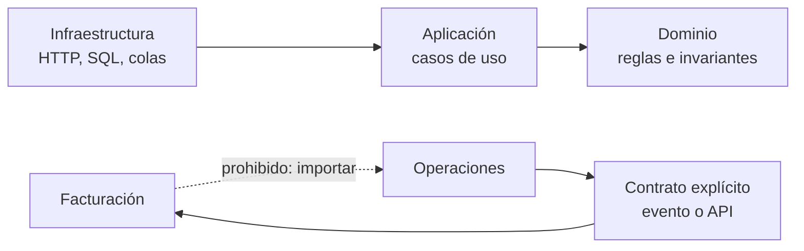
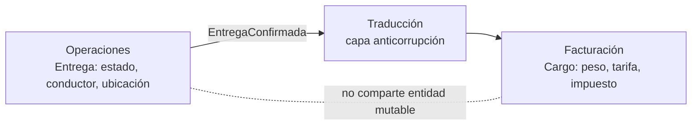
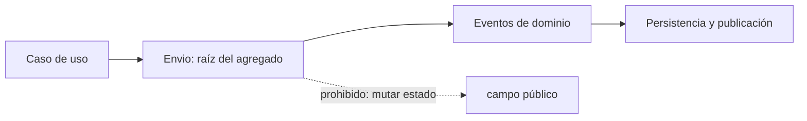
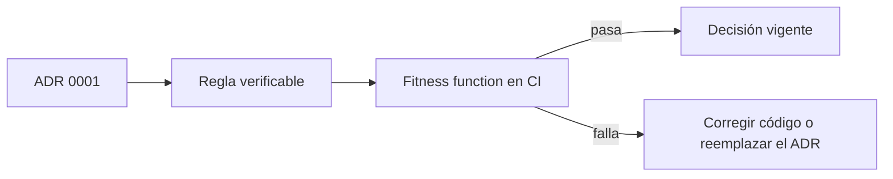

# Módulo 3: Arquitectura moderna y DDD: límites que sobreviven al cambio

## Aprende construyendo

Este módulo no empieza con la pregunta «¿microservicios o monolito?», sino con una anterior: **¿dónde termina una parte del sistema y empieza otra?** Esa frontera se decide con lenguaje, reglas de negocio y coste de cambio, no con el número de repositorios. Vas a modelar RutaFlow como un monolito modular, separar dos contextos que usan la misma palabra para cosas distintas, proteger una invariante dentro de un agregado y registrar la decisión en un ADR que una prueba automática puede defender.

Cada tema parte de una carpeta vacía, crea archivos ejecutables y se comprueba con `node --test` o un script de verificación. No necesitas Docker para este módulo; el laboratorio con Floci llega en el Módulo 22. **Conocimiento previo:** Módulos 0 a 3 (Linux, Git, Docker y Compose), programación con funciones y objetos, y haber leído el modelo de envíos del proyecto RutaFlow. Si vienes de Java, el Módulo 22 de Spring Boot amplía estos mismos conceptos con puertos y C4; aquí el foco está en la decisión y en la evidencia, no en el framework.


### Tema 1: Límites, acoplamiento y monolito modular: cuándo un microservicio no es la respuesta · Avanzado · 45 min

<details open>
<summary><strong>Capa 1 — Lectura</strong></summary>

#### ► DE QUÉ TRATA
Al finalizar podrás construir un monolito modular mínimo, ejecutar una prueba que demuestre que el dominio no muta sus entradas ni depende de infraestructura, y explicar con evidencia por qué extraer un servicio todavía no está justificado. Conocimiento previo: funciones, objetos…

#### ► CÓMO FUNCIONA


</details>

<details>
<summary><strong>Capa 2 — Construcción</strong></summary>

#### Código y verificación

```bash
mkdir -p arquitectura-moderna/modulo-19/tema-1-monolito-modular/src/domain
cd arquitectura-moderna/modulo-19/tema-1-monolito-modular
npm init -y
mkdir -p src/application src/infra test
```

```javascript
// Reglas del dominio: no conocen HTTP, SQL ni variables de entorno.
const TRANSICIONES = {
  admitido: ['clasificado'],
  clasificado: ['asignado'],
  asignado: ['en_transito'],
  en_transito: ['intentado', 'entregado'],
  intentado: ['en_transito', 'entregado'],
  entregado: [],
};

function confirmarEntrega(envio, ocurridoEn) {
  if (envio.estado === 'entregado') {
    throw new Error('Una entrega confirmada es terminal');
  }
  if (!TRANSICIONES[envio.estado]?.includes('entregado')) {
    throw new Error(`No se puede entregar desde ${envio.estado}`);
  }
  // Se devuelve un objeto nuevo: la entrada no se muta.
  return {
    ...envio,
    estado: 'entregado',
    eventos: [...envio.eventos, { tipo: 'EntregaConfirmada', ocurridoEn }],
  };
}

module.exports = { confirmarEntrega };
```

```javascript
// La aplicación orquesta; el dominio decide.
function crearConfirmarEntrega({ repositorio, reloj = () => new Date().toISOString() }) {
  return function ejecutar(id) {
    const envio = repositorio.buscar(id);
    if (!envio) throw new Error(`Envío ${id} no encontrado`);
    const actualizado = require('../domain/envio').confirmarEntrega(envio, reloj());
    repositorio.guardar(actualizado);
    return actualizado;
  };
}

module.exports = { crearConfirmarEntrega };
```

```javascript
const test = require('node:test');
const assert = require('node:assert/strict');
const { confirmarEntrega } = require('../src/domain/envio');

test('confirmar entrega no muta la entrada y registra el hecho', () => {
  const original = { id: 'RF-1', estado: 'en_transito', eventos: [] };
  const resultado = confirmarEntrega(original, '2026-10-31T10:00:00Z');

  assert.equal(resultado.estado, 'entregado');
  assert.equal(original.estado, 'en_transito');
  assert.equal(resultado.eventos.at(-1).tipo, 'EntregaConfirmada');
});

test('una entrega confirmada no vuelve atrás', () => {
  const entregado = { id: 'RF-1', estado: 'entregado', eventos: [] };
  assert.throws(() => confirmarEntrega(entregado, '2026-10-31T10:00:00Z'), /terminal/);
});
```

```bash
node --test
```

</details>

### Tema 2: Lenguaje ubicuo y contextos delimitados: el mismo envío no significa lo mismo · Avanzado · 45 min

<details open>
<summary><strong>Capa 1 — Lectura</strong></summary>

#### ► DE QUÉ TRATA
Al finalizar podrás separar dos contextos que usan el mismo sustantivo, traducir solo los campos necesarios y demostrar con una prueba que un cambio en Facturación no altera el estado de Operaciones. Conocimiento previo: Tema 1 del módulo, objetos y pruebas con node --test.

#### ► CÓMO FUNCIONA


</details>

<details>
<summary><strong>Capa 2 — Construcción</strong></summary>

#### Código y verificación


```bash
mkdir -p arquitectura-moderna/modulo-19/tema-2-contextos/src/{operaciones,facturacion,anticorrupcion}
cd arquitectura-moderna/modulo-19/tema-2-contextos
npm init -y
```

```javascript
// src/operaciones/entrega.js
// Modelo local de Operaciones: su estado y su historia logística.
function crearEntrega({ id, clienteId, conductorId }) {
  return { id, clienteId, conductorId, estado: 'en_transito', eventos: [] };
}

function confirmar(entrega) {
  if (entrega.estado !== 'en_transito') throw new Error('Solo se confirma en tránsito');
  return { ...entrega, estado: 'entregado', eventos: [...entrega.eventos, 'EntregaConfirmada'] };
}

module.exports = { crearEntrega, confirmar };
```

```javascript
// src/facturacion/cargo.js
// Modelo local de Facturación: no conoce conductores ni ubicaciones.
function crearCargo({ envioId, clienteId, pesoKg, tarifaPorKg }) {
  return {
    envioId,
    clienteId,
    pesoFacturable: pesoKg,
    total: Number((pesoKg * tarifaPorKg).toFixed(2)),
    estado: 'pendiente',
  };
}

module.exports = { crearCargo };
```

```javascript
// src/anticorrupcion/traductor.js
// La frontera decide qué cruza y qué no.
function traducirEntregaConfirmada(evento, tarifaPorKg) {
  if (!evento.envioId || !evento.clienteId || evento.pesoKg <= 0) {
    throw new Error('Evento incompleto para facturación');
  }
  return {
    envioId: evento.envioId,
    clienteId: evento.clienteId,
    pesoKg: evento.pesoKg,
    tarifaPorKg,
  };
}

module.exports = { traducirEntregaConfirmada };
```

```javascript
const test = require('node:test');
const assert = require('node:assert/strict');
const { crearEntrega, confirmar } = require('../src/operaciones/entrega');
const { traducirEntregaConfirmada } = require('../src/anticorrupcion/traductor');
const { crearCargo } = require('../src/facturacion/cargo');

test('la traducción solo expone los datos que facturación necesita', () => {
  const entrega = confirmar(crearEntrega({ id: 'RF-9', clienteId: 'C-3', conductorId: 'K-7' }));
  const datos = traducirEntregaConfirmada(
    { envioId: entrega.id, clienteId: entrega.clienteId, pesoKg: 12 },
    1500,
  );

  assert.deepEqual(Object.keys(datos).sort(), ['clienteId', 'envioId', 'pesoKg', 'tarifaPorKg']);
  assert.equal(datos.conductorId, undefined);
});

test('un cargo no puede cambiar el estado logístico', () => {
  const entrega = crearEntrega({ id: 'RF-9', clienteId: 'C-3', conductorId: 'K-7' });
  const cargo = crearCargo({ envioId: entrega.id, clienteId: entrega.clienteId, pesoKg: 12, tarifaPorKg: 1500 });
  cargo.estado = 'facturado';

  assert.equal(entrega.estado, 'en_transito');
  assert.equal(cargo.estado, 'facturado');
});
```

</details>

### Tema 3: Agregados, invariantes y eventos de dominio: dónde vive la regla que no se puede romper · Avanzado · 45 min

<details open>
<summary><strong>Capa 1 — Lectura</strong></summary>

#### ► DE QUÉ TRATA
Al finalizar podrás construir un agregado Envio que valide una invariante, cambie su estado solo mediante sus métodos y emita eventos de dominio, y demostrar con pruebas que una mutación externa no puede saltarse la regla. Conocimiento previo: Temas 1 y 2, clases y node --test.

#### ► CÓMO FUNCIONA


</details>

<details>
<summary><strong>Capa 2 — Construcción</strong></summary>

#### Código y verificación


```bash
mkdir -p arquitectura-moderna/modulo-19/tema-3-agregado/{src/domain,test}
cd arquitectura-moderna/modulo-19/tema-3-agregado
npm init -y
```

```javascript
// Agregado: el estado solo cambia mediante métodos que validan invariantes.
class Envio {
  #estado;
  #eventos = [];

  constructor({ id, estado = 'admitido' }) {
    this.id = id;
    this.#estado = estado;
  }

  get estado() {
    return this.#estado;
  }

  get eventos() {
    return [...this.#eventos];
  }

  confirmar(ocurridoEn) {
    if (this.#estado === 'entregado') {
      throw new Error('Una entrega confirmada es terminal');
    }
    if (!['en_transito', 'intentado'].includes(this.#estado)) {
      throw new Error(`No se puede confirmar desde ${this.#estado}`);
    }
    this.#estado = 'entregado';
    this.#eventos.push({ tipo: 'EntregaConfirmada', envioId: this.id, ocurridoEn });
    return this;
  }

  reintentar(ocurridoEn) {
    if (this.#estado !== 'intentado') {
      throw new Error('Solo se reintenta un intento fallido');
    }
    this.#estado = 'en_transito';
    this.#eventos.push({ tipo: 'EntregaReintentada', envioId: this.id, ocurridoEn });
    return this;
  }
}

module.exports = { Envio };
```

```javascript
const test = require('node:test');
const assert = require('node:assert/strict');
const { Envio } = require('../src/domain/envio');

test('confirmar produce un evento y deja la entrega terminal', () => {
  const envio = new Envio({ id: 'RF-20', estado: 'en_transito' });
  envio.confirmar('2026-10-31T12:00:00Z');

  assert.equal(envio.estado, 'entregado');
  assert.deepEqual(envio.eventos.map((evento) => evento.tipo), ['EntregaConfirmada']);
});

test('no se puede reabrir una entrega confirmada', () => {
  const envio = new Envio({ id: 'RF-20', estado: 'en_transito' });
  envio.confirmar('2026-10-31T12:00:00Z');

  assert.throws(() => envio.confirmar('2026-10-31T12:01:00Z'), /terminal/);
  assert.throws(() => envio.reintentar('2026-10-31T12:01:00Z'), /intento fallido/);
});
```

```bash
node --test
```

</details>

### Tema 4: ADR y fitness functions: decisiones que el código puede defender · Avanzado · 45 min

<details open>
<summary><strong>Capa 1 — Lectura</strong></summary>

#### ► DE QUÉ TRATA
Al finalizar podrás escribir un ADR que justifique un monolito modular, implementar una fitness function que verifique las dependencias permitidas y demostrar que la prueba falla ante una violación real. Conocimiento previo: Temas 1 a 3 y manejo de archivos con Node.

#### ► CÓMO FUNCIONA


</details>

<details>
<summary><strong>Capa 2 — Construcción</strong></summary>

#### Código y verificación


```bash
mkdir -p arquitectura-moderna/modulo-19/tema-4-adr/{docs/adr,src/domain,src/infra,scripts}
cd arquitectura-moderna/modulo-19/tema-4-adr
npm init -y
```

```javascript
// Fitness function: el dominio no puede importar infraestructura ni frameworks.
import { readFileSync, readdirSync, statSync } from 'node:fs';
import { join, relative } from 'node:path';

const raiz = process.cwd();
const dominio = join(raiz, 'src', 'domain');
const prohibidos = [/from ['"]\.\.\/infra/, /require\(['"]\.\.\/infra/, /from ['"]express['"]/, /from ['"]pg['"]/];

function archivos(directorio) {
  return readdirSync(directorio).flatMap((nombre) => {
    const ruta = join(directorio, nombre);
    return statSync(ruta).isDirectory() ? archivos(ruta) : [ruta];
  });
}

const violaciones = archivos(dominio).filter((archivo) => {
  const contenido = readFileSync(archivo, 'utf8');
  return prohibidos.some((patron) => patron.test(contenido));
});

if (violaciones.length) {
  console.error('El dominio importa infraestructura:');
  for (const archivo of violaciones) console.error(`- ${relative(raiz, archivo)}`);
  process.exitCode = 1;
} else {
  console.log(`Límites OK: ${archivos(dominio).length} archivos de dominio sin imports prohibidos`);
}
```

```bash
node scripts/limites.mjs
```

</details>
