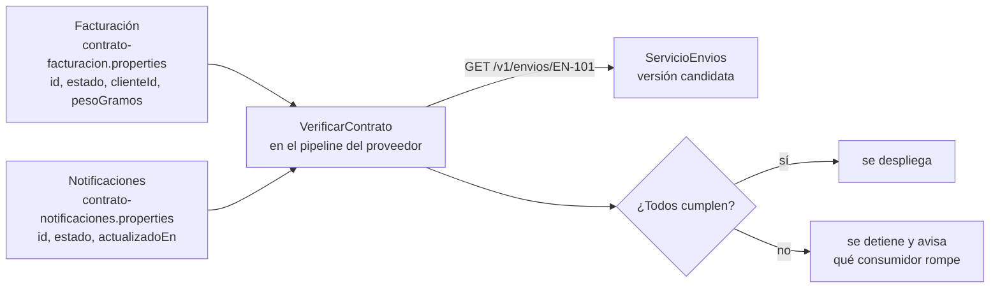
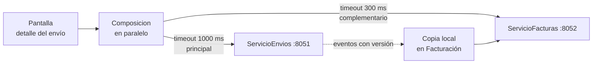
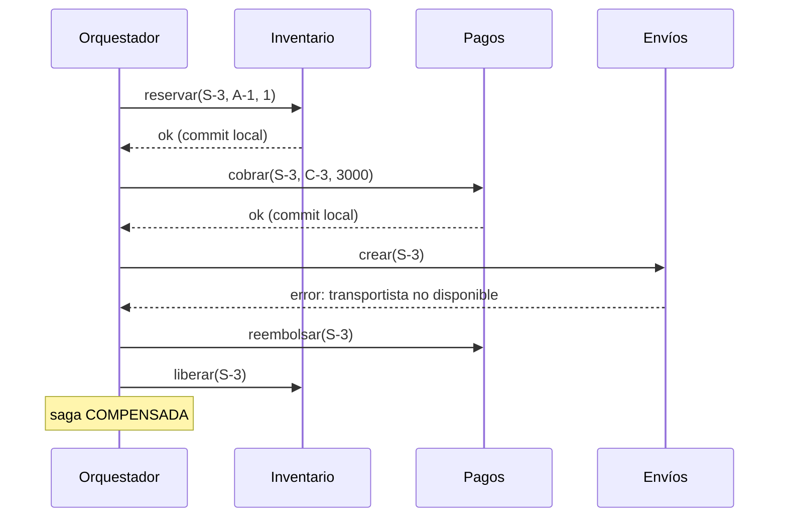
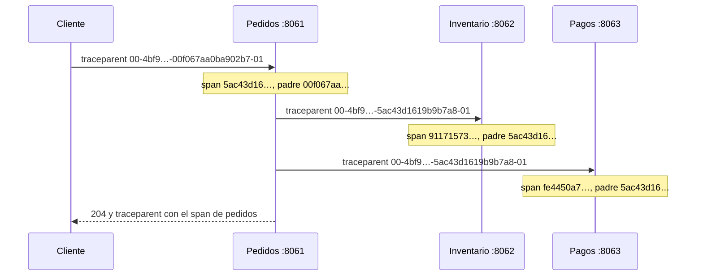

# Módulo 4: Microservicios: contratos, datos por servicio, sagas y trazas distribuidas

**Entorno comprobado para esta edición (2026-11-24):** OpenJDK 25.0.5.1 en Linux x86_64, solo con el JDK y con H2
2.3.232 para las bases de datos: `com.sun.net.httpserver.HttpServer`, `java.net.http.HttpClient` (síncrono y
asíncrono), `CompletableFuture`, hilos virtuales y JDBC con H2 en memoria. Todas las salidas de este módulo se
obtuvieron ejecutando el código mostrado ese día. Los servicios son procesos locales en `127.0.0.1`; en el Tema 4 los
tres servicios corren en una misma JVM, cada uno con su puerto, y se hablan por HTTP real. Las duraciones en
milisegundos cambiarán en tu equipo; los estados, los conteos y la forma de las trazas no.

El Módulo 3 terminó con un monolito modular y una pregunta: ¿cuándo se justifica sacar un módulo como servicio? Este
módulo muestra qué hay que resolver el día en que se saca. Cuatro problemas aparecen siempre: el contrato entre
servicios se vuelve una promesa pública que puede romperse sin que nadie lo note; los datos dejan de estar en una sola
base y ya no hay `JOIN` ni transacción que los una; una operación de negocio que antes era una transacción ahora cruza
tres servicios; y un error ya no deja una traza de pila, sino pistas repartidas en varios procesos.

**Al terminar este módulo podrás:**
- verificar con pruebas de contrato guiadas por el consumidor que un cambio del proveedor no rompe a quien lo usa;
- distinguir un cambio compatible de uno incompatible y aplicar el lector tolerante;
- componer datos de dos servicios en paralelo y devolver un resultado parcial cuando uno falla;
- mantener una copia local de datos ajenos con eventos y protegerla de eventos desordenados;
- coordinar una operación entre tres servicios con una saga orquestada y compensaciones idempotentes;
- propagar el contexto de traza W3C entre servicios y reconstruir el árbol de una petición.

**Esquema del módulo:** Tema 1 (contratos) → Tema 2 (datos por servicio) → Tema 3 (sagas) → Tema 4 (trazas
distribuidas) → Proyecto 17 (la compra que cruza tres servicios).

**Qué necesitas saber antes:** de este curso, **timeout**, **resultado desconocido**, **idempotencia** y **reintento**
(Módulo 1, Tema 1), **consistencia eventual** (Módulo 1, Tema 2), **outbox** y consumidor idempotente (Módulo 1,
Tema 3), **circuit breaker**, **registro estructurado** e **ID de correlación** (Módulo 1, Tema 4), **commit en dos
fases** (Módulo 1, Tema 5), **contexto delimitado** y **evento de integración** (Módulo 3, Tema 2) y **concurrencia
optimista** (Módulo 3, Tema 4). De Fundamentos, HTTP, cabeceras y códigos de estado (Módulo 3, Tema 2). Del curso SQL,
**transacción** (Módulo 0, Tema 4). Los programas se ejecutan con `java Programa.java`; el del Tema 3, con
`java -cp ~/herramientas/h2-2.3.232.jar Programa.java`.

**Qué no se repite aquí:** los timeouts, reintentos y el circuit breaker están en el Módulo 1, Tema 4; la entrega
confiable de eventos con outbox, en el Módulo 1, Tema 3. La implementación con Spring Boot, Spring Cloud y los
servicios de mensajería está en el curso de Microservicios: comunicación entre servicios (Módulo 8), resiliencia
(Módulo 14), observabilidad (Módulo 18) y consistencia distribuida (Módulo 21). Este módulo enseña las decisiones con el
JDK solo, para que las veas sin framework.


## Aprende construyendo


### Tema 1: Contratos entre servicios: pruebas guiadas por el consumidor y cambios compatibles · Avanzado · 55 min

<details open>
<summary><strong>Capa 1 — Lectura</strong></summary>

#### Objetivos
Al terminar este tema podrás:
- escribir el contrato que un consumidor espera de un proveedor: campos y tipos;
- verificar ese contrato contra el proveedor real y obtener un código de salida que sirva en CI;
- clasificar un cambio como compatible o incompatible con evidencia;
- explicar por qué cada consumidor tiene su propio contrato.

**Conceptos clave:** contrato de API, proveedor, consumidor, prueba de contrato guiada por el consumidor, cambio compatible, cambio incompatible, lector tolerante, versionado de API

#### El problema
El equipo de Envíos ahora es un servicio aparte. Para que el peso sea más preciso, decide devolver `pesoKg` con
decimales en lugar de `pesoGramos`, y de paso cambia `clienteId` a número. Sus pruebas pasan: el servicio responde
`200` y el JSON está bien formado. El lunes, Facturación cobra cero a todos los clientes porque ya no encuentra
`pesoGramos`. Notificaciones, en cambio, sigue funcionando. ¿Cómo se entera Envíos, **antes** de desplegar, de que
rompe a uno de sus consumidores y no al otro?

Este tema usa **API**, **petición**, **respuesta** y **JSON** (Fundamentos, Módulo 3, Tema 2), el **evento de
integración** como contrato (Módulo 3, Tema 2, de este curso) y el **código de salida** (Fundamentos, Módulo 0, Tema 4).

#### Glosario del tema

**contrato de API**
- **Definición técnica:** acuerdo explícito sobre las operaciones de un servicio: rutas, métodos, campos de entrada y salida, tipos, códigos de estado y significado de cada uno.
- **En palabras sencillas:** el formulario que dos oficinas acordaron usar para pedirse cosas.
- **Dónde se rompe la comparación:** un formulario impreso no cambia solo; una API cambia con un despliegue, y el otro lado no ve el cambio hasta que falla.
- **Ejemplo:** `GET /v1/envios/{id}` devuelve `id`, `estado`, `clienteId`, `pesoGramos` y `actualizadoEn`.
- **Error típico:** considerar que el contrato es «lo que el código devuelve hoy»: cualquier refactorización lo cambia sin querer.

**proveedor**
- **Definición técnica:** servicio que expone la API y es responsable de cumplir el contrato.
- **En palabras sencillas:** la oficina que responde los formularios.
- **Dónde se rompe la comparación:** un proveedor tiene muchos consumidores y casi nunca los conoce a todos.
- **Ejemplo:** `ServicioEnvios.java` en el puerto 8051, con tres variantes de respuesta.
- **Error típico:** probar solo que el proveedor «responde 200»: el estado puede ser correcto y el contenido estar roto para alguien.

**consumidor**
- **Definición técnica:** servicio o cliente que llama a la API y depende de una parte de su respuesta.
- **En palabras sencillas:** quien llena el formulario y lee la respuesta.
- **Dónde se rompe la comparación:** cada consumidor lee solo las casillas que le importan; no todos usan las mismas.
- **Ejemplo:** Facturación usa `pesoGramos`; Notificaciones usa `actualizadoEn` y no le importa el peso.
- **Error típico:** que el consumidor lea campos «por si acaso»: cada campo leído es una dependencia más.

**prueba de contrato guiada por el consumidor (*consumer-driven contract test*)**
- **Definición técnica:** prueba en la que cada consumidor declara qué partes de la respuesta usa y con qué tipos, y el proveedor ejecuta todas esas declaraciones contra su implementación real antes de desplegar.
- **En palabras sencillas:** cada oficina entrega su lista de «esto es lo que yo leo», y quien responde revisa todas las listas antes de cambiar el formulario.
- **Dónde se rompe la comparación:** la lista solo protege lo que se escribió en ella; si un consumidor lee un campo que no declaró, la prueba no lo cuida.
- **Ejemplo:** `contrato-facturacion.properties` declara cuatro campos; `VerificarContrato.java` los comprueba contra el proveedor y sale con `1` si falla.
- **Error típico:** escribir el contrato del lado del proveedor: así describe lo que devuelve, no lo que cada consumidor necesita.

**cambio compatible**
- **Definición técnica:** modificación del proveedor que no invalida ningún contrato vigente; por ejemplo, agregar un campo opcional en la respuesta o un parámetro opcional en la petición.
- **En palabras sencillas:** agregar una casilla nueva al formulario sin mover las viejas.
- **Dónde se rompe la comparación:** solo es compatible si los consumidores ignoran lo que no conocen; un consumidor estricto puede fallar con un campo nuevo.
- **Ejemplo:** la variante `ampliado` agrega `conductorId` y los dos contratos siguen en `CUMPLE`.
- **Error típico:** asumir que agregar siempre es seguro: agregar un **valor nuevo** a un campo enumerado (`estado: "DEVUELTO"`) puede romper a quien hace un `switch` exhaustivo.

**cambio incompatible**
- **Definición técnica:** modificación que invalida al menos un contrato: quitar o renombrar un campo, cambiar su tipo o su unidad, cambiar el significado de un código de estado.
- **En palabras sencillas:** mover o borrar casillas del formulario.
- **Dónde se rompe la comparación:** a veces el campo sigue ahí con el mismo nombre y tipo pero otra unidad; la prueba de tipos no lo detecta.
- **Ejemplo:** la variante `incompatible` produce `falta el campo pesoGramos (entero)` y `clienteId: se esperaba texto, llegó entero`.
- **Error típico:** hacerlo en la misma versión de la API «porque es un cambio pequeño».

**lector tolerante (*tolerant reader*)**
- **Definición técnica:** consumidor que lee solo los campos que necesita e ignora los demás, de modo que los cambios compatibles del proveedor no lo afectan.
- **En palabras sencillas:** leer tus casillas y no preocuparte por las que no conoces.
- **Dónde se rompe la comparación:** tolerar campos extra no es tolerar campos faltantes: lo que necesitas sigue siendo obligatorio.
- **Ejemplo:** `campos ignorados por el consumidor: [actualizadoEn, conductorId]`: Facturación los ve y no falla.
- **Error típico:** deserializar con una clase que falla ante campos desconocidos; en Jackson, `FAIL_ON_UNKNOWN_PROPERTIES` debe estar en `false` para clientes de APIs ajenas.

**versionado de API**
- **Definición técnica:** práctica de publicar los cambios incompatibles bajo una versión nueva (por ejemplo `/v2/...`) mientras la versión anterior sigue disponible hasta que sus consumidores migren.
- **En palabras sencillas:** imprimir el formulario nuevo sin destruir los viejos hasta que todos se cambien.
- **Dónde se rompe la comparación:** mantener dos versiones tiene costo: dos rutas, dos pruebas, dos documentaciones.
- **Ejemplo:** el cambio a `pesoKg` debería publicarse como `GET /v2/envios/{id}` y retirar `/v1` cuando Facturación migre.
- **Error típico:** crear una versión nueva por cada cambio, incluso compatible: los consumidores no saben a cuál ir.

#### ► CÓMO FUNCIONA
Cada consumidor guarda en su repositorio un archivo con los campos que lee y sus tipos, y se lo entrega al proveedor.
El pipeline del proveedor, antes de desplegar, arranca el servicio con el código nuevo y ejecuta **todos** los
contratos contra él. Si uno falla, el despliegue se detiene y el mensaje dice qué consumidor se rompe y por qué. Un
contrato que pasa no prueba que el consumidor funcione: prueba que lo que el consumidor declaró que usa sigue ahí.



#### Problema resuelto 1.1
Escribe el proveedor con tres variantes (acordada, ampliada e incompatible), el contrato de Facturación y un
verificador que se ejecute contra el proveedor real.

**Razonamiento:**
1. El proveedor recibe la variante como argumento para simular tres versiones del código.
2. El contrato es un archivo `.properties` del consumidor: `campo=tipo`. Es simple a propósito; herramientas como Pact
   guardan lo mismo en JSON con más detalle.
3. El verificador hace la petición real, extrae los campos de primer nivel del JSON con una expresión regular y
   clasifica cada valor como texto, entero, decimal, booleano o nulo.
4. Compara contra el contrato, informa los campos ignorados (lector tolerante) y termina con código 1 si algo falla.

```java
// ServicioEnvios.java — proveedor del contrato GET /v1/envios/{id}, en tres variantes
import com.sun.net.httpserver.HttpExchange;
import com.sun.net.httpserver.HttpServer;
import java.net.InetSocketAddress;

static String variante;

void main(String[] args) throws IOException {
    variante = args.length > 0 ? args[0] : "v1";
    HttpServer servidor = HttpServer.create(new InetSocketAddress("127.0.0.1", 8051), 0);
    servidor.createContext("/v1/envios/", this::envio);
    servidor.start();
    IO.println("envíos en 127.0.0.1:8051, variante " + variante);
}

void envio(HttpExchange ex) throws IOException {
    String id = ex.getRequestURI().getPath().substring("/v1/envios/".length());
    String json = switch (variante) {
        // v1: el contrato acordado
        case "v1" -> "{\"id\":\"" + id + "\",\"estado\":\"ENTREGADO\",\"clienteId\":\"C-3\",\"pesoGramos\":2300,"
                + "\"actualizadoEn\":\"2026-11-24T15:00:00Z\"}";
        // ampliado: agrega un campo nuevo (cambio compatible)
        case "ampliado" -> "{\"id\":\"" + id + "\",\"estado\":\"ENTREGADO\",\"clienteId\":\"C-3\",\"pesoGramos\":2300,"
                + "\"actualizadoEn\":\"2026-11-24T15:00:00Z\",\"conductorId\":\"K-7\"}";
        // incompatible: renombra el peso, cambia la unidad y vuelve número el cliente
        default -> "{\"id\":\"" + id + "\",\"estado\":\"ENTREGADO\",\"clienteId\":3,\"pesoKg\":2.3,"
                + "\"actualizadoEn\":\"2026-11-24T15:00:00Z\"}";
    };
    byte[] cuerpo = json.getBytes(StandardCharsets.UTF_8);
    ex.getResponseHeaders().set("Content-Type", "application/json");
    ex.sendResponseHeaders(200, cuerpo.length);
    try (var salida = ex.getResponseBody()) {
        salida.write(cuerpo);
    }
}
```

```text
# contrato-facturacion.properties
# Lo que Facturación (consumidor) lee de GET /v1/envios/{id}: campo = tipo
id=texto
estado=texto
clienteId=texto
pesoGramos=entero
```

```java
// VerificarContrato.java — prueba de contrato guiada por el consumidor contra el proveedor real
import java.net.URI;
import java.net.http.HttpClient;
import java.net.http.HttpRequest;
import java.net.http.HttpResponse;
import java.util.regex.Pattern;

// campo JSON de primer nivel: "nombre": "texto" | número | true | false | null
static final Pattern CAMPO = Pattern.compile("\"(\\w+)\":(\"[^\"]*\"|-?\\d+(?:\\.\\d+)?|true|false|null)");

String tipoDe(String valor) {
    if (valor.startsWith("\"")) return "texto";
    if (valor.matches("-?\\d+")) return "entero";
    if (valor.matches("-?\\d+\\.\\d+")) return "decimal";
    return valor.equals("null") ? "nulo" : "booleano";
}

void main(String[] args) throws Exception {
    String archivo = args.length > 0 ? args[0] : "contrato-facturacion.properties";
    String consumidor = archivo.replace("contrato-", "").replace(".properties", "");
    var esperado = new Properties();
    try (var r = Files.newBufferedReader(Path.of(archivo))) {
        esperado.load(r);
    }
    var respuesta = HttpClient.newHttpClient().send(
            HttpRequest.newBuilder(URI.create("http://127.0.0.1:8051/v1/envios/EN-101")).build(),
            HttpResponse.BodyHandlers.ofString());
    Map<String, String> recibido = new TreeMap<>();
    var m = CAMPO.matcher(respuesta.body());
    while (m.find()) recibido.put(m.group(1), tipoDe(m.group(2)));

    List<String> fallas = new ArrayList<>();
    for (String campo : new TreeSet<>(esperado.stringPropertyNames())) {
        String tipo = esperado.getProperty(campo);
        if (!recibido.containsKey(campo)) fallas.add("falta el campo " + campo + " (" + tipo + ")");
        else if (!recibido.get(campo).equals(tipo))
            fallas.add(campo + ": se esperaba " + tipo + ", llegó " + recibido.get(campo));
    }
    Set<String> ignorados = new TreeSet<>(recibido.keySet());
    ignorados.removeAll(esperado.stringPropertyNames());
    IO.println("estado HTTP " + respuesta.statusCode() + ", campos ignorados por el consumidor: " + ignorados);
    if (fallas.isEmpty()) {
        IO.println("contrato de " + consumidor + ": CUMPLE (" + esperado.size() + " campos)");
    } else {
        fallas.forEach(f -> IO.println("contrato de " + consumidor + ": FALLA, " + f));
        System.exit(1);
    }
}
```

Arranca el proveedor con cada variante y verifica el contrato de Facturación:

```text
$ java ServicioEnvios.java v1
$ java VerificarContrato.java; echo "salida: $?"
estado HTTP 200, campos ignorados por el consumidor: [actualizadoEn]
contrato de facturacion: CUMPLE (4 campos)
salida: 0

$ java ServicioEnvios.java ampliado
$ java VerificarContrato.java; echo "salida: $?"
estado HTTP 200, campos ignorados por el consumidor: [actualizadoEn, conductorId]
contrato de facturacion: CUMPLE (4 campos)
salida: 0

$ java ServicioEnvios.java incompatible
$ java VerificarContrato.java; echo "salida: $?"
estado HTTP 200, campos ignorados por el consumidor: [actualizadoEn, pesoKg]
contrato de facturacion: FALLA, clienteId: se esperaba texto, llegó entero
contrato de facturacion: FALLA, falta el campo pesoGramos (entero)
salida: 1
```

**Explicación por partes.**
- `ServicioEnvios.java`, líneas 18–29: las tres respuestas. La incompatible cambia el nombre, la unidad y el tipo de dos
  campos a la vez, como pasa en un refactor real.
- `VerificarContrato.java`, línea 9: la expresión reconoce `"nombre":valor` cuando el valor es texto entre comillas,
  número, `true`, `false` o `null`. Alcanza para un JSON plano; para objetos anidados se usa un parser como Jackson.
- Líneas 33–37: cada campo del contrato debe existir y tener el tipo declarado.
- Líneas 39–41: lo que sobra se informa pero no falla: eso es el lector tolerante.
- Línea 46: `System.exit(1)` hace que el pipeline se detenga. Sin un código de salida distinto de 0, la prueba solo
  imprimiría y el despliegue seguiría.
- La variante `ampliado` es compatible: el campo nuevo `conductorId` aparece en los ignorados.

#### Problema resuelto 1.2
Agrega un segundo consumidor, Notificaciones, con su propio contrato, y verifica las tres variantes otra vez.

**Razonamiento:**
1. Notificaciones lee otros campos: identificador, estado y fecha de actualización.
2. El mismo verificador recibe el archivo del contrato como argumento.
3. Así se ve que «incompatible» no es una propiedad del cambio solo, sino del cambio frente a cada consumidor.

```text
# contrato-notificaciones.properties
# Lo que Notificaciones (consumidor) lee de GET /v1/envios/{id}: campo = tipo
id=texto
estado=texto
actualizadoEn=texto
```

```text
$ java VerificarContrato.java contrato-notificaciones.properties; echo "salida: $?"   # con v1
estado HTTP 200, campos ignorados por el consumidor: [clienteId, pesoGramos]
contrato de notificaciones: CUMPLE (3 campos)
salida: 0
# con ampliado
estado HTTP 200, campos ignorados por el consumidor: [clienteId, conductorId, pesoGramos]
contrato de notificaciones: CUMPLE (3 campos)
salida: 0
# con incompatible
estado HTTP 200, campos ignorados por el consumidor: [clienteId, pesoKg]
contrato de notificaciones: CUMPLE (3 campos)
salida: 0
```

**Explicación por partes.**
- Notificaciones cumple en las tres variantes: no lee `pesoGramos` ni le importa el tipo de `clienteId`.
- La variante incompatible rompe a Facturación y no a Notificaciones. Si el proveedor solo probara contra uno, podría
  desplegar con confianza falsa o bloquearse sin razón. Por eso el pipeline ejecuta **todos** los contratos.
- El mismo cambio publicado como `/v2` dejaría a Facturación en `/v1` mientras migra, y Notificaciones podría pasar a
  `/v2` de inmediato.

> **Error común.** Probar el contrato con un servidor simulado del lado del consumidor y nunca contra el proveedor
> real. La simulación dice lo que el consumidor **cree** que recibe; el contrato vale cuando lo ejecuta el proveedor
> con su código candidato.

> **Error común.** Cambiar la unidad sin cambiar el nombre: devolver kilos en `pesoGramos`. El tipo sigue siendo
> número y la prueba de tipos pasa. Los nombres con unidad (`pesoGramos`, `timeoutMs`) y los ejemplos de valores en el
> contrato ayudan a detectarlo.

> **Buena práctica.** Para un cambio incompatible, sigue la secuencia expandir y contraer: agrega el campo nuevo junto
> al viejo (compatible), migra a los consumidores, verifica con sus contratos que ya no leen el viejo y solo entonces
> quítalo.

> **Prevenir errores.** Guarda los contratos de los consumidores en un lugar que el pipeline del proveedor pueda leer
> (un repositorio compartido o un servidor de contratos como Pact Broker) y haz que un contrato fallido bloquee el
> despliegue, no solo que avise.

#### Checkpoint 1.1
El proveedor agrega al campo `estado` un valor nuevo, `"DEVUELTO"`. ¿Lo detecta `VerificarContrato.java`?

Respuesta: no. El campo sigue existiendo y sigue siendo texto. Si un consumidor hace un `switch` sobre los estados que
conoce, puede fallar igual. Para cubrirlo, el contrato tendría que declarar los valores aceptados (`estado=texto:
ENTREGADO|EN_TRANSITO`) y el consumidor, tolerar valores desconocidos.

</details>

<details>
<summary><strong>Capa 2 — Construcción</strong></summary>

#### Paso 1 · Prepara la carpeta
Crea `mkdir -p ~/labs/arquitectura/micro/contratos && cd ~/labs/arquitectura/micro/contratos` y copia
`ServicioEnvios.java`, `VerificarContrato.java` y los dos archivos `.properties`.

#### Paso 2 · Verifica la versión acordada
Arranca `java ServicioEnvios.java v1` y ejecuta los dos contratos. Los dos deben cumplir con salida 0.

#### Paso 3 · Prueba el cambio compatible
Reinicia con `ampliado` y comprueba que `conductorId` aparece en los ignorados y que los dos cumplen.

#### Paso 4 · Prueba el cambio incompatible
Reinicia con `incompatible` y comprueba que Facturación falla con dos mensajes y salida 1, y Notificaciones cumple.

#### Paso 5 · Escribe el plan de migración
En `migracion-peso.md`, describe los pasos de expandir y contraer para pasar de `pesoGramos` a `pesoKg` sin romper a
Facturación.

#### Resumen
- El **contrato de API** es la promesa del **proveedor** a sus **consumidores**.
- En la **prueba de contrato guiada por el consumidor**, cada consumidor declara lo que lee y el proveedor lo verifica
  antes de desplegar.
- Un **cambio compatible** agrega sin quitar; un **cambio incompatible** quita, renombra o cambia tipos o unidades.
- El **lector tolerante** ignora lo que no conoce y exige lo que necesita.
- El **versionado de API** permite publicar un cambio incompatible sin romper a los consumidores que aún no migran.

#### Ejercicio verificable 1
Básico. Agrega `actualizadoEn=texto` al contrato de Facturación y verifica contra la variante `v1`. ¿Qué cambia en la
salida?

Respuesta esperada: `campos ignorados por el consumidor: []` y `contrato de facturacion: CUMPLE (5 campos)`. El campo
que antes se ignoraba ahora es parte del contrato: el proveedor ya no puede quitarlo sin romper a Facturación.

#### Ejercicio verificable 2
Intermedio. Cambia en el contrato de Notificaciones `actualizadoEn=texto` por `actualizadoEn=entero` y verifica contra
`v1`. ¿Quién tiene que corregir: el proveedor o el consumidor?

Respuesta esperada: `contrato de notificaciones: FALLA, actualizadoEn: se esperaba entero, llegó texto` y salida 1. El
contrato está mal escrito: el proveedor siempre devolvió texto ISO-8601. Lo corrige el consumidor. Por eso el contrato
se revisa entre los dos equipos y no se escribe a ciegas.

#### Ejercicio verificable 3
Reto. Agrega al proveedor una variante `expandida` que devuelva **a la vez** `pesoGramos` y `pesoKg`. ¿Qué dicen los
dos contratos, y qué paso de la migración representa?

Respuesta esperada: los dos cumplen; Facturación muestra `pesoKg` entre los ignorados. Es el paso «expandir»: el campo
nuevo convive con el viejo. Cuando Facturación cambie su contrato a `pesoKg=decimal` y lo verifique, el proveedor podrá
quitar `pesoGramos` (paso «contraer»).

#### En el trabajo
Las pruebas de contrato son la forma estándar de desplegar microservicios por separado sin un ambiente de integración
lleno de servicios. Pact es la herramienta más usada; Spring Cloud Contract cumple el mismo papel en el ecosistema
Spring. En una revisión de una API, las preguntas son: «¿quién consume este campo?», «¿este cambio es compatible?» y
«¿cuál es el plan para retirar la versión vieja?».

</details>

### Tema 2: Datos por servicio: composición de API y copias locales alimentadas por eventos · Avanzado · 55 min

<details open>
<summary><strong>Capa 1 — Lectura</strong></summary>

#### Objetivos
Al terminar este tema podrás:
- explicar por qué cada servicio es dueño de sus datos y qué se pierde al separarlos;
- componer la respuesta de dos servicios en paralelo, con un timeout distinto para el dato principal y el complementario;
- devolver un resultado parcial explícito cuando el servicio complementario falla;
- mantener una copia local de datos ajenos con eventos y descartar los que llegan desordenados.

**Conceptos clave:** base de datos por servicio, composición de API, dato principal y dato complementario, resultado parcial, copia local (proyección), evento desordenado, CQRS

#### El problema
La pantalla «detalle del envío» muestra el envío y su factura. En el monolito era un `JOIN`. Ahora el envío vive en la
base del servicio de Envíos y la factura en la de Facturas, y ninguno puede leer la base del otro. Si Facturas tarda dos
segundos, la pantalla entera se queda en blanco dos segundos. Y Facturación, que necesita el estado de cada envío para
cobrar, no quiere llamar a Envíos en cada cálculo. ¿Cómo se consulta lo que está repartido?

Este tema usa el **timeout** y el **resultado desconocido** (Módulo 1, Tema 1), la **consistencia eventual** (Módulo
1, Tema 2), el consumidor idempotente (Módulo 1, Tema 3) y la **versión** de un agregado (Módulo 3, Tema 4).

#### Glosario del tema

**base de datos por servicio**
- **Definición técnica:** principio según el cual cada servicio es el único que lee y escribe su almacenamiento; los demás acceden a esos datos solo a través de su API o de los eventos que publica.
- **En palabras sencillas:** cada oficina con su archivador bajo llave; para saber algo, le preguntas a la oficina.
- **Dónde se rompe la comparación:** preguntar cuesta un viaje por la red y la oficina puede no contestar.
- **Ejemplo:** `ServicioEnvios` y `ServicioFacturas` corren en puertos distintos y ninguno conoce el almacenamiento del otro.
- **Error típico:** «solo esta consulta» directa a la tabla de otro servicio: desde ese día, ninguno de los dos puede cambiar su esquema solo.

**composición de API (*API composition*)**
- **Definición técnica:** patrón en el que un componente consulta varios servicios y combina sus respuestas en una sola, en lugar de unirlas en la base.
- **En palabras sencillas:** el `JOIN` hecho en el código, con llamadas por red.
- **Dónde se rompe la comparación:** un `JOIN` es atómico y rápido; la composición puede encontrar un servicio caído o datos de momentos distintos.
- **Ejemplo:** `Composicion.consultar("EN-101")` llama a los dos servicios en paralelo y arma un JSON con los dos.
- **Error típico:** hacer las llamadas en serie: la latencia total es la suma, no el máximo.

**dato principal y dato complementario**
- **Definición técnica:** clasificación de las partes de una respuesta compuesta: sin el dato principal la respuesta no tiene sentido; el complementario mejora la respuesta pero se puede omitir.
- **En palabras sencillas:** sin el envío no hay pantalla; sin la factura, la pantalla funciona con un aviso.
- **Dónde se rompe la comparación:** la clasificación la decide el negocio, y cambia según la pantalla: en la de cobros, la factura es la principal.
- **Ejemplo:** timeout de 1000 ms para Envíos y de 300 ms para Facturas.
- **Error típico:** usar el mismo timeout para todo: el dato menos importante decide la latencia de toda la pantalla.

**resultado parcial**
- **Definición técnica:** respuesta que incluye los datos disponibles y declara explícitamente cuáles faltan y por qué, en lugar de fallar entera o inventar valores.
- **En palabras sencillas:** «aquí está tu envío; la factura no se pudo consultar ahora».
- **Dónde se rompe la comparación:** un resultado parcial que no avisa se confunde con un resultado completo vacío («no tiene factura»).
- **Ejemplo:** `"estado":"parcial"` con `"aviso":"facturacion_no_disponible: HttpTimeoutException"`.
- **Error típico:** devolver `"factura": null` sin aviso: el usuario cree que el envío no se facturó.

**copia local (proyección)**
- **Definición técnica:** almacenamiento propio de un servicio con los datos de otro que necesita, construido y actualizado aplicando los eventos que ese otro publica.
- **En palabras sencillas:** una libreta con lo que necesitas de otra oficina, que actualizas cada vez que te avisan de un cambio.
- **Dónde se rompe la comparación:** la libreta va un poco atrasada: entre el cambio y el aviso hay un retraso.
- **Ejemplo:** Facturación guarda el estado de `EN-101` a partir de los eventos de Envíos y no lo consulta por HTTP.
- **Error típico:** copiar todos los campos «por si acaso»: la copia local solo debe tener lo que el servicio usa.

**evento desordenado**
- **Definición técnica:** evento que llega al consumidor después de otro que fue publicado más tarde, por reintentos, particiones o caminos distintos en la red o en el broker.
- **En palabras sencillas:** recibir primero la carta del viernes y después la del miércoles.
- **Dónde se rompe la comparación:** la carta tiene fecha impresa; el evento solo se puede ordenar si trae una versión o una secuencia.
- **Ejemplo:** `ENTREGADO v3` llega a los 2.0 s y `EN_REPARTO v2` a los 2.4 s.
- **Error típico:** aplicar los eventos en orden de llegada: la copia termina con un estado viejo para siempre.

**CQRS (separación de comandos y consultas)**
- **Definición técnica:** patrón que usa modelos distintos para escribir (comandos que cambian el estado y validan reglas) y para leer (vistas optimizadas para cada consulta, actualizadas desde los cambios).
- **En palabras sencillas:** un expediente para tramitar y un tablero resumen para consultar.
- **Dónde se rompe la comparación:** el tablero se actualiza después del trámite, no al mismo tiempo.
- **Ejemplo:** el agregado `Envio` (Módulo 3) es el modelo de escritura; la copia local de Facturación es un modelo de lectura.
- **Error típico:** aplicar CQRS a todo el sistema: solo vale la pena donde las lecturas y las escrituras tienen necesidades muy distintas.

#### ► CÓMO FUNCIONA
Hay dos formas de leer datos de otro servicio. **Preguntarle en el momento** (composición): el dato está al día,
pero dependes de que el otro responda rápido; las llamadas van en paralelo y el dato complementario tiene un timeout
corto y un plan B. **Guardar una copia** (proyección): la consulta es local y rápida, pero el dato puede estar
atrasado; los eventos traen una versión y la copia solo acepta versiones más nuevas que la que tiene.



#### Problema resuelto 2.1
Compón el envío y su factura desde dos servicios y prueba cuatro situaciones: todo bien, Facturas lento, Facturas
caído y Envíos caído.

**Razonamiento:**
1. `sendAsync` devuelve un `CompletableFuture`: las dos peticiones salen a la vez, y la respuesta tarda lo que tarde la
   más lenta, acotada por su timeout.
2. Primero se espera el dato principal. Si falla, no hay respuesta útil: `no_disponible`.
3. Después se espera el complementario. Si falla por cualquier motivo, se responde con el envío y un aviso que nombra
   la causa.
4. `ServicioFacturas` recibe la demora como argumento para simular la dependencia lenta.

```java
// ServicioFacturas.java — dueño de las facturas; responde con una demora configurable
import com.sun.net.httpserver.HttpServer;
import java.net.InetSocketAddress;
import java.util.concurrent.Executors;

void main(String[] args) throws IOException {
    long demoraMs = args.length > 0 ? Long.parseLong(args[0]) : 0;
    HttpServer servidor = HttpServer.create(new InetSocketAddress("127.0.0.1", 8052), 0);
    servidor.createContext("/v1/facturas", ex -> {
        String envio = ex.getRequestURI().getQuery().replace("envio=", "");
        try {
            Thread.sleep(demoraMs);                                   // dependencia lenta controlada
        } catch (InterruptedException e) {
            Thread.currentThread().interrupt();
        }
        byte[] cuerpo = ("{\"envioId\":\"" + envio + "\",\"total\":4500,\"estado\":\"COBRADA\"}")
                .getBytes(StandardCharsets.UTF_8);
        ex.getResponseHeaders().set("Content-Type", "application/json");
        ex.sendResponseHeaders(200, cuerpo.length);
        try (var salida = ex.getResponseBody()) {
            salida.write(cuerpo);
        }
    });
    servidor.setExecutor(Executors.newVirtualThreadPerTaskExecutor());
    servidor.start();
    IO.println("facturas en 127.0.0.1:8052, demora " + demoraMs + " ms");
}
```

```java
// Composicion.java — une datos de dos servicios en paralelo; si el secundario tarda, responde parcial
import java.net.URI;
import java.net.http.HttpClient;
import java.net.http.HttpRequest;
import java.net.http.HttpResponse;
import java.time.Duration;
import java.util.concurrent.CompletableFuture;

static final HttpClient CLIENTE = HttpClient.newBuilder().connectTimeout(Duration.ofMillis(300)).build();

CompletableFuture<HttpResponse<String>> pedir(String url, long timeoutMs) {
    var peticion = HttpRequest.newBuilder(URI.create(url)).timeout(Duration.ofMillis(timeoutMs)).build();
    return CLIENTE.sendAsync(peticion, HttpResponse.BodyHandlers.ofString());
}

String consultar(String envioId) {
    var envio = pedir("http://127.0.0.1:8051/v1/envios/" + envioId, 1000);      // dato principal
    var factura = pedir("http://127.0.0.1:8052/v1/facturas?envio=" + envioId, 300); // dato complementario
    String cuerpoEnvio;
    try {
        cuerpoEnvio = envio.join().body();
    } catch (Exception error) {
        return "{\"estado\":\"no_disponible\",\"causa\":\"envios: " + error.getCause().getClass().getSimpleName() + "\"}";
    }
    try {
        return "{\"estado\":\"completo\",\"envio\":" + cuerpoEnvio + ",\"factura\":" + factura.join().body() + "}";
    } catch (Exception error) {
        return "{\"estado\":\"parcial\",\"envio\":" + cuerpoEnvio + ",\"aviso\":\"facturacion_no_disponible: "
                + error.getCause().getClass().getSimpleName() + "\"}";
    }
}

void main() {
    long inicio = System.nanoTime();
    String resultado = consultar("EN-101");
    long ms = (System.nanoTime() - inicio) / 1_000_000;
    IO.println(resultado);
    IO.println("respondió en menos de 1100 ms: " + (ms < 1100 ? "sí" : "no"));
}
```

Con `java ServicioEnvios.java v1` (del Tema 1) y `java ServicioFacturas.java 0` arriba:

```text
$ java Composicion.java
{"estado":"completo","envio":{"id":"EN-101","estado":"ENTREGADO","clienteId":"C-3","pesoGramos":2300,"actualizadoEn":"2026-11-24T15:00:00Z"},"factura":{"envioId":"EN-101","total":4500,"estado":"COBRADA"}}
respondió en menos de 1100 ms: sí
```

Con Facturas lento (`java ServicioFacturas.java 2000`):

```text
$ java Composicion.java
{"estado":"parcial","envio":{"id":"EN-101","estado":"ENTREGADO","clienteId":"C-3","pesoGramos":2300,"actualizadoEn":"2026-11-24T15:00:00Z"},"aviso":"facturacion_no_disponible: HttpTimeoutException"}
respondió en menos de 1100 ms: sí
```

Con Facturas detenido:

```text
$ java Composicion.java
{"estado":"parcial","envio":{"id":"EN-101","estado":"ENTREGADO","clienteId":"C-3","pesoGramos":2300,"actualizadoEn":"2026-11-24T15:00:00Z"},"aviso":"facturacion_no_disponible: ConnectException"}
respondió en menos de 1100 ms: sí
```

Con Envíos también detenido:

```text
$ java Composicion.java
{"estado":"no_disponible","causa":"envios: ConnectException"}
respondió en menos de 1100 ms: sí
```

**Explicación por partes.**
- `Composicion.java`, líneas 17–18: las dos peticiones se lanzan antes de esperar ninguna. Cada una con su timeout.
- Línea 21: `join()` espera el envío; si el futuro terminó con error, `join` lanza una `CompletionException` cuya
  causa (`getCause()`) es el error real: `ConnectException` o `HttpTimeoutException`.
- Líneas 26–29: el envío ya está en la mano; si la factura falla, la respuesta es parcial y dice por qué.
- Con Facturas lento, la pantalla responde en unos 300 ms en lugar de 2 s: el timeout del dato complementario protege
  la latencia de toda la respuesta.
- Con Envíos caído no hay nada que mostrar y la respuesta lo dice en lugar de inventar.

#### Problema resuelto 2.2
Facturación mantiene una copia local del estado de cada envío alimentada por eventos. Simula que el evento de la
versión 3 llega antes que el de la versión 2, y compara la copia con y sin control de versión.

**Razonamiento:**
1. Cada evento trae el estado y la versión del agregado `Envio` que lo produjo (Módulo 3, Tema 4).
2. Un reloj simulado indica cuándo llega cada evento a Facturación; la proyección se calcula en cuatro instantes.
3. Sin control, el último en llegar gana. Con control, un evento con versión menor o igual a la guardada se ignora;
   eso también descarta los repetidos.

```java
// Proyeccion.java — Facturación mantiene su propia copia de los envíos a partir de eventos
record EventoEnvio(String envioId, String estado, int version, double llegaEnSeg) {
}

record CopiaLocal(String estado, int version) {
    @Override
    public String toString() {
        return estado + " v" + version;
    }
}

/** Aplica los eventos en el orden en que llegan; con control, ignora los que traen una versión vieja. */
Map<String, CopiaLocal> proyectar(List<EventoEnvio> eventos, double hastaSeg, boolean conVersion) {
    Map<String, CopiaLocal> copia = new TreeMap<>();
    eventos.stream()
            .filter(e -> e.llegaEnSeg() <= hastaSeg)
            .sorted(Comparator.comparingDouble(EventoEnvio::llegaEnSeg))
            .forEach(e -> {
                CopiaLocal actual = copia.get(e.envioId());
                if (conVersion && actual != null && actual.version() >= e.version()) {
                    return;                                   // evento viejo o repetido: se ignora
                }
                copia.put(e.envioId(), new CopiaLocal(e.estado(), e.version()));
            });
    return copia;
}

void main() {
    // Envíos publica tres cambios de EN-101; la red entrega el de versión 3 antes que el de versión 2
    List<EventoEnvio> eventos = List.of(
            new EventoEnvio("EN-101", "DESPACHADO", 1, 0.5),
            new EventoEnvio("EN-101", "ENTREGADO", 3, 2.0),
            new EventoEnvio("EN-101", "EN_REPARTO", 2, 2.4));
    for (double t : new double[] {0.2, 1.0, 2.1, 3.0}) {
        IO.println(String.format(Locale.ROOT, "t=%.1f s  sin versión: %-22s con versión: %s",
                t, proyectar(eventos, t, false), proyectar(eventos, t, true)));
    }
}
```

```text
$ java Proyeccion.java
t=0.2 s  sin versión: {}                     con versión: {}
t=1.0 s  sin versión: {EN-101=DESPACHADO v1} con versión: {EN-101=DESPACHADO v1}
t=2.1 s  sin versión: {EN-101=ENTREGADO v3}  con versión: {EN-101=ENTREGADO v3}
t=3.0 s  sin versión: {EN-101=EN_REPARTO v2} con versión: {EN-101=ENTREGADO v3}
```

**Explicación por partes.**
- A los 0.2 s no ha llegado nada: la copia está vacía aunque Envíos ya despachó. Es la consistencia eventual en su
  forma más simple.
- A los 2.1 s llegó la versión 3 (`ENTREGADO`) antes que la 2.
- A los 3.0 s llega la versión 2: sin control, la copia retrocede a `EN_REPARTO` y se queda así para siempre, porque no
  llegará otro evento. Con control (línea 20), la versión 2 se ignora y la copia queda en `ENTREGADO v3`.
- Línea 17: los eventos se ordenan por momento de **llegada**, no por versión: así se comporta un consumidor real, que
  procesa lo que recibe.

> **Error común.** Consultar en la composición la base de otro servicio «porque es más rápido». Funciona hasta que el
> otro equipo cambia una columna. La API o los eventos son el único acceso.

> **Error común.** Dejar sin timeout el dato complementario. La pantalla hereda la peor latencia de todos sus
> servicios; con diez servicios, siempre alguno está lento.

> **Buena práctica.** Muestra la antigüedad de una copia local cuando importa: «estado actualizado hace 3 s». El
> usuario entiende un dato atrasado si sabe que lo es.

> **Prevenir errores.** Prueba la proyección con eventos repetidos y desordenados, como en `Proyeccion.java`. En
> producción, los brokers garantizan como mucho el orden dentro de una partición, y los reintentos repiten mensajes.

#### Checkpoint 2.1
¿Por qué `Composicion.java` lanza las dos peticiones antes de esperar la primera?

Respuesta: para que la latencia total sea la del servicio más lento (acotada por su timeout) y no la suma de las dos.
Si esperara el envío antes de pedir la factura, con Facturas lento la respuesta tardaría lo del envío más 300 ms.

</details>

<details>
<summary><strong>Capa 2 — Construcción</strong></summary>

#### Paso 1 · Prepara la carpeta
Crea `mkdir -p ~/labs/arquitectura/micro/datos && cd ~/labs/arquitectura/micro/datos` y copia
`ServicioEnvios.java` (del Tema 1), `ServicioFacturas.java`, `Composicion.java` y `Proyeccion.java`.

#### Paso 2 · Compón con todo arriba
Arranca `java ServicioEnvios.java v1` y `java ServicioFacturas.java 0`, y comprueba `"estado":"completo"`.

#### Paso 3 · Degrada la respuesta
Reinicia Facturas con `2000` y comprueba `"estado":"parcial"` con `HttpTimeoutException`; detenlo y comprueba
`ConnectException`.

#### Paso 4 · Quita el dato principal
Detén Envíos y comprueba `{"estado":"no_disponible","causa":"envios: ConnectException"}`.

#### Paso 5 · Desordena los eventos
Ejecuta `java Proyeccion.java` y explica por qué a los 3.0 s las dos columnas difieren.

#### Resumen
- Con **base de datos por servicio**, nadie lee la base de otro; se pregunta por API o se escucha por eventos.
- La **composición de API** consulta en paralelo y combina; distingue **dato principal y dato complementario**.
- Si falla lo complementario, se devuelve un **resultado parcial** que lo declara.
- Una **copia local** alimentada por eventos responde rápido y va un poco atrasada.
- Los **eventos desordenados** se controlan con una versión; la copia solo acepta versiones más nuevas.
- **CQRS** separa el modelo que escribe del que se consulta.

#### Ejercicio verificable 1
Básico. En `Composicion.java`, cambia el timeout de Facturas de `300` a `3000` y repite con Facturas en `2000`. ¿Qué
estado responde y cuánto tarda, aproximadamente?

Respuesta esperada: `"estado":"completo"` con la factura, pero la respuesta tarda unos 2 s y la última línea dice
`respondió en menos de 1100 ms: no`. El dato complementario quedó decidiendo la latencia de toda la pantalla.

#### Ejercicio verificable 2
Intermedio. En `Proyeccion.java`, agrega un evento repetido `new EventoEnvio("EN-101", "ENTREGADO", 3, 2.6)`. ¿Cambia
alguna columna a los 3.0 s?

Respuesta esperada: la columna con versión no cambia (`ENTREGADO v3`): la versión 3 ya estaba y el repetido se ignora.
La columna sin versión pasa a `ENTREGADO v3` porque ese fue el último en llegar: un repetido tardío «arregló» el error
por accidente. Corregir por accidente no es corregir.

#### Ejercicio verificable 3
Reto. ¿Qué tendría que pasar para que la copia local de Facturación muestre `ENTREGADO` antes de que la composición de
la pantalla lo muestre? ¿Es posible?

Respuesta esperada: no con estos datos: la composición pregunta a Envíos, que es la fuente, y ve el cambio en cuanto
se guarda; la copia local lo ve cuando llega el evento. Lo contrario sí es posible (la pantalla dice `ENTREGADO` y
Facturación todavía `EN_REPARTO`), y por eso la regla de cobro debe tolerar ese retraso o esperar el evento.

#### En el trabajo
La composición de API suele vivir en un BFF (*Backend for Frontend*) o en la pasarela de API; las copias locales, en
cada servicio que las necesita, alimentadas desde Kafka o RabbitMQ. En una revisión de diseño se pregunta, para cada
dato de una pantalla: «¿de qué servicio viene, qué pasa si no responde y cuánto atraso es aceptable?».

</details>

### Tema 3: Sagas: una operación de negocio que cruza tres servicios sin transacción distribuida · Avanzado · 60 min

<details open>
<summary><strong>Capa 1 — Lectura</strong></summary>

#### Objetivos
Al terminar este tema podrás:
- explicar por qué una compra que toca tres servicios no puede ser una sola transacción;
- implementar una saga orquestada con pasos y compensaciones en orden inverso;
- escribir operaciones y compensaciones idempotentes, y demostrarlo repitiendo una compensación;
- reconocer los estados intermedios que una saga deja ver y cómo mitigarlos.

**Conceptos clave:** saga, transacción local, paso y compensación, orquestación, coreografía, compensación idempotente, aislamiento perdido, registro de la saga

#### El problema
Una compra necesita tres cosas: reservar el producto en Inventario, cobrar en Pagos y crear el envío en Envíos. En el
monolito era una transacción: si el envío fallaba, `ROLLBACK` deshacía el cobro y la reserva. Ahora cada servicio
tiene su base y su transacción. El commit en dos fases del Módulo 1, Tema 5, bloquea a todos mientras un coordinador
decide, y si el coordinador se cae, los participantes quedan esperando. Esta tarde el transportista está caído: ¿cómo
se devuelve el dinero y se libera el producto de una compra que ya cobró?

Este tema usa **transacción**, `COMMIT` y `ROLLBACK` (SQL, Módulo 0, Tema 4), la **idempotencia** (Módulo 1, Tema 1),
el **commit en dos fases** (Módulo 1, Tema 5) y la **transacción por agregado** (Módulo 3, Tema 4).

#### Glosario del tema

**saga**
- **Definición técnica:** secuencia de transacciones locales en distintos servicios que juntas realizan una operación de negocio; si un paso falla, se ejecutan las compensaciones de los pasos ya confirmados para llevar el sistema a un estado consistente.
- **En palabras sencillas:** un trámite en varias ventanillas; si la última dice que no, vuelves a las anteriores a deshacer lo que hiciste.
- **Dónde se rompe la comparación:** deshacer no es «como si nunca hubiera pasado»: el cobro y el reembolso quedan los dos en el extracto.
- **Ejemplo:** `S-3` reserva, cobra, falla al crear el envío, reembolsa y libera.
- **Error típico:** llamar saga a una secuencia de llamadas sin compensaciones: el primer fallo deja el sistema a medias.

**transacción local**
- **Definición técnica:** transacción ACID dentro de la base de un solo servicio; es la unidad de atomicidad de cada paso.
- **En palabras sencillas:** lo que una ventanilla hace completo o no hace.
- **Dónde se rompe la comparación:** cada ventanilla confirma por su cuenta; nadie confirma «todo junto».
- **Ejemplo:** `reservar` descuenta el stock e inserta la reserva con un solo `commit()`.
- **Error típico:** hacer dos escrituras de un paso sin transacción: si falla entre las dos, ni siquiera la compensación sabe qué deshacer.

**paso y compensación**
- **Definición técnica:** cada paso de la saga es una acción confirmada localmente; su compensación es la acción semántica que revierte su efecto de negocio.
- **En palabras sencillas:** «cobrar» y su contrario de negocio, «reembolsar».
- **Dónde se rompe la comparación:** algunas acciones no se pueden compensar (un correo enviado, un paquete entregado); esos pasos van al final.
- **Ejemplo:** `reservar`/`liberar`, `cobrar`/`reembolsar`, `crear envío`/`anular envío`.
- **Error típico:** compensar con un `DELETE` que borra la evidencia: la compensación también es un hecho y debe quedar registrada.

**orquestación**
- **Definición técnica:** estilo de saga en el que un componente central, el orquestador, decide el orden de los pasos, llama a cada participante y ejecuta las compensaciones.
- **En palabras sencillas:** un coordinador con la lista de ventanillas que lleva el trámite de principio a fin.
- **Dónde se rompe la comparación:** el coordinador puede caerse a mitad; por eso guarda en qué paso va.
- **Ejemplo:** `ejecutarSaga` recorre la lista de `Paso` y, ante un fallo, recorre `hechos.reversed()`.
- **Error típico:** meter reglas de negocio de los participantes en el orquestador: el orquestador coordina, cada servicio decide sus reglas.

**coreografía**
- **Definición técnica:** estilo de saga sin coordinador: cada servicio reacciona a eventos del anterior y publica los suyos; las compensaciones también se disparan por eventos.
- **En palabras sencillas:** cada ventanilla avisa a la siguiente cuando termina.
- **Dónde se rompe la comparación:** nadie tiene la lista completa: para saber en qué va una compra hay que juntar los eventos de todos.
- **Ejemplo:** Inventario publica `StockReservado`, Pagos lo escucha y publica `PagoRealizado`, Envíos lo escucha.
- **Error típico:** usar coreografía con muchos pasos: el flujo queda repartido en tantos servicios que nadie puede leerlo.

**compensación idempotente**
- **Definición técnica:** compensación que, ejecutada varias veces con el mismo identificador de saga, produce el mismo efecto que una sola vez.
- **En palabras sencillas:** pedir el reembolso dos veces no te devuelve el doble.
- **Dónde se rompe la comparación:** para lograrlo, el servicio debe recordar qué compensó; sin memoria, no hay idempotencia.
- **Ejemplo:** `liberar("S-3")` busca la reserva de `S-3`; si ya no existe, no hace nada.
- **Error típico:** compensar con «sumar lo que se restó» sin verificar si ya se sumó: un reintento duplica el stock.

**aislamiento perdido**
- **Definición técnica:** propiedad de las sagas por la cual otros pueden ver los estados intermedios de la operación, porque cada paso confirma antes de que la saga termine.
- **En palabras sencillas:** entre el cobro y el reembolso, el cliente ve el dinero descontado.
- **Dónde se rompe la comparación:** en una transacción ACID nadie ve lo intermedio; en una saga sí, y hay que diseñar para eso.
- **Ejemplo:** durante `S-3`, antes de compensar, el saldo de `C-3` es 1000 y el stock es 2.
- **Error típico:** tomar decisiones sobre datos que una saga en curso puede revertir, como confirmar otra compra con un stock que está «reservado».

**registro de la saga**
- **Definición técnica:** almacenamiento durable donde el orquestador anota cada paso iniciado, terminado o compensado, para retomar la saga si se reinicia.
- **En palabras sencillas:** la hoja de ruta del trámite, con lo que ya se firmó.
- **Dónde se rompe la comparación:** la hoja dice qué se pidió, no siempre qué pasó: un paso pudo ejecutarse y no alcanzar a anotarse, por eso los pasos son idempotentes.
- **Ejemplo:** en este tema el registro es la salida en pantalla; el Ejercicio verificable 3 lo pasa a una tabla.
- **Error típico:** guardar el estado de la saga solo en memoria: si el orquestador se reinicia, la compra queda cobrada y sin envío.

#### ► CÓMO FUNCIONA
El orquestador tiene la lista de pasos, cada uno con su compensación. Ejecuta los pasos en orden; cada uno es una
transacción local en su servicio. Si un paso falla con un rechazo de negocio o un error técnico, ejecuta las
compensaciones de los pasos **ya confirmados**, en orden inverso. El paso que falló no se compensa: su transacción local
ya se deshizo sola. Cada operación usa el identificador de la saga para ser idempotente.



#### Problema resuelto 3.1
Implementa tres participantes con su propia base H2 y un orquestador, y ejecuta tres compras: una que termina, una
rechazada por saldo y una que falla al crear el envío. Después, repite una compensación.

**Razonamiento:**
1. Cada participante abre su propia base en memoria (`jdbc:h2:mem:inventario`, `pagos`, `envios`): ningún servicio ve
   las tablas de otro.
2. Cada operación con efecto guarda una fila con el identificador de la saga (`reserva`, `cobro`). Esa fila hace la
   operación idempotente y le dice a la compensación qué deshacer.
3. Los rechazos de negocio (sin stock, sin saldo) se lanzan antes de escribir nada.
4. El orquestador recibe los pasos como datos: nombre, acción, nombre de la compensación y compensación.

```java
// Participantes.java — tres servicios, cada uno con su propia base H2 y operaciones idempotentes
import java.sql.Connection;
import java.sql.DriverManager;
import java.sql.SQLException;

class Participantes {
    static class RechazoDeNegocio extends RuntimeException {
        RechazoDeNegocio(String mensaje) {
            super(mensaje);
        }
    }

    static Connection base(String nombre, String... ddl) throws SQLException {
        Connection c = DriverManager.getConnection("jdbc:h2:mem:" + nombre + ";DB_CLOSE_DELAY=-1");
        try (var st = c.createStatement()) {
            for (String sentencia : ddl) st.execute(sentencia);
        }
        return c;
    }

    static int entero(Connection c, String sql, Object... parametros) throws SQLException {
        try (var ps = c.prepareStatement(sql)) {
            for (int i = 0; i < parametros.length; i++) ps.setObject(i + 1, parametros[i]);
            try (var rs = ps.executeQuery()) {
                return rs.next() ? rs.getInt(1) : -1;
            }
        }
    }

    static void ejecutar(Connection c, String sql, Object... parametros) throws SQLException {
        try (var ps = c.prepareStatement(sql)) {
            for (int i = 0; i < parametros.length; i++) ps.setObject(i + 1, parametros[i]);
            ps.executeUpdate();
        }
    }

    /** Servicio de inventario: reserva y libera unidades. */
    static class Inventario {
        final Connection c;

        Inventario() throws SQLException {
            c = base("inventario", "CREATE TABLE stock (sku VARCHAR(10) PRIMARY KEY, disponible INT)",
                    "CREATE TABLE reserva (saga_id VARCHAR(10) PRIMARY KEY, sku VARCHAR(10), cantidad INT)",
                    "INSERT INTO stock VALUES ('A-1', 5)");
        }

        synchronized void reservar(String saga, String sku, int cantidad) throws SQLException {
            if (entero(c, "SELECT COUNT(*) FROM reserva WHERE saga_id = ?", saga) > 0) return; // ya reservado
            if (entero(c, "SELECT disponible FROM stock WHERE sku = ?", sku) < cantidad) {
                throw new RechazoDeNegocio("sin stock de " + sku);
            }
            c.setAutoCommit(false);
            ejecutar(c, "UPDATE stock SET disponible = disponible - ? WHERE sku = ?", cantidad, sku);
            ejecutar(c, "INSERT INTO reserva VALUES (?, ?, ?)", saga, sku, cantidad);
            c.commit();
            c.setAutoCommit(true);
        }

        synchronized void liberar(String saga) throws SQLException {          // compensación
            int cantidad = entero(c, "SELECT cantidad FROM reserva WHERE saga_id = ?", saga);
            if (cantidad < 0) return;                                          // nada que liberar
            c.setAutoCommit(false);
            ejecutar(c, "UPDATE stock SET disponible = disponible + ? WHERE sku = (SELECT sku FROM reserva WHERE saga_id = ?)",
                    cantidad, saga);
            ejecutar(c, "DELETE FROM reserva WHERE saga_id = ?", saga);
            c.commit();
            c.setAutoCommit(true);
        }

        int disponible(String sku) throws SQLException {
            return entero(c, "SELECT disponible FROM stock WHERE sku = ?", sku);
        }
    }

    /** Servicio de pagos: cobra y reembolsa. */
    static class Pagos {
        final Connection c;

        Pagos() throws SQLException {
            c = base("pagos", "CREATE TABLE saldo (cliente VARCHAR(10) PRIMARY KEY, saldo INT)",
                    "CREATE TABLE cobro (saga_id VARCHAR(10) PRIMARY KEY, cliente VARCHAR(10), monto INT)",
                    "INSERT INTO saldo VALUES ('C-3', 10000), ('C-4', 1000)");
        }

        synchronized void cobrar(String saga, String cliente, int monto) throws SQLException {
            if (entero(c, "SELECT COUNT(*) FROM cobro WHERE saga_id = ?", saga) > 0) return;
            if (entero(c, "SELECT saldo FROM saldo WHERE cliente = ?", cliente) < monto) {
                throw new RechazoDeNegocio("saldo insuficiente de " + cliente);
            }
            c.setAutoCommit(false);
            ejecutar(c, "UPDATE saldo SET saldo = saldo - ? WHERE cliente = ?", monto, cliente);
            ejecutar(c, "INSERT INTO cobro VALUES (?, ?, ?)", saga, cliente, monto);
            c.commit();
            c.setAutoCommit(true);
        }

        synchronized void reembolsar(String saga) throws SQLException {        // compensación
            int monto = entero(c, "SELECT monto FROM cobro WHERE saga_id = ?", saga);
            if (monto < 0) return;
            c.setAutoCommit(false);
            ejecutar(c, "UPDATE saldo SET saldo = saldo + ? WHERE cliente = (SELECT cliente FROM cobro WHERE saga_id = ?)",
                    monto, saga);
            ejecutar(c, "DELETE FROM cobro WHERE saga_id = ?", saga);
            c.commit();
            c.setAutoCommit(true);
        }

        int saldo(String cliente) throws SQLException {
            return entero(c, "SELECT saldo FROM saldo WHERE cliente = ?", cliente);
        }
    }

    /** Servicio de envíos: crea el envío; el transportista puede estar caído. */
    static class Envios {
        final Connection c;
        boolean transportistaCaido;

        Envios() throws SQLException {
            c = base("envios", "CREATE TABLE envio (saga_id VARCHAR(10) PRIMARY KEY, cliente VARCHAR(10), sku VARCHAR(10))");
        }

        synchronized void crear(String saga, String cliente, String sku) throws SQLException {
            if (transportistaCaido) {
                throw new IllegalStateException("transportista no disponible");
            }
            ejecutar(c, "MERGE INTO envio KEY (saga_id) VALUES (?, ?, ?)", saga, cliente, sku);
        }

        int total() throws SQLException {
            return entero(c, "SELECT COUNT(*) FROM envio");
        }
    }
}
```

```java
// Saga.java — orquestador: ejecuta los pasos en orden y, si uno falla, compensa los anteriores al revés
import java.sql.SQLException;

interface Accion {
    void ejecutar() throws SQLException;
}

record Paso(String nombre, Accion accion, String nombreCompensacion, Accion compensacion) {
}

static Participantes.Inventario inventario;
static Participantes.Pagos pagos;
static Participantes.Envios envios;

void ejecutarSaga(String saga, List<Paso> pasos) throws SQLException {
    List<Paso> hechos = new ArrayList<>();
    for (Paso paso : pasos) {
        try {
            paso.accion().ejecutar();
            hechos.add(paso);
            IO.println("  " + saga + " ✓ " + paso.nombre());
        } catch (RuntimeException fallo) {
            IO.println("  " + saga + " ✗ " + paso.nombre() + ": " + fallo.getMessage());
            for (Paso hecho : hechos.reversed()) {                 // compensa en orden inverso
                hecho.compensacion().ejecutar();
                IO.println("  " + saga + " ↺ " + hecho.nombreCompensacion());
            }
            IO.println("  " + saga + " terminó COMPENSADA");
            return;
        }
    }
    IO.println("  " + saga + " terminó COMPLETADA");
}

List<Paso> compra(String saga, String cliente, String sku, int cantidad, int monto) {
    return List.of(
            new Paso("reservar " + cantidad + " de " + sku, () -> inventario.reservar(saga, sku, cantidad),
                    "liberar reserva", () -> inventario.liberar(saga)),
            new Paso("cobrar " + monto + " a " + cliente, () -> pagos.cobrar(saga, cliente, monto),
                    "reembolsar", () -> pagos.reembolsar(saga)),
            new Paso("crear envío", () -> envios.crear(saga, cliente, sku),
                    "anular envío", () -> { }));
}

void estado() throws SQLException {
    IO.println("  estado: stock A-1=" + inventario.disponible("A-1") + ", saldo C-3=" + pagos.saldo("C-3")
            + ", saldo C-4=" + pagos.saldo("C-4") + ", envíos=" + envios.total());
}

void main() throws SQLException {
    inventario = new Participantes.Inventario();
    pagos = new Participantes.Pagos();
    envios = new Participantes.Envios();
    estado();

    IO.println("S-1: C-3 compra 2 unidades por 6000");
    ejecutarSaga("S-1", compra("S-1", "C-3", "A-1", 2, 6000));
    estado();

    IO.println("S-2: C-4 compra 1 unidad por 3000 (saldo 1000)");
    ejecutarSaga("S-2", compra("S-2", "C-4", "A-1", 1, 3000));
    estado();

    IO.println("S-3: C-3 compra 1 unidad por 3000 con el transportista caído");
    envios.transportistaCaido = true;
    ejecutarSaga("S-3", compra("S-3", "C-3", "A-1", 1, 3000));
    estado();

    IO.println("S-3: la compensación llega repetida");
    inventario.liberar("S-3");
    pagos.reembolsar("S-3");
    estado();
}
```

```text
$ java -cp ~/herramientas/h2-2.3.232.jar Saga.java
  estado: stock A-1=5, saldo C-3=10000, saldo C-4=1000, envíos=0
S-1: C-3 compra 2 unidades por 6000
  S-1 ✓ reservar 2 de A-1
  S-1 ✓ cobrar 6000 a C-3
  S-1 ✓ crear envío
  S-1 terminó COMPLETADA
  estado: stock A-1=3, saldo C-3=4000, saldo C-4=1000, envíos=1
S-2: C-4 compra 1 unidad por 3000 (saldo 1000)
  S-2 ✓ reservar 1 de A-1
  S-2 ✗ cobrar 3000 a C-4: saldo insuficiente de C-4
  S-2 ↺ liberar reserva
  S-2 terminó COMPENSADA
  estado: stock A-1=3, saldo C-3=4000, saldo C-4=1000, envíos=1
S-3: C-3 compra 1 unidad por 3000 con el transportista caído
  S-3 ✓ reservar 1 de A-1
  S-3 ✓ cobrar 3000 a C-3
  S-3 ✗ crear envío: transportista no disponible
  S-3 ↺ reembolsar
  S-3 ↺ liberar reserva
  S-3 terminó COMPENSADA
  estado: stock A-1=3, saldo C-3=4000, saldo C-4=1000, envíos=1
S-3: la compensación llega repetida
  estado: stock A-1=3, saldo C-3=4000, saldo C-4=1000, envíos=1
```

**Explicación por partes.**
- `Participantes.java`, línea 48: si ya hay una reserva para esta saga, `reservar` no hace nada. Un reintento del
  orquestador no reserva dos veces.
- Líneas 49–51: el rechazo de negocio ocurre antes de cualquier escritura.
- Líneas 52–57: el descuento y la fila de reserva van en una transacción local.
- Líneas 59–68: `liberar` busca la reserva de la saga; si no existe (`-1`), termina. Por eso la compensación repetida
  al final no cambia nada.
- Línea 123: el fallo de Envíos es técnico (`IllegalStateException`), no de negocio; para la saga da igual: hay que
  compensar.
- `Saga.java`, líneas 19–21: un paso se agrega a `hechos` solo si su acción terminó bien.
- Líneas 24–27: `hechos.reversed()` compensa del último al primero. En `S-2` solo se libera la reserva, porque el
  cobro nunca se confirmó; en `S-3` se reembolsa y después se libera.
- Las líneas `estado:` muestran que después de `S-2` y de `S-3` todo vuelve a los valores que dejó `S-1`.

> **Error común.** Compensar el paso que falló. Si `cobrar` lanza antes de su `commit`, no hay cobro que reembolsar.
> Llamar a `reembolsar` igual es inofensivo **solo** porque es idempotente; sin esa propiedad, devolvería dinero que
> nunca se cobró.

> **Error común.** Tratar un timeout como un fallo y compensar de inmediato. Tras un timeout el resultado es
> desconocido (Módulo 1, Tema 1): el cobro pudo hacerse. Primero se reintenta con la misma clave hasta saber; si no
> se puede saber, se compensa, y la compensación idempotente cubre los dos casos.

> **Buena práctica.** Ordena los pasos de la saga de modo que los que no se pueden compensar vayan al final: primero
> reservar y cobrar, que tienen contrario; al final, notificar al cliente o entregar a un tercero.

> **Prevenir errores.** Para los estados intermedios visibles, usa estados explícitos en lugar de valores definitivos:
> una reserva es `RESERVADA` y no descuenta el stock vendible hasta que la saga confirma. A esta técnica se le llama
> bloqueo semántico.

#### Checkpoint 3.1
En `S-3`, justo después de `cobrar` y antes de compensar, ¿cuánto stock disponible y cuánto saldo de `C-3` vería otro
proceso?

Respuesta: stock 2 y saldo 1000. Después de `S-1` había 3 y 4000; `S-3` reservó 1 y cobró 3000, y los dos pasos ya
estaban confirmados. Ese es el aislamiento que se pierde en una saga.

</details>

<details>
<summary><strong>Capa 2 — Construcción</strong></summary>

#### Paso 1 · Prepara la carpeta
Crea `mkdir -p ~/labs/arquitectura/micro/saga && cd ~/labs/arquitectura/micro/saga` y copia `Participantes.java` y
`Saga.java`.

#### Paso 2 · Ejecuta las tres compras
Ejecuta `java -cp ~/herramientas/h2-2.3.232.jar Saga.java` y comprueba que `S-1` termina `COMPLETADA` y `S-2` y `S-3`
terminan `COMPENSADA`.

#### Paso 3 · Comprueba los estados
Verifica que la línea `estado:` después de `S-3` es igual a la de después de `S-1`.

#### Paso 4 · Mira lo intermedio
Agrega `estado();` dentro del `catch` de `ejecutarSaga`, antes del bucle de compensaciones, y compara con la respuesta
del Checkpoint 3.1.

#### Paso 5 · Repite la compensación
Comprueba que la última línea `estado:` no cambió al llamar otra vez a `liberar` y `reembolsar`.

#### Resumen
- Una **saga** encadena **transacciones locales**; si un paso falla, ejecuta las **compensaciones** de los confirmados.
- En la **orquestación** un coordinador lleva la lista; en la **coreografía** cada servicio reacciona a eventos.
- Las operaciones y las **compensaciones** son **idempotentes** gracias al identificador de la saga.
- Una saga tiene **aislamiento perdido**: otros ven los estados intermedios.
- El **registro de la saga** permite retomarla si el orquestador se reinicia.

#### Ejercicio verificable 1
Básico. ¿Qué imprime la saga si una cuarta compra, `S-4`, pide 4 unidades de `A-1` para `C-3` por 3000?

Respuesta esperada: `S-4 ✗ reservar 4 de A-1: sin stock de A-1` y `S-4 terminó COMPENSADA`, sin ninguna línea `↺`.
Quedaban 3 unidades; el primer paso falla y no hay nada confirmado que compensar.

#### Ejercicio verificable 2
Intermedio. Quita de `reembolsar` la línea `if (monto < 0) return;`. ¿Qué pasa con la compensación repetida del final?

Respuesta esperada: la segunda llamada encuentra `monto = -1` y ejecuta `UPDATE saldo SET saldo = saldo + -1 WHERE
cliente = (SELECT ...)`; como la subconsulta no encuentra el cobro, el `UPDATE` no afecta filas y el saldo no cambia.
Funciona por casualidad de la subconsulta, no por diseño: la guarda explícita es la que hace la idempotencia legible
y segura ante otro cambio.

#### Ejercicio verificable 3
Reto. Haz el orquestador durable: crea en una base propia la tabla `saga (id, paso, estado)` y escribe una fila antes y
después de cada paso y de cada compensación. Si el proceso se detiene después de `cobrar` en `S-3`, ¿qué debe hacer al
arrancar?

Respuesta esperada: leer las sagas que no terminaron, ver que `S-3` tiene `reservar` y `cobrar` hechos y `crear envío`
sin resultado, y decidir con la misma lógica: reintentar `crear envío` con el mismo identificador (es idempotente
gracias al `MERGE`) o, si el transportista sigue caído, compensar en orden inverso. Sin ese registro, `S-3` quedaría
cobrada para siempre.

#### En el trabajo
Las sagas son la forma estándar de coordinar operaciones de negocio entre microservicios; motores como Temporal,
Camunda o los flujos de AWS Step Functions guardan el registro de la saga y reintentan los pasos por ti. En el curso de
Microservicios, el Módulo 21 las implementa con Spring Boot y mensajería. En una revisión de diseño, por cada paso se
pregunta: «¿cuál es su compensación, es idempotente y qué ve el usuario mientras tanto?».

</details>

### Tema 4: Trazas distribuidas: propagar el contexto W3C y reconstruir una petición · Avanzado · 55 min

<details open>
<summary><strong>Capa 1 — Lectura</strong></summary>

#### Objetivos
Al terminar este tema podrás:
- leer y escribir la cabecera `traceparent` del estándar W3C Trace Context;
- crear un span por servicio y propagar el contexto a las llamadas siguientes;
- reconstruir el árbol de una petición a partir de los spans de varios servicios y encontrar el más lento;
- explicar por qué llamar en paralelo cambia la duración total y cómo se ve en la traza.

**Conceptos clave:** traza distribuida, span, trace-id, span-id y parent-id, traceparent, propagación de contexto, span raíz, ruta crítica

#### El problema
Un pedido tarda 175 ms y el objetivo es 150 ms. El servicio de Pedidos dice que él solo trabaja 10 ms. Inventario
dice 30 ms. Pagos dice 120 ms. Cada equipo mira sus propios registros y no encuentra nada raro, porque cada registro
muestra un pedazo. El ID de correlación del Módulo 1, Tema 4, permite buscar las líneas de una petición, pero no dice
quién llamó a quién ni qué parte del tiempo se pasó esperando a otro. ¿Cómo se ve la petición completa?

Este tema usa el **registro estructurado** y el **ID de correlación** (Módulo 1, Tema 4), las **cabeceras HTTP**
(Fundamentos, Módulo 3, Tema 2), el **hash criptográfico** (Seguridad, Módulo 0, Tema 2) y los **hilos virtuales**
(Java, Módulo 5).

#### Glosario del tema

**traza distribuida**
- **Definición técnica:** registro de todas las operaciones que produjo una misma petición a través de varios servicios, organizado como un árbol de spans que comparten un identificador de traza.
- **En palabras sencillas:** la historia completa de un pedido: quién lo atendió, a quién le pidió ayuda y cuánto tardó cada uno.
- **Dónde se rompe la comparación:** la historia solo está completa si **todos** los servicios propagan el contexto; uno que no lo hace corta el árbol.
- **Ejemplo:** la traza `4bf92f3577b34da6a3ce929d0e0e4736` tiene tres spans: pedidos, inventario y pagos.
- **Error típico:** confundirla con un registro: el registro dice qué pasó en un proceso; la traza dice cómo se relacionan los procesos.

**span**
- **Definición técnica:** unidad de trabajo dentro de una traza, con nombre, servicio, inicio, duración, identificador propio y el identificador de su padre.
- **En palabras sencillas:** una línea de la historia: «pagos cobró, tardó 121 ms, se lo pidió pedidos».
- **Dónde se rompe la comparación:** un span de un padre incluye el tiempo de sus hijos: no se suman, se anidan.
- **Ejemplo:** `{"servicio":"pagos","operacion":"POST /cobros",...,"ms":121.1}`.
- **Error típico:** sumar las duraciones de todos los spans y esperar que dé la duración de la petición.

**trace-id, span-id y parent-id**
- **Definición técnica:** el trace-id (16 bytes, 32 caracteres hexadecimales) identifica la traza completa; el span-id (8 bytes, 16 hexadecimales) identifica un span; el parent-id es el span-id del span que lo originó.
- **En palabras sencillas:** el número del pedido, el número de cada paso y el número del paso que lo pidió.
- **Dónde se rompe la comparación:** los números no dicen nada por sí solos: se generan al azar para no repetirse.
- **Ejemplo:** el span de pagos tiene `parent_id` igual al `span_id` de pedidos, `5ac43d1619b9b7a8`.
- **Error típico:** generar un trace-id nuevo en cada servicio: cada uno queda en una traza distinta y el árbol nunca se arma.

**traceparent**
- **Definición técnica:** cabecera HTTP del estándar W3C Trace Context con el formato `versión-traceid-parentid-banderas`, por ejemplo `00-4bf92f3577b34da6a3ce929d0e0e4736-00f067aa0ba902b7-01`.
- **En palabras sencillas:** la etiqueta que viaja pegada a cada llamada con el número del pedido y del paso que llama.
- **Dónde se rompe la comparación:** la etiqueta no se copia tal cual: cada servicio cambia la parte del padre por su propio span-id.
- **Ejemplo:** pedidos recibe `...-00f067aa0ba902b7-01` y envía a pagos `...-5ac43d1619b9b7a8-01`.
- **Error típico:** reenviar la cabecera recibida sin cambiarla: todos los spans parecen hijos del cliente y el árbol pierde los niveles.

**propagación de contexto**
- **Definición técnica:** mecanismo por el cual cada servicio extrae el contexto de traza de la petición entrante y lo inyecta, con su propio span-id, en todas las peticiones o mensajes salientes.
- **En palabras sencillas:** pasar la etiqueta a la siguiente ventanilla, con tu firma.
- **Dónde se rompe la comparación:** también hay que propagarla en mensajes de colas y en tareas asíncronas, no solo en HTTP.
- **Ejemplo:** `llamar(c, url)` agrega `traceparent` con `c.traceparent()` a cada llamada.
- **Error típico:** propagar en las llamadas síncronas y olvidar los hilos o las colas: los trabajos en segundo plano quedan como trazas sueltas.

**span raíz**
- **Definición técnica:** span sin padre dentro de la traza observada; normalmente es el del primer servicio que recibe la petición.
- **En palabras sencillas:** la primera ventanilla.
- **Dónde se rompe la comparación:** si el cliente también registra su span, la raíz es el cliente; aquí el cliente no registra, y la raíz es pedidos.
- **Ejemplo:** el span de pedidos tiene `parent_id` `00f067aa0ba902b7`, el span del cliente, que no está en `spans.jsonl`.
- **Error típico:** iniciar una traza nueva en cada servicio interno cuando la petición no trae `traceparent` válido por un error de formato.

**ruta crítica**
- **Definición técnica:** secuencia de spans que determina la duración total de la petición; acortar un span fuera de ella no reduce la latencia.
- **En palabras sencillas:** la fila más larga que tienes que hacer; las cortas no te demoran.
- **Dónde se rompe la comparación:** con llamadas en paralelo, la ruta crítica pasa solo por la más lenta.
- **Ejemplo:** en serie, pedidos tarda 175 ms (10 + 31 + 121 y el resto en red); en paralelo, 140 ms: ahí solo pesa pagos.
- **Error típico:** optimizar el servicio que más se queja en lugar del que está en la ruta crítica.

#### ► CÓMO FUNCIONA
El cliente envía `traceparent` con un trace-id y su span-id. Pedidos lo lee, crea su span (mismo trace-id, span-id
nuevo, padre = el del cliente) y llama a Inventario y a Pagos con un `traceparent` cuyo padre es **su** span-id. Cada
uno hace lo mismo. Al terminar, cada servicio escribe su span en un archivo, que en producción sería un colector como
OpenTelemetry Collector. Un programa lee los spans de una traza, los une por parent-id y dibuja el árbol.



#### Problema resuelto 4.1
Construye tres servicios que propaguen `traceparent`, un cliente que inicie la traza y un programa que reconstruya el
árbol desde los spans registrados.

**Razonamiento:**
1. Cada servicio valida la cabecera con una expresión regular del formato W3C. Si no llega o no es válida, empieza una
   traza nueva con un trace-id aleatorio de 16 bytes.
2. Para que los identificadores del libro coincidan con los tuyos, el span-id se deriva del trace-id, el servicio y la
   ruta con SHA-256. En producción, el span-id es aleatorio; derivarlo sirve solo para el laboratorio.
3. Cada servicio simula su trabajo con una pausa (10, 30 y 120 ms) y registra su span en `spans.jsonl` al terminar,
   con la duración medida con `System.nanoTime()`.
4. Los tres servidores corren en la misma JVM, en puertos distintos; las llamadas entre ellos son HTTP real.
5. `Arbol.java` filtra por trace-id, agrupa los spans por padre e imprime con sangría.

```java
// Servicios.java — pedidos, inventario y pagos: cada uno lee traceparent, crea su span y lo propaga
import com.sun.net.httpserver.HttpExchange;
import com.sun.net.httpserver.HttpServer;
import java.net.InetSocketAddress;
import java.net.URI;
import java.net.http.HttpClient;
import java.net.http.HttpRequest;
import java.net.http.HttpResponse;
import java.nio.file.StandardOpenOption;
import java.security.MessageDigest;
import java.security.SecureRandom;
import java.util.HexFormat;
import java.util.concurrent.Executors;
import java.util.regex.Pattern;

static final Pattern TRACEPARENT = Pattern.compile("00-([0-9a-f]{32})-([0-9a-f]{16})-([0-9a-f]{2})");
static final HttpClient CLIENTE = HttpClient.newHttpClient();
static final Path SPANS = Path.of("spans.jsonl");

record Contexto(String traceId, String spanId, String padreId) {
    String traceparent() {
        return "00-" + traceId + "-" + spanId + "-01";              // el hijo recibe MI span como padre
    }
}

/** Lee el traceparent recibido; si no hay o es inválido, empieza una traza nueva. */
Contexto continuar(HttpExchange ex, String servicio) {
    var m = TRACEPARENT.matcher(String.valueOf(ex.getRequestHeaders().getFirst("traceparent")));
    String traceId = m.matches() ? m.group(1) : nuevoId(16);
    String padre = m.matches() ? m.group(2) : "-";
    String spanId = hex(sha256(traceId + servicio + ex.getRequestURI())).substring(0, 16); // estable para el libro
    return new Contexto(traceId, spanId, padre);
}

synchronized void registrar(String servicio, Contexto c, String operacion, long inicioNs, long finNs) throws IOException {
    String linea = String.format(Locale.ROOT,
            "{\"servicio\":\"%s\",\"operacion\":\"%s\",\"trace_id\":\"%s\",\"span_id\":\"%s\",\"parent_id\":\"%s\",\"ms\":%.1f}%n",
            servicio, operacion, c.traceId(), c.spanId(), c.padreId(), (finNs - inicioNs) / 1e6);
    Files.writeString(SPANS, linea, StandardOpenOption.CREATE, StandardOpenOption.APPEND);
}

void llamar(Contexto c, String url) throws Exception {
    var peticion = HttpRequest.newBuilder(URI.create(url)).header("traceparent", c.traceparent())
            .POST(HttpRequest.BodyPublishers.noBody()).build();
    CLIENTE.send(peticion, HttpResponse.BodyHandlers.discarding());
}

void servicio(int puerto, String nombre, String ruta, long trabajoMs, List<String> siguientes) throws IOException {
    HttpServer s = HttpServer.create(new InetSocketAddress("127.0.0.1", puerto), 0);
    s.createContext(ruta, ex -> {
        long inicio = System.nanoTime();
        Contexto c = continuar(ex, nombre);
        try {
            Thread.sleep(trabajoMs);                                      // trabajo propio del servicio
            for (String url : siguientes) llamar(c, url);                 // llamadas a otros servicios
            ex.getResponseHeaders().set("traceparent", c.traceparent());
            ex.sendResponseHeaders(204, -1);
        } catch (Exception error) {
            ex.sendResponseHeaders(500, -1);
        } finally {
            ex.close();
            registrar(nombre, c, "POST " + ruta, inicio, System.nanoTime());
        }
    });
    s.setExecutor(Executors.newVirtualThreadPerTaskExecutor());
    s.start();
}

void main() throws IOException {
    Files.deleteIfExists(SPANS);
    servicio(8062, "inventario", "/reservas", 30, List.of());
    servicio(8063, "pagos", "/cobros", 120, List.of());
    servicio(8061, "pedidos", "/pedidos", 10,
            List.of("http://127.0.0.1:8062/reservas", "http://127.0.0.1:8063/cobros"));
    IO.println("pedidos :8061 -> inventario :8062 y pagos :8063");
}

static byte[] sha256(String texto) {
    try {
        return MessageDigest.getInstance("SHA-256").digest(texto.getBytes(StandardCharsets.UTF_8));
    } catch (Exception e) {
        throw new IllegalStateException(e);
    }
}

static String nuevoId(int bytes) {
    byte[] azar = new byte[bytes];
    new SecureRandom().nextBytes(azar);                               // traza nueva: identificador aleatorio
    return hex(azar);
}

static String hex(byte[] bytes) {
    return HexFormat.of().formatHex(bytes);
}
```

```java
// Cliente.java — inicia una traza con un traceparent conocido y crea un pedido
import java.net.URI;
import java.net.http.HttpClient;
import java.net.http.HttpRequest;
import java.net.http.HttpResponse;

void main(String[] args) throws Exception {
    var peticion = HttpRequest.newBuilder(URI.create("http://127.0.0.1:8061/pedidos"))
            .POST(HttpRequest.BodyPublishers.noBody());
    if (args.length == 0) {   // ejemplo del estándar W3C: trace-id de 32 hex y span del cliente de 16 hex
        peticion.header("traceparent", "00-4bf92f3577b34da6a3ce929d0e0e4736-00f067aa0ba902b7-01");
    }
    var r = HttpClient.newHttpClient().send(peticion.build(), HttpResponse.BodyHandlers.discarding());
    IO.println("estado " + r.statusCode() + ", traceparent de respuesta: " + r.headers().firstValue("traceparent").orElse("-"));
}
```

```java
// Arbol.java — reconstruye la traza desde spans.jsonl: quién llamó a quién y cuánto tardó cada uno
import java.util.regex.Pattern;

record Span(String servicio, String operacion, String traceId, String spanId, String padreId, double ms) {
}

static final Pattern CAMPO = Pattern.compile("\"(\\w+)\":\"?([^\",}]*)\"?");

Span leer(String linea) {
    Map<String, String> c = new HashMap<>();
    var m = CAMPO.matcher(linea);
    while (m.find()) c.put(m.group(1), m.group(2));
    return new Span(c.get("servicio"), c.get("operacion"), c.get("trace_id"), c.get("span_id"),
            c.get("parent_id"), Double.parseDouble(c.get("ms")));
}

void imprimir(Span s, Map<String, List<Span>> hijos, String sangria) {
    IO.println(String.format(Locale.ROOT, "%s%-12s %-16s span %s  %6.1f ms", sangria, s.servicio(), s.operacion(), s.spanId(), s.ms()));
    for (Span h : hijos.getOrDefault(s.spanId(), List.of())) imprimir(h, hijos, sangria + "  ");
}

void main(String[] args) throws IOException {
    String traza = args.length > 0 ? args[0] : "4bf92f3577b34da6a3ce929d0e0e4736";
    List<Span> spans = Files.readAllLines(Path.of("spans.jsonl")).stream().map(this::leer)
            .filter(s -> s.traceId().equals(traza)).toList();
    Map<String, List<Span>> hijos = new HashMap<>();
    spans.forEach(s -> hijos.computeIfAbsent(s.padreId(), k -> new ArrayList<>()).add(s));
    Set<String> propios = new HashSet<>(spans.stream().map(Span::spanId).toList());
    IO.println("traza " + traza + ": " + spans.size() + " spans");
    spans.stream().filter(s -> !propios.contains(s.padreId()))          // raíz: su padre no es de esta traza
            .forEach(raiz -> imprimir(raiz, hijos, "  "));
    Span lento = spans.stream().filter(s -> !hijos.containsKey(s.spanId()))
            .max(Comparator.comparingDouble(Span::ms)).orElseThrow();
    IO.println("hoja más lenta: " + lento.servicio() + " (" + lento.ms() + " ms)");
}
```

Arranca `java Servicios.java` en una terminal. En otra, haz una petición de calentamiento sin `traceparent`
(`java Cliente.java sin`), luego la petición con la traza conocida, y reconstruye el árbol:

```text
$ java Cliente.java
estado 204, traceparent de respuesta: 00-4bf92f3577b34da6a3ce929d0e0e4736-5ac43d1619b9b7a8-01
$ grep 4bf92f spans.jsonl
{"servicio":"inventario","operacion":"POST /reservas","trace_id":"4bf92f3577b34da6a3ce929d0e0e4736","span_id":"9117157381327bc8","parent_id":"5ac43d1619b9b7a8","ms":30.8}
{"servicio":"pagos","operacion":"POST /cobros","trace_id":"4bf92f3577b34da6a3ce929d0e0e4736","span_id":"fe4450a7e6372d78","parent_id":"5ac43d1619b9b7a8","ms":121.1}
{"servicio":"pedidos","operacion":"POST /pedidos","trace_id":"4bf92f3577b34da6a3ce929d0e0e4736","span_id":"5ac43d1619b9b7a8","parent_id":"00f067aa0ba902b7","ms":175.2}
$ java Arbol.java
traza 4bf92f3577b34da6a3ce929d0e0e4736: 3 spans
  pedidos      POST /pedidos    span 5ac43d1619b9b7a8   175.2 ms
    inventario   POST /reservas   span 9117157381327bc8    30.8 ms
    pagos        POST /cobros     span fe4450a7e6372d78   121.1 ms
hoja más lenta: pagos (121.1 ms)
```

Una petición sin `traceparent` inicia una traza nueva:

```text
$ java Cliente.java sin
estado 204, traceparent de respuesta: 00-c54296256741324ed4fd37e96c62a6fe-74ec92f89dc5eb63-01
$ tail -1 spans.jsonl
{"servicio":"pedidos","operacion":"POST /pedidos","trace_id":"c54296256741324ed4fd37e96c62a6fe","span_id":"74ec92f89dc5eb63","parent_id":"-","ms":169.3}
```

**Explicación por partes.**
- `Servicios.java`, líneas 20–24: `traceparent()` arma la cabecera saliente con **mi** span-id como padre.
- Líneas 27–33: `continuar` acepta el contexto entrante o empieza uno nuevo. `padre` queda en `-` cuando la traza
  empieza aquí.
- Líneas 42–46: cada llamada saliente lleva la cabecera. Un solo servicio que olvide esta línea corta el árbol.
- Línea 55: las llamadas van en serie: primero inventario, después pagos.
- Línea 62: el span se registra en el `finally`, con la duración completa, incluida la espera por los hijos.
- En el archivo, los hijos aparecen **antes** que el padre: terminan primero. Por eso el árbol se arma por parent-id
  y no por orden de llegada.
- Los spans hijos llegan a 152 ms entre los dos; pedidos dura 175 ms: el resto son sus 10 ms propios y el costo de las
  dos llamadas HTTP. `hoja más lenta: pagos` señala dónde mirar primero.
- La petición sin cabecera tiene `parent_id` `-` y un trace-id aleatorio: es una traza que empieza en pedidos.

> **Error común.** Registrar el trace-id en los logs pero no propagarlo en las llamadas. Cada servicio tiene su
> trace-id y todos parecen peticiones distintas. Propagar es lo que convierte registros sueltos en una traza.

> **Error común.** Confiar en un `traceparent` mal formado. Un cliente puede enviar basura; si el servicio la copia
> tal cual, contamina las trazas. Valida el formato (línea 28) y empieza una traza nueva si no cumple.

> **Buena práctica.** No escribas esto a mano en producción: OpenTelemetry instrumenta `HttpClient`, Spring,
> JDBC y los clientes de colas automáticamente con el agente de Java, y exporta los spans a Jaeger, Tempo o el
> servicio de la nube. Este tema lo construye a mano para que sepas qué hace.

> **Prevenir errores.** Muestrea las trazas en producción (por ejemplo, el 10 % de las peticiones y el 100 % de las que
> fallan): registrar todos los spans de todas las peticiones cuesta almacenamiento y red.

#### Checkpoint 4.1
¿Qué `parent_id` tendría el span de inventario si pedidos reenviara la cabecera recibida sin cambiarla?

Respuesta: `00f067aa0ba902b7`, el span del cliente. Inventario y pagos parecerían hermanos de pedidos y no sus hijos,
y el árbol perdería el nivel que muestra que pedidos los esperó.

</details>

<details>
<summary><strong>Capa 2 — Construcción</strong></summary>

#### Paso 1 · Prepara la carpeta
Crea `mkdir -p ~/labs/arquitectura/micro/trazas && cd ~/labs/arquitectura/micro/trazas` y copia `Servicios.java`,
`Cliente.java` y `Arbol.java`.

#### Paso 2 · Genera la traza
Arranca `java Servicios.java`, ejecuta `java Cliente.java sin` y luego `java Cliente.java`. Comprueba que la respuesta
traiga `traceparent` con el span `5ac43d1619b9b7a8`.

#### Paso 3 · Reconstruye el árbol
Ejecuta `java Arbol.java` y comprueba tres spans con pedidos como raíz e inventario y pagos como hijos.

#### Paso 4 · Encuentra la ruta crítica
Con las duraciones de tu equipo, calcula cuánto del tiempo de pedidos se fue esperando a sus hijos.

#### Paso 5 · Corta la propagación
Comenta la cabecera en `llamar` (línea 43), reinicia y repite. Ejecuta `java Arbol.java` y explica por qué ahora la
traza tiene un solo span.

#### Resumen
- Una **traza distribuida** es el árbol de **spans** de una petición a través de varios servicios.
- El **trace-id** une la traza; el **span-id** y el **parent-id** arman el árbol.
- La cabecera **traceparent** lleva el contexto; cada servicio la reemite con su propio span-id.
- Sin **propagación de contexto**, cada servicio queda en una traza distinta.
- El **span raíz** es el primero de la traza observada.
- La **ruta crítica** decide la latencia; las llamadas en paralelo la acortan.

#### Ejercicio verificable 1
Básico. En la salida de `grep`, ¿cuál es el `parent_id` de pedidos y de dónde sale?

Respuesta esperada: `00f067aa0ba902b7`, la parte del medio de la cabecera que envió `Cliente.java`. Es el span del
cliente, que no se registra en `spans.jsonl`; por eso `Arbol.java` toma a pedidos como raíz.

#### Ejercicio verificable 2
Intermedio. Con la cabecera comentada en `llamar` (Paso 5), ¿cuántos spans tiene la traza `4bf92f...` y dónde quedan
los de inventario y pagos?

Respuesta esperada: `traza 4bf92f3577b34da6a3ce929d0e0e4736: 1 spans`. Inventario y pagos no recibieron
`traceparent`, así que cada uno empezó su propia traza aleatoria con `parent_id` `-`. Siguen en `spans.jsonl`, pero
nada los une al pedido.

#### Ejercicio verificable 3
Reto. Cambia la línea 55 para llamar a inventario y pagos en paralelo con un `Executors.newVirtualThreadPerTaskExecutor()`
en un `try`-con-recursos, enviando cada `llamar` como tarea. ¿Cómo cambia el árbol?

Respuesta esperada: la forma es la misma (pedidos con dos hijos), pero pedidos baja de unos 175 ms a unos 140 ms
(`pedidos POST /pedidos span 5ac43d1619b9b7a8 140.0 ms` en el equipo de referencia). Ahora la ruta crítica es solo
pagos: inventario corre mientras pagos trabaja. Acelerar inventario ya no cambiaría la latencia.

#### En el trabajo
OpenTelemetry es el estándar para trazas, métricas y registros, y usa `traceparent` del W3C. En un incidente, la
traza de una petición lenta es lo primero que se abre: muestra en segundos qué servicio y qué llamada consumieron el
tiempo. En el curso de Microservicios, el Módulo 18 configura OpenTelemetry con Spring Boot.

</details>

### Proyecto 17: la compra que cruza tres servicios

<details open>
<summary><strong>Capa 1 — Lectura</strong></summary>

Vas a unir los cuatro temas en una compra real entre tres servicios HTTP separados: Inventario, Pagos y Envíos, cada uno
con su propia base H2 y su propio proceso. Un orquestador expone `POST /compras` y coordina la saga. El objetivo es que
cualquier fallo de un servicio deje el sistema consistente, que cada cambio de API se pruebe contra sus consumidores y
que cada compra se pueda seguir de punta a punta.

**Qué debe cumplir:**
- Cada servicio publica su contrato y el orquestador guarda el suyo como consumidor; un script verifica todos los
  contratos y falla con código 1 si alguno no cumple (Tema 1).
- Ningún servicio lee la base de otro; `GET /compras/{id}` compone la respuesta en paralelo y devuelve un resultado
  parcial si Envíos no responde en 300 ms (Tema 2).
- La compra es una saga orquestada con compensaciones idempotentes y un registro durable en la base del orquestador;
  al reiniciarlo, retoma las sagas pendientes (Tema 3).
- Todas las llamadas propagan `traceparent`; cada servicio registra sus spans y un programa reconstruye el árbol de una
  compra (Tema 4).

</details>

<details>
<summary><strong>Capa 2 — Construcción</strong></summary>

**Pruebas que debes ejecutar y su evidencia esperada:**

| Prueba | Cómo | Evidencia esperada |
|---|---|---|
| Contrato roto | renombrar un campo de la respuesta de Pagos | el script de contratos falla con el nombre del consumidor y salida 1 |
| Compra completa | `POST /compras` con stock y saldo suficientes | saga `COMPLETADA`; un árbol con el orquestador y tres hijos |
| Saldo insuficiente | compra con un cliente sin saldo | saga `COMPENSADA`; stock igual al de antes |
| Envíos caído | detener Envíos y comprar | reembolso y liberación en el registro; `GET /compras/{id}` parcial |
| Orquestador reiniciado | detener el orquestador después de cobrar | al arrancar, la saga se completa o se compensa; nunca queda cobrada sin envío |
| Compensación repetida | llamar dos veces al reembolso de la misma saga | el saldo cambia una sola vez |

**Entregables:** el código de los cuatro procesos; la carpeta `contratos/` con un archivo por consumidor;
`runbook.md` con los pasos para diagnosticar «compras lentas» a partir de una traza; y `adr-011.md` que justifique
orquestación frente a coreografía para esta compra, con la condición que te haría cambiar de estilo.

</details>
