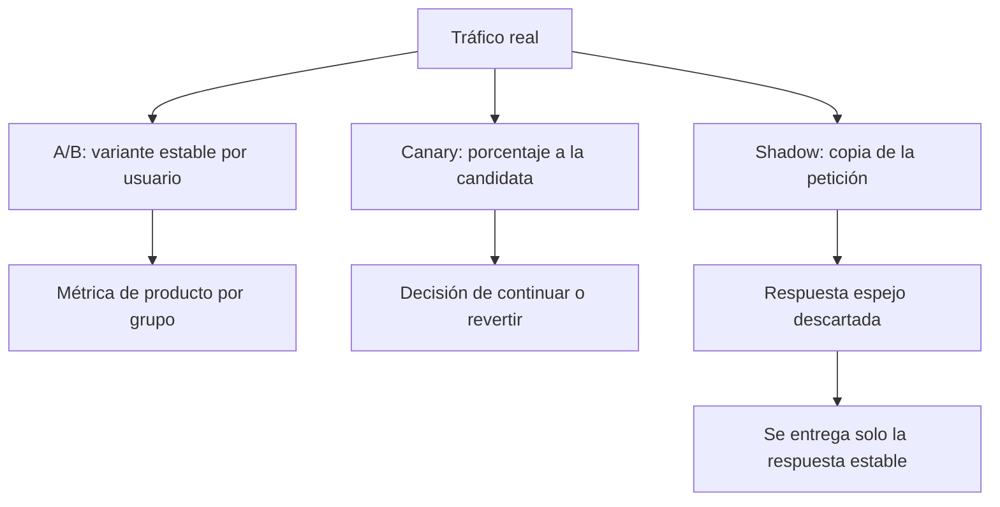

# Módulo 1: CD — estrategias de despliegue


## Aprende construyendo


### Tema 1: Blue-green deployment · Intermedio · 25 min

<details open>
<summary><strong>Capa 1 — Lectura</strong></summary>

#### ► DE QUÉ TRATA
Al finalizar podrás implementar un corte de tráfico blue-green con NGINX, con rollback instantáneo hacia el entorno anterior sin reconstruir nada.

</details>

<details>
<summary><strong>Capa 2 — Construcción</strong></summary>

#### Código y verificación
```
┌── Antes del corte ────────────┐   ┌── Después del corte ────────────┐
│ Balanceador ──▶ Blue (v1, 100%)   │   │ Balanceador ──▶ Green (v2, 100%)    │
│           ╲──▶ Green (v2, standby) │   │           ╲──▶ Blue (v1, standby,   │
└─────────────────────┘   │              listo para rollback)  │
                              └─────────────────────────┘
```

```bash
mkdir -p academia-devops/src/modulo5/blue-green/nginx
cd academia-devops/src/modulo5/blue-green
```

Crea el archivo `nginx/activo.conf`:

```text
upstream activo {
    server blue:3000;
}
server {
    listen 80;
    location / { proxy_pass http://activo; }
}
```

Crea el archivo `compose.yaml`:

```yaml
services:
  blue:
    image: node:22-alpine
    command: ["node", "-e", "require('http').createServer((q,r)=>r.end('version BLUE (v1)')).listen(3000)"]
  green:
    image: node:22-alpine
    command: ["node", "-e", "require('http').createServer((q,r)=>r.end('version GREEN (v2)')).listen(3000)"]
  edge:
    image: nginx:1.30-alpine
    ports: ["8080:80"]
    volumes: ["./nginx/activo.conf:/etc/nginx/conf.d/default.conf:ro"]
    depends_on: [blue, green]
```

```bash
docker compose up -d
curl -s http://localhost:8080/
```

```bash
sed -i 's/server blue:3000;/server green:3000;/' nginx/activo.conf
docker compose exec edge nginx -s reload
curl -s http://localhost:8080/
```

</details>

### Tema 2: Canary releases · Intermedio · 25 min

<details open>
<summary><strong>Capa 1 — Lectura</strong></summary>

#### ► DE QUÉ TRATA
Al finalizar podrás enrutar un porcentaje pequeño de tráfico real hacia una nueva versión con NGINX, e incrementarlo gradualmente según métricas observadas.

</details>

<details>
<summary><strong>Capa 2 — Construcción</strong></summary>

#### Código y verificación
```
┌── 5% tráfico ──▶ v2 (nueva) ──┐  ┌── 95% tráfico ──▶ v1 (estable) ──┐
└───────────────────┘  └──────────────────────┘
¿métricas OK? Sí ──▶ incrementa a 25% ──▶ ... hasta 100%
              No ──▶ revierte a 0%, v1 sigue atendiendo todo
```

```bash
mkdir -p academia-devops/src/modulo5/canary/nginx
cd academia-devops/src/modulo5/canary
```

Crea el archivo `nginx/canary.conf`:

```text
split_clients "${remote_addr}${request_id}" $version {
    5%     canary;
    *      estable;
}
upstream estable { server v1:3000; }
upstream canary  { server v2:3000; }
server {
    listen 80;
    location / { proxy_pass http://$version; }
}
```

Crea el archivo `compose.yaml`:

```yaml
services:
  v1:
    image: node:22-alpine
    command: ["node", "-e", "require('http').createServer((q,r)=>r.end('v1 estable')).listen(3000)"]
  v2:
    image: node:22-alpine
    command: ["node", "-e", "require('http').createServer((q,r)=>r.end('v2 canary')).listen(3000)"]
  edge:
    image: nginx:1.30-alpine
    ports: ["8081:80"]
    volumes: ["./nginx/canary.conf:/etc/nginx/conf.d/default.conf:ro"]
    depends_on: [v1, v2]
```

```bash
docker compose up -d
```

```bash
for i in $(seq 100); do curl -s http://localhost:8081/; echo; done | sort | uniq -c
```

</details>

### Tema 3: Rolling updates · Intermedio · 25 min

<details open>
<summary><strong>Capa 1 — Lectura</strong></summary>

#### ► DE QUÉ TRATA
Al finalizar podrás reemplazar instancias de una versión anterior por la nueva de forma incremental, controlando cuántas pueden estar simultáneamente no disponibles (maxUnavailable) o de más (maxSurge).

</details>

<details>
<summary><strong>Capa 2 — Construcción</strong></summary>

#### Código y verificación
```
┌── Instancias iniciales ──┐  [v1] [v1] [v1] [v1] [v1]
├── Paso 1 (maxUnavailable:1) ┤  [v2] [v1] [v1] [v1] [v1]  ← nunca menos de 4 disponibles
├── Paso 2 ────────────────┤  [v2] [v2] [v1] [v1] [v1]
└── Final ─────────────────┘  [v2] [v2] [v2] [v2] [v2]
```

```bash
mkdir -p academia-devops/src/modulo5/rolling && cd academia-devops/src/modulo5/rolling
```

Crea el archivo `compose.yaml`:

```yaml
services:
  app:
    image: node:22-alpine
    command: ["node", "-e", "require('http').createServer((q,r)=>r.end('version: '+process.env.VERSION)).listen(3000)"]
    environment:
      VERSION: v1
```

```bash
docker compose up -d --scale app=3
docker compose ps
```

```bash
CONTENEDOR=$(docker compose ps -q app | head -1)
docker compose stop "$CONTENEDOR"
docker compose rm -f "$CONTENEDOR"
sed -i.bak 's/VERSION: v1/VERSION: v2/' compose.yaml
docker compose up -d --scale app=3 --no-recreate
docker compose ps
```

</details>

### Tema 4: Feature flags vs branches por entorno · Intermedio · 25 min

<details open>
<summary><strong>Capa 1 — Lectura</strong></summary>

#### ► DE QUÉ TRATA
Al finalizar podrás desacoplar el despliegue de código del lanzamiento de una funcionalidad usando un feature flag activable sin nuevo despliegue.

#### ► REGLA PRÁCTICA
Un feature flag separa "el código ya está en producción" de "el código ya es visible": el mismo despliegue puede llegar con el flag en `false` y activarse después sin un nuevo deploy, incluso para un subconjunto de usuarios. Una rama por entorno (`develop`/`staging`/`main`) en cambio ata la visibilidad al propio despliegue: para que algo se vea hay que desplegar esa rama, lo que acopla "cuándo se sube el código" con "cuándo lo ve el usuario".

</details>

<details>
<summary><strong>Capa 2 — Construcción</strong></summary>

#### Código y verificación
```
┌── Sin feature flag (acoplado) ──┐   ┌── Con feature flag (desacoplado) ──┐
│ deploy = release                    │   │ deploy (código en producción, flag=false) │
│ código visible para TODOS               │   │ tiempo después: flag=true ──▶ visible      │
│ inmediatamente                            │   │ (para todos, o solo un subconjunto)         │
└─────────────────────┘   └──────────────────────────┘
```

```bash
mkdir -p academia-devops/src/modulo5/feature-flag && cd academia-devops/src/modulo5/feature-flag
```

Crea el archivo `app.js`:

```js
const http = require('node:http');
http.createServer((req, res) => {
  const flagNuevaFuncion = process.env.FLAG_NUEVA_FUNCION === 'true';
  const respuesta = flagNuevaFuncion
    ? 'funcion nueva ACTIVA'
    : 'funcion nueva desactivada (comportamiento anterior)';
  res.end(respuesta);
}).listen(3000);
```

```bash
docker run -d --name app-flag -p 3002:3000 -v "$(pwd)":/app -w /app -e FLAG_NUEVA_FUNCION=false node:22-alpine node app.js
curl -s http://localhost:3002/
```

```bash
docker rm -f app-flag
docker run -d --name app-flag -p 3002:3000 -v "$(pwd)":/app -w /app -e FLAG_NUEVA_FUNCION=true node:22-alpine node app.js
curl -s http://localhost:3002/
```

</details>

### Tema 5: Rollback automático por métricas · Intermedio · 25 min

<details open>
<summary><strong>Capa 1 — Lectura</strong></summary>

#### ► DE QUÉ TRATA
Al finalizar podrás diseñar (y simular con un script simple) un rollback automático que revierte un despliegue sin intervención humana cuando una métrica supera un umbral.

</details>

<details>
<summary><strong>Capa 2 — Construcción</strong></summary>

#### Código y verificación
```
Despliegue canario en curso (5% del tráfico en v2)
   Monitorea: tasa de error
   ¿tasa de error > umbral durante > X minutos?
     Sí ──▶ ROLLBACK AUTOMÁTICO (revierte a v1, sin intervención humana)
     No ──▶ continúa, incrementa gradualmente el porcentaje hacia v2
```

```bash
mkdir -p academia-devops/src/modulo5/rollback-auto && cd academia-devops/src/modulo5/rollback-auto
```

Crea el archivo `app-fallido.js`:

```js
const http = require('node:http');
let total = 0, errores = 0;
http.createServer((req, res) => {
  total++;
  if (Math.random() < 0.4) { errores++; res.writeHead(500).end('error'); return; }
  res.end('ok');
  if (req.url === '/metricas') res.end(JSON.stringify({total, errores}));
}).listen(3000);
```

```bash
docker run -d --name backend-canario -p 3003:3000 -v "$(pwd)":/app -w /app node:22-alpine node app-fallido.js
```

Crea el archivo `vigilar.sh`:

```bash
#!/bin/bash
set -euo pipefail
UMBRAL=20
ERRORES=0
TOTAL=0
for i in $(seq 20); do
  CODIGO=$(curl -s -o /dev/null -w "%{http_code}" http://localhost:3003/)
  TOTAL=$((TOTAL+1))
  [ "$CODIGO" = "500" ] && ERRORES=$((ERRORES+1))
done
PORCENTAJE=$((ERRORES * 100 / TOTAL))
echo "tasa de error observada: ${PORCENTAJE}% (umbral: ${UMBRAL}%)"
if [ "$PORCENTAJE" -gt "$UMBRAL" ]; then
  echo "ROLLBACK AUTOMATICO: tasa de error supera el umbral"
  docker rm -f backend-canario
  exit 1
fi
echo "metricas OK, continua el despliegue"
```

```bash
chmod +x vigilar.sh
```

```bash
docker run --rm --network host -v "$(pwd)":/w -w /w alpine sh -c "apk add --no-cache curl bash >/dev/null 2>&1; bash vigilar.sh"
```

</details>

### Tema 6: Rollback ensayado y compatibilidad del artefacto anterior · Intermedio · 25 min

<details open>
<summary><strong>Capa 1 — Lectura</strong></summary>

#### ► DE QUÉ TRATA
Al finalizar ensayarás una promoción de versión con una comprobación automática y retorno a un artefacto conocido si falla. Prerrequisitos: procesos, códigos de salida y archivos en la terminal. Ejemplo independiente desde una carpeta vacía; no requiere Kubernetes.

</details>

<details>
<summary><strong>Capa 2 — Construcción</strong></summary>

#### Código y verificación
```bash
mkdir ensayo-release
cd ensayo-release
```

Crea `release.sh`:

```bash
#!/usr/bin/env bash
# release.sh — promueve un candidato solo si pasa la verificación; si no, se queda el artefacto conocido
set -uo pipefail
printf '#!/bin/sh\necho "ENV-42 listo"\n' > v1.sh
printf '#!/bin/sh\necho "configuración inválida" >&2\nexit 1\n' > v2.sh
chmod +x v1.sh v2.sh
echo v1.sh > active.txt
anterior=$(cat active.txt)
candidato=v2.sh

# La verificación observa salida y código de salida antes de cambiar el puntero.
salida=$(./"$candidato" 2>/dev/null); codigo=$?
if [[ $codigo -eq 0 && "$salida" == *"ENV-42 listo"* ]]; then
  echo "$candidato" > active.txt; resultado="Candidato promovido"
else
  echo "$anterior" > active.txt; resultado="Candidato rechazado (código $codigo)"
fi

[[ $(./"$(cat active.txt)") == "ENV-42 listo" ]] || { echo "fallo: la versión activa no responde"; exit 1; }
echo "$resultado; activa: $(cat active.txt)"
```

```bash
chmod +x release.sh
./release.sh
```

```text
Candidato rechazado (código 1); activa: v1.sh
```

Cambia `candidato=v2.sh` por `candidato=v1.sh` y vuelve a ejecutar: `Candidato promovido; activa: v1.sh`.

</details>

### Tema 7: A/B testing y shadow traffic: medir sin convertir usuarios en cobayas · Intermedio · 25 min

<details open>
<summary><strong>Capa 1 — Lectura</strong></summary>

#### ► DE QUÉ TRATA
Al finalizar distinguirás un experimento A/B de un canary y de un despliegue shadow, asignarás una variante de forma determinista y protegerás la respuesta real cuando una segunda versión solo observa tráfico. Prerrequisitos: los Temas 1–3 de este módulo, HTTP, una función y prue…

#### ► CÓMO FUNCIONA


</details>

<details>
<summary><strong>Capa 2 — Construcción</strong></summary>

#### Código y verificación

```bash
mkdir ejemplo-deploy-strategies
cd ejemplo-deploy-strategies
```

```json
{
  "name": "rutaflow-deployment-strategies",
  "private": true,
  "type": "module",
  "scripts": { "test": "node deployment.test.mjs" }
}
```

```js
import { createHash } from 'node:crypto';

/**
 * Asigna siempre el mismo usuario a la misma variante dentro de este ejemplo.
 * No es un sistema de experimentación de producción: no persiste consentimiento,
 * métricas, exclusiones ni reglas de privacidad.
 */
export function abVariant(userId, split = 0.1) {
  if (!userId || !Number.isFinite(split) || split < 0 || split > 1) {
    throw new Error('userId y split válido (0..1) son obligatorios');
  }
  const digest = createHash('sha256').update(userId).digest();
  const bucket = digest.readUInt32BE(0) / 0x1_0000_0000;
  return bucket < split ? 'canary' : 'stable';
}

/**
 * Ejecuta el comportamiento estable y envía una copia a la variante shadow.
 * La respuesta shadow se descarta y el callback recibe solo la respuesta real.
 * El handler shadow debe ser de solo lectura o idempotente para no duplicar
 * efectos de negocio.
 */
export async function serveWithShadow({ request, stable, shadow, timeoutMs = 100 }) {
  if (typeof stable !== 'function' || typeof shadow !== 'function') {
    throw new Error('stable y shadow deben ser funciones');
  }
  const shadowWork = Promise.resolve()
    .then(() => shadow(request))
    .catch(() => undefined);
  const stableResult = await stable(request);
  await Promise.race([
    shadowWork,
    new Promise(resolve => setTimeout(resolve, timeoutMs)),
  ]);
  return stableResult;
}
```

```js
import assert from 'node:assert/strict';
import { abVariant, serveWithShadow } from './deployment.mjs';

assert.equal(abVariant('ENV-42', 0), 'stable');
assert.equal(abVariant('ENV-42', 1), 'canary');
assert.equal(abVariant('ENV-42'), abVariant('ENV-42'));

const calls = [];
const response = await serveWithShadow({
  request: { id: 'ENV-42' },
  stable: async request => {
    calls.push(`stable:${request.id}`);
    return { status: 200, source: 'stable' };
  },
  shadow: async request => {
    calls.push(`shadow:${request.id}`);
    return { status: 500, source: 'shadow' };
  },
});
assert.deepEqual(response, { status: 200, source: 'stable' });
assert.deepEqual(calls.sort(), ['shadow:ENV-42', 'stable:ENV-42']);
console.log('deployment strategies: ok');
```

```bash
npm test
```

</details>

### Tema 8: Mapa de decisión: las siete estrategias de despliegue · Intermedio · 30 min

## Motivación

Ya viste cada estrategia por separado en este módulo y en el 7. Ahora toca elegir la adecuada para cada servicio de Tienda Aurora. Usar la equivocada sale caro: un canary en un servicio con 50 visitas al día nunca junta datos suficientes, y un recreate en el checkout deja la tienda caída en plena venta.

## Concepto

Las estrategias se dividen en dos grupos:
- **Integradas en Kubernetes** (rolling update, ramped y recreate): se configuran en el propio Deployment.
- **Con herramientas adicionales** (blue/green, canary, A/B y shadow): necesitan un balanceador, una malla de servicios (Istio, Linkerd) o una herramienta de entrega progresiva (Argo Rollouts, Flagger).

| Estrategia | Cómo funciona | ¿Caída de servicio? | ¿Versiones mezcladas? | Costo extra | Rollback | Úsala cuando… |
|---|---|---|---|---|---|---|
| Rolling update | Reemplaza pods por lotes (`maxSurge`, `maxUnavailable`) | No | Sí, durante el despliegue | Bajo | Otro rolling update | Valor por defecto para servicios sin estado |
| Ramped | Rolling update de uno en uno, verificando cada paso | No | Sí, más tiempo | Bajo | Detener y revertir | Quieres observar cada pod nuevo antes de seguir |
| Recreate | Borra todos los v1 y luego crea los v2 | **Sí** | No | Ninguno | Redesplegar v1 | v1 y v2 no pueden convivir (p. ej., migración de esquema incompatible) |
| Blue/Green | Dos entornos completos; el Service cambia de uno a otro | No | No | **2× pods** | Instantáneo: volver a apuntar | Necesitas rollback inmediato y puedes pagar el doble |
| Canary | Un % pequeño del tráfico va a v2 y se amplía si va bien | No | Sí, controlado | Bajo | Mandar el 0 % a v2 | Hay tráfico real suficiente para medir errores |
| A/B testing | Divide por usuario o cabecera para comparar métricas de negocio | No | Sí, por diseño | Medio | Terminar el experimento | Decides por conversión, no solo por errores técnicos |
| Shadow | Copia el tráfico real a v2 y descarta sus respuestas | No | No (el usuario solo ve v1) | **2× carga** | No aplica | Probar v2 con carga de producción sin riesgo |

Atención con shadow: si v2 escribe en la base de datos o llama a pagos, el tráfico copiado ejecuta esas acciones de verdad. Solo es seguro con operaciones de lectura o con efectos aislados.

## Ejemplo mínimo

**Ramped** es un rolling update configurado para ir de uno en uno sin perder capacidad:

```yaml
apiVersion: apps/v1
kind: Deployment
metadata:
  name: api-pedidos
spec:
  replicas: 4
  strategy:
    type: RollingUpdate
    rollingUpdate:
      maxSurge: 1          # como mucho 1 pod extra durante el cambio
      maxUnavailable: 0    # nunca menos de 4 pods listos
  minReadySeconds: 30      # un pod nuevo debe estar 30 s listo antes de seguir
  selector:
    matchLabels: { app: api-pedidos }
  template:
    metadata:
      labels: { app: api-pedidos }
    spec:
      containers:
        - name: api
          image: registro.local/api-pedidos:2.0.0
          readinessProbe:
            httpGet: { path: /actuator/health/readiness, port: 8080 }
```

Con `maxUnavailable: 0` y `maxSurge: 1`, Kubernetes crea un pod v2, espera a que pase la readiness probe y 30 segundos más, y solo entonces retira un v1. `kubectl rollout pause deployment/api-pedidos` congela el avance si ves algo raro.

## Reglas y casos límite

- **Sin readiness probe, ninguna estrategia es segura:** Kubernetes daría por listo un pod que todavía no atiende.
- **Las versiones mezcladas exigen compatibilidad.** Durante un rolling update, v1 y v2 leen la misma base de datos y reciben los mismos mensajes; los cambios de esquema se hacen en pasos compatibles hacia atrás.
- **Blue/Green duplica también los recursos externos** que cada entorno use (colas, cachés); planifica la capacidad.

## Compruébalo

1. Para el checkout (mucho tráfico, error caro), el panel de administración (5 usuarios) y un servicio de recomendaciones nuevo, ¿qué estrategia eliges en cada caso y por qué?
2. Con `replicas: 6`, `maxSurge: 2` y `maxUnavailable: 2`, ¿cuántos pods como mínimo y como máximo existen durante el despliegue?

