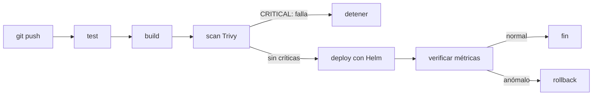
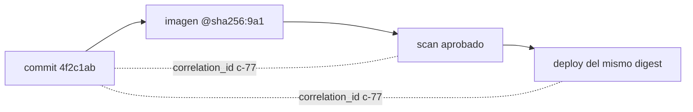
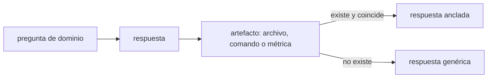

# Módulo 2: Proyecto integrador — pipeline CI/CD completo


## Aprende construyendo


### Tema 1: El pipeline completo — de commit a producción verificada · Avanzado · 45 min

<details open>
<summary><strong>Capa 1 — Lectura</strong></summary>

#### ► DE QUÉ TRATA
Al finalizar vas a validar, con un script, que el pipeline de RutaFlow encadena sus etapas con gates bloqueantes y etiqueta la imagen con el hash del commit. Prerrequisitos: módulos 1-12 completos, Docker (para ejecutar `yq` sin instalarlo) y `jq` (`brew install jq` o `apt install jq`); no necesitas un clúster real…

#### ► CÓMO FUNCIONA


</details>

<details>
<summary><strong>Capa 2 — Construcción</strong></summary>

#### Código y verificación

```bash
mkdir ejemplo && cd ejemplo
```

```yaml
name: pipeline
on: [push]
jobs:
  test:
    runs-on: ubuntu-latest
    steps:
      - uses: actions/checkout@3d3c42e5aac5ba805825da76410c181273ba90b1 # v7.0.1
      - run: npm ci && npm test
  build:
    needs: test
    runs-on: ubuntu-latest
    steps:
      - uses: actions/checkout@3d3c42e5aac5ba805825da76410c181273ba90b1 # v7.0.1
      - uses: docker/login-action@8aa5831fb8d48d8f76594c7ddde61ae58019f550 # v4.8.0
        with:
          registry: registry.rutaflow.app
          username: ${{ secrets.REGISTRY_USER }}
          password: ${{ secrets.REGISTRY_TOKEN }}
      - run: |
          docker build -t registry.rutaflow.app/api:${{ github.sha }} .
          docker push registry.rutaflow.app/api:${{ github.sha }}
  scan:
    needs: build
    runs-on: ubuntu-latest
    steps:
      - uses: aquasecurity/trivy-action@ed142fd0673e97e23eac54620cfb913e5ce36c25 # v0.36.0
        with:
          image-ref: registry.rutaflow.app/api:${{ github.sha }}
          severity: CRITICAL
          exit-code: "1"
        env:
          TRIVY_USERNAME: ${{ secrets.REGISTRY_USER }}
          TRIVY_PASSWORD: ${{ secrets.REGISTRY_TOKEN }}
  deploy:
    needs: scan
    runs-on: ubuntu-latest
    steps:
      - uses: actions/checkout@3d3c42e5aac5ba805825da76410c181273ba90b1 # v7.0.1
      - run: helm upgrade --install api ./chart --set image.tag=${{ github.sha }}
```

Crea `verificar_pipeline.sh`. `yq` convierte el YAML a JSON y `jq` hace las comprobaciones:

```bash
#!/usr/bin/env bash
# verificar_pipeline.sh — el pipeline encadena sus etapas, bloquea ante CRITICAL y etiqueta con github.sha
set -euo pipefail
flujo=$(docker run --rm -v "$PWD":/workdir mikefarah/yq -o=json .github/workflows/pipeline.yml)
falla() { echo "fallo: $1"; exit 1; }
q() { jq -r "$1" <<<"$flujo"; }
TAG='${{ github.sha }}'
IMAGEN="registry.rutaflow.app/api:$TAG"

for par in test:build build:scan scan:deploy; do
  anterior=${par%%:*}; siguiente=${par#*:}
  [[ $(q ".jobs.$siguiente.needs") == "$anterior" ]] || falla "$siguiente no depende de $anterior"
done

escaneo=$(q '[.jobs.scan.steps[] | select((.uses // "") | startswith("aquasecurity/trivy-action@"))][0].with // empty')
[[ -n "$escaneo" ]] || falla "el job scan no ejecuta Trivy"
[[ $(jq -r '."exit-code" | tostring' <<<"$escaneo") == 1 && $(jq -r .severity <<<"$escaneo") == CRITICAL ]] \
  || falla "el escaneo no bloquea ante una vulnerabilidad CRITICAL"

comandos() { q "[.jobs.$1.steps[].run // empty] | join(\"\n\")"; }
grep -qF "docker build -t $IMAGEN" <<<"$(comandos build)" && grep -qF "docker push $IMAGEN" <<<"$(comandos build)" \
  || falla "build no construye y publica la imagen etiquetada con github.sha"
[[ $(jq -r '."image-ref"' <<<"$escaneo") == "$IMAGEN" ]] || falla "scan no revisa la imagen etiquetada con github.sha"
grep -qF "image.tag=$TAG" <<<"$(comandos deploy)" || falla "deploy no despliega la imagen etiquetada con github.sha"

sin_sha=$(q '[.jobs | to_entries[] | .key as $job | .value.steps[] | select(.uses != null)
              | select(.uses | test("@[0-9a-f]{40}$") | not) | "\($job) usa \(.uses)"][0] // empty')
[[ -z "$sin_sha" ]] || falla "$sin_sha sin fijarla por SHA"

echo "jobs: test -> build -> scan -> deploy"
echo "gate de seguridad: bloqueante (exit-code 1, severity CRITICAL)"
echo "imagen etiquetada con el hash del commit en build, scan y deploy"
echo "acciones fijadas por SHA de commit"
```

```bash
chmod +x verificar_pipeline.sh
./verificar_pipeline.sh
```

```text
jobs: test -> build -> scan -> deploy
gate de seguridad: bloqueante (exit-code 1, severity CRITICAL)
imagen etiquetada con el hash del commit en build, scan y deploy
acciones fijadas por SHA de commit
```

</details>

### Tema 2: Uniendo cada módulo del track en un solo flujo · Avanzado · 45 min

<details open>
<summary><strong>Capa 1 — Lectura</strong></summary>

#### ► DE QUÉ TRATA
Al finalizar vas a reconstruir la cadena commit → imagen → escaneo → despliegue a partir de eventos trazables y a detectar cuándo un pipeline perdió esa trazabilidad. Prerrequisitos: Tema 1 de este módulo y `jq`.

#### ► CÓMO FUNCIONA


</details>

<details>
<summary><strong>Capa 2 — Construcción</strong></summary>

#### Código y verificación


```bash
mkdir ejemplo && cd ejemplo
```

```json
{"etapa":"commit","commit":"4f2c1ab","correlation_id":"c-77"}
{"etapa":"build","commit":"4f2c1ab","imagen":"registry.rutaflow.app/api@sha256:9a1","correlation_id":"c-77"}
{"etapa":"scan","commit":"4f2c1ab","resultado":"aprobado","correlation_id":"c-77"}
{"etapa":"deploy","commit":"4f2c1ab","imagen":"registry.rutaflow.app/api@sha256:9a1","correlation_id":"c-77"}
```

Crea `trazabilidad.sh`:

```bash
#!/usr/bin/env bash
# trazabilidad.sh — reconstruye commit -> imagen -> escaneo -> despliegue desde eventos.jsonl
set -euo pipefail
falla() { echo "fallo: $1"; exit 1; }
q() { jq -rs "$@" eventos.jsonl; }   # -s junta todas las líneas en un solo arreglo

[[ $(q '[.[].correlation_id] | unique | length') == 1 ]] || falla "la cadena no comparte correlation_id"
commit=$(q '.[0].commit')
[[ $(q --arg c "$commit" 'all(.commit == $c)') == true ]] || falla "hay etapas de otro commit"
imagenes=$(q '[.[].imagen // empty] | unique')
[[ $(jq 'length' <<<"$imagenes") == 1 && $(jq 'any(contains(":latest"))' <<<"$imagenes") == false ]] \
  || falla "la imagen no es trazable por digest"
[[ $(q 'map(select(.etapa == "scan"))[0].resultado') == aprobado ]] || falla "se desplegó sin un escaneo aprobado"

echo "commit: $commit"
echo "imagen: $(jq -r '.[0]' <<<"$imagenes")"
echo "etapas: $(q 'map(.etapa) | join(" -> ")')"
echo "cadena completa: true"
```

```bash
chmod +x trazabilidad.sh
./trazabilidad.sh
```

```text
commit: 4f2c1ab
imagen: registry.rutaflow.app/api@sha256:9a1
etapas: commit -> build -> scan -> deploy
cadena completa: true
```

</details>

### Tema 3: Cierre del track — checklist final y reflexión · Avanzado · 45 min

<details open>
<summary><strong>Capa 1 — Lectura</strong></summary>

#### ► DE QUÉ TRATA
Al finalizar vas a responder un checklist de decisiones reales del pipeline de RutaFlow y a comprobar, con un evaluador, si tus respuestas están ancladas en artefactos concretos. Prerrequisitos: Temas 1-2 de este módulo.

#### ► CÓMO FUNCIONA


</details>

<details>
<summary><strong>Capa 2 — Construcción</strong></summary>

#### Código y verificación


```bash
mkdir ejemplo && cd ejemplo
```

```markdown
## 1. Deployment frente a StatefulSet
Usamos Deployment porque la API no necesita identidad estable ni almacenamiento propio; el estado vive en Postgres, no en el Pod.

## 2. GitOps y credenciales
El operador dentro del clúster lee del repositorio y no guarda credenciales de despliegue externas, a diferencia del runner de CD.

## 3. Canary y rollback
Desplegamos el 10 % con Helm y revertimos con rollback si la tasa de error supera el 1 % durante 5 minutos.
```

Crea `evaluar_checklist.sh`. `awk` recorre el archivo sección por sección:

```bash
#!/usr/bin/env bash
# evaluar_checklist.sh — cada respuesta del checklist debe nombrar una decisión técnica concreta
set -euo pipefail
awk '
  /^## / { if (titulo) evaluar(); titulo = substr($0, 4); respuesta = ""; n++; next }
  { respuesta = respuesta " " $0 }
  END { if (titulo) evaluar(); if (fallos) { print "fallo:" fallos; exit 1 }
        print "preguntas respondidas: " n; print "respuestas ancladas a una decisión: true" }
  function evaluar(   palabras, r) {
    r = tolower(respuesta)
    palabras = split(respuesta, _, /[[:space:]]+/) - 1
    if (palabras < 12) fallos = fallos " " titulo ": respuesta demasiado corta;"
    if (r ~ /es usar git como fuente de verdad|es una buena práctica/) fallos = fallos " " titulo ": respuesta genérica sin artefacto;"
    if (r !~ /deployment|statefulset|helm|postgres|operador|runner|canary|rollback/)
      fallos = fallos " " titulo ": sin decisión técnica nombrada;"
  }
' checklist.md
```

```bash
chmod +x evaluar_checklist.sh
./evaluar_checklist.sh
```

```text
preguntas respondidas: 3
respuestas ancladas a una decisión: true
```

</details>
