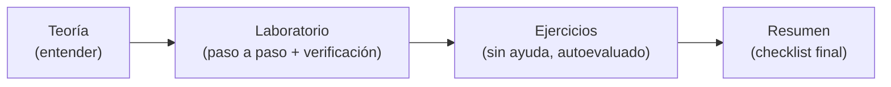

# Módulo 0: Introducción y preparación


## Antes de comenzar: prepara solo lo que necesitas

Ve instalando herramientas cuando el tema las necesite. Para el Tema 1 basta con abrir Terminal en macOS/Linux o PowerShell en Windows. Antes del Tema 2 necesitarás [Node.js](https://nodejs.org/en/download/); antes del Tema 4, Docker. AWS CLI y Python se preparan en los laboratorios que los usan.

El curso funciona con servicios locales y no requiere una cuenta cloud ni tarjeta. Usa solo las credenciales de prueba que indican los ejemplos; nunca pegues claves de una cuenta real.

## Aprende construyendo

### Tema 1: Fundamentos absolutos — qué es una terminal, un comando y un sistema operativo

#### Paso 1 · Objetivo y preparación
Al finalizar podrás crear una carpeta, entrar en ella y guardar un archivo. **Conocimiento previo:** ninguno. Abre Terminal en macOS/Linux o PowerShell en Windows. No necesitas saber programar ni instalar Docker.

#### Paso 2 · Contexto y caso real
Cuando guardas un proyecto, importa saber en qué carpeta estás. Si ejecutas una orden en otro lugar, el archivo puede terminar donde no lo encuentras. **¿Por qué es importante?** Saber dónde estás evita perder archivos y repetir trabajo.

#### Paso 3 · Teoría sencilla y analogía
La **terminal** es la ventana donde escribes. Un **comando** es una orden corta. El **sistema operativo** organiza archivos y programas; el **shell** lee la orden y se la entrega al sistema. Si escribes mal una orden, el sistema suele mostrar un mensaje que ayuda a corregirla. **Analogía:** como en una cocina: tú haces el pedido, el shell lo entiende y el sistema lo prepara. Si entraste al restaurante equivocado, la orden no llega a la mesa correcta.

**Recorrido de una orden:** `┌ tú escribes → terminal → shell → sistema operativo ┐`<br>`└ resultado ←────────────────────────────────────────┘`.

#### Paso 4 · Demostración guiada desde cero
Crea el ejemplo independiente en una carpeta nueva y entra en ella. El archivo de texto se llamará `saludo.txt`:

```bash
mkdir ejemplo-terminal
cd ejemplo-terminal
```

En macOS/Linux guarda y muestra el texto:

```bash
printf 'Hola, ya estoy en mi carpeta\n' > saludo.txt
pwd
cat saludo.txt
```

En PowerShell usa:

```powershell
"Hola, ya estoy en mi carpeta" | Set-Content saludo.txt
Get-Location
Get-Content saludo.txt
```

`mkdir` crea la carpeta; `cd` entra en ella; las otras órdenes guardan y muestran el texto. `pwd` y `Get-Location` muestran dónde estás. **Resultado esperado:** verás la ruta de `ejemplo-terminal` y el mensaje `Hola, ya estoy en mi carpeta`. El archivo está en `ejemplo-terminal/saludo.txt`.

#### Paso 5 · Práctica guiada
**Fallo deliberado:** pide leer `salud.txt`, sin la letra “o”. Verás un mensaje de error porque ese archivo no existe. **Pista:** compara el nombre que escribiste con `saludo.txt`; corrígelo y vuelve a leerlo.

#### Paso 6 · Práctica independiente
Guarda una segunda nota y muéstrala. En macOS/Linux:

```bash
echo 'Mi primer archivo' > nota.txt
cat nota.txt
```

En PowerShell:

```powershell
'Mi primer archivo' | Set-Content nota.txt
Get-Content nota.txt
```

Luego cambia a la carpeta anterior e intenta leer `nota.txt`; vuelve a `ejemplo-terminal` y repite. Observa por qué importa la carpeta actual.

#### Paso 7 · Cierre y evidencia
**Evidencia de aprendizaje:** conserva los dos archivos, la ruta, la salida y el error del Paso 5. **Transferencia al proyecto integrador cloud:** guarda esos comandos en la bitácora y repítelos desde la carpeta donde pondrás los laboratorios. El siguiente tema usa la terminal para probar una conexión. **Errores comunes:** confundir el nombre de la carpeta con el del archivo y olvidar dónde estás. **Límite:** macOS/Linux y Windows escriben algunas órdenes de forma distinta; aquí ves ambas.

**Fuente oficial:** [AWS CLI desde una terminal en Windows, macOS y Linux](https://docs.aws.amazon.com/cli/latest/userguide/cli-chap-welcome.html).


### Tema 2: Fundamentos de redes — direcciones IP, puertos, HTTP y APIs

#### Paso 1 · Objetivo y preparación
Al finalizar distinguirás un servidor apagado de una ruta que no existe. **Prerrequisitos:** Node.js instalado y una terminal. Comprueba `node --version`; en Windows usa `curl.exe`. Este ejemplo independiente empieza en una carpeta vacía.

#### Paso 2 · Contexto y caso real
Si una página local no responde, puede que el programa esté apagado, que uses otra puerta o que la dirección pedida no exista. Vamos a probar cada caso. **¿Por qué es importante?** Separar estos problemas te dice qué corregir primero.

#### Paso 3 · Teoría sencilla y analogía
Una **dirección IP** señala el computador que recibe el mensaje. `127.0.0.1` significa “este mismo computador”. El **puerto** es como el número de una puerta; usaremos el `3000`.

HTTP es el formato del mensaje entre dos programas. La ruta `/salud` nos servirá para preguntar si todo está listo. Una **API** es el conjunto de rutas que el programa sabe atender. `200` indica que encontró lo que pedimos; `404`, que esa ruta no existe. **Analogía:** IP es la dirección del edificio, el puerto es el número de puerta y HTTP es la manera de hacer la pregunta.

**Recorrido de la petición:** `┌ cliente → 127.0.0.1:3000 → servidor ┐`<br>`└ cliente ← 200 o 404 ←───────────────┘`.

#### Paso 4 · Demostración guiada desde cero
Crea el ejemplo independiente en una carpeta nueva y entra en ella:

```bash
mkdir ejemplo-red
cd ejemplo-red
```

Crea `server.mjs` dentro de `ejemplo-red` con este contenido:

```js
import { createServer } from 'node:http';

const server = createServer((request, response) => {
  const existe = request.method === 'GET' && request.url === '/salud';
  response.writeHead(existe ? 200 : 404, {
    'Content-Type': 'application/json'
  });
  const body = existe
    ? { estado: 'listo' }
    : { error: 'Prueba la ruta /salud' };
  response.end(JSON.stringify(body));
});

server.listen(3000, '127.0.0.1', () => {
  console.log('Listo en http://127.0.0.1:3000');
});
```

En la primera terminal, entra en `ejemplo-red` e inicia el servidor:

```bash
node server.mjs
```

No cierres esa ventana. En una segunda terminal, prueba:

```bash
curl -i http://127.0.0.1:3000/salud
curl -i http://127.0.0.1:3000/otra
```

En PowerShell escribe `curl.exe -i` al inicio de cada línea. **Resultado esperado:** la primera petición muestra `200` y `{"estado":"listo"}`; la segunda, `404`. `createServer` atiende pedidos, `writeHead` elige el número de respuesta y `listen` deja el programa esperando en la puerta 3000. Deténlo con Ctrl+C.

#### Paso 5 · Práctica guiada
**Fallo deliberado:** cambia el puerto `3000` en el comando por `3001`. Verás un error de conexión porque el programa escucha en `3000`. **Pista:** compara el puerto del comando con el de `server.listen`; corrige el número. Un `404` significa que sí llegaste al servidor; “no se pudo conectar” significa que no.

#### Paso 6 · Práctica independiente
Agrega `/version`. Cambia estas dos partes del archivo:

```js
const existe = request.method === 'GET' &&
  (request.url === '/salud' || request.url === '/version');
const body = existe
  ? request.url === '/version' ? { version: '1' } : { estado: 'listo' }
  : { error: 'Prueba /salud o /version' };
```

Reinicia el servidor y comprueba `/version` y `/no-existe`. Espera `200` con `{"version":"1"}` y `404` para la ruta que no agregaste.

#### Paso 7 · Cierre y evidencia
**Evidencia de aprendizaje:** entrega `server.mjs`, las tres respuestas y la corrección del fallo del Paso 5. **Transferencia al proyecto integrador cloud:** al probar Floci, apunta el puerto y la ruta que usaste; así sabrás si el emulador está apagado o si pediste algo que no existe. El siguiente tema muestra cómo se ordena el curso. **Errores comunes:** confundir el puerto con la ruta y creer que `404` significa que el servidor está apagado. **Límite:** este ejemplo solo escucha en tu computador; no lo publiques en Internet.

**Fuentes oficiales:** [servidor HTTP de Node.js](https://nodejs.org/api/http.html) y [códigos de respuesta](https://developer.mozilla.org/en-US/docs/Web/HTTP/Reference/Status).


### Tema 3: Qué vas a aprender y cómo está estructurado el curso

#### Paso 1 · Objetivo y preparación
Al finalizar tendrás una bitácora corta para recordar qué probaste y qué sigue. **Conocimiento previo:** ninguno. No necesitas memorizar los servicios antes de comenzar.

#### Paso 2 · Contexto y caso real
En un equipo, otra persona necesita repetir tu prueba y entender qué pasó. Una nota con el comando y el resultado ayuda más que escribir “ya funciona”. **¿Por qué es importante?** Una prueba que otra persona puede repetir da confianza en el cambio.

#### Paso 3 · Teoría sencilla y analogía
**Analogía:** el orden es parecido a armar una casa: primero aprendes a usar las herramientas, luego instalas las piezas y al final conectas todo.

| Empiezas por | Luego aprendes | Al final puedes |
|---|---|---|
| Terminal y redes | Contenedores | Ejecutar servicios en tu computador |
| Archivos y colas | Bases de datos y funciones | Guardar datos y reaccionar a eventos |
| APIs y permisos | Servicios avanzados | Conectar sistemas con acceso controlado |
| Integración | Proyecto multi-nube | Probar el sistema completo y explicar decisiones |

No tienes que aprenderlo todo hoy. Avanza cuando puedas mostrar qué hiciste y qué resultado obtuviste.

**Mapa:** `┌ terminal y redes → servicios individuales → combinar servicios ┐`<br>`└ aprender lo básico ───────────────────────→ proyecto completo ┘`.

#### Paso 4 · Demostración guiada: registra una práctica
Crea una carpeta nueva para el ejemplo independiente:

```bash
mkdir mi-ruta
cd mi-ruta
```

Dentro, crea `bitacora.md` con este ejemplo y reemplaza la salida por la tuya:

```markdown
# Mi bitácora

Tema: terminal
Archivo: ejemplo-terminal/saludo.txt
Comando: cat saludo.txt (o Get-Content saludo.txt)
Resultado: Hola, ya estoy en mi carpeta
Error que corregí: escribí mal el nombre
Siguiente paso: probar una petición HTTP
```

Abre el archivo y comprueba que puedes explicar cada línea. Esta nota no es un examen; te ayuda a retomar donde quedaste.

Para volver a verla, entra a `mi-ruta` y ejecuta en macOS/Linux:

```bash
cd mi-ruta
cat bitacora.md
```

En PowerShell usa `Get-Content bitacora.md`. **Resultado esperado:** ves los mismos campos que escribiste y reconoces cuál es el siguiente tema.

#### Paso 5 · Práctica guiada
**Fallo deliberado:** registra en la bitácora que pediste `/salud` antes de iniciar el servidor; apunta el error de conexión. **Pista:** inicia primero el servidor del Tema 2 y repite la petición. Luego cambia el orden de tus tareas para que el registro coincida con lo que observaste.

#### Paso 6 · Práctica independiente
Agrega el resultado real de `/salud` o `/otra`. Si algo falló, apunta el mensaje y la corrección; no inventes la salida.

#### Paso 7 · Cierre y evidencia
**Evidencia de aprendizaje:** entrega `bitacora.md` con dos prácticas y sus resultados. **Transferencia al proyecto integrador cloud:** registra el comando que levantó cada servicio, su salida y el error que corregiste para que alguien pueda repetirlo. El siguiente módulo prepara el entorno. **Errores comunes:** avanzar sin mirar la salida o confundir leer una explicación con haber probado el comando. **Límite:** la bitácora recuerda tu trabajo; por sí sola no demuestra que domines cada servicio.

**Fuente oficial:** [guía oficial de AWS CLI](https://docs.aws.amazon.com/cli/latest/userguide/cli-chap-welcome.html).


### Tema 4: Qué es Floci — definición, propósito y comparativa con LocalStack

#### Paso 1 · Objetivo y preparación
Al terminar podrás reconocer qué hace Floci y comprobar si está respondiendo en tu computador. Necesitas Docker Desktop abierto y una terminal. En la carpeta principal del proyecto ejecuta `docker --version`.
#### Paso 2 · Contexto y caso real
Antes de usar servicios de nube de una empresa, puedes ensayar en una copia local. Así practicas comandos sin crear recursos en una cuenta real.
#### Paso 3 · Teoría, modelo mental y analogía
Piensa en Floci como un simulador: recibe algunas solicitudes parecidas a las de AWS y responde desde tu computador. No es AWS y no reproduce todos sus detalles.
#### Paso 4 · Demostración guiada
Desde la carpeta principal del proyecto, inicia solo el servicio AWS que ya está definido en `docker-compose.yml`:
```bash
docker compose up -d aws-local
docker compose ps aws-local
curl -i http://localhost:4566/_floci/health
```
La primera orden descarga y enciende el contenedor; la segunda muestra si está activo; la tercera pregunta por su estado. Busca una respuesta HTTP `200`. Floci ofrece una herramienta llamada LocalStack, pero aquí vamos a usar Floci: ambos permiten practicar servicios de AWS en local y sus catálogos no son idénticos.
Ahora crea `ejemplo-floci/revisar.mjs` con este código:
```js
const respuesta = await fetch("http://localhost:4566/_floci/health");

console.log(`Floci respondió: ${respuesta.status}`);
```
Ejecuta `node ejemplo-floci/revisar.mjs`. **Resultado esperado:** imprime `Floci respondió: 200`. `fetch` hace la misma pregunta que el comando anterior, y `respuesta.status` muestra el número que volvió. Cambia temporalmente `4566` por `4567` y ejecuta de nuevo: ahora Node mostrará un error de conexión. Devuelve el `4566` para corregirlo. Si el `200` no aparece, primero revisa el estado con `docker compose ps aws-local`.
Una respuesta HTTP es una forma de contestar por la web. `200` quiere decir “recibí tu consulta y pude responder”. Si aparece “connection refused” o “no se pudo conectar”, revisa primero que Docker esté abierto y que `docker compose ps` diga `Up`. Si ves `404`, llegaste al servidor, pero la dirección escrita no existe. En este ejercicio usamos la ruta exacta `/_floci/health`; no es una página para crear buckets.
#### Paso 5 · Práctica guiada
Detén el servicio y repite la consulta de salud:
```bash
docker compose stop aws-local
curl -i http://localhost:4566/_floci/health
```
La consulta debería fallar porque ya no hay un servicio escuchando. Vuelve a iniciarlo con `docker compose up -d aws-local` y repite el `curl`. Si `curl` no existe en tu sistema, abre `http://localhost:4566/_floci/health` en el navegador.
Fíjate en la diferencia: “no se pudo conectar” indica que el servicio está apagado o que el puerto no coincide; `404` indica que el servicio sí contestó, pero no encontró esa ruta. Esta diferencia sirve para ubicar el problema antes de cambiar código. Si aparece otro mensaje, guárdalo tal como salió y consulta los registros con `docker compose logs --tail=20 aws-local`.
#### Paso 6 · Práctica independiente
En `ejemplo-floci.md`, anota qué comando lo inició, qué puerto usaste y qué cambió al detenerlo. No pongas claves personales: el ejercicio funciona sin una cuenta de nube.
#### Paso 7 · Cierre y evidencia
En `ejemplo-floci.md` incluye la salida de `revisar.mjs`, la consulta con puerto incorrecto y explica por qué falló. Después sigue al tema 5 para conocer los tres puertos. **Fuente:** [instalación oficial de Floci](https://floci.io/floci/getting-started/installation/) y [README oficial de Floci CLI](https://github.com/floci-io/floci-cli/blob/main/README.md). El comando de este ejercicio usa el Compose del proyecto, por lo que ejecútalo desde su carpeta principal.
**Conceptos clave:** Floci, simulador local, contenedor, puerto.
**¿Por qué es importante?** Practicar localmente te deja equivocarte y corregir el comando antes de trabajar con recursos de una cuenta real.
El puerto `4566` es una entrada de tu computador conectada al servicio dentro del contenedor. Cuando el contenedor está detenido, esa entrada deja de responder. Al iniciar el curso usaremos AWS CLI y programas pequeños para crear recursos de práctica; por ahora basta con confirmar que Floci puede encenderse y apagarse. Si ya tienes otro programa usando el puerto, Docker avisará que no puede enlazarlo. Detén el programa que lo ocupa o revisa su configuración antes de seguir.

**Para el proyecto integrador:** registra el puerto y la respuesta de salud antes de probar almacenamiento. Esa respuesta solo indica que el emulador está activo.

### Tema 5: Servicios que emula Floci — AWS, Azure y GCP

#### Paso 1 · Objetivo y preparación
Al terminar podrás ubicar qué proveedor responde en cada puerto. No necesitas instalar tres herramientas: el Compose del proyecto ya describe los tres servicios.
#### Paso 2 · Contexto y caso real
Si una aplicación habla con el puerto equivocado, pregunta al proveedor equivocado o no recibe respuesta. Los puertos son como números de puerta.
#### Paso 3 · Teoría, modelo mental y analogía
AWS, Azure y Google Cloud ofrecen cosas parecidas con nombres distintos. Por ejemplo, todos permiten guardar archivos; cada uno tiene su propia puerta local y sus propias reglas.
#### Paso 4 · Demostración guiada
Desde la carpeta principal del proyecto ejecuta:
```bash
docker compose config --services
```
**Resultado esperado:** verás `aws-local`, `azure-local` y `gcp-local`. En `docker-compose.yml`, busca `ports:` y lee las tres asignaciones. En esta versión son `4566`, `4577` y `4588`, respectivamente. El curso comienza con AWS; los otros dos se usan en el tema multi-nube.
Si el listado no coincide, comprueba que abriste la carpeta correcta: `pwd` muestra la ruta actual en macOS/Linux y `Get-Location` la muestra en PowerShell. `docker compose config --services` lee la configuración; no inicia contenedores. Esta es una ventaja para explorar el proyecto sin ocupar memoria.

| Proveedor | Ejemplo de almacenamiento | Servicio local | Puerto |
|---|---|---|---:|
| AWS | S3 | `aws-local` | 4566 |
| Azure | Blob Storage | `azure-local` | 4577 |
| Google Cloud | Cloud Storage | `gcp-local` | 4588 |

#### Paso 5 · Práctica guiada
Inicia AWS y Azure: `docker compose up -d aws-local azure-local`. Luego ejecuta `docker compose ps`. Compara los nombres y puertos que aparecen con la tabla. Si tu computador va lento, deja solo AWS encendido: `docker compose stop azure-local`.
#### Paso 6 · Práctica independiente
Crea `proveedores.md`. Añade una fila para cada proveedor con el nombre del servicio de archivos y el puerto leído en `docker-compose.yml`. Comprueba el puerto de GCP aunque no lo enciendas.
Para escribir la tabla, puedes empezar con este contenido y completar las celdas:
```text
AWS: S3 — puerto 4566
Azure: Blob Storage — puerto 4577
Google Cloud: Cloud Storage — puerto 4588
```
Después busca cada número en la sección `ports:`. No confundas el puerto publicado, que es visible en tu computador, con el número interno del contenedor: Compose muestra ambos juntos, separados por dos puntos.
#### Paso 7 · Cierre y evidencia
Guarda `proveedores.md` y la salida de `docker compose ps`. Explica con tus palabras por qué `localhost:4566` y `localhost:4577` son puertas distintas. Si no tienes Docker, completa la tabla leyendo el archivo; anota que falta ejecutar la comprobación. **Fuente:** [Compose del proyecto](../../../../docker-compose.yml) y [guía oficial de servicios Floci](https://github.com/floci-io/floci/blob/main/docs/services/index.md).
**Conceptos clave:** proveedor, servicio, puerto, endpoint.
**¿Por qué es importante?** Leer el proveedor y su puerto antes de ejecutar un comando evita enviarlo al emulador equivocado y ayuda a entender mejor los ejemplos multi-nube posteriores.

**Para el proyecto integrador:** al cambiar de proveedor tendrás que cambiar tanto el nombre del servicio como la dirección a la que tu programa envía la solicitud. **Límite:** usa AWS (`4566`) mientras el curso no indique lo contrario; cambia a Azure o GCP solo cuando el tema lo pida explícitamente, para no confundir un error de proveedor con un error de código.

### Tema 6: Ventajas y limitaciones de practicar con un emulador local

#### Paso 1 · Objetivo y preparación
Al terminar podrás distinguir qué confirma una prueba local y qué todavía no confirma. Necesitas la carpeta principal del proyecto y puedes hacer el ejercicio aunque Docker no esté instalado.
#### Paso 2 · Contexto y caso real
Una prueba puede salir bien en tu computador y fallar en la nube real por diferencias de permisos, velocidad o funciones disponibles. Decir qué se probó evita prometer de más.
#### Paso 3 · Teoría, modelo mental y analogía
Un simulador de manejo sirve para practicar giros y señales, pero no demuestra cómo se siente conducir en una autopista real. Un emulador local también es útil, con límites.
#### Paso 4 · Demostración guiada
Abre `docker-compose.yml` y comprueba que AWS publica el puerto local `4566`. Si Docker está disponible, ejecuta `docker compose up -d aws-local` y después:
```bash
curl -i http://localhost:4566/_floci/health
```
Una respuesta `200` muestra que el emulador responde a esa consulta. No prueba que un bucket se conserve ante una falla ni que los permisos se comporten igual que en AWS.
Para saber si un ejercicio está completo, escribe una frase que nombre la acción observada: “consulté el estado de Floci y recibí `200`”. Evita frases como “ya funciona todo”: no hemos enviado un archivo, probado permisos, ni comparado el resultado con una cuenta real. Un buen registro permite que otra persona repita exactamente la misma comprobación.
#### Paso 5 · Práctica guiada
Prueba por error el puerto `4567`: `curl -i http://localhost:4567/_floci/health`. La consulta falla porque el Compose publica el servicio en `4566`. Corrige el número y repite. Si no puedes ejecutar Docker, predice el resultado leyendo `ports:` y anótalo como pendiente, sin inventar una salida.
#### Paso 6 · Práctica independiente
En `limites.md`, escribe dos listas cortas: “Esto sí comprobé” y “Esto aún no comprobé”. Añade como mínimo que no verificaste el uso con una cuenta real, ni la carga de muchos usuarios a la vez.
Puedes usar estas preguntas para completar el archivo: ¿qué URL consultaste?, ¿qué número de respuesta viste?, ¿qué mensaje salió con el puerto equivocado?, ¿qué cambiarías para repetir la prueba? Añade también el nombre del archivo que revisaste (`docker-compose.yml`). Así la evidencia incluye una acción, un resultado y el límite de lo que ese resultado permite afirmar.
#### Paso 7 · Cierre y evidencia
Entrega `limites.md` con la respuesta correcta para el puerto, el fallo esperado en el incorrecto y una frase sobre lo que cada prueba no demuestra. El siguiente tema organiza la forma de estudiar. **Fuente:** [guía oficial de servicios Floci](https://github.com/floci-io/floci/blob/main/docs/services/index.md).
**Conceptos clave:** prueba local, escala, permisos, límite.
**¿Por qué es importante?** Explicar el alcance de una prueba protege al equipo de concluir que un sistema está listo solo porque pasó una comprobación pequeña en local.

**Para el proyecto integrador:** informa con precisión: “la salud local respondió” es evidencia útil; no equivale a “la aplicación está lista para producción”.

### Tema 7: Metodología de estudio — teoría, laboratorio y evaluación en cada módulo

#### Paso 1 · Objetivo y preparación
Al finalizar podrás estudiar con evidencia desde cero. Prerrequisitos: terminal y editor; verifica `git --version`.
#### Paso 2 · Contexto y caso real
Un aprendizaje profesional alterna explicación, práctica y comprobación.
#### Paso 3 · Teoría, modelo mental y analogía
Cada ciclo es una iteración: entender, construir, fallar, corregir y explicar.
#### Paso 4 · Demostración guiada
Crea `src/study-log.md` desde una carpeta vacía.
```bash
mkdir ejemplo-bitacora
node --version
```

**Ejecuta el ejemplo** (con Floci corriendo en local, ejecuta el comando contra el emulador):

```bash
floci up
aws --endpoint-url http://localhost:4566 sts get-caller-identity
```
Confirma la respuesta del servicio emulado.

Resultado esperado: Git disponible.
#### Paso 5 · Práctica guiada
Pista: omite una evidencia para provocar un fallo deliberado y complétala.
#### Paso 6 · Práctica independiente
Registra una sesión completa con criterios de éxito.
#### Paso 7 · Cierre y evidencia
Entrega bitácora, salida, fallo y corrección; explica el resultado. Siguiente paso: iniciar el módulo 1. Errores comunes: marcar sin probar y no documentar decisiones. Fuente oficial: https://git-scm.com/doc.
**Conceptos clave:** ciclo teoría-práctica-evaluación, entregable verificable, autoevaluación con criterios de éxito.

Cada uno de los diez módulos de este curso sigue el mismo ciclo de tres fases. La primera fase es la teoría: para cada tema del módulo encontrarás una explicación de los conceptos, una analogía que conecta la idea con algo cotidiano, una justificación de por qué ese concepto importa en el mundo real, y una representación visual simplificada. Esta fase no tiene comandos que ejecutar: es para construir el modelo mental antes de tocar el teclado.

La segunda fase es el laboratorio práctico. Aquí cada paso especifica una acción, el comando exacto que debes ejecutar, una explicación de qué hace ese comando, y la salida esperada para que puedas comparar lo que ves en tu terminal con lo que deberías ver. El laboratorio también incluye una sección de verificación al final —una forma concreta de comprobar que el resultado es correcto— y una lista de errores comunes con sus soluciones, para que si algo falla no te quedes bloqueado.

La tercera fase son los ejercicios de evaluación. A diferencia del laboratorio, aquí no se te da el comando exacto: se te da un enunciado (una tarea a resolver), y tú decides qué comandos usar. Cada ejercicio incluye una solución esperada como referencia y una lista de criterios de éxito para que puedas autoevaluarte objetivamente, sin depender de que alguien más corrija tu trabajo. Esta fase es la que realmente demuestra si dominas el concepto: cualquiera puede copiar un comando de un laboratorio, pero resolver un ejercicio nuevo con esos mismos conceptos requiere haberlos entendido.

Al final de cada módulo hay un resumen que recoge los puntos clave, lista explícitamente los conceptos que deberías haber aprendido, sugiere próximos pasos, y enlaza recursos adicionales para quien quiera profundizar más allá del alcance del curso. Este resumen no es un simple recordatorio: úsalo como checklist antes de avanzar al siguiente módulo. Si no puedes explicar con tus propias palabras cada punto clave del resumen, vale la pena repasar el módulo antes de continuar.

**Analogía:** esta metodología es la misma que usan las escuelas de vuelo, de cirugía o de oficios técnicos: primero la clase teórica (por qué funciona así), después la práctica supervisada con instrucciones exactas (así se hace, paso a paso), y por último la evaluación sin ayuda (hazlo tú, y compruébalo tú mismo con una lista de criterios). Ningún piloto pasa directo de la teoría a volar solo sin la fase intermedia de práctica guiada.

**¿Por qué es importante?** Saber de antemano cómo está construido cada módulo te permite dosificar tu tiempo: si vas con prisa, la teoría te da el mínimo para no perderte; si tienes tiempo, el laboratorio te da práctica guiada; y los ejercicios de evaluación son innegociables si quieres saber, con evidencia real, si aprendiste algo o solo copiaste comandos.

**Diagrama:**



---

**Transferencia al proyecto integrador «Cloud local multi-nube»:** Versiona una evidencia por práctica del entorno cloud: comando, salida, fallo y corrección. Otra persona debe repetir la creación de una cola desde ese registro y obtener el mismo recurso lógico.

## Ruta de proyecto progresivo desde carpeta vacía

No crees un proyecto desechable por módulo. Conserva un único repositorio que evoluciona durante todo el track y etiqueta cada hito (`git tag modulo-N`). Empieza con `mkdir academia-cloud && cd academia-cloud && git init`; crea allí `compose.yaml`, `infra/`, `src/` y `tests/`. Ejecuta el comando paso a paso, inspecciona los archivos generados y registra versiones y precondiciones en el README.

| Hito | Evolución acumulativa | Evidencia antes de avanzar |
|---|---|---|
| Base | almacenamiento, eventos y serverless. | Arranque reproducible, commit limpio y prueba mínima. |
| Aplicación | datos, IaC y servicios integrados. | Casos normales, límite y error automatizados. |
| Integración | Conecta capas y reemplaza dobles por infraestructura controlada. | Diagrama, contratos y prueba de integración. |
| Experto | gobierno, multi-cloud y recuperación. | Perfil o threat model, telemetría y runbook de recuperación. |

Al iniciar cada laboratorio crea una rama `modulo-N`, implementa el incremento, verifica el criterio de éxito y fusiona solo con pruebas verdes. Si un módulo necesita un experimento aislado, colócalo en `experiments/modulo-N/`; el producto acumulativo permanece ejecutable. Al terminar, otra persona debe poder clonar el repositorio y reproducir el último hito siguiendo únicamente el README.


## Laboratorio práctico

**Objetivo del laboratorio:** dejar instalado y verificado todo el software que vas a necesitar desde el Módulo 1 en adelante: Docker, AWS CLI, Python 3 y Node.js, además de las variables de entorno que le indican a la AWS CLI que hable con Floci en vez de con AWS real.

**Requisitos previos:** un ordenador con Windows, macOS o Linux, con al menos 4 GB de RAM libres y conexión a internet para descargar el software. No se requiere experiencia previa con la línea de comandos, pero si nunca has abierto una terminal, dedica unos minutos a familiarizarte con abrirla y escribir comandos simples como `pwd` o `cd`.

| Paso | Acción | Comando | Explicación | Salida esperada |
|---|---|---|---|---|
| 1 | Instalar Docker | Descarga Docker Desktop (Windows/Mac) desde el sitio oficial de Docker, o Docker Engine (Linux) con el gestor de paquetes de tu distribución | Docker es el motor de contenedores que va a ejecutar Floci; sin Docker no puedes levantar ningún emulador de este curso | El instalador termina sin errores y Docker Desktop (o el daemon en Linux) queda corriendo |
| 2 | Verificar Docker | `docker --version` | Confirma que el binario de Docker está en tu PATH y responde | Una línea como `Docker version 27.x.x, build xxxxxxx` |
| 3 | Probar que Docker funciona de extremo a extremo | `docker run hello-world` | Descarga una imagen mínima de prueba y la ejecuta en un contenedor | Un mensaje de texto que empieza con "Hello from Docker!" |
| 4 | Instalar AWS CLI | Descarga el instalador de AWS CLI v2 desde la documentación oficial de AWS para tu sistema operativo | La AWS CLI es la herramienta de línea de comandos que vas a usar en casi todos los módulos para hablar con Floci | El instalador termina sin errores |
| 5 | Verificar AWS CLI | `aws --version` | Confirma que el binario está instalado y en tu PATH | Una línea como `aws-cli/2.x.x Python/3.x.x ...` |
| 6 | Instalar Python 3 | Descarga Python 3 desde python.org o usa el gestor de paquetes de tu sistema | Vas a usar Python (con la librería boto3) en varios laboratorios para hablar con Floci desde código, no solo desde la CLI | El instalador termina sin errores |
| 7 | Verificar Python | `python3 --version` | Confirma la versión instalada | Una línea como `Python 3.11.x` (cualquier versión 3.9 o superior sirve) |
| 8 | Instalar Node.js | Descarga Node.js LTS desde nodejs.org o usa un gestor de versiones como nvm | Vas a escribir funciones Lambda en Node.js en el Módulo 5 | El instalador termina sin errores |
| 9 | Verificar Node.js | `node --version` | Confirma la versión instalada | Una línea como `v20.x.x` o superior |
| 10 | Configurar variables de entorno de AWS CLI | En Linux/macOS: `export AWS_ACCESS_KEY_ID=test`<br>`export AWS_SECRET_ACCESS_KEY=test`<br>`export AWS_DEFAULT_REGION=us-east-1`<br><br>En Windows (PowerShell): `$Env:AWS_ACCESS_KEY_ID="test"`<br>`$Env:AWS_SECRET_ACCESS_KEY="test"`<br>`$Env:AWS_DEFAULT_REGION="us-east-1"` | Floci no valida credenciales reales, pero la AWS CLI exige que existan unas credenciales con formato válido antes de dejarte ejecutar cualquier comando | Los comandos se ejecutan sin mostrar ningún error |
| 11 | Confirmar que las variables quedaron activas | `echo $AWS_ACCESS_KEY_ID` (Linux/macOS) o `echo $Env:AWS_ACCESS_KEY_ID` (PowerShell) | Verifica que el valor se guardó correctamente en la sesión actual de la terminal | Se imprime `test` |

**Verificación:** al finalizar, ejecuta los cuatro comandos de versión (`docker --version`, `aws --version`, `python3 --version`, `node --version`) en una sola sesión de terminal y confirma que los cuatro responden sin error. Si los cuatro comandos devuelven una versión, el entorno está listo para el Módulo 1.

**Errores comunes y soluciones**

- **`docker: command not found` después de instalar Docker Desktop.** En macOS y Windows, cierra y vuelve a abrir la terminal después de instalar; el instalador actualiza el PATH pero las terminales ya abiertas no lo recargan automáticamente.
- **`Cannot connect to the Docker daemon` al ejecutar `docker run hello-world`.** Docker Desktop debe estar abierto y completamente iniciado (el ícono de la ballena en la barra de tareas debe indicar que está corriendo, no "starting"). En Linux, verifica que el servicio esté activo con `sudo systemctl status docker` y arráncalo con `sudo systemctl start docker` si no lo está.
- **Las variables de entorno desaparecen al cerrar la terminal.** Esto es esperado: las variables exportadas con `export` (o `$Env:` en PowerShell) solo viven en la sesión actual. Si quieres que persistan, añádelas a tu archivo de configuración de shell (`.bashrc`, `.zshrc`) o crea un perfil de AWS CLI dedicado con `aws configure --profile floci`, que verás en detalle en el Módulo 1.
- **`aws: command not found` en Windows tras instalar.** Asegúrate de haber reiniciado la terminal (o la sesión de Windows) después de la instalación; el instalador de AWS CLI v2 en Windows requiere reiniciar la consola para actualizar el PATH del sistema.

---
