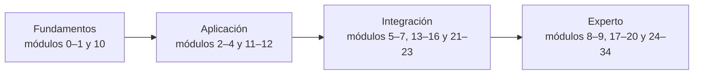
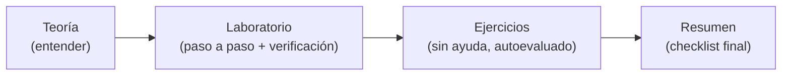
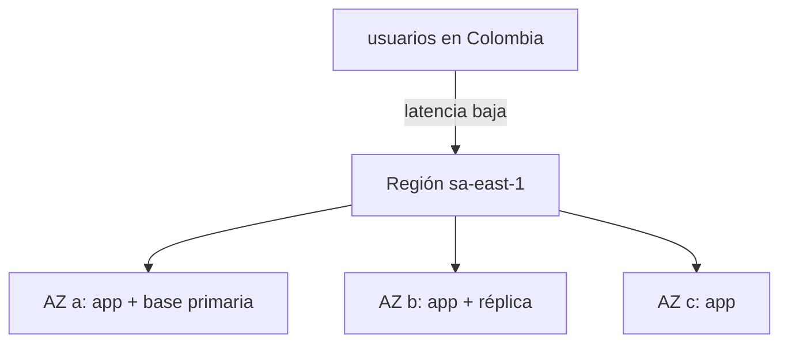

# Módulo 0: Introducción y preparación


## Antes de comenzar: prepara solo lo que necesitas

Ve instalando herramientas cuando el tema las necesite. Para el Tema 1 basta con abrir Terminal en macOS/Linux o PowerShell en Windows. Antes del Tema 2 necesitarás [Node.js](https://nodejs.org/en/download/); antes del Tema 4, Docker. AWS CLI y Python se preparan en los laboratorios que los usan.

El curso funciona con servicios locales y no requiere una cuenta cloud ni tarjeta. Usa solo las credenciales de prueba que indican los ejemplos; nunca pegues claves de una cuenta real.

## Mapa de la ruta

«Cloud Local — AWS, Azure y GCP» tiene 35 módulos en 4 etapas. Cada etapa se apoya en la anterior; usa la tabla para saltar a un módulo concreto.



| Módulo | Etapa | Qué aprendes |
|---|---|---|
| 0 | Fundamentos | [Introducción y preparación](/curso/cloud/0) |
| 1 | Fundamentos | [Fundamentos de Docker y contenedores](/curso/cloud/1) |
| 2 | Aplicación | [Almacenamiento en la nube con S3](/curso/cloud/2) |
| 3 | Aplicación | [Mensajería asíncrona con SQS](/curso/cloud/3) |
| 4 | Aplicación | [Bases de datos NoSQL con DynamoDB](/curso/cloud/4) |
| 5 | Integración | [Serverless con Lambda](/curso/cloud/5) |
| 6 | Integración | [APIs con API Gateway](/curso/cloud/6) |
| 7 | Integración | [Identidad y acceso con IAM](/curso/cloud/7) |
| 8 | Experto | [Azure y GCP con Floci](/curso/cloud/8) |
| 9 | Experto | [Proyecto final: Sistema de Gestión de Tareas](/curso/cloud/9) |
| 10 | Fundamentos | [Secretos y configuración: Secrets Manager, Key Vault y Secret Manager](/curso/cloud/10) |
| 11 | Aplicación | [Mensajería Pub/Sub: SNS, EventBridge y Azure Event Hubs](/curso/cloud/11) |
| 12 | Aplicación | [Observabilidad con CloudWatch: logs, métricas y alarmas](/curso/cloud/12) |
| 13 | Integración | [Bases de datos relacionales con RDS (PostgreSQL real)](/curso/cloud/13) |
| 14 | Integración | [Contenedores: ECR, ECS y comparación con Cloud Run](/curso/cloud/14) |
| 15 | Integración | [Infraestructura como código con CloudFormation](/curso/cloud/15) |
| 16 | Integración | [Orquestación de flujos con Step Functions](/curso/cloud/16) |
| 17 | Experto | [Streaming: Kinesis, MSK (Kafka) y Pub/Sub avanzado](/curso/cloud/17) |
| 18 | Experto | [Autenticación de usuarios con Cognito](/curso/cloud/18) |
| 19 | Experto | [Analítica de datos con Athena y Glue](/curso/cloud/19) |
| 20 | Experto | [IA y servicios especializados: Bedrock, Textract y Transcribe](/curso/cloud/20) |
| 21 | Integración | [Cómputo elástico con EC2 y Auto Scaling](/curso/cloud/21) |
| 22 | Integración | [Balanceo de carga, CDN y DNS — ELB, CloudFront, Route53 y ACM](/curso/cloud/22) |
| 23 | Integración | [Caché en memoria con ElastiCache](/curso/cloud/23) |
| 24 | Experto | [CI/CD nativo de AWS con CodeBuild y CodeDeploy](/curso/cloud/24) |
| 25 | Experto | [Gobierno, configuración y continuidad — AWS Config, AppConfig y Backup](/curso/cloud/25) |
| 26 | Experto | [Streaming e integración avanzada — Firehose y EventBridge Pipes](/curso/cloud/26) |
| 27 | Experto | [APIs GraphQL con AppSync y correo transaccional con SES](/curso/cloud/27) |
| 28 | Experto | [Bases de datos de grafos y búsqueda — Neptune y OpenSearch](/curso/cloud/28) |
| 29 | Experto | [FinOps y gobierno de cuenta — Cost Explorer, Pricing, BCM Data Exports, Resource Groups Tagging y STS](/curso/cloud/29) |
| 30 | Experto | [Transferencia de archivos gestionada con Transfer Family](/curso/cloud/30) |
| 31 | Experto | [Proyecto integrador: API multi-nube con AWS, Azure y GCP](/curso/cloud/31) |
| 32 | Experto | [Arquitectura cloud resiliente: redes, landing zones y recuperación](/curso/cloud/32) |
| 33 | Experto | [Cloud Master: plataforma, seguridad, datos y FinOps](/curso/cloud/33) |
| 34 | Experto | [Floci oficial completo: plataforma, servicios y laboratorios](/curso/cloud/34) |

## Aprende construyendo


### Tema 1: Fundamentos absolutos — qué es una terminal, un comando y un sistema operativo · Básico · 20 min

<details open>
<summary><strong>Capa 1 — Lectura</strong></summary>

#### ► DE QUÉ TRATA
Al finalizar podrás crear una carpeta, entrar en ella y guardar un archivo. Conocimiento previo: ninguno. Abre Terminal en macOS/Linux o PowerShell en Windows. No necesitas saber programar ni instalar Docker.

#### ► LA IDEA EN UNA FRASE
**Al finalizar podrás crear una carpeta, entrar en ella y guardar un archivo.**

#### ► POR QUÉ EXISTE ESTO
Resuelve un problema real de diseño o implementación y evita decisiones a ciegas.

#### ► LA ANALOGÍA
Piensa en fundamentos absolutos — qué es una terminal, un comando y un sistema operativo como una herramienta de taller: útil cuando conoces su propósito y sus límites.
**Dónde se rompe la analogía:** en software, los efectos dependen del contexto, la escala y los trade-offs.

#### ► CÓMO FUNCIONA
1. Identifica el problema que fundamentos absolutos — qué es una terminal, un comando y un sistema operativo resuelve.
2. Observa sus componentes y relaciones.
3. Aplica la opción más simple que funcione.
4. Verifica el resultado y los límites.

#### ► LO QUE PUEDE SALIR MAL
| Síntoma | Causa probable | Arreglo |
|---|---|---|
| Fundamentos absolutos — qué es una terminal, un comando y un sistema operativo se aplica pero el resultado no mejora | Se usó sin medir el problema real | Mide antes y compara contra la alternativa simple |
| Aparece complejidad inesperada | Se adoptó la técnica sin comprender sus trade-offs | Vuelve a la sección de trade-offs y reduce el alcance |
| Falla en un caso límite | Se asumió un contexto que no se cumple | Prueba el caso límite y documenta cuándo NO usarlo |

#### ► TRADE-OFFS
| Opción | Cuándo usarla | Cuándo NO usarla |
|---|---|---|
| Usar Fundamentos absolutos — qué es una terminal, un comando y un sistema operativo | Cuando el problema coincide con su propósito y el beneficio es observable | Cuando agrega complejidad sin resolver un problema real |
| Alternativa más simple | Cuando el contexto es pequeño, estable o fácil de razonar | Cuando ya demostró no escalar o no cumplir el requisito |
| Postergar la decisión | Cuando falta evidencia del problema | Cuando el costo de esperar es mayor que el costo de probar |

#### ► CUÁNDO NO USAR ESTO
No uses fundamentos absolutos — qué es una terminal, un comando y un sistema operativo por defecto. Aplícalo cuando el problema lo justifique y puedas verificar el beneficio; si una alternativa más simple resuelve igual, prefiérela.

#### ► DE VUELTA A LA ANALOGÍA
Volviendo a la analogía: fundamentos absolutos — qué es una terminal, un comando y un sistema operativo funciona como el modelo inicial, pero recuerda dónde se rompe: en producción importan la evidencia, la escala y el costo de equivocarte.

#### ► LO QUE DEBES RECORDAR
- Fundamentos absolutos — qué es una terminal, un comando y un sistema operativo existe para resolver un problema específico.
- Mide antes de adoptar complejidad.
- Conoce el caso donde NO usarlo.
- Verifica con evidencia observable.

#### ► PREGUNTAS PARA PENSAR
1. ¿Qué problema concreto resuelve fundamentos absolutos — qué es una terminal, un comando y un sistema operativo en tu contexto?
2. ¿Cómo sabrías que fundamentos absolutos — qué es una terminal, un comando y un sistema operativo no está funcionando bien?
3. ¿Qué alternativa más simple considerarías antes de usar fundamentos absolutos — qué es una terminal, un comando y un sistema operativo?

</details>

<details>
<summary><strong>Capa 2 — Construcción</strong></summary>

#### Código y verificación
```bash
mkdir ejemplo-terminal
cd ejemplo-terminal
```

```bash
printf 'Hola, ya estoy en mi carpeta\n' > saludo.txt
pwd
cat saludo.txt
```

```powershell
"Hola, ya estoy en mi carpeta" | Set-Content saludo.txt
Get-Location
Get-Content saludo.txt
```

```bash
echo 'Mi primer archivo' > nota.txt
cat nota.txt
```

```powershell
'Mi primer archivo' | Set-Content nota.txt
Get-Content nota.txt
```

</details>

### Tema 2: Fundamentos de redes — direcciones IP, puertos, HTTP y APIs · Básico · 20 min

<details open>
<summary><strong>Capa 1 — Lectura</strong></summary>

#### ► DE QUÉ TRATA
Al finalizar distinguirás un servidor apagado de una ruta que no existe. Prerrequisitos: Node.js instalado y una terminal. Comprueba node --version; en Windows usa curl.exe. Este ejemplo independiente empieza en una carpeta vacía.

#### ► LA IDEA EN UNA FRASE
**Al finalizar distinguirás un servidor apagado de una ruta que no existe.**

#### ► POR QUÉ EXISTE ESTO
Resuelve un problema real de diseño o implementación y evita decisiones a ciegas.

#### ► LA ANALOGÍA
Piensa en fundamentos de redes — direcciones ip, puertos, http y apis como una herramienta de taller: útil cuando conoces su propósito y sus límites.
**Dónde se rompe la analogía:** en software, los efectos dependen del contexto, la escala y los trade-offs.

#### ► CÓMO FUNCIONA
1. Identifica el problema que fundamentos de redes — direcciones ip, puertos, http y apis resuelve.
2. Observa sus componentes y relaciones.
3. Aplica la opción más simple que funcione.
4. Verifica el resultado y los límites.

#### ► LO QUE PUEDE SALIR MAL
| Síntoma | Causa probable | Arreglo |
|---|---|---|
| Fundamentos de redes — direcciones IP, puertos, HTTP y APIs se aplica pero el resultado no mejora | Se usó sin medir el problema real | Mide antes y compara contra la alternativa simple |
| Aparece complejidad inesperada | Se adoptó la técnica sin comprender sus trade-offs | Vuelve a la sección de trade-offs y reduce el alcance |
| Falla en un caso límite | Se asumió un contexto que no se cumple | Prueba el caso límite y documenta cuándo NO usarlo |

#### ► TRADE-OFFS
| Opción | Cuándo usarla | Cuándo NO usarla |
|---|---|---|
| Usar Fundamentos de redes — direcciones IP, puertos, HTTP y APIs | Cuando el problema coincide con su propósito y el beneficio es observable | Cuando agrega complejidad sin resolver un problema real |
| Alternativa más simple | Cuando el contexto es pequeño, estable o fácil de razonar | Cuando ya demostró no escalar o no cumplir el requisito |
| Postergar la decisión | Cuando falta evidencia del problema | Cuando el costo de esperar es mayor que el costo de probar |

#### ► CUÁNDO NO USAR ESTO
No uses fundamentos de redes — direcciones ip, puertos, http y apis por defecto. Aplícalo cuando el problema lo justifique y puedas verificar el beneficio; si una alternativa más simple resuelve igual, prefiérela.

#### ► DE VUELTA A LA ANALOGÍA
Volviendo a la analogía: fundamentos de redes — direcciones ip, puertos, http y apis funciona como el modelo inicial, pero recuerda dónde se rompe: en producción importan la evidencia, la escala y el costo de equivocarte.

#### ► LO QUE DEBES RECORDAR
- Fundamentos de redes — direcciones IP, puertos, HTTP y APIs existe para resolver un problema específico.
- Mide antes de adoptar complejidad.
- Conoce el caso donde NO usarlo.
- Verifica con evidencia observable.

#### ► PREGUNTAS PARA PENSAR
1. ¿Qué problema concreto resuelve fundamentos de redes — direcciones ip, puertos, http y apis en tu contexto?
2. ¿Cómo sabrías que fundamentos de redes — direcciones ip, puertos, http y apis no está funcionando bien?
3. ¿Qué alternativa más simple considerarías antes de usar fundamentos de redes — direcciones ip, puertos, http y apis?

</details>

<details>
<summary><strong>Capa 2 — Construcción</strong></summary>

#### Código y verificación
```bash
mkdir ejemplo-red
cd ejemplo-red
```

```js
import { createServer } from 'node:http';

const server = createServer((request, response) => {
  const existe = request.method === 'GET' && request.url === '/salud';
  response.writeHead(existe ? 200 : 404, {
    'Content-Type': 'application/json'
  });
  const body = existe
    ? { estado: 'listo' }
    : { error: 'Prueba la ruta /salud' };
  response.end(JSON.stringify(body));
});

server.listen(3000, '127.0.0.1', () => {
  console.log('Listo en http://127.0.0.1:3000');
});
```

```bash
node server.mjs
```

```bash
curl -i http://127.0.0.1:3000/salud
curl -i http://127.0.0.1:3000/otra
```

```js
const existe = request.method === 'GET' &&
  (request.url === '/salud' || request.url === '/version');
const body = existe
  ? request.url === '/version' ? { version: '1' } : { estado: 'listo' }
  : { error: 'Prueba /salud o /version' };
```

</details>

### Tema 3: Qué vas a aprender y cómo está estructurado el curso · Básico · 20 min

<details open>
<summary><strong>Capa 1 — Lectura</strong></summary>

#### ► DE QUÉ TRATA
Al finalizar tendrás una bitácora corta para recordar qué probaste y qué sigue. Conocimiento previo: ninguno. No necesitas memorizar los servicios antes de comenzar.

#### ► LA IDEA EN UNA FRASE
**Al finalizar tendrás una bitácora corta para recordar qué probaste y qué sigue.**

#### ► POR QUÉ EXISTE ESTO
Resuelve un problema real de diseño o implementación y evita decisiones a ciegas.

#### ► LA ANALOGÍA
Piensa en qué vas a aprender y cómo está estructurado el curso como una herramienta de taller: útil cuando conoces su propósito y sus límites.
**Dónde se rompe la analogía:** en software, los efectos dependen del contexto, la escala y los trade-offs.

#### ► CÓMO FUNCIONA
1. Identifica el problema que qué vas a aprender y cómo está estructurado el curso resuelve.
2. Observa sus componentes y relaciones.
3. Aplica la opción más simple que funcione.
4. Verifica el resultado y los límites.

#### ► LO QUE PUEDE SALIR MAL
| Síntoma | Causa probable | Arreglo |
|---|---|---|
| Qué vas a aprender y cómo está estructurado el curso se aplica pero el resultado no mejora | Se usó sin medir el problema real | Mide antes y compara contra la alternativa simple |
| Aparece complejidad inesperada | Se adoptó la técnica sin comprender sus trade-offs | Vuelve a la sección de trade-offs y reduce el alcance |
| Falla en un caso límite | Se asumió un contexto que no se cumple | Prueba el caso límite y documenta cuándo NO usarlo |

#### ► TRADE-OFFS
| Opción | Cuándo usarla | Cuándo NO usarla |
|---|---|---|
| Usar Qué vas a aprender y cómo está estructurado el curso | Cuando el problema coincide con su propósito y el beneficio es observable | Cuando agrega complejidad sin resolver un problema real |
| Alternativa más simple | Cuando el contexto es pequeño, estable o fácil de razonar | Cuando ya demostró no escalar o no cumplir el requisito |
| Postergar la decisión | Cuando falta evidencia del problema | Cuando el costo de esperar es mayor que el costo de probar |

#### ► CUÁNDO NO USAR ESTO
No uses qué vas a aprender y cómo está estructurado el curso por defecto. Aplícalo cuando el problema lo justifique y puedas verificar el beneficio; si una alternativa más simple resuelve igual, prefiérela.

#### ► DE VUELTA A LA ANALOGÍA
Volviendo a la analogía: qué vas a aprender y cómo está estructurado el curso funciona como el modelo inicial, pero recuerda dónde se rompe: en producción importan la evidencia, la escala y el costo de equivocarte.

#### ► LO QUE DEBES RECORDAR
- Qué vas a aprender y cómo está estructurado el curso existe para resolver un problema específico.
- Mide antes de adoptar complejidad.
- Conoce el caso donde NO usarlo.
- Verifica con evidencia observable.

#### ► PREGUNTAS PARA PENSAR
1. ¿Qué problema concreto resuelve qué vas a aprender y cómo está estructurado el curso en tu contexto?
2. ¿Cómo sabrías que qué vas a aprender y cómo está estructurado el curso no está funcionando bien?
3. ¿Qué alternativa más simple considerarías antes de usar qué vas a aprender y cómo está estructurado el curso?

</details>

<details>
<summary><strong>Capa 2 — Construcción</strong></summary>

#### Código y verificación
```bash
mkdir mi-ruta
cd mi-ruta
```

```markdown
# Mi bitácora

Tema: terminal
Archivo: ejemplo-terminal/saludo.txt
Comando: cat saludo.txt (o Get-Content saludo.txt)
Resultado: Hola, ya estoy en mi carpeta
Error que corregí: escribí mal el nombre
Siguiente paso: probar una petición HTTP
```

```bash
cd mi-ruta
cat bitacora.md
```

</details>

### Tema 4: Qué es Floci — definición, propósito y comparativa con LocalStack · Básico · 20 min

<details open>
<summary><strong>Capa 1 — Lectura</strong></summary>

#### ► DE QUÉ TRATA
Al terminar podrás reconocer qué hace Floci y comprobar si está respondiendo en tu computador. Necesitas Docker Desktop abierto y una terminal. En la carpeta principal del proyecto ejecuta docker --version.

#### ► LA IDEA EN UNA FRASE
**Al terminar podrás reconocer qué hace Floci y comprobar si está respondiendo en tu computador.**

#### ► POR QUÉ EXISTE ESTO
Resuelve un problema real de diseño o implementación y evita decisiones a ciegas.

#### ► LA ANALOGÍA
Piensa en qué es floci — definición, propósito y comparativa con localstack como una herramienta de taller: útil cuando conoces su propósito y sus límites.
**Dónde se rompe la analogía:** en software, los efectos dependen del contexto, la escala y los trade-offs.

#### ► CÓMO FUNCIONA
1. Identifica el problema que qué es floci — definición, propósito y comparativa con localstack resuelve.
2. Observa sus componentes y relaciones.
3. Aplica la opción más simple que funcione.
4. Verifica el resultado y los límites.

#### ► LO QUE PUEDE SALIR MAL
| Síntoma | Causa probable | Arreglo |
|---|---|---|
| Qué es Floci — definición, propósito y comparativa con LocalStack se aplica pero el resultado no mejora | Se usó sin medir el problema real | Mide antes y compara contra la alternativa simple |
| Aparece complejidad inesperada | Se adoptó la técnica sin comprender sus trade-offs | Vuelve a la sección de trade-offs y reduce el alcance |
| Falla en un caso límite | Se asumió un contexto que no se cumple | Prueba el caso límite y documenta cuándo NO usarlo |

#### ► TRADE-OFFS
| Opción | Cuándo usarla | Cuándo NO usarla |
|---|---|---|
| Usar Qué es Floci — definición, propósito y comparativa con LocalStack | Cuando el problema coincide con su propósito y el beneficio es observable | Cuando agrega complejidad sin resolver un problema real |
| Alternativa más simple | Cuando el contexto es pequeño, estable o fácil de razonar | Cuando ya demostró no escalar o no cumplir el requisito |
| Postergar la decisión | Cuando falta evidencia del problema | Cuando el costo de esperar es mayor que el costo de probar |

#### ► CUÁNDO NO USAR ESTO
No uses qué es floci — definición, propósito y comparativa con localstack por defecto. Aplícalo cuando el problema lo justifique y puedas verificar el beneficio; si una alternativa más simple resuelve igual, prefiérela.

#### ► DE VUELTA A LA ANALOGÍA
Volviendo a la analogía: qué es floci — definición, propósito y comparativa con localstack funciona como el modelo inicial, pero recuerda dónde se rompe: en producción importan la evidencia, la escala y el costo de equivocarte.

#### ► LO QUE DEBES RECORDAR
- Qué es Floci — definición, propósito y comparativa con LocalStack existe para resolver un problema específico.
- Mide antes de adoptar complejidad.
- Conoce el caso donde NO usarlo.
- Verifica con evidencia observable.

#### ► PREGUNTAS PARA PENSAR
1. ¿Qué problema concreto resuelve qué es floci — definición, propósito y comparativa con localstack en tu contexto?
2. ¿Cómo sabrías que qué es floci — definición, propósito y comparativa con localstack no está funcionando bien?
3. ¿Qué alternativa más simple considerarías antes de usar qué es floci — definición, propósito y comparativa con localstack?

</details>

<details>
<summary><strong>Capa 2 — Construcción</strong></summary>

#### Código y verificación
```bash
docker compose up -d aws-local
docker compose ps aws-local
curl -i http://localhost:4566/_floci/health
```

```js
const respuesta = await fetch("http://localhost:4566/_floci/health");

console.log(`Floci respondió: ${respuesta.status}`);
```

```bash
docker compose stop aws-local
curl -i http://localhost:4566/_floci/health
```

</details>

### Tema 5: Servicios que emula Floci — AWS, Azure y GCP · Básico · 20 min

<details open>
<summary><strong>Capa 1 — Lectura</strong></summary>

#### ► DE QUÉ TRATA
Al terminar podrás ubicar qué proveedor responde en cada puerto. No necesitas instalar tres herramientas: el Compose del proyecto ya describe los tres servicios.

#### ► LA IDEA EN UNA FRASE
**Al terminar podrás ubicar qué proveedor responde en cada puerto.**

#### ► POR QUÉ EXISTE ESTO
Resuelve un problema real de diseño o implementación y evita decisiones a ciegas.

#### ► LA ANALOGÍA
Piensa en servicios que emula floci — aws, azure y gcp como una herramienta de taller: útil cuando conoces su propósito y sus límites.
**Dónde se rompe la analogía:** en software, los efectos dependen del contexto, la escala y los trade-offs.

#### ► CÓMO FUNCIONA
1. Identifica el problema que servicios que emula floci — aws, azure y gcp resuelve.
2. Observa sus componentes y relaciones.
3. Aplica la opción más simple que funcione.
4. Verifica el resultado y los límites.

#### ► LO QUE PUEDE SALIR MAL
| Síntoma | Causa probable | Arreglo |
|---|---|---|
| Servicios que emula Floci — AWS, Azure y GCP se aplica pero el resultado no mejora | Se usó sin medir el problema real | Mide antes y compara contra la alternativa simple |
| Aparece complejidad inesperada | Se adoptó la técnica sin comprender sus trade-offs | Vuelve a la sección de trade-offs y reduce el alcance |
| Falla en un caso límite | Se asumió un contexto que no se cumple | Prueba el caso límite y documenta cuándo NO usarlo |

#### ► TRADE-OFFS
| Opción | Cuándo usarla | Cuándo NO usarla |
|---|---|---|
| Usar Servicios que emula Floci — AWS, Azure y GCP | Cuando el problema coincide con su propósito y el beneficio es observable | Cuando agrega complejidad sin resolver un problema real |
| Alternativa más simple | Cuando el contexto es pequeño, estable o fácil de razonar | Cuando ya demostró no escalar o no cumplir el requisito |
| Postergar la decisión | Cuando falta evidencia del problema | Cuando el costo de esperar es mayor que el costo de probar |

#### ► CUÁNDO NO USAR ESTO
No uses servicios que emula floci — aws, azure y gcp por defecto. Aplícalo cuando el problema lo justifique y puedas verificar el beneficio; si una alternativa más simple resuelve igual, prefiérela.

#### ► DE VUELTA A LA ANALOGÍA
Volviendo a la analogía: servicios que emula floci — aws, azure y gcp funciona como el modelo inicial, pero recuerda dónde se rompe: en producción importan la evidencia, la escala y el costo de equivocarte.

#### ► LO QUE DEBES RECORDAR
- Servicios que emula Floci — AWS, Azure y GCP existe para resolver un problema específico.
- Mide antes de adoptar complejidad.
- Conoce el caso donde NO usarlo.
- Verifica con evidencia observable.

#### ► PREGUNTAS PARA PENSAR
1. ¿Qué problema concreto resuelve servicios que emula floci — aws, azure y gcp en tu contexto?
2. ¿Cómo sabrías que servicios que emula floci — aws, azure y gcp no está funcionando bien?
3. ¿Qué alternativa más simple considerarías antes de usar servicios que emula floci — aws, azure y gcp?

</details>

<details>
<summary><strong>Capa 2 — Construcción</strong></summary>

#### Código y verificación
```bash
docker compose config --services
```

```text
AWS: S3 — puerto 4566
Azure: Blob Storage — puerto 4577
Google Cloud: Cloud Storage — puerto 4588
```

</details>

### Tema 6: Ventajas y limitaciones de practicar con un emulador local · Básico · 20 min

<details open>
<summary><strong>Capa 1 — Lectura</strong></summary>

#### ► DE QUÉ TRATA
Al terminar podrás distinguir qué confirma una prueba local y qué todavía no confirma. Necesitas la carpeta principal del proyecto y puedes hacer el ejercicio aunque Docker no esté instalado.

#### ► LA IDEA EN UNA FRASE
**Al terminar podrás distinguir qué confirma una prueba local y qué todavía no confirma.**

#### ► POR QUÉ EXISTE ESTO
Resuelve un problema real de diseño o implementación y evita decisiones a ciegas.

#### ► LA ANALOGÍA
Piensa en ventajas y limitaciones de practicar con un emulador local como una herramienta de taller: útil cuando conoces su propósito y sus límites.
**Dónde se rompe la analogía:** en software, los efectos dependen del contexto, la escala y los trade-offs.

#### ► CÓMO FUNCIONA
1. Identifica el problema que ventajas y limitaciones de practicar con un emulador local resuelve.
2. Observa sus componentes y relaciones.
3. Aplica la opción más simple que funcione.
4. Verifica el resultado y los límites.

#### ► LO QUE PUEDE SALIR MAL
| Síntoma | Causa probable | Arreglo |
|---|---|---|
| Ventajas y limitaciones de practicar con un emulador local se aplica pero el resultado no mejora | Se usó sin medir el problema real | Mide antes y compara contra la alternativa simple |
| Aparece complejidad inesperada | Se adoptó la técnica sin comprender sus trade-offs | Vuelve a la sección de trade-offs y reduce el alcance |
| Falla en un caso límite | Se asumió un contexto que no se cumple | Prueba el caso límite y documenta cuándo NO usarlo |

#### ► TRADE-OFFS
| Opción | Cuándo usarla | Cuándo NO usarla |
|---|---|---|
| Usar Ventajas y limitaciones de practicar con un emulador local | Cuando el problema coincide con su propósito y el beneficio es observable | Cuando agrega complejidad sin resolver un problema real |
| Alternativa más simple | Cuando el contexto es pequeño, estable o fácil de razonar | Cuando ya demostró no escalar o no cumplir el requisito |
| Postergar la decisión | Cuando falta evidencia del problema | Cuando el costo de esperar es mayor que el costo de probar |

#### ► CUÁNDO NO USAR ESTO
No uses ventajas y limitaciones de practicar con un emulador local por defecto. Aplícalo cuando el problema lo justifique y puedas verificar el beneficio; si una alternativa más simple resuelve igual, prefiérela.

#### ► DE VUELTA A LA ANALOGÍA
Volviendo a la analogía: ventajas y limitaciones de practicar con un emulador local funciona como el modelo inicial, pero recuerda dónde se rompe: en producción importan la evidencia, la escala y el costo de equivocarte.

#### ► LO QUE DEBES RECORDAR
- Ventajas y limitaciones de practicar con un emulador local existe para resolver un problema específico.
- Mide antes de adoptar complejidad.
- Conoce el caso donde NO usarlo.
- Verifica con evidencia observable.

#### ► PREGUNTAS PARA PENSAR
1. ¿Qué problema concreto resuelve ventajas y limitaciones de practicar con un emulador local en tu contexto?
2. ¿Cómo sabrías que ventajas y limitaciones de practicar con un emulador local no está funcionando bien?
3. ¿Qué alternativa más simple considerarías antes de usar ventajas y limitaciones de practicar con un emulador local?

</details>

<details>
<summary><strong>Capa 2 — Construcción</strong></summary>

#### Código y verificación
```bash
curl -i http://localhost:4566/_floci/health
```

</details>

### Tema 7: Metodología de estudio — teoría, laboratorio y evaluación en cada módulo · Básico · 20 min

<details open>
<summary><strong>Capa 1 — Lectura</strong></summary>

#### ► DE QUÉ TRATA
Al finalizar podrás estudiar cada módulo del curso con el mismo ciclo de tres fases y dejar evidencia de cada una en una bitácora versionada. Conceptos clave: ciclo teoría-práctica-evaluación, entregable verificable, autoevaluación con criterios de éxito. Prerrequisitos: una term…

#### ► LA IDEA EN UNA FRASE
**Al finalizar podrás estudiar cada módulo del curso con el mismo ciclo de tres fases y dejar evidencia de cada una en una bitácora versionada.**

#### ► POR QUÉ EXISTE ESTO
Resuelve un problema real de diseño o implementación y evita decisiones a ciegas.

#### ► LA ANALOGÍA
Piensa en metodología de estudio — teoría, laboratorio y evaluación en cada módulo como una herramienta de taller: útil cuando conoces su propósito y sus límites.
**Dónde se rompe la analogía:** en software, los efectos dependen del contexto, la escala y los trade-offs.

#### ► CÓMO FUNCIONA


#### ► LO QUE PUEDE SALIR MAL
| Síntoma | Causa probable | Arreglo |
|---|---|---|
| Metodología de estudio — teoría, laboratorio y evaluación en cada módulo se aplica pero el resultado no mejora | Se usó sin medir el problema real | Mide antes y compara contra la alternativa simple |
| Aparece complejidad inesperada | Se adoptó la técnica sin comprender sus trade-offs | Vuelve a la sección de trade-offs y reduce el alcance |
| Falla en un caso límite | Se asumió un contexto que no se cumple | Prueba el caso límite y documenta cuándo NO usarlo |

#### ► TRADE-OFFS
| Opción | Cuándo usarla | Cuándo NO usarla |
|---|---|---|
| Usar Metodología de estudio — teoría, laboratorio y evaluación en cada módulo | Cuando el problema coincide con su propósito y el beneficio es observable | Cuando agrega complejidad sin resolver un problema real |
| Alternativa más simple | Cuando el contexto es pequeño, estable o fácil de razonar | Cuando ya demostró no escalar o no cumplir el requisito |
| Postergar la decisión | Cuando falta evidencia del problema | Cuando el costo de esperar es mayor que el costo de probar |

#### ► CUÁNDO NO USAR ESTO
No uses metodología de estudio — teoría, laboratorio y evaluación en cada módulo por defecto. Aplícalo cuando el problema lo justifique y puedas verificar el beneficio; si una alternativa más simple resuelve igual, prefiérela.

#### ► DE VUELTA A LA ANALOGÍA
Volviendo a la analogía: metodología de estudio — teoría, laboratorio y evaluación en cada módulo funciona como el modelo inicial, pero recuerda dónde se rompe: en producción importan la evidencia, la escala y el costo de equivocarte.

#### ► LO QUE DEBES RECORDAR
- Metodología de estudio — teoría, laboratorio y evaluación en cada módulo existe para resolver un problema específico.
- Mide antes de adoptar complejidad.
- Conoce el caso donde NO usarlo.
- Verifica con evidencia observable.

#### ► PREGUNTAS PARA PENSAR
1. ¿Qué problema concreto resuelve metodología de estudio — teoría, laboratorio y evaluación en cada módulo en tu contexto?
2. ¿Cómo sabrías que metodología de estudio — teoría, laboratorio y evaluación en cada módulo no está funcionando bien?
3. ¿Qué alternativa más simple considerarías antes de usar metodología de estudio — teoría, laboratorio y evaluación en cada módulo?

</details>

<details>
<summary><strong>Capa 2 — Construcción</strong></summary>

#### Código y verificación


```bash
mkdir -p academia-cloud/src && cd academia-cloud
git init -q
printf '# Bitácora\n\n## Módulo 0\n- Teoría: leí los temas 1-7\n- Laboratorio: pendiente\n- Evaluación: pendiente\n' > src/study-log.md
git add src/study-log.md && git commit -qm "bitácora: inicia módulo 0"
git log --oneline -1
```

```bash
aws --endpoint-url http://localhost:4566 sts get-caller-identity
```

</details>

### Tema 8: Modelos de servicio (IaaS, PaaS, SaaS), regiones y zonas de disponibilidad · Básico · 40 min

<details open>
<summary><strong>Capa 1 — Lectura</strong></summary>

#### ► DE QUÉ TRATA
Ten a mano la AWS CLI configurada contra el emulador local del curso (levántalo con docker compose up -d aws-local desde la carpeta principal del proyecto y exporta AWS_ENDPOINT_URL=http://localhost:4566 junto con las credenciales test del laboratorio de este módulo) o una cuenta…

#### ► LA IDEA EN UNA FRASE
**Ten a mano la AWS CLI configurada contra el emulador local del curso (levántalo con docker compose up -d aws-local desde la carpeta principal del proyecto y exporta AWS_ENDPOINT_URL=http://localhost:4566 junto con las credenciales test del laboratorio de este módulo) o una cuenta real en modo solo lectura.**

#### ► POR QUÉ EXISTE ESTO
Resuelve un problema real de diseño o implementación y evita decisiones a ciegas.

#### ► LA ANALOGÍA
Piensa en modelos de servicio (iaas, paas, saas), regiones y zonas de disponibilidad como una herramienta de taller: útil cuando conoces su propósito y sus límites.
**Dónde se rompe la analogía:** en software, los efectos dependen del contexto, la escala y los trade-offs.

#### ► CÓMO FUNCIONA


#### ► LO QUE PUEDE SALIR MAL
| Síntoma | Causa probable | Arreglo |
|---|---|---|
| Modelos de servicio (IaaS, PaaS, SaaS), regiones y zonas de disponibilidad se aplica pero el resultado no mejora | Se usó sin medir el problema real | Mide antes y compara contra la alternativa simple |
| Aparece complejidad inesperada | Se adoptó la técnica sin comprender sus trade-offs | Vuelve a la sección de trade-offs y reduce el alcance |
| Falla en un caso límite | Se asumió un contexto que no se cumple | Prueba el caso límite y documenta cuándo NO usarlo |

#### ► TRADE-OFFS
| Opción | Cuándo usarla | Cuándo NO usarla |
|---|---|---|
| Usar Modelos de servicio (IaaS, PaaS, SaaS), regiones y zonas de disponibilidad | Cuando el problema coincide con su propósito y el beneficio es observable | Cuando agrega complejidad sin resolver un problema real |
| Alternativa más simple | Cuando el contexto es pequeño, estable o fácil de razonar | Cuando ya demostró no escalar o no cumplir el requisito |
| Postergar la decisión | Cuando falta evidencia del problema | Cuando el costo de esperar es mayor que el costo de probar |

#### ► CUÁNDO NO USAR ESTO
No uses modelos de servicio (iaas, paas, saas), regiones y zonas de disponibilidad por defecto. Aplícalo cuando el problema lo justifique y puedas verificar el beneficio; si una alternativa más simple resuelve igual, prefiérela.

#### ► DE VUELTA A LA ANALOGÍA
Volviendo a la analogía: modelos de servicio (iaas, paas, saas), regiones y zonas de disponibilidad funciona como el modelo inicial, pero recuerda dónde se rompe: en producción importan la evidencia, la escala y el costo de equivocarte.

#### ► LO QUE DEBES RECORDAR
- Modelos de servicio (IaaS, PaaS, SaaS), regiones y zonas de disponibilidad existe para resolver un problema específico.
- Mide antes de adoptar complejidad.
- Conoce el caso donde NO usarlo.
- Verifica con evidencia observable.

#### ► PREGUNTAS PARA PENSAR
1. ¿Qué problema concreto resuelve modelos de servicio (iaas, paas, saas), regiones y zonas de disponibilidad en tu contexto?
2. ¿Cómo sabrías que modelos de servicio (iaas, paas, saas), regiones y zonas de disponibilidad no está funcionando bien?
3. ¿Qué alternativa más simple considerarías antes de usar modelos de servicio (iaas, paas, saas), regiones y zonas de disponibilidad?

</details>

<details>
<summary><strong>Capa 2 — Construcción</strong></summary>

#### Código y verificación


```markdown
# Decisión de región para RutaFlow
| Criterio | us-east-1 | sa-east-1 |
|---|---|---|
| Latencia medida desde Bogotá (ms) | (medir) | (medir) |
| ¿Tiene todos los servicios que usamos? | sí | revisar |
| Costo relativo de cómputo | menor | mayor |
| Requisito legal de residencia | revisar con legal | revisar con legal |
Decisión: ... · Zonas: al menos 2 AZ para la API y la base.
```

```bash
export AWS_ENDPOINT_URL=http://localhost:4566   # omítelo si usas tu perfil de AWS en modo lectura
export AWS_ACCESS_KEY_ID=test AWS_SECRET_ACCESS_KEY=test AWS_DEFAULT_REGION=us-east-1
aws ec2 describe-regions --query "Regions[].RegionName" --output text
aws ec2 describe-availability-zones --region us-east-1 --query "AvailabilityZones[].ZoneName" --output text
```

```text
describe-regions devuelve una lista como: us-east-1 us-east-2 us-west-2 sa-east-1 eu-west-1 ...
describe-availability-zones devuelve varias zonas: us-east-1a us-east-1b us-east-1c ...
```

</details>
