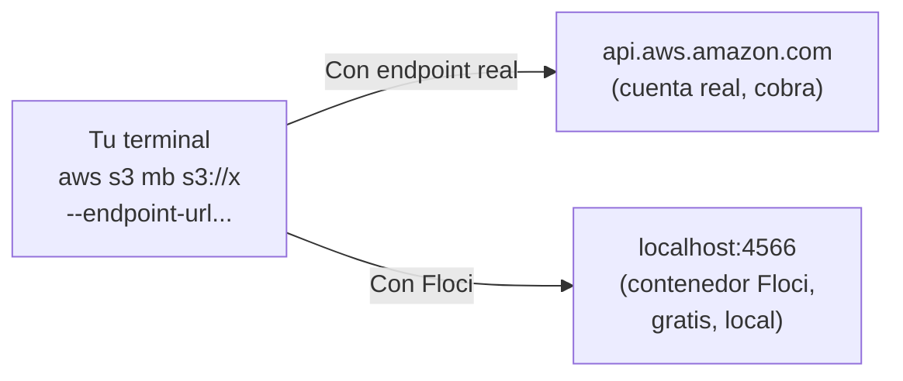
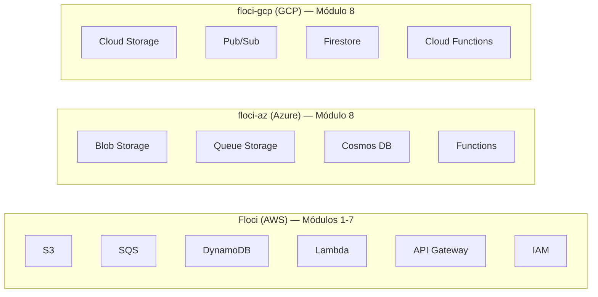
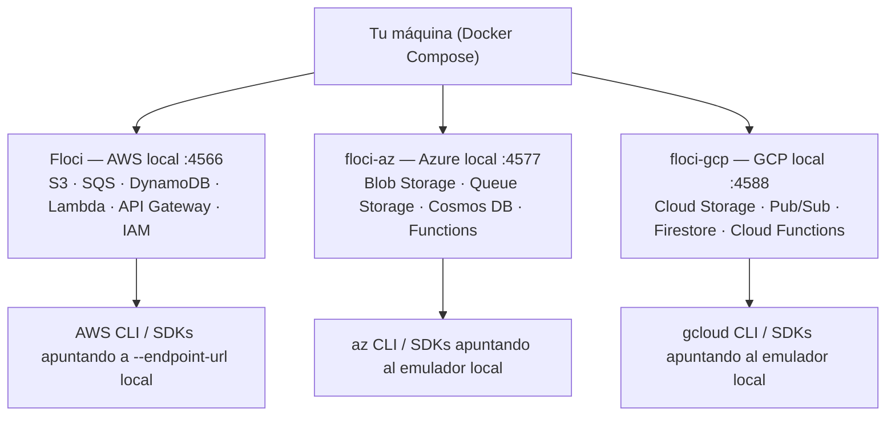
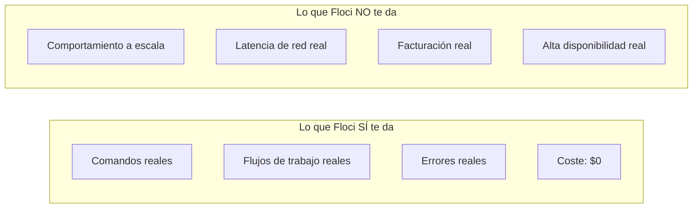
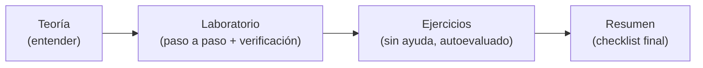

# Módulo 0: Introducción y preparación


## Antes de comenzar: prepara solo lo que necesitas

Ve instalando herramientas cuando el tema las necesite. Para el Tema 1 basta con abrir Terminal en macOS/Linux o PowerShell en Windows. Antes del Tema 2 necesitarás [Node.js](https://nodejs.org/en/download/); antes del Tema 4, Docker. AWS CLI y Python se preparan en los laboratorios que los usan.

El curso funciona con servicios locales y no requiere una cuenta cloud ni tarjeta. Usa solo las credenciales de prueba que indican los ejemplos; nunca pegues claves de una cuenta real.

## Aprende construyendo

### Tema 1: Fundamentos absolutos — qué es una terminal, un comando y un sistema operativo

#### Paso 1 · Objetivo y preparación
Al finalizar podrás crear una carpeta, entrar en ella y guardar un archivo. **Conocimiento previo:** ninguno. Abre Terminal en macOS/Linux o PowerShell en Windows. No necesitas saber programar ni instalar Docker.

#### Paso 2 · Contexto y caso real
Cuando guardas un proyecto, importa saber en qué carpeta estás. Si ejecutas una orden en otro lugar, el archivo puede terminar donde no lo encuentras. **¿Por qué es importante?** Saber dónde estás evita perder archivos y repetir trabajo.

#### Paso 3 · Teoría sencilla y analogía
La **terminal** es la ventana donde escribes. Un **comando** es una orden corta. El **sistema operativo** organiza archivos y programas; el **shell** lee la orden y se la entrega al sistema. Si escribes mal una orden, el sistema suele mostrar un mensaje que ayuda a corregirla. **Analogía:** como en una cocina: tú haces el pedido, el shell lo entiende y el sistema lo prepara. Si entraste al restaurante equivocado, la orden no llega a la mesa correcta.

**Recorrido de una orden:** `┌ tú escribes → terminal → shell → sistema operativo ┐`<br>`└ resultado ←────────────────────────────────────────┘`.

#### Paso 4 · Demostración guiada desde cero
Crea el ejemplo independiente en una carpeta nueva y entra en ella. El archivo de texto se llamará `saludo.txt`:

```bash
mkdir ejemplo-terminal
cd ejemplo-terminal
```

En macOS/Linux guarda y muestra el texto:

```bash
printf 'Hola, ya estoy en mi carpeta\n' > saludo.txt
pwd
cat saludo.txt
```

En PowerShell usa:

```powershell
"Hola, ya estoy en mi carpeta" | Set-Content saludo.txt
Get-Location
Get-Content saludo.txt
```

`mkdir` crea la carpeta; `cd` entra en ella; las otras órdenes guardan y muestran el texto. `pwd` y `Get-Location` muestran dónde estás. **Resultado esperado:** verás la ruta de `ejemplo-terminal` y el mensaje `Hola, ya estoy en mi carpeta`. El archivo está en `ejemplo-terminal/saludo.txt`.

#### Paso 5 · Práctica guiada
**Fallo deliberado:** pide leer `salud.txt`, sin la letra “o”. Verás un mensaje de error porque ese archivo no existe. **Pista:** compara el nombre que escribiste con `saludo.txt`; corrígelo y vuelve a leerlo.

#### Paso 6 · Práctica independiente
Guarda una segunda nota y muéstrala. En macOS/Linux:

```bash
echo 'Mi primer archivo' > nota.txt
cat nota.txt
```

En PowerShell:

```powershell
'Mi primer archivo' | Set-Content nota.txt
Get-Content nota.txt
```

Luego cambia a la carpeta anterior e intenta leer `nota.txt`; vuelve a `ejemplo-terminal` y repite. Observa por qué importa la carpeta actual.

#### Paso 7 · Cierre y evidencia
**Evidencia de aprendizaje:** conserva los dos archivos, la ruta, la salida y el error del Paso 5. **Transferencia al proyecto integrador cloud:** guarda esos comandos en la bitácora y repítelos desde la carpeta donde pondrás los laboratorios. El siguiente tema usa la terminal para probar una conexión. **Errores comunes:** confundir el nombre de la carpeta con el del archivo y olvidar dónde estás. **Límite:** macOS/Linux y Windows escriben algunas órdenes de forma distinta; aquí ves ambas.

**Fuente oficial:** [AWS CLI desde una terminal en Windows, macOS y Linux](https://docs.aws.amazon.com/cli/latest/userguide/cli-chap-welcome.html).


### Tema 2: Fundamentos de redes — direcciones IP, puertos, HTTP y APIs

#### Paso 1 · Objetivo y preparación
Al finalizar distinguirás un servidor apagado de una ruta que no existe. **Prerrequisitos:** Node.js instalado y una terminal. Comprueba `node --version`; en Windows usa `curl.exe`. Este ejemplo independiente empieza en una carpeta vacía.

#### Paso 2 · Contexto y caso real
Si una página local no responde, puede que el programa esté apagado, que uses otra puerta o que la dirección pedida no exista. Vamos a probar cada caso. **¿Por qué es importante?** Separar estos problemas te dice qué corregir primero.

#### Paso 3 · Teoría sencilla y analogía
Una **dirección IP** señala el computador que recibe el mensaje. `127.0.0.1` significa “este mismo computador”. El **puerto** es como el número de una puerta; usaremos el `3000`.

HTTP es el formato del mensaje entre dos programas. La ruta `/salud` nos servirá para preguntar si todo está listo. Una **API** es el conjunto de rutas que el programa sabe atender. `200` indica que encontró lo que pedimos; `404`, que esa ruta no existe. **Analogía:** IP es la dirección del edificio, el puerto es el número de puerta y HTTP es la manera de hacer la pregunta.

**Recorrido de la petición:** `┌ cliente → 127.0.0.1:3000 → servidor ┐`<br>`└ cliente ← 200 o 404 ←───────────────┘`.

#### Paso 4 · Demostración guiada desde cero
Crea el ejemplo independiente en una carpeta nueva y entra en ella:

```bash
mkdir ejemplo-red
cd ejemplo-red
```

Crea `server.mjs` dentro de `ejemplo-red` con este contenido:

```js
import { createServer } from 'node:http';

const server = createServer((request, response) => {
  const existe = request.method === 'GET' && request.url === '/salud';
  response.writeHead(existe ? 200 : 404, {
    'Content-Type': 'application/json'
  });
  const body = existe
    ? { estado: 'listo' }
    : { error: 'Prueba la ruta /salud' };
  response.end(JSON.stringify(body));
});

server.listen(3000, '127.0.0.1', () => {
  console.log('Listo en http://127.0.0.1:3000');
});
```

En la primera terminal, entra en `ejemplo-red` e inicia el servidor:

```bash
node server.mjs
```

No cierres esa ventana. En una segunda terminal, prueba:

```bash
curl -i http://127.0.0.1:3000/salud
curl -i http://127.0.0.1:3000/otra
```

En PowerShell escribe `curl.exe -i` al inicio de cada línea. **Resultado esperado:** la primera petición muestra `200` y `{"estado":"listo"}`; la segunda, `404`. `createServer` atiende pedidos, `writeHead` elige el número de respuesta y `listen` deja el programa esperando en la puerta 3000. Deténlo con Ctrl+C.

#### Paso 5 · Práctica guiada
**Fallo deliberado:** cambia el puerto `3000` en el comando por `3001`. Verás un error de conexión porque el programa escucha en `3000`. **Pista:** compara el puerto del comando con el de `server.listen`; corrige el número. Un `404` significa que sí llegaste al servidor; “no se pudo conectar” significa que no.

#### Paso 6 · Práctica independiente
Agrega `/version`. Cambia estas dos partes del archivo:

```js
const existe = request.method === 'GET' &&
  (request.url === '/salud' || request.url === '/version');
const body = existe
  ? request.url === '/version' ? { version: '1' } : { estado: 'listo' }
  : { error: 'Prueba /salud o /version' };
```

Reinicia el servidor y comprueba `/version` y `/no-existe`. Espera `200` con `{"version":"1"}` y `404` para la ruta que no agregaste.

#### Paso 7 · Cierre y evidencia
**Evidencia de aprendizaje:** entrega `server.mjs`, las tres respuestas y la corrección del fallo del Paso 5. **Transferencia al proyecto integrador cloud:** al probar Floci, apunta el puerto y la ruta que usaste; así sabrás si el emulador está apagado o si pediste algo que no existe. El siguiente tema muestra cómo se ordena el curso. **Errores comunes:** confundir el puerto con la ruta y creer que `404` significa que el servidor está apagado. **Límite:** este ejemplo solo escucha en tu computador; no lo publiques en Internet.

**Fuentes oficiales:** [servidor HTTP de Node.js](https://nodejs.org/api/http.html) y [códigos de respuesta](https://developer.mozilla.org/en-US/docs/Web/HTTP/Reference/Status).


### Tema 3: Qué vas a aprender y cómo está estructurado el curso

#### Paso 1 · Objetivo y preparación
Al finalizar tendrás una bitácora corta para recordar qué probaste y qué sigue. **Conocimiento previo:** ninguno. No necesitas memorizar los servicios antes de comenzar.

#### Paso 2 · Contexto y caso real
En un equipo, otra persona necesita repetir tu prueba y entender qué pasó. Una nota con el comando y el resultado ayuda más que escribir “ya funciona”. **¿Por qué es importante?** Una prueba que otra persona puede repetir da confianza en el cambio.

#### Paso 3 · Teoría sencilla y analogía
**Analogía:** el orden es parecido a armar una casa: primero aprendes a usar las herramientas, luego instalas las piezas y al final conectas todo.

| Empiezas por | Luego aprendes | Al final puedes |
|---|---|---|
| Terminal y redes | Contenedores | Ejecutar servicios en tu computador |
| Archivos y colas | Bases de datos y funciones | Guardar datos y reaccionar a eventos |
| APIs y permisos | Servicios avanzados | Conectar sistemas con acceso controlado |
| Integración | Proyecto multi-nube | Probar el sistema completo y explicar decisiones |

No tienes que aprenderlo todo hoy. Avanza cuando puedas mostrar qué hiciste y qué resultado obtuviste.

**Mapa:** `┌ terminal y redes → servicios individuales → combinar servicios ┐`<br>`└ aprender lo básico ───────────────────────→ proyecto completo ┘`.

#### Paso 4 · Demostración guiada: registra una práctica
Crea una carpeta nueva para el ejemplo independiente:

```bash
mkdir mi-ruta
cd mi-ruta
```

Dentro, crea `bitacora.md` con este ejemplo y reemplaza la salida por la tuya:

```markdown
# Mi bitácora

Tema: terminal
Archivo: ejemplo-terminal/saludo.txt
Comando: cat saludo.txt (o Get-Content saludo.txt)
Resultado: Hola, ya estoy en mi carpeta
Error que corregí: escribí mal el nombre
Siguiente paso: probar una petición HTTP
```

Abre el archivo y comprueba que puedes explicar cada línea. Esta nota no es un examen; te ayuda a retomar donde quedaste.

Para volver a verla, entra a `mi-ruta` y ejecuta en macOS/Linux:

```bash
cd mi-ruta
cat bitacora.md
```

En PowerShell usa `Get-Content bitacora.md`. **Resultado esperado:** ves los mismos campos que escribiste y reconoces cuál es el siguiente tema.

#### Paso 5 · Práctica guiada
**Fallo deliberado:** registra en la bitácora que pediste `/salud` antes de iniciar el servidor; apunta el error de conexión. **Pista:** inicia primero el servidor del Tema 2 y repite la petición. Luego cambia el orden de tus tareas para que el registro coincida con lo que observaste.

#### Paso 6 · Práctica independiente
Agrega el resultado real de `/salud` o `/otra`. Si algo falló, apunta el mensaje y la corrección; no inventes la salida.

#### Paso 7 · Cierre y evidencia
**Evidencia de aprendizaje:** entrega `bitacora.md` con dos prácticas y sus resultados. **Transferencia al proyecto integrador cloud:** registra el comando que levantó cada servicio, su salida y el error que corregiste para que alguien pueda repetirlo. El siguiente módulo prepara el entorno. **Errores comunes:** avanzar sin mirar la salida o confundir leer una explicación con haber probado el comando. **Límite:** la bitácora recuerda tu trabajo; por sí sola no demuestra que domines cada servicio.

**Fuente oficial:** [guía oficial de AWS CLI](https://docs.aws.amazon.com/cli/latest/userguide/cli-chap-welcome.html).


### Tema 4: Qué es Floci — definición, propósito y comparativa con LocalStack

#### Paso 1 · Objetivo y preparación
Al finalizar podrás levantar un emulador desde cero. Prerrequisitos: Docker y terminal; verifica `docker --version`.
#### Paso 2 · Contexto y caso real
Practicar localmente reduce riesgo y coste antes de usar una cuenta real.
#### Paso 3 · Teoría, modelo mental y analogía
Un emulador es un aeropuerto de entrenamiento: imita procedimientos, no todos los detalles.
#### Paso 4 · Demostración guiada
Crea `src/floci-check.js` desde una carpeta vacía.
```bash
mkdir ejemplo-floci
docker --version
```
Resultado esperado: Docker disponible.
#### Paso 5 · Práctica guiada
Pista: detén el contenedor para provocar un fallo deliberado y corrígelo.
#### Paso 6 · Práctica independiente
Levanta un servicio y documenta una limitación.
#### Paso 7 · Cierre y evidencia
Entrega comandos, salida, fallo y corrección; explica el resultado. Siguiente paso: catálogo. Errores comunes: asumir paridad total y usar credenciales reales. Fuente oficial: https://docs.docker.com/.
**Conceptos clave:** emulador de nube, API-compatible, LocalStack, entorno local, coste cero.

Floci es un emulador de servicios de nube que corre en tu propia máquina, dentro de un contenedor Docker, y que responde a los mismos comandos y llamadas de API que usarías contra una cuenta real de AWS, Azure o GCP. Cuando ejecutas `aws s3 mb s3://mi-bucket --endpoint-url http://localhost:4566`, Floci recibe esa petición, la procesa como si fuera el servicio S3 real, y te devuelve una respuesta con el mismo formato que devolvería AWS. La única diferencia visible es el `--endpoint-url`: en vez de apuntar a los servidores de Amazon, apunta a un puerto de tu propio ordenador.

Esta idea no es nueva: Floci sigue el mismo enfoque que herramientas como LocalStack, que lleva años siendo el emulador de referencia para AWS en local. La diferencia principal entre Floci y LocalStack para este curso es que Floci empaqueta, en una sola imagen o en un pequeño conjunto de contenedores, emuladores para los tres grandes proveedores —AWS, Azure y GCP— con la misma filosofía de "mismo comando, mismo endpoint local", mientras que replicar esa cobertura multi-nube con otras herramientas normalmente implica combinar varios proyectos distintos (uno por proveedor).

Es fundamental entender qué hace Floci por dentro para no tratarlo como magia: dentro del contenedor corre una implementación que entiende el protocolo HTTP y los formatos de petición/respuesta de cada servicio (S3, SQS, DynamoDB, Lambda, API Gateway, IAM, y sus equivalentes en Azure y GCP), guarda el estado en memoria o en disco local, y expone todo por un puerto TCP. No hay facturación, no hay límites de cuenta gratuita, no hay riesgo de dejarte un recurso encendido y recibir una factura sorpresa a fin de mes.

Esto tiene una consecuencia práctica muy importante para cómo vas a trabajar en este curso: vas a usar las mismas herramientas de línea de comandos que usarías en un trabajo real —AWS CLI, `boto3` en Python, el SDK de Node.js— sin necesidad de crear una cuenta, sin tarjeta de crédito, y sin miedo a romper nada, porque todo lo que hagas vive dentro de un contenedor que puedes borrar y volver a levantar en segundos.

Además del contenedor en sí, el proyecto ofrece dos herramientas oficiales que vas a usar a lo largo del curso: `floci-cli`, una interfaz de línea de comandos (`floci start`, `floci env`, `floci doctor`) que instalarás en el Módulo 1 y que simplifica levantar, verificar y detener Floci sin recordar flags largos de `docker run`; y `floci-ui`, un panel visual para explorar tus buckets S3, tablas DynamoDB y demás recursos desde el navegador en vez de solo desde la terminal. `floci-ui` corre como un proyecto aparte (`github.com/floci-io/floci-ui`), con su propia pila de Docker Compose que incluye su propio Floci integrado — clónalo en otra carpeta y ejecuta `docker compose up` ahí (o `docker compose --profile multicloud up` para AWS, Azure y GCP a la vez) y ábrelo en `http://localhost:4500`; no forma parte del `docker-compose.yml` de este curso.

**Analogía:** Floci es como un simulador de vuelo para pilotos. Un simulador no es un avión real, pero replica fielmente la cabina, los instrumentos y las respuestas del avión ante cada acción del piloto. Un piloto que aprende en el simulador transfiere casi toda esa habilidad al avión real, porque los controles y las reacciones son los mismos; lo único que cambia es que estrellar el simulador no tiene consecuencias. Floci hace lo mismo con la nube: los comandos, las respuestas y los conceptos son los reales, pero equivocarte no cuesta dinero ni compromete una cuenta de producción.

**¿Por qué es importante?** Sin un emulador local, aprender servicios cloud reales tiene dos barreras: el coste (muchos servicios cobran por uso incluso en pruebas) y el riesgo (una mala configuración de IAM o un bucket público mal configurado en una cuenta real puede tener consecuencias serias). Floci elimina ambas barreras para la fase de aprendizaje, y como usa los mismos comandos que la nube real, todo lo que practiques aquí es transferible: el día que uses una cuenta de AWS real, cambias el endpoint y usas exactamente lo mismo que aprendiste.

**Diagrama:**



**Transferencia al proyecto integrador «Cloud local multi-nube»:** Levanta el emulador elegido y crea un bucket de evidencias con credenciales locales. Documenta endpoint y versión, y comprueba que la prueba no depende de una cuenta cloud real.

### Tema 5: Servicios que emula Floci — AWS, Azure y GCP

#### Paso 1 · Objetivo y preparación
Al finalizar podrás identificar endpoints desde cero. Prerrequisitos: Docker y terminal; verifica `docker compose version`.
#### Paso 2 · Contexto y caso real
Una plataforma multi-cloud necesita distinguir proveedor, endpoint y contrato.
#### Paso 3 · Teoría, modelo mental y analogía
Cada endpoint es una ventanilla con catálogo y reglas propias.
#### Paso 4 · Demostración guiada
Crea `src/endpoints.js` desde una carpeta vacía.
```bash
mkdir ejemplo-endpoints
docker compose version
```
Resultado esperado: Compose disponible.
#### Paso 5 · Práctica guiada
Pista: usa un endpoint equivocado para provocar un fallo deliberado y corrígelo.
#### Paso 6 · Práctica independiente
Lista un servicio por proveedor y prueba su respuesta.
#### Paso 7 · Cierre y evidencia
Entrega tabla, salida, fallo y corrección; explica el resultado. Siguiente paso: límites. Errores comunes: mezclar regiones y endpoints. Fuente oficial: https://docs.aws.amazon.com/.
**Conceptos clave:** floci (AWS), floci-az (Azure), floci-gcp (GCP), catálogo de servicios, endpoint por proveedor.

Floci no es un único contenedor: es una familia de tres imágenes, una por proveedor de nube, pensadas para usarse de forma independiente o en conjunto según lo que necesites practicar. La imagen principal, a la que llamamos simplemente Floci, emula servicios de AWS: S3 (almacenamiento de objetos), SQS (colas de mensajes), DynamoDB (base de datos NoSQL), Lambda (funciones serverless), API Gateway (APIs HTTP) e IAM (identidad y acceso), además de los servicios avanzados que verás en módulos posteriores al proyecto final, como Secrets Manager, SNS, EventBridge, CloudWatch, RDS, ECR/ECS y otros.

La segunda imagen, floci-az, emula el equivalente en Azure de esos mismos patrones: Blob Storage en vez de S3, Queue Storage en vez de SQS, Cosmos DB en vez de DynamoDB, y Azure Functions en vez de Lambda. La tercera, floci-gcp, hace lo propio para Google Cloud: Cloud Storage, Pub/Sub, Firestore y Cloud Functions. Vas a conocer estas dos últimas en profundidad en el Módulo 8, pero es importante que sepas desde ahora que existen, porque el objetivo final del curso no es que memorices comandos de AWS, sino que entiendas patrones de nube que se repiten con nombres distintos en cada proveedor.

Cada imagen expone sus servicios en puertos distintos para que puedas tener varias corriendo a la vez sin que choquen entre sí. Floci (AWS) usa por convención el puerto 4566 para casi todos sus servicios (el mismo patrón que usa LocalStack), mientras que floci-az y floci-gcp usan sus propios rangos de puertos que verás documentados cuando llegues al Módulo 8. Por ahora, en los Módulos 1 a 7, vas a trabajar exclusivamente con la imagen de AWS.

Entender esta separación por proveedor desde el principio evita una confusión típica de quien empieza en cloud: pensar que "aprender la nube" es aprender AWS. En realidad estás aprendiendo conceptos —almacenamiento de objetos, colas, bases de datos NoSQL, cómputo sin servidor— que cada proveedor implementa con su propio nombre y su propia API, pero que comparten la misma lógica subyacente. Ese es exactamente el ejercicio que vas a hacer en el Módulo 8: el mismo caso de uso, resuelto en los tres proveedores.

**Analogía:** los tres contenedores de Floci son como tres traductores distintos que hablan idiomas distintos (AWS, Azure, GCP) pero que traducen los mismos conceptos: "guardar un archivo", "enviar un mensaje a una cola", "guardar un registro en una base de datos sin esquema fijo". Aprender los tres no es aprender tres cosas nuevas, es aprender un vocabulario nuevo para las mismas ideas que ya conoces.

**¿Por qué es importante?** Las empresas no siempre usan un solo proveedor de nube, y muchos roles de ingeniería exigen soltura con más de uno, o al menos la capacidad de entender rápido un proveedor nuevo si ya conoces otro. Empezar a distinguir "el servicio" de "el nombre que le pone el proveedor" desde el Módulo 0 te prepara mejor para ese escenario que aprender AWS de memoria sin esa perspectiva.

**Diagrama:**



**Diagrama interactivo — arquitectura de Floci corriendo en local:**



### Tema 6: Ventajas y limitaciones de practicar con un emulador local

#### Paso 1 · Objetivo y preparación
Al finalizar podrás evaluar fidelidad desde cero. Prerrequisitos: Docker y terminal; verifica `docker --version`.
#### Paso 2 · Contexto y caso real
Una prueba local debe declarar qué garantiza y qué no.
#### Paso 3 · Teoría, modelo mental y analogía
La paridad es un puente con límites conocidos; no es una copia perfecta.
#### Paso 4 · Demostración guiada
Crea `src/parity-check.js` desde una carpeta vacía.
```bash
mkdir ejemplo-paridad
docker --version
```
Resultado esperado: herramienta disponible.
#### Paso 5 · Práctica guiada
Pista: usa una operación no emulada para provocar un fallo deliberado y corrígelo documentando el límite.
#### Paso 6 · Práctica independiente
Compara local y documentación oficial.
#### Paso 7 · Cierre y evidencia
Entrega matriz, salida, fallo y corrección; explica el resultado. Siguiente paso: metodología. Errores comunes: extrapolar resultados locales a producción. Fuente oficial: https://docs.aws.amazon.com/.
**Conceptos clave:** paridad de comportamiento, fidelidad parcial, límites del emulador, transferencia de conocimiento.

Ningún emulador es una copia perfecta del servicio real, y es importante que empieces el curso con expectativas correctas sobre esto. Floci reproduce con fidelidad alta el comportamiento funcional de cada servicio: la forma de los comandos, las respuestas, los códigos de error más comunes, y el flujo de trabajo típico. Eso es suficiente para aprender el 90% de lo que necesitas para usar estos servicios en el mundo real. Lo que un emulador no reproduce, y no puede reproducir, es el comportamiento a gran escala: cómo se comporta DynamoDB con mil millones de items, cómo escala Lambda ante diez mil invocaciones simultáneas, o los tiempos de latencia reales entre regiones geográficas distintas.

Tampoco reproduce, salvo excepciones, las integraciones más avanzadas o específicas de cada proveedor que dependen de infraestructura propietaria compleja —ciertas características de seguridad de nivel de red, algunos servicios de machine learning gestionado, o comportamientos de facturación—. Para el objetivo de este curso, que es que entiendas los conceptos y sepas operar cada servicio con confianza, estas limitaciones no son un obstáculo: nadie aprende a programar entendiendo primero cómo escala un sistema a nivel de datacenter.

La ventaja más grande, más allá del coste cero, es la velocidad de iteración. Levantar y destruir un bucket S3, una tabla DynamoDB o una función Lambda en Floci toma segundos. Hacerlo en una cuenta real de AWS también es rápido, pero cada error tiene un coste de contexto: si rompes algo en una cuenta compartida de un equipo real, puedes afectar a otras personas. En Floci, tu única "cuenta" es tu contenedor local: si algo sale mal, lo destruyes con `docker compose down` y lo vuelves a levantar limpio en un minuto.

La otra ventaja, menos obvia pero igual de importante, es que aprender contra un emulador te obliga a leer y entender los mensajes de error reales de cada servicio, en vez de depender de una interfaz gráfica que oculta los detalles. Vas a trabajar principalmente por línea de comandos a lo largo del curso, y eso construye una habilidad que se transfiere directamente a cualquier entorno de producción real, donde gran parte del trabajo serio se hace igual: por CLI, por API, o por infraestructura como código.

**Analogía:** un emulador de nube es como una piscina de entrenamiento para nadadores olímpicos: tiene el mismo agua, los mismos carriles, la misma resistencia física que una piscina de competición, pero no replica el ruido de miles de espectadores ni la presión de una final olímpica. Entrenar en la piscina te prepara para nadar; la experiencia de competir a gran escala se construye después, con el tiempo, no antes.

**¿Por qué es importante?** Saber qué SÍ vas a aprender bien aquí (comandos, conceptos, flujos de trabajo, errores comunes) y qué NO vas a experimentar (escala masiva, latencia de red real, facturación) te evita dos errores: subestimar lo que aprendes por pensar que "no es lo real", o sobreestimar tu preparación pensando que ya sabes operar estos servicios en producción a gran escala solo por haber terminado el curso.

**Diagrama:**



**Transferencia al proyecto integrador «Cloud local multi-nube»:** Clasifica las pruebas de almacenamiento del proyecto entre contrato local y validación pendiente en nube real. Conserva una prueba de lectura y escritura y explica qué no demuestra sobre IAM, durabilidad o latencia de producción.

### Tema 7: Metodología de estudio — teoría, laboratorio y evaluación en cada módulo

#### Paso 1 · Objetivo y preparación
Al finalizar podrás estudiar con evidencia desde cero. Prerrequisitos: terminal y editor; verifica `git --version`.
#### Paso 2 · Contexto y caso real
Un aprendizaje profesional alterna explicación, práctica y comprobación.
#### Paso 3 · Teoría, modelo mental y analogía
Cada ciclo es una iteración: entender, construir, fallar, corregir y explicar.
#### Paso 4 · Demostración guiada
Crea `src/study-log.md` desde una carpeta vacía.
```bash
mkdir ejemplo-bitacora
node --version
```

**Ejecuta el ejemplo** (con Floci corriendo en local, ejecuta el comando contra el emulador):

```bash
floci up
aws --endpoint-url http://localhost:4566 sts get-caller-identity
```
Confirma la respuesta del servicio emulado.

Resultado esperado: Git disponible.
#### Paso 5 · Práctica guiada
Pista: omite una evidencia para provocar un fallo deliberado y complétala.
#### Paso 6 · Práctica independiente
Registra una sesión completa con criterios de éxito.
#### Paso 7 · Cierre y evidencia
Entrega bitácora, salida, fallo y corrección; explica el resultado. Siguiente paso: iniciar el módulo 1. Errores comunes: marcar sin probar y no documentar decisiones. Fuente oficial: https://git-scm.com/doc.
**Conceptos clave:** ciclo teoría-práctica-evaluación, entregable verificable, autoevaluación con criterios de éxito.

Cada uno de los diez módulos de este curso sigue el mismo ciclo de tres fases. La primera fase es la teoría: para cada tema del módulo encontrarás una explicación de los conceptos, una analogía que conecta la idea con algo cotidiano, una justificación de por qué ese concepto importa en el mundo real, y una representación visual simplificada. Esta fase no tiene comandos que ejecutar: es para construir el modelo mental antes de tocar el teclado.

La segunda fase es el laboratorio práctico. Aquí cada paso especifica una acción, el comando exacto que debes ejecutar, una explicación de qué hace ese comando, y la salida esperada para que puedas comparar lo que ves en tu terminal con lo que deberías ver. El laboratorio también incluye una sección de verificación al final —una forma concreta de comprobar que el resultado es correcto— y una lista de errores comunes con sus soluciones, para que si algo falla no te quedes bloqueado.

La tercera fase son los ejercicios de evaluación. A diferencia del laboratorio, aquí no se te da el comando exacto: se te da un enunciado (una tarea a resolver), y tú decides qué comandos usar. Cada ejercicio incluye una solución esperada como referencia y una lista de criterios de éxito para que puedas autoevaluarte objetivamente, sin depender de que alguien más corrija tu trabajo. Esta fase es la que realmente demuestra si dominas el concepto: cualquiera puede copiar un comando de un laboratorio, pero resolver un ejercicio nuevo con esos mismos conceptos requiere haberlos entendido.

Al final de cada módulo hay un resumen que recoge los puntos clave, lista explícitamente los conceptos que deberías haber aprendido, sugiere próximos pasos, y enlaza recursos adicionales para quien quiera profundizar más allá del alcance del curso. Este resumen no es un simple recordatorio: úsalo como checklist antes de avanzar al siguiente módulo. Si no puedes explicar con tus propias palabras cada punto clave del resumen, vale la pena repasar el módulo antes de continuar.

**Analogía:** esta metodología es la misma que usan las escuelas de vuelo, de cirugía o de oficios técnicos: primero la clase teórica (por qué funciona así), después la práctica supervisada con instrucciones exactas (así se hace, paso a paso), y por último la evaluación sin ayuda (hazlo tú, y compruébalo tú mismo con una lista de criterios). Ningún piloto pasa directo de la teoría a volar solo sin la fase intermedia de práctica guiada.

**¿Por qué es importante?** Saber de antemano cómo está construido cada módulo te permite dosificar tu tiempo: si vas con prisa, la teoría te da el mínimo para no perderte; si tienes tiempo, el laboratorio te da práctica guiada; y los ejercicios de evaluación son innegociables si quieres saber, con evidencia real, si aprendiste algo o solo copiaste comandos.

**Diagrama:**



---

**Transferencia al proyecto integrador «Cloud local multi-nube»:** Versiona una evidencia por práctica del entorno cloud: comando, salida, fallo y corrección. Otra persona debe repetir la creación de una cola desde ese registro y obtener el mismo recurso lógico.

## Ruta de proyecto progresivo desde carpeta vacía

No crees un proyecto desechable por módulo. Conserva un único repositorio que evoluciona durante todo el track y etiqueta cada hito (`git tag modulo-N`). Empieza con `mkdir academia-cloud && cd academia-cloud && git init`; crea allí `compose.yaml`, `infra/`, `src/` y `tests/`. Ejecuta el comando paso a paso, inspecciona los archivos generados y registra versiones y precondiciones en el README.

| Hito | Evolución acumulativa | Evidencia antes de avanzar |
|---|---|---|
| Base | almacenamiento, eventos y serverless. | Arranque reproducible, commit limpio y prueba mínima. |
| Aplicación | datos, IaC y servicios integrados. | Casos normales, límite y error automatizados. |
| Integración | Conecta capas y reemplaza dobles por infraestructura controlada. | Diagrama, contratos y prueba de integración. |
| Experto | gobierno, multi-cloud y recuperación. | Perfil o threat model, telemetría y runbook de recuperación. |

Al iniciar cada laboratorio crea una rama `modulo-N`, implementa el incremento, verifica el criterio de éxito y fusiona solo con pruebas verdes. Si un módulo necesita un experimento aislado, colócalo en `experiments/modulo-N/`; el producto acumulativo permanece ejecutable. Al terminar, otra persona debe poder clonar el repositorio y reproducir el último hito siguiendo únicamente el README.


## Laboratorio práctico

**Objetivo del laboratorio:** dejar instalado y verificado todo el software que vas a necesitar desde el Módulo 1 en adelante: Docker, AWS CLI, Python 3 y Node.js, además de las variables de entorno que le indican a la AWS CLI que hable con Floci en vez de con AWS real.

**Requisitos previos:** un ordenador con Windows, macOS o Linux, con al menos 4 GB de RAM libres y conexión a internet para descargar el software. No se requiere experiencia previa con la línea de comandos, pero si nunca has abierto una terminal, dedica unos minutos a familiarizarte con abrirla y escribir comandos simples como `pwd` o `cd`.

| Paso | Acción | Comando | Explicación | Salida esperada |
|---|---|---|---|---|
| 1 | Instalar Docker | Descarga Docker Desktop (Windows/Mac) desde el sitio oficial de Docker, o Docker Engine (Linux) con el gestor de paquetes de tu distribución | Docker es el motor de contenedores que va a ejecutar Floci; sin Docker no puedes levantar ningún emulador de este curso | El instalador termina sin errores y Docker Desktop (o el daemon en Linux) queda corriendo |
| 2 | Verificar Docker | `docker --version` | Confirma que el binario de Docker está en tu PATH y responde | Una línea como `Docker version 27.x.x, build xxxxxxx` |
| 3 | Probar que Docker funciona de extremo a extremo | `docker run hello-world` | Descarga una imagen mínima de prueba y la ejecuta en un contenedor | Un mensaje de texto que empieza con "Hello from Docker!" |
| 4 | Instalar AWS CLI | Descarga el instalador de AWS CLI v2 desde la documentación oficial de AWS para tu sistema operativo | La AWS CLI es la herramienta de línea de comandos que vas a usar en casi todos los módulos para hablar con Floci | El instalador termina sin errores |
| 5 | Verificar AWS CLI | `aws --version` | Confirma que el binario está instalado y en tu PATH | Una línea como `aws-cli/2.x.x Python/3.x.x ...` |
| 6 | Instalar Python 3 | Descarga Python 3 desde python.org o usa el gestor de paquetes de tu sistema | Vas a usar Python (con la librería boto3) en varios laboratorios para hablar con Floci desde código, no solo desde la CLI | El instalador termina sin errores |
| 7 | Verificar Python | `python3 --version` | Confirma la versión instalada | Una línea como `Python 3.11.x` (cualquier versión 3.9 o superior sirve) |
| 8 | Instalar Node.js | Descarga Node.js LTS desde nodejs.org o usa un gestor de versiones como nvm | Vas a escribir funciones Lambda en Node.js en el Módulo 5 | El instalador termina sin errores |
| 9 | Verificar Node.js | `node --version` | Confirma la versión instalada | Una línea como `v20.x.x` o superior |
| 10 | Configurar variables de entorno de AWS CLI | En Linux/macOS: `export AWS_ACCESS_KEY_ID=test`<br>`export AWS_SECRET_ACCESS_KEY=test`<br>`export AWS_DEFAULT_REGION=us-east-1`<br><br>En Windows (PowerShell): `$Env:AWS_ACCESS_KEY_ID="test"`<br>`$Env:AWS_SECRET_ACCESS_KEY="test"`<br>`$Env:AWS_DEFAULT_REGION="us-east-1"` | Floci no valida credenciales reales, pero la AWS CLI exige que existan unas credenciales con formato válido antes de dejarte ejecutar cualquier comando | Los comandos se ejecutan sin mostrar ningún error |
| 11 | Confirmar que las variables quedaron activas | `echo $AWS_ACCESS_KEY_ID` (Linux/macOS) o `echo $Env:AWS_ACCESS_KEY_ID` (PowerShell) | Verifica que el valor se guardó correctamente en la sesión actual de la terminal | Se imprime `test` |

**Verificación:** al finalizar, ejecuta los cuatro comandos de versión (`docker --version`, `aws --version`, `python3 --version`, `node --version`) en una sola sesión de terminal y confirma que los cuatro responden sin error. Si los cuatro comandos devuelven una versión, el entorno está listo para el Módulo 1.

**Errores comunes y soluciones**

- **`docker: command not found` después de instalar Docker Desktop.** En macOS y Windows, cierra y vuelve a abrir la terminal después de instalar; el instalador actualiza el PATH pero las terminales ya abiertas no lo recargan automáticamente.
- **`Cannot connect to the Docker daemon` al ejecutar `docker run hello-world`.** Docker Desktop debe estar abierto y completamente iniciado (el ícono de la ballena en la barra de tareas debe indicar que está corriendo, no "starting"). En Linux, verifica que el servicio esté activo con `sudo systemctl status docker` y arráncalo con `sudo systemctl start docker` si no lo está.
- **Las variables de entorno desaparecen al cerrar la terminal.** Esto es esperado: las variables exportadas con `export` (o `$Env:` en PowerShell) solo viven en la sesión actual. Si quieres que persistan, añádelas a tu archivo de configuración de shell (`.bashrc`, `.zshrc`) o crea un perfil de AWS CLI dedicado con `aws configure --profile floci`, que verás en detalle en el Módulo 1.
- **`aws: command not found` en Windows tras instalar.** Asegúrate de haber reiniciado la terminal (o la sesión de Windows) después de la instalación; el instalador de AWS CLI v2 en Windows requiere reiniciar la consola para actualizar el PATH del sistema.

---
