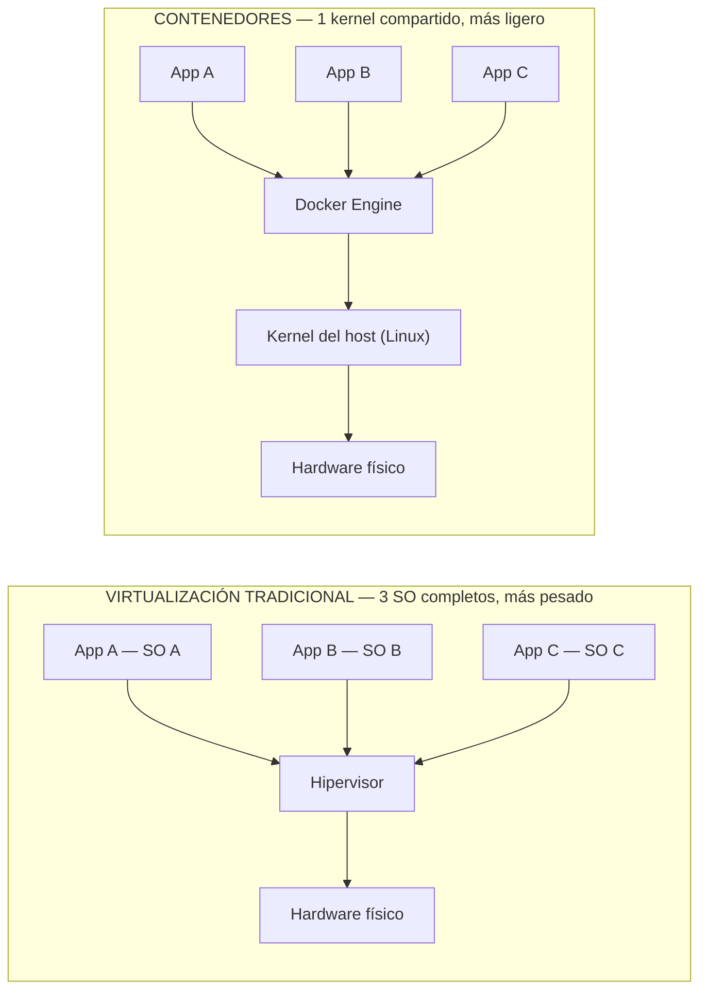
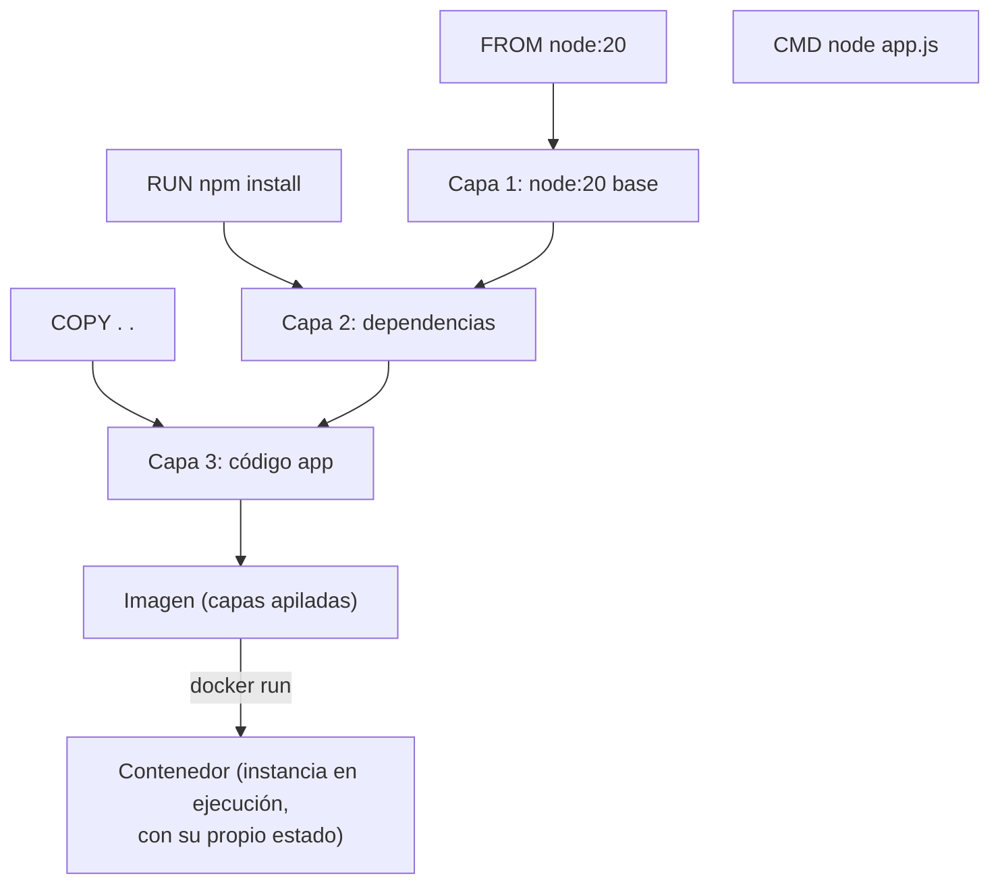
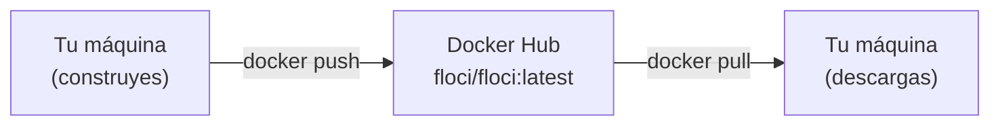
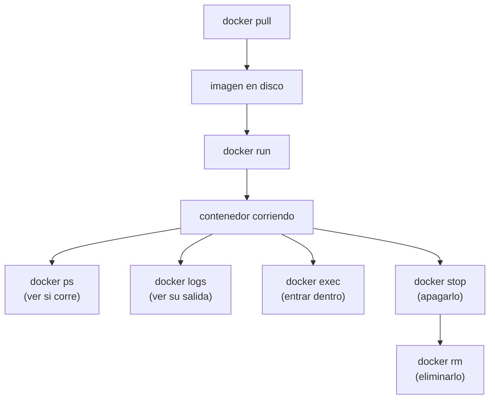
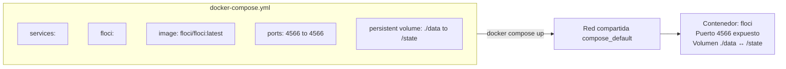

# Módulo 1: Fundamentos de Docker y contenedores


## Aprende construyendo


### Tema 1: Virtualización vs contenedores · Básico · 25 min

<details open>
<summary><strong>Capa 1 — Lectura</strong></summary>

#### ► DE QUÉ TRATA
Al finalizar podrás comparar virtualización y contenedores desde cero. Prerrequisitos: Docker; verifica docker --version.

#### ► LA IDEA EN UNA FRASE
**Al finalizar podrás comparar virtualización y contenedores desde cero.**

#### ► POR QUÉ EXISTE ESTO
Resuelve un problema real de diseño o implementación y evita decisiones a ciegas.

#### ► LA ANALOGÍA
Piensa en virtualización vs contenedores como una herramienta de taller: útil cuando conoces su propósito y sus límites.
**Dónde se rompe la analogía:** en software, los efectos dependen del contexto, la escala y los trade-offs.

#### ► CÓMO FUNCIONA


#### ► LO QUE PUEDE SALIR MAL
| Síntoma | Causa probable | Arreglo |
|---|---|---|
| Virtualización vs contenedores se aplica pero el resultado no mejora | Se usó sin medir el problema real | Mide antes y compara contra la alternativa simple |
| Aparece complejidad inesperada | Se adoptó la técnica sin comprender sus trade-offs | Vuelve a la sección de trade-offs y reduce el alcance |
| Falla en un caso límite | Se asumió un contexto que no se cumple | Prueba el caso límite y documenta cuándo NO usarlo |

#### ► TRADE-OFFS
| Opción | Cuándo usarla | Cuándo NO usarla |
|---|---|---|
| Usar Virtualización vs contenedores | Cuando el problema coincide con su propósito y el beneficio es observable | Cuando agrega complejidad sin resolver un problema real |
| Alternativa más simple | Cuando el contexto es pequeño, estable o fácil de razonar | Cuando ya demostró no escalar o no cumplir el requisito |
| Postergar la decisión | Cuando falta evidencia del problema | Cuando el costo de esperar es mayor que el costo de probar |

#### ► CUÁNDO NO USAR ESTO
No uses virtualización vs contenedores por defecto. Aplícalo cuando el problema lo justifique y puedas verificar el beneficio; si una alternativa más simple resuelve igual, prefiérela.

#### ► DE VUELTA A LA ANALOGÍA
Volviendo a la analogía: virtualización vs contenedores funciona como el modelo inicial, pero recuerda dónde se rompe: en producción importan la evidencia, la escala y el costo de equivocarte.

#### ► LO QUE DEBES RECORDAR
- Virtualización vs contenedores existe para resolver un problema específico.
- Mide antes de adoptar complejidad.
- Conoce el caso donde NO usarlo.
- Verifica con evidencia observable.

#### ► PREGUNTAS PARA PENSAR
1. ¿Qué problema concreto resuelve virtualización vs contenedores en tu contexto?
2. ¿Cómo sabrías que virtualización vs contenedores no está funcionando bien?
3. ¿Qué alternativa más simple considerarías antes de usar virtualización vs contenedores?

</details>

<details>
<summary><strong>Capa 2 — Construcción</strong></summary>

#### Código y verificación


```bash
mkdir ejemplo-contenedores && cd ejemplo-contenedores
uname -r
docker run --rm ubuntu:24.04 uname -r
docker run --rm ubuntu:24.04 sh -c '. /etc/os-release; echo "$PRETTY_NAME"'
docker run --rm ubuntu:24.04 ps -e
```

</details>

### Tema 2: Imágenes y capas · Básico · 25 min

<details open>
<summary><strong>Capa 1 — Lectura</strong></summary>

#### ► DE QUÉ TRATA
Al finalizar podrás construir una imagen desde cero. Prerrequisitos: Docker; verifica docker --version.

#### ► LA IDEA EN UNA FRASE
**Al finalizar podrás construir una imagen desde cero.**

#### ► POR QUÉ EXISTE ESTO
Resuelve un problema real de diseño o implementación y evita decisiones a ciegas.

#### ► LA ANALOGÍA
Piensa en imágenes y capas como una herramienta de taller: útil cuando conoces su propósito y sus límites.
**Dónde se rompe la analogía:** en software, los efectos dependen del contexto, la escala y los trade-offs.

#### ► CÓMO FUNCIONA


#### ► LO QUE PUEDE SALIR MAL
| Síntoma | Causa probable | Arreglo |
|---|---|---|
| Imágenes y capas se aplica pero el resultado no mejora | Se usó sin medir el problema real | Mide antes y compara contra la alternativa simple |
| Aparece complejidad inesperada | Se adoptó la técnica sin comprender sus trade-offs | Vuelve a la sección de trade-offs y reduce el alcance |
| Falla en un caso límite | Se asumió un contexto que no se cumple | Prueba el caso límite y documenta cuándo NO usarlo |

#### ► TRADE-OFFS
| Opción | Cuándo usarla | Cuándo NO usarla |
|---|---|---|
| Usar Imágenes y capas | Cuando el problema coincide con su propósito y el beneficio es observable | Cuando agrega complejidad sin resolver un problema real |
| Alternativa más simple | Cuando el contexto es pequeño, estable o fácil de razonar | Cuando ya demostró no escalar o no cumplir el requisito |
| Postergar la decisión | Cuando falta evidencia del problema | Cuando el costo de esperar es mayor que el costo de probar |

#### ► CUÁNDO NO USAR ESTO
No uses imágenes y capas por defecto. Aplícalo cuando el problema lo justifique y puedas verificar el beneficio; si una alternativa más simple resuelve igual, prefiérela.

#### ► DE VUELTA A LA ANALOGÍA
Volviendo a la analogía: imágenes y capas funciona como el modelo inicial, pero recuerda dónde se rompe: en producción importan la evidencia, la escala y el costo de equivocarte.

#### ► LO QUE DEBES RECORDAR
- Imágenes y capas existe para resolver un problema específico.
- Mide antes de adoptar complejidad.
- Conoce el caso donde NO usarlo.
- Verifica con evidencia observable.

#### ► PREGUNTAS PARA PENSAR
1. ¿Qué problema concreto resuelve imágenes y capas en tu contexto?
2. ¿Cómo sabrías que imágenes y capas no está funcionando bien?
3. ¿Qué alternativa más simple considerarías antes de usar imágenes y capas?

</details>

<details>
<summary><strong>Capa 2 — Construcción</strong></summary>

#### Código y verificación


```bash
mkdir -p ejemplo-imagen/src && cd ejemplo-imagen
printf '#!/bin/sh\necho "Hola desde la imagen ejemplo-imagen:1.0"\n' > src/saludo.sh
cat > Dockerfile <<'EOF'
FROM ubuntu:24.04
WORKDIR /app
COPY src/saludo.sh .
CMD ["sh", "saludo.sh"]
EOF
docker build -t ejemplo-imagen:1.0 .
docker run --rm ejemplo-imagen:1.0
docker history ejemplo-imagen:1.0
```

</details>

### Tema 3: Registros de contenedores (Docker Hub) · Básico · 25 min

<details open>
<summary><strong>Capa 1 — Lectura</strong></summary>

#### ► DE QUÉ TRATA
Al finalizar podrás publicar una imagen de forma segura. Prerrequisitos: Docker; verifica docker --version.

#### ► LA IDEA EN UNA FRASE
**Al finalizar podrás publicar una imagen de forma segura.**

#### ► POR QUÉ EXISTE ESTO
Resuelve un problema real de diseño o implementación y evita decisiones a ciegas.

#### ► LA ANALOGÍA
Piensa en registros de contenedores (docker hub) como una herramienta de taller: útil cuando conoces su propósito y sus límites.
**Dónde se rompe la analogía:** en software, los efectos dependen del contexto, la escala y los trade-offs.

#### ► CÓMO FUNCIONA


#### ► LO QUE PUEDE SALIR MAL
| Síntoma | Causa probable | Arreglo |
|---|---|---|
| Registros de contenedores (Docker Hub) se aplica pero el resultado no mejora | Se usó sin medir el problema real | Mide antes y compara contra la alternativa simple |
| Aparece complejidad inesperada | Se adoptó la técnica sin comprender sus trade-offs | Vuelve a la sección de trade-offs y reduce el alcance |
| Falla en un caso límite | Se asumió un contexto que no se cumple | Prueba el caso límite y documenta cuándo NO usarlo |

#### ► TRADE-OFFS
| Opción | Cuándo usarla | Cuándo NO usarla |
|---|---|---|
| Usar Registros de contenedores (Docker Hub) | Cuando el problema coincide con su propósito y el beneficio es observable | Cuando agrega complejidad sin resolver un problema real |
| Alternativa más simple | Cuando el contexto es pequeño, estable o fácil de razonar | Cuando ya demostró no escalar o no cumplir el requisito |
| Postergar la decisión | Cuando falta evidencia del problema | Cuando el costo de esperar es mayor que el costo de probar |

#### ► CUÁNDO NO USAR ESTO
No uses registros de contenedores (docker hub) por defecto. Aplícalo cuando el problema lo justifique y puedas verificar el beneficio; si una alternativa más simple resuelve igual, prefiérela.

#### ► DE VUELTA A LA ANALOGÍA
Volviendo a la analogía: registros de contenedores (docker hub) funciona como el modelo inicial, pero recuerda dónde se rompe: en producción importan la evidencia, la escala y el costo de equivocarte.

#### ► LO QUE DEBES RECORDAR
- Registros de contenedores (Docker Hub) existe para resolver un problema específico.
- Mide antes de adoptar complejidad.
- Conoce el caso donde NO usarlo.
- Verifica con evidencia observable.

#### ► PREGUNTAS PARA PENSAR
1. ¿Qué problema concreto resuelve registros de contenedores (docker hub) en tu contexto?
2. ¿Cómo sabrías que registros de contenedores (docker hub) no está funcionando bien?
3. ¿Qué alternativa más simple considerarías antes de usar registros de contenedores (docker hub)?

</details>

<details>
<summary><strong>Capa 2 — Construcción</strong></summary>

#### Código y verificación


```bash
mkdir ejemplo-registry && cd ejemplo-registry
docker pull ubuntu:24.04
docker image inspect ubuntu:24.04 --format '{{index .RepoDigests 0}}'
docker tag ubuntu:24.04 miusuario/base-rutaflow:1.0
docker images miusuario/base-rutaflow
```

</details>

### Tema 4: Comandos esenciales de Docker · Básico · 25 min

<details open>
<summary><strong>Capa 1 — Lectura</strong></summary>

#### ► DE QUÉ TRATA
Al finalizar podrás operar contenedores desde cero. Prerrequisitos: Docker; verifica docker --version.

#### ► LA IDEA EN UNA FRASE
**Al finalizar podrás operar contenedores desde cero.**

#### ► POR QUÉ EXISTE ESTO
Resuelve un problema real de diseño o implementación y evita decisiones a ciegas.

#### ► LA ANALOGÍA
Piensa en comandos esenciales de docker como una herramienta de taller: útil cuando conoces su propósito y sus límites.
**Dónde se rompe la analogía:** en software, los efectos dependen del contexto, la escala y los trade-offs.

#### ► CÓMO FUNCIONA


#### ► LO QUE PUEDE SALIR MAL
| Síntoma | Causa probable | Arreglo |
|---|---|---|
| Comandos esenciales de Docker se aplica pero el resultado no mejora | Se usó sin medir el problema real | Mide antes y compara contra la alternativa simple |
| Aparece complejidad inesperada | Se adoptó la técnica sin comprender sus trade-offs | Vuelve a la sección de trade-offs y reduce el alcance |
| Falla en un caso límite | Se asumió un contexto que no se cumple | Prueba el caso límite y documenta cuándo NO usarlo |

#### ► TRADE-OFFS
| Opción | Cuándo usarla | Cuándo NO usarla |
|---|---|---|
| Usar Comandos esenciales de Docker | Cuando el problema coincide con su propósito y el beneficio es observable | Cuando agrega complejidad sin resolver un problema real |
| Alternativa más simple | Cuando el contexto es pequeño, estable o fácil de razonar | Cuando ya demostró no escalar o no cumplir el requisito |
| Postergar la decisión | Cuando falta evidencia del problema | Cuando el costo de esperar es mayor que el costo de probar |

#### ► CUÁNDO NO USAR ESTO
No uses comandos esenciales de docker por defecto. Aplícalo cuando el problema lo justifique y puedas verificar el beneficio; si una alternativa más simple resuelve igual, prefiérela.

#### ► DE VUELTA A LA ANALOGÍA
Volviendo a la analogía: comandos esenciales de docker funciona como el modelo inicial, pero recuerda dónde se rompe: en producción importan la evidencia, la escala y el costo de equivocarte.

#### ► LO QUE DEBES RECORDAR
- Comandos esenciales de Docker existe para resolver un problema específico.
- Mide antes de adoptar complejidad.
- Conoce el caso donde NO usarlo.
- Verifica con evidencia observable.

#### ► PREGUNTAS PARA PENSAR
1. ¿Qué problema concreto resuelve comandos esenciales de docker en tu contexto?
2. ¿Cómo sabrías que comandos esenciales de docker no está funcionando bien?
3. ¿Qué alternativa más simple considerarías antes de usar comandos esenciales de docker?

</details>

<details>
<summary><strong>Capa 2 — Construcción</strong></summary>

#### Código y verificación


```bash
mkdir ejemplo-comandos && cd ejemplo-comandos
docker run -d --name rutaflow-demo ubuntu:24.04 sh -c 'echo "servicio iniciado"; sleep 300'
docker ps --filter name=rutaflow-demo
docker logs rutaflow-demo
docker exec rutaflow-demo cat /etc/os-release
docker stop rutaflow-demo
docker ps -a --filter name=rutaflow-demo
docker rm rutaflow-demo
```

</details>

### Tema 5: Docker Compose — servicios, redes y volúmenes · Básico · 25 min

<details open>
<summary><strong>Capa 1 — Lectura</strong></summary>

#### ► DE QUÉ TRATA
Al finalizar podrás coordinar servicios desde cero. Prerrequisitos: Docker Compose; verifica docker compose version.

#### ► LA IDEA EN UNA FRASE
**Al finalizar podrás coordinar servicios desde cero.**

#### ► POR QUÉ EXISTE ESTO
Resuelve un problema real de diseño o implementación y evita decisiones a ciegas.

#### ► LA ANALOGÍA
Piensa en docker compose — servicios, redes y volúmenes como una herramienta de taller: útil cuando conoces su propósito y sus límites.
**Dónde se rompe la analogía:** en software, los efectos dependen del contexto, la escala y los trade-offs.

#### ► CÓMO FUNCIONA


#### ► LO QUE PUEDE SALIR MAL
| Síntoma | Causa probable | Arreglo |
|---|---|---|
| Docker Compose — servicios, redes y volúmenes se aplica pero el resultado no mejora | Se usó sin medir el problema real | Mide antes y compara contra la alternativa simple |
| Aparece complejidad inesperada | Se adoptó la técnica sin comprender sus trade-offs | Vuelve a la sección de trade-offs y reduce el alcance |
| Falla en un caso límite | Se asumió un contexto que no se cumple | Prueba el caso límite y documenta cuándo NO usarlo |

#### ► TRADE-OFFS
| Opción | Cuándo usarla | Cuándo NO usarla |
|---|---|---|
| Usar Docker Compose — servicios, redes y volúmenes | Cuando el problema coincide con su propósito y el beneficio es observable | Cuando agrega complejidad sin resolver un problema real |
| Alternativa más simple | Cuando el contexto es pequeño, estable o fácil de razonar | Cuando ya demostró no escalar o no cumplir el requisito |
| Postergar la decisión | Cuando falta evidencia del problema | Cuando el costo de esperar es mayor que el costo de probar |

#### ► CUÁNDO NO USAR ESTO
No uses docker compose — servicios, redes y volúmenes por defecto. Aplícalo cuando el problema lo justifique y puedas verificar el beneficio; si una alternativa más simple resuelve igual, prefiérela.

#### ► DE VUELTA A LA ANALOGÍA
Volviendo a la analogía: docker compose — servicios, redes y volúmenes funciona como el modelo inicial, pero recuerda dónde se rompe: en producción importan la evidencia, la escala y el costo de equivocarte.

#### ► LO QUE DEBES RECORDAR
- Docker Compose — servicios, redes y volúmenes existe para resolver un problema específico.
- Mide antes de adoptar complejidad.
- Conoce el caso donde NO usarlo.
- Verifica con evidencia observable.

#### ► PREGUNTAS PARA PENSAR
1. ¿Qué problema concreto resuelve docker compose — servicios, redes y volúmenes en tu contexto?
2. ¿Cómo sabrías que docker compose — servicios, redes y volúmenes no está funcionando bien?
3. ¿Qué alternativa más simple considerarías antes de usar docker compose — servicios, redes y volúmenes?

</details>

<details>
<summary><strong>Capa 2 — Construcción</strong></summary>

#### Código y verificación


```yaml
services:
  escritor:
    image: ubuntu:24.04
    command: sh -c 'date -u +%FT%TZ >> /datos/registro.txt && echo "escribí una línea"'
    volumes:
      - datos-entregas:/datos
  lector:
    image: ubuntu:24.04
    command: sh -c 'wc -l < /datos/registro.txt'
    volumes:
      - datos-entregas:/datos
    depends_on:
      escritor:
        condition: service_completed_successfully

volumes:
  datos-entregas:
```

```bash
docker compose run --rm lector
docker compose run --rm lector
docker compose down
docker compose run --rm lector
docker compose down -v
docker compose run --rm lector
```

</details>

### Laboratorio 1.1 — Comandos esenciales con una imagen de prueba

<details open>
<summary><strong>Capa 1 — Lectura</strong></summary>

#### ► DE QUÉ TRATA
Este tema te guía por laboratorio 1.1 — comandos esenciales con una imagen de prueba con foco en comprensión antes de implementación.

#### ► LA IDEA EN UNA FRASE
**Entender laboratorio 1.1 — comandos esenciales con una imagen de prueba te permite tomar mejores decisiones técnicas.**

#### ► POR QUÉ EXISTE ESTO
Resuelve un problema real de diseño o implementación y evita decisiones a ciegas.

#### ► LA ANALOGÍA
Piensa en laboratorio 1.1 — comandos esenciales con una imagen de prueba como una herramienta de taller: útil cuando conoces su propósito y sus límites.
**Dónde se rompe la analogía:** en software, los efectos dependen del contexto, la escala y los trade-offs.

#### ► CÓMO FUNCIONA
1. Identifica el problema que laboratorio 1.1 — comandos esenciales con una imagen de prueba resuelve.
2. Observa sus componentes y relaciones.
3. Aplica la opción más simple que funcione.
4. Verifica el resultado y los límites.

#### ► LO QUE PUEDE SALIR MAL
| Síntoma | Causa probable | Arreglo |
|---|---|---|
| Laboratorio 1.1 — Comandos esenciales con una imagen de prueba se aplica pero el resultado no mejora | Se usó sin medir el problema real | Mide antes y compara contra la alternativa simple |
| Aparece complejidad inesperada | Se adoptó la técnica sin comprender sus trade-offs | Vuelve a la sección de trade-offs y reduce el alcance |
| Falla en un caso límite | Se asumió un contexto que no se cumple | Prueba el caso límite y documenta cuándo NO usarlo |

#### ► TRADE-OFFS
| Opción | Cuándo usarla | Cuándo NO usarla |
|---|---|---|
| Usar Laboratorio 1.1 — Comandos esenciales con una imagen de prueba | Cuando el problema coincide con su propósito y el beneficio es observable | Cuando agrega complejidad sin resolver un problema real |
| Alternativa más simple | Cuando el contexto es pequeño, estable o fácil de razonar | Cuando ya demostró no escalar o no cumplir el requisito |
| Postergar la decisión | Cuando falta evidencia del problema | Cuando el costo de esperar es mayor que el costo de probar |

#### ► CUÁNDO NO USAR ESTO
No uses laboratorio 1.1 — comandos esenciales con una imagen de prueba por defecto. Aplícalo cuando el problema lo justifique y puedas verificar el beneficio; si una alternativa más simple resuelve igual, prefiérela.

#### ► DE VUELTA A LA ANALOGÍA
Volviendo a la analogía: laboratorio 1.1 — comandos esenciales con una imagen de prueba funciona como el modelo inicial, pero recuerda dónde se rompe: en producción importan la evidencia, la escala y el costo de equivocarte.

#### ► LO QUE DEBES RECORDAR
- Laboratorio 1.1 — Comandos esenciales con una imagen de prueba existe para resolver un problema específico.
- Mide antes de adoptar complejidad.
- Conoce el caso donde NO usarlo.
- Verifica con evidencia observable.

#### ► PREGUNTAS PARA PENSAR
1. ¿Qué problema concreto resuelve laboratorio 1.1 — comandos esenciales con una imagen de prueba en tu contexto?
2. ¿Cómo sabrías que laboratorio 1.1 — comandos esenciales con una imagen de prueba no está funcionando bien?
3. ¿Qué alternativa más simple considerarías antes de usar laboratorio 1.1 — comandos esenciales con una imagen de prueba?

</details>

<details>
<summary><strong>Capa 2 — Construcción</strong></summary>

#### Nota de construcción
Este tema es principalmente conceptual en esta versión. La verificación se realiza con las preguntas de comprensión y el criterio de cuándo NO usar laboratorio 1.1 — comandos esenciales con una imagen de prueba.

</details>

### Laboratorio 1.2 — Instalar floci-cli y levantar Floci

<details open>
<summary><strong>Capa 1 — Lectura</strong></summary>

#### ► DE QUÉ TRATA
Este tema te guía por laboratorio 1.2 — instalar floci-cli y levantar floci con foco en comprensión antes de implementación.

#### ► LA IDEA EN UNA FRASE
**Entender laboratorio 1.2 — instalar floci-cli y levantar floci te permite tomar mejores decisiones técnicas.**

#### ► POR QUÉ EXISTE ESTO
Resuelve un problema real de diseño o implementación y evita decisiones a ciegas.

#### ► LA ANALOGÍA
Piensa en laboratorio 1.2 — instalar floci-cli y levantar floci como una herramienta de taller: útil cuando conoces su propósito y sus límites.
**Dónde se rompe la analogía:** en software, los efectos dependen del contexto, la escala y los trade-offs.

#### ► CÓMO FUNCIONA
1. Identifica el problema que laboratorio 1.2 — instalar floci-cli y levantar floci resuelve.
2. Observa sus componentes y relaciones.
3. Aplica la opción más simple que funcione.
4. Verifica el resultado y los límites.

#### ► LO QUE PUEDE SALIR MAL
| Síntoma | Causa probable | Arreglo |
|---|---|---|
| Laboratorio 1.2 — Instalar floci-cli y levantar Floci se aplica pero el resultado no mejora | Se usó sin medir el problema real | Mide antes y compara contra la alternativa simple |
| Aparece complejidad inesperada | Se adoptó la técnica sin comprender sus trade-offs | Vuelve a la sección de trade-offs y reduce el alcance |
| Falla en un caso límite | Se asumió un contexto que no se cumple | Prueba el caso límite y documenta cuándo NO usarlo |

#### ► TRADE-OFFS
| Opción | Cuándo usarla | Cuándo NO usarla |
|---|---|---|
| Usar Laboratorio 1.2 — Instalar floci-cli y levantar Floci | Cuando el problema coincide con su propósito y el beneficio es observable | Cuando agrega complejidad sin resolver un problema real |
| Alternativa más simple | Cuando el contexto es pequeño, estable o fácil de razonar | Cuando ya demostró no escalar o no cumplir el requisito |
| Postergar la decisión | Cuando falta evidencia del problema | Cuando el costo de esperar es mayor que el costo de probar |

#### ► CUÁNDO NO USAR ESTO
No uses laboratorio 1.2 — instalar floci-cli y levantar floci por defecto. Aplícalo cuando el problema lo justifique y puedas verificar el beneficio; si una alternativa más simple resuelve igual, prefiérela.

#### ► DE VUELTA A LA ANALOGÍA
Volviendo a la analogía: laboratorio 1.2 — instalar floci-cli y levantar floci funciona como el modelo inicial, pero recuerda dónde se rompe: en producción importan la evidencia, la escala y el costo de equivocarte.

#### ► LO QUE DEBES RECORDAR
- Laboratorio 1.2 — Instalar floci-cli y levantar Floci existe para resolver un problema específico.
- Mide antes de adoptar complejidad.
- Conoce el caso donde NO usarlo.
- Verifica con evidencia observable.

#### ► PREGUNTAS PARA PENSAR
1. ¿Qué problema concreto resuelve laboratorio 1.2 — instalar floci-cli y levantar floci en tu contexto?
2. ¿Cómo sabrías que laboratorio 1.2 — instalar floci-cli y levantar floci no está funcionando bien?
3. ¿Qué alternativa más simple considerarías antes de usar laboratorio 1.2 — instalar floci-cli y levantar floci?

</details>

<details>
<summary><strong>Capa 2 — Construcción</strong></summary>

#### Nota de construcción
Este tema es principalmente conceptual en esta versión. La verificación se realiza con las preguntas de comprensión y el criterio de cuándo NO usar laboratorio 1.2 — instalar floci-cli y levantar floci.

</details>

### Laboratorio 1.3 — Probar la AWS CLI contra Floci

<details open>
<summary><strong>Capa 1 — Lectura</strong></summary>

#### ► DE QUÉ TRATA
Este tema te guía por laboratorio 1.3 — probar la aws cli contra floci con foco en comprensión antes de implementación.

#### ► LA IDEA EN UNA FRASE
**Entender laboratorio 1.3 — probar la aws cli contra floci te permite tomar mejores decisiones técnicas.**

#### ► POR QUÉ EXISTE ESTO
Resuelve un problema real de diseño o implementación y evita decisiones a ciegas.

#### ► LA ANALOGÍA
Piensa en laboratorio 1.3 — probar la aws cli contra floci como una herramienta de taller: útil cuando conoces su propósito y sus límites.
**Dónde se rompe la analogía:** en software, los efectos dependen del contexto, la escala y los trade-offs.

#### ► CÓMO FUNCIONA
1. Identifica el problema que laboratorio 1.3 — probar la aws cli contra floci resuelve.
2. Observa sus componentes y relaciones.
3. Aplica la opción más simple que funcione.
4. Verifica el resultado y los límites.

#### ► LO QUE PUEDE SALIR MAL
| Síntoma | Causa probable | Arreglo |
|---|---|---|
| Laboratorio 1.3 — Probar la AWS CLI contra Floci se aplica pero el resultado no mejora | Se usó sin medir el problema real | Mide antes y compara contra la alternativa simple |
| Aparece complejidad inesperada | Se adoptó la técnica sin comprender sus trade-offs | Vuelve a la sección de trade-offs y reduce el alcance |
| Falla en un caso límite | Se asumió un contexto que no se cumple | Prueba el caso límite y documenta cuándo NO usarlo |

#### ► TRADE-OFFS
| Opción | Cuándo usarla | Cuándo NO usarla |
|---|---|---|
| Usar Laboratorio 1.3 — Probar la AWS CLI contra Floci | Cuando el problema coincide con su propósito y el beneficio es observable | Cuando agrega complejidad sin resolver un problema real |
| Alternativa más simple | Cuando el contexto es pequeño, estable o fácil de razonar | Cuando ya demostró no escalar o no cumplir el requisito |
| Postergar la decisión | Cuando falta evidencia del problema | Cuando el costo de esperar es mayor que el costo de probar |

#### ► CUÁNDO NO USAR ESTO
No uses laboratorio 1.3 — probar la aws cli contra floci por defecto. Aplícalo cuando el problema lo justifique y puedas verificar el beneficio; si una alternativa más simple resuelve igual, prefiérela.

#### ► DE VUELTA A LA ANALOGÍA
Volviendo a la analogía: laboratorio 1.3 — probar la aws cli contra floci funciona como el modelo inicial, pero recuerda dónde se rompe: en producción importan la evidencia, la escala y el costo de equivocarte.

#### ► LO QUE DEBES RECORDAR
- Laboratorio 1.3 — Probar la AWS CLI contra Floci existe para resolver un problema específico.
- Mide antes de adoptar complejidad.
- Conoce el caso donde NO usarlo.
- Verifica con evidencia observable.

#### ► PREGUNTAS PARA PENSAR
1. ¿Qué problema concreto resuelve laboratorio 1.3 — probar la aws cli contra floci en tu contexto?
2. ¿Cómo sabrías que laboratorio 1.3 — probar la aws cli contra floci no está funcionando bien?
3. ¿Qué alternativa más simple considerarías antes de usar laboratorio 1.3 — probar la aws cli contra floci?

</details>

<details>
<summary><strong>Capa 2 — Construcción</strong></summary>

#### Código y verificación
```yaml
services:
  aws-local:
    image: floci/floci:2.2.0@sha256:e97cd0c1dc2aa14e7697fb5ef5018404c4d6345169dbd276315f0bed2c7b0520
    container_name: floci-aws
    ports:
      - "${AWS_LOCAL_PORT:-4566}:4566"
```

```bash
docker compose up -d aws-local
# equivalente manual a `eval $(floci env)`:
export AWS_ENDPOINT_URL=http://localhost:4566
export AWS_ACCESS_KEY_ID=test AWS_SECRET_ACCESS_KEY=test AWS_DEFAULT_REGION=us-east-1
```

</details>

### Laboratorio 1.4 — Usar StackPort y Floci UI

<details open>
<summary><strong>Capa 1 — Lectura</strong></summary>

#### ► DE QUÉ TRATA
Este tema te guía por laboratorio 1.4 — usar stackport y floci ui con foco en comprensión antes de implementación.

#### ► LA IDEA EN UNA FRASE
**Entender laboratorio 1.4 — usar stackport y floci ui te permite tomar mejores decisiones técnicas.**

#### ► POR QUÉ EXISTE ESTO
Resuelve un problema real de diseño o implementación y evita decisiones a ciegas.

#### ► LA ANALOGÍA
Piensa en laboratorio 1.4 — usar stackport y floci ui como una herramienta de taller: útil cuando conoces su propósito y sus límites.
**Dónde se rompe la analogía:** en software, los efectos dependen del contexto, la escala y los trade-offs.

#### ► CÓMO FUNCIONA
1. Identifica el problema que laboratorio 1.4 — usar stackport y floci ui resuelve.
2. Observa sus componentes y relaciones.
3. Aplica la opción más simple que funcione.
4. Verifica el resultado y los límites.

#### ► LO QUE PUEDE SALIR MAL
| Síntoma | Causa probable | Arreglo |
|---|---|---|
| Laboratorio 1.4 — Usar StackPort y Floci UI se aplica pero el resultado no mejora | Se usó sin medir el problema real | Mide antes y compara contra la alternativa simple |
| Aparece complejidad inesperada | Se adoptó la técnica sin comprender sus trade-offs | Vuelve a la sección de trade-offs y reduce el alcance |
| Falla en un caso límite | Se asumió un contexto que no se cumple | Prueba el caso límite y documenta cuándo NO usarlo |

#### ► TRADE-OFFS
| Opción | Cuándo usarla | Cuándo NO usarla |
|---|---|---|
| Usar Laboratorio 1.4 — Usar StackPort y Floci UI | Cuando el problema coincide con su propósito y el beneficio es observable | Cuando agrega complejidad sin resolver un problema real |
| Alternativa más simple | Cuando el contexto es pequeño, estable o fácil de razonar | Cuando ya demostró no escalar o no cumplir el requisito |
| Postergar la decisión | Cuando falta evidencia del problema | Cuando el costo de esperar es mayor que el costo de probar |

#### ► CUÁNDO NO USAR ESTO
No uses laboratorio 1.4 — usar stackport y floci ui por defecto. Aplícalo cuando el problema lo justifique y puedas verificar el beneficio; si una alternativa más simple resuelve igual, prefiérela.

#### ► DE VUELTA A LA ANALOGÍA
Volviendo a la analogía: laboratorio 1.4 — usar stackport y floci ui funciona como el modelo inicial, pero recuerda dónde se rompe: en producción importan la evidencia, la escala y el costo de equivocarte.

#### ► LO QUE DEBES RECORDAR
- Laboratorio 1.4 — Usar StackPort y Floci UI existe para resolver un problema específico.
- Mide antes de adoptar complejidad.
- Conoce el caso donde NO usarlo.
- Verifica con evidencia observable.

#### ► PREGUNTAS PARA PENSAR
1. ¿Qué problema concreto resuelve laboratorio 1.4 — usar stackport y floci ui en tu contexto?
2. ¿Cómo sabrías que laboratorio 1.4 — usar stackport y floci ui no está funcionando bien?
3. ¿Qué alternativa más simple considerarías antes de usar laboratorio 1.4 — usar stackport y floci ui?

</details>

<details>
<summary><strong>Capa 2 — Construcción</strong></summary>

#### Código y verificación
```bash
docker compose up -d aws-local stackport
```

```bash
git clone https://github.com/floci-io/floci-ui.git
cd floci-ui
docker compose up -d
docker compose ps
```

```bash
aws --endpoint-url=http://localhost:4566 s3 mb s3://mi-primer-bucket-visual
```

</details>
