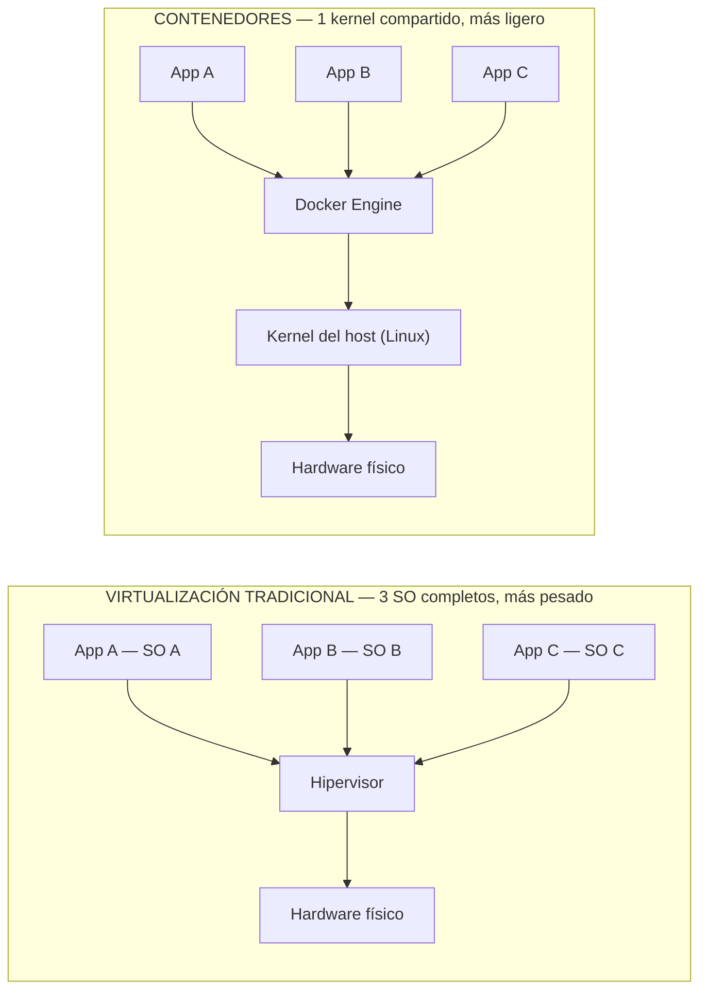
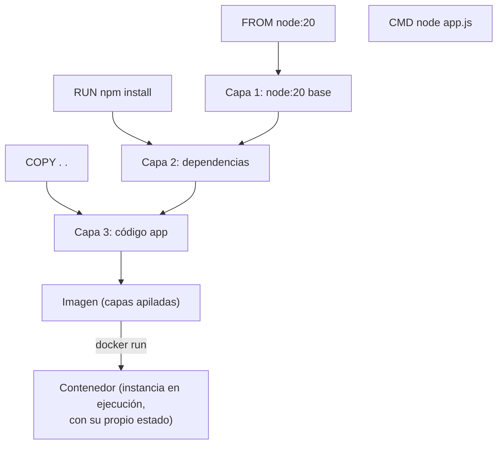
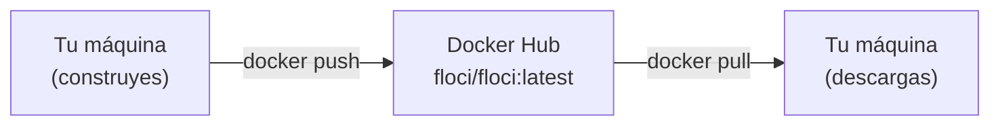
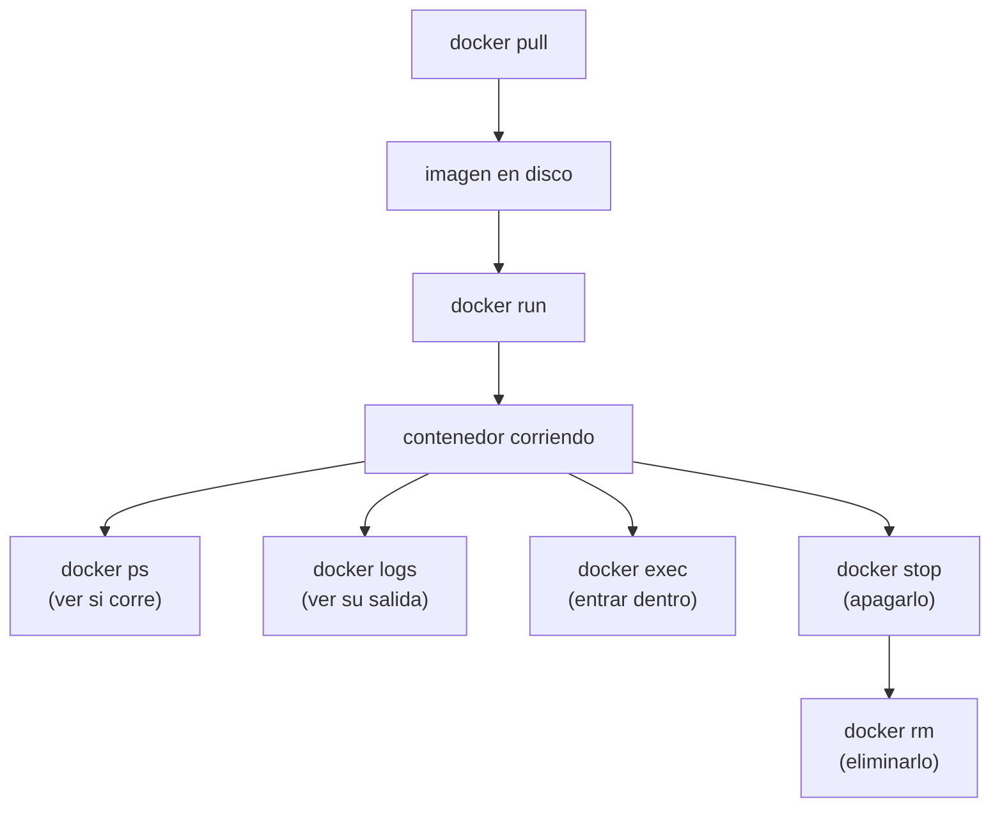
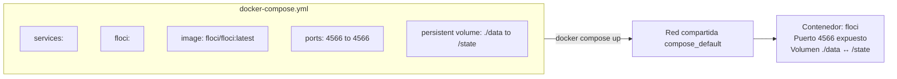

# Módulo 1: Fundamentos de Docker y contenedores


## Aprende construyendo


### Tema 1: Virtualización vs contenedores · Básico · 25 min

<details open>
<summary><strong>Capa 1 — Lectura</strong></summary>

#### ► DE QUÉ TRATA
Al finalizar podrás comparar virtualización y contenedores desde cero. Prerrequisitos: Docker; verifica docker --version.

#### ► CÓMO FUNCIONA


#### ► REGLA PRÁCTICA
Usa contenedores cuando varias apps pueden compartir el mismo kernel Linux del host; usa una VM completa cuando necesitas aislar sistemas operativos distintos entre sí o del host, no solo procesos.

</details>

<details>
<summary><strong>Capa 2 — Construcción</strong></summary>

#### Código y verificación

```bash
mkdir ejemplo-contenedores && cd ejemplo-contenedores
uname -r
docker run --rm ubuntu:24.04 uname -r
docker run --rm ubuntu:24.04 sh -c '. /etc/os-release; echo "$PRETTY_NAME"'
docker run --rm ubuntu:24.04 ps -e
```

</details>

### Tema 2: Imágenes y capas · Básico · 25 min

<details open>
<summary><strong>Capa 1 — Lectura</strong></summary>

#### ► DE QUÉ TRATA
Al finalizar podrás construir una imagen desde cero. Prerrequisitos: Docker; verifica docker --version.

#### ► CÓMO FUNCIONA


</details>

<details>
<summary><strong>Capa 2 — Construcción</strong></summary>

#### Código y verificación


```bash
mkdir -p ejemplo-imagen/src && cd ejemplo-imagen
printf '#!/bin/sh\necho "Hola desde la imagen ejemplo-imagen:1.0"\n' > src/saludo.sh
```

Crea el archivo `Dockerfile`:

```dockerfile
FROM ubuntu:24.04
WORKDIR /app
COPY src/saludo.sh .
CMD ["sh", "saludo.sh"]
```

```bash
docker build -t ejemplo-imagen:1.0 .
docker run --rm ejemplo-imagen:1.0
docker history ejemplo-imagen:1.0
```

</details>

### Tema 3: Registros de contenedores (Docker Hub) · Básico · 25 min

<details open>
<summary><strong>Capa 1 — Lectura</strong></summary>

#### ► DE QUÉ TRATA
Al finalizar podrás publicar una imagen de forma segura. Prerrequisitos: Docker; verifica docker --version.

#### ► CÓMO FUNCIONA


</details>

<details>
<summary><strong>Capa 2 — Construcción</strong></summary>

#### Código y verificación


```bash
mkdir ejemplo-registry && cd ejemplo-registry
docker pull ubuntu:24.04
docker image inspect ubuntu:24.04 --format '{{index .RepoDigests 0}}'
docker tag ubuntu:24.04 miusuario/base-rutaflow:1.0
docker images miusuario/base-rutaflow
```

</details>

### Tema 4: Comandos esenciales de Docker · Básico · 25 min

<details open>
<summary><strong>Capa 1 — Lectura</strong></summary>

#### ► DE QUÉ TRATA
Al finalizar podrás operar contenedores desde cero. Prerrequisitos: Docker; verifica docker --version.

#### ► CÓMO FUNCIONA


</details>

<details>
<summary><strong>Capa 2 — Construcción</strong></summary>

#### Código y verificación


```bash
mkdir ejemplo-comandos && cd ejemplo-comandos
docker run -d --name rutaflow-demo ubuntu:24.04 sh -c 'echo "servicio iniciado"; sleep 300'
docker ps --filter name=rutaflow-demo
docker logs rutaflow-demo
docker exec rutaflow-demo cat /etc/os-release
docker stop rutaflow-demo
docker ps -a --filter name=rutaflow-demo
docker rm rutaflow-demo
```

</details>

### Tema 5: Docker Compose — servicios, redes y volúmenes · Básico · 25 min

<details open>
<summary><strong>Capa 1 — Lectura</strong></summary>

#### ► DE QUÉ TRATA
Al finalizar podrás coordinar servicios desde cero. Prerrequisitos: Docker Compose; verifica docker compose version.

#### ► CÓMO FUNCIONA


</details>

<details>
<summary><strong>Capa 2 — Construcción</strong></summary>

#### Código y verificación


```yaml
services:
  escritor:
    image: ubuntu:24.04
    command: sh -c 'date -u +%FT%TZ >> /datos/registro.txt && echo "escribí una línea"'
    volumes:
      - datos-entregas:/datos
  lector:
    image: ubuntu:24.04
    command: sh -c 'wc -l < /datos/registro.txt'
    volumes:
      - datos-entregas:/datos
    depends_on:
      escritor:
        condition: service_completed_successfully

volumes:
  datos-entregas:
```

```bash
docker compose run --rm lector
docker compose run --rm lector
docker compose down
docker compose run --rm lector
docker compose down -v
docker compose run --rm lector
```

</details>

### Laboratorio 1.1 — Comandos esenciales con una imagen de prueba

<details open>
<summary><strong>Capa 1 — Lectura</strong></summary>

</details>

<details>
<summary><strong>Capa 2 — Construcción</strong></summary>

#### Nota de construcción
Este tema es principalmente conceptual en esta versión. La verificación se realiza con las preguntas de comprensión y el criterio de cuándo NO usar laboratorio 1.1 — comandos esenciales con una imagen de prueba.

</details>

### Laboratorio 1.2 — Instalar floci-cli y levantar Floci

<details open>
<summary><strong>Capa 1 — Lectura</strong></summary>

</details>

<details>
<summary><strong>Capa 2 — Construcción</strong></summary>

#### Nota de construcción
Este tema es principalmente conceptual en esta versión. La verificación se realiza con las preguntas de comprensión y el criterio de cuándo NO usar laboratorio 1.2 — instalar floci-cli y levantar floci.

</details>

### Laboratorio 1.3 — Probar la AWS CLI contra Floci

<details open>
<summary><strong>Capa 1 — Lectura</strong></summary>

</details>

<details>
<summary><strong>Capa 2 — Construcción</strong></summary>

#### Código y verificación
```yaml
services:
  aws-local:
    image: floci/floci:2.2.0@sha256:e97cd0c1dc2aa14e7697fb5ef5018404c4d6345169dbd276315f0bed2c7b0520
    container_name: floci-aws
    ports:
      - "${AWS_LOCAL_PORT:-4566}:4566"
```

```bash
docker compose up -d aws-local
# equivalente manual a `eval $(floci env)`:
export AWS_ENDPOINT_URL=http://localhost:4566
export AWS_ACCESS_KEY_ID=test AWS_SECRET_ACCESS_KEY=test AWS_DEFAULT_REGION=us-east-1
```

</details>

### Laboratorio 1.4 — Usar StackPort y Floci UI

<details open>
<summary><strong>Capa 1 — Lectura</strong></summary>

</details>

<details>
<summary><strong>Capa 2 — Construcción</strong></summary>

#### Código y verificación
```bash
docker compose up -d aws-local stackport
```

```bash
git clone https://github.com/floci-io/floci-ui.git
cd floci-ui
docker compose up -d
docker compose ps
```

```bash
aws --endpoint-url=http://localhost:4566 s3 mb s3://mi-primer-bucket-visual
```

</details>
