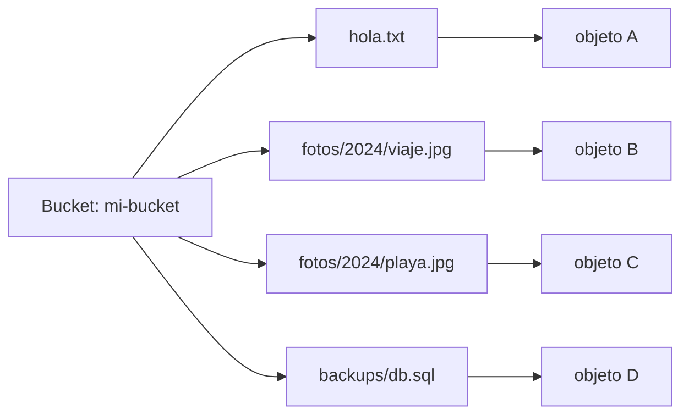
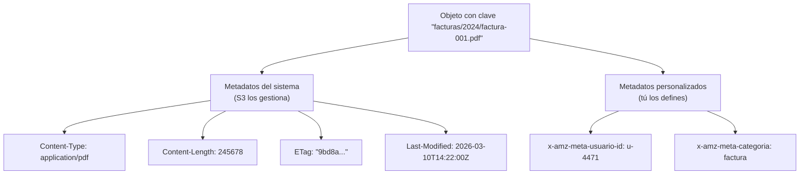
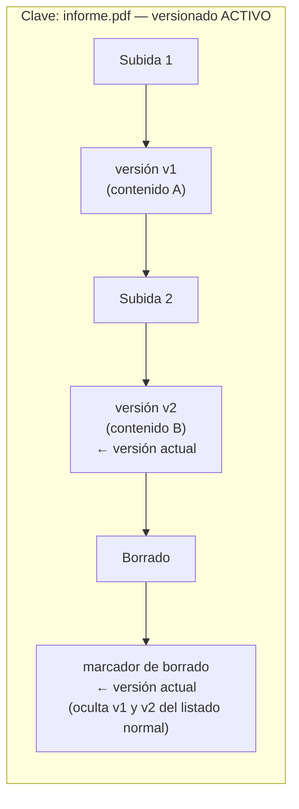
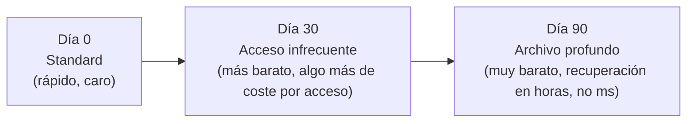
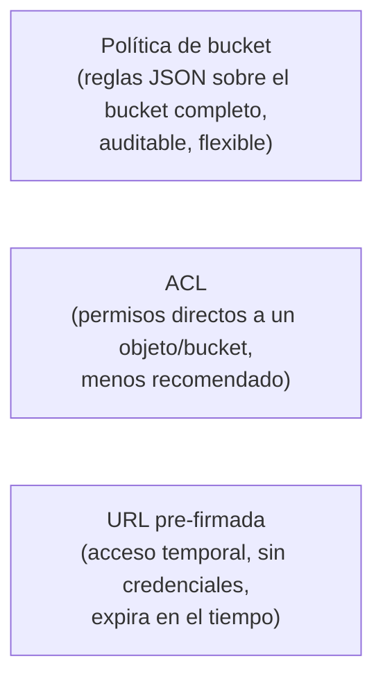
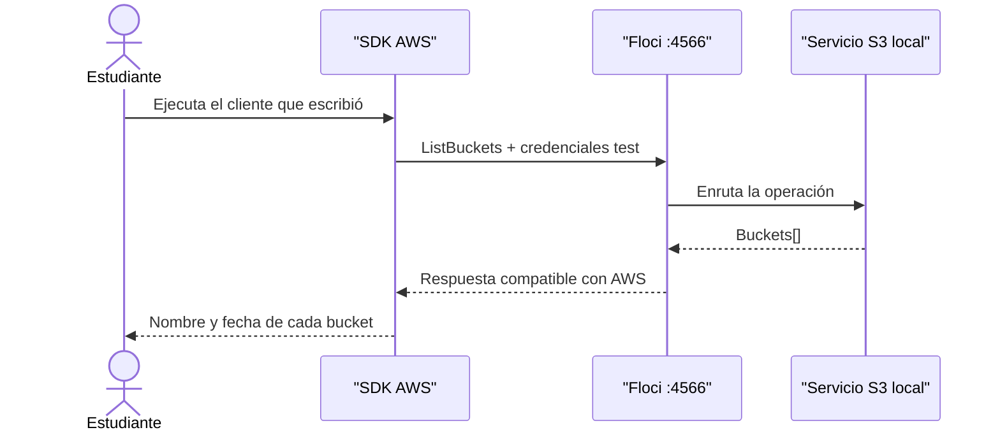

# Módulo 1: Almacenamiento en la nube con S3


## Aprende construyendo


### Tema 1: Objetos, buckets y su nomenclatura · Intermedio · 30 min

<details open>
<summary><strong>Capa 1 — Lectura</strong></summary>

#### ► DE QUÉ TRATA
Al finalizar podrás almacenar un objeto desde cero. Prerrequisitos: Docker y AWS CLI; verifica aws --version.

#### ► CÓMO FUNCIONA


</details>

<details>
<summary><strong>Capa 2 — Construcción</strong></summary>

#### Código y verificación
```error-output
An error occurred (NoSuchBucket) when calling the PutObject operation: The specified bucket does not exist
```

```bash
# ❌ INCORRECTO: bucket no existe
aws s3 cp entrega-001.jpg s3://pruebas-entrega-inexistente/envio-4471/entrega-001.jpg
# NoSuchBucket error

# ✅ CORRECTO: crear bucket primero
aws s3 mb s3://pruebas-entrega  # make bucket
aws s3 cp entrega-001.jpg s3://pruebas-entrega/envio-4471/entrega-001.jpg
```

```bash
# 1. Revisar si bucket existe
aws s3 ls | grep pruebas-entrega

# 2. Si no existe, crearlo
aws s3 mb s3://pruebas-entrega

# 3. Luego sí, subir
aws s3 cp entrega-001.jpg s3://pruebas-entrega/envio-4471/entrega-001.jpg
```


```bash
mkdir ejemplo-s3 && cd ejemplo-s3
printf 'entrega 001 firmada\n' > entrega-001.txt
aws s3 mb s3://pruebas-entrega
aws s3 cp entrega-001.txt s3://pruebas-entrega/envio-4471/entrega-001.txt
aws s3 ls s3://pruebas-entrega/envio-4471/
aws s3 cp s3://pruebas-entrega/envio-4471/entrega-001.txt descargada.txt
diff entrega-001.txt descargada.txt && echo "contenido idéntico"
```

</details>

### Tema 2: Claves y metadatos · Intermedio · 30 min

<details open>
<summary><strong>Capa 1 — Lectura</strong></summary>

#### ► DE QUÉ TRATA
Al finalizar podrás subir un objeto con metadatos reales y entender por qué el Content-Type importa. Prerrequisitos: Módulo 1 (floci start, eval $(floci env)).

#### ► CÓMO FUNCIONA


</details>

<details>
<summary><strong>Capa 2 — Construcción</strong></summary>

#### Código y verificación

```bash
aws s3 mb s3://pruebas-entrega
echo "contenido-simulado-de-foto" > entrega-001.jpg
aws s3 cp entrega-001.jpg s3://pruebas-entrega/envio-4471/entrega-001.jpg \
  --content-type image/jpeg --metadata conductor=c-891,envioId=4471
aws s3api head-object --bucket pruebas-entrega --key envio-4471/entrega-001.jpg
```

```bash
aws s3 cp entrega-001.jpg s3://pruebas-entrega/envio-4471/entrega-001-sin-tipo.jpg
aws s3api head-object --bucket pruebas-entrega --key envio-4471/entrega-001-sin-tipo.jpg
```

</details>

### Tema 3: Versionado y ciclo de vida · Intermedio · 30 min

<details open>
<summary><strong>Capa 1 — Lectura</strong></summary>

#### ► DE QUÉ TRATA
Al finalizar podrás activar versionado y recuperar una versión reemplazada por error. Prerrequisitos: Tema 2 completo (el bucket pruebas-entrega ya existe).

#### ► LA ANALOGÍA
Versionar es conservar cada edición con su propio identificador, no sobrescribir la historia.

**Conceptos clave:** versionado, ID de versión, marcador de borrado (delete marker), reglas de ciclo de vida (lifecycle rules).

**Definición.** Por defecto, al subir un objeto bajo una clave ya existente, S3 sobrescribe el contenido anterior sin conservar rastro: la versión previa se pierde de forma irrecuperable. El versionado modifica este comportamiento: una vez activado sobre un bucket, cada subida a una clave existente conserva ambas versiones —la anterior y la nueva—, identificadas cada una por un ID de versión único, en lugar de sobrescribir. El mecanismo permite listar el historial completo de versiones de una clave, recuperar cualquier versión anterior, o restaurar una versión antigua como versión "actual" mediante una nueva subida.

Con el versionado activo, eliminar un objeto tampoco lo elimina físicamente de forma inmediata: S3 inserta un marcador de borrado (*delete marker*) como versión más reciente de esa clave. El objeto deja de aparecer en un listado estándar —el marcador oculta las versiones anteriores en las operaciones habituales—, pero el contenido real permanece almacenado y es recuperable eliminando ese marcador. Este mecanismo añade una capa de protección frente a borrados accidentales, con dos implicaciones directas: el versionado, una vez activado sobre un bucket, no admite desactivación completa —únicamente suspensión—, y un bucket versionado incrementa su consumo de almacenamiento al conservar cada versión histórica.

El ciclo de vida (*lifecycle*) de un objeto se gestiona mediante reglas que S3 aplica automáticamente con el transcurso del tiempo, sin intervención manual. Una regla de ciclo de vida puede, por ejemplo, trasladar objetos con más de 30 días de antigüedad a una capa de almacenamiento de coste reducido para acceso infrecuente, eliminar versiones con más de 90 días de antigüedad, o retirar marcadores de borrado huérfanos. Estas reglas se definen sobre un bucket completo o sobre un prefijo de claves específico —por ejemplo, únicamente `logs/`— y se evalúan de forma asíncrona en segundo plano por el propio servicio.

La combinación de versionado con reglas de ciclo de vida constituye un patrón habitual en producción: el versionado protege frente a sobrescrituras y borrados accidentales, mientras que una regla de ciclo de vida asociada elimina automáticamente versiones que superan cierta antigüedad, acotando el crecimiento del coste de almacenamiento que implicaría conservar indefinidamente cada versión histórica.

**¿Por qué es importante?** El versionado constituye la defensa más simple y efectiva frente al error operativo más frecuente al trabajar con almacenamiento: la sobrescritura o eliminación accidental del archivo equivocado. Todo bucket que almacene datos cuya pérdida resulte inaceptable —copias de seguridad, documentos de usuario, artefactos de código empaquetado— debería, como práctica estándar de la industria, tener el versionado activo desde su creación.

**Diagrama:**



v1 y v2 siguen existiendo y son recuperables eliminando el marcador de borrado.

En el proyecto integrador RutaFlow puedes declarar este mismo comportamiento en código, no solo
ejecutarlo por CLI: escribe en tu propio `template.yaml` el bucket `PruebasEntrega` con
`VersioningConfiguration: { Status: Enabled }`. Así, cualquier entorno desplegado desde esa
plantilla nace con el versionado activo que acabás de probar a mano.

#### ► CÓMO FUNCIONA


</details>

<details>
<summary><strong>Capa 2 — Construcción</strong></summary>

#### Código y verificación


```bash
aws s3api put-bucket-versioning --bucket pruebas-entrega --versioning-configuration Status=Enabled
echo "foto-correcta-envio-4471" > correcta.jpg
aws s3 cp correcta.jpg s3://pruebas-entrega/envio-4471/entrega-001.jpg
echo "foto-equivocada-de-otro-envio" > equivocada.jpg
aws s3 cp equivocada.jpg s3://pruebas-entrega/envio-4471/entrega-001.jpg
aws s3api list-object-versions --bucket pruebas-entrega --prefix envio-4471/entrega-001.jpg
```

```bash
aws s3api get-object --bucket pruebas-entrega --key envio-4471/entrega-001.jpg \
  --version-id <VersionId-de-la-correcta> recuperada.jpg
cat recuperada.jpg
```

</details>

### Tema 4: Transición entre capas de almacenamiento · Intermedio · 30 min

<details open>
<summary><strong>Capa 1 — Lectura</strong></summary>

#### ► DE QUÉ TRATA
Al finalizar podrás configurar y verificar una regla de ciclo de vida real. Prerrequisitos: Tema 3 completo.

#### ► CÓMO FUNCIONA


</details>

<details>
<summary><strong>Capa 2 — Construcción</strong></summary>

#### Código y verificación


Crea el archivo `lifecycle.json`:

```json
{
  "Rules": [{
    "ID": "mover-pruebas-entrega-a-infrecuente",
    "Status": "Enabled",
    "Filter": { "Prefix": "envio-" },
    "Transitions": [{ "Days": 30, "StorageClass": "STANDARD_IA" }]
  }]
}
```

```bash
aws s3api put-bucket-lifecycle-configuration --bucket pruebas-entrega --lifecycle-configuration file://lifecycle.json
aws s3api get-bucket-lifecycle-configuration --bucket pruebas-entrega
```

</details>

### Tema 5: Políticas de bucket, ACL y URLs pre-firmadas · Intermedio · 30 min

<details open>
<summary><strong>Capa 1 — Lectura</strong></summary>

#### ► DE QUÉ TRATA
Al finalizar podrás generar una URL temporal para que un cliente vea su prueba de entrega sin exponer el bucket. Prerrequisitos: Tema 2 completo (objeto envio-4471/entrega-001.jpg existente).

#### ► CÓMO FUNCIONA


</details>

<details>
<summary><strong>Capa 2 — Construcción</strong></summary>

#### Código y verificación


```bash
mkdir ejemplo && cd ejemplo && floci start
```

```bash
aws s3 presign s3://pruebas-entrega/envio-4471/entrega-001.jpg --expires-in 120
```

</details>

### Antes de escribir código: crea tu propio proyecto

<details open>
<summary><strong>Capa 1 — Lectura</strong></summary>

#### ► CÓMO FUNCIONA


</details>

<details>
<summary><strong>Capa 2 — Construcción</strong></summary>

#### Código y verificación
```bash
mkdir s3-sdk-lab
cd s3-sdk-lab
```

```text
s3-sdk-lab/                 # elige UNA de estas dos estructuras
├── package.json            # opción JavaScript
├── s3-list-buckets.js
├── build.gradle.kts        # opción Java
└── src/main/java/S3ListBuckets.java
```


</details>

### Opción A — JavaScript con AWS SDK v3

<details open>
<summary><strong>Capa 1 — Lectura</strong></summary>

</details>

<details>
<summary><strong>Capa 2 — Construcción</strong></summary>

#### Código y verificación
```bash
npm init -y
npm pkg set type=module
npm install @aws-sdk/client-s3
```

```js
import { S3Client, ListBucketsCommand } from '@aws-sdk/client-s3';

const client = new S3Client({
  region: 'us-east-1',
  endpoint: 'http://localhost:4566',
  forcePathStyle: true,
  credentials: { accessKeyId: 'test', secretAccessKey: 'test' }
});

try {
  const result = await client.send(new ListBucketsCommand({}));
  const buckets = result.Buckets ?? [];
  if (buckets.length === 0) {
    console.log('No hay buckets todavía. Crea uno con: aws s3 mb s3://mi-bucket');
  } else {
    console.log('Buckets:');
    for (const bucket of buckets) {
      console.log(`  - ${bucket.Name} (creado ${bucket.CreationDate?.toISOString()})`);
    }
  }
} catch (error) {
  console.error('No se pudo consultar S3 local:', error.message);
  process.exitCode = 1;
}
```

```bash
node s3-list-buckets.js
```

```text
No hay buckets todavía. Crea uno con: aws s3 mb s3://mi-bucket
```

```text
Buckets:
  - mi-bucket (creado 2026-07-19T14:20:00.000Z)
```

</details>

### Opción B — Java con AWS SDK v2

<details open>
<summary><strong>Capa 1 — Lectura</strong></summary>

El SDK v2 de Java se divide en un módulo por servicio; el BOM fija la misma versión para todos. `endpointOverride`
manda las llamadas a Floci en lugar de a AWS, y `forcePathStyle` pone el bucket en la ruta
(`localhost:4566/mi-bucket`) porque un emulador local no tiene un subdominio por bucket.

</details>

<details>
<summary><strong>Capa 2 — Construcción</strong></summary>

#### Código y verificación
Crea `build.gradle.kts`:

```kotlin
plugins { application }

java { toolchain { languageVersion = JavaLanguageVersion.of(21) } }

repositories { mavenCentral() }

dependencies {
    implementation(platform("software.amazon.awssdk:bom:2.55.6"))
    implementation("software.amazon.awssdk:s3")
    runtimeOnly("org.slf4j:slf4j-nop:2.0.17")   // silencia el aviso de logging del SDK
}

application { mainClass = "S3ListBuckets" }
```

Crea `src/main/java/S3ListBuckets.java`:

```java
import java.net.URI;
import java.util.List;

import software.amazon.awssdk.auth.credentials.AwsBasicCredentials;
import software.amazon.awssdk.auth.credentials.StaticCredentialsProvider;
import software.amazon.awssdk.core.exception.SdkException;
import software.amazon.awssdk.regions.Region;
import software.amazon.awssdk.services.s3.S3Client;
import software.amazon.awssdk.services.s3.model.Bucket;

public class S3ListBuckets {
    public static void main(String[] args) {
        try (S3Client client = S3Client.builder()
                .region(Region.US_EAST_1)
                .endpointOverride(URI.create("http://localhost:4566"))
                .forcePathStyle(true)
                .credentialsProvider(StaticCredentialsProvider.create(AwsBasicCredentials.create("test", "test")))
                .build()) {
            List<Bucket> buckets = client.listBuckets().buckets();
            if (buckets.isEmpty()) {
                System.out.println("No hay buckets todavía. Crea uno con: aws s3 mb s3://mi-bucket");
            } else {
                System.out.println("Buckets:");
                for (Bucket bucket : buckets) {
                    System.out.println("  - " + bucket.name() + " (creado " + bucket.creationDate() + ")");
                }
            }
        } catch (SdkException error) {
            System.err.println("No se pudo consultar S3 local: " + error.getMessage());
            System.exit(1);
        }
    }
}
```

```bash
touch settings.gradle.kts          # proyecto de un solo módulo
gradle wrapper
./gradlew -q run
```

La salida es la misma que la de la opción A. `creationDate()` es un `Instant`, que se imprime en ISO-8601:
`  - mi-bucket (creado 2026-07-19T14:20:00Z)`.

</details>

### Provoca un fallo útil antes de continuar

<details open>
<summary><strong>Capa 1 — Lectura</strong></summary>

</details>

<details>
<summary><strong>Capa 2 — Construcción</strong></summary>

#### Nota de construcción
Este tema es principalmente conceptual en esta versión. La verificación se realiza con las preguntas de comprensión y el criterio de cuándo NO usar provoca un fallo útil antes de continuar.

</details>

### Parte 1 — Operaciones CRUD básicas

<details open>
<summary><strong>Capa 1 — Lectura</strong></summary>

</details>

<details>
<summary><strong>Capa 2 — Construcción</strong></summary>

#### Nota de construcción
Este tema es principalmente conceptual en esta versión. La verificación se realiza con las preguntas de comprensión y el criterio de cuándo NO usar parte 1 — operaciones crud básicas.

</details>

### Parte 2 — Versionado

<details open>
<summary><strong>Capa 1 — Lectura</strong></summary>

</details>

<details>
<summary><strong>Capa 2 — Construcción</strong></summary>

#### Nota de construcción
Este tema es principalmente conceptual en esta versión. La verificación se realiza con las preguntas de comprensión y el criterio de cuándo NO usar parte 2 — versionado.

</details>
