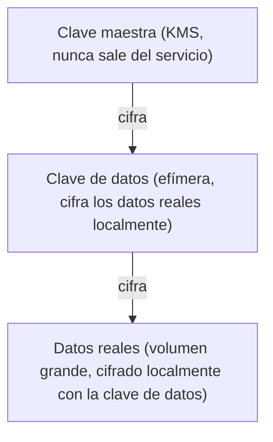
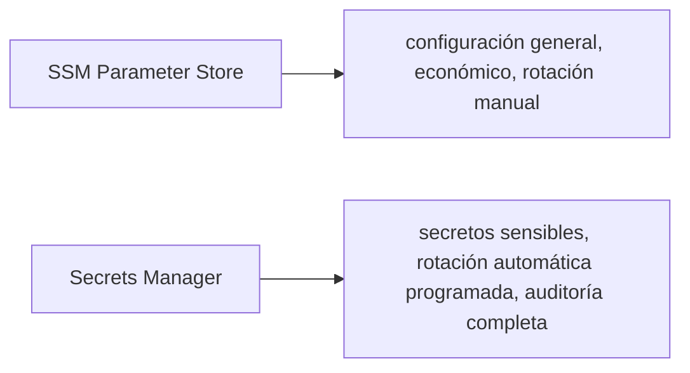

# Módulo 10: Secretos y configuración: Secrets Manager, Key Vault y Secret Manager


## Aprende construyendo


### Tema 1: Secrets Manager y por qué no usar variables de entorno hardcodeadas · Básico · 40 min

<details open>
<summary><strong>Capa 1 — Lectura</strong></summary>

#### ► DE QUÉ TRATA
Al finalizar vas a sacar una clave real de RutaFlow de un archivo versionado y meterla donde corresponde. Prerrequisitos: Módulo 9 completo.

#### ► LA IDEA EN UNA FRASE
**Al finalizar vas a sacar una clave real de RutaFlow de un archivo versionado y meterla donde corresponde.**

#### ► POR QUÉ EXISTE ESTO
Resuelve un problema real de diseño o implementación y evita decisiones a ciegas.

#### ► LA ANALOGÍA
Piensa en secrets manager y por qué no usar variables de entorno hardcodeadas como una herramienta de taller: útil cuando conoces su propósito y sus límites.
**Dónde se rompe la analogía:** en software, los efectos dependen del contexto, la escala y los trade-offs.

#### ► CÓMO FUNCIONA
1. Identifica el problema que secrets manager y por qué no usar variables de entorno hardcodeadas resuelve.
2. Observa sus componentes y relaciones.
3. Aplica la opción más simple que funcione.
4. Verifica el resultado y los límites.

#### ► LO QUE PUEDE SALIR MAL
| Síntoma | Causa probable | Arreglo |
|---|---|---|
| Secrets Manager y por qué no usar variables de entorno hardcodeadas se aplica pero el resultado no mejora | Se usó sin medir el problema real | Mide antes y compara contra la alternativa simple |
| Aparece complejidad inesperada | Se adoptó la técnica sin comprender sus trade-offs | Vuelve a la sección de trade-offs y reduce el alcance |
| Falla en un caso límite | Se asumió un contexto que no se cumple | Prueba el caso límite y documenta cuándo NO usarlo |

#### ► TRADE-OFFS
| Opción | Cuándo usarla | Cuándo NO usarla |
|---|---|---|
| Usar Secrets Manager y por qué no usar variables de entorno hardcodeadas | Cuando el problema coincide con su propósito y el beneficio es observable | Cuando agrega complejidad sin resolver un problema real |
| Alternativa más simple | Cuando el contexto es pequeño, estable o fácil de razonar | Cuando ya demostró no escalar o no cumplir el requisito |
| Postergar la decisión | Cuando falta evidencia del problema | Cuando el costo de esperar es mayor que el costo de probar |

#### ► CUÁNDO NO USAR ESTO
No uses secrets manager y por qué no usar variables de entorno hardcodeadas por defecto. Aplícalo cuando el problema lo justifique y puedas verificar el beneficio; si una alternativa más simple resuelve igual, prefiérela.

#### ► DE VUELTA A LA ANALOGÍA
Volviendo a la analogía: secrets manager y por qué no usar variables de entorno hardcodeadas funciona como el modelo inicial, pero recuerda dónde se rompe: en producción importan la evidencia, la escala y el costo de equivocarte.

#### ► LO QUE DEBES RECORDAR
- Secrets Manager y por qué no usar variables de entorno hardcodeadas existe para resolver un problema específico.
- Mide antes de adoptar complejidad.
- Conoce el caso donde NO usarlo.
- Verifica con evidencia observable.

#### ► PREGUNTAS PARA PENSAR
1. ¿Qué problema concreto resuelve secrets manager y por qué no usar variables de entorno hardcodeadas en tu contexto?
2. ¿Cómo sabrías que secrets manager y por qué no usar variables de entorno hardcodeadas no está funcionando bien?
3. ¿Qué alternativa más simple considerarías antes de usar secrets manager y por qué no usar variables de entorno hardcodeadas?

</details>

<details>
<summary><strong>Capa 2 — Construcción</strong></summary>

#### Código y verificación
```bash
aws secretsmanager create-secret --name /app/db-password --secret-string "mi-password-segura"
aws secretsmanager get-secret-value --secret-id /app/db-password --query SecretString --output text
```

```bash
aws secretsmanager create-secret --name /app/db-password --secret-string "mi-password-segura"
aws secretsmanager get-secret-value --secret-id /app/db-password --query SecretString --output text
```

```bash
echo "SMS_GATEWAY_API_KEY=demo_rutaflow_12345" > .env
grep SMS_GATEWAY_API_KEY .env
aws secretsmanager create-secret --name /rutaflow/sms-gateway-api-key --secret-string "demo_rutaflow_12345"
```

```bash
git init -q && git add .env && git commit -qm "config: agrega .env por error"
git rm -q .env && git commit -qm "config: elimina .env"
git log --all --oneline -- .env
git show HEAD~1:.env
```

</details>

### Tema 2: KMS y envelope encryption · Básico · 40 min

<details open>
<summary><strong>Capa 1 — Lectura</strong></summary>

#### ► DE QUÉ TRATA
Al finalizar vas a cifrar un respaldo local de la clave del Tema 1 con KMS, y a comprobar qué pasa si alguien sin permiso intenta descifrarlo. Prerrequisitos: Tema 1 de este módulo.

#### ► LA IDEA EN UNA FRASE
**Al finalizar vas a cifrar un respaldo local de la clave del Tema 1 con KMS, y a comprobar qué pasa si alguien sin permiso intenta descifrarlo.**

#### ► POR QUÉ EXISTE ESTO
Resuelve un problema real de diseño o implementación y evita decisiones a ciegas.

#### ► LA ANALOGÍA
Piensa en kms y envelope encryption como una herramienta de taller: útil cuando conoces su propósito y sus límites.
**Dónde se rompe la analogía:** en software, los efectos dependen del contexto, la escala y los trade-offs.

#### ► CÓMO FUNCIONA


#### ► LO QUE PUEDE SALIR MAL
| Síntoma | Causa probable | Arreglo |
|---|---|---|
| KMS y envelope encryption se aplica pero el resultado no mejora | Se usó sin medir el problema real | Mide antes y compara contra la alternativa simple |
| Aparece complejidad inesperada | Se adoptó la técnica sin comprender sus trade-offs | Vuelve a la sección de trade-offs y reduce el alcance |
| Falla en un caso límite | Se asumió un contexto que no se cumple | Prueba el caso límite y documenta cuándo NO usarlo |

#### ► TRADE-OFFS
| Opción | Cuándo usarla | Cuándo NO usarla |
|---|---|---|
| Usar KMS y envelope encryption | Cuando el problema coincide con su propósito y el beneficio es observable | Cuando agrega complejidad sin resolver un problema real |
| Alternativa más simple | Cuando el contexto es pequeño, estable o fácil de razonar | Cuando ya demostró no escalar o no cumplir el requisito |
| Postergar la decisión | Cuando falta evidencia del problema | Cuando el costo de esperar es mayor que el costo de probar |

#### ► CUÁNDO NO USAR ESTO
No uses kms y envelope encryption por defecto. Aplícalo cuando el problema lo justifique y puedas verificar el beneficio; si una alternativa más simple resuelve igual, prefiérela.

#### ► DE VUELTA A LA ANALOGÍA
Volviendo a la analogía: kms y envelope encryption funciona como el modelo inicial, pero recuerda dónde se rompe: en producción importan la evidencia, la escala y el costo de equivocarte.

#### ► LO QUE DEBES RECORDAR
- KMS y envelope encryption existe para resolver un problema específico.
- Mide antes de adoptar complejidad.
- Conoce el caso donde NO usarlo.
- Verifica con evidencia observable.

#### ► PREGUNTAS PARA PENSAR
1. ¿Qué problema concreto resuelve kms y envelope encryption en tu contexto?
2. ¿Cómo sabrías que kms y envelope encryption no está funcionando bien?
3. ¿Qué alternativa más simple considerarías antes de usar kms y envelope encryption?

</details>

<details>
<summary><strong>Capa 2 — Construcción</strong></summary>

#### Código y verificación
```bash
aws kms create-key --description "Clave de la app"
aws kms encrypt --key-id alias/mi-clave --plaintext fileb://secreto.txt --query CiphertextBlob --output text | base64 -d > secreto.enc
aws kms decrypt --ciphertext-blob fileb://secreto.enc --query Plaintext --output text | base64 -d
```


```bash
aws kms create-key --description "Clave de respaldo RutaFlow" --query KeyMetadata.KeyId --output text
aws kms create-alias --alias-name alias/rutaflow-backup --target-key-id "$(aws kms list-keys --query 'Keys[-1].KeyId' --output text)"
echo "demo_rutaflow_12345" > respaldo-secreto.txt
aws kms encrypt --key-id alias/rutaflow-backup --plaintext fileb://respaldo-secreto.txt --query CiphertextBlob --output text | base64 -d > respaldo-secreto.enc
aws kms decrypt --ciphertext-blob fileb://respaldo-secreto.enc --query Plaintext --output text | base64 -d
```

</details>

### Tema 3: SSM Parameter Store vs Secrets Manager · Básico · 40 min

<details open>
<summary><strong>Capa 1 — Lectura</strong></summary>

#### ► DE QUÉ TRATA
Al finalizar vas a separar, para RutaFlow, qué va en SSM Parameter Store y qué va en Secrets Manager, y a comprobar por qué un rol sin permiso específico no puede leer ninguno de los dos. Prerrequisitos: Temas 1-2 de este módulo.

#### ► LA IDEA EN UNA FRASE
**Al finalizar vas a separar, para RutaFlow, qué va en SSM Parameter Store y qué va en Secrets Manager, y a comprobar por qué un rol sin permiso específico no puede leer ninguno de los dos.**

#### ► POR QUÉ EXISTE ESTO
Resuelve un problema real de diseño o implementación y evita decisiones a ciegas.

#### ► LA ANALOGÍA
Piensa en ssm parameter store vs secrets manager como una herramienta de taller: útil cuando conoces su propósito y sus límites.
**Dónde se rompe la analogía:** en software, los efectos dependen del contexto, la escala y los trade-offs.

#### ► CÓMO FUNCIONA


#### ► REGLA PRÁCTICA
Si rotar manualmente es aceptable y el dato no es sensible, usa Parameter Store por costo; si el dato requiere rotación automática programada y auditoría, usa Secrets Manager aunque cueste más.

#### ► LO QUE PUEDE SALIR MAL
| Síntoma | Causa probable | Arreglo |
|---|---|---|
| SSM Parameter Store vs Secrets Manager se aplica pero el resultado no mejora | Se usó sin medir el problema real | Mide antes y compara contra la alternativa simple |
| Aparece complejidad inesperada | Se adoptó la técnica sin comprender sus trade-offs | Vuelve a la sección de trade-offs y reduce el alcance |
| Falla en un caso límite | Se asumió un contexto que no se cumple | Prueba el caso límite y documenta cuándo NO usarlo |

#### ► TRADE-OFFS
| Opción | Cuándo usarla | Cuándo NO usarla |
|---|---|---|
| Usar SSM Parameter Store vs Secrets Manager | Cuando el problema coincide con su propósito y el beneficio es observable | Cuando agrega complejidad sin resolver un problema real |
| Alternativa más simple | Cuando el contexto es pequeño, estable o fácil de razonar | Cuando ya demostró no escalar o no cumplir el requisito |
| Postergar la decisión | Cuando falta evidencia del problema | Cuando el costo de esperar es mayor que el costo de probar |

#### ► CUÁNDO NO USAR ESTO
No uses ssm parameter store vs secrets manager por defecto. Aplícalo cuando el problema lo justifique y puedas verificar el beneficio; si una alternativa más simple resuelve igual, prefiérela.

#### ► DE VUELTA A LA ANALOGÍA
Volviendo a la analogía: ssm parameter store vs secrets manager funciona como el modelo inicial, pero recuerda dónde se rompe: en producción importan la evidencia, la escala y el costo de equivocarte.

#### ► LO QUE DEBES RECORDAR
- SSM Parameter Store vs Secrets Manager existe para resolver un problema específico.
- Mide antes de adoptar complejidad.
- Conoce el caso donde NO usarlo.
- Verifica con evidencia observable.

#### ► PREGUNTAS PARA PENSAR
1. ¿Qué problema concreto resuelve ssm parameter store vs secrets manager en tu contexto?
2. ¿Cómo sabrías que ssm parameter store vs secrets manager no está funcionando bien?
3. ¿Qué alternativa más simple considerarías antes de usar ssm parameter store vs secrets manager?

</details>

<details>
<summary><strong>Capa 2 — Construcción</strong></summary>

#### Código y verificación
```bash
aws ssm put-parameter --name /app/api-url --value "http://localhost:4566" --type String
```


```bash
aws ssm put-parameter --name /rutaflow/sms-gateway-url --value "https://sms-provider.example.com/v1" --type String
aws ssm get-parameter --name /rutaflow/sms-gateway-url --query Parameter.Value --output text
```

</details>
