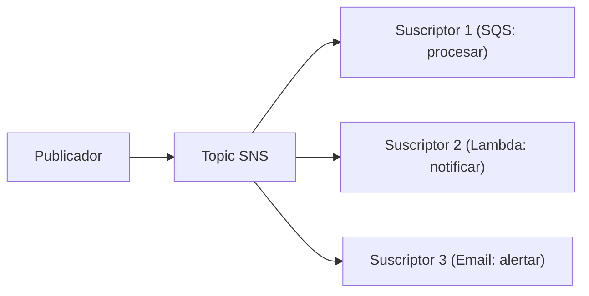
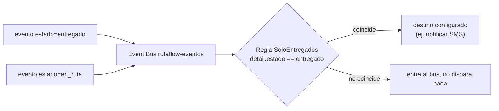
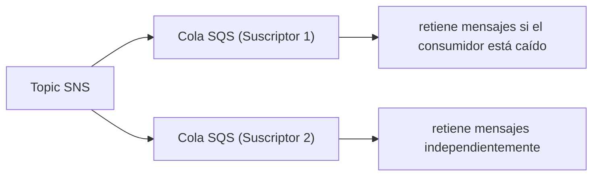

# Módulo 10: Mensajería Pub/Sub: SNS, EventBridge y Azure Event Hubs


## Aprende construyendo


### Tema 1: El patrón fan-out con SNS · Intermedio · 45 min

<details open>
<summary><strong>Capa 1 — Lectura</strong></summary>

#### ► DE QUÉ TRATA
Al finalizar vas a distribuir el evento real "envío entregado" de RutaFlow a dos consumidores independientes sin que confirmar-entrega conozca a ninguno de los dos. Prerrequisitos: Módulo 5 completo.

#### ► CÓMO FUNCIONA


</details>

<details>
<summary><strong>Capa 2 — Construcción</strong></summary>

#### Código y verificación
```bash
aws sns create-topic --name mis-alertas
aws sns subscribe --topic-arn arn:aws:sns:us-east-1:000000000000:mis-alertas --protocol sqs --notification-endpoint arn:aws:sqs:us-east-1:000000000000:mi-cola
aws sns publish --topic-arn ... --message "Alerta importante"
```


```bash
TOPIC_ARN=$(aws sns create-topic --name rutaflow-envio-entregado --query TopicArn --output text)
NOTIF_Q=$(aws sqs create-queue --queue-name notificaciones-cliente --query QueueUrl --output text)
ANALYTICS_Q=$(aws sqs create-queue --queue-name analitica-entregas --query QueueUrl --output text)
# Cada cola debe autorizar al tema a escribir en ella; sin esta política, en AWS real el mensaje no llega.
permitir_sns() {
  QUEUE_ARN=$(aws sqs get-queue-attributes --queue-url "$1" --attribute-names QueueArn --query Attributes.QueueArn --output text)
  jq -n --arg q "$QUEUE_ARN" --arg t "$TOPIC_ARN" '{Policy: ({Version: "2012-10-17", Statement: [{Effect: "Allow",
    Principal: {Service: "sns.amazonaws.com"}, Action: "sqs:SendMessage", Resource: $q,
    Condition: {ArnEquals: {"aws:SourceArn": $t}}}]} | tojson)}' > atributos.json
  aws sqs set-queue-attributes --queue-url "$1" --attributes file://atributos.json
}
permitir_sns "$NOTIF_Q"
permitir_sns "$ANALYTICS_Q"
aws sns subscribe --topic-arn "$TOPIC_ARN" --protocol sqs --notification-endpoint "$(aws sqs get-queue-attributes --queue-url "$NOTIF_Q" --attribute-names QueueArn --query Attributes.QueueArn --output text)"
aws sns subscribe --topic-arn "$TOPIC_ARN" --protocol sqs --notification-endpoint "$(aws sqs get-queue-attributes --queue-url "$ANALYTICS_Q" --attribute-names QueueArn --query Attributes.QueueArn --output text)"
aws sns publish --topic-arn "$TOPIC_ARN" --message '{"shipmentId":"env-4471","estado":"entregado"}'
aws sqs receive-message --queue-url "$NOTIF_Q"
aws sqs receive-message --queue-url "$ANALYTICS_Q"
```

</details>

### Tema 2: EventBridge: bus de eventos con filtrado declarativo · Intermedio · 45 min

<details open>
<summary><strong>Capa 1 — Lectura</strong></summary>

#### ► DE QUÉ TRATA
Al finalizar vas a filtrar los eventos de ShipmentEvents (Módulo 4) para que solo "entregado" dispare la notificación SMS, sin que creado o en_ruta la activen por error. Prerrequisitos: Tema 1 de este módulo.

#### ► CÓMO FUNCIONA


</details>

<details>
<summary><strong>Capa 2 — Construcción</strong></summary>

#### Código y verificación
```bash
aws events create-event-bus --name mi-bus
aws events put-rule --name ReglaEjemplo --event-bus-name mi-bus --event-pattern '{"source":["mi.app"]}'
aws events put-events --entries '[{"Source":"mi.app","DetailType":"TareaCreada","Detail":"{\"id\":\"001\"}","EventBusName":"mi-bus"}]'
```

```bash
aws events put-rule --name ReglaEjemplo --event-bus-name mi-bus --event-pattern '{"source":["mi.app"]}'
# Solo eventos con source="mi.app" disparan esta regla, filtrado declarativo sobre el contenido
```


```bash
aws events create-event-bus --name rutaflow-eventos
aws events put-rule --name SoloEntregados --event-bus-name rutaflow-eventos \
  --event-pattern '{"source":["rutaflow.envios"],"detail":{"estado":["entregado"]}}'
aws events put-events --entries '[{"Source":"rutaflow.envios","DetailType":"CambioEstado","Detail":"{\"shipmentId\":\"env-4471\",\"estado\":\"entregado\"}","EventBusName":"rutaflow-eventos"}]'
aws events put-events --entries '[{"Source":"rutaflow.envios","DetailType":"CambioEstado","Detail":"{\"shipmentId\":\"env-4471\",\"estado\":\"en_ruta\"}","EventBusName":"rutaflow-eventos"}]'
```

</details>

### Tema 3: SNS + SQS juntos, y Azure Event Hubs · Intermedio · 45 min

<details open>
<summary><strong>Capa 1 — Lectura</strong></summary>

#### ► DE QUÉ TRATA
Al finalizar vas a comprobar que notificaciones-cliente (Tema 1) no pierde ningún mensaje aunque nadie lo esté leyendo por un rato. Prerrequisitos: Tema 1 de este módulo.

#### ► CÓMO FUNCIONA


</details>

<details>
<summary><strong>Capa 2 — Construcción</strong></summary>

#### Código y verificación

```bash
aws sns publish --topic-arn "$TOPIC_ARN" --message '{"shipmentId":"env-5002","estado":"entregado"}'
aws sns publish --topic-arn "$TOPIC_ARN" --message '{"shipmentId":"env-5003","estado":"entregado"}'
aws sqs get-queue-attributes --queue-url "$NOTIF_Q" --attribute-names ApproximateNumberOfMessages
```

</details>
