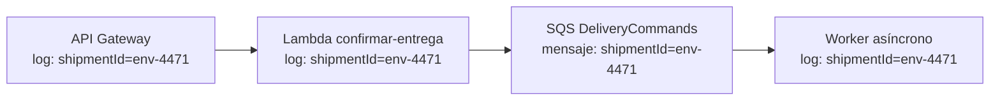
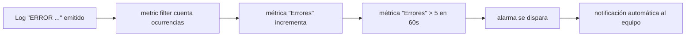
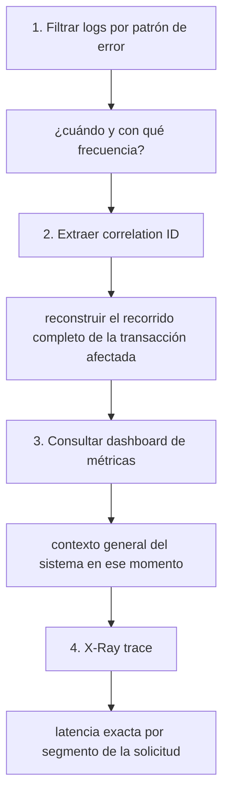

# Módulo 11: Observabilidad con CloudWatch: logs, métricas y alarmas


## Aprende construyendo


### Tema 1: Log groups, log streams y correlation ID · Intermedio · 45 min

<details open>
<summary><strong>Capa 1 — Lectura</strong></summary>

#### ► DE QUÉ TRATA
Al finalizar vas a usar shipmentId como correlation ID real para seguir una entrega a través de confirmar-entrega (Módulo 5), API Gateway (Módulo 6) y SQS (Módulo 5 Tema 6). Prerrequisitos: Módulo 5 completo.

#### ► CÓMO FUNCIONA


</details>

<details>
<summary><strong>Capa 2 — Construcción</strong></summary>

#### Código y verificación
```bash
aws logs create-log-group --log-group-name /mi-app/backend
aws logs create-log-stream --log-group-name /mi-app/backend --log-stream-name app-001
AHORA_MS=$(( $(date +%s) * 1000 ))   # CloudWatch Logs espera milisegundos desde 1970
aws logs put-log-events --log-group-name /mi-app/backend --log-stream-name app-001 --log-events "[{\"timestamp\":$AHORA_MS,\"message\":\"ERROR request_id=abc tarea_id=001 msg=fallo\"}]"
```

```python
import logging
import uuid

logging.basicConfig(level=logging.INFO, format="%(levelname)s %(message)s")
correlation_id = str(uuid.uuid4())
logging.info(f"correlation_id={correlation_id} accion=procesar_tarea")
```


```bash
aws logs create-log-group --log-group-name /rutaflow/confirmar-entrega
aws logs create-log-stream --log-group-name /rutaflow/confirmar-entrega --log-stream-name invocacion-001
aws logs put-log-events --log-group-name /rutaflow/confirmar-entrega --log-stream-name invocacion-001 \
  --log-events "[{\"timestamp\":$(date +%s000),\"message\":\"shipmentId=env-4471 accion=confirmar status=delivered\"}]"
aws logs filter-log-events --log-group-name /rutaflow/confirmar-entrega --filter-pattern "env-4471"
```

</details>

### Tema 2: Metric filters y alarmas · Intermedio · 45 min

<details open>
<summary><strong>Capa 1 — Lectura</strong></summary>

#### ► DE QUÉ TRATA
Al finalizar vas a convertir el error de validación real de confirmar-entrega (Módulo 5, "comando de entrega inválido") en una métrica con alarma. Prerrequisitos: Tema 1 de este módulo.

#### ► LA ANALOGÍA
Un metric filter transforma una marca de texto repetida en los logs en un contador numérico observable, sin que tengas que instrumentar manualmente cada punto del código.

**Conceptos clave:** convertir patrones de texto en logs a métricas numéricas monitoreables, más económico que métricas custom manuales.

```bash
aws logs put-metric-filter --log-group-name /mi-app/backend --filter-name ContarErrores --filter-pattern "ERROR" --metric-transformations metricName=Errores,metricNamespace=MiApp,metricValue=1
aws cloudwatch put-metric-alarm --alarm-name MuchosErrores --metric-name Errores --namespace MiApp --statistic Sum --period 60 --threshold 5 --comparison-operator GreaterThanThreshold --evaluation-periods 1
```

En el primer comando, `--filter-name` identifica el filtro; `--filter-pattern` es el texto o patrón que buscás dentro de cada línea de log (acá, literalmente `"ERROR"`); `--metric-transformations` define cómo ese patrón se convierte en métrica: `--namespace` (dentro del mismo flag) agrupa métricas relacionadas, `--metric-name` es el nombre de la métrica resultante, y su valor es cuánto suma cada coincidencia. En el segundo comando, `--alarm-name` identifica la alarma; `--statistic` es la agregación que evalúa (`Sum`, `Average`...); `--period` es la ventana de tiempo en segundos sobre la que se calcula esa agregación; `--threshold` es el valor límite; `--comparison-operator` define la comparación (por ejemplo, "mayor que"); y `--evaluation-periods` es cuántos períodos consecutivos deben cumplir esa condición antes de disparar la alarma. En resumen: `--metric-transformations` es la bandera que define cómo se deriva la métrica desde el patrón de log, y `--evaluation-periods` es la bandera que fija cuántos períodos consecutivos se exigen antes de disparar la alarma.

Un metric filter examina continuamente los logs entrantes de un log group buscando un patrón específico (`"ERROR"`), incrementando una métrica numérica cada vez que ese patrón aparece, sin que la aplicación necesite emitir explícitamente una métrica custom por separado además del log de error mismo: la métrica se deriva automáticamente del log ya existente, aprovechando información que la aplicación ya está registrando de todas formas por razones de depuración, en vez de duplicar ese esfuerzo instrumentando manualmente un contador de métricas custom adicional para el mismo propósito, lo que hace a los metric filters considerablemente más económicos en esfuerzo de instrumentación que las métricas custom manuales.

Una alarma configurada sobre esa métrica derivada (`threshold=5`, `evaluation-periods=1`) dispara una notificación automáticamente cuando el conteo de errores supera el umbral definido dentro del período configurado, permitiendo que el equipo de desarrollo se entere de un problema de producción de forma proactiva (antes de que múltiples usuarios reporten el mismo problema por otros canales), cerrando el ciclo completo desde "el código registra un error" hasta "el equipo responsable recibe una notificación automática accionable".

**Analogía:** un metric filter es como un sistema de conteo automático que registra cuántas veces aparece una palabra clave específica en los reportes diarios ya existentes de una oficina, sin requerir un formulario de conteo separado adicional; una alarma es como una campana automática que suena cuando ese conteo supera un umbral preocupante dentro de un período específico, alertando al supervisor antes de que el problema se vuelva evidente por sus consecuencias visibles.

**¿Por qué es importante?** Un metric filter es más barato que una métrica custom porque deriva la métrica automáticamente de logs que la aplicación ya emite, sin instrumentación manual adicional; las alarmas permiten detectar problemas proactivamente antes de que los usuarios los reporten por otros canales.

**Diagrama:**



**Transferencia al proyecto integrador «Cloud local multi-nube»:** Genera un error controlado al confirmar una entrega y haz que active el filtro y la alarma definidos. Registra la demora observada y el enlace al diagnóstico que recibirá la persona de guardia.

#### ► CÓMO FUNCIONA


</details>

<details>
<summary><strong>Capa 2 — Construcción</strong></summary>

#### Código y verificación
```bash
aws logs put-metric-filter --log-group-name /mi-app/backend --filter-name ContarErrores --filter-pattern "ERROR" --metric-transformations metricName=Errores,metricNamespace=MiApp,metricValue=1
aws cloudwatch put-metric-alarm --alarm-name MuchosErrores --metric-name Errores --namespace MiApp --statistic Sum --period 60 --threshold 5 --comparison-operator GreaterThanThreshold --evaluation-periods 1
```


```bash
aws logs put-metric-filter --log-group-name /rutaflow/confirmar-entrega --filter-name ComandosInvalidos \
  --filter-pattern "\"comando de entrega inválido\"" \
  --metric-transformations metricName=ComandosInvalidos,metricNamespace=RutaFlow,metricValue=1
aws logs put-log-events --log-group-name /rutaflow/confirmar-entrega --log-stream-name invocacion-001 \
  --log-events "[{\"timestamp\":$(date +%s000),\"message\":\"shipmentId=env-6001 comando de entrega inválido\"}]"
aws cloudwatch get-metric-statistics --namespace RutaFlow --metric-name ComandosInvalidos \
  --start-time "$(date -u -v-5M +%Y-%m-%dT%H:%M:%S)" --end-time "$(date -u +%Y-%m-%dT%H:%M:%S)" --period 60 --statistics Sum
```

</details>

### Tema 3: Diagnóstico sistemático y X-Ray · Intermedio · 45 min

<details open>
<summary><strong>Capa 1 — Lectura</strong></summary>

#### ► DE QUÉ TRATA
Al finalizar podrás investigar incidentes desde cero. Prerrequisitos: Node.js y Docker; verifica node --version.

#### ► CÓMO FUNCIONA


</details>

<details>
<summary><strong>Capa 2 — Construcción</strong></summary>

#### Código y verificación

```bash
mkdir ejemplo-incidente && cd ejemplo-incidente
aws logs create-log-group --log-group-name /rutaflow/confirmar-entrega
aws logs create-log-stream --log-group-name /rutaflow/confirmar-entrega --log-stream-name incidente-001
AHORA_MS=$(( $(date +%s) * 1000 ))
aws logs put-log-events --log-group-name /rutaflow/confirmar-entrega --log-stream-name incidente-001 --log-events \
  "[{\"timestamp\":$AHORA_MS,\"message\":\"INFO shipmentId=env-4471 accion=recibir\"},{\"timestamp\":$((AHORA_MS+1)),\"message\":\"ERROR shipmentId=env-4471 msg=tabla no encontrada\"},{\"timestamp\":$((AHORA_MS+2)),\"message\":\"INFO shipmentId=env-5002 accion=recibir\"}]"
aws logs filter-log-events --log-group-name /rutaflow/confirmar-entrega --filter-pattern "ERROR" --query 'events[].message' --output text
aws logs filter-log-events --log-group-name /rutaflow/confirmar-entrega --filter-pattern '"env-4471"' --query 'events[].message' --output text
```

</details>
