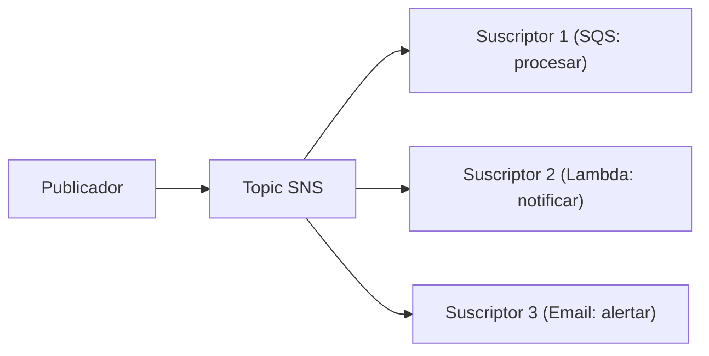
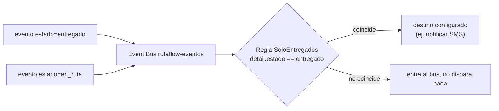
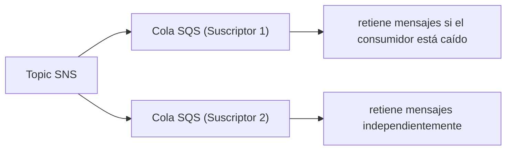

# Módulo 11: Mensajería Pub/Sub: SNS, EventBridge y Azure Event Hubs


## Aprende construyendo


### Tema 1: El patrón fan-out con SNS · Intermedio · 45 min

<details open>
<summary><strong>Capa 1 — Lectura</strong></summary>

#### ► DE QUÉ TRATA
Al finalizar vas a distribuir el evento real "envío entregado" de RutaFlow a dos consumidores independientes sin que confirmar-entrega conozca a ninguno de los dos. Prerrequisitos: Módulo 5 completo.

#### ► LA IDEA EN UNA FRASE
**Al finalizar vas a distribuir el evento real "envío entregado" de RutaFlow a dos consumidores independientes sin que confirmar-entrega conozca a ninguno de los dos.**

#### ► POR QUÉ EXISTE ESTO
Resuelve un problema real de diseño o implementación y evita decisiones a ciegas.

#### ► LA ANALOGÍA
Piensa en el patrón fan-out con sns como una herramienta de taller: útil cuando conoces su propósito y sus límites.
**Dónde se rompe la analogía:** en software, los efectos dependen del contexto, la escala y los trade-offs.

#### ► CÓMO FUNCIONA


#### ► LO QUE PUEDE SALIR MAL
| Síntoma | Causa probable | Arreglo |
|---|---|---|
| El patrón fan-out con SNS se aplica pero el resultado no mejora | Se usó sin medir el problema real | Mide antes y compara contra la alternativa simple |
| Aparece complejidad inesperada | Se adoptó la técnica sin comprender sus trade-offs | Vuelve a la sección de trade-offs y reduce el alcance |
| Falla en un caso límite | Se asumió un contexto que no se cumple | Prueba el caso límite y documenta cuándo NO usarlo |

#### ► TRADE-OFFS
| Opción | Cuándo usarla | Cuándo NO usarla |
|---|---|---|
| Usar El patrón fan-out con SNS | Cuando el problema coincide con su propósito y el beneficio es observable | Cuando agrega complejidad sin resolver un problema real |
| Alternativa más simple | Cuando el contexto es pequeño, estable o fácil de razonar | Cuando ya demostró no escalar o no cumplir el requisito |
| Postergar la decisión | Cuando falta evidencia del problema | Cuando el costo de esperar es mayor que el costo de probar |

#### ► CUÁNDO NO USAR ESTO
No uses el patrón fan-out con sns por defecto. Aplícalo cuando el problema lo justifique y puedas verificar el beneficio; si una alternativa más simple resuelve igual, prefiérela.

#### ► DE VUELTA A LA ANALOGÍA
Volviendo a la analogía: el patrón fan-out con sns funciona como el modelo inicial, pero recuerda dónde se rompe: en producción importan la evidencia, la escala y el costo de equivocarte.

#### ► LO QUE DEBES RECORDAR
- El patrón fan-out con SNS existe para resolver un problema específico.
- Mide antes de adoptar complejidad.
- Conoce el caso donde NO usarlo.
- Verifica con evidencia observable.

#### ► PREGUNTAS PARA PENSAR
1. ¿Qué problema concreto resuelve el patrón fan-out con sns en tu contexto?
2. ¿Cómo sabrías que el patrón fan-out con sns no está funcionando bien?
3. ¿Qué alternativa más simple considerarías antes de usar el patrón fan-out con sns?

</details>

<details>
<summary><strong>Capa 2 — Construcción</strong></summary>

#### Código y verificación
```bash
aws sns create-topic --name mis-alertas
aws sns subscribe --topic-arn arn:aws:sns:us-east-1:000000000000:mis-alertas --protocol sqs --notification-endpoint arn:aws:sqs:us-east-1:000000000000:mi-cola
aws sns publish --topic-arn ... --message "Alerta importante"
```


```bash
TOPIC_ARN=$(aws sns create-topic --name rutaflow-envio-entregado --query TopicArn --output text)
NOTIF_Q=$(aws sqs create-queue --queue-name notificaciones-cliente --query QueueUrl --output text)
ANALYTICS_Q=$(aws sqs create-queue --queue-name analitica-entregas --query QueueUrl --output text)
# Cada cola debe autorizar al tema a escribir en ella; sin esta política, en AWS real el mensaje no llega.
permitir_sns() {
  QUEUE_ARN=$(aws sqs get-queue-attributes --queue-url "$1" --attribute-names QueueArn --query Attributes.QueueArn --output text)
  python3 -c 'import json,sys; q,t=sys.argv[1:]; p={"Version":"2012-10-17","Statement":[{"Effect":"Allow","Principal":{"Service":"sns.amazonaws.com"},"Action":"sqs:SendMessage","Resource":q,"Condition":{"ArnEquals":{"aws:SourceArn":t}}}]}; print(json.dumps({"Policy":json.dumps(p)}))' "$QUEUE_ARN" "$TOPIC_ARN" > atributos.json
  aws sqs set-queue-attributes --queue-url "$1" --attributes file://atributos.json
}
permitir_sns "$NOTIF_Q"
permitir_sns "$ANALYTICS_Q"
aws sns subscribe --topic-arn "$TOPIC_ARN" --protocol sqs --notification-endpoint "$(aws sqs get-queue-attributes --queue-url "$NOTIF_Q" --attribute-names QueueArn --query Attributes.QueueArn --output text)"
aws sns subscribe --topic-arn "$TOPIC_ARN" --protocol sqs --notification-endpoint "$(aws sqs get-queue-attributes --queue-url "$ANALYTICS_Q" --attribute-names QueueArn --query Attributes.QueueArn --output text)"
aws sns publish --topic-arn "$TOPIC_ARN" --message '{"shipmentId":"env-4471","estado":"entregado"}'
aws sqs receive-message --queue-url "$NOTIF_Q"
aws sqs receive-message --queue-url "$ANALYTICS_Q"
```

</details>

### Tema 2: EventBridge: bus de eventos con filtrado declarativo · Intermedio · 45 min

<details open>
<summary><strong>Capa 1 — Lectura</strong></summary>

#### ► DE QUÉ TRATA
Al finalizar vas a filtrar los eventos de ShipmentEvents (Módulo 4) para que solo "entregado" dispare la notificación SMS, sin que creado o en_ruta la activen por error. Prerrequisitos: Tema 1 de este módulo.

#### ► LA IDEA EN UNA FRASE
**Al finalizar vas a filtrar los eventos de ShipmentEvents (Módulo 4) para que solo "entregado" dispare la notificación SMS, sin que creado o en_ruta la activen por error.**

#### ► POR QUÉ EXISTE ESTO
Resuelve un problema real de diseño o implementación y evita decisiones a ciegas.

#### ► LA ANALOGÍA
Piensa en eventbridge: bus de eventos con filtrado declarativo como una herramienta de taller: útil cuando conoces su propósito y sus límites.
**Dónde se rompe la analogía:** en software, los efectos dependen del contexto, la escala y los trade-offs.

#### ► CÓMO FUNCIONA


#### ► LO QUE PUEDE SALIR MAL
| Síntoma | Causa probable | Arreglo |
|---|---|---|
| EventBridge: bus de eventos con filtrado declarativo se aplica pero el resultado no mejora | Se usó sin medir el problema real | Mide antes y compara contra la alternativa simple |
| Aparece complejidad inesperada | Se adoptó la técnica sin comprender sus trade-offs | Vuelve a la sección de trade-offs y reduce el alcance |
| Falla en un caso límite | Se asumió un contexto que no se cumple | Prueba el caso límite y documenta cuándo NO usarlo |

#### ► TRADE-OFFS
| Opción | Cuándo usarla | Cuándo NO usarla |
|---|---|---|
| Usar EventBridge: bus de eventos con filtrado declarativo | Cuando el problema coincide con su propósito y el beneficio es observable | Cuando agrega complejidad sin resolver un problema real |
| Alternativa más simple | Cuando el contexto es pequeño, estable o fácil de razonar | Cuando ya demostró no escalar o no cumplir el requisito |
| Postergar la decisión | Cuando falta evidencia del problema | Cuando el costo de esperar es mayor que el costo de probar |

#### ► CUÁNDO NO USAR ESTO
No uses eventbridge: bus de eventos con filtrado declarativo por defecto. Aplícalo cuando el problema lo justifique y puedas verificar el beneficio; si una alternativa más simple resuelve igual, prefiérela.

#### ► DE VUELTA A LA ANALOGÍA
Volviendo a la analogía: eventbridge: bus de eventos con filtrado declarativo funciona como el modelo inicial, pero recuerda dónde se rompe: en producción importan la evidencia, la escala y el costo de equivocarte.

#### ► LO QUE DEBES RECORDAR
- EventBridge: bus de eventos con filtrado declarativo existe para resolver un problema específico.
- Mide antes de adoptar complejidad.
- Conoce el caso donde NO usarlo.
- Verifica con evidencia observable.

#### ► PREGUNTAS PARA PENSAR
1. ¿Qué problema concreto resuelve eventbridge: bus de eventos con filtrado declarativo en tu contexto?
2. ¿Cómo sabrías que eventbridge: bus de eventos con filtrado declarativo no está funcionando bien?
3. ¿Qué alternativa más simple considerarías antes de usar eventbridge: bus de eventos con filtrado declarativo?

</details>

<details>
<summary><strong>Capa 2 — Construcción</strong></summary>

#### Código y verificación
```bash
aws events create-event-bus --name mi-bus
aws events put-rule --name ReglaEjemplo --event-bus-name mi-bus --event-pattern '{"source":["mi.app"]}'
aws events put-events --entries '[{"Source":"mi.app","DetailType":"TareaCreada","Detail":"{\"id\":\"001\"}","EventBusName":"mi-bus"}]'
```

```bash
aws events put-rule --name ReglaEjemplo --event-bus-name mi-bus --event-pattern '{"source":["mi.app"]}'
# Solo eventos con source="mi.app" disparan esta regla, filtrado declarativo sobre el contenido
```


```bash
aws events create-event-bus --name rutaflow-eventos
aws events put-rule --name SoloEntregados --event-bus-name rutaflow-eventos \
  --event-pattern '{"source":["rutaflow.envios"],"detail":{"estado":["entregado"]}}'
aws events put-events --entries '[{"Source":"rutaflow.envios","DetailType":"CambioEstado","Detail":"{\"shipmentId\":\"env-4471\",\"estado\":\"entregado\"}","EventBusName":"rutaflow-eventos"}]'
aws events put-events --entries '[{"Source":"rutaflow.envios","DetailType":"CambioEstado","Detail":"{\"shipmentId\":\"env-4471\",\"estado\":\"en_ruta\"}","EventBusName":"rutaflow-eventos"}]'
```

</details>

### Tema 3: SNS + SQS juntos, y Azure Event Hubs · Intermedio · 45 min

<details open>
<summary><strong>Capa 1 — Lectura</strong></summary>

#### ► DE QUÉ TRATA
Al finalizar vas a comprobar que notificaciones-cliente (Tema 1) no pierde ningún mensaje aunque nadie lo esté leyendo por un rato. Prerrequisitos: Tema 1 de este módulo.

#### ► LA IDEA EN UNA FRASE
**Al finalizar vas a comprobar que notificaciones-cliente (Tema 1) no pierde ningún mensaje aunque nadie lo esté leyendo por un rato.**

#### ► POR QUÉ EXISTE ESTO
Resuelve un problema real de diseño o implementación y evita decisiones a ciegas.

#### ► LA ANALOGÍA
Piensa en sns + sqs juntos, y azure event hubs como una herramienta de taller: útil cuando conoces su propósito y sus límites.
**Dónde se rompe la analogía:** en software, los efectos dependen del contexto, la escala y los trade-offs.

#### ► CÓMO FUNCIONA


#### ► LO QUE PUEDE SALIR MAL
| Síntoma | Causa probable | Arreglo |
|---|---|---|
| SNS + SQS juntos, y Azure Event Hubs se aplica pero el resultado no mejora | Se usó sin medir el problema real | Mide antes y compara contra la alternativa simple |
| Aparece complejidad inesperada | Se adoptó la técnica sin comprender sus trade-offs | Vuelve a la sección de trade-offs y reduce el alcance |
| Falla en un caso límite | Se asumió un contexto que no se cumple | Prueba el caso límite y documenta cuándo NO usarlo |

#### ► TRADE-OFFS
| Opción | Cuándo usarla | Cuándo NO usarla |
|---|---|---|
| Usar SNS + SQS juntos, y Azure Event Hubs | Cuando el problema coincide con su propósito y el beneficio es observable | Cuando agrega complejidad sin resolver un problema real |
| Alternativa más simple | Cuando el contexto es pequeño, estable o fácil de razonar | Cuando ya demostró no escalar o no cumplir el requisito |
| Postergar la decisión | Cuando falta evidencia del problema | Cuando el costo de esperar es mayor que el costo de probar |

#### ► CUÁNDO NO USAR ESTO
No uses sns + sqs juntos, y azure event hubs por defecto. Aplícalo cuando el problema lo justifique y puedas verificar el beneficio; si una alternativa más simple resuelve igual, prefiérela.

#### ► DE VUELTA A LA ANALOGÍA
Volviendo a la analogía: sns + sqs juntos, y azure event hubs funciona como el modelo inicial, pero recuerda dónde se rompe: en producción importan la evidencia, la escala y el costo de equivocarte.

#### ► LO QUE DEBES RECORDAR
- SNS + SQS juntos, y Azure Event Hubs existe para resolver un problema específico.
- Mide antes de adoptar complejidad.
- Conoce el caso donde NO usarlo.
- Verifica con evidencia observable.

#### ► PREGUNTAS PARA PENSAR
1. ¿Qué problema concreto resuelve sns + sqs juntos, y azure event hubs en tu contexto?
2. ¿Cómo sabrías que sns + sqs juntos, y azure event hubs no está funcionando bien?
3. ¿Qué alternativa más simple considerarías antes de usar sns + sqs juntos, y azure event hubs?

</details>

<details>
<summary><strong>Capa 2 — Construcción</strong></summary>

#### Código y verificación


```bash
aws sns publish --topic-arn "$TOPIC_ARN" --message '{"shipmentId":"env-5002","estado":"entregado"}'
aws sns publish --topic-arn "$TOPIC_ARN" --message '{"shipmentId":"env-5003","estado":"entregado"}'
aws sqs get-queue-attributes --queue-url "$NOTIF_Q" --attribute-names ApproximateNumberOfMessages
```

</details>
