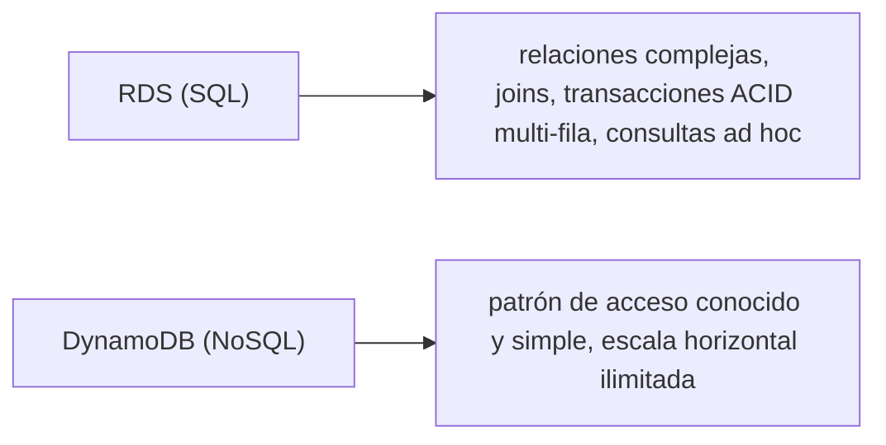
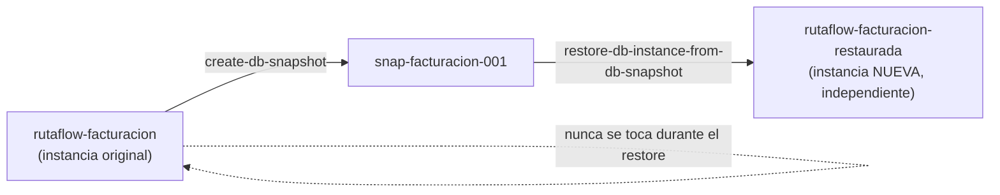
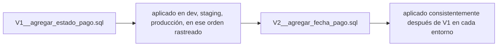

# Módulo 13: Bases de datos relacionales con RDS (PostgreSQL real)


## Aprende construyendo


### Tema 1: RDS Instance y cuándo elegir SQL sobre NoSQL · Avanzado · 45 min

<details open>
<summary><strong>Capa 1 — Lectura</strong></summary>

#### ► DE QUÉ TRATA
Al finalizar vas a crear el esquema relacional real de facturación de RutaFlow, y a comprobar por qué DynamoDB (Módulo 4) no sería la elección correcta para este caso específico. Prerrequisitos: Módulo 4 completo.

#### ► CÓMO FUNCIONA


</details>

<details>
<summary><strong>Capa 2 — Construcción</strong></summary>

#### Código y verificación
```bash
aws rds create-db-instance --db-instance-identifier mi-postgres --db-instance-class db.t3.micro --engine postgres --master-username admin --master-user-password admin123 --allocated-storage 20
aws rds wait db-instance-available --db-instance-identifier mi-postgres
```


```bash
aws rds create-db-instance --db-instance-identifier rutaflow-facturacion --db-instance-class db.t3.micro \
  --engine postgres --master-username admin --master-user-password admin123 --allocated-storage 20
aws rds wait db-instance-available --db-instance-identifier rutaflow-facturacion
psql -h localhost -U admin -d postgres -c "
CREATE TABLE clientes (id SERIAL PRIMARY KEY, nombre TEXT);
CREATE TABLE facturas (id SERIAL PRIMARY KEY, cliente_id INT REFERENCES clientes(id), shipment_id TEXT, monto NUMERIC);
CREATE TABLE pagos (id SERIAL PRIMARY KEY, factura_id INT REFERENCES facturas(id), monto NUMERIC);
"
```

</details>

### Tema 2: Snapshots y restore · Avanzado · 45 min

<details open>
<summary><strong>Capa 1 — Lectura</strong></summary>

#### ► DE QUÉ TRATA
Al finalizar vas a respaldar rutaflow-facturacion (Tema 1) y a restaurarlo como una instancia nueva, probando que el histórico de facturas sobrevive a un error humano. Prerrequisitos: Tema 1 de este módulo.

#### ► CÓMO FUNCIONA


</details>

<details>
<summary><strong>Capa 2 — Construcción</strong></summary>

#### Código y verificación
```bash
aws rds create-db-snapshot --db-instance-identifier mi-postgres --db-snapshot-identifier snap-001
aws rds restore-db-instance-from-db-snapshot --db-instance-identifier mi-postgres-2 --db-snapshot-identifier snap-001
```

```bash
aws rds create-db-snapshot --db-instance-identifier mi-postgres --db-snapshot-identifier snap-001
aws rds restore-db-instance-from-db-snapshot --db-instance-identifier mi-postgres-2 --db-snapshot-identifier snap-001
# mi-postgres-2 es una instancia NUEVA e independiente; mi-postgres original permanece intacta
```


```bash
aws rds create-db-snapshot --db-instance-identifier rutaflow-facturacion --db-snapshot-identifier snap-facturacion-001
aws rds wait db-snapshot-available --db-snapshot-identifier snap-facturacion-001
aws rds restore-db-instance-from-db-snapshot --db-instance-identifier rutaflow-facturacion-restaurada --db-snapshot-identifier snap-facturacion-001
aws rds wait db-instance-available --db-instance-identifier rutaflow-facturacion-restaurada
psql -h localhost -U admin -d postgres -c "SELECT count(*) FROM facturas;"
```

</details>

### Tema 3: Migrations · Avanzado · 45 min

<details open>
<summary><strong>Capa 1 — Lectura</strong></summary>

#### ► DE QUÉ TRATA
Al finalizar vas a agregar una columna nueva a facturas (Tema 1) con una migración versionada, y a comprobar qué pasa si la corrés dos veces por accidente. Prerrequisitos: Tema 1 de este módulo.

#### ► CÓMO FUNCIONA


</details>

<details>
<summary><strong>Capa 2 — Construcción</strong></summary>

#### Código y verificación
```sql
-- V1__agregar_estado_pago.sql
ALTER TABLE facturas ADD COLUMN estado_pago TEXT DEFAULT 'pendiente';
```


```bash
mkdir ejemplo && cd ejemplo && floci start
```

```bash
psql -h localhost -U admin -d postgres -c "
CREATE TABLE IF NOT EXISTS migraciones_aplicadas (version INT PRIMARY KEY, aplicada_en TIMESTAMP DEFAULT now());
"
psql -h localhost -U admin -d postgres -c "
DO \$\$
BEGIN
  IF NOT EXISTS (SELECT 1 FROM migraciones_aplicadas WHERE version = 1) THEN
    ALTER TABLE facturas ADD COLUMN estado_pago TEXT DEFAULT 'pendiente';
    INSERT INTO migraciones_aplicadas (version) VALUES (1);
  END IF;
END \$\$;
"
```

</details>
