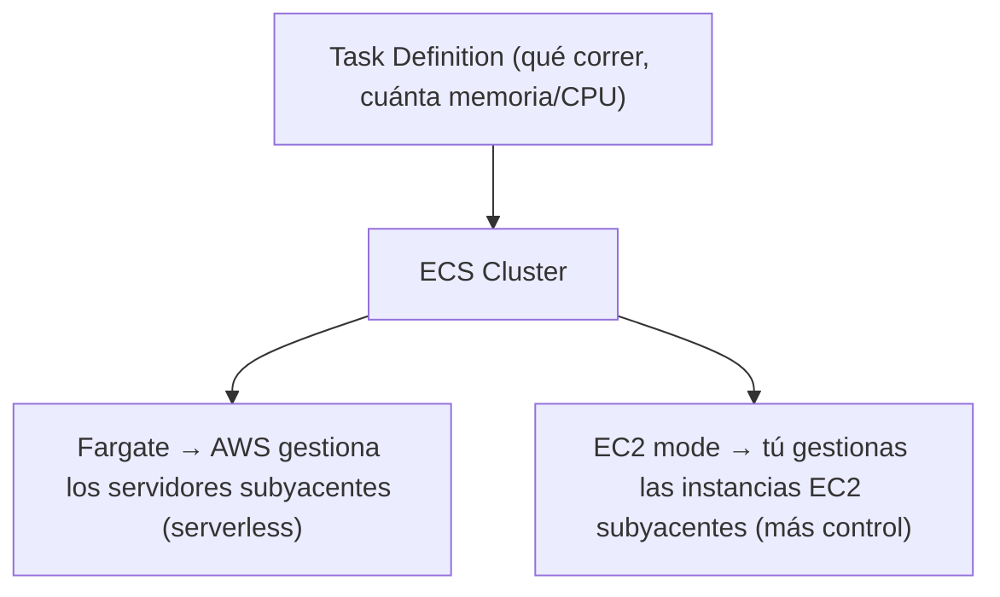
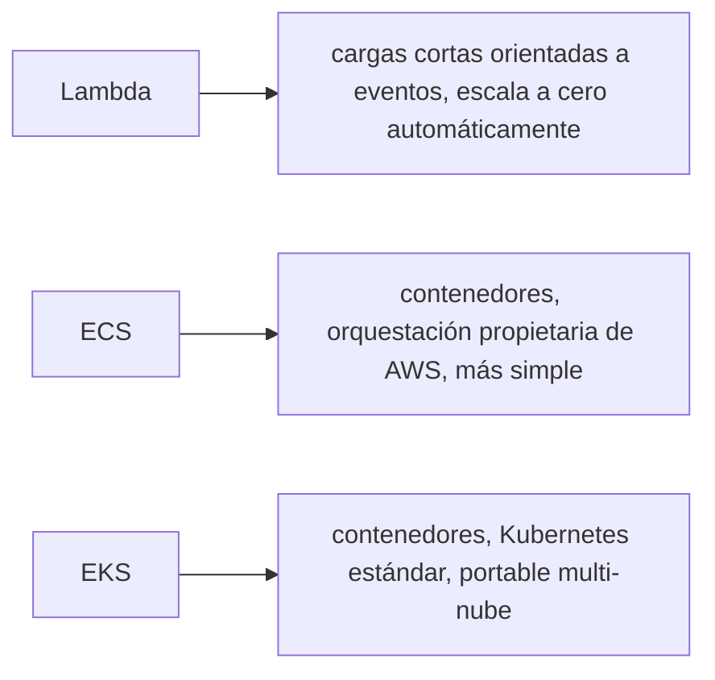
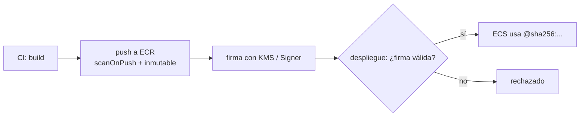

# Módulo 14: Contenedores: ECR, ECS y comparación con Cloud Run


## Aprende construyendo


### Tema 1: ECR y por qué no basta con Docker Hub · Avanzado · 45 min

<details open>
<summary><strong>Capa 1 — Lectura</strong></summary>

#### ► DE QUÉ TRATA
Al finalizar vas a publicar en un repositorio ECR privado la imagen del planificador de rutas de RutaFlow, un proceso propietario que no debería vivir en un registro público. Prerrequisitos: Módulo 0 (Docker).

</details>

<details>
<summary><strong>Capa 2 — Construcción</strong></summary>

#### Código y verificación
```bash
docker build -t mi-api:latest .
aws ecr create-repository --repository-name mi-api
aws ecr get-login-password | docker login --username AWS --password-stdin localhost:4566
docker tag mi-api:latest localhost:4566/mi-api:latest && docker push localhost:4566/mi-api:latest
```

```bash
docker build -t mi-api:latest .
aws ecr create-repository --repository-name mi-api
docker push localhost:4566/mi-api:latest
```

```bash
echo -e "FROM node:20-alpine\nCOPY . .\nCMD [\"node\",\"planificador.js\"]" > Dockerfile
docker build -t rutaflow-planificador:latest .
aws ecr create-repository --repository-name rutaflow-planificador
aws ecr get-login-password | docker login --username AWS --password-stdin localhost:4566
docker tag rutaflow-planificador:latest localhost:4566/rutaflow-planificador:latest
docker push localhost:4566/rutaflow-planificador:latest
```

</details>

### Tema 2: Task Definition y ECS Cluster · Avanzado · 45 min

<details open>
<summary><strong>Capa 1 — Lectura</strong></summary>

#### ► DE QUÉ TRATA
Al finalizar vas a correr rutaflow-planificador (Tema 1) como una tarea real de ECS, describiendo cuánta memoria y CPU necesita. Prerrequisitos: Tema 1 de este módulo.

#### ► CÓMO FUNCIONA


</details>

<details>
<summary><strong>Capa 2 — Construcción</strong></summary>

#### Código y verificación
```bash
aws ecs register-task-definition --family mi-api-task --container-definitions '[{"name":"mi-api","image":"localhost:4566/mi-api:latest","portMappings":[{"containerPort":3000}]}]'
aws ecs create-cluster --cluster-name mi-cluster
aws ecs run-task --cluster mi-cluster --task-definition mi-api-task
```


```bash
aws ecs register-task-definition --family rutaflow-planificador-task \
  --container-definitions '[{"name":"planificador","image":"localhost:4566/rutaflow-planificador:latest","memory":512,"cpu":256}]'
aws ecs create-cluster --cluster-name rutaflow-cluster
aws ecs run-task --cluster rutaflow-cluster --task-definition rutaflow-planificador-task
```

</details>

### Tema 3: Contenedores vs Lambda, y EKS · Avanzado · 45 min

<details open>
<summary><strong>Capa 1 — Lectura</strong></summary>

#### ► DE QUÉ TRATA
Al finalizar vas a justificar, con el límite real de Lambda del Módulo 5, por qué el planificador de rutas tiene que ser un contenedor y confirmar-entrega tiene que ser una función. Prerrequisitos: Módulo 5 completo, Temas 1-2 de este módulo.

#### ► CÓMO FUNCIONA


#### ► REGLA PRÁCTICA
Si la carga es corta, orientada a eventos y puede escalar a cero, usa Lambda; si necesita correr continuamente o supera el límite de duración/recursos de Lambda, usa un contenedor en ECS (más simple) o EKS (si ya necesitas Kubernetes estándar y portabilidad multi-nube).

</details>

<details>
<summary><strong>Capa 2 — Construcción</strong></summary>

#### Código y verificación
```bash
aws eks create-cluster --name dev-cluster --role-arn arn:aws:iam::000000000000:role/eks-role
aws eks update-kubeconfig --name dev-cluster
kubectl run nginx --image=nginx:alpine
```


```bash
aws lambda create-function --function-name planificador-fallido --runtime nodejs24.x \
  --handler index.handler --zip-file fileb://funcion.zip --timeout 1800 \
  --role arn:aws:iam::000000000000:role/lambda-role
```

</details>

### Tema 4: Cadena de suministro en la nube: escaneo, firma y verificación de imágenes en ECR · Avanzado · 45 min

<details open>
<summary><strong>Capa 1 — Lectura</strong></summary>

#### ► DE QUÉ TRATA
Necesitas la AWS CLI, Docker y una herramienta de firma (cosign o Notation). Las firmas y la verificación se prueban en una cuenta real; el emulador local permite practicar la creación del repositorio y las etiquetas inmutables.

#### ► CÓMO FUNCIONA


</details>

<details>
<summary><strong>Capa 2 — Construcción</strong></summary>

#### Código y verificación

```hcl
resource "aws_ecr_repository" "api" {
  name                 = "rutaflow/api"
  image_tag_mutability = "IMMUTABLE" # nadie sobrescribe una etiqueta existente

  image_scanning_configuration {
    scan_on_push = true
  }

  encryption_configuration {
    encryption_type = "KMS"
  }
}
```

```bash
set -euo pipefail
IMAGEN="$CUENTA.dkr.ecr.us-east-1.amazonaws.com/rutaflow/api"
DIGEST=$(aws ecr describe-images --repository-name rutaflow/api --image-ids imageTag="$VERSION" \
  --query 'imageDetails[0].imageDigest' --output text)

# Revisa el escaneo antes de firmar.
CRITICAS=$(aws ecr describe-image-scan-findings --repository-name rutaflow/api --image-id imageDigest="$DIGEST" \
  --query 'imageScanFindings.findingSeverityCounts.CRITICAL' --output text)
[ "$CRITICAS" = "None" ] || { echo "hay $CRITICAS vulnerabilidades críticas"; exit 1; }

# Firma por digest con una clave de KMS (la clave nunca sale de KMS).
cosign sign --key "awskms:///alias/rutaflow-firma" "$IMAGEN@$DIGEST"

# En el despliegue: verifica antes de usar.
cosign verify --key "awskms:///alias/rutaflow-firma" "$IMAGEN@$DIGEST" > /dev/null && echo "firma válida: $DIGEST"
```

```bash
terraform -chdir=infra apply
VERSION=1.4.0 CUENTA=111122223333 bash ci/firmar-y-verificar.sh
# IMAGEN solo existe dentro del script; defínela también en esta terminal.
IMAGEN="111122223333.dkr.ecr.us-east-1.amazonaws.com/rutaflow/api"
docker push "$IMAGEN:1.4.0"   # segundo intento con la misma etiqueta
```

```text
firma válida: sha256:3f1c...
El segundo push con la etiqueta 1.4.0 falla con: tag invalid: The image tag '1.4.0' already exists in the 'rutaflow/api' repository and cannot be overwritten because the repository is immutable.
```

</details>
