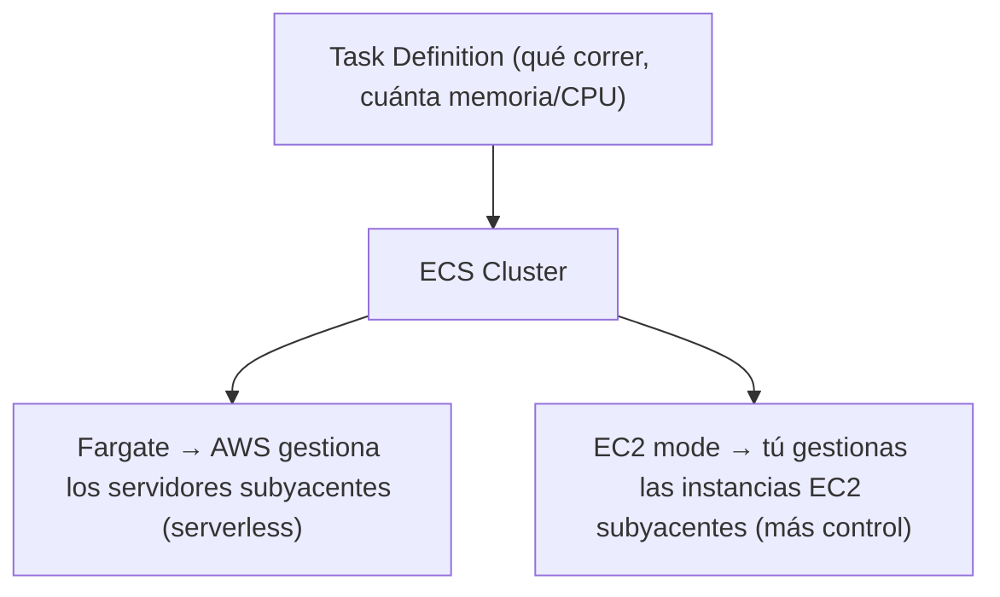
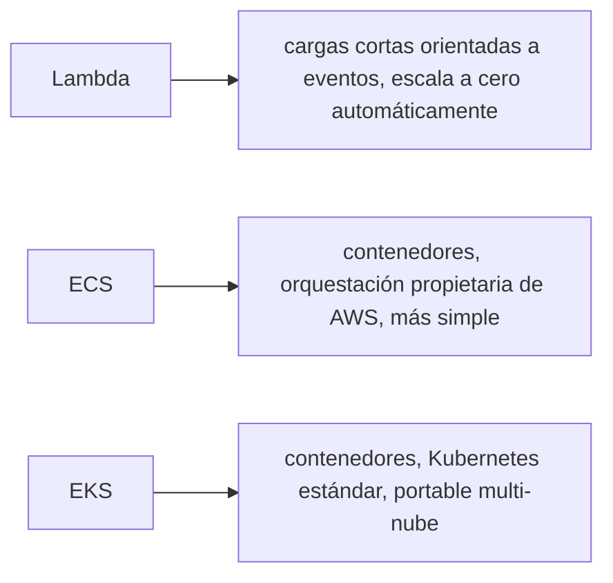
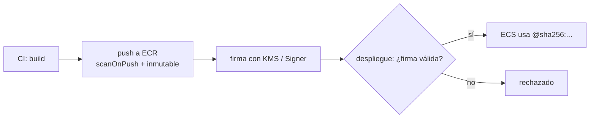

# Módulo 14: Contenedores: ECR, ECS y comparación con Cloud Run


## Aprende construyendo

### Tema 1: ECR y por qué no basta con Docker Hub

#### Paso 1 · Objetivo y preparación
Al finalizar vas a publicar en un repositorio ECR privado la imagen del planificador de rutas de RutaFlow, un proceso propietario que no debería vivir en un registro público. Prerrequisitos: Módulo 0 (Docker).
#### Paso 2 · Contexto y caso real
El planificador de rutas de RutaFlow calcula asignaciones óptimas conductor-envío con lógica propietaria de la empresa — esa imagen nunca debería publicarse en un registro público como Docker Hub, ni accesible sin control de acceso vía IAM.
#### Paso 3 · Teoría, modelo mental y analogía
ECR es un almacén cerrado con identidad y auditoría, integrado directamente con IAM; Docker Hub es un mercado público pensado para compartir, no para proteger.

**Conceptos clave:** registro privado con control de acceso IAM integrado, no un registro público genérico.

```bash
docker build -t mi-api:latest .
aws ecr create-repository --repository-name mi-api
aws ecr get-login-password | docker login --username AWS --password-stdin localhost:4566
docker tag mi-api:latest localhost:4566/mi-api:latest && docker push localhost:4566/mi-api:latest
```

En esos comandos, `--repository-name` es el nombre del repositorio dentro de ECR (equivalente a un nombre de imagen en Docker Hub); `--password-stdin` le dice a `docker login` que lea la contraseña desde la entrada estándar (lo que le llega por la tubería `|` del comando anterior) en vez de pedirla interactiva o pasarla como texto plano en la terminal, y `--username` es el usuario con el que iniciás sesión en el registro (`AWS`, un valor fijo cuando te autenticás contra ECR). En resumen: `--password-stdin` es la bandera que hace que `docker login` lea la contraseña por la entrada estándar.

ECR es un registro de imágenes Docker (formato OCI, el estándar abierto de imágenes de contenedor que Docker Hub, ECR y otros registros comparten) privado y específicamente integrado con el control de acceso de IAM (Módulo 7): a diferencia de Docker Hub (un registro público orientado principalmente a imágenes de código abierto compartidas, aunque también ofrece repositorios privados), ECR permite definir políticas de acceso granulares directamente vía IAM sobre quién puede leer o escribir en cada repositorio específico, integrándose naturalmente con el resto de la infraestructura de permisos ya gestionada en la misma cuenta cloud, sin necesidad de gestionar credenciales separadas de un servicio de terceros externo a esa infraestructura.

Esta integración nativa con IAM es especialmente valiosa para imágenes que contienen código propietario de la empresa (no destinado a compartirse públicamente), donde el control de acceso granular y auditado es un requisito de seguridad, no solo una conveniencia operativa.

**Analogía:** ECR es como un almacén privado de una empresa con control de acceso vinculado directamente al sistema de credenciales corporativo existente, mientras Docker Hub es como un mercado público donde cualquiera puede publicar y consultar mercancía (con la opción de secciones privadas, pero gestionadas con un sistema de acceso separado del control interno de la empresa).

**¿Por qué es importante?** ECR ofrece control de acceso granular integrado nativamente con IAM sobre repositorios privados de imágenes, apropiado para código propietario que requiere ese nivel de control de acceso auditado, integrado con el resto de la infraestructura de permisos de la misma cuenta.

**Prueba en terminal:**

```bash
docker build -t mi-api:latest .
aws ecr create-repository --repository-name mi-api
docker push localhost:4566/mi-api:latest
```

**Transferencia al proyecto integrador «Cloud local multi-nube»:** Publica la imagen del consumidor con una etiqueta identificable y registra su digest. Despliega por esa referencia inmutable y comprueba que reconstruir otra imagen no cambia el artefacto ya seleccionado.

#### Paso 4 · Demostración guiada
```bash
echo -e "FROM node:20-alpine\nCOPY . .\nCMD [\"node\",\"planificador.js\"]" > Dockerfile
docker build -t rutaflow-planificador:latest .
aws ecr create-repository --repository-name rutaflow-planificador
aws ecr get-login-password | docker login --username AWS --password-stdin localhost:4566
docker tag rutaflow-planificador:latest localhost:4566/rutaflow-planificador:latest
docker push localhost:4566/rutaflow-planificador:latest
```
Resultado esperado: `docker push` termina confirmando el digest de la imagen subida — la imagen del planificador ahora vive en un repositorio privado, visible solo para quien tenga el permiso IAM correspondiente, nunca en un índice público.
#### Paso 5 · Práctica guiada
Pista: cerrá sesión (`docker logout localhost:4566`) y probá `docker pull localhost:4566/rutaflow-planificador:latest` sin volver a autenticarte — ese es el fallo deliberado: la extracción se rechaza porque no hay sesión autenticada contra el registro, a diferencia de Docker Hub, donde una imagen pública se puede extraer sin ninguna credencial.
#### Paso 6 · Práctica independiente
Volvé a autenticarte, publicá una segunda versión (`:v2`) de la misma imagen, y usá `aws ecr describe-images --repository-name rutaflow-planificador` para comparar el `imageDigest` de `latest` contra el de `v2` — confirmá que son distintos, evidencia de que un tag mutable como `latest` no te dice por sí solo qué contenido real se está ejecutando.
#### Paso 7 · Cierre
Entregá la publicación exitosa del Paso 4, el rechazo sin sesión del Paso 5, y la comparación de digests del Paso 6; explicá por qué un repositorio como este nunca debería ser público para RutaFlow. Siguiente paso: orquestación. Errores comunes: usar tags mutables y credenciales compartidas. Fuente oficial: https://docs.aws.amazon.com/AmazonECR/latest/userguide/what-is-ecr.html.

### Tema 2: Task Definition y ECS Cluster

#### Paso 1 · Objetivo y preparación
Al finalizar vas a correr `rutaflow-planificador` (Tema 1) como una tarea real de ECS, describiendo cuánta memoria y CPU necesita. Prerrequisitos: Tema 1 de este módulo.
#### Paso 2 · Contexto y caso real
El planificador corre varios minutos calculando rutas óptimas — RutaFlow necesita que, si el contenedor se cae a mitad de cálculo, algo lo vuelva a levantar automáticamente, sin que un humano tenga que notarlo y reiniciarlo a mano.
#### Paso 3 · Teoría, modelo mental y analogía
La Task Definition es el plano de cómo correr el contenedor; el Cluster es quien mantiene ese estado deseado, reemplazando tareas que se caen.

**Conceptos clave:** especificación declarativa de cómo ejecutar un contenedor, orquestada por un cluster.

```bash
aws ecs register-task-definition --family mi-api-task --container-definitions '[{"name":"mi-api","image":"localhost:4566/mi-api:latest","portMappings":[{"containerPort":3000}]}]'
aws ecs create-cluster --cluster-name mi-cluster
aws ecs run-task --cluster mi-cluster --task-definition mi-api-task
```

`--family` agrupa versiones sucesivas de la misma Task Definition bajo un nombre común; `--container-definitions` es el JSON que describe cada contenedor de la tarea (imagen, puertos, memoria...). Al crear el cluster, `--cluster-name` lo identifica; al correr la tarea, `--cluster` dice en qué cluster ejecutarla y `--task-definition` cuál definición usar. En resumen: `--family` es la bandera que agrupa versiones de la Task Definition, `--cluster-name` es la bandera que nombra el cluster al crearlo, `--cluster` es la bandera que elige el cluster al ejecutar, y `--task-definition` es la bandera que elige qué definición correr.

Un Task Definition especifica declarativamente cómo ejecutar uno o más contenedores relacionados como una unidad (qué imagen usar, qué puertos exponer, cuánta memoria y CPU asignar, variables de entorno), de forma conceptualmente similar a un `docker-compose.yml` pero gestionado por ECS en vez de por Docker Compose localmente; un ECS Cluster es el conjunto de recursos de cómputo (ya sea infraestructura EC2 gestionada explícitamente, o Fargate, el modo serverless donde AWS gestiona los servidores subyacentes de forma completamente transparente) sobre el cual ECS programa la ejecución efectiva de los tasks definidos.

Fargate (modo serverless) elimina completamente la necesidad de aprovisionar y gestionar instancias EC2 subyacentes para correr los contenedores, similar en espíritu a cómo Lambda elimina la gestión de servidores para funciones (Módulo 5), mientras que el modo EC2 tradicional da control más fino sobre el tipo específico de instancia subyacente (útil para cargas de trabajo con requisitos de hardware muy específicos, como GPUs), a costa de requerir gestión explícita de esas instancias por parte del equipo.

**Analogía:** un Task Definition es como el manifiesto de carga detallado de un envío (qué contiene, cuánto espacio necesita, requisitos especiales de manejo); un ECS Cluster es como el puerto de destino donde ese envío se despacha efectivamente, con Fargate siendo un servicio de despacho completamente gestionado (sin preocuparse por la infraestructura del puerto) y el modo EC2 siendo gestionar directamente la infraestructura portuaria propia con más control pero más responsabilidad operativa.

**¿Por qué es importante?** El Task Definition especifica declarativamente cómo ejecutar contenedores relacionados como unidad; Fargate elimina la gestión de servidores subyacentes de forma análoga a Lambda, mientras el modo EC2 da más control a costa de gestión operativa explícita.

**Diagrama:**



**Transferencia al proyecto integrador «Cloud local multi-nube»:** Declara recursos, imagen, configuración y logs de la tarea del consumidor. Arráncala con una configuración inválida y verifica que el fallo es observable sin que la tarea aparezca saludable.

#### Paso 4 · Demostración guiada
```bash
aws ecs register-task-definition --family rutaflow-planificador-task \
  --container-definitions '[{"name":"planificador","image":"localhost:4566/rutaflow-planificador:latest","memory":512,"cpu":256}]'
aws ecs create-cluster --cluster-name rutaflow-cluster
aws ecs run-task --cluster rutaflow-cluster --task-definition rutaflow-planificador-task
```
Resultado esperado: `run-task` devuelve un JSON con la tarea en estado `PENDING` o `RUNNING` — el cluster ya sabe exactamente cuánta memoria (512 MB) y CPU (256 unidades) reservar para cada ejecución del planificador, declarado una sola vez en la Task Definition.
#### Paso 5 · Práctica guiada
Pista: registrá una segunda Task Definition (`rutaflow-planificador-task-v2`) apuntando a una imagen que nunca publicaste (`localhost:4566/rutaflow-planificador:v99`) y corré `run-task` con ella — ese es el fallo deliberado: la tarea entra en estado `STOPPED` con un motivo de fallo relacionado a no poder descargar la imagen, no un error de tu código, sino de una referencia que nunca existió.
#### Paso 6 · Práctica independiente
Corregí el Paso 5 apuntando de nuevo a `:latest`, y documentá qué pasaría si el planificador necesitara escalar a tres ejecuciones simultáneas en hora pico (pista: `run-task --count 3` en vez de una tarea suelta, o un ECS Service en vez de tareas individuales para mantener ese número de forma continua).
#### Paso 7 · Cierre
Entregá la Task Definition registrada y corriendo, el fallo de imagen inexistente del Paso 5, y la reflexión sobre escalado del Paso 6; explicá qué controla la Task Definition y qué controla el Cluster por separado. Siguiente paso: elegir servicio. Errores comunes: estado manual y no definir límites. Fuente oficial: https://docs.aws.amazon.com/eks/latest/userguide/what-is-eks.html.

### Tema 3: Contenedores vs Lambda, y EKS

#### Paso 1 · Objetivo y preparación
Al finalizar vas a justificar, con el límite real de Lambda del Módulo 5, por qué el planificador de rutas tiene que ser un contenedor y `confirmar-entrega` tiene que ser una función. Prerrequisitos: Módulo 5 completo, Temas 1-2 de este módulo.
#### Paso 2 · Contexto y caso real
`confirmar-entrega` responde en milisegundos a un solo envío; el planificador de rutas procesa todos los envíos pendientes de una zona y puede tardar 20-30 minutos en una hora pico — ambos son "cómputo", pero no caben en la misma plataforma.
#### Paso 3 · Teoría, modelo mental y analogía
Elegir entre Lambda y contenedores es como elegir entre un taxi (por viaje puntual, corto) y una flota propia (para trabajos largos con requisitos específicos de equipo).

**Conceptos clave:** elegir según duración, control de runtime y complejidad de la carga de trabajo.

Usar contenedores (ECS) sobre Lambda es apropiado cuando la carga de trabajo tiene una duración prolongada más allá de los límites de tiempo de ejecución de una función Lambda, requiere un control más fino sobre el entorno de ejecución (versiones específicas de librerías del sistema operativo, dependencias binarias particulares que no encajan bien en el modelo de runtime más restringido de Lambda), o cuando la aplicación ya está empaquetada como un contenedor por otras razones (por ejemplo, un mismo artefacto de contenedor que también corre en Kubernetes en otro contexto); Lambda sigue siendo preferible para cargas de trabajo cortas, orientadas a eventos, donde el modelo de escalado automático a cero (sin costo cuando no hay invocaciones) es especialmente valioso.

```bash
aws eks create-cluster --name dev-cluster --role-arn arn:aws:iam::000000000000:role/eks-role
aws eks update-kubeconfig --name dev-cluster
kubectl run nginx --image=nginx:alpine
```

`--role-arn` es la bandera que le da al cluster de EKS un rol de IAM con los permisos que necesita para operar (crear recursos, hablar con otros servicios); `--image` en el comando de `kubectl` es la imagen de contenedor que ese Pod va a correr. `kubectl` en sí es la herramienta de línea de comandos estándar de Kubernetes (no específica de AWS): con ella hablás con cualquier cluster de Kubernetes, sea EKS, GKE o uno local, una vez que `update-kubeconfig` configuró las credenciales de conexión.

EKS (Elastic Kubernetes Service) ofrece Kubernetes gestionado como alternativa a ECS, apropiado específicamente cuando el equipo ya tiene experiencia y tooling construido alrededor de Kubernetes (el estándar de facto de orquestación de contenedores multi-nube, estudiado en el track de DevOps), o necesita portabilidad explícita entre proveedores cloud usando exactamente las mismas herramientas y manifiestos de Kubernetes; ECS, en contraste, es una solución de orquestación específica y propietaria de AWS, más simple de operar si no se requiere esa portabilidad multi-nube o el ecosistema específico de herramientas de Kubernetes. Cloud Run en GCP ocupa un espacio conceptualmente intermedio, ofreciendo contenedores con un modelo de escalado serverless más cercano en experiencia a Lambda que a la gestión explícita de clusters de ECS/EKS.

**Analogía:** elegir entre Lambda y contenedores es como elegir entre contratar un especialista puntual para una tarea corta y específica (Lambda) frente a montar un taller completo con equipo propio para trabajos más prolongados o con requisitos muy particulares de herramientas (contenedores); EKS es como adoptar un estándar de gestión de talleres reconocido internacionalmente (Kubernetes) frente a un sistema de gestión propietario específico de un único proveedor (ECS).

**¿Por qué es importante?** Los contenedores son apropiados para cargas prolongadas o con requisitos de runtime específicos que Lambda no acomoda bien; EKS ofrece portabilidad vía el estándar Kubernetes, mientras ECS es más simple pero específico de AWS.

**Diagrama:**



En el proyecto integrador RutaFlow, esta decisión se expresa en tu propia infraestructura:
declara `ConfirmarEntregaFn` como `AWS::Serverless::Function` (Lambda) en `template.yaml`
precisamente porque responde a un solo evento `DeliveryCommand` en milisegundos; un planificador
de rutas que procesa toda una zona en un solo lote nunca debería declararse ahí como función,
sino como tarea ECS o EKS separada.

---

#### Paso 4 · Demostración guiada
```bash
aws lambda create-function --function-name planificador-fallido --runtime nodejs24.x \
  --handler index.handler --zip-file fileb://funcion.zip --timeout 1800 \
  --role arn:aws:iam::000000000000:role/lambda-role
```
Resultado esperado: ese es el fallo deliberado — `ParameterValidationError` o `InvalidParameterValueException` según la versión: el campo `--timeout` de Lambda tiene un tope real de 900 segundos (15 minutos); 1800 segundos (30 minutos, lo que el planificador necesita de verdad) directamente no es un valor válido para Lambda.
#### Paso 5 · Práctica guiada
Pista: corregí el Paso 4 reemplazando el enfoque completo, no solo el número — el planificador tiene que correr como la tarea ECS del Tema 2 (sin límite de 15 minutos), mientras que `confirmar-entrega` (que sí cabe sobradamente en ese límite) se queda en Lambda exactamente como está desde el Módulo 5.
#### Paso 6 · Práctica independiente
Construí una tabla de dos filas (`confirmar-entrega` / planificador de rutas) con tres columnas (duración típica, necesidad de control del entorno, modelo de coste) y completala con lo que ya sabés de ambos de los Módulos 5 y 14.
#### Paso 7 · Cierre
Entregá el error de timeout del Paso 4, la decisión de plataforma del Paso 5 y la tabla del Paso 6; explicá por qué "¿cuánto dura la tarea?" es la primera pregunta antes de elegir Lambda o contenedores, no la única pero sí la más decisiva acá. Siguiente paso: seguridad operacional. Errores comunes: elegir por moda y olvidar observabilidad. Fuente oficial: https://aws.amazon.com/compute/.

### Tema 4: Cadena de suministro en la nube: escaneo, firma y verificación de imágenes en ECR · Avanzado · 45 min

**Prerrequisito:** temas «ECR y por qué no basta con Docker Hub» y «Task Definition y ECS Cluster» de este módulo.

**Al finalizar podrás:** escanear las imágenes al subirlas a ECR, firmarlas con Notation o cosign, y desplegar en ECS solo imágenes firmadas e identificadas por digest.

**¿Por qué es importante?** Si alguien sube una imagen alterada al registro con la misma etiqueta, el siguiente despliegue la usa sin preguntar. Escanear encuentra vulnerabilidades conocidas; firmar y verificar garantiza que la imagen viene de tu pipeline.

#### Paso 1 · Objetivo y preparación

Necesitas la AWS CLI, Docker y una herramienta de firma (cosign o Notation). Las firmas y la verificación se prueban en una cuenta real; el emulador local permite practicar la creación del repositorio y las etiquetas inmutables.

#### Paso 2 · Contexto y caso real

En RutaFlow, alguien con acceso al registro subió por error una imagen de pruebas con la etiqueta `api:1.4.0`. Producción la desplegó al escalar. Con etiquetas inmutables, firma y verificación por digest, ese despliegue habría sido rechazado.

#### Paso 3 · Teoría, modelo mental y analogía

**Conceptos clave:** cadena de suministro, escaneo al subir, etiqueta inmutable, digest, firma de imagen, cosign, Notation, verificación en el despliegue, SBOM.

Tres defensas que se suman:

1. **Escanear al subir** (`scanOnPush`): ECR busca vulnerabilidades conocidas en el sistema operativo y los paquetes de la imagen.
2. **Etiquetas inmutables:** una vez que `api:1.4.0` existe, nadie puede sobrescribirla. Y el despliegue usa el **digest** (`@sha256:...`), que identifica el contenido exacto.
3. **Firmar y verificar:** el pipeline firma la imagen con una clave (cosign con KMS, o Notation con AWS Signer). El despliegue verifica la firma antes de usarla y rechaza las que no la tienen.

Un **SBOM** (lista de componentes de la imagen) se puede adjuntar como artefacto firmado para saber qué contiene cada versión.

**Analogía:** es la cadena de custodia de una evidencia: se fotografía al entrar (escaneo), se sella con un número (digest), alguien autorizado firma el acta (firma) y quien la recibe revisa el sello antes de aceptarla (verificación).

**Límite de uso:** el escaneo solo conoce vulnerabilidades publicadas. La firma prueba quién publicó la imagen, no que sea segura. Si la clave de firma se filtra, la cadena se rompe: guárdala en KMS o Signer.



#### Paso 4 · Demostración guiada desde cero

Archivo `infra/ecr.tf`:

```hcl
resource "aws_ecr_repository" "api" {
  name                 = "rutaflow/api"
  image_tag_mutability = "IMMUTABLE" # nadie sobrescribe una etiqueta existente

  image_scanning_configuration {
    scan_on_push = true
  }

  encryption_configuration {
    encryption_type = "KMS"
  }
}
```

Archivo `ci/firmar-y-verificar.sh`:

```bash
set -euo pipefail
IMAGEN="$CUENTA.dkr.ecr.us-east-1.amazonaws.com/rutaflow/api"
DIGEST=$(aws ecr describe-images --repository-name rutaflow/api --image-ids imageTag="$VERSION" \
  --query 'imageDetails[0].imageDigest' --output text)

# Revisa el escaneo antes de firmar.
CRITICAS=$(aws ecr describe-image-scan-findings --repository-name rutaflow/api --image-id imageDigest="$DIGEST" \
  --query 'imageScanFindings.findingSeverityCounts.CRITICAL' --output text)
[ "$CRITICAS" = "None" ] || { echo "hay $CRITICAS vulnerabilidades críticas"; exit 1; }

# Firma por digest con una clave de KMS (la clave nunca sale de KMS).
cosign sign --key "awskms:///alias/rutaflow-firma" "$IMAGEN@$DIGEST"

# En el despliegue: verifica antes de usar.
cosign verify --key "awskms:///alias/rutaflow-firma" "$IMAGEN@$DIGEST" > /dev/null && echo "firma válida: $DIGEST"
```

Ejecútalo:

```bash
terraform -chdir=infra apply
VERSION=1.4.0 CUENTA=111122223333 bash ci/firmar-y-verificar.sh
# IMAGEN solo existe dentro del script; defínela también en esta terminal.
IMAGEN="111122223333.dkr.ecr.us-east-1.amazonaws.com/rutaflow/api"
docker push "$IMAGEN:1.4.0"   # segundo intento con la misma etiqueta
```

**Explicación por bloques:** El repositorio tiene etiquetas inmutables, escaneo al subir y cifrado con KMS. El script obtiene el digest de la versión, revisa que el escaneo no tenga vulnerabilidades críticas, firma la imagen por digest con una clave de KMS y la verifica. El último comando intenta subir otra imagen con una etiqueta que ya existe, lo que el repositorio inmutable debe rechazar.

**Resultado esperado:**

```text
firma válida: sha256:3f1c...
El segundo push con la etiqueta 1.4.0 falla con: tag invalid: The image tag '1.4.0' already exists in the 'rutaflow/api' repository and cannot be overwritten because the repository is immutable.
```

**Fallo deliberado:** firma la imagen por etiqueta (`$IMAGEN:1.4.0`) en un repositorio mutable y luego sube otra imagen con esa etiqueta. **Error esperado:** la verificación por etiqueta ahora apunta a una imagen sin firma o con otro contenido. **Diagnóstico:** las etiquetas se mueven; los digests no. Firma, verifica y despliega siempre por digest, y usa repositorios inmutables.

#### Paso 5 · Práctica guiada

1. **Reproducción:** crea el repositorio y sube una imagen; revisa el resultado del escaneo en la consola.
2. **Variación:** sube una imagen con una vulnerabilidad crítica conocida (por ejemplo, una base antigua) y comprueba que el script no la firma.
3. **Diagnóstico:** reproduce el fallo deliberado con etiquetas mutables.
4. **Integración:** genera un SBOM con `syft` y adjúntalo firmado con `cosign attest`.
5. **Diseño:** escribe la regla de despliegue de RutaFlow: qué se verifica, quién guarda la clave y qué pasa si la verificación falla.

**Pista:** si dudas de qué imagen corre en producción, compara el digest de la tarea de ECS con el firmado en el pipeline.

#### Paso 6 · Práctica independiente

Configura la verificación en el despliegue con una política de admisión (por ejemplo, Kyverno o el verificador de imágenes de tu orquestador) para que rechace automáticamente imágenes sin firma.

#### Paso 7 · Cierre

- [ ] Explicas las tres defensas y qué protege cada una.
- [ ] El repositorio es inmutable y escanea al subir.
- [ ] Firmas y verificas por digest.
- [ ] Reprodujiste el problema de firmar por etiqueta.

Si fallas dos o más, vuelve al Paso 3. **Errores comunes:** firmar por etiqueta, guardar la clave de firma en el CI y creer que una imagen firmada no tiene vulnerabilidades. **Siguiente paso:** el tema «Contenedores vs Lambda, y EKS» aplica la misma verificación a los otros destinos.

**Transferencia al proyecto integrador «RutaFlow»:** haz que el pipeline de RutaFlow suba a un ECR inmutable, firme por digest con KMS y que el despliegue verifique la firma.

**Fuente oficial:** [Amazon ECR — Image scanning](https://docs.aws.amazon.com/AmazonECR/latest/userguide/image-scanning.html) y [Amazon ECR — Image tag mutability](https://docs.aws.amazon.com/AmazonECR/latest/userguide/image-tag-mutability.html) y [Sigstore — cosign](https://docs.sigstore.dev/cosign/signing/overview/).

## Laboratorio práctico

> Este laboratorio asume que ya ejecutaste `floci start` y `eval $(floci env)` (Módulo 1) en tu sesión de terminal, así que los comandos de `aws` no repiten `--endpoint-url`.

**Objetivo del laboratorio:** publicar una imagen Docker en ECR y ejecutarla como task en ECS.

**Requisitos previos:** Módulo 13 completado.

| Paso | Acción | Comando | Explicación |
|---|---|---|---|
| 1 | Construir la imagen Docker | `docker build -t mi-api:latest .` | Formato OCI |
| 2 | Crear el repositorio ECR y publicar la imagen | `aws ecr create-repository` + `docker push` | Registro privado |
| 3 | Registrar un Task Definition | `aws ecs register-task-definition` | Especificación declarativa |
| 4 | Crear un cluster y ejecutar el task | `aws ecs create-cluster` + `run-task` | Verifica con `docker ps` |
| 5 | Explorar EKS como alternativa | `aws eks create-cluster` + `kubectl run` | Compara con ECS |

**Verificación:** el laboratorio se considera exitoso si la imagen se publica correctamente en ECR, y si el task se ejecuta correctamente en el cluster ECS, verificable con `docker ps` mostrando el contenedor corriendo.

**Errores comunes y soluciones**

- **Usar Docker Hub para imágenes propietarias que requieren control de acceso granular vía IAM.** Usa ECR para esa integración nativa.
- **Elegir Lambda para una carga de trabajo de larga duración o con requisitos de runtime muy específicos.** Considera contenedores (ECS/EKS) para esos casos.
- **Elegir EKS sin necesidad real de portabilidad multi-nube o del ecosistema de Kubernetes.** ECS es más simple si esa portabilidad no es un requisito.

---
