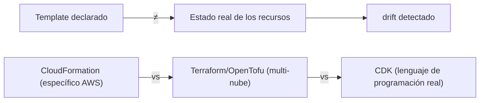

# Módulo 15: Infraestructura como código con CloudFormation


## Aprende construyendo


### Tema 1: Stack, Template y por qué no crear recursos manualmente con la CLI · Avanzado · 45 min

<details open>
<summary><strong>Capa 1 — Lectura</strong></summary>

#### ► DE QUÉ TRATA
Al finalizar podrás declarar infraestructura desde cero. Prerrequisitos: Floci corriendo y eval "$(floci env)" cargado (Laboratorio 1.2); verifica aws --version.

#### ► LA IDEA EN UNA FRASE
**Al finalizar podrás declarar infraestructura desde cero.**

#### ► POR QUÉ EXISTE ESTO
Resuelve un problema real de diseño o implementación y evita decisiones a ciegas.

#### ► LA ANALOGÍA
Piensa en stack, template y por qué no crear recursos manualmente con la cli como una herramienta de taller: útil cuando conoces su propósito y sus límites.
**Dónde se rompe la analogía:** en software, los efectos dependen del contexto, la escala y los trade-offs.

#### ► CÓMO FUNCIONA
1. Identifica el problema que stack, template y por qué no crear recursos manualmente con la cli resuelve.
2. Observa sus componentes y relaciones.
3. Aplica la opción más simple que funcione.
4. Verifica el resultado y los límites.

#### ► LO QUE PUEDE SALIR MAL
| Síntoma | Causa probable | Arreglo |
|---|---|---|
| Stack, Template y por qué no crear recursos manualmente con la CLI se aplica pero el resultado no mejora | Se usó sin medir el problema real | Mide antes y compara contra la alternativa simple |
| Aparece complejidad inesperada | Se adoptó la técnica sin comprender sus trade-offs | Vuelve a la sección de trade-offs y reduce el alcance |
| Falla en un caso límite | Se asumió un contexto que no se cumple | Prueba el caso límite y documenta cuándo NO usarlo |

#### ► TRADE-OFFS
| Opción | Cuándo usarla | Cuándo NO usarla |
|---|---|---|
| Usar Stack, Template y por qué no crear recursos manualmente con la CLI | Cuando el problema coincide con su propósito y el beneficio es observable | Cuando agrega complejidad sin resolver un problema real |
| Alternativa más simple | Cuando el contexto es pequeño, estable o fácil de razonar | Cuando ya demostró no escalar o no cumplir el requisito |
| Postergar la decisión | Cuando falta evidencia del problema | Cuando el costo de esperar es mayor que el costo de probar |

#### ► CUÁNDO NO USAR ESTO
No uses stack, template y por qué no crear recursos manualmente con la cli por defecto. Aplícalo cuando el problema lo justifique y puedas verificar el beneficio; si una alternativa más simple resuelve igual, prefiérela.

#### ► DE VUELTA A LA ANALOGÍA
Volviendo a la analogía: stack, template y por qué no crear recursos manualmente con la cli funciona como el modelo inicial, pero recuerda dónde se rompe: en producción importan la evidencia, la escala y el costo de equivocarte.

#### ► LO QUE DEBES RECORDAR
- Stack, Template y por qué no crear recursos manualmente con la CLI existe para resolver un problema específico.
- Mide antes de adoptar complejidad.
- Conoce el caso donde NO usarlo.
- Verifica con evidencia observable.

#### ► PREGUNTAS PARA PENSAR
1. ¿Qué problema concreto resuelve stack, template y por qué no crear recursos manualmente con la cli en tu contexto?
2. ¿Cómo sabrías que stack, template y por qué no crear recursos manualmente con la cli no está funcionando bien?
3. ¿Qué alternativa más simple considerarías antes de usar stack, template y por qué no crear recursos manualmente con la cli?

</details>

<details>
<summary><strong>Capa 2 — Construcción</strong></summary>

#### Código y verificación
```yaml
Resources:
  MiBucket:
    Type: AWS::S3::Bucket
  MiCola:
    Type: AWS::SQS::Queue
Outputs:
  NombreBucket:
    Value: !Ref MiBucket
```

```bash
aws cloudformation deploy --template-file stack-basico.yaml --stack-name mi-stack
```

```yaml
Resources:
  MiBucket: { Type: AWS::S3::Bucket }
  MiCola: { Type: AWS::SQS::Queue }
Outputs:
  NombreBucket: { Value: !Ref MiBucket }
```

```yaml
AWSTemplateFormatVersion: "2010-09-09"
Description: Bucket de evidencias de RutaFlow
Parameters:
  Entorno:
    Type: String
    AllowedValues: [dev, prod]
    Default: dev
Resources:
  EvidenciasBucket:
    Type: AWS::S3::Bucket
    Properties:
      BucketName: !Sub "rutaflow-evidencias-${Entorno}"
Outputs:
  NombreBucket:
    Value: !Ref EvidenciasBucket
```

```bash
cd ejemplo-cloudformation
aws cloudformation deploy --template-file plantilla.yaml --stack-name rutaflow-evidencias
aws cloudformation describe-stacks --stack-name rutaflow-evidencias \
  --query 'Stacks[0].[StackStatus,Outputs[0].OutputValue]' --output text
aws s3 ls
```

</details>

### Tema 2: Change sets · Avanzado · 45 min

<details open>
<summary><strong>Capa 1 — Lectura</strong></summary>

#### ► DE QUÉ TRATA
Al finalizar podrás revisar un plan desde cero. Prerrequisitos: el stack rutaflow-evidencias del Tema 1; verifica aws --version.

#### ► LA IDEA EN UNA FRASE
**Al finalizar podrás revisar un plan desde cero.**

#### ► POR QUÉ EXISTE ESTO
Resuelve un problema real de diseño o implementación y evita decisiones a ciegas.

#### ► LA ANALOGÍA
Piensa en change sets como una herramienta de taller: útil cuando conoces su propósito y sus límites.
**Dónde se rompe la analogía:** en software, los efectos dependen del contexto, la escala y los trade-offs.

#### ► CÓMO FUNCIONA
1. Identifica el problema que change sets resuelve.
2. Observa sus componentes y relaciones.
3. Aplica la opción más simple que funcione.
4. Verifica el resultado y los límites.

#### ► LO QUE PUEDE SALIR MAL
| Síntoma | Causa probable | Arreglo |
|---|---|---|
| Change sets se aplica pero el resultado no mejora | Se usó sin medir el problema real | Mide antes y compara contra la alternativa simple |
| Aparece complejidad inesperada | Se adoptó la técnica sin comprender sus trade-offs | Vuelve a la sección de trade-offs y reduce el alcance |
| Falla en un caso límite | Se asumió un contexto que no se cumple | Prueba el caso límite y documenta cuándo NO usarlo |

#### ► TRADE-OFFS
| Opción | Cuándo usarla | Cuándo NO usarla |
|---|---|---|
| Usar Change sets | Cuando el problema coincide con su propósito y el beneficio es observable | Cuando agrega complejidad sin resolver un problema real |
| Alternativa más simple | Cuando el contexto es pequeño, estable o fácil de razonar | Cuando ya demostró no escalar o no cumplir el requisito |
| Postergar la decisión | Cuando falta evidencia del problema | Cuando el costo de esperar es mayor que el costo de probar |

#### ► CUÁNDO NO USAR ESTO
No uses change sets por defecto. Aplícalo cuando el problema lo justifique y puedas verificar el beneficio; si una alternativa más simple resuelve igual, prefiérela.

#### ► DE VUELTA A LA ANALOGÍA
Volviendo a la analogía: change sets funciona como el modelo inicial, pero recuerda dónde se rompe: en producción importan la evidencia, la escala y el costo de equivocarte.

#### ► LO QUE DEBES RECORDAR
- Change sets existe para resolver un problema específico.
- Mide antes de adoptar complejidad.
- Conoce el caso donde NO usarlo.
- Verifica con evidencia observable.

#### ► PREGUNTAS PARA PENSAR
1. ¿Qué problema concreto resuelve change sets en tu contexto?
2. ¿Cómo sabrías que change sets no está funcionando bien?
3. ¿Qué alternativa más simple considerarías antes de usar change sets?

</details>

<details>
<summary><strong>Capa 2 — Construcción</strong></summary>

#### Código y verificación
```bash
aws cloudformation create-change-set --stack-name mi-stack --template-body file://stack-basico.yaml --change-set-name cambio-001
aws cloudformation describe-change-set --stack-name mi-stack --change-set-name cambio-001
aws cloudformation execute-change-set --stack-name mi-stack --change-set-name cambio-001
```

```bash
create-change-set   → calcula el impacto SIN aplicar el cambio
describe-change-set → revisa exactamente qué se crearía/modificaría/eliminaría
execute-change-set  → aplica el cambio YA revisado y aprobado
```

```yaml
      VersioningConfiguration:
        Status: Enabled
```

```bash
aws cloudformation create-change-set --stack-name rutaflow-evidencias \
  --change-set-name activar-versionado --template-body file://plantilla.yaml
aws cloudformation wait change-set-create-complete --stack-name rutaflow-evidencias \
  --change-set-name activar-versionado
aws cloudformation describe-change-set --stack-name rutaflow-evidencias --change-set-name activar-versionado \
  --query 'Changes[].ResourceChange.[Action,LogicalResourceId,Replacement]' --output text
aws cloudformation execute-change-set --stack-name rutaflow-evidencias --change-set-name activar-versionado
```

</details>

### Tema 3: Drift detection, Terraform/CDK, y compatibilidad multi-herramienta · Avanzado · 45 min

<details open>
<summary><strong>Capa 1 — Lectura</strong></summary>

#### ► DE QUÉ TRATA
Al finalizar podrás detectar drift desde cero. Prerrequisitos: el stack rutaflow-evidencias del Tema 2; verifica aws --version.

#### ► LA IDEA EN UNA FRASE
**Al finalizar podrás detectar drift desde cero.**

#### ► POR QUÉ EXISTE ESTO
Resuelve un problema real de diseño o implementación y evita decisiones a ciegas.

#### ► LA ANALOGÍA
Piensa en drift detection, terraform/cdk, y compatibilidad multi-herramienta como una herramienta de taller: útil cuando conoces su propósito y sus límites.
**Dónde se rompe la analogía:** en software, los efectos dependen del contexto, la escala y los trade-offs.

#### ► CÓMO FUNCIONA


#### ► LO QUE PUEDE SALIR MAL
| Síntoma | Causa probable | Arreglo |
|---|---|---|
| Drift detection, Terraform/CDK, y compatibilidad multi-herramienta se aplica pero el resultado no mejora | Se usó sin medir el problema real | Mide antes y compara contra la alternativa simple |
| Aparece complejidad inesperada | Se adoptó la técnica sin comprender sus trade-offs | Vuelve a la sección de trade-offs y reduce el alcance |
| Falla en un caso límite | Se asumió un contexto que no se cumple | Prueba el caso límite y documenta cuándo NO usarlo |

#### ► TRADE-OFFS
| Opción | Cuándo usarla | Cuándo NO usarla |
|---|---|---|
| Usar Drift detection, Terraform/CDK, y compatibilidad multi-herramienta | Cuando el problema coincide con su propósito y el beneficio es observable | Cuando agrega complejidad sin resolver un problema real |
| Alternativa más simple | Cuando el contexto es pequeño, estable o fácil de razonar | Cuando ya demostró no escalar o no cumplir el requisito |
| Postergar la decisión | Cuando falta evidencia del problema | Cuando el costo de esperar es mayor que el costo de probar |

#### ► CUÁNDO NO USAR ESTO
No uses drift detection, terraform/cdk, y compatibilidad multi-herramienta por defecto. Aplícalo cuando el problema lo justifique y puedas verificar el beneficio; si una alternativa más simple resuelve igual, prefiérela.

#### ► DE VUELTA A LA ANALOGÍA
Volviendo a la analogía: drift detection, terraform/cdk, y compatibilidad multi-herramienta funciona como el modelo inicial, pero recuerda dónde se rompe: en producción importan la evidencia, la escala y el costo de equivocarte.

#### ► LO QUE DEBES RECORDAR
- Drift detection, Terraform/CDK, y compatibilidad multi-herramienta existe para resolver un problema específico.
- Mide antes de adoptar complejidad.
- Conoce el caso donde NO usarlo.
- Verifica con evidencia observable.

#### ► PREGUNTAS PARA PENSAR
1. ¿Qué problema concreto resuelve drift detection, terraform/cdk, y compatibilidad multi-herramienta en tu contexto?
2. ¿Cómo sabrías que drift detection, terraform/cdk, y compatibilidad multi-herramienta no está funcionando bien?
3. ¿Qué alternativa más simple considerarías antes de usar drift detection, terraform/cdk, y compatibilidad multi-herramienta?

</details>

<details>
<summary><strong>Capa 2 — Construcción</strong></summary>

#### Código y verificación


```bash
aws s3api put-bucket-versioning --bucket rutaflow-evidencias-dev --versioning-configuration Status=Suspended
aws cloudformation detect-stack-drift --stack-name rutaflow-evidencias
aws cloudformation describe-stack-resource-drifts --stack-name rutaflow-evidencias \
  --query 'StackResourceDrifts[].[LogicalResourceId,StackResourceDriftStatus]' --output text
```

</details>
