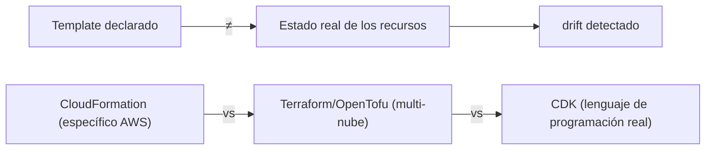

# Módulo 15: Infraestructura como código con CloudFormation


## Aprende construyendo


### Tema 1: Stack, Template y por qué no crear recursos manualmente con la CLI · Avanzado · 45 min

<details open>
<summary><strong>Capa 1 — Lectura</strong></summary>

#### ► DE QUÉ TRATA
Al finalizar podrás declarar infraestructura desde cero. Prerrequisitos: Floci corriendo y eval "$(floci env)" cargado (Laboratorio 1.2); verifica aws --version.

</details>

<details>
<summary><strong>Capa 2 — Construcción</strong></summary>

#### Código y verificación
```yaml
Resources:
  MiBucket:
    Type: AWS::S3::Bucket
  MiCola:
    Type: AWS::SQS::Queue
Outputs:
  NombreBucket:
    Value: !Ref MiBucket
```

```bash
aws cloudformation deploy --template-file stack-basico.yaml --stack-name mi-stack
```

```yaml
Resources:
  MiBucket: { Type: AWS::S3::Bucket }
  MiCola: { Type: AWS::SQS::Queue }
Outputs:
  NombreBucket: { Value: !Ref MiBucket }
```

```yaml
AWSTemplateFormatVersion: "2010-09-09"
Description: Bucket de evidencias de RutaFlow
Parameters:
  Entorno:
    Type: String
    AllowedValues: [dev, prod]
    Default: dev
Resources:
  EvidenciasBucket:
    Type: AWS::S3::Bucket
    Properties:
      BucketName: !Sub "rutaflow-evidencias-${Entorno}"
Outputs:
  NombreBucket:
    Value: !Ref EvidenciasBucket
```

```bash
cd ejemplo-cloudformation
aws cloudformation deploy --template-file plantilla.yaml --stack-name rutaflow-evidencias
aws cloudformation describe-stacks --stack-name rutaflow-evidencias \
  --query 'Stacks[0].[StackStatus,Outputs[0].OutputValue]' --output text
aws s3 ls
```

</details>

### Tema 2: Change sets · Avanzado · 45 min

<details open>
<summary><strong>Capa 1 — Lectura</strong></summary>

#### ► DE QUÉ TRATA
Al finalizar podrás revisar un plan desde cero. Prerrequisitos: el stack rutaflow-evidencias del Tema 1; verifica aws --version.

</details>

<details>
<summary><strong>Capa 2 — Construcción</strong></summary>

#### Código y verificación
```bash
aws cloudformation create-change-set --stack-name mi-stack --template-body file://stack-basico.yaml --change-set-name cambio-001
aws cloudformation describe-change-set --stack-name mi-stack --change-set-name cambio-001
aws cloudformation execute-change-set --stack-name mi-stack --change-set-name cambio-001
```

```bash
create-change-set   → calcula el impacto SIN aplicar el cambio
describe-change-set → revisa exactamente qué se crearía/modificaría/eliminaría
execute-change-set  → aplica el cambio YA revisado y aprobado
```

```yaml
      VersioningConfiguration:
        Status: Enabled
```

```bash
aws cloudformation create-change-set --stack-name rutaflow-evidencias \
  --change-set-name activar-versionado --template-body file://plantilla.yaml
aws cloudformation wait change-set-create-complete --stack-name rutaflow-evidencias \
  --change-set-name activar-versionado
aws cloudformation describe-change-set --stack-name rutaflow-evidencias --change-set-name activar-versionado \
  --query 'Changes[].ResourceChange.[Action,LogicalResourceId,Replacement]' --output text
aws cloudformation execute-change-set --stack-name rutaflow-evidencias --change-set-name activar-versionado
```

</details>

### Tema 3: Drift detection, Terraform/CDK, y compatibilidad multi-herramienta · Avanzado · 45 min

<details open>
<summary><strong>Capa 1 — Lectura</strong></summary>

#### ► DE QUÉ TRATA
Al finalizar podrás detectar drift desde cero. Prerrequisitos: el stack rutaflow-evidencias del Tema 2; verifica aws --version.

#### ► CÓMO FUNCIONA


</details>

<details>
<summary><strong>Capa 2 — Construcción</strong></summary>

#### Código y verificación

```bash
aws s3api put-bucket-versioning --bucket rutaflow-evidencias-dev --versioning-configuration Status=Suspended
aws cloudformation detect-stack-drift --stack-name rutaflow-evidencias
aws cloudformation describe-stack-resource-drifts --stack-name rutaflow-evidencias \
  --query 'StackResourceDrifts[].[LogicalResourceId,StackResourceDriftStatus]' --output text
```

</details>
