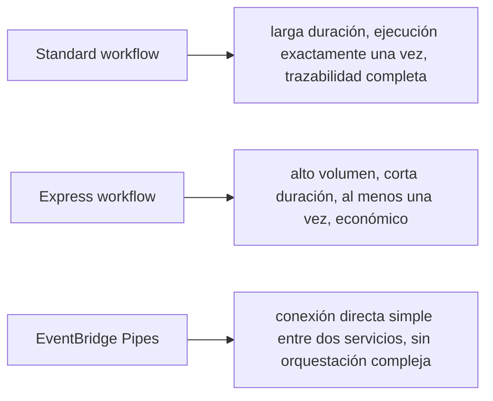
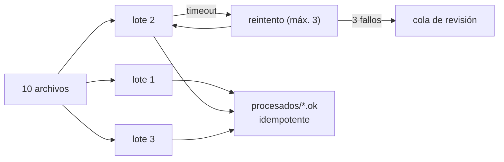

# Módulo 15: Orquestación de flujos con Step Functions


## Aprende construyendo


### Tema 1: State machine y Task states · Avanzado · 45 min

<details open>
<summary><strong>Capa 1 — Lectura</strong></summary>

#### ► DE QUÉ TRATA
Al finalizar vas a declarar como state machine el mismo flujo que confirmar-entrega (Módulo 5) ya hace en código: validar, guardar el evento, notificar. Prerrequisitos: Módulos 5 y 11 completos.

</details>

<details>
<summary><strong>Capa 2 — Construcción</strong></summary>

#### Código y verificación
```bash
aws stepfunctions create-state-machine --name FlujoTareas --definition file://maquina.json --role-arn arn:aws:iam::000000000000:role/sfn-role
aws stepfunctions start-execution --state-machine-arn arn:aws:states:us-east-1:000000000000:stateMachine:FlujoTareas --input '{"tarea":"001"}'
```

```json
{
  "StartAt": "ValidarTarea",
  "States": {
    "ValidarTarea": { "Type": "Task", "Resource": "arn:...", "Next": "GuardarEnDynamoDB" },
    "GuardarEnDynamoDB": { "Type": "Task", "Resource": "arn:...", "Next": "EnviarNotificacion" },
    "EnviarNotificacion": { "Type": "Task", "Resource": "arn:...", "End": true }
  }
}
```

Crea el archivo `maquina-confirmar.json`:

```json
{
  "StartAt": "GuardarEvento",
  "States": {
    "GuardarEvento": {
      "Type": "Task",
      "Resource": "arn:aws:states:::dynamodb:putItem",
      "Parameters": {"TableName": "ShipmentEvents", "Item": {"shipmentId": {"S.$": "$.shipmentId"}, "sequence": {"N": "1"}, "estado": {"S": "entregado"}}},
      "Next": "Notificar"
    },
    "Notificar": {
      "Type": "Task",
      "Resource": "arn:aws:states:::sns:publish",
      "Parameters": {"TopicArn": "arn:aws:sns:us-east-1:000000000000:rutaflow-envio-entregado", "Message.$": "$.shipmentId"},
      "End": true
    }
  }
}
```

```bash
aws stepfunctions create-state-machine --name ConfirmarEntregaFlow --definition file://maquina-confirmar.json --role-arn arn:aws:iam::000000000000:role/sfn-role
aws stepfunctions start-execution --state-machine-arn arn:aws:states:us-east-1:000000000000:stateMachine:ConfirmarEntregaFlow --input '{"shipmentId":"env-7001"}'
```

</details>

### Tema 2: Choice state, Retry y Catch · Avanzado · 45 min

<details open>
<summary><strong>Capa 1 — Lectura</strong></summary>

#### ► DE QUÉ TRATA
Al finalizar vas a agregarle a ConfirmarEntregaFlow (Tema 1) manejo explícito de errores: reintentar si DynamoDB está ocupado, y una rama de error que no oculte la causa. Prerrequisitos: Tema 1 de este módulo.

</details>

<details>
<summary><strong>Capa 2 — Construcción</strong></summary>

#### Objetivo observable
Al finalizar vas a agregarle a `ConfirmarEntregaFlow` (Tema 1) manejo explícito de errores: reintentar si DynamoDB está ocupado, y una rama de error que no oculte la causa. Prerrequisitos: Tema 1 de este módulo.

</details>

### Tema 3: Express vs Standard, y cuándo EventBridge Pipes es suficiente · Avanzado · 45 min

<details open>
<summary><strong>Capa 1 — Lectura</strong></summary>

#### ► DE QUÉ TRATA
Al finalizar vas a decidir, con números reales, si ConfirmarEntregaFlow debería ser Standard o Express — y si el planificador de rutas (Módulo 14) necesita Step Functions en absoluto. Prerrequisitos: Módulo 14, Temas 1-2 de este módulo.

#### ► CÓMO FUNCIONA


#### ► REGLA PRÁCTICA
Si solo necesitas conectar dos servicios sin pasos intermedios, usa EventBridge Pipes y ahórrate Step Functions. Si sí necesitas orquestar varios pasos, elige Standard cuando el flujo sea largo y deba ejecutarse exactamente una vez con trazabilidad completa, y Express cuando sea de alto volumen, corta duración y tolere al menos una vez.

</details>

<details>
<summary><strong>Capa 2 — Construcción</strong></summary>

#### Objetivo observable
Al finalizar vas a decidir, con números reales, si `ConfirmarEntregaFlow` debería ser Standard o Express — y si el planificador de rutas (Módulo 14) necesita Step Functions en absoluto. Prerrequisitos: Módulo 14, Temas 1-2 de este módulo.

</details>

### Tema 4: Procesamiento por lotes: trabajos independientes, reintentos e idempotencia · Avanzado · 40 min

<details open>
<summary><strong>Capa 1 — Lectura</strong></summary>

#### ► DE QUÉ TRATA
Usa JDK 21 o superior (`java Lote.java` compila y ejecuta en un paso). Crea la carpeta academia-labs/cloud/lotes. La demostración corre en tu máquina; la misma estructura se lleva a AWS Batch o a Step Functions.

#### ► CÓMO FUNCIONA


</details>

<details>
<summary><strong>Capa 2 — Construcción</strong></summary>

#### Código y verificación

```java
// Lote.java — procesa archivos en lotes independientes, con reintentos e idempotencia
import java.io.IOException;
import java.nio.file.*;
import java.util.*;
import java.util.concurrent.TimeoutException;
import java.util.stream.IntStream;

public class Lote {
    static final List<String> ENTRADA = IntStream.rangeClosed(1, 10)
            .mapToObj(dia -> "guias-%02d.csv".formatted(dia)).toList();   // 10 archivos del mes
    static final int TAMANO_LOTE = 4;
    static final int INTENTOS = 3;
    static final Path SALIDA = Path.of("procesados");
    static final Map<String, Integer> FALLOS_SIMULADOS = new HashMap<>(Map.of("guias-06.csv", 1)); // un timeout de red

    static void procesar(String archivo) throws IOException, TimeoutException {
        Path destino = SALIDA.resolve(archivo + ".ok");
        if (Files.exists(destino)) return;                  // idempotente: si ya se hizo, no se repite
        if (FALLOS_SIMULADOS.getOrDefault(archivo, 0) > 0) {
            FALLOS_SIMULADOS.merge(archivo, -1, Integer::sum);
            throw new TimeoutException(archivo + ": tiempo agotado");
        }
        Files.writeString(destino, "{\"archivo\":\"" + archivo + "\",\"filas\":1000}");
    }

    public static void main(String[] args) throws IOException {
        Files.createDirectories(SALIDA);
        // Cada lote es como un trabajo de un array job: independiente y reintentable.
        for (int inicio = 0, n = 1; inicio < ENTRADA.size(); inicio += TAMANO_LOTE, n++) {
            List<String> lote = ENTRADA.subList(inicio, Math.min(inicio + TAMANO_LOTE, ENTRADA.size()));
            boolean listo = false;
            for (int intento = 1; intento <= INTENTOS && !listo; intento++) {
                try {
                    for (String archivo : lote) procesar(archivo);
                    System.out.printf("lote %d (%d archivos): ok en el intento %d%n", n, lote.size(), intento);
                    listo = true;
                } catch (TimeoutException error) {
                    System.out.printf("lote %d: %s, reintentando%n", n, error.getMessage());
                }
            }
            if (!listo) System.out.printf("lote %d: falló %d veces, va a la cola de revisión%n", n, INTENTOS);
        }
        try (var archivos = Files.list(SALIDA)) {
            long hechos = archivos.filter(p -> p.toString().endsWith(".ok")).count();
            System.out.printf("procesados: %d de %d%n", hechos, ENTRADA.size());
        }
    }
}
```

```bash
cd academia-labs/cloud/lotes
java Lote.java
java Lote.java   # segunda vez: idempotente
```

```text
lote 1 (4 archivos): ok en el intento 1
lote 2: guias-06.csv: tiempo agotado, reintentando
lote 2 (4 archivos): ok en el intento 2
lote 3 (2 archivos): ok en el intento 1
procesados: 10 de 10
```

</details>
