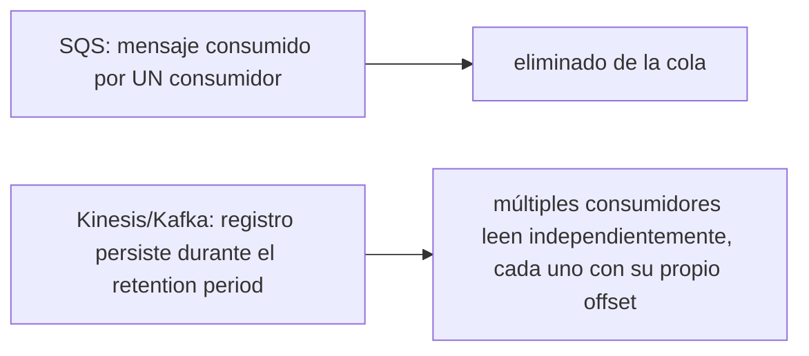
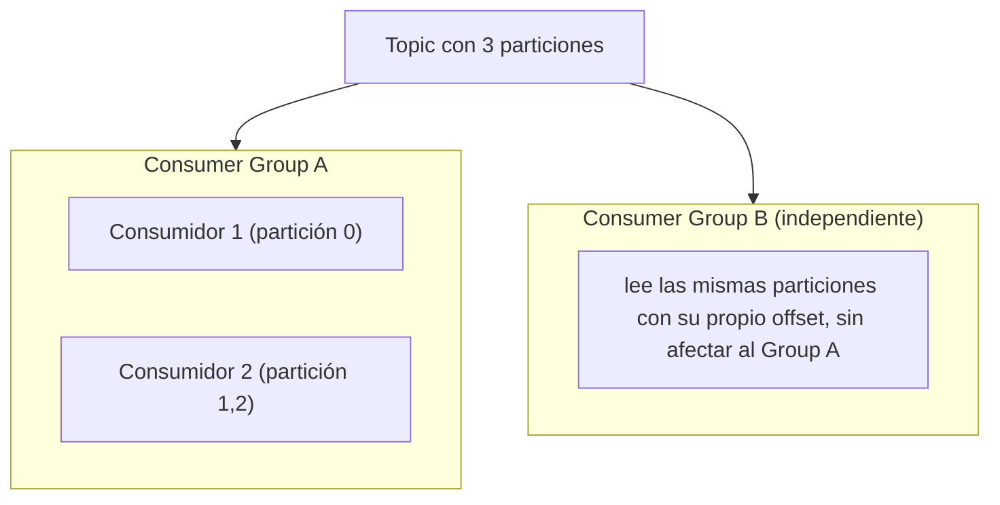
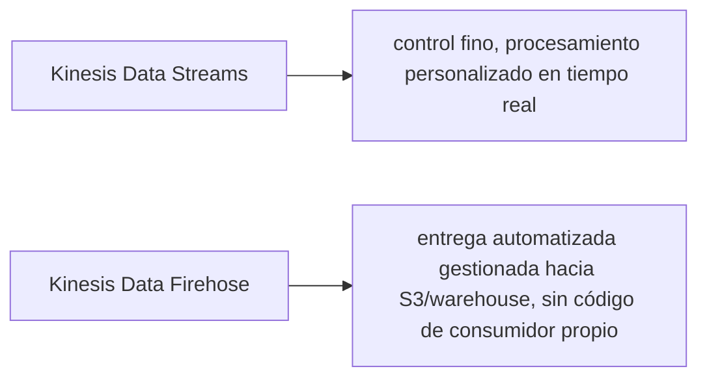

# Módulo 16: Streaming: Kinesis, MSK (Kafka) y Pub/Sub avanzado


## Aprende construyendo


### Tema 1: Streams vs colas · Avanzado · 45 min

<details open>
<summary><strong>Capa 1 — Lectura</strong></summary>

#### ► DE QUÉ TRATA
Al finalizar vas a transmitir la ubicación GPS real de un conductor de RutaFlow por un stream que dos consumidores distintos leen de forma independiente. Prerrequisitos: Módulo 4 completo.

#### ► CÓMO FUNCIONA


#### ► REGLA PRÁCTICA
Si solo un consumidor debe procesar cada mensaje y luego puede descartarse, usa una cola (SQS). Si varios consumidores independientes necesitan leer el mismo evento (cada uno a su propio ritmo), usa un stream (Kinesis/Kafka).

</details>

<details>
<summary><strong>Capa 2 — Construcción</strong></summary>

#### Código y verificación
```bash
aws kinesis create-stream --stream-name mi-stream --shard-count 2
aws kinesis put-record --stream-name mi-stream --partition-key user-001 --data $(echo -n "evento-1" | base64)
```


```bash
aws kinesis create-stream --stream-name rutaflow-ubicacion-conductores --shard-count 1
aws kinesis put-record --stream-name rutaflow-ubicacion-conductores --partition-key conductor-c891 --data $(echo -n '{"conductorId":"c-891","lat":4.6097,"lon":-74.0817}' | base64)
SHARD_ID=$(aws kinesis describe-stream --stream-name rutaflow-ubicacion-conductores --query 'StreamDescription.Shards[0].ShardId' --output text)
ITERATOR=$(aws kinesis get-shard-iterator --stream-name rutaflow-ubicacion-conductores --shard-id "$SHARD_ID" --shard-iterator-type TRIM_HORIZON --query ShardIterator --output text)
aws kinesis get-records --shard-iterator "$ITERATOR"
```

</details>

### Tema 2: MSK (Kafka gestionado) y consumer groups · Avanzado · 45 min

<details open>
<summary><strong>Capa 1 — Lectura</strong></summary>

#### ► DE QUÉ TRATA
Al finalizar vas a modelar el mismo topic de ubicaciones del Tema 1 sobre MSK, con dos consumer groups independientes (mapa en vivo y alertas de desvío). Prerrequisitos: Tema 1 de este módulo.

#### ► CÓMO FUNCIONA


</details>

<details>
<summary><strong>Capa 2 — Construcción</strong></summary>

#### Código y verificación
```bash
aws kafka create-cluster --cluster-name mi-kafka --broker-node-group-info '{"InstanceType":"kafka.m5.large", ...}' --number-of-broker-nodes 1 --kafka-version "3.5.1"
```


```bash
aws kafka create-cluster --cluster-name rutaflow-ubicacion-kafka \
  --broker-node-group-info '{"InstanceType":"kafka.m5.large","ClientSubnets":["subnet-local"]}' \
  --number-of-broker-nodes 1 --kafka-version "3.5.1"
kafka-topics.sh --create --topic ubicacion-conductores --bootstrap-server localhost:9092
kafka-console-consumer.sh --topic ubicacion-conductores --group mapa-en-vivo --bootstrap-server localhost:9092 --from-beginning --max-messages 1
kafka-consumer-groups.sh --describe --group mapa-en-vivo --bootstrap-server localhost:9092
```

</details>

### Tema 3: Kinesis Data Streams vs Firehose, y GCP Managed Kafka · Avanzado · 45 min

<details open>
<summary><strong>Capa 1 — Lectura</strong></summary>

#### ► DE QUÉ TRATA
Al finalizar vas a decidir qué parte del flujo de ubicaciones de RutaFlow necesita Kinesis Data Streams y cuál puede resolverse con Firehose. Prerrequisitos: Tema 1 de este módulo.

#### ► CÓMO FUNCIONA


#### ► REGLA PRÁCTICA
Si solo necesitas entregar los datos a un destino fijo (S3, un warehouse) sin procesarlos tú mismo, usa Firehose y evita escribir un consumidor. Si necesitas lógica de procesamiento personalizada en tiempo real sobre cada registro, usa Kinesis Data Streams.

</details>

<details>
<summary><strong>Capa 2 — Construcción</strong></summary>

#### Código y verificación

```bash
aws s3 mb s3://rutaflow-ubicaciones-historico
aws firehose create-delivery-stream --delivery-stream-name ubicaciones-a-s3 \
  --s3-destination-configuration RoleARN=arn:aws:iam::000000000000:role/firehose-role,BucketARN=arn:aws:s3:::rutaflow-ubicaciones-historico
aws firehose put-record --delivery-stream-name ubicaciones-a-s3 --record Data=$(echo -n '{"conductorId":"c-891","lat":4.6097,"lon":-74.0817}' | base64)
```

</details>
