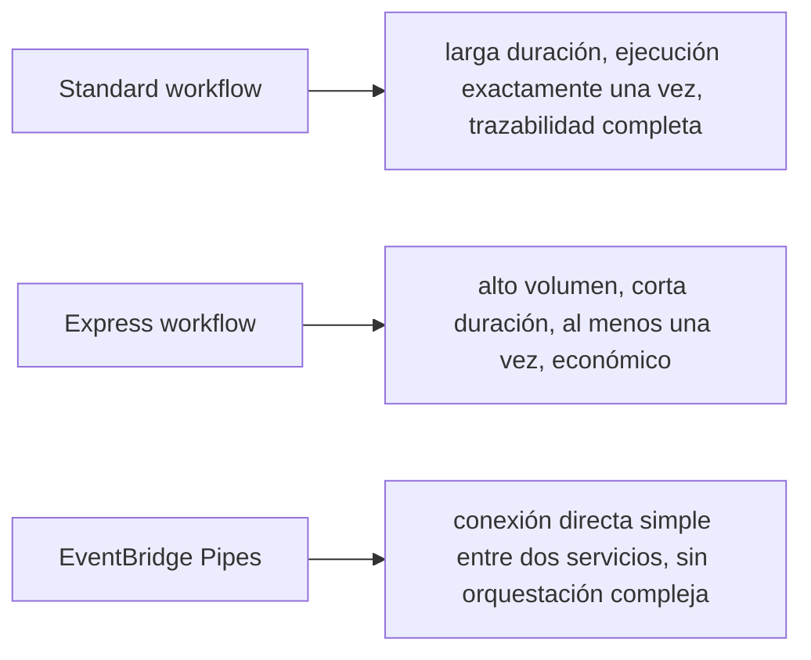
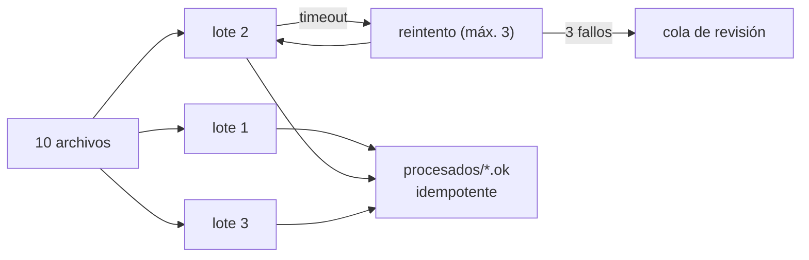

# Módulo 16: Orquestación de flujos con Step Functions


## Aprende construyendo


### Tema 1: State machine y Task states · Avanzado · 45 min

<details open>
<summary><strong>Capa 1 — Lectura</strong></summary>

#### ► DE QUÉ TRATA
Al finalizar vas a declarar como state machine el mismo flujo que confirmar-entrega (Módulo 5) ya hace en código: validar, guardar el evento, notificar. Prerrequisitos: Módulos 5 y 11 completos.

#### ► LA IDEA EN UNA FRASE
**Al finalizar vas a declarar como state machine el mismo flujo que confirmar-entrega (Módulo 5) ya hace en código: validar, guardar el evento, notificar.**

#### ► POR QUÉ EXISTE ESTO
Resuelve un problema real de diseño o implementación y evita decisiones a ciegas.

#### ► LA ANALOGÍA
Piensa en state machine y task states como una herramienta de taller: útil cuando conoces su propósito y sus límites.
**Dónde se rompe la analogía:** en software, los efectos dependen del contexto, la escala y los trade-offs.

#### ► CÓMO FUNCIONA
1. Identifica el problema que state machine y task states resuelve.
2. Observa sus componentes y relaciones.
3. Aplica la opción más simple que funcione.
4. Verifica el resultado y los límites.

#### ► LO QUE PUEDE SALIR MAL
| Síntoma | Causa probable | Arreglo |
|---|---|---|
| State machine y Task states se aplica pero el resultado no mejora | Se usó sin medir el problema real | Mide antes y compara contra la alternativa simple |
| Aparece complejidad inesperada | Se adoptó la técnica sin comprender sus trade-offs | Vuelve a la sección de trade-offs y reduce el alcance |
| Falla en un caso límite | Se asumió un contexto que no se cumple | Prueba el caso límite y documenta cuándo NO usarlo |

#### ► TRADE-OFFS
| Opción | Cuándo usarla | Cuándo NO usarla |
|---|---|---|
| Usar State machine y Task states | Cuando el problema coincide con su propósito y el beneficio es observable | Cuando agrega complejidad sin resolver un problema real |
| Alternativa más simple | Cuando el contexto es pequeño, estable o fácil de razonar | Cuando ya demostró no escalar o no cumplir el requisito |
| Postergar la decisión | Cuando falta evidencia del problema | Cuando el costo de esperar es mayor que el costo de probar |

#### ► CUÁNDO NO USAR ESTO
No uses state machine y task states por defecto. Aplícalo cuando el problema lo justifique y puedas verificar el beneficio; si una alternativa más simple resuelve igual, prefiérela.

#### ► DE VUELTA A LA ANALOGÍA
Volviendo a la analogía: state machine y task states funciona como el modelo inicial, pero recuerda dónde se rompe: en producción importan la evidencia, la escala y el costo de equivocarte.

#### ► LO QUE DEBES RECORDAR
- State machine y Task states existe para resolver un problema específico.
- Mide antes de adoptar complejidad.
- Conoce el caso donde NO usarlo.
- Verifica con evidencia observable.

#### ► PREGUNTAS PARA PENSAR
1. ¿Qué problema concreto resuelve state machine y task states en tu contexto?
2. ¿Cómo sabrías que state machine y task states no está funcionando bien?
3. ¿Qué alternativa más simple considerarías antes de usar state machine y task states?

</details>

<details>
<summary><strong>Capa 2 — Construcción</strong></summary>

#### Código y verificación
```bash
aws stepfunctions create-state-machine --name FlujoTareas --definition file://maquina.json --role-arn arn:aws:iam::000000000000:role/sfn-role
aws stepfunctions start-execution --state-machine-arn arn:aws:states:us-east-1:000000000000:stateMachine:FlujoTareas --input '{"tarea":"001"}'
```

```json
{
  "StartAt": "ValidarTarea",
  "States": {
    "ValidarTarea": { "Type": "Task", "Resource": "arn:...", "Next": "GuardarEnDynamoDB" },
    "GuardarEnDynamoDB": { "Type": "Task", "Resource": "arn:...", "Next": "EnviarNotificacion" },
    "EnviarNotificacion": { "Type": "Task", "Resource": "arn:...", "End": true }
  }
}
```

```bash
cat > maquina-confirmar.json <<'EOF'
{
  "StartAt": "GuardarEvento",
  "States": {
    "GuardarEvento": {
      "Type": "Task",
      "Resource": "arn:aws:states:::dynamodb:putItem",
      "Parameters": {"TableName": "ShipmentEvents", "Item": {"shipmentId": {"S.$": "$.shipmentId"}, "sequence": {"N": "1"}, "estado": {"S": "entregado"}}},
      "Next": "Notificar"
    },
    "Notificar": {
      "Type": "Task",
      "Resource": "arn:aws:states:::sns:publish",
      "Parameters": {"TopicArn": "arn:aws:sns:us-east-1:000000000000:rutaflow-envio-entregado", "Message.$": "$.shipmentId"},
      "End": true
    }
  }
}
EOF
aws stepfunctions create-state-machine --name ConfirmarEntregaFlow --definition file://maquina-confirmar.json --role-arn arn:aws:iam::000000000000:role/sfn-role
aws stepfunctions start-execution --state-machine-arn arn:aws:states:us-east-1:000000000000:stateMachine:ConfirmarEntregaFlow --input '{"shipmentId":"env-7001"}'
```

</details>

### Tema 2: Choice state, Retry y Catch · Avanzado · 45 min

<details open>
<summary><strong>Capa 1 — Lectura</strong></summary>

#### ► DE QUÉ TRATA
Al finalizar vas a agregarle a ConfirmarEntregaFlow (Tema 1) manejo explícito de errores: reintentar si DynamoDB está ocupado, y una rama de error que no oculte la causa. Prerrequisitos: Tema 1 de este módulo.

#### ► LA IDEA EN UNA FRASE
**Al finalizar vas a agregarle a ConfirmarEntregaFlow (Tema 1) manejo explícito de errores: reintentar si DynamoDB está ocupado, y una rama de error que no oculte la causa.**

#### ► POR QUÉ EXISTE ESTO
Resuelve un problema real de diseño o implementación y evita decisiones a ciegas.

#### ► LA ANALOGÍA
Piensa en choice state, retry y catch como una herramienta de taller: útil cuando conoces su propósito y sus límites.
**Dónde se rompe la analogía:** en software, los efectos dependen del contexto, la escala y los trade-offs.

#### ► CÓMO FUNCIONA
1. Identifica el problema que choice state, retry y catch resuelve.
2. Observa sus componentes y relaciones.
3. Aplica la opción más simple que funcione.
4. Verifica el resultado y los límites.

#### ► LO QUE PUEDE SALIR MAL
| Síntoma | Causa probable | Arreglo |
|---|---|---|
| Choice state, Retry y Catch se aplica pero el resultado no mejora | Se usó sin medir el problema real | Mide antes y compara contra la alternativa simple |
| Aparece complejidad inesperada | Se adoptó la técnica sin comprender sus trade-offs | Vuelve a la sección de trade-offs y reduce el alcance |
| Falla en un caso límite | Se asumió un contexto que no se cumple | Prueba el caso límite y documenta cuándo NO usarlo |

#### ► TRADE-OFFS
| Opción | Cuándo usarla | Cuándo NO usarla |
|---|---|---|
| Usar Choice state, Retry y Catch | Cuando el problema coincide con su propósito y el beneficio es observable | Cuando agrega complejidad sin resolver un problema real |
| Alternativa más simple | Cuando el contexto es pequeño, estable o fácil de razonar | Cuando ya demostró no escalar o no cumplir el requisito |
| Postergar la decisión | Cuando falta evidencia del problema | Cuando el costo de esperar es mayor que el costo de probar |

#### ► CUÁNDO NO USAR ESTO
No uses choice state, retry y catch por defecto. Aplícalo cuando el problema lo justifique y puedas verificar el beneficio; si una alternativa más simple resuelve igual, prefiérela.

#### ► DE VUELTA A LA ANALOGÍA
Volviendo a la analogía: choice state, retry y catch funciona como el modelo inicial, pero recuerda dónde se rompe: en producción importan la evidencia, la escala y el costo de equivocarte.

#### ► LO QUE DEBES RECORDAR
- Choice state, Retry y Catch existe para resolver un problema específico.
- Mide antes de adoptar complejidad.
- Conoce el caso donde NO usarlo.
- Verifica con evidencia observable.

#### ► PREGUNTAS PARA PENSAR
1. ¿Qué problema concreto resuelve choice state, retry y catch en tu contexto?
2. ¿Cómo sabrías que choice state, retry y catch no está funcionando bien?
3. ¿Qué alternativa más simple considerarías antes de usar choice state, retry y catch?

</details>

<details>
<summary><strong>Capa 2 — Construcción</strong></summary>

#### Objetivo observable
Al finalizar vas a agregarle a `ConfirmarEntregaFlow` (Tema 1) manejo explícito de errores: reintentar si DynamoDB está ocupado, y una rama de error que no oculte la causa. Prerrequisitos: Tema 1 de este módulo.

</details>

### Tema 3: Express vs Standard, y cuándo EventBridge Pipes es suficiente · Avanzado · 45 min

<details open>
<summary><strong>Capa 1 — Lectura</strong></summary>

#### ► DE QUÉ TRATA
Al finalizar vas a decidir, con números reales, si ConfirmarEntregaFlow debería ser Standard o Express — y si el planificador de rutas (Módulo 14) necesita Step Functions en absoluto. Prerrequisitos: Módulo 14, Temas 1-2 de este módulo.

#### ► LA IDEA EN UNA FRASE
**Al finalizar vas a decidir, con números reales, si ConfirmarEntregaFlow debería ser Standard o Express — y si el planificador de rutas (Módulo 14) necesita Step Functions en absoluto.**

#### ► POR QUÉ EXISTE ESTO
Resuelve un problema real de diseño o implementación y evita decisiones a ciegas.

#### ► LA ANALOGÍA
Piensa en express vs standard, y cuándo eventbridge pipes es suficiente como una herramienta de taller: útil cuando conoces su propósito y sus límites.
**Dónde se rompe la analogía:** en software, los efectos dependen del contexto, la escala y los trade-offs.

#### ► CÓMO FUNCIONA


#### ► LO QUE PUEDE SALIR MAL
| Síntoma | Causa probable | Arreglo |
|---|---|---|
| Express vs Standard, y cuándo EventBridge Pipes es suficiente se aplica pero el resultado no mejora | Se usó sin medir el problema real | Mide antes y compara contra la alternativa simple |
| Aparece complejidad inesperada | Se adoptó la técnica sin comprender sus trade-offs | Vuelve a la sección de trade-offs y reduce el alcance |
| Falla en un caso límite | Se asumió un contexto que no se cumple | Prueba el caso límite y documenta cuándo NO usarlo |

#### ► TRADE-OFFS
| Opción | Cuándo usarla | Cuándo NO usarla |
|---|---|---|
| Usar Express vs Standard, y cuándo EventBridge Pipes es suficiente | Cuando el problema coincide con su propósito y el beneficio es observable | Cuando agrega complejidad sin resolver un problema real |
| Alternativa más simple | Cuando el contexto es pequeño, estable o fácil de razonar | Cuando ya demostró no escalar o no cumplir el requisito |
| Postergar la decisión | Cuando falta evidencia del problema | Cuando el costo de esperar es mayor que el costo de probar |

#### ► CUÁNDO NO USAR ESTO
No uses express vs standard, y cuándo eventbridge pipes es suficiente por defecto. Aplícalo cuando el problema lo justifique y puedas verificar el beneficio; si una alternativa más simple resuelve igual, prefiérela.

#### ► DE VUELTA A LA ANALOGÍA
Volviendo a la analogía: express vs standard, y cuándo eventbridge pipes es suficiente funciona como el modelo inicial, pero recuerda dónde se rompe: en producción importan la evidencia, la escala y el costo de equivocarte.

#### ► LO QUE DEBES RECORDAR
- Express vs Standard, y cuándo EventBridge Pipes es suficiente existe para resolver un problema específico.
- Mide antes de adoptar complejidad.
- Conoce el caso donde NO usarlo.
- Verifica con evidencia observable.

#### ► PREGUNTAS PARA PENSAR
1. ¿Qué problema concreto resuelve express vs standard, y cuándo eventbridge pipes es suficiente en tu contexto?
2. ¿Cómo sabrías que express vs standard, y cuándo eventbridge pipes es suficiente no está funcionando bien?
3. ¿Qué alternativa más simple considerarías antes de usar express vs standard, y cuándo eventbridge pipes es suficiente?

</details>

<details>
<summary><strong>Capa 2 — Construcción</strong></summary>

#### Objetivo observable
Al finalizar vas a decidir, con números reales, si `ConfirmarEntregaFlow` debería ser Standard o Express — y si el planificador de rutas (Módulo 14) necesita Step Functions en absoluto. Prerrequisitos: Módulo 14, Temas 1-2 de este módulo.

</details>

### Tema 4: Procesamiento por lotes: trabajos independientes, reintentos e idempotencia · Avanzado · 40 min

<details open>
<summary><strong>Capa 1 — Lectura</strong></summary>

#### ► DE QUÉ TRATA
Usa Python 3.10 o superior. Crea la carpeta academia-labs/cloud/lotes. La demostración corre en tu máquina; la misma estructura se lleva a AWS Batch o a Step Functions.

#### ► LA IDEA EN UNA FRASE
**Usa Python 3.10 o superior.**

#### ► POR QUÉ EXISTE ESTO
Resuelve un problema real de diseño o implementación y evita decisiones a ciegas.

#### ► LA ANALOGÍA
Piensa en procesamiento por lotes: trabajos independientes, reintentos e idempotencia como una herramienta de taller: útil cuando conoces su propósito y sus límites.
**Dónde se rompe la analogía:** en software, los efectos dependen del contexto, la escala y los trade-offs.

#### ► CÓMO FUNCIONA


#### ► LO QUE PUEDE SALIR MAL
| Síntoma | Causa probable | Arreglo |
|---|---|---|
| Procesamiento por lotes: trabajos independientes, reintentos e idempotencia se aplica pero el resultado no mejora | Se usó sin medir el problema real | Mide antes y compara contra la alternativa simple |
| Aparece complejidad inesperada | Se adoptó la técnica sin comprender sus trade-offs | Vuelve a la sección de trade-offs y reduce el alcance |
| Falla en un caso límite | Se asumió un contexto que no se cumple | Prueba el caso límite y documenta cuándo NO usarlo |

#### ► TRADE-OFFS
| Opción | Cuándo usarla | Cuándo NO usarla |
|---|---|---|
| Usar Procesamiento por lotes: trabajos independientes, reintentos e idempotencia | Cuando el problema coincide con su propósito y el beneficio es observable | Cuando agrega complejidad sin resolver un problema real |
| Alternativa más simple | Cuando el contexto es pequeño, estable o fácil de razonar | Cuando ya demostró no escalar o no cumplir el requisito |
| Postergar la decisión | Cuando falta evidencia del problema | Cuando el costo de esperar es mayor que el costo de probar |

#### ► CUÁNDO NO USAR ESTO
No uses procesamiento por lotes: trabajos independientes, reintentos e idempotencia por defecto. Aplícalo cuando el problema lo justifique y puedas verificar el beneficio; si una alternativa más simple resuelve igual, prefiérela.

#### ► DE VUELTA A LA ANALOGÍA
Volviendo a la analogía: procesamiento por lotes: trabajos independientes, reintentos e idempotencia funciona como el modelo inicial, pero recuerda dónde se rompe: en producción importan la evidencia, la escala y el costo de equivocarte.

#### ► LO QUE DEBES RECORDAR
- Procesamiento por lotes: trabajos independientes, reintentos e idempotencia existe para resolver un problema específico.
- Mide antes de adoptar complejidad.
- Conoce el caso donde NO usarlo.
- Verifica con evidencia observable.

#### ► PREGUNTAS PARA PENSAR
1. ¿Qué problema concreto resuelve procesamiento por lotes: trabajos independientes, reintentos e idempotencia en tu contexto?
2. ¿Cómo sabrías que procesamiento por lotes: trabajos independientes, reintentos e idempotencia no está funcionando bien?
3. ¿Qué alternativa más simple considerarías antes de usar procesamiento por lotes: trabajos independientes, reintentos e idempotencia?

</details>

<details>
<summary><strong>Capa 2 — Construcción</strong></summary>

#### Código y verificación


```python
import json
from pathlib import Path

ENTRADA = [f"guias-{dia:02d}.csv" for dia in range(1, 11)]  # 10 archivos del mes
TAMANO_LOTE = 4
INTENTOS = 3
salida = Path("procesados"); salida.mkdir(exist_ok=True)
fallos_simulados = {"guias-06.csv": 1}  # falla una vez (por ejemplo, un timeout de red)

def procesar(archivo: str) -> None:
    destino = salida / (archivo + ".ok")
    if destino.exists():            # idempotente: si ya se hizo, no se repite
        return
    if fallos_simulados.get(archivo, 0) > 0:
        fallos_simulados[archivo] -= 1
        raise TimeoutError(f"{archivo}: tiempo agotado")
    destino.write_text(json.dumps({"archivo": archivo, "filas": 1000}))

# Cada lote es como un trabajo de un array job: independiente y reintentable.
for n, inicio in enumerate(range(0, len(ENTRADA), TAMANO_LOTE), start=1):
    lote = ENTRADA[inicio:inicio + TAMANO_LOTE]
    for intento in range(1, INTENTOS + 1):
        try:
            for archivo in lote:
                procesar(archivo)
            print(f"lote {n} ({len(lote)} archivos): ok en el intento {intento}")
            break
        except TimeoutError as error:
            print(f"lote {n}: {error}, reintentando")
    else:
        print(f"lote {n}: falló {INTENTOS} veces, va a la cola de revisión")

print(f"procesados: {len(list(salida.glob('*.ok')))} de {len(ENTRADA)}")
```

```bash
cd academia-labs/cloud/lotes
python3 lote.py
python3 lote.py   # segunda vez: idempotente
```

```text
lote 1 (4 archivos): ok en el intento 1
lote 2: guias-06.csv: tiempo agotado, reintentando
lote 2 (4 archivos): ok en el intento 2
lote 3 (2 archivos): ok en el intento 1
procesados: 10 de 10
```

</details>
