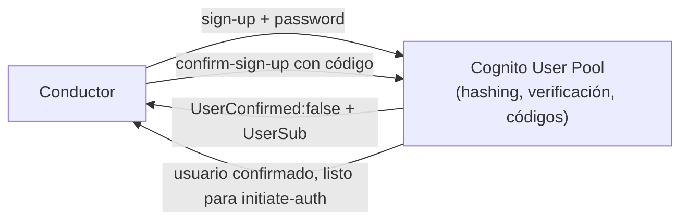
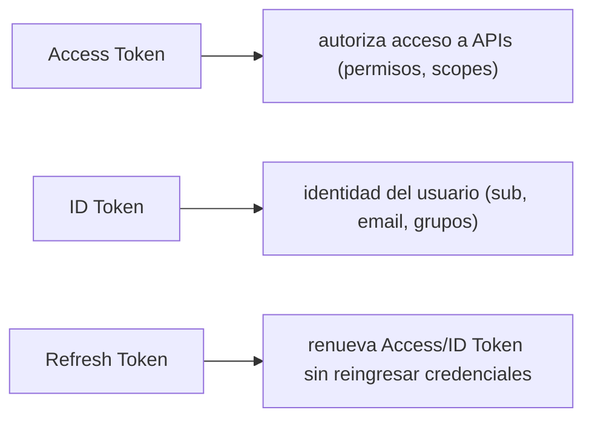
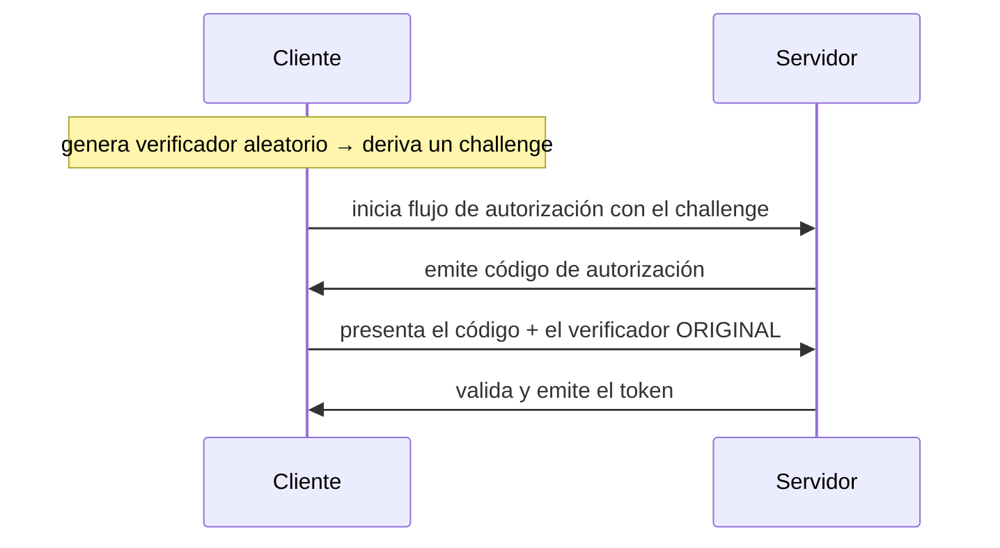

# Módulo 17: Autenticación de usuarios con Cognito


## Aprende construyendo


### Tema 1: Por qué no construir tu propio sistema de autenticación · Avanzado · 45 min

<details open>
<summary><strong>Capa 1 — Lectura</strong></summary>

#### ► DE QUÉ TRATA
Al finalizar vas a registrar un conductor real de RutaFlow en Cognito, en vez de inventar un sistema de login propio para la app del conductor. Prerrequisitos: Módulo 6 completo.

#### ► CÓMO FUNCIONA


</details>

<details>
<summary><strong>Capa 2 — Construcción</strong></summary>

#### Código y verificación
```bash
aws cognito-idp create-user-pool --pool-name MiApp --auto-verified-attributes email
aws cognito-idp sign-up --client-id <client-id> --username alice@ejemplo.com --password "Segura123!" --user-attributes Name=email,Value=alice@ejemplo.com
```

```bash
aws cognito-idp create-user-pool --pool-name MiApp --auto-verified-attributes email
aws cognito-idp create-user-pool-client --user-pool-id <pool-id> --client-name web-client --no-generate-secret
```


```bash
POOL_ID=$(aws cognito-idp create-user-pool --pool-name RutaFlowConductores --auto-verified-attributes email --query UserPool.Id --output text)
CLIENT_ID=$(aws cognito-idp create-user-pool-client --user-pool-id "$POOL_ID" --client-name app-conductor --no-generate-secret --query UserPoolClient.ClientId --output text)
aws cognito-idp sign-up --client-id "$CLIENT_ID" --username conductor-c891@rutaflow.com --password "Segura123!" \
  --user-attributes Name=email,Value=conductor-c891@rutaflow.com
```

</details>

### Tema 2: Access Token, ID Token y Refresh Token · Avanzado · 45 min

<details open>
<summary><strong>Capa 1 — Lectura</strong></summary>

#### ► DE QUÉ TRATA
Al finalizar vas a loguear al conductor del Tema 1 y a distinguir cuál de los tres tokens que recibís debería usarse para llamar POST /entregas. Prerrequisitos: Tema 1 de este módulo.

#### ► CÓMO FUNCIONA


</details>

<details>
<summary><strong>Capa 2 — Construcción</strong></summary>

#### Código y verificación
```bash
aws cognito-idp initiate-auth --client-id <client-id> --auth-flow USER_PASSWORD_AUTH --auth-parameters USERNAME=alice@ejemplo.com,PASSWORD="Segura123!"
```


```bash
mkdir ejemplo && cd ejemplo && floci start
```

```bash
aws cognito-idp initiate-auth --client-id "$CLIENT_ID" --auth-flow USER_PASSWORD_AUTH \
  --auth-parameters USERNAME=conductor-c891@rutaflow.com,PASSWORD="Segura123!" \
  --query 'AuthenticationResult.{Access:AccessToken,Id:IdToken,Refresh:RefreshToken}'
```

</details>

### Tema 3: OAuth 2.0 y PKCE · Avanzado · 45 min

<details open>
<summary><strong>Capa 1 — Lectura</strong></summary>


*Figura animada. El código de autorización solo sirve junto al verifier que nunca salió de la app.*

#### ► DE QUÉ TRATA
Al finalizar vas a armar el flujo OAuth 2.0 con PKCE que la app móvil del conductor necesita, porque esa app no puede guardar ningún secreto de cliente de forma segura. Prerrequisitos: Temas 1-2 de este módulo.

#### ► CÓMO FUNCIONA


</details>

<details>
<summary><strong>Capa 2 — Construcción</strong></summary>

#### Código y verificación

```bash
aws cognito-idp describe-user-pool-client --user-pool-id "$POOL_ID" --client-id "$CLIENT_ID" \
  --query 'UserPoolClient.AllowedOAuthFlows'
```

```bash
mkdir ejemplo && cd ejemplo && floci start
```

```bash
CODE_VERIFIER=$(openssl rand -base64 48 | tr '+/' '-_' | tr -d '=')
CODE_CHALLENGE=$(printf '%s' "$CODE_VERIFIER" | openssl dgst -sha256 -binary | base64 | tr '+/' '-_' | tr -d '=')
echo "verifier: ${#CODE_VERIFIER} caracteres, challenge: ${#CODE_CHALLENGE} caracteres"
echo "Abre en el navegador: http://localhost:4566/oauth2/authorize?client_id=$CLIENT_ID&response_type=code&code_challenge=$CODE_CHALLENGE&code_challenge_method=S256&redirect_uri=rutaflow://callback"
```

</details>
