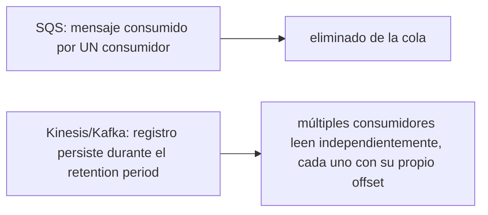
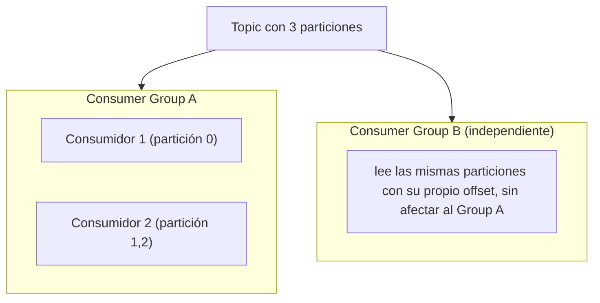
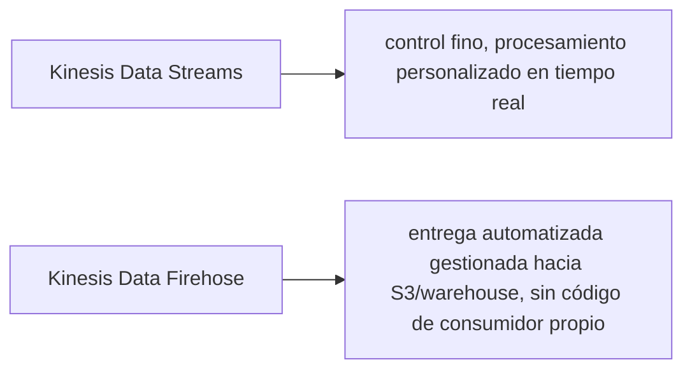

# Módulo 17: Streaming: Kinesis, MSK (Kafka) y Pub/Sub avanzado


## Aprende construyendo


### Tema 1: Streams vs colas · Avanzado · 45 min

<details open>
<summary><strong>Capa 1 — Lectura</strong></summary>

#### ► DE QUÉ TRATA
Al finalizar vas a transmitir la ubicación GPS real de un conductor de RutaFlow por un stream que dos consumidores distintos leen de forma independiente. Prerrequisitos: Módulo 4 completo.

#### ► LA IDEA EN UNA FRASE
**Al finalizar vas a transmitir la ubicación GPS real de un conductor de RutaFlow por un stream que dos consumidores distintos leen de forma independiente.**

#### ► POR QUÉ EXISTE ESTO
Resuelve un problema real de diseño o implementación y evita decisiones a ciegas.

#### ► LA ANALOGÍA
Piensa en streams vs colas como una herramienta de taller: útil cuando conoces su propósito y sus límites.
**Dónde se rompe la analogía:** en software, los efectos dependen del contexto, la escala y los trade-offs.

#### ► CÓMO FUNCIONA


#### ► REGLA PRÁCTICA
Si solo un consumidor debe procesar cada mensaje y luego puede descartarse, usa una cola (SQS). Si varios consumidores independientes necesitan leer el mismo evento (cada uno a su propio ritmo), usa un stream (Kinesis/Kafka).

#### ► LO QUE PUEDE SALIR MAL
| Síntoma | Causa probable | Arreglo |
|---|---|---|
| Streams vs colas se aplica pero el resultado no mejora | Se usó sin medir el problema real | Mide antes y compara contra la alternativa simple |
| Aparece complejidad inesperada | Se adoptó la técnica sin comprender sus trade-offs | Vuelve a la sección de trade-offs y reduce el alcance |
| Falla en un caso límite | Se asumió un contexto que no se cumple | Prueba el caso límite y documenta cuándo NO usarlo |

#### ► TRADE-OFFS
| Opción | Cuándo usarla | Cuándo NO usarla |
|---|---|---|
| Usar Streams vs colas | Cuando el problema coincide con su propósito y el beneficio es observable | Cuando agrega complejidad sin resolver un problema real |
| Alternativa más simple | Cuando el contexto es pequeño, estable o fácil de razonar | Cuando ya demostró no escalar o no cumplir el requisito |
| Postergar la decisión | Cuando falta evidencia del problema | Cuando el costo de esperar es mayor que el costo de probar |

#### ► CUÁNDO NO USAR ESTO
No uses streams vs colas por defecto. Aplícalo cuando el problema lo justifique y puedas verificar el beneficio; si una alternativa más simple resuelve igual, prefiérela.

#### ► DE VUELTA A LA ANALOGÍA
Volviendo a la analogía: streams vs colas funciona como el modelo inicial, pero recuerda dónde se rompe: en producción importan la evidencia, la escala y el costo de equivocarte.

#### ► LO QUE DEBES RECORDAR
- Streams vs colas existe para resolver un problema específico.
- Mide antes de adoptar complejidad.
- Conoce el caso donde NO usarlo.
- Verifica con evidencia observable.

#### ► PREGUNTAS PARA PENSAR
1. ¿Qué problema concreto resuelve streams vs colas en tu contexto?
2. ¿Cómo sabrías que streams vs colas no está funcionando bien?
3. ¿Qué alternativa más simple considerarías antes de usar streams vs colas?

</details>

<details>
<summary><strong>Capa 2 — Construcción</strong></summary>

#### Código y verificación
```bash
aws kinesis create-stream --stream-name mi-stream --shard-count 2
aws kinesis put-record --stream-name mi-stream --partition-key user-001 --data $(echo -n "evento-1" | base64)
```


```bash
aws kinesis create-stream --stream-name rutaflow-ubicacion-conductores --shard-count 1
aws kinesis put-record --stream-name rutaflow-ubicacion-conductores --partition-key conductor-c891 --data $(echo -n '{"conductorId":"c-891","lat":4.6097,"lon":-74.0817}' | base64)
SHARD_ID=$(aws kinesis describe-stream --stream-name rutaflow-ubicacion-conductores --query 'StreamDescription.Shards[0].ShardId' --output text)
ITERATOR=$(aws kinesis get-shard-iterator --stream-name rutaflow-ubicacion-conductores --shard-id "$SHARD_ID" --shard-iterator-type TRIM_HORIZON --query ShardIterator --output text)
aws kinesis get-records --shard-iterator "$ITERATOR"
```

</details>

### Tema 2: MSK (Kafka gestionado) y consumer groups · Avanzado · 45 min

<details open>
<summary><strong>Capa 1 — Lectura</strong></summary>

#### ► DE QUÉ TRATA
Al finalizar vas a modelar el mismo topic de ubicaciones del Tema 1 sobre MSK, con dos consumer groups independientes (mapa en vivo y alertas de desvío). Prerrequisitos: Tema 1 de este módulo.

#### ► LA IDEA EN UNA FRASE
**Al finalizar vas a modelar el mismo topic de ubicaciones del Tema 1 sobre MSK, con dos consumer groups independientes (mapa en vivo y alertas de desvío).**

#### ► POR QUÉ EXISTE ESTO
Resuelve un problema real de diseño o implementación y evita decisiones a ciegas.

#### ► LA ANALOGÍA
Piensa en msk (kafka gestionado) y consumer groups como una herramienta de taller: útil cuando conoces su propósito y sus límites.
**Dónde se rompe la analogía:** en software, los efectos dependen del contexto, la escala y los trade-offs.

#### ► CÓMO FUNCIONA


#### ► LO QUE PUEDE SALIR MAL
| Síntoma | Causa probable | Arreglo |
|---|---|---|
| MSK (Kafka gestionado) y consumer groups se aplica pero el resultado no mejora | Se usó sin medir el problema real | Mide antes y compara contra la alternativa simple |
| Aparece complejidad inesperada | Se adoptó la técnica sin comprender sus trade-offs | Vuelve a la sección de trade-offs y reduce el alcance |
| Falla en un caso límite | Se asumió un contexto que no se cumple | Prueba el caso límite y documenta cuándo NO usarlo |

#### ► TRADE-OFFS
| Opción | Cuándo usarla | Cuándo NO usarla |
|---|---|---|
| Usar MSK (Kafka gestionado) y consumer groups | Cuando el problema coincide con su propósito y el beneficio es observable | Cuando agrega complejidad sin resolver un problema real |
| Alternativa más simple | Cuando el contexto es pequeño, estable o fácil de razonar | Cuando ya demostró no escalar o no cumplir el requisito |
| Postergar la decisión | Cuando falta evidencia del problema | Cuando el costo de esperar es mayor que el costo de probar |

#### ► CUÁNDO NO USAR ESTO
No uses msk (kafka gestionado) y consumer groups por defecto. Aplícalo cuando el problema lo justifique y puedas verificar el beneficio; si una alternativa más simple resuelve igual, prefiérela.

#### ► DE VUELTA A LA ANALOGÍA
Volviendo a la analogía: msk (kafka gestionado) y consumer groups funciona como el modelo inicial, pero recuerda dónde se rompe: en producción importan la evidencia, la escala y el costo de equivocarte.

#### ► LO QUE DEBES RECORDAR
- MSK (Kafka gestionado) y consumer groups existe para resolver un problema específico.
- Mide antes de adoptar complejidad.
- Conoce el caso donde NO usarlo.
- Verifica con evidencia observable.

#### ► PREGUNTAS PARA PENSAR
1. ¿Qué problema concreto resuelve msk (kafka gestionado) y consumer groups en tu contexto?
2. ¿Cómo sabrías que msk (kafka gestionado) y consumer groups no está funcionando bien?
3. ¿Qué alternativa más simple considerarías antes de usar msk (kafka gestionado) y consumer groups?

</details>

<details>
<summary><strong>Capa 2 — Construcción</strong></summary>

#### Código y verificación
```bash
aws kafka create-cluster --cluster-name mi-kafka --broker-node-group-info '{"InstanceType":"kafka.m5.large", ...}' --number-of-broker-nodes 1 --kafka-version "3.5.1"
```


```bash
aws kafka create-cluster --cluster-name rutaflow-ubicacion-kafka \
  --broker-node-group-info '{"InstanceType":"kafka.m5.large","ClientSubnets":["subnet-local"]}' \
  --number-of-broker-nodes 1 --kafka-version "3.5.1"
kafka-topics.sh --create --topic ubicacion-conductores --bootstrap-server localhost:9092
kafka-console-consumer.sh --topic ubicacion-conductores --group mapa-en-vivo --bootstrap-server localhost:9092 --from-beginning --max-messages 1
kafka-consumer-groups.sh --describe --group mapa-en-vivo --bootstrap-server localhost:9092
```

</details>

### Tema 3: Kinesis Data Streams vs Firehose, y GCP Managed Kafka · Avanzado · 45 min

<details open>
<summary><strong>Capa 1 — Lectura</strong></summary>

#### ► DE QUÉ TRATA
Al finalizar vas a decidir qué parte del flujo de ubicaciones de RutaFlow necesita Kinesis Data Streams y cuál puede resolverse con Firehose. Prerrequisitos: Tema 1 de este módulo.

#### ► LA IDEA EN UNA FRASE
**Al finalizar vas a decidir qué parte del flujo de ubicaciones de RutaFlow necesita Kinesis Data Streams y cuál puede resolverse con Firehose.**

#### ► POR QUÉ EXISTE ESTO
Resuelve un problema real de diseño o implementación y evita decisiones a ciegas.

#### ► LA ANALOGÍA
Piensa en kinesis data streams vs firehose, y gcp managed kafka como una herramienta de taller: útil cuando conoces su propósito y sus límites.
**Dónde se rompe la analogía:** en software, los efectos dependen del contexto, la escala y los trade-offs.

#### ► CÓMO FUNCIONA


#### ► REGLA PRÁCTICA
Si solo necesitas entregar los datos a un destino fijo (S3, un warehouse) sin procesarlos tú mismo, usa Firehose y evita escribir un consumidor. Si necesitas lógica de procesamiento personalizada en tiempo real sobre cada registro, usa Kinesis Data Streams.

#### ► LO QUE PUEDE SALIR MAL
| Síntoma | Causa probable | Arreglo |
|---|---|---|
| Kinesis Data Streams vs Firehose, y GCP Managed Kafka se aplica pero el resultado no mejora | Se usó sin medir el problema real | Mide antes y compara contra la alternativa simple |
| Aparece complejidad inesperada | Se adoptó la técnica sin comprender sus trade-offs | Vuelve a la sección de trade-offs y reduce el alcance |
| Falla en un caso límite | Se asumió un contexto que no se cumple | Prueba el caso límite y documenta cuándo NO usarlo |

#### ► TRADE-OFFS
| Opción | Cuándo usarla | Cuándo NO usarla |
|---|---|---|
| Usar Kinesis Data Streams vs Firehose, y GCP Managed Kafka | Cuando el problema coincide con su propósito y el beneficio es observable | Cuando agrega complejidad sin resolver un problema real |
| Alternativa más simple | Cuando el contexto es pequeño, estable o fácil de razonar | Cuando ya demostró no escalar o no cumplir el requisito |
| Postergar la decisión | Cuando falta evidencia del problema | Cuando el costo de esperar es mayor que el costo de probar |

#### ► CUÁNDO NO USAR ESTO
No uses kinesis data streams vs firehose, y gcp managed kafka por defecto. Aplícalo cuando el problema lo justifique y puedas verificar el beneficio; si una alternativa más simple resuelve igual, prefiérela.

#### ► DE VUELTA A LA ANALOGÍA
Volviendo a la analogía: kinesis data streams vs firehose, y gcp managed kafka funciona como el modelo inicial, pero recuerda dónde se rompe: en producción importan la evidencia, la escala y el costo de equivocarte.

#### ► LO QUE DEBES RECORDAR
- Kinesis Data Streams vs Firehose, y GCP Managed Kafka existe para resolver un problema específico.
- Mide antes de adoptar complejidad.
- Conoce el caso donde NO usarlo.
- Verifica con evidencia observable.

#### ► PREGUNTAS PARA PENSAR
1. ¿Qué problema concreto resuelve kinesis data streams vs firehose, y gcp managed kafka en tu contexto?
2. ¿Cómo sabrías que kinesis data streams vs firehose, y gcp managed kafka no está funcionando bien?
3. ¿Qué alternativa más simple considerarías antes de usar kinesis data streams vs firehose, y gcp managed kafka?

</details>

<details>
<summary><strong>Capa 2 — Construcción</strong></summary>

#### Código y verificación


```bash
aws s3 mb s3://rutaflow-ubicaciones-historico
aws firehose create-delivery-stream --delivery-stream-name ubicaciones-a-s3 \
  --s3-destination-configuration RoleARN=arn:aws:iam::000000000000:role/firehose-role,BucketARN=arn:aws:s3:::rutaflow-ubicaciones-historico
aws firehose put-record --delivery-stream-name ubicaciones-a-s3 --record Data=$(echo -n '{"conductorId":"c-891","lat":4.6097,"lon":-74.0817}' | base64)
```

</details>
