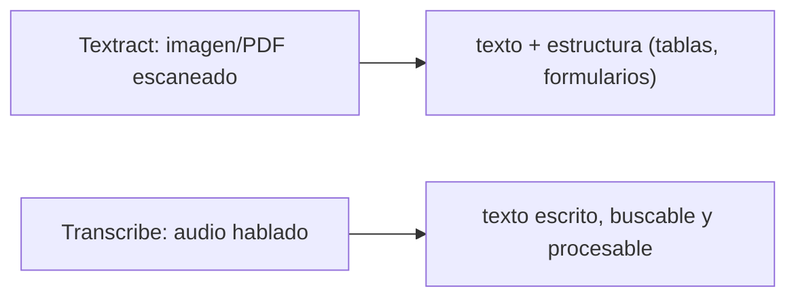
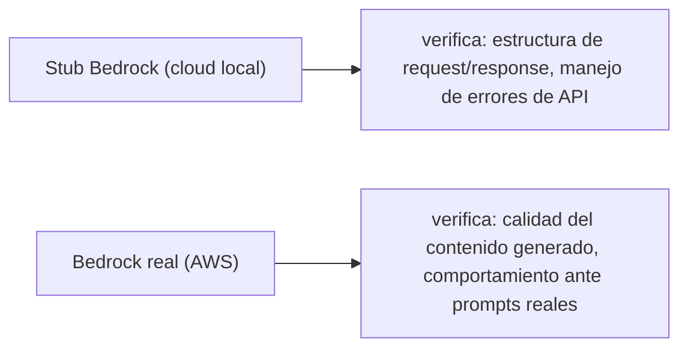
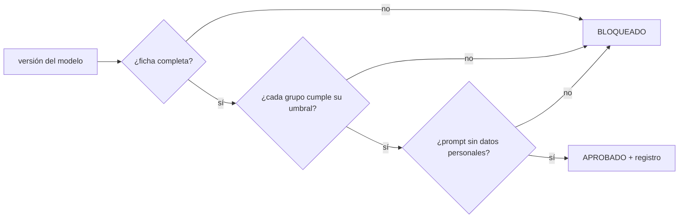

# Módulo 19: IA y servicios especializados: Bedrock, Textract y Transcribe


## Aprende construyendo


### Tema 1: Bedrock Runtime y respuestas stub deterministas · Avanzado · 40 min

<details open>
<summary><strong>Capa 1 — Lectura</strong></summary>

#### ► DE QUÉ TRATA
Al finalizar vas a usar Bedrock para redactar el texto del SMS de confirmación de entrega (Módulo 10-11), y a comprobar qué parte de eso es realmente verificable en local. Prerrequisitos: Módulos 10 y 11 completos.

</details>

<details>
<summary><strong>Capa 2 — Construcción</strong></summary>

#### Código y verificación
```bash
aws bedrock-runtime invoke-model --model-id anthropic.claude-sonnet-5 --body '{"prompt":"Hola","max_tokens":100}' --cli-binary-format raw-in-base64-out output.json
```

```bash
aws bedrock-runtime invoke-model --model-id ... --body '{"prompt":"Hola"}' ...
# cloud local: MISMA entrada → SIEMPRE la misma salida stub (determinista)
# AWS real: misma entrada → puede variar entre invocaciones (no determinista)
```

```bash
aws bedrock-runtime invoke-model --model-id anthropic.claude-sonnet-5 \
  --body '{"prompt":"Redacta un SMS breve confirmando la entrega del envío env-4471","max_tokens":50}' \
  --cli-binary-format raw-in-base64-out salida1.json
aws bedrock-runtime invoke-model --model-id anthropic.claude-sonnet-5 \
  --body '{"prompt":"Redacta un SMS breve confirmando la entrega del envío env-4471","max_tokens":50}' \
  --cli-binary-format raw-in-base64-out salida2.json
diff salida1.json salida2.json
```

</details>

### Tema 2: Textract y Transcribe · Avanzado · 40 min

<details open>
<summary><strong>Capa 1 — Lectura</strong></summary>

#### ► DE QUÉ TRATA
Al finalizar vas a extraer automáticamente cliente y monto de una factura escaneada (Módulo 13) con Textract, y a transcribir el reporte de voz de un conductor con Transcribe. Prerrequisitos: Módulo 13 completo.

#### ► CÓMO FUNCIONA


</details>

<details>
<summary><strong>Capa 2 — Construcción</strong></summary>

#### Código y verificación
```bash
aws textract analyze-document --document '{"S3Object":{"Bucket":"mi-bucket","Name":"documento.jpg"}}' --feature-types TABLES FORMS
```

```bash
aws transcribe start-transcription-job --transcription-job-name mi-transcripcion --media '{"MediaFileUri":"s3://mi-bucket/audio.mp3"}' --output-bucket-name mi-bucket
```


```bash
aws s3 cp factura-escaneada.jpg s3://adjuntos-tareas/facturas/factura-001.jpg
aws textract analyze-document --document '{"S3Object":{"Bucket":"adjuntos-tareas","Name":"facturas/factura-001.jpg"}}' --feature-types FORMS
aws transcribe start-transcription-job --transcription-job-name reporte-conductor-c891 \
  --media '{"MediaFileUri":"s3://adjuntos-tareas/audios/reporte-c891.mp3"}' --output-bucket-name adjuntos-tareas
```

</details>

### Tema 3: Stub vs mock, y qué probar localmente · Avanzado · 40 min

<details open>
<summary><strong>Capa 1 — Lectura</strong></summary>

#### ► DE QUÉ TRATA
Al finalizar vas a documentar, para los SMS generados (Tema 1) y las facturas extraídas (Tema 2), qué se puede confiar probando en Floci y qué necesita el servicio real de AWS. Prerrequisitos: Temas 1-2 de este módulo.

#### ► CÓMO FUNCIONA


#### ► REGLA PRÁCTICA
Usa el stub local para todo lo que sea estructura de la llamada (request/response, manejo de errores) porque es rápido y repetible; reserva el servicio real de AWS para verificar la calidad del contenido generado, que el stub no puede reproducir.

</details>

<details>
<summary><strong>Capa 2 — Construcción</strong></summary>

#### Código y verificación

```bash
# Lo que SÍ confirma el stub de Floci (estructura del contrato):
aws bedrock-runtime invoke-model --model-id anthropic.claude-sonnet-5 \
  --body '{"prompt":"test","max_tokens":10}' --cli-binary-format raw-in-base64-out stub.json
cat stub.json
```

</details>

### Tema 4: Gobierno de IA y ML: fichas de modelo, umbrales por grupo y una puerta antes de publicar · Avanzado · 45 min

<details open>
<summary><strong>Capa 1 — Lectura</strong></summary>

#### ► DE QUÉ TRATA
Necesitas `jq` 1.6 o superior. Crea academia-labs/cloud/gobierno-ia. En un proyecto real, la ficha viene del registro de modelos (SageMaker Model Registry, MLflow) y las métricas de la evaluación.

#### ► CÓMO FUNCIONA


</details>

<details>
<summary><strong>Capa 2 — Construcción</strong></summary>

#### Código y verificación


La ficha del modelo que el equipo quiere publicar va en `ficha.json` (en la vida real viene del registro de modelos):

```json
{
  "nombre": "estimador-tiempo-entrega", "version": "3",
  "proposito": "estimar minutos de entrega por parada",
  "datos_entrenamiento": "entregas 2025 anonimizadas",
  "responsable": "equipo-datos",
  "metricas": {"error_medio_min": 6.2, "error_medio_min_zona_rural": 14.8},
  "prompt_sistema": "Responde con minutos. Ejemplo: cliente Ana Pérez, cédula 1020304050."
}
```

Crea `puerta_modelo.sh`. `jq` revisa los campos obligatorios, compara cada métrica con su umbral y busca en el prompt
números que parecen documentos de identidad:

```bash
#!/usr/bin/env bash
# puerta_modelo.sh — bloquea la publicación si la ficha está incompleta, hay sesgo o el prompt tiene PII
jq -r '
  ["proposito", "datos_entrenamiento", "responsable"] as $requisitos
  | {"error_medio_min": 8.0, "error_medio_min_zona_rural": 12.0} as $umbrales   # el rural no puede quedar atrás
  | . as $f
  | [ ($requisitos[] | select(($f[.] // "") == "") | "falta el campo \(.) en la ficha"),
      ($umbrales | to_entries[] | select($f.metricas[.key] > .value)
        | "\(.key) = \($f.metricas[.key]) supera \(.value)"),
      (select($f.prompt_sistema | test("\\b\\d{8,10}\\b"))   # números que parecen documentos de identidad
        | "el prompt de sistema contiene datos personales") ] as $problemas
  | "\($f.nombre) v\($f.version): \(if ($problemas | length) > 0 then "BLOQUEADO" else "APROBADO" end)",
    ($problemas[] | " - \(.)")
' ficha.json
```

```bash
cd academia-labs/cloud/gobierno-ia
chmod +x puerta_modelo.sh
./puerta_modelo.sh
```

```text
estimador-tiempo-entrega v3: BLOQUEADO
 - error_medio_min_zona_rural = 14.8 supera 12.0
 - el prompt de sistema contiene datos personales
```

</details>
