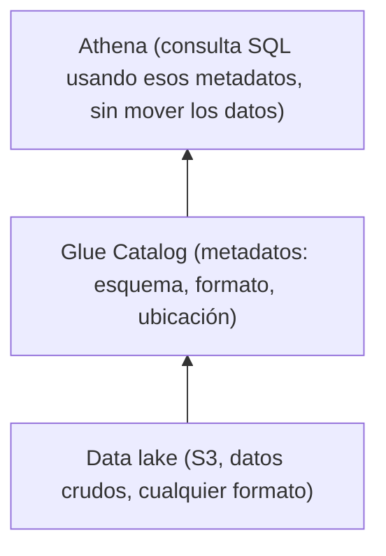
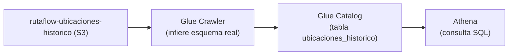
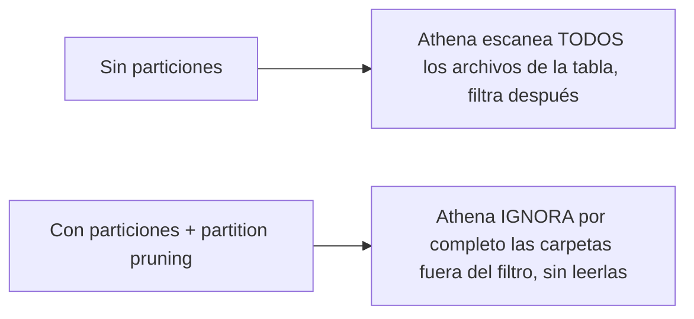

# Módulo 19: Analítica de datos con Athena y Glue


## Aprende construyendo


### Tema 1: Data lake y Glue Catalog · Avanzado · 45 min

<details open>
<summary><strong>Capa 1 — Lectura</strong></summary>

#### ► DE QUÉ TRATA
Al finalizar vas a catalogar, sin moverlos, los archivos de ubicación histórica que Firehose (Módulo 17) ya deposita en rutaflow-ubicaciones-historico. Prerrequisitos: Módulo 17 completo.

#### ► CÓMO FUNCIONA


</details>

<details>
<summary><strong>Capa 2 — Construcción</strong></summary>

#### Código y verificación
```bash
aws glue create-database --database-input '{"Name":"tienda"}'
aws glue create-table --database-name tienda --table-input '{"Name":"pedidos","StorageDescriptor":{...}}'
```


```bash
aws glue create-database --database-input '{"Name":"rutaflow_analytics"}'
aws glue create-table --database-name rutaflow_analytics --table-input '{
  "Name":"ubicaciones",
  "StorageDescriptor":{
    "Columns":[{"Name":"conductorId","Type":"string"},{"Name":"lat","Type":"double"},{"Name":"lon","Type":"double"}],
    "Location":"s3://rutaflow-ubicaciones-historico/",
    "InputFormat":"org.apache.hadoop.mapred.TextInputFormat"
  }
}'
aws athena start-query-execution --query-string "SELECT conductorId, lat, lon FROM rutaflow_analytics.ubicaciones LIMIT 5" \
  --result-configuration OutputLocation=s3://rutaflow-ubicaciones-historico/resultados/
```

</details>

### Tema 2: Glue Crawler y Athena · Avanzado · 45 min

<details open>
<summary><strong>Capa 1 — Lectura</strong></summary>

#### ► DE QUÉ TRATA
Al finalizar vas a dejar que un Glue Crawler descubra solo el esquema real de rutaflow-ubicaciones-historico, en vez de declararlo a mano como en el Tema 1. Prerrequisitos: Tema 1 de este módulo.

#### ► CÓMO FUNCIONA


</details>

<details>
<summary><strong>Capa 2 — Construcción</strong></summary>

#### Código y verificación
```bash
aws glue create-crawler --name crawler-pedidos --targets '{"S3Targets":[{"Path":"s3://analytics-bucket/pedidos"}]}' --database-name tienda
aws glue start-crawler --name crawler-pedidos
```

```bash
aws athena start-query-execution --query-string "SELECT cliente, SUM(monto) as total FROM tienda.pedidos GROUP BY cliente ORDER BY total DESC" --result-configuration OutputLocation=s3://analytics-bucket/resultados/
```

```bash
aws glue start-crawler --name crawler-pedidos
# → descubre esquema automáticamente y lo registra en Glue Catalog

aws athena start-query-execution --query-string "SELECT ... FROM tienda.pedidos ..."
# → consulta SQL directa sobre los archivos en S3, usando ese esquema
```


```bash
aws glue create-crawler --name crawler-ubicaciones --role arn:aws:iam::000000000000:role/glue-crawler-role \
  --targets '{"S3Targets":[{"Path":"s3://rutaflow-ubicaciones-historico/"}]}' --database-name rutaflow_analytics
aws glue start-crawler --name crawler-ubicaciones
# El crawler es asíncrono: espera a que vuelva a READY antes de leer la tabla.
sleep 5
until [ "$(aws glue get-crawler --name crawler-ubicaciones --query 'Crawler.State' --output text)" = "READY" ]; do
  echo "crawler en curso…"; sleep 5
done
aws glue get-table --database-name rutaflow_analytics --name ubicaciones_historico --query 'Table.StorageDescriptor.Columns'
```

</details>

### Tema 3: Parquet vs CSV, y partition pruning · Avanzado · 45 min

<details open>
<summary><strong>Capa 1 — Lectura</strong></summary>

#### ► DE QUÉ TRATA
Al finalizar vas a medir, con bytes escaneados reales, cuánto cuesta de más consultar rutaflow-ubicaciones-historico sin particionar por fecha. Prerrequisitos: Tema 2 de este módulo.

#### ► CÓMO FUNCIONA


#### ► REGLA PRÁCTICA
Si tus consultas casi siempre filtran por una misma columna (como la fecha), particiona la tabla por esa columna: partition pruning hace que Athena ni siquiera lea los archivos fuera del filtro, en vez de escanearlos todos y descartar después.

</details>

<details>
<summary><strong>Capa 2 — Construcción</strong></summary>

#### Código y verificación


```bash
mkdir ejemplo && cd ejemplo && floci start
```

```bash
aws athena start-query-execution --query-string "SELECT conductorId FROM rutaflow_analytics.ubicaciones WHERE anio=2026 AND mes=10 AND dia=5" \
  --result-configuration OutputLocation=s3://rutaflow-ubicaciones-historico/resultados/
aws athena get-query-execution --query-execution-id <id-de-la-ejecucion-anterior> --query 'QueryExecution.Statistics.DataScannedInBytes'
```

</details>
