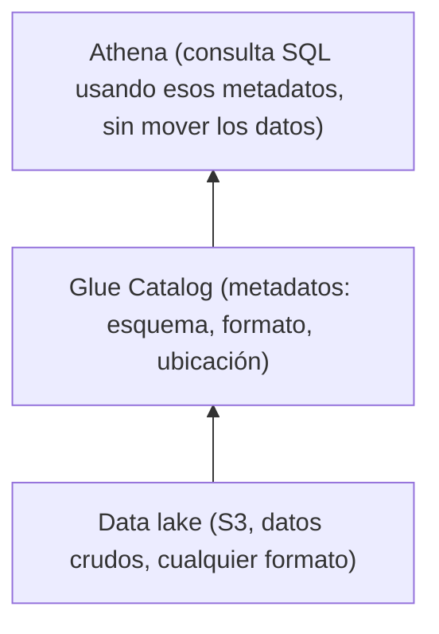
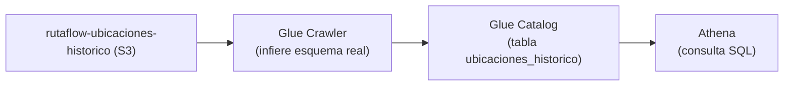
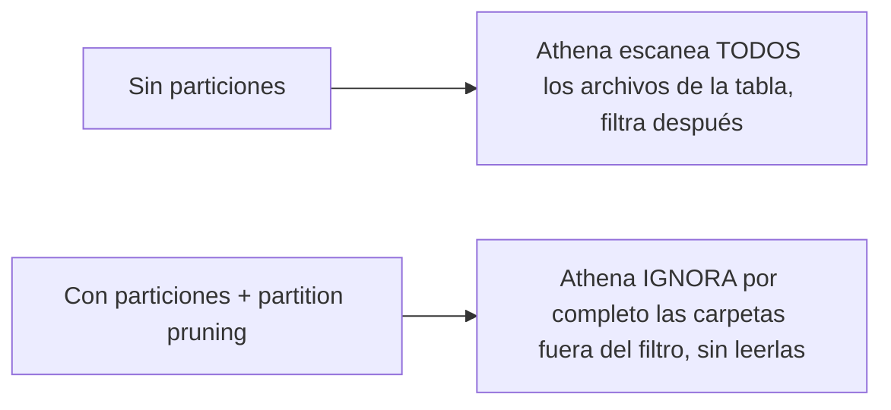

# Módulo 19: Analítica de datos con Athena y Glue


## Aprende construyendo


### Tema 1: Data lake y Glue Catalog · Avanzado · 45 min

<details open>
<summary><strong>Capa 1 — Lectura</strong></summary>

#### ► DE QUÉ TRATA
Al finalizar vas a catalogar, sin moverlos, los archivos de ubicación histórica que Firehose (Módulo 17) ya deposita en rutaflow-ubicaciones-historico. Prerrequisitos: Módulo 17 completo.

#### ► LA IDEA EN UNA FRASE
**Al finalizar vas a catalogar, sin moverlos, los archivos de ubicación histórica que Firehose (Módulo 17) ya deposita en rutaflow-ubicaciones-historico.**

#### ► POR QUÉ EXISTE ESTO
Resuelve un problema real de diseño o implementación y evita decisiones a ciegas.

#### ► LA ANALOGÍA
Piensa en data lake y glue catalog como una herramienta de taller: útil cuando conoces su propósito y sus límites.
**Dónde se rompe la analogía:** en software, los efectos dependen del contexto, la escala y los trade-offs.

#### ► CÓMO FUNCIONA


#### ► LO QUE PUEDE SALIR MAL
| Síntoma | Causa probable | Arreglo |
|---|---|---|
| Data lake y Glue Catalog se aplica pero el resultado no mejora | Se usó sin medir el problema real | Mide antes y compara contra la alternativa simple |
| Aparece complejidad inesperada | Se adoptó la técnica sin comprender sus trade-offs | Vuelve a la sección de trade-offs y reduce el alcance |
| Falla en un caso límite | Se asumió un contexto que no se cumple | Prueba el caso límite y documenta cuándo NO usarlo |

#### ► TRADE-OFFS
| Opción | Cuándo usarla | Cuándo NO usarla |
|---|---|---|
| Usar Data lake y Glue Catalog | Cuando el problema coincide con su propósito y el beneficio es observable | Cuando agrega complejidad sin resolver un problema real |
| Alternativa más simple | Cuando el contexto es pequeño, estable o fácil de razonar | Cuando ya demostró no escalar o no cumplir el requisito |
| Postergar la decisión | Cuando falta evidencia del problema | Cuando el costo de esperar es mayor que el costo de probar |

#### ► CUÁNDO NO USAR ESTO
No uses data lake y glue catalog por defecto. Aplícalo cuando el problema lo justifique y puedas verificar el beneficio; si una alternativa más simple resuelve igual, prefiérela.

#### ► DE VUELTA A LA ANALOGÍA
Volviendo a la analogía: data lake y glue catalog funciona como el modelo inicial, pero recuerda dónde se rompe: en producción importan la evidencia, la escala y el costo de equivocarte.

#### ► LO QUE DEBES RECORDAR
- Data lake y Glue Catalog existe para resolver un problema específico.
- Mide antes de adoptar complejidad.
- Conoce el caso donde NO usarlo.
- Verifica con evidencia observable.

#### ► PREGUNTAS PARA PENSAR
1. ¿Qué problema concreto resuelve data lake y glue catalog en tu contexto?
2. ¿Cómo sabrías que data lake y glue catalog no está funcionando bien?
3. ¿Qué alternativa más simple considerarías antes de usar data lake y glue catalog?

</details>

<details>
<summary><strong>Capa 2 — Construcción</strong></summary>

#### Código y verificación
```bash
aws glue create-database --database-input '{"Name":"tienda"}'
aws glue create-table --database-name tienda --table-input '{"Name":"pedidos","StorageDescriptor":{...}}'
```


```bash
aws glue create-database --database-input '{"Name":"rutaflow_analytics"}'
aws glue create-table --database-name rutaflow_analytics --table-input '{
  "Name":"ubicaciones",
  "StorageDescriptor":{
    "Columns":[{"Name":"conductorId","Type":"string"},{"Name":"lat","Type":"double"},{"Name":"lon","Type":"double"}],
    "Location":"s3://rutaflow-ubicaciones-historico/",
    "InputFormat":"org.apache.hadoop.mapred.TextInputFormat"
  }
}'
aws athena start-query-execution --query-string "SELECT conductorId, lat, lon FROM rutaflow_analytics.ubicaciones LIMIT 5" \
  --result-configuration OutputLocation=s3://rutaflow-ubicaciones-historico/resultados/
```

</details>

### Tema 2: Glue Crawler y Athena · Avanzado · 45 min

<details open>
<summary><strong>Capa 1 — Lectura</strong></summary>

#### ► DE QUÉ TRATA
Al finalizar vas a dejar que un Glue Crawler descubra solo el esquema real de rutaflow-ubicaciones-historico, en vez de declararlo a mano como en el Tema 1. Prerrequisitos: Tema 1 de este módulo.

#### ► LA IDEA EN UNA FRASE
**Al finalizar vas a dejar que un Glue Crawler descubra solo el esquema real de rutaflow-ubicaciones-historico, en vez de declararlo a mano como en el Tema 1.**

#### ► POR QUÉ EXISTE ESTO
Resuelve un problema real de diseño o implementación y evita decisiones a ciegas.

#### ► LA ANALOGÍA
Piensa en glue crawler y athena como una herramienta de taller: útil cuando conoces su propósito y sus límites.
**Dónde se rompe la analogía:** en software, los efectos dependen del contexto, la escala y los trade-offs.

#### ► CÓMO FUNCIONA


#### ► LO QUE PUEDE SALIR MAL
| Síntoma | Causa probable | Arreglo |
|---|---|---|
| Glue Crawler y Athena se aplica pero el resultado no mejora | Se usó sin medir el problema real | Mide antes y compara contra la alternativa simple |
| Aparece complejidad inesperada | Se adoptó la técnica sin comprender sus trade-offs | Vuelve a la sección de trade-offs y reduce el alcance |
| Falla en un caso límite | Se asumió un contexto que no se cumple | Prueba el caso límite y documenta cuándo NO usarlo |

#### ► TRADE-OFFS
| Opción | Cuándo usarla | Cuándo NO usarla |
|---|---|---|
| Usar Glue Crawler y Athena | Cuando el problema coincide con su propósito y el beneficio es observable | Cuando agrega complejidad sin resolver un problema real |
| Alternativa más simple | Cuando el contexto es pequeño, estable o fácil de razonar | Cuando ya demostró no escalar o no cumplir el requisito |
| Postergar la decisión | Cuando falta evidencia del problema | Cuando el costo de esperar es mayor que el costo de probar |

#### ► CUÁNDO NO USAR ESTO
No uses glue crawler y athena por defecto. Aplícalo cuando el problema lo justifique y puedas verificar el beneficio; si una alternativa más simple resuelve igual, prefiérela.

#### ► DE VUELTA A LA ANALOGÍA
Volviendo a la analogía: glue crawler y athena funciona como el modelo inicial, pero recuerda dónde se rompe: en producción importan la evidencia, la escala y el costo de equivocarte.

#### ► LO QUE DEBES RECORDAR
- Glue Crawler y Athena existe para resolver un problema específico.
- Mide antes de adoptar complejidad.
- Conoce el caso donde NO usarlo.
- Verifica con evidencia observable.

#### ► PREGUNTAS PARA PENSAR
1. ¿Qué problema concreto resuelve glue crawler y athena en tu contexto?
2. ¿Cómo sabrías que glue crawler y athena no está funcionando bien?
3. ¿Qué alternativa más simple considerarías antes de usar glue crawler y athena?

</details>

<details>
<summary><strong>Capa 2 — Construcción</strong></summary>

#### Código y verificación
```bash
aws glue create-crawler --name crawler-pedidos --targets '{"S3Targets":[{"Path":"s3://analytics-bucket/pedidos"}]}' --database-name tienda
aws glue start-crawler --name crawler-pedidos
```

```bash
aws athena start-query-execution --query-string "SELECT cliente, SUM(monto) as total FROM tienda.pedidos GROUP BY cliente ORDER BY total DESC" --result-configuration OutputLocation=s3://analytics-bucket/resultados/
```

```bash
aws glue start-crawler --name crawler-pedidos
# → descubre esquema automáticamente y lo registra en Glue Catalog

aws athena start-query-execution --query-string "SELECT ... FROM tienda.pedidos ..."
# → consulta SQL directa sobre los archivos en S3, usando ese esquema
```


```bash
aws glue create-crawler --name crawler-ubicaciones --role arn:aws:iam::000000000000:role/glue-crawler-role \
  --targets '{"S3Targets":[{"Path":"s3://rutaflow-ubicaciones-historico/"}]}' --database-name rutaflow_analytics
aws glue start-crawler --name crawler-ubicaciones
# El crawler es asíncrono: espera a que vuelva a READY antes de leer la tabla.
sleep 5
until [ "$(aws glue get-crawler --name crawler-ubicaciones --query 'Crawler.State' --output text)" = "READY" ]; do
  echo "crawler en curso…"; sleep 5
done
aws glue get-table --database-name rutaflow_analytics --name ubicaciones_historico --query 'Table.StorageDescriptor.Columns'
```

</details>

### Tema 3: Parquet vs CSV, y partition pruning · Avanzado · 45 min

<details open>
<summary><strong>Capa 1 — Lectura</strong></summary>

#### ► DE QUÉ TRATA
Al finalizar vas a medir, con bytes escaneados reales, cuánto cuesta de más consultar rutaflow-ubicaciones-historico sin particionar por fecha. Prerrequisitos: Tema 2 de este módulo.

#### ► LA IDEA EN UNA FRASE
**Al finalizar vas a medir, con bytes escaneados reales, cuánto cuesta de más consultar rutaflow-ubicaciones-historico sin particionar por fecha.**

#### ► POR QUÉ EXISTE ESTO
Resuelve un problema real de diseño o implementación y evita decisiones a ciegas.

#### ► LA ANALOGÍA
Piensa en parquet vs csv, y partition pruning como una herramienta de taller: útil cuando conoces su propósito y sus límites.
**Dónde se rompe la analogía:** en software, los efectos dependen del contexto, la escala y los trade-offs.

#### ► CÓMO FUNCIONA


#### ► LO QUE PUEDE SALIR MAL
| Síntoma | Causa probable | Arreglo |
|---|---|---|
| Parquet vs CSV, y partition pruning se aplica pero el resultado no mejora | Se usó sin medir el problema real | Mide antes y compara contra la alternativa simple |
| Aparece complejidad inesperada | Se adoptó la técnica sin comprender sus trade-offs | Vuelve a la sección de trade-offs y reduce el alcance |
| Falla en un caso límite | Se asumió un contexto que no se cumple | Prueba el caso límite y documenta cuándo NO usarlo |

#### ► TRADE-OFFS
| Opción | Cuándo usarla | Cuándo NO usarla |
|---|---|---|
| Usar Parquet vs CSV, y partition pruning | Cuando el problema coincide con su propósito y el beneficio es observable | Cuando agrega complejidad sin resolver un problema real |
| Alternativa más simple | Cuando el contexto es pequeño, estable o fácil de razonar | Cuando ya demostró no escalar o no cumplir el requisito |
| Postergar la decisión | Cuando falta evidencia del problema | Cuando el costo de esperar es mayor que el costo de probar |

#### ► CUÁNDO NO USAR ESTO
No uses parquet vs csv, y partition pruning por defecto. Aplícalo cuando el problema lo justifique y puedas verificar el beneficio; si una alternativa más simple resuelve igual, prefiérela.

#### ► DE VUELTA A LA ANALOGÍA
Volviendo a la analogía: parquet vs csv, y partition pruning funciona como el modelo inicial, pero recuerda dónde se rompe: en producción importan la evidencia, la escala y el costo de equivocarte.

#### ► LO QUE DEBES RECORDAR
- Parquet vs CSV, y partition pruning existe para resolver un problema específico.
- Mide antes de adoptar complejidad.
- Conoce el caso donde NO usarlo.
- Verifica con evidencia observable.

#### ► PREGUNTAS PARA PENSAR
1. ¿Qué problema concreto resuelve parquet vs csv, y partition pruning en tu contexto?
2. ¿Cómo sabrías que parquet vs csv, y partition pruning no está funcionando bien?
3. ¿Qué alternativa más simple considerarías antes de usar parquet vs csv, y partition pruning?

</details>

<details>
<summary><strong>Capa 2 — Construcción</strong></summary>

#### Código y verificación


```bash
mkdir ejemplo && cd ejemplo && floci start
```

```bash
aws athena start-query-execution --query-string "SELECT conductorId FROM rutaflow_analytics.ubicaciones WHERE anio=2026 AND mes=10 AND dia=5" \
  --result-configuration OutputLocation=s3://rutaflow-ubicaciones-historico/resultados/
aws athena get-query-execution --query-execution-id <id-de-la-ejecucion-anterior> --query 'QueryExecution.Statistics.DataScannedInBytes'
```

</details>
