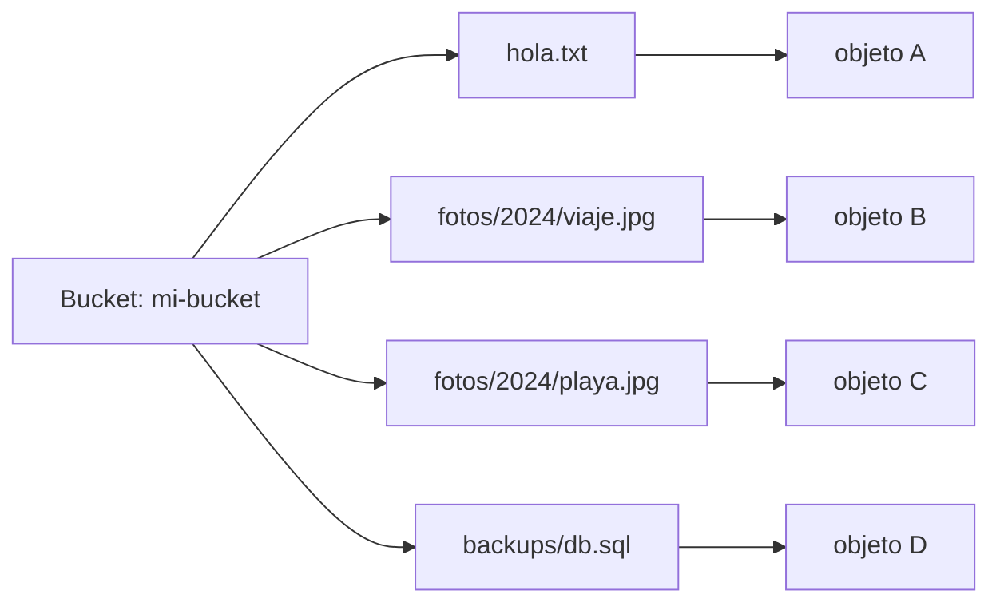
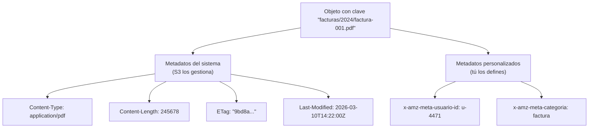
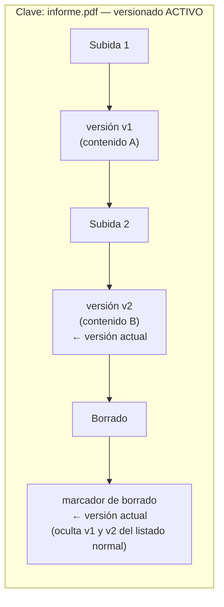
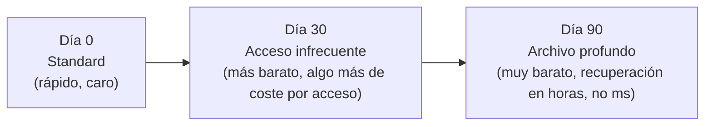
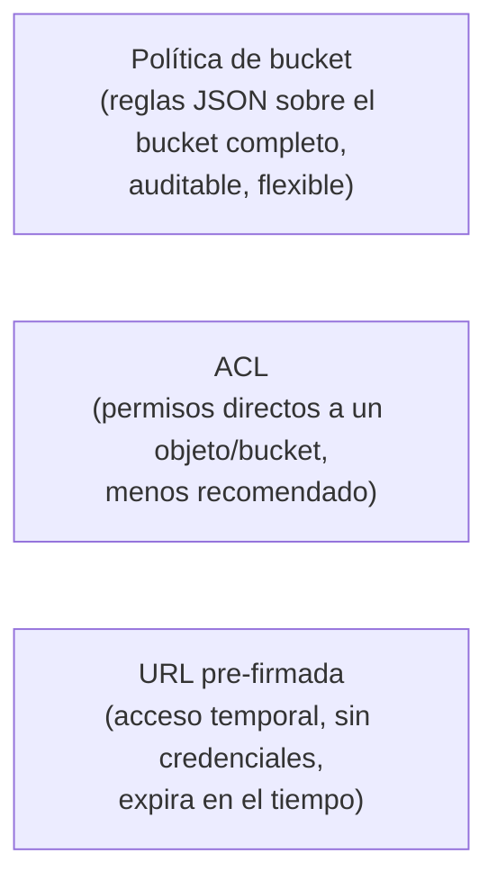
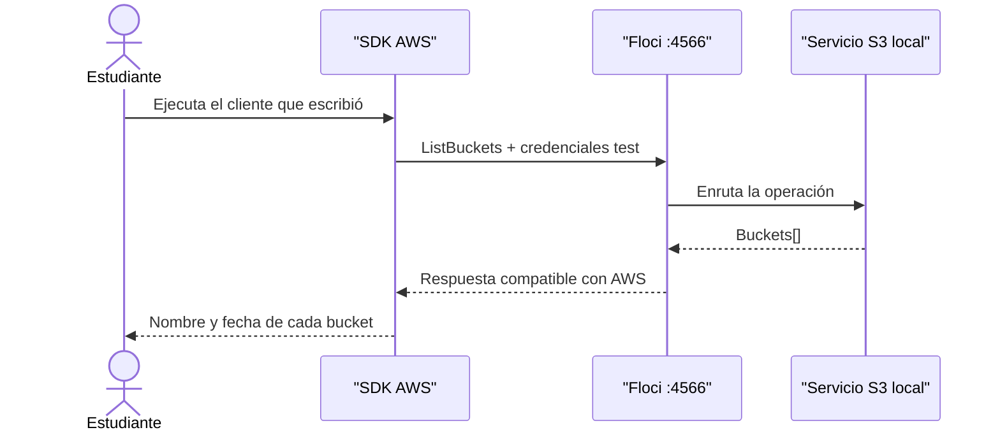

# Módulo 2: Almacenamiento en la nube con S3


## Aprende construyendo


### Tema 1: Objetos, buckets y su nomenclatura · Intermedio · 30 min

<details open>
<summary><strong>Capa 1 — Lectura</strong></summary>

#### ► DE QUÉ TRATA
Al finalizar podrás almacenar un objeto desde cero. Prerrequisitos: Docker y AWS CLI; verifica aws --version.

#### ► LA IDEA EN UNA FRASE
**Al finalizar podrás almacenar un objeto desde cero.**

#### ► POR QUÉ EXISTE ESTO
Resuelve un problema real de diseño o implementación y evita decisiones a ciegas.

#### ► LA ANALOGÍA
Piensa en objetos, buckets y su nomenclatura como una herramienta de taller: útil cuando conoces su propósito y sus límites.
**Dónde se rompe la analogía:** en software, los efectos dependen del contexto, la escala y los trade-offs.

#### ► CÓMO FUNCIONA


#### ► LO QUE PUEDE SALIR MAL
| Síntoma | Causa probable | Arreglo |
|---|---|---|
| Objetos, buckets y su nomenclatura se aplica pero el resultado no mejora | Se usó sin medir el problema real | Mide antes y compara contra la alternativa simple |
| Aparece complejidad inesperada | Se adoptó la técnica sin comprender sus trade-offs | Vuelve a la sección de trade-offs y reduce el alcance |
| Falla en un caso límite | Se asumió un contexto que no se cumple | Prueba el caso límite y documenta cuándo NO usarlo |

#### ► TRADE-OFFS
| Opción | Cuándo usarla | Cuándo NO usarla |
|---|---|---|
| Usar Objetos, buckets y su nomenclatura | Cuando el problema coincide con su propósito y el beneficio es observable | Cuando agrega complejidad sin resolver un problema real |
| Alternativa más simple | Cuando el contexto es pequeño, estable o fácil de razonar | Cuando ya demostró no escalar o no cumplir el requisito |
| Postergar la decisión | Cuando falta evidencia del problema | Cuando el costo de esperar es mayor que el costo de probar |

#### ► CUÁNDO NO USAR ESTO
No uses objetos, buckets y su nomenclatura por defecto. Aplícalo cuando el problema lo justifique y puedas verificar el beneficio; si una alternativa más simple resuelve igual, prefiérela.

#### ► DE VUELTA A LA ANALOGÍA
Volviendo a la analogía: objetos, buckets y su nomenclatura funciona como el modelo inicial, pero recuerda dónde se rompe: en producción importan la evidencia, la escala y el costo de equivocarte.

#### ► LO QUE DEBES RECORDAR
- Objetos, buckets y su nomenclatura existe para resolver un problema específico.
- Mide antes de adoptar complejidad.
- Conoce el caso donde NO usarlo.
- Verifica con evidencia observable.

#### ► PREGUNTAS PARA PENSAR
1. ¿Qué problema concreto resuelve objetos, buckets y su nomenclatura en tu contexto?
2. ¿Cómo sabrías que objetos, buckets y su nomenclatura no está funcionando bien?
3. ¿Qué alternativa más simple considerarías antes de usar objetos, buckets y su nomenclatura?

</details>

<details>
<summary><strong>Capa 2 — Construcción</strong></summary>

#### Código y verificación
```error-output
An error occurred (NoSuchBucket) when calling the PutObject operation: The specified bucket does not exist
```

```bash
# ❌ INCORRECTO: bucket no existe
aws s3 cp entrega-001.jpg s3://pruebas-entrega-inexistente/envio-4471/entrega-001.jpg
# NoSuchBucket error

# ✅ CORRECTO: crear bucket primero
aws s3 mb s3://pruebas-entrega  # make bucket
aws s3 cp entrega-001.jpg s3://pruebas-entrega/envio-4471/entrega-001.jpg
```

```bash
# 1. Revisar si bucket existe
aws s3 ls | grep pruebas-entrega

# 2. Si no existe, crearlo
aws s3 mb s3://pruebas-entrega

# 3. Luego sí, subir
aws s3 cp entrega-001.jpg s3://pruebas-entrega/envio-4471/entrega-001.jpg
```


```bash
mkdir ejemplo-s3 && cd ejemplo-s3
printf 'entrega 001 firmada\n' > entrega-001.txt
aws s3 mb s3://pruebas-entrega
aws s3 cp entrega-001.txt s3://pruebas-entrega/envio-4471/entrega-001.txt
aws s3 ls s3://pruebas-entrega/envio-4471/
aws s3 cp s3://pruebas-entrega/envio-4471/entrega-001.txt descargada.txt
diff entrega-001.txt descargada.txt && echo "contenido idéntico"
```

</details>

### Tema 2: Claves y metadatos · Intermedio · 30 min

<details open>
<summary><strong>Capa 1 — Lectura</strong></summary>

#### ► DE QUÉ TRATA
Al finalizar podrás subir un objeto con metadatos reales y entender por qué el Content-Type importa. Prerrequisitos: Módulo 1 (floci start, eval $(floci env)).

#### ► LA IDEA EN UNA FRASE
**Al finalizar podrás subir un objeto con metadatos reales y entender por qué el Content-Type importa.**

#### ► POR QUÉ EXISTE ESTO
Resuelve un problema real de diseño o implementación y evita decisiones a ciegas.

#### ► LA ANALOGÍA
Piensa en claves y metadatos como una herramienta de taller: útil cuando conoces su propósito y sus límites.
**Dónde se rompe la analogía:** en software, los efectos dependen del contexto, la escala y los trade-offs.

#### ► CÓMO FUNCIONA


#### ► LO QUE PUEDE SALIR MAL
| Síntoma | Causa probable | Arreglo |
|---|---|---|
| Claves y metadatos se aplica pero el resultado no mejora | Se usó sin medir el problema real | Mide antes y compara contra la alternativa simple |
| Aparece complejidad inesperada | Se adoptó la técnica sin comprender sus trade-offs | Vuelve a la sección de trade-offs y reduce el alcance |
| Falla en un caso límite | Se asumió un contexto que no se cumple | Prueba el caso límite y documenta cuándo NO usarlo |

#### ► TRADE-OFFS
| Opción | Cuándo usarla | Cuándo NO usarla |
|---|---|---|
| Usar Claves y metadatos | Cuando el problema coincide con su propósito y el beneficio es observable | Cuando agrega complejidad sin resolver un problema real |
| Alternativa más simple | Cuando el contexto es pequeño, estable o fácil de razonar | Cuando ya demostró no escalar o no cumplir el requisito |
| Postergar la decisión | Cuando falta evidencia del problema | Cuando el costo de esperar es mayor que el costo de probar |

#### ► CUÁNDO NO USAR ESTO
No uses claves y metadatos por defecto. Aplícalo cuando el problema lo justifique y puedas verificar el beneficio; si una alternativa más simple resuelve igual, prefiérela.

#### ► DE VUELTA A LA ANALOGÍA
Volviendo a la analogía: claves y metadatos funciona como el modelo inicial, pero recuerda dónde se rompe: en producción importan la evidencia, la escala y el costo de equivocarte.

#### ► LO QUE DEBES RECORDAR
- Claves y metadatos existe para resolver un problema específico.
- Mide antes de adoptar complejidad.
- Conoce el caso donde NO usarlo.
- Verifica con evidencia observable.

#### ► PREGUNTAS PARA PENSAR
1. ¿Qué problema concreto resuelve claves y metadatos en tu contexto?
2. ¿Cómo sabrías que claves y metadatos no está funcionando bien?
3. ¿Qué alternativa más simple considerarías antes de usar claves y metadatos?

</details>

<details>
<summary><strong>Capa 2 — Construcción</strong></summary>

#### Código y verificación


```bash
aws s3 mb s3://pruebas-entrega
echo "contenido-simulado-de-foto" > entrega-001.jpg
aws s3 cp entrega-001.jpg s3://pruebas-entrega/envio-4471/entrega-001.jpg \
  --content-type image/jpeg --metadata conductor=c-891,envioId=4471
aws s3api head-object --bucket pruebas-entrega --key envio-4471/entrega-001.jpg
```

```bash
aws s3 cp entrega-001.jpg s3://pruebas-entrega/envio-4471/entrega-001-sin-tipo.jpg
aws s3api head-object --bucket pruebas-entrega --key envio-4471/entrega-001-sin-tipo.jpg
```

</details>

### Tema 3: Versionado y ciclo de vida · Intermedio · 30 min

<details open>
<summary><strong>Capa 1 — Lectura</strong></summary>

#### ► DE QUÉ TRATA
Al finalizar podrás activar versionado y recuperar una versión reemplazada por error. Prerrequisitos: Tema 2 completo (el bucket pruebas-entrega ya existe).

#### ► LA IDEA EN UNA FRASE
**Al finalizar podrás activar versionado y recuperar una versión reemplazada por error.**

#### ► POR QUÉ EXISTE ESTO
Resuelve un problema real de diseño o implementación y evita decisiones a ciegas.

#### ► LA ANALOGÍA
Versionar es conservar cada edición con su propio identificador, no sobrescribir la historia.

**Conceptos clave:** versionado, ID de versión, marcador de borrado (delete marker), reglas de ciclo de vida (lifecycle rules).

**Definición.** Por defecto, al subir un objeto bajo una clave ya existente, S3 sobrescribe el contenido anterior sin conservar rastro: la versión previa se pierde de forma irrecuperable. El versionado modifica este comportamiento: una vez activado sobre un bucket, cada subida a una clave existente conserva ambas versiones —la anterior y la nueva—, identificadas cada una por un ID de versión único, en lugar de sobrescribir. El mecanismo permite listar el historial completo de versiones de una clave, recuperar cualquier versión anterior, o restaurar una versión antigua como versión "actual" mediante una nueva subida.

Con el versionado activo, eliminar un objeto tampoco lo elimina físicamente de forma inmediata: S3 inserta un marcador de borrado (*delete marker*) como versión más reciente de esa clave. El objeto deja de aparecer en un listado estándar —el marcador oculta las versiones anteriores en las operaciones habituales—, pero el contenido real permanece almacenado y es recuperable eliminando ese marcador. Este mecanismo añade una capa de protección frente a borrados accidentales, con dos implicaciones directas: el versionado, una vez activado sobre un bucket, no admite desactivación completa —únicamente suspensión—, y un bucket versionado incrementa su consumo de almacenamiento al conservar cada versión histórica.

El ciclo de vida (*lifecycle*) de un objeto se gestiona mediante reglas que S3 aplica automáticamente con el transcurso del tiempo, sin intervención manual. Una regla de ciclo de vida puede, por ejemplo, trasladar objetos con más de 30 días de antigüedad a una capa de almacenamiento de coste reducido para acceso infrecuente, eliminar versiones con más de 90 días de antigüedad, o retirar marcadores de borrado huérfanos. Estas reglas se definen sobre un bucket completo o sobre un prefijo de claves específico —por ejemplo, únicamente `logs/`— y se evalúan de forma asíncrona en segundo plano por el propio servicio.

La combinación de versionado con reglas de ciclo de vida constituye un patrón habitual en producción: el versionado protege frente a sobrescrituras y borrados accidentales, mientras que una regla de ciclo de vida asociada elimina automáticamente versiones que superan cierta antigüedad, acotando el crecimiento del coste de almacenamiento que implicaría conservar indefinidamente cada versión histórica.

**¿Por qué es importante?** El versionado constituye la defensa más simple y efectiva frente al error operativo más frecuente al trabajar con almacenamiento: la sobrescritura o eliminación accidental del archivo equivocado. Todo bucket que almacene datos cuya pérdida resulte inaceptable —copias de seguridad, documentos de usuario, artefactos de código empaquetado— debería, como práctica estándar de la industria, tener el versionado activo desde su creación.

**Diagrama:**



v1 y v2 siguen existiendo y son recuperables eliminando el marcador de borrado.

En el proyecto integrador RutaFlow puedes declarar este mismo comportamiento en código, no solo
ejecutarlo por CLI: escribe en tu propio `template.yaml` el bucket `PruebasEntrega` con
`VersioningConfiguration: { Status: Enabled }`. Así, cualquier entorno desplegado desde esa
plantilla nace con el versionado activo que acabás de probar a mano.

**Dónde se rompe la analogía:** el modelo simplifica la realidad; en producción influyen escala, fallos, costo y contexto.

#### ► CÓMO FUNCIONA


#### ► LO QUE PUEDE SALIR MAL
| Síntoma | Causa probable | Arreglo |
|---|---|---|
| Versionado y ciclo de vida se aplica pero el resultado no mejora | Se usó sin medir el problema real | Mide antes y compara contra la alternativa simple |
| Aparece complejidad inesperada | Se adoptó la técnica sin comprender sus trade-offs | Vuelve a la sección de trade-offs y reduce el alcance |
| Falla en un caso límite | Se asumió un contexto que no se cumple | Prueba el caso límite y documenta cuándo NO usarlo |

#### ► TRADE-OFFS
| Opción | Cuándo usarla | Cuándo NO usarla |
|---|---|---|
| Usar Versionado y ciclo de vida | Cuando el problema coincide con su propósito y el beneficio es observable | Cuando agrega complejidad sin resolver un problema real |
| Alternativa más simple | Cuando el contexto es pequeño, estable o fácil de razonar | Cuando ya demostró no escalar o no cumplir el requisito |
| Postergar la decisión | Cuando falta evidencia del problema | Cuando el costo de esperar es mayor que el costo de probar |

#### ► CUÁNDO NO USAR ESTO
No uses versionado y ciclo de vida por defecto. Aplícalo cuando el problema lo justifique y puedas verificar el beneficio; si una alternativa más simple resuelve igual, prefiérela.

#### ► DE VUELTA A LA ANALOGÍA
Volviendo a la analogía: versionado y ciclo de vida funciona como el modelo inicial, pero recuerda dónde se rompe: en producción importan la evidencia, la escala y el costo de equivocarte.

#### ► LO QUE DEBES RECORDAR
- Versionado y ciclo de vida existe para resolver un problema específico.
- Mide antes de adoptar complejidad.
- Conoce el caso donde NO usarlo.
- Verifica con evidencia observable.

#### ► PREGUNTAS PARA PENSAR
1. ¿Qué problema concreto resuelve versionado y ciclo de vida en tu contexto?
2. ¿Cómo sabrías que versionado y ciclo de vida no está funcionando bien?
3. ¿Qué alternativa más simple considerarías antes de usar versionado y ciclo de vida?

</details>

<details>
<summary><strong>Capa 2 — Construcción</strong></summary>

#### Código y verificación


```bash
aws s3api put-bucket-versioning --bucket pruebas-entrega --versioning-configuration Status=Enabled
echo "foto-correcta-envio-4471" > correcta.jpg
aws s3 cp correcta.jpg s3://pruebas-entrega/envio-4471/entrega-001.jpg
echo "foto-equivocada-de-otro-envio" > equivocada.jpg
aws s3 cp equivocada.jpg s3://pruebas-entrega/envio-4471/entrega-001.jpg
aws s3api list-object-versions --bucket pruebas-entrega --prefix envio-4471/entrega-001.jpg
```

```bash
aws s3api get-object --bucket pruebas-entrega --key envio-4471/entrega-001.jpg \
  --version-id <VersionId-de-la-correcta> recuperada.jpg
cat recuperada.jpg
```

</details>

### Tema 4: Transición entre capas de almacenamiento · Intermedio · 30 min

<details open>
<summary><strong>Capa 1 — Lectura</strong></summary>

#### ► DE QUÉ TRATA
Al finalizar podrás configurar y verificar una regla de ciclo de vida real. Prerrequisitos: Tema 3 completo.

#### ► LA IDEA EN UNA FRASE
**Al finalizar podrás configurar y verificar una regla de ciclo de vida real.**

#### ► POR QUÉ EXISTE ESTO
Resuelve un problema real de diseño o implementación y evita decisiones a ciegas.

#### ► LA ANALOGÍA
Piensa en transición entre capas de almacenamiento como una herramienta de taller: útil cuando conoces su propósito y sus límites.
**Dónde se rompe la analogía:** en software, los efectos dependen del contexto, la escala y los trade-offs.

#### ► CÓMO FUNCIONA


#### ► LO QUE PUEDE SALIR MAL
| Síntoma | Causa probable | Arreglo |
|---|---|---|
| Transición entre capas de almacenamiento se aplica pero el resultado no mejora | Se usó sin medir el problema real | Mide antes y compara contra la alternativa simple |
| Aparece complejidad inesperada | Se adoptó la técnica sin comprender sus trade-offs | Vuelve a la sección de trade-offs y reduce el alcance |
| Falla en un caso límite | Se asumió un contexto que no se cumple | Prueba el caso límite y documenta cuándo NO usarlo |

#### ► TRADE-OFFS
| Opción | Cuándo usarla | Cuándo NO usarla |
|---|---|---|
| Usar Transición entre capas de almacenamiento | Cuando el problema coincide con su propósito y el beneficio es observable | Cuando agrega complejidad sin resolver un problema real |
| Alternativa más simple | Cuando el contexto es pequeño, estable o fácil de razonar | Cuando ya demostró no escalar o no cumplir el requisito |
| Postergar la decisión | Cuando falta evidencia del problema | Cuando el costo de esperar es mayor que el costo de probar |

#### ► CUÁNDO NO USAR ESTO
No uses transición entre capas de almacenamiento por defecto. Aplícalo cuando el problema lo justifique y puedas verificar el beneficio; si una alternativa más simple resuelve igual, prefiérela.

#### ► DE VUELTA A LA ANALOGÍA
Volviendo a la analogía: transición entre capas de almacenamiento funciona como el modelo inicial, pero recuerda dónde se rompe: en producción importan la evidencia, la escala y el costo de equivocarte.

#### ► LO QUE DEBES RECORDAR
- Transición entre capas de almacenamiento existe para resolver un problema específico.
- Mide antes de adoptar complejidad.
- Conoce el caso donde NO usarlo.
- Verifica con evidencia observable.

#### ► PREGUNTAS PARA PENSAR
1. ¿Qué problema concreto resuelve transición entre capas de almacenamiento en tu contexto?
2. ¿Cómo sabrías que transición entre capas de almacenamiento no está funcionando bien?
3. ¿Qué alternativa más simple considerarías antes de usar transición entre capas de almacenamiento?

</details>

<details>
<summary><strong>Capa 2 — Construcción</strong></summary>

#### Código y verificación


Crea el archivo `lifecycle.json`:

```json
{
  "Rules": [{
    "ID": "mover-pruebas-entrega-a-infrecuente",
    "Status": "Enabled",
    "Filter": { "Prefix": "envio-" },
    "Transitions": [{ "Days": 30, "StorageClass": "STANDARD_IA" }]
  }]
}
```

```bash
aws s3api put-bucket-lifecycle-configuration --bucket pruebas-entrega --lifecycle-configuration file://lifecycle.json
aws s3api get-bucket-lifecycle-configuration --bucket pruebas-entrega
```

</details>

### Tema 5: Políticas de bucket, ACL y URLs pre-firmadas · Intermedio · 30 min

<details open>
<summary><strong>Capa 1 — Lectura</strong></summary>

#### ► DE QUÉ TRATA
Al finalizar podrás generar una URL temporal para que un cliente vea su prueba de entrega sin exponer el bucket. Prerrequisitos: Tema 2 completo (objeto envio-4471/entrega-001.jpg existente).

#### ► LA IDEA EN UNA FRASE
**Al finalizar podrás generar una URL temporal para que un cliente vea su prueba de entrega sin exponer el bucket.**

#### ► POR QUÉ EXISTE ESTO
Resuelve un problema real de diseño o implementación y evita decisiones a ciegas.

#### ► LA ANALOGÍA
Piensa en políticas de bucket, acl y urls pre-firmadas como una herramienta de taller: útil cuando conoces su propósito y sus límites.
**Dónde se rompe la analogía:** en software, los efectos dependen del contexto, la escala y los trade-offs.

#### ► CÓMO FUNCIONA


#### ► LO QUE PUEDE SALIR MAL
| Síntoma | Causa probable | Arreglo |
|---|---|---|
| Políticas de bucket, ACL y URLs pre-firmadas se aplica pero el resultado no mejora | Se usó sin medir el problema real | Mide antes y compara contra la alternativa simple |
| Aparece complejidad inesperada | Se adoptó la técnica sin comprender sus trade-offs | Vuelve a la sección de trade-offs y reduce el alcance |
| Falla en un caso límite | Se asumió un contexto que no se cumple | Prueba el caso límite y documenta cuándo NO usarlo |

#### ► TRADE-OFFS
| Opción | Cuándo usarla | Cuándo NO usarla |
|---|---|---|
| Usar Políticas de bucket, ACL y URLs pre-firmadas | Cuando el problema coincide con su propósito y el beneficio es observable | Cuando agrega complejidad sin resolver un problema real |
| Alternativa más simple | Cuando el contexto es pequeño, estable o fácil de razonar | Cuando ya demostró no escalar o no cumplir el requisito |
| Postergar la decisión | Cuando falta evidencia del problema | Cuando el costo de esperar es mayor que el costo de probar |

#### ► CUÁNDO NO USAR ESTO
No uses políticas de bucket, acl y urls pre-firmadas por defecto. Aplícalo cuando el problema lo justifique y puedas verificar el beneficio; si una alternativa más simple resuelve igual, prefiérela.

#### ► DE VUELTA A LA ANALOGÍA
Volviendo a la analogía: políticas de bucket, acl y urls pre-firmadas funciona como el modelo inicial, pero recuerda dónde se rompe: en producción importan la evidencia, la escala y el costo de equivocarte.

#### ► LO QUE DEBES RECORDAR
- Políticas de bucket, ACL y URLs pre-firmadas existe para resolver un problema específico.
- Mide antes de adoptar complejidad.
- Conoce el caso donde NO usarlo.
- Verifica con evidencia observable.

#### ► PREGUNTAS PARA PENSAR
1. ¿Qué problema concreto resuelve políticas de bucket, acl y urls pre-firmadas en tu contexto?
2. ¿Cómo sabrías que políticas de bucket, acl y urls pre-firmadas no está funcionando bien?
3. ¿Qué alternativa más simple considerarías antes de usar políticas de bucket, acl y urls pre-firmadas?

</details>

<details>
<summary><strong>Capa 2 — Construcción</strong></summary>

#### Código y verificación


```bash
mkdir ejemplo && cd ejemplo && floci start
```

```bash
aws s3 presign s3://pruebas-entrega/envio-4471/entrega-001.jpg --expires-in 120
```

</details>

### Antes de escribir código: crea tu propio proyecto

<details open>
<summary><strong>Capa 1 — Lectura</strong></summary>

#### ► DE QUÉ TRATA
Este tema te guía por antes de escribir código: crea tu propio proyecto con foco en comprensión antes de implementación.

#### ► LA IDEA EN UNA FRASE
**Entender antes de escribir código: crea tu propio proyecto te permite tomar mejores decisiones técnicas.**

#### ► POR QUÉ EXISTE ESTO
Resuelve un problema real de diseño o implementación y evita decisiones a ciegas.

#### ► LA ANALOGÍA
Piensa en antes de escribir código: crea tu propio proyecto como una herramienta de taller: útil cuando conoces su propósito y sus límites.
**Dónde se rompe la analogía:** en software, los efectos dependen del contexto, la escala y los trade-offs.

#### ► CÓMO FUNCIONA


#### ► LO QUE PUEDE SALIR MAL
| Síntoma | Causa probable | Arreglo |
|---|---|---|
| Antes de escribir código: crea tu propio proyecto se aplica pero el resultado no mejora | Se usó sin medir el problema real | Mide antes y compara contra la alternativa simple |
| Aparece complejidad inesperada | Se adoptó la técnica sin comprender sus trade-offs | Vuelve a la sección de trade-offs y reduce el alcance |
| Falla en un caso límite | Se asumió un contexto que no se cumple | Prueba el caso límite y documenta cuándo NO usarlo |

#### ► TRADE-OFFS
| Opción | Cuándo usarla | Cuándo NO usarla |
|---|---|---|
| Usar Antes de escribir código: crea tu propio proyecto | Cuando el problema coincide con su propósito y el beneficio es observable | Cuando agrega complejidad sin resolver un problema real |
| Alternativa más simple | Cuando el contexto es pequeño, estable o fácil de razonar | Cuando ya demostró no escalar o no cumplir el requisito |
| Postergar la decisión | Cuando falta evidencia del problema | Cuando el costo de esperar es mayor que el costo de probar |

#### ► CUÁNDO NO USAR ESTO
No uses antes de escribir código: crea tu propio proyecto por defecto. Aplícalo cuando el problema lo justifique y puedas verificar el beneficio; si una alternativa más simple resuelve igual, prefiérela.

#### ► DE VUELTA A LA ANALOGÍA
Volviendo a la analogía: antes de escribir código: crea tu propio proyecto funciona como el modelo inicial, pero recuerda dónde se rompe: en producción importan la evidencia, la escala y el costo de equivocarte.

#### ► LO QUE DEBES RECORDAR
- Antes de escribir código: crea tu propio proyecto existe para resolver un problema específico.
- Mide antes de adoptar complejidad.
- Conoce el caso donde NO usarlo.
- Verifica con evidencia observable.

#### ► PREGUNTAS PARA PENSAR
1. ¿Qué problema concreto resuelve antes de escribir código: crea tu propio proyecto en tu contexto?
2. ¿Cómo sabrías que antes de escribir código: crea tu propio proyecto no está funcionando bien?
3. ¿Qué alternativa más simple considerarías antes de usar antes de escribir código: crea tu propio proyecto?

</details>

<details>
<summary><strong>Capa 2 — Construcción</strong></summary>

#### Código y verificación
```bash
mkdir s3-sdk-lab
cd s3-sdk-lab
```

```text
s3-sdk-lab/                 # elige UNA de estas dos estructuras
├── package.json            # opción JavaScript
├── s3-list-buckets.js
├── requirements.txt        # opción Python
└── s3_list_buckets.py
```


</details>

### Opción A — JavaScript con AWS SDK v3

<details open>
<summary><strong>Capa 1 — Lectura</strong></summary>

#### ► DE QUÉ TRATA
Este tema te guía por opción a — javascript con aws sdk v3 con foco en comprensión antes de implementación.

#### ► LA IDEA EN UNA FRASE
**Entender opción a — javascript con aws sdk v3 te permite tomar mejores decisiones técnicas.**

#### ► POR QUÉ EXISTE ESTO
Resuelve un problema real de diseño o implementación y evita decisiones a ciegas.

#### ► LA ANALOGÍA
Piensa en opción a — javascript con aws sdk v3 como una herramienta de taller: útil cuando conoces su propósito y sus límites.
**Dónde se rompe la analogía:** en software, los efectos dependen del contexto, la escala y los trade-offs.

#### ► CÓMO FUNCIONA
1. Identifica el problema que opción a — javascript con aws sdk v3 resuelve.
2. Observa sus componentes y relaciones.
3. Aplica la opción más simple que funcione.
4. Verifica el resultado y los límites.

#### ► LO QUE PUEDE SALIR MAL
| Síntoma | Causa probable | Arreglo |
|---|---|---|
| Opción A — JavaScript con AWS SDK v3 se aplica pero el resultado no mejora | Se usó sin medir el problema real | Mide antes y compara contra la alternativa simple |
| Aparece complejidad inesperada | Se adoptó la técnica sin comprender sus trade-offs | Vuelve a la sección de trade-offs y reduce el alcance |
| Falla en un caso límite | Se asumió un contexto que no se cumple | Prueba el caso límite y documenta cuándo NO usarlo |

#### ► TRADE-OFFS
| Opción | Cuándo usarla | Cuándo NO usarla |
|---|---|---|
| Usar Opción A — JavaScript con AWS SDK v3 | Cuando el problema coincide con su propósito y el beneficio es observable | Cuando agrega complejidad sin resolver un problema real |
| Alternativa más simple | Cuando el contexto es pequeño, estable o fácil de razonar | Cuando ya demostró no escalar o no cumplir el requisito |
| Postergar la decisión | Cuando falta evidencia del problema | Cuando el costo de esperar es mayor que el costo de probar |

#### ► CUÁNDO NO USAR ESTO
No uses opción a — javascript con aws sdk v3 por defecto. Aplícalo cuando el problema lo justifique y puedas verificar el beneficio; si una alternativa más simple resuelve igual, prefiérela.

#### ► DE VUELTA A LA ANALOGÍA
Volviendo a la analogía: opción a — javascript con aws sdk v3 funciona como el modelo inicial, pero recuerda dónde se rompe: en producción importan la evidencia, la escala y el costo de equivocarte.

#### ► LO QUE DEBES RECORDAR
- Opción A — JavaScript con AWS SDK v3 existe para resolver un problema específico.
- Mide antes de adoptar complejidad.
- Conoce el caso donde NO usarlo.
- Verifica con evidencia observable.

#### ► PREGUNTAS PARA PENSAR
1. ¿Qué problema concreto resuelve opción a — javascript con aws sdk v3 en tu contexto?
2. ¿Cómo sabrías que opción a — javascript con aws sdk v3 no está funcionando bien?
3. ¿Qué alternativa más simple considerarías antes de usar opción a — javascript con aws sdk v3?

</details>

<details>
<summary><strong>Capa 2 — Construcción</strong></summary>

#### Código y verificación
```bash
npm init -y
npm pkg set type=module
npm install @aws-sdk/client-s3
```

```js
import { S3Client, ListBucketsCommand } from '@aws-sdk/client-s3';

const client = new S3Client({
  region: 'us-east-1',
  endpoint: 'http://localhost:4566',
  forcePathStyle: true,
  credentials: { accessKeyId: 'test', secretAccessKey: 'test' }
});

try {
  const result = await client.send(new ListBucketsCommand({}));
  const buckets = result.Buckets ?? [];
  if (buckets.length === 0) {
    console.log('No hay buckets todavía. Crea uno con: aws s3 mb s3://mi-bucket');
  } else {
    console.log('Buckets:');
    for (const bucket of buckets) {
      console.log(`  - ${bucket.Name} (creado ${bucket.CreationDate?.toISOString()})`);
    }
  }
} catch (error) {
  console.error('No se pudo consultar S3 local:', error.message);
  process.exitCode = 1;
}
```

```bash
node s3-list-buckets.js
```

```text
No hay buckets todavía. Crea uno con: aws s3 mb s3://mi-bucket
```

```text
Buckets:
  - mi-bucket (creado 2026-07-19T14:20:00.000Z)
```

</details>

### Opción B — Python con boto3

<details open>
<summary><strong>Capa 1 — Lectura</strong></summary>

#### ► DE QUÉ TRATA
Este tema te guía por opción b — python con boto3 con foco en comprensión antes de implementación.

#### ► LA IDEA EN UNA FRASE
**Entender opción b — python con boto3 te permite tomar mejores decisiones técnicas.**

#### ► POR QUÉ EXISTE ESTO
Resuelve un problema real de diseño o implementación y evita decisiones a ciegas.

#### ► LA ANALOGÍA
Piensa en opción b — python con boto3 como una herramienta de taller: útil cuando conoces su propósito y sus límites.
**Dónde se rompe la analogía:** en software, los efectos dependen del contexto, la escala y los trade-offs.

#### ► CÓMO FUNCIONA
1. Identifica el problema que opción b — python con boto3 resuelve.
2. Observa sus componentes y relaciones.
3. Aplica la opción más simple que funcione.
4. Verifica el resultado y los límites.

#### ► LO QUE PUEDE SALIR MAL
| Síntoma | Causa probable | Arreglo |
|---|---|---|
| Opción B — Python con boto3 se aplica pero el resultado no mejora | Se usó sin medir el problema real | Mide antes y compara contra la alternativa simple |
| Aparece complejidad inesperada | Se adoptó la técnica sin comprender sus trade-offs | Vuelve a la sección de trade-offs y reduce el alcance |
| Falla en un caso límite | Se asumió un contexto que no se cumple | Prueba el caso límite y documenta cuándo NO usarlo |

#### ► TRADE-OFFS
| Opción | Cuándo usarla | Cuándo NO usarla |
|---|---|---|
| Usar Opción B — Python con boto3 | Cuando el problema coincide con su propósito y el beneficio es observable | Cuando agrega complejidad sin resolver un problema real |
| Alternativa más simple | Cuando el contexto es pequeño, estable o fácil de razonar | Cuando ya demostró no escalar o no cumplir el requisito |
| Postergar la decisión | Cuando falta evidencia del problema | Cuando el costo de esperar es mayor que el costo de probar |

#### ► CUÁNDO NO USAR ESTO
No uses opción b — python con boto3 por defecto. Aplícalo cuando el problema lo justifique y puedas verificar el beneficio; si una alternativa más simple resuelve igual, prefiérela.

#### ► DE VUELTA A LA ANALOGÍA
Volviendo a la analogía: opción b — python con boto3 funciona como el modelo inicial, pero recuerda dónde se rompe: en producción importan la evidencia, la escala y el costo de equivocarte.

#### ► LO QUE DEBES RECORDAR
- Opción B — Python con boto3 existe para resolver un problema específico.
- Mide antes de adoptar complejidad.
- Conoce el caso donde NO usarlo.
- Verifica con evidencia observable.

#### ► PREGUNTAS PARA PENSAR
1. ¿Qué problema concreto resuelve opción b — python con boto3 en tu contexto?
2. ¿Cómo sabrías que opción b — python con boto3 no está funcionando bien?
3. ¿Qué alternativa más simple considerarías antes de usar opción b — python con boto3?

</details>

<details>
<summary><strong>Capa 2 — Construcción</strong></summary>

#### Código y verificación
```text
boto3
```

```python
import boto3
from botocore.exceptions import BotoCoreError, ClientError

client = boto3.client(
    "s3",
    region_name="us-east-1",
    endpoint_url="http://localhost:4566",
    aws_access_key_id="test",
    aws_secret_access_key="test",
)

try:
    result = client.list_buckets()
    buckets = result.get("Buckets", [])
    if not buckets:
        print("No hay buckets todavía. Crea uno con: aws s3 mb s3://mi-bucket")
    else:
        print("Buckets:")
        for bucket in buckets:
            print(f"  - {bucket['Name']} (creado {bucket['CreationDate'].isoformat()})")
except (BotoCoreError, ClientError) as error:
    raise SystemExit(f"No se pudo consultar S3 local: {error}")
```

```bash
python3 -m venv .venv
source .venv/bin/activate          # macOS o Linux
# En PowerShell de Windows usa: .venv\Scripts\Activate.ps1
python -m pip install -r requirements.txt
python s3_list_buckets.py
```

</details>

### Provoca un fallo útil antes de continuar

<details open>
<summary><strong>Capa 1 — Lectura</strong></summary>

#### ► DE QUÉ TRATA
Este tema te guía por provoca un fallo útil antes de continuar con foco en comprensión antes de implementación.

#### ► LA IDEA EN UNA FRASE
**Entender provoca un fallo útil antes de continuar te permite tomar mejores decisiones técnicas.**

#### ► POR QUÉ EXISTE ESTO
Resuelve un problema real de diseño o implementación y evita decisiones a ciegas.

#### ► LA ANALOGÍA
Piensa en provoca un fallo útil antes de continuar como una herramienta de taller: útil cuando conoces su propósito y sus límites.
**Dónde se rompe la analogía:** en software, los efectos dependen del contexto, la escala y los trade-offs.

#### ► CÓMO FUNCIONA
1. Identifica el problema que provoca un fallo útil antes de continuar resuelve.
2. Observa sus componentes y relaciones.
3. Aplica la opción más simple que funcione.
4. Verifica el resultado y los límites.

#### ► LO QUE PUEDE SALIR MAL
| Síntoma | Causa probable | Arreglo |
|---|---|---|
| Provoca un fallo útil antes de continuar se aplica pero el resultado no mejora | Se usó sin medir el problema real | Mide antes y compara contra la alternativa simple |
| Aparece complejidad inesperada | Se adoptó la técnica sin comprender sus trade-offs | Vuelve a la sección de trade-offs y reduce el alcance |
| Falla en un caso límite | Se asumió un contexto que no se cumple | Prueba el caso límite y documenta cuándo NO usarlo |

#### ► TRADE-OFFS
| Opción | Cuándo usarla | Cuándo NO usarla |
|---|---|---|
| Usar Provoca un fallo útil antes de continuar | Cuando el problema coincide con su propósito y el beneficio es observable | Cuando agrega complejidad sin resolver un problema real |
| Alternativa más simple | Cuando el contexto es pequeño, estable o fácil de razonar | Cuando ya demostró no escalar o no cumplir el requisito |
| Postergar la decisión | Cuando falta evidencia del problema | Cuando el costo de esperar es mayor que el costo de probar |

#### ► CUÁNDO NO USAR ESTO
No uses provoca un fallo útil antes de continuar por defecto. Aplícalo cuando el problema lo justifique y puedas verificar el beneficio; si una alternativa más simple resuelve igual, prefiérela.

#### ► DE VUELTA A LA ANALOGÍA
Volviendo a la analogía: provoca un fallo útil antes de continuar funciona como el modelo inicial, pero recuerda dónde se rompe: en producción importan la evidencia, la escala y el costo de equivocarte.

#### ► LO QUE DEBES RECORDAR
- Provoca un fallo útil antes de continuar existe para resolver un problema específico.
- Mide antes de adoptar complejidad.
- Conoce el caso donde NO usarlo.
- Verifica con evidencia observable.

#### ► PREGUNTAS PARA PENSAR
1. ¿Qué problema concreto resuelve provoca un fallo útil antes de continuar en tu contexto?
2. ¿Cómo sabrías que provoca un fallo útil antes de continuar no está funcionando bien?
3. ¿Qué alternativa más simple considerarías antes de usar provoca un fallo útil antes de continuar?

</details>

<details>
<summary><strong>Capa 2 — Construcción</strong></summary>

#### Nota de construcción
Este tema es principalmente conceptual en esta versión. La verificación se realiza con las preguntas de comprensión y el criterio de cuándo NO usar provoca un fallo útil antes de continuar.

</details>

### Parte 1 — Operaciones CRUD básicas

<details open>
<summary><strong>Capa 1 — Lectura</strong></summary>

#### ► DE QUÉ TRATA
Este tema te guía por parte 1 — operaciones crud básicas con foco en comprensión antes de implementación.

#### ► LA IDEA EN UNA FRASE
**Entender parte 1 — operaciones crud básicas te permite tomar mejores decisiones técnicas.**

#### ► POR QUÉ EXISTE ESTO
Resuelve un problema real de diseño o implementación y evita decisiones a ciegas.

#### ► LA ANALOGÍA
Piensa en parte 1 — operaciones crud básicas como una herramienta de taller: útil cuando conoces su propósito y sus límites.
**Dónde se rompe la analogía:** en software, los efectos dependen del contexto, la escala y los trade-offs.

#### ► CÓMO FUNCIONA
1. Identifica el problema que parte 1 — operaciones crud básicas resuelve.
2. Observa sus componentes y relaciones.
3. Aplica la opción más simple que funcione.
4. Verifica el resultado y los límites.

#### ► LO QUE PUEDE SALIR MAL
| Síntoma | Causa probable | Arreglo |
|---|---|---|
| Parte 1 — Operaciones CRUD básicas se aplica pero el resultado no mejora | Se usó sin medir el problema real | Mide antes y compara contra la alternativa simple |
| Aparece complejidad inesperada | Se adoptó la técnica sin comprender sus trade-offs | Vuelve a la sección de trade-offs y reduce el alcance |
| Falla en un caso límite | Se asumió un contexto que no se cumple | Prueba el caso límite y documenta cuándo NO usarlo |

#### ► TRADE-OFFS
| Opción | Cuándo usarla | Cuándo NO usarla |
|---|---|---|
| Usar Parte 1 — Operaciones CRUD básicas | Cuando el problema coincide con su propósito y el beneficio es observable | Cuando agrega complejidad sin resolver un problema real |
| Alternativa más simple | Cuando el contexto es pequeño, estable o fácil de razonar | Cuando ya demostró no escalar o no cumplir el requisito |
| Postergar la decisión | Cuando falta evidencia del problema | Cuando el costo de esperar es mayor que el costo de probar |

#### ► CUÁNDO NO USAR ESTO
No uses parte 1 — operaciones crud básicas por defecto. Aplícalo cuando el problema lo justifique y puedas verificar el beneficio; si una alternativa más simple resuelve igual, prefiérela.

#### ► DE VUELTA A LA ANALOGÍA
Volviendo a la analogía: parte 1 — operaciones crud básicas funciona como el modelo inicial, pero recuerda dónde se rompe: en producción importan la evidencia, la escala y el costo de equivocarte.

#### ► LO QUE DEBES RECORDAR
- Parte 1 — Operaciones CRUD básicas existe para resolver un problema específico.
- Mide antes de adoptar complejidad.
- Conoce el caso donde NO usarlo.
- Verifica con evidencia observable.

#### ► PREGUNTAS PARA PENSAR
1. ¿Qué problema concreto resuelve parte 1 — operaciones crud básicas en tu contexto?
2. ¿Cómo sabrías que parte 1 — operaciones crud básicas no está funcionando bien?
3. ¿Qué alternativa más simple considerarías antes de usar parte 1 — operaciones crud básicas?

</details>

<details>
<summary><strong>Capa 2 — Construcción</strong></summary>

#### Nota de construcción
Este tema es principalmente conceptual en esta versión. La verificación se realiza con las preguntas de comprensión y el criterio de cuándo NO usar parte 1 — operaciones crud básicas.

</details>

### Parte 2 — Versionado

<details open>
<summary><strong>Capa 1 — Lectura</strong></summary>

#### ► DE QUÉ TRATA
Este tema te guía por parte 2 — versionado con foco en comprensión antes de implementación.

#### ► LA IDEA EN UNA FRASE
**Entender parte 2 — versionado te permite tomar mejores decisiones técnicas.**

#### ► POR QUÉ EXISTE ESTO
Resuelve un problema real de diseño o implementación y evita decisiones a ciegas.

#### ► LA ANALOGÍA
Piensa en parte 2 — versionado como una herramienta de taller: útil cuando conoces su propósito y sus límites.
**Dónde se rompe la analogía:** en software, los efectos dependen del contexto, la escala y los trade-offs.

#### ► CÓMO FUNCIONA
1. Identifica el problema que parte 2 — versionado resuelve.
2. Observa sus componentes y relaciones.
3. Aplica la opción más simple que funcione.
4. Verifica el resultado y los límites.

#### ► LO QUE PUEDE SALIR MAL
| Síntoma | Causa probable | Arreglo |
|---|---|---|
| Parte 2 — Versionado se aplica pero el resultado no mejora | Se usó sin medir el problema real | Mide antes y compara contra la alternativa simple |
| Aparece complejidad inesperada | Se adoptó la técnica sin comprender sus trade-offs | Vuelve a la sección de trade-offs y reduce el alcance |
| Falla en un caso límite | Se asumió un contexto que no se cumple | Prueba el caso límite y documenta cuándo NO usarlo |

#### ► TRADE-OFFS
| Opción | Cuándo usarla | Cuándo NO usarla |
|---|---|---|
| Usar Parte 2 — Versionado | Cuando el problema coincide con su propósito y el beneficio es observable | Cuando agrega complejidad sin resolver un problema real |
| Alternativa más simple | Cuando el contexto es pequeño, estable o fácil de razonar | Cuando ya demostró no escalar o no cumplir el requisito |
| Postergar la decisión | Cuando falta evidencia del problema | Cuando el costo de esperar es mayor que el costo de probar |

#### ► CUÁNDO NO USAR ESTO
No uses parte 2 — versionado por defecto. Aplícalo cuando el problema lo justifique y puedas verificar el beneficio; si una alternativa más simple resuelve igual, prefiérela.

#### ► DE VUELTA A LA ANALOGÍA
Volviendo a la analogía: parte 2 — versionado funciona como el modelo inicial, pero recuerda dónde se rompe: en producción importan la evidencia, la escala y el costo de equivocarte.

#### ► LO QUE DEBES RECORDAR
- Parte 2 — Versionado existe para resolver un problema específico.
- Mide antes de adoptar complejidad.
- Conoce el caso donde NO usarlo.
- Verifica con evidencia observable.

#### ► PREGUNTAS PARA PENSAR
1. ¿Qué problema concreto resuelve parte 2 — versionado en tu contexto?
2. ¿Cómo sabrías que parte 2 — versionado no está funcionando bien?
3. ¿Qué alternativa más simple considerarías antes de usar parte 2 — versionado?

</details>

<details>
<summary><strong>Capa 2 — Construcción</strong></summary>

#### Nota de construcción
Este tema es principalmente conceptual en esta versión. La verificación se realiza con las preguntas de comprensión y el criterio de cuándo NO usar parte 2 — versionado.

</details>
