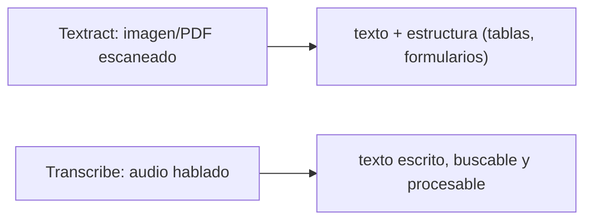
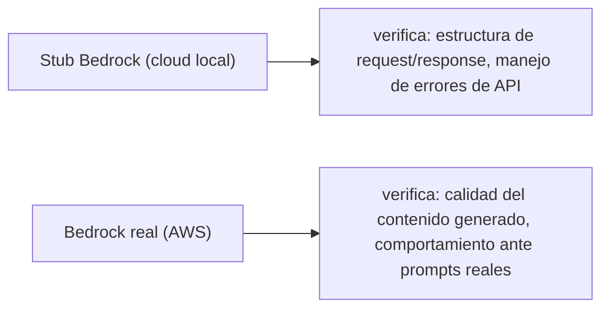
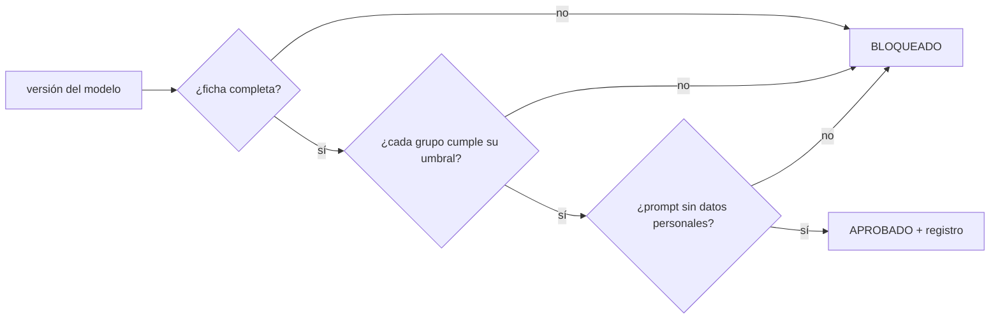

# Módulo 20: IA y servicios especializados: Bedrock, Textract y Transcribe


## Aprende construyendo


### Tema 1: Bedrock Runtime y respuestas stub deterministas · Avanzado · 40 min

<details open>
<summary><strong>Capa 1 — Lectura</strong></summary>

#### ► DE QUÉ TRATA
Al finalizar vas a usar Bedrock para redactar el texto del SMS de confirmación de entrega (Módulo 10-11), y a comprobar qué parte de eso es realmente verificable en local. Prerrequisitos: Módulos 10 y 11 completos.

#### ► LA IDEA EN UNA FRASE
**Al finalizar vas a usar Bedrock para redactar el texto del SMS de confirmación de entrega (Módulo 10-11), y a comprobar qué parte de eso es realmente verificable en local.**

#### ► POR QUÉ EXISTE ESTO
Resuelve un problema real de diseño o implementación y evita decisiones a ciegas.

#### ► LA ANALOGÍA
Piensa en bedrock runtime y respuestas stub deterministas como una herramienta de taller: útil cuando conoces su propósito y sus límites.
**Dónde se rompe la analogía:** en software, los efectos dependen del contexto, la escala y los trade-offs.

#### ► CÓMO FUNCIONA
1. Identifica el problema que bedrock runtime y respuestas stub deterministas resuelve.
2. Observa sus componentes y relaciones.
3. Aplica la opción más simple que funcione.
4. Verifica el resultado y los límites.

#### ► LO QUE PUEDE SALIR MAL
| Síntoma | Causa probable | Arreglo |
|---|---|---|
| Bedrock Runtime y respuestas stub deterministas se aplica pero el resultado no mejora | Se usó sin medir el problema real | Mide antes y compara contra la alternativa simple |
| Aparece complejidad inesperada | Se adoptó la técnica sin comprender sus trade-offs | Vuelve a la sección de trade-offs y reduce el alcance |
| Falla en un caso límite | Se asumió un contexto que no se cumple | Prueba el caso límite y documenta cuándo NO usarlo |

#### ► TRADE-OFFS
| Opción | Cuándo usarla | Cuándo NO usarla |
|---|---|---|
| Usar Bedrock Runtime y respuestas stub deterministas | Cuando el problema coincide con su propósito y el beneficio es observable | Cuando agrega complejidad sin resolver un problema real |
| Alternativa más simple | Cuando el contexto es pequeño, estable o fácil de razonar | Cuando ya demostró no escalar o no cumplir el requisito |
| Postergar la decisión | Cuando falta evidencia del problema | Cuando el costo de esperar es mayor que el costo de probar |

#### ► CUÁNDO NO USAR ESTO
No uses bedrock runtime y respuestas stub deterministas por defecto. Aplícalo cuando el problema lo justifique y puedas verificar el beneficio; si una alternativa más simple resuelve igual, prefiérela.

#### ► DE VUELTA A LA ANALOGÍA
Volviendo a la analogía: bedrock runtime y respuestas stub deterministas funciona como el modelo inicial, pero recuerda dónde se rompe: en producción importan la evidencia, la escala y el costo de equivocarte.

#### ► LO QUE DEBES RECORDAR
- Bedrock Runtime y respuestas stub deterministas existe para resolver un problema específico.
- Mide antes de adoptar complejidad.
- Conoce el caso donde NO usarlo.
- Verifica con evidencia observable.

#### ► PREGUNTAS PARA PENSAR
1. ¿Qué problema concreto resuelve bedrock runtime y respuestas stub deterministas en tu contexto?
2. ¿Cómo sabrías que bedrock runtime y respuestas stub deterministas no está funcionando bien?
3. ¿Qué alternativa más simple considerarías antes de usar bedrock runtime y respuestas stub deterministas?

</details>

<details>
<summary><strong>Capa 2 — Construcción</strong></summary>

#### Código y verificación
```bash
aws bedrock-runtime invoke-model --model-id anthropic.claude-sonnet-5 --body '{"prompt":"Hola","max_tokens":100}' --cli-binary-format raw-in-base64-out output.json
```

```bash
aws bedrock-runtime invoke-model --model-id ... --body '{"prompt":"Hola"}' ...
# cloud local: MISMA entrada → SIEMPRE la misma salida stub (determinista)
# AWS real: misma entrada → puede variar entre invocaciones (no determinista)
```

```bash
aws bedrock-runtime invoke-model --model-id anthropic.claude-sonnet-5 \
  --body '{"prompt":"Redacta un SMS breve confirmando la entrega del envío env-4471","max_tokens":50}' \
  --cli-binary-format raw-in-base64-out salida1.json
aws bedrock-runtime invoke-model --model-id anthropic.claude-sonnet-5 \
  --body '{"prompt":"Redacta un SMS breve confirmando la entrega del envío env-4471","max_tokens":50}' \
  --cli-binary-format raw-in-base64-out salida2.json
diff salida1.json salida2.json
```

</details>

### Tema 2: Textract y Transcribe · Avanzado · 40 min

<details open>
<summary><strong>Capa 1 — Lectura</strong></summary>

#### ► DE QUÉ TRATA
Al finalizar vas a extraer automáticamente cliente y monto de una factura escaneada (Módulo 13) con Textract, y a transcribir el reporte de voz de un conductor con Transcribe. Prerrequisitos: Módulo 13 completo.

#### ► LA IDEA EN UNA FRASE
**Al finalizar vas a extraer automáticamente cliente y monto de una factura escaneada (Módulo 13) con Textract, y a transcribir el reporte de voz de un conductor con Transcribe.**

#### ► POR QUÉ EXISTE ESTO
Resuelve un problema real de diseño o implementación y evita decisiones a ciegas.

#### ► LA ANALOGÍA
Piensa en textract y transcribe como una herramienta de taller: útil cuando conoces su propósito y sus límites.
**Dónde se rompe la analogía:** en software, los efectos dependen del contexto, la escala y los trade-offs.

#### ► CÓMO FUNCIONA


#### ► LO QUE PUEDE SALIR MAL
| Síntoma | Causa probable | Arreglo |
|---|---|---|
| Textract y Transcribe se aplica pero el resultado no mejora | Se usó sin medir el problema real | Mide antes y compara contra la alternativa simple |
| Aparece complejidad inesperada | Se adoptó la técnica sin comprender sus trade-offs | Vuelve a la sección de trade-offs y reduce el alcance |
| Falla en un caso límite | Se asumió un contexto que no se cumple | Prueba el caso límite y documenta cuándo NO usarlo |

#### ► TRADE-OFFS
| Opción | Cuándo usarla | Cuándo NO usarla |
|---|---|---|
| Usar Textract y Transcribe | Cuando el problema coincide con su propósito y el beneficio es observable | Cuando agrega complejidad sin resolver un problema real |
| Alternativa más simple | Cuando el contexto es pequeño, estable o fácil de razonar | Cuando ya demostró no escalar o no cumplir el requisito |
| Postergar la decisión | Cuando falta evidencia del problema | Cuando el costo de esperar es mayor que el costo de probar |

#### ► CUÁNDO NO USAR ESTO
No uses textract y transcribe por defecto. Aplícalo cuando el problema lo justifique y puedas verificar el beneficio; si una alternativa más simple resuelve igual, prefiérela.

#### ► DE VUELTA A LA ANALOGÍA
Volviendo a la analogía: textract y transcribe funciona como el modelo inicial, pero recuerda dónde se rompe: en producción importan la evidencia, la escala y el costo de equivocarte.

#### ► LO QUE DEBES RECORDAR
- Textract y Transcribe existe para resolver un problema específico.
- Mide antes de adoptar complejidad.
- Conoce el caso donde NO usarlo.
- Verifica con evidencia observable.

#### ► PREGUNTAS PARA PENSAR
1. ¿Qué problema concreto resuelve textract y transcribe en tu contexto?
2. ¿Cómo sabrías que textract y transcribe no está funcionando bien?
3. ¿Qué alternativa más simple considerarías antes de usar textract y transcribe?

</details>

<details>
<summary><strong>Capa 2 — Construcción</strong></summary>

#### Código y verificación
```bash
aws textract analyze-document --document '{"S3Object":{"Bucket":"mi-bucket","Name":"documento.jpg"}}' --feature-types TABLES FORMS
```

```bash
aws transcribe start-transcription-job --transcription-job-name mi-transcripcion --media '{"MediaFileUri":"s3://mi-bucket/audio.mp3"}' --output-bucket-name mi-bucket
```


```bash
aws s3 cp factura-escaneada.jpg s3://adjuntos-tareas/facturas/factura-001.jpg
aws textract analyze-document --document '{"S3Object":{"Bucket":"adjuntos-tareas","Name":"facturas/factura-001.jpg"}}' --feature-types FORMS
aws transcribe start-transcription-job --transcription-job-name reporte-conductor-c891 \
  --media '{"MediaFileUri":"s3://adjuntos-tareas/audios/reporte-c891.mp3"}' --output-bucket-name adjuntos-tareas
```

</details>

### Tema 3: Stub vs mock, y qué probar localmente · Avanzado · 40 min

<details open>
<summary><strong>Capa 1 — Lectura</strong></summary>

#### ► DE QUÉ TRATA
Al finalizar vas a documentar, para los SMS generados (Tema 1) y las facturas extraídas (Tema 2), qué se puede confiar probando en Floci y qué necesita el servicio real de AWS. Prerrequisitos: Temas 1-2 de este módulo.

#### ► LA IDEA EN UNA FRASE
**Al finalizar vas a documentar, para los SMS generados (Tema 1) y las facturas extraídas (Tema 2), qué se puede confiar probando en Floci y qué necesita el servicio real de AWS.**

#### ► POR QUÉ EXISTE ESTO
Resuelve un problema real de diseño o implementación y evita decisiones a ciegas.

#### ► LA ANALOGÍA
Piensa en stub vs mock, y qué probar localmente como una herramienta de taller: útil cuando conoces su propósito y sus límites.
**Dónde se rompe la analogía:** en software, los efectos dependen del contexto, la escala y los trade-offs.

#### ► CÓMO FUNCIONA


#### ► LO QUE PUEDE SALIR MAL
| Síntoma | Causa probable | Arreglo |
|---|---|---|
| Stub vs mock, y qué probar localmente se aplica pero el resultado no mejora | Se usó sin medir el problema real | Mide antes y compara contra la alternativa simple |
| Aparece complejidad inesperada | Se adoptó la técnica sin comprender sus trade-offs | Vuelve a la sección de trade-offs y reduce el alcance |
| Falla en un caso límite | Se asumió un contexto que no se cumple | Prueba el caso límite y documenta cuándo NO usarlo |

#### ► TRADE-OFFS
| Opción | Cuándo usarla | Cuándo NO usarla |
|---|---|---|
| Usar Stub vs mock, y qué probar localmente | Cuando el problema coincide con su propósito y el beneficio es observable | Cuando agrega complejidad sin resolver un problema real |
| Alternativa más simple | Cuando el contexto es pequeño, estable o fácil de razonar | Cuando ya demostró no escalar o no cumplir el requisito |
| Postergar la decisión | Cuando falta evidencia del problema | Cuando el costo de esperar es mayor que el costo de probar |

#### ► CUÁNDO NO USAR ESTO
No uses stub vs mock, y qué probar localmente por defecto. Aplícalo cuando el problema lo justifique y puedas verificar el beneficio; si una alternativa más simple resuelve igual, prefiérela.

#### ► DE VUELTA A LA ANALOGÍA
Volviendo a la analogía: stub vs mock, y qué probar localmente funciona como el modelo inicial, pero recuerda dónde se rompe: en producción importan la evidencia, la escala y el costo de equivocarte.

#### ► LO QUE DEBES RECORDAR
- Stub vs mock, y qué probar localmente existe para resolver un problema específico.
- Mide antes de adoptar complejidad.
- Conoce el caso donde NO usarlo.
- Verifica con evidencia observable.

#### ► PREGUNTAS PARA PENSAR
1. ¿Qué problema concreto resuelve stub vs mock, y qué probar localmente en tu contexto?
2. ¿Cómo sabrías que stub vs mock, y qué probar localmente no está funcionando bien?
3. ¿Qué alternativa más simple considerarías antes de usar stub vs mock, y qué probar localmente?

</details>

<details>
<summary><strong>Capa 2 — Construcción</strong></summary>

#### Código y verificación


```bash
# Lo que SÍ confirma el stub de Floci (estructura del contrato):
aws bedrock-runtime invoke-model --model-id anthropic.claude-sonnet-5 \
  --body '{"prompt":"test","max_tokens":10}' --cli-binary-format raw-in-base64-out stub.json
cat stub.json
```

</details>

### Tema 4: Gobierno de IA y ML: fichas de modelo, umbrales por grupo y una puerta antes de publicar · Avanzado · 45 min

<details open>
<summary><strong>Capa 1 — Lectura</strong></summary>

#### ► DE QUÉ TRATA
Usa Python 3.10 o superior. Crea academia-labs/cloud/gobierno-ia. En un proyecto real, la ficha viene del registro de modelos (SageMaker Model Registry, MLflow) y las métricas de la evaluación.

#### ► LA IDEA EN UNA FRASE
**Usa Python 3.10 o superior.**

#### ► POR QUÉ EXISTE ESTO
Resuelve un problema real de diseño o implementación y evita decisiones a ciegas.

#### ► LA ANALOGÍA
Piensa en gobierno de ia y ml: fichas de modelo, umbrales por grupo y una puerta antes de publicar como una herramienta de taller: útil cuando conoces su propósito y sus límites.
**Dónde se rompe la analogía:** en software, los efectos dependen del contexto, la escala y los trade-offs.

#### ► CÓMO FUNCIONA


#### ► LO QUE PUEDE SALIR MAL
| Síntoma | Causa probable | Arreglo |
|---|---|---|
| Gobierno de IA y ML: fichas de modelo, umbrales por grupo y una puerta antes de publicar se aplica pero el resultado no mejora | Se usó sin medir el problema real | Mide antes y compara contra la alternativa simple |
| Aparece complejidad inesperada | Se adoptó la técnica sin comprender sus trade-offs | Vuelve a la sección de trade-offs y reduce el alcance |
| Falla en un caso límite | Se asumió un contexto que no se cumple | Prueba el caso límite y documenta cuándo NO usarlo |

#### ► TRADE-OFFS
| Opción | Cuándo usarla | Cuándo NO usarla |
|---|---|---|
| Usar Gobierno de IA y ML: fichas de modelo, umbrales por grupo y una puerta antes de publicar | Cuando el problema coincide con su propósito y el beneficio es observable | Cuando agrega complejidad sin resolver un problema real |
| Alternativa más simple | Cuando el contexto es pequeño, estable o fácil de razonar | Cuando ya demostró no escalar o no cumplir el requisito |
| Postergar la decisión | Cuando falta evidencia del problema | Cuando el costo de esperar es mayor que el costo de probar |

#### ► CUÁNDO NO USAR ESTO
No uses gobierno de ia y ml: fichas de modelo, umbrales por grupo y una puerta antes de publicar por defecto. Aplícalo cuando el problema lo justifique y puedas verificar el beneficio; si una alternativa más simple resuelve igual, prefiérela.

#### ► DE VUELTA A LA ANALOGÍA
Volviendo a la analogía: gobierno de ia y ml: fichas de modelo, umbrales por grupo y una puerta antes de publicar funciona como el modelo inicial, pero recuerda dónde se rompe: en producción importan la evidencia, la escala y el costo de equivocarte.

#### ► LO QUE DEBES RECORDAR
- Gobierno de IA y ML: fichas de modelo, umbrales por grupo y una puerta antes de publicar existe para resolver un problema específico.
- Mide antes de adoptar complejidad.
- Conoce el caso donde NO usarlo.
- Verifica con evidencia observable.

#### ► PREGUNTAS PARA PENSAR
1. ¿Qué problema concreto resuelve gobierno de ia y ml: fichas de modelo, umbrales por grupo y una puerta antes de publicar en tu contexto?
2. ¿Cómo sabrías que gobierno de ia y ml: fichas de modelo, umbrales por grupo y una puerta antes de publicar no está funcionando bien?
3. ¿Qué alternativa más simple considerarías antes de usar gobierno de ia y ml: fichas de modelo, umbrales por grupo y una puerta antes de publicar?

</details>

<details>
<summary><strong>Capa 2 — Construcción</strong></summary>

#### Código y verificación


```python
import json
import re

# Ficha del modelo que el equipo quiere publicar (en la vida real viene del registro de modelos).
ficha = json.loads("""{
  "nombre": "estimador-tiempo-entrega", "version": "3",
  "proposito": "estimar minutos de entrega por parada",
  "datos_entrenamiento": "entregas 2025 anonimizadas",
  "responsable": "equipo-datos",
  "metricas": {"error_medio_min": 6.2, "error_medio_min_zona_rural": 14.8},
  "prompt_sistema": "Responde con minutos. Ejemplo: cliente Ana Pérez, cédula 1020304050."
}""")

REQUISITOS = ["proposito", "datos_entrenamiento", "responsable"]
UMBRALES = {"error_medio_min": 8.0, "error_medio_min_zona_rural": 12.0}  # el rural no puede quedar atrás
PII = re.compile(r"\b\d{8,10}\b")  # números que parecen documentos de identidad

problemas = []
problemas += [f"falta '{c}' en la ficha" for c in REQUISITOS if not ficha.get(c)]
problemas += [f"{m} = {ficha['metricas'][m]} supera {u}" for m, u in UMBRALES.items() if ficha["metricas"][m] > u]
if PII.search(ficha["prompt_sistema"]):
    problemas.append("el prompt de sistema contiene datos personales")

print(f"{ficha['nombre']} v{ficha['version']}: {'BLOQUEADO' if problemas else 'APROBADO'}")
for p in problemas:
    print(" -", p)
```

```bash
cd academia-labs/cloud/gobierno-ia
python3 puerta_modelo.py
```

```text
estimador-tiempo-entrega v3: BLOQUEADO
 - error_medio_min_zona_rural = 14.8 supera 12.0
 - el prompt de sistema contiene datos personales
```

</details>
