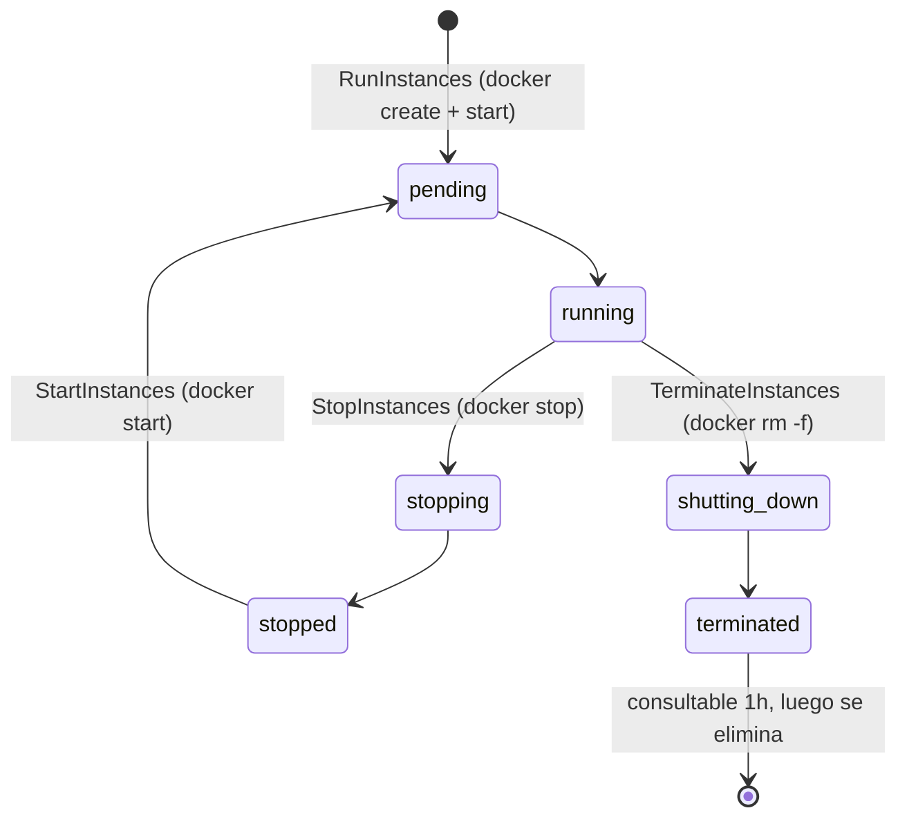
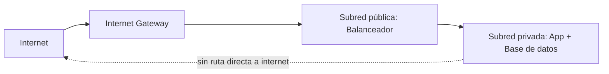

# Módulo 21: Cómputo elástico con EC2 y Auto Scaling


## Aprende construyendo


### Tema 1: El modelo de ejecución de EC2 — instancias que son contenedores Docker reales · Avanzado · 30 min

<details open>
<summary><strong>Capa 1 — Lectura</strong></summary>

#### ► DE QUÉ TRATA
Al finalizar podrás lanzar una instancia desde cero. Prerrequisitos: Docker y Node.js; verifica node --version.

#### ► CÓMO FUNCIONA


</details>

<details>
<summary><strong>Capa 2 — Construcción</strong></summary>

#### Código y verificación


```bash
# archivo: src/labs/modulo-21/tema-1-ciclo-de-vida.sh — ejecutar con: bash tema-1-ciclo-de-vida.sh
ID=$(aws ec2 run-instances --image-id ami-amazonlinux2023 --instance-type t2.micro \
  --query 'Instances[0].InstanceId' --output text)
docker ps | grep "$ID"          # contenedor real, estado "Up"
aws ec2 stop-instances --instance-ids "$ID"
sleep 3
docker ps -a | grep "$ID"       # mismo contenedor, ahora "Exited"
```

```bash
mkdir ejemplo-ec2 && cd ejemplo-ec2
# pega aquí el contenido de tema-1-ciclo-de-vida.sh y guárdalo
bash tema-1-ciclo-de-vida.sh
aws ec2 describe-instances --query 'Reservations[].Instances[].[InstanceId,State.Name]' --output text
```

</details>

### Tema 2: AMIs, grupos de seguridad y claves SSH · Avanzado · 30 min

<details open>
<summary><strong>Capa 1 — Lectura</strong></summary>

#### ► DE QUÉ TRATA
Al finalizar vas a preparar el grupo de seguridad y la clave SSH que el primer nodo de reparto va a usar para arrancar. Prerrequisitos: Tema 1 de este módulo.

#### ► LA ANALOGÍA
La AMI es el molde de la instancia; el security group es la portería que declara qué tráfico debería entrar; la key pair es la llave real para entrar por SSH.

**Conceptos clave:** mapeo de AMI a imagen Docker, `CreateSecurityGroup`, `ImportKeyPair`, inyección de clave pública.

**Practícalo tú:**

```bash

# archivo: src/labs/modulo-21/tema-2-security-group-y-clave.sh — ejecutar con: bash tema-2-security-group-y-clave.sh
GROUP_ID=$(aws ec2 create-security-group \
  --group-name demo-nodo --description "SG del primer nodo demo" \
  --query 'GroupId' --output text)
aws ec2 authorize-security-group-ingress --group-id "$GROUP_ID" --protocol tcp --port 22 --cidr 0.0.0.0/0
aws ec2 import-key-pair --key-name demo-key --public-key-material fileb://~/.ssh/id_rsa.pub
```

`--group-name` nombra el grupo de seguridad al crearlo; el ID que devuelve ese comando es lo que después identifica con `--group-id` en el comando de `authorize-security-group-ingress`. Ese comando abre una regla de entrada: `--protocol` y `--port` (acá, TCP puerto 22, el de SSH) definen qué tráfico permitir, y `--cidr` es el rango de IPs de origen autorizado (`0.0.0.0/0` significa "cualquier IP", sin restricción). `--key-name` nombra el par de claves al importarlo; `--public-key-material` es el contenido de tu clave pública SSH real (`fileb://` la lee como archivo binario). En resumen: `--group-name` es la bandera que nombra el grupo al crearlo, y `--group-id` es la bandera que lo identifica en comandos posteriores.

**Resultado esperado:** `create-security-group` devuelve un `GroupId`; `import-key-pair` devuelve un `KeyFingerprint`. Ambos quedan guardados y consultables — pero, como leíste arriba, el `GroupId` no bloquea ni permite tráfico real: la regla vive en el registro de Floci, no en la red puente de Docker.

**Modifica esto:** ejecuta `aws ec2 describe-security-groups --group-ids $GROUP_ID` y confirma que la regla de entrada al puerto 22 aparece en la respuesta aunque, como acabas de leer, no se aplique de verdad.

**Cuándo no usarlo:** no valides reglas de firewall de producción contra este grupo de seguridad; esa prueba solo es válida contra AWS real.

**Cómo crece tu proyecto:** `demo-nodo` y `demo-key` son el grupo y la clave que usarás para lanzar y conectarte por SSH al primer nodo de cómputo de reparto del proyecto integrador.

Floci resuelve identificadores de AMI en imágenes Docker reales mediante una tabla de mapeo incorporada: `ami-amazonlinux2023` apunta a `public.ecr.aws/amazonlinux/amazonlinux:2023`, `ami-ubuntu2204` a `public.ecr.aws/docker/library/ubuntu:22.04`, y así con Debian y Alpine. Cualquier ID de AMI que no reconozca —incluyendo IDs reales de AWS como `ami-0abc12345678`— cae por defecto en Amazon Linux 2023, así que scripts existentes que referencian AMIs reales siguen funcionando sin modificación.

Los grupos de seguridad se crean, almacenan y devuelven correctamente vía `CreateSecurityGroup` y `AuthorizeSecurityGroupIngress`, pero **no se aplican a nivel de red**: es la red puente de Docker la que maneja el enrutamiento real, no las reglas de tu grupo de seguridad. Esto es importante para no asumir aislamiento de red que en Floci no existe. Donde sí hay comportamiento real es en las claves SSH: `CreateKeyPair` genera un PEM ficticio que no sirve para SSH real, pero `ImportKeyPair` acepta una clave pública tuya de verdad, y Floci la copia dentro del contenedor en `/root/.ssh/authorized_keys` al arrancar, exponiendo el puerto 22 del contenedor en un puerto del host (rango por defecto 2200–2299).

**Analogía:** el mapeo de AMI a imagen Docker es como pedir "una copia de Ubuntu 22.04" en un catálogo y que siempre te entreguen exactamente esa versión, sin importar qué código de catálogo internacional escribas si no lo reconocen: por defecto te dan la opción más segura y común.

**¿Por qué es importante?** Saber que los grupos de seguridad no filtran tráfico realmente en Floci evita que confundas "mi laboratorio funcionó a pesar de reglas restrictivas" con "mis reglas de seguridad son correctas": esa validación real solo la obtienes contra AWS de verdad.


</details>

<details>
<summary><strong>Capa 2 — Construcción</strong></summary>

#### Código y verificación
```bash
# archivo: src/labs/modulo-21/tema-2-security-group-y-clave.sh — ejecutar con: bash tema-2-security-group-y-clave.sh
GROUP_ID=$(aws ec2 create-security-group \
  --group-name demo-nodo --description "SG del primer nodo demo" \
  --query 'GroupId' --output text)
aws ec2 authorize-security-group-ingress --group-id "$GROUP_ID" --protocol tcp --port 22 --cidr 0.0.0.0/0
aws ec2 import-key-pair --key-name demo-key --public-key-material fileb://~/.ssh/id_rsa.pub
```

```bash
GROUP_ID=$(aws ec2 create-security-group --group-name demo-nodo --description "SG del primer nodo demo" --query 'GroupId' --output text)
aws ec2 authorize-security-group-ingress --group-id "$GROUP_ID" --protocol tcp --port 22 --cidr 0.0.0.0/0
aws ec2 import-key-pair --key-name demo-key --public-key-material fileb://~/.ssh/id_rsa.pub
```

</details>

### Tema 3: UserData e IMDS — arranque automatizado y credenciales por instancia · Avanzado · 30 min

<details open>
<summary><strong>Capa 1 — Lectura</strong></summary>

#### ► DE QUÉ TRATA
Al finalizar podrás inicializar una instancia desde cero. Prerrequisitos: Docker y Node.js; verifica node --version.

</details>

<details>
<summary><strong>Capa 2 — Construcción</strong></summary>

#### Código y verificación
```bash
# archivo: src/labs/modulo-21/tema-3-userdata-imds.sh — ejecutar con: bash tema-3-userdata-imds.sh
aws ec2 run-instances --image-id ami-amazonlinux2023 --instance-type t2.micro \
  --user-data '#!/bin/bash
echo "listo" > /tmp/listo.txt'
# docker ps -lq = el contenedor creado más recientemente (el que acabas de lanzar)
docker logs "$(docker ps -lq)" | grep listo

TOKEN=$(curl -s -X PUT http://localhost:9169/latest/api/token -H "x-aws-ec2-metadata-token-ttl-seconds: 21600")
curl -s -H "x-aws-ec2-metadata-token: $TOKEN" http://localhost:9169/latest/meta-data/instance-id
```

```bash
mkdir ejemplo-bootstrap && cd ejemplo-bootstrap
# pega aquí el contenido de tema-3-userdata-imds.sh y guárdalo
bash tema-3-userdata-imds.sh
docker logs "$(docker ps -lq)" | grep -ci 'secret\|password' || true
```

</details>

### Tema 4: Auto Scaling — configuraciones de lanzamiento y grupos · Avanzado · 30 min

<details open>
<summary><strong>Capa 1 — Lectura</strong></summary>

#### ► DE QUÉ TRATA
Al finalizar vas a declarar demo-asg, el grupo que mantiene siempre disponible al menos un nodo de reparto activo. Prerrequisitos: Temas 2-3 de este módulo.

#### ► LA ANALOGÍA
Un Auto Scaling Group es una flota con mínimo, máximo y capacidad deseada declarados: vos decís el resultado que querés, el grupo se encarga de los pasos para lograrlo.

**Conceptos clave:** launch configuration, Auto Scaling Group, capacidad mínima/máxima/deseada, adjunto a grupos objetivo ELB.

Una configuración de lanzamiento (`CreateLaunchConfiguration`) es una plantilla que describe qué instancia lanzar: imagen, tipo de instancia, clave SSH, grupos de seguridad y UserData. Un Auto Scaling Group (`CreateAutoScalingGroup`) referencia esa plantilla y define capacidad mínima, máxima y deseada, además de las zonas de disponibilidad donde debe distribuir instancias. A partir de ahí, el grupo se encarga de mantener el número de instancias `InService` alineado con la capacidad deseada — tú declaras el resultado que quieres, no los pasos para lograrlo.

Los grupos de Auto Scaling se pueden adjuntar a grupos objetivo de un Application/Network Load Balancer (`AttachLoadBalancerTargetGroups`): cuando el reconciliador lanza una instancia nueva, la registra automáticamente en esos grupos objetivo como `InService`, y cuando termina una instancia, la da de baja del balanceador antes de eliminarla — evitando que el balanceador siga enviando tráfico a una instancia que ya no existe.

**Analogía:** una configuración de lanzamiento es la receta de un plato; un Auto Scaling Group es el compromiso de un restaurante de "siempre tener entre 2 y 5 porciones de ese plato listas en la cocina, ajustando cuántas se cocinan según la demanda del momento".

**¿Por qué es importante?** Separar la plantilla (qué lanzar) de la política de capacidad (cuántas y cuándo) es el mismo patrón declarativo que verás una y otra vez en infraestructura moderna — Kubernetes Deployments, ECS Services — y entenderlo aquí te da una base sólida para reconocerlo en cualquier plataforma.

**Practícalo tú:**

```bash

# archivo: src/labs/modulo-21/tema-4-launch-config.sh — ejecutar con: bash tema-4-launch-config.sh
aws autoscaling create-launch-configuration \
  --launch-configuration-name demo-lc \
  --image-id ami-amazonlinux2023 --instance-type t2.micro
aws autoscaling create-auto-scaling-group \
  --auto-scaling-group-name demo-asg \
  --launch-configuration-name demo-lc \
  --min-size 1 --max-size 3 --desired-capacity 1 \
  --availability-zones us-east-1a
```

`--launch-configuration-name` nombra la plantilla (creada en el primer comando, referenciada en el segundo); `--auto-scaling-group-name` nombra el grupo; `--min-size`, `--max-size` y `--desired-capacity` son, respectivamente, el mínimo, el máximo y la cantidad que el grupo intenta mantener activa en todo momento; `--availability-zones` es en qué zonas físicas distribuir esas instancias. En resumen: `--launch-configuration-name` es la bandera que nombra la plantilla, `--auto-scaling-group-name` es la bandera que nombra el grupo, y `--min-size`/`--max-size`/`--desired-capacity` son las banderas que fijan el mínimo, el máximo y la capacidad deseada.

**Resultado esperado:** ambos comandos terminan sin salida (éxito silencioso, igual que en AWS real); `aws autoscaling describe-auto-scaling-groups --auto-scaling-group-names demo-asg` muestra el grupo con una instancia en `LifecycleState: InService` a los pocos segundos.

**Modifica esto:** guarda la definición de la configuración de lanzamiento en `launch-config.json` y vuelve a crearla pasando `--cli-input-json file://launch-config.json` en vez de flags sueltos — así es como versionarías esta plantilla en un repositorio real.

**Cuándo no usarlo:** las configuraciones de lanzamiento (launch configurations) están en modo de solo-mantenimiento en AWS real desde 2023; en un proyecto nuevo fuera de este curso usarías Launch Templates, no este recurso.

**Cómo crece tu proyecto:** `demo-asg` es el grupo que mantiene siempre disponible al menos un nodo de reparto activo para el proyecto integrador, incluso si uno falla.


</details>

<details>
<summary><strong>Capa 2 — Construcción</strong></summary>

#### Código y verificación
```bash
# archivo: src/labs/modulo-21/tema-4-launch-config.sh — ejecutar con: bash tema-4-launch-config.sh
aws autoscaling create-launch-configuration \
  --launch-configuration-name demo-lc \
  --image-id ami-amazonlinux2023 --instance-type t2.micro
aws autoscaling create-auto-scaling-group \
  --auto-scaling-group-name demo-asg \
  --launch-configuration-name demo-lc \
  --min-size 1 --max-size 3 --desired-capacity 1 \
  --availability-zones us-east-1a
```

```bash
aws autoscaling create-launch-configuration --launch-configuration-name demo-lc \
  --image-id ami-amazonlinux2023 --instance-type t2.micro --security-groups demo-nodo --key-name demo-key
aws autoscaling create-auto-scaling-group --auto-scaling-group-name demo-asg \
  --launch-configuration-name demo-lc --min-size 1 --max-size 3 --desired-capacity 1 --availability-zones us-east-1a
```

</details>

### Tema 5: El reconciliador de capacidad y las políticas de escalado · Avanzado · 30 min

<details open>
<summary><strong>Capa 1 — Lectura</strong></summary>

#### ► DE QUÉ TRATA
Al finalizar vas a forzar que el reconciliador de demo-asg (Tema 4) escale de verdad, y a comprobar qué pasa cuando le pedís algo imposible. Prerrequisitos: Tema 4 de este módulo.

#### ► LA ANALOGÍA
El reconciliador compara, cada 10 segundos, cuántas instancias hay contra cuántas debería haber — como un encargado de turno que cuenta meseros y llama a alguien de guardia si faltan.

**Conceptos clave:** reconciliador de capacidad, ciclo de 10 segundos, scale-out, scale-in, lifecycle hooks, políticas de escalado.

Floci ejecuta en segundo plano un reconciliador de capacidad que corre cada 10 segundos: compara el número de instancias `InService` de cada grupo contra su `DesiredCapacity`. Si faltan instancias (scale-out), llama a `RunInstances` con la configuración de lanzamiento del grupo y las nuevas instancias pasan de `Pending` a `InService` en cuanto EC2 las reporta `running`, registrándose automáticamente en cualquier grupo objetivo ELB adjunto. Si sobran instancias (scale-in), selecciona instancias no protegidas contra reducción, las da de baja de los grupos objetivo y las termina. Cada evento de escalado queda registrado en el historial de actividad del grupo (`DescribeScalingActivities`), así que siempre puedes auditar cuándo y por qué cambió la capacidad.

Los lifecycle hooks (`PutLifecycleHook`) te permiten insertar una pausa controlada durante el lanzamiento o la terminación de una instancia —por ejemplo, para ejecutar un script de configuración antes de marcarla `InService`— señalizando `CONTINUE` o `ABANDON` cuando termines. Las políticas de escalado (`PutScalingPolicy`) automatizan el ajuste de `DesiredCapacity` en respuesta a eventos, aunque en este curso vas a practicar el caso más simple: cambiarlo manualmente con `SetDesiredCapacity` y observar al reconciliador reaccionar.

**Analogía:** el reconciliador de capacidad es como un encargado de turno que cada 10 segundos cuenta cuántos meseros hay trabajando, y si faltan llama a alguien de la lista de guardia; si sobran, envía a alguien a casa — sin que el gerente tenga que estar pendiente minuto a minuto.

**¿Por qué es importante?** Este patrón de "reconciliación continua hacia un estado deseado" es el mismo principio detrás de Kubernetes, Terraform y casi toda la infraestructura declarativa moderna: aprenderlo aquí, con un ciclo de 10 segundos que puedes observar en vivo, es mucho más intuitivo que leerlo solo en teoría.

**Practícalo tú:**

```bash

# archivo: src/labs/modulo-21/tema-5-reconciliador.sh — ejecutar con: bash tema-5-reconciliador.sh
aws autoscaling set-desired-capacity --auto-scaling-group-name demo-asg --desired-capacity 3
sleep 12
aws autoscaling describe-scaling-activities --auto-scaling-group-name demo-asg
```

**Resultado esperado:** en los ~12 segundos de espera (más de un ciclo de reconciliación de 10 s), el reconciliador lanza 2 instancias adicionales; `describe-scaling-activities` muestra las actividades de lanzamiento hasta llegar a 3 instancias `InService`, sin que tú hayas llamado a `run-instances` manualmente.

**Modifica esto:** vuelve a bajar `--desired-capacity` a 1 y observa en `describe-scaling-activities` cómo el reconciliador ahora termina instancias (scale-in) en vez de lanzarlas, hasta volver a 1 `InService`.

**Cuándo no usarlo:** no uses `set-desired-capacity` manual como sustituto de una política de escalado real en producción; ahí querrías políticas dirigidas por métricas (`PutScalingPolicy`) que reaccionen solas a CPU o latencia, no un valor fijo que cambias a mano.

**Cómo crece tu proyecto:** este es el mismo mecanismo que mantiene la flota de nodos de reparto al tamaño correcto durante picos de pedidos, sin intervención manual.

---

**Transferencia al proyecto integrador «Cloud local multi-nube»:** Aumenta la demanda simulada de procesamiento y observa las decisiones de capacidad. Documenta umbral, enfriamiento y capacidad máxima; al bajar la carga, comprueba que las tareas en curso no se pierden.


</details>

<details>
<summary><strong>Capa 2 — Construcción</strong></summary>

#### Código y verificación
```bash
# archivo: src/labs/modulo-21/tema-5-reconciliador.sh — ejecutar con: bash tema-5-reconciliador.sh
aws autoscaling set-desired-capacity --auto-scaling-group-name demo-asg --desired-capacity 3
sleep 12
aws autoscaling describe-scaling-activities --auto-scaling-group-name demo-asg
```

```bash
mkdir ejemplo && cd ejemplo && floci start
```

```bash
aws autoscaling set-desired-capacity --auto-scaling-group-name demo-asg --desired-capacity 3
sleep 12
aws autoscaling describe-scaling-activities --auto-scaling-group-name demo-asg
```

</details>

### Tema 6: VPC y redes — subredes, security groups y el flujo del tráfico · Avanzado · 30 min

<details open>
<summary><strong>Capa 1 — Lectura</strong></summary>

#### ► DE QUÉ TRATA
Al finalizar podrás crear una VPC con una subred pública y una privada, un security group, y explicar por qué una base de datos va en la subred privada mientras el balanceador va en la pública. Prerrequisitos: Módulo 0 (fundamentos de redes: IP, puertos) y Floci corriendo.

#### ► CÓMO FUNCIONA


</details>

<details>
<summary><strong>Capa 2 — Construcción</strong></summary>

#### Código y verificación


```bash
# 1. Crear la VPC
VPC=$(aws ec2 create-vpc --cidr-block 10.0.0.0/16 --query Vpc.VpcId --output text)
# 2. Subred pública y subred privada
aws ec2 create-subnet --vpc-id "$VPC" --cidr-block 10.0.1.0/24   # pública
aws ec2 create-subnet --vpc-id "$VPC" --cidr-block 10.0.2.0/24   # privada
# 3. Security group que solo permite entrada por el puerto 5432 (Postgres) desde la propia VPC
SG=$(aws ec2 create-security-group --group-name db-sg --description "DB" --vpc-id "$VPC" --query GroupId --output text)
aws ec2 authorize-security-group-ingress --group-id "$SG" --protocol tcp --port 5432 --cidr 10.0.0.0/16
aws ec2 describe-security-groups --group-ids "$SG"
```

</details>

### Laboratorio 21.1 — Lanzar una instancia EC2 con acceso SSH e IMDS

<details open>
<summary><strong>Capa 1 — Lectura</strong></summary>

</details>

<details>
<summary><strong>Capa 2 — Construcción</strong></summary>

#### Nota de construcción
Este tema es principalmente conceptual en esta versión. La verificación se realiza con las preguntas de comprensión y el criterio de cuándo NO usar laboratorio 21.1 — lanzar una instancia ec2 con acceso ssh e imds.

</details>

### Laboratorio 21.2 — Auto Scaling Group con reconciliador en vivo

<details open>
<summary><strong>Capa 1 — Lectura</strong></summary>

</details>

<details>
<summary><strong>Capa 2 — Construcción</strong></summary>

#### Nota de construcción
Este tema es principalmente conceptual en esta versión. La verificación se realiza con las preguntas de comprensión y el criterio de cuándo NO usar laboratorio 21.2 — auto scaling group con reconciliador en vivo.

</details>
