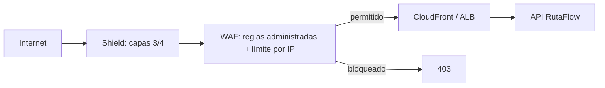

# Módulo 22: Balanceo de carga, CDN y DNS — ELB, CloudFront, Route53 y ACM


## Aprende construyendo


### Tema 1: ELB v2 — balanceadores, grupos objetivo y reglas · Avanzado · 35 min

<details open>
<summary><strong>Capa 1 — Lectura</strong></summary>

#### ► DE QUÉ TRATA
Al finalizar vas a declarar demo-alb para repartir tráfico entre los nodos de reparto de demo-asg (Módulo 21). Prerrequisitos: Módulo 21 completo.

#### ► LA IDEA EN UNA FRASE
**Al finalizar vas a declarar demo-alb para repartir tráfico entre los nodos de reparto de demo-asg (Módulo 21).**

#### ► POR QUÉ EXISTE ESTO
Resuelve un problema real de diseño o implementación y evita decisiones a ciegas.

#### ► LA ANALOGÍA
Un ALB es una central que escucha, decide según reglas (ruta, host) y envía al grupo objetivo correspondiente, retirando de la rotación cualquier objetivo que falle el healthcheck.

**Conceptos clave:** Application Load Balancer (ALB), grupo objetivo (target group), listener, regla de enrutamiento, Fase 1 vs Fase 2.

Elastic Load Balancing v2 gestiona balanceadores de carga de aplicaciones (ALB) y de red (NLB) a través de una API de plano de gestión completa: puedes crear balanceadores, grupos objetivo, listeners y reglas de enrutamiento por ruta o por host, exactamente como en AWS real, y todos esos recursos se almacenan y se devuelven correctamente vía SDK, CLI o Terraform. Lo que Floci todavía no hace —está planeado como Fase 2— es abrir puertos de escucha TCP reales que reenvíen tráfico HTTP de verdad a los objetivos registrados; por ahora, `DescribeTargetHealth` siempre devuelve el estado `initial`, y no hay tráfico real fluyendo a través del balanceador.

Esto significa que en este módulo vas a practicar el ciclo de vida completo del plano de control —crear el balanceador, el grupo objetivo, registrar objetivos, crear listeners con reglas de enrutamiento por ruta (`/api/*` hacia un grupo, el resto hacia otro)— que es exactamente la misma superficie de API que usarías con Terraform o el SDK contra un ALB real, aunque el tráfico HTTP en sí no se enruta todavía dentro de Floci. Cada `CreateListener` crea automáticamente una regla por defecto inmutable, y las prioridades de reglas se validan de forma atómica para evitar conflictos.

**Analogía:** el ALB en Floci en este momento es como el plano arquitectónico completo de un edificio de oficinas con los ascensores, pasillos y señalización ya diseñados y aprobados, pero donde todavía no se ha instalado la electricidad que los haría funcionar de verdad: la estructura de decisiones (a dónde va cada solicitud) ya está correctamente definida y es consultable.

**¿Por qué es importante?** Practicar el plano de control de ELB v2 te prepara para el mismo flujo de trabajo con Terraform/CDK que usarías contra AWS real: definir grupos objetivo, listeners y reglas es idéntico: solo cambia que en Floci el tráfico real todavía no atraviesa el balanceador.

**Practícalo tú:**

```bash
# archivo: src/labs/modulo-22/tema-1-alb.sh — ejecutar con: bash tema-1-alb.sh
LB_ARN=$(aws elbv2 create-load-balancer --name demo-alb --type application --scheme internet-facing \
  --query 'LoadBalancers[0].LoadBalancerArn' --output text)
TG_ARN=$(aws elbv2 create-target-group --name demo-objetivos --protocol HTTP --port 80 --target-type instance \
  --query 'TargetGroups[0].TargetGroupArn' --output text)
LISTENER_ARN=$(aws elbv2 create-listener --load-balancer-arn "$LB_ARN" --protocol HTTP --port 80 \
  --default-actions Type=forward,TargetGroupArn="$TG_ARN" --query 'Listeners[0].ListenerArn' --output text)
aws elbv2 create-rule --listener-arn "$LISTENER_ARN" --priority 10 \
  --conditions Field=path-pattern,Values='/api/*' --actions Type=forward,TargetGroupArn="$TG_ARN"
```

`--scheme internet-facing` hace que el balanceador tenga una IP pública (la alternativa, `internal`, solo es alcanzable dentro de tu red privada); `--target-type instance` dice que el grupo objetivo apunta a instancias EC2 (existen otros tipos, como `ip` o `lambda`). `--load-balancer-arn` y `--listener-arn` identifican, respectivamente, a qué balanceador y a qué listener referirte en cada comando siguiente. `--default-actions` (con `Type=forward,TargetGroupArn=...`) define qué hacer con el tráfico que no matchea ninguna regla específica — reenviarlo al grupo objetivo indicado. Al crear una regla, `--priority` decide el orden de evaluación cuando hay varias reglas (menor número, mayor prioridad), `--conditions` es el criterio que debe cumplir la petición (acá, que la ruta empiece con `/api/`), y `--actions` es qué hacer si se cumple esa condición. En resumen: `--target-type` es la bandera que fija a qué tipo de recurso apunta el grupo objetivo, `--load-balancer-arn` y `--listener-arn` son las banderas que identifican el balanceador y el listener, `--default-actions` es la bandera que define la acción por defecto del listener, y `--priority` es la bandera que fija el orden de evaluación de la regla.

**Resultado esperado:** cada comando devuelve su ARN (`LoadBalancerArn`, `TargetGroupArn`, `ListenerArn`, `RuleArn`); `aws elbv2 describe-target-health --target-group-arn $TG_ARN` siempre devuelve estado `initial` — recuerda que Floci aún no enruta tráfico real (Fase 2 pendiente).

**Modifica esto:** registra una instancia real del Módulo 21 con `register-targets` y confirma con `describe-target-groups` que aparece asociada, aunque su salud siga `initial`.

**Cuándo no usarlo:** no uses `describe-target-health` de Floci para validar que tu aplicación responde de verdad; eso solo lo confirmas contra un ALB real o probando la instancia directamente.

**Cómo crece tu proyecto:** este ALB es el punto de entrada que balanceará tráfico hacia los nodos de reparto en cuanto tengas más de una instancia activa.

**Transferencia al proyecto integrador «Cloud local multi-nube»:** Enruta seguimiento y operaciones a grupos objetivo distintos. Retira una instancia del grupo de prueba y confirma mediante peticiones que el tráfico se dirige únicamente a destinos saludables.

**Dónde se rompe la analogía:** el modelo simplifica la realidad; en producción influyen escala, fallos, costo y contexto.

#### ► CÓMO FUNCIONA
1. Identifica el problema que elb v2 — balanceadores, grupos objetivo y reglas resuelve.
2. Observa sus componentes y relaciones.
3. Aplica la opción más simple que funcione.
4. Verifica el resultado y los límites.

#### ► LO QUE PUEDE SALIR MAL
| Síntoma | Causa probable | Arreglo |
|---|---|---|
| ELB v2 — balanceadores, grupos objetivo y reglas se aplica pero el resultado no mejora | Se usó sin medir el problema real | Mide antes y compara contra la alternativa simple |
| Aparece complejidad inesperada | Se adoptó la técnica sin comprender sus trade-offs | Vuelve a la sección de trade-offs y reduce el alcance |
| Falla en un caso límite | Se asumió un contexto que no se cumple | Prueba el caso límite y documenta cuándo NO usarlo |

#### ► TRADE-OFFS
| Opción | Cuándo usarla | Cuándo NO usarla |
|---|---|---|
| Usar ELB v2 — balanceadores, grupos objetivo y reglas | Cuando el problema coincide con su propósito y el beneficio es observable | Cuando agrega complejidad sin resolver un problema real |
| Alternativa más simple | Cuando el contexto es pequeño, estable o fácil de razonar | Cuando ya demostró no escalar o no cumplir el requisito |
| Postergar la decisión | Cuando falta evidencia del problema | Cuando el costo de esperar es mayor que el costo de probar |

#### ► CUÁNDO NO USAR ESTO
No uses elb v2 — balanceadores, grupos objetivo y reglas por defecto. Aplícalo cuando el problema lo justifique y puedas verificar el beneficio; si una alternativa más simple resuelve igual, prefiérela.

#### ► DE VUELTA A LA ANALOGÍA
Volviendo a la analogía: elb v2 — balanceadores, grupos objetivo y reglas funciona como el modelo inicial, pero recuerda dónde se rompe: en producción importan la evidencia, la escala y el costo de equivocarte.

#### ► LO QUE DEBES RECORDAR
- ELB v2 — balanceadores, grupos objetivo y reglas existe para resolver un problema específico.
- Mide antes de adoptar complejidad.
- Conoce el caso donde NO usarlo.
- Verifica con evidencia observable.

#### ► PREGUNTAS PARA PENSAR
1. ¿Qué problema concreto resuelve elb v2 — balanceadores, grupos objetivo y reglas en tu contexto?
2. ¿Cómo sabrías que elb v2 — balanceadores, grupos objetivo y reglas no está funcionando bien?
3. ¿Qué alternativa más simple considerarías antes de usar elb v2 — balanceadores, grupos objetivo y reglas?

</details>

<details>
<summary><strong>Capa 2 — Construcción</strong></summary>

#### Código y verificación
```bash
# archivo: src/labs/modulo-22/tema-1-alb.sh — ejecutar con: bash tema-1-alb.sh
LB_ARN=$(aws elbv2 create-load-balancer --name demo-alb --type application --scheme internet-facing \
  --query 'LoadBalancers[0].LoadBalancerArn' --output text)
TG_ARN=$(aws elbv2 create-target-group --name demo-objetivos --protocol HTTP --port 80 --target-type instance \
  --query 'TargetGroups[0].TargetGroupArn' --output text)
LISTENER_ARN=$(aws elbv2 create-listener --load-balancer-arn "$LB_ARN" --protocol HTTP --port 80 \
  --default-actions Type=forward,TargetGroupArn="$TG_ARN" --query 'Listeners[0].ListenerArn' --output text)
aws elbv2 create-rule --listener-arn "$LISTENER_ARN" --priority 10 \
  --conditions Field=path-pattern,Values='/api/*' --actions Type=forward,TargetGroupArn="$TG_ARN"
```

```bash
LB_ARN=$(aws elbv2 create-load-balancer --name demo-alb --type application --scheme internet-facing \
  --query 'LoadBalancers[0].LoadBalancerArn' --output text)
TG_ARN=$(aws elbv2 create-target-group --name demo-objetivos --protocol HTTP --port 80 --target-type instance \
  --query 'TargetGroups[0].TargetGroupArn' --output text)
LISTENER_ARN=$(aws elbv2 create-listener --load-balancer-arn "$LB_ARN" --protocol HTTP --port 80 \
  --default-actions Type=forward,TargetGroupArn="$TG_ARN" --query 'Listeners[0].ListenerArn' --output text)
```

</details>

### Tema 2: ACM — certificados TLS con criptografía real · Avanzado · 35 min

<details open>
<summary><strong>Capa 1 — Lectura</strong></summary>

#### ► DE QUÉ TRATA
Al finalizar vas a emitir el certificado TLS que demo-alb (Tema 1) va a necesitar para su listener HTTPS. Prerrequisitos: Tema 1 de este módulo.

#### ► LA IDEA EN UNA FRASE
**Al finalizar vas a emitir el certificado TLS que demo-alb (Tema 1) va a necesitar para su listener HTTPS.**

#### ► POR QUÉ EXISTE ESTO
Resuelve un problema real de diseño o implementación y evita decisiones a ciegas.

#### ► LA ANALOGÍA
Piensa en acm — certificados tls con criptografía real como una herramienta de taller: útil cuando conoces su propósito y sus límites.
**Dónde se rompe la analogía:** en software, los efectos dependen del contexto, la escala y los trade-offs.

#### ► CÓMO FUNCIONA
1. Identifica el problema que acm — certificados tls con criptografía real resuelve.
2. Observa sus componentes y relaciones.
3. Aplica la opción más simple que funcione.
4. Verifica el resultado y los límites.

#### ► LO QUE PUEDE SALIR MAL
| Síntoma | Causa probable | Arreglo |
|---|---|---|
| ACM — certificados TLS con criptografía real se aplica pero el resultado no mejora | Se usó sin medir el problema real | Mide antes y compara contra la alternativa simple |
| Aparece complejidad inesperada | Se adoptó la técnica sin comprender sus trade-offs | Vuelve a la sección de trade-offs y reduce el alcance |
| Falla en un caso límite | Se asumió un contexto que no se cumple | Prueba el caso límite y documenta cuándo NO usarlo |

#### ► TRADE-OFFS
| Opción | Cuándo usarla | Cuándo NO usarla |
|---|---|---|
| Usar ACM — certificados TLS con criptografía real | Cuando el problema coincide con su propósito y el beneficio es observable | Cuando agrega complejidad sin resolver un problema real |
| Alternativa más simple | Cuando el contexto es pequeño, estable o fácil de razonar | Cuando ya demostró no escalar o no cumplir el requisito |
| Postergar la decisión | Cuando falta evidencia del problema | Cuando el costo de esperar es mayor que el costo de probar |

#### ► CUÁNDO NO USAR ESTO
No uses acm — certificados tls con criptografía real por defecto. Aplícalo cuando el problema lo justifique y puedas verificar el beneficio; si una alternativa más simple resuelve igual, prefiérela.

#### ► DE VUELTA A LA ANALOGÍA
Volviendo a la analogía: acm — certificados tls con criptografía real funciona como el modelo inicial, pero recuerda dónde se rompe: en producción importan la evidencia, la escala y el costo de equivocarte.

#### ► LO QUE DEBES RECORDAR
- ACM — certificados TLS con criptografía real existe para resolver un problema específico.
- Mide antes de adoptar complejidad.
- Conoce el caso donde NO usarlo.
- Verifica con evidencia observable.

#### ► PREGUNTAS PARA PENSAR
1. ¿Qué problema concreto resuelve acm — certificados tls con criptografía real en tu contexto?
2. ¿Cómo sabrías que acm — certificados tls con criptografía real no está funcionando bien?
3. ¿Qué alternativa más simple considerarías antes de usar acm — certificados tls con criptografía real?

</details>

<details>
<summary><strong>Capa 2 — Construcción</strong></summary>

#### Código y verificación
```bash
# archivo: src/labs/modulo-22/tema-2-acm.sh — ejecutar con: bash tema-2-acm.sh
CERT_ARN=$(aws acm request-certificate --domain-name api.demo.example.com --validation-method DNS \
  --query 'CertificateArn' --output text)
aws acm describe-certificate --certificate-arn "$CERT_ARN" --query 'Certificate.Status' --output text
aws acm get-certificate --certificate-arn "$CERT_ARN"
```

```bash
mkdir ejemplo && cd ejemplo && floci start
```

```bash
CERT_ARN=$(aws acm request-certificate --domain-name api.demo.example.com --validation-method DNS \
  --query 'CertificateArn' --output text)
aws acm describe-certificate --certificate-arn "$CERT_ARN" --query 'Certificate.Status' --output text
```

</details>

### Tema 3: CloudFront — distribución de contenido y control de acceso al origen · Avanzado · 35 min

<details open>
<summary><strong>Capa 1 — Lectura</strong></summary>

#### ► DE QUÉ TRATA
Al finalizar vas a distribuir las fotos de entrega de pruebas-entrega (Módulo 2) por CDN, en vez de servirlas directamente desde S3. Prerrequisitos: Módulo 2 completo.

#### ► LA IDEA EN UNA FRASE
**Al finalizar vas a distribuir las fotos de entrega de pruebas-entrega (Módulo 2) por CDN, en vez de servirlas directamente desde S3.**

#### ► POR QUÉ EXISTE ESTO
Resuelve un problema real de diseño o implementación y evita decisiones a ciegas.

#### ► LA ANALOGÍA
CloudFront es una red de sucursales: la caché evita que cada petición tenga que viajar hasta el almacén central (el bucket S3 de origen).

**Conceptos clave:** distribución, política de caché, invalidación, control de acceso de origen (OAC).

**Dominio propio en AWS real:** además del registro DNS, `fotos.demo.example.com` debe añadirse como nombre alternativo de la distribución y quedar cubierto por su certificado TLS. Este laboratorio crea una distribución básica y no configura esos dos requisitos; Floci tampoco entrega el contenido. Fuente oficial: https://docs.aws.amazon.com/AmazonCloudFront/latest/DeveloperGuide/CNAMEs.html.

CloudFront en Floci emula el plano de gestión completo: puedes crear una distribución apuntando a un origen (por ejemplo, un bucket S3), definir políticas de caché con sus TTLs mínimo/por defecto/máximo, configurar políticas de encabezados de respuesta, crear invalidaciones de caché, y proteger el acceso al origen con Control de Acceso de Origen (OAC) o la identidad heredada (OAI). Todas las distribuciones pasan inmediatamente al estado `Deployed` —sin la demora de propagación global que existe en AWS real—, y las invalidaciones se marcan como `Completed` de inmediato. Lo que no está emulado es la entrega real de contenido: no hay una red de distribución sirviendo tus archivos desde ubicaciones cercanas al usuario, esto es una implementación de plano de gestión únicamente.

Un detalle de comportamiento importante: todas las operaciones de mutación (`PUT`, `DELETE`) exigen un encabezado `If-Match` con el `ETag` actual de la distribución — si no lo incluyes o es incorrecto, la petición falla con `InvalidIfMatchVersion`. Este patrón de actualización optimista (leer el ETag, luego escribir con ese ETag) es el mismo que usan muchas APIs REST maduras para evitar que dos actualizaciones concurrentes se pisen entre sí.

**Analogía:** una distribución CloudFront en Floci es como el contrato firmado con una empresa de mensajería para que distribuya tus paquetes desde bodegas cercanas a cada cliente: el contrato (la configuración) es completamente real y consultable, pero en este momento el laboratorio no simula los camiones moviéndose de verdad.

**¿Por qué es importante?** Practicar la configuración de políticas de caché, orígenes y control de acceso es la parte que más se diseña con cuidado en una arquitectura CDN real; el volumen de tráfico que efectivamente sirve CloudFront es una preocupación operativa distinta que se valida contra AWS real.

**Practícalo tú:**

```bash
# archivo: src/labs/modulo-22/tema-3-cloudfront.sh — ejecutar con: bash tema-3-cloudfront.sh
DIST_ID=$(aws cloudfront create-distribution --distribution-config \
  '{"CallerReference":"demo-1","Enabled":true,"Origins":{"Quantity":1,"Items":[{"Id":"origen-s3","DomainName":"curso-cloud-local.s3.amazonaws.com","S3OriginConfig":{"OriginAccessIdentity":""}}]},"DefaultCacheBehavior":{"TargetOriginId":"origen-s3","ViewerProtocolPolicy":"redirect-to-https","CachePolicyId":"658327ea-f89d-4fab-a63d-7e88639e58f6"}}' \
  --query 'Distribution.Id' --output text)
aws cloudfront create-invalidation --distribution-id "$DIST_ID" \
  --invalidation-batch '{"Paths":{"Quantity":1,"Items":["/*"]},"CallerReference":"inv-1"}'
```

`--distribution-config` es el JSON completo que describe la distribución (de dónde sirve el contenido, cómo cachearlo); `--distribution-id` (usado en la invalidación y en modificaciones posteriores) identifica cuál distribución afectar; `--invalidation-batch` lista qué rutas de caché forzar a refrescar (acá, `/*`, es decir todo). En resumen: `--distribution-id` es la bandera que identifica la distribución afectada, e `--invalidation-batch` es la bandera que fija las rutas a invalidar.

**Resultado esperado:** `create-distribution` devuelve estado `Deployed` de inmediato y un `DomainName` tipo `{id}.cloudfront.net`; la invalidación se marca `Completed` sin esperar propagación real.

**Modifica esto:** intenta borrar la distribución directamente con `aws cloudfront delete-distribution --id $DIST_ID --if-match <etag>` sin deshabilitarla antes, y observa el error `DistributionNotDisabled` — corrígelo llamando primero a `update-distribution` con `Enabled=false`.

**Cuándo no usarlo:** no midas aquí latencia de entrega de contenido ni comportamiento de caché de borde real; Floci solo emula el plano de gestión, no la red de distribución física.

**Cómo crece tu proyecto:** esta distribución serviría los assets estáticos del panel de seguimiento, reusando el mismo origen S3 de módulos anteriores.

**Transferencia al proyecto integrador «Cloud local multi-nube»:** Distribuye solo recursos públicos del seguimiento mediante el borde. Comprueba que una evidencia privada no se vuelve accesible al reutilizar la misma política de caché o de origen.

**Dónde se rompe la analogía:** el modelo simplifica la realidad; en producción influyen escala, fallos, costo y contexto.

#### ► CÓMO FUNCIONA
1. Identifica el problema que cloudfront — distribución de contenido y control de acceso al origen resuelve.
2. Observa sus componentes y relaciones.
3. Aplica la opción más simple que funcione.
4. Verifica el resultado y los límites.

#### ► LO QUE PUEDE SALIR MAL
| Síntoma | Causa probable | Arreglo |
|---|---|---|
| CloudFront — distribución de contenido y control de acceso al origen se aplica pero el resultado no mejora | Se usó sin medir el problema real | Mide antes y compara contra la alternativa simple |
| Aparece complejidad inesperada | Se adoptó la técnica sin comprender sus trade-offs | Vuelve a la sección de trade-offs y reduce el alcance |
| Falla en un caso límite | Se asumió un contexto que no se cumple | Prueba el caso límite y documenta cuándo NO usarlo |

#### ► TRADE-OFFS
| Opción | Cuándo usarla | Cuándo NO usarla |
|---|---|---|
| Usar CloudFront — distribución de contenido y control de acceso al origen | Cuando el problema coincide con su propósito y el beneficio es observable | Cuando agrega complejidad sin resolver un problema real |
| Alternativa más simple | Cuando el contexto es pequeño, estable o fácil de razonar | Cuando ya demostró no escalar o no cumplir el requisito |
| Postergar la decisión | Cuando falta evidencia del problema | Cuando el costo de esperar es mayor que el costo de probar |

#### ► CUÁNDO NO USAR ESTO
No uses cloudfront — distribución de contenido y control de acceso al origen por defecto. Aplícalo cuando el problema lo justifique y puedas verificar el beneficio; si una alternativa más simple resuelve igual, prefiérela.

#### ► DE VUELTA A LA ANALOGÍA
Volviendo a la analogía: cloudfront — distribución de contenido y control de acceso al origen funciona como el modelo inicial, pero recuerda dónde se rompe: en producción importan la evidencia, la escala y el costo de equivocarte.

#### ► LO QUE DEBES RECORDAR
- CloudFront — distribución de contenido y control de acceso al origen existe para resolver un problema específico.
- Mide antes de adoptar complejidad.
- Conoce el caso donde NO usarlo.
- Verifica con evidencia observable.

#### ► PREGUNTAS PARA PENSAR
1. ¿Qué problema concreto resuelve cloudfront — distribución de contenido y control de acceso al origen en tu contexto?
2. ¿Cómo sabrías que cloudfront — distribución de contenido y control de acceso al origen no está funcionando bien?
3. ¿Qué alternativa más simple considerarías antes de usar cloudfront — distribución de contenido y control de acceso al origen?

</details>

<details>
<summary><strong>Capa 2 — Construcción</strong></summary>

#### Código y verificación
```bash
# archivo: src/labs/modulo-22/tema-3-cloudfront.sh — ejecutar con: bash tema-3-cloudfront.sh
DIST_ID=$(aws cloudfront create-distribution --distribution-config \
  '{"CallerReference":"demo-1","Enabled":true,"Origins":{"Quantity":1,"Items":[{"Id":"origen-s3","DomainName":"curso-cloud-local.s3.amazonaws.com","S3OriginConfig":{"OriginAccessIdentity":""}}]},"DefaultCacheBehavior":{"TargetOriginId":"origen-s3","ViewerProtocolPolicy":"redirect-to-https","CachePolicyId":"658327ea-f89d-4fab-a63d-7e88639e58f6"}}' \
  --query 'Distribution.Id' --output text)
aws cloudfront create-invalidation --distribution-id "$DIST_ID" \
  --invalidation-batch '{"Paths":{"Quantity":1,"Items":["/*"]},"CallerReference":"inv-1"}'
```

```bash
DIST_ID=$(aws cloudfront create-distribution --distribution-config \
  '{"CallerReference":"pruebas-entrega-1","Enabled":true,"Origins":{"Quantity":1,"Items":[{"Id":"origen-pruebas-entrega","DomainName":"pruebas-entrega.s3.amazonaws.com","S3OriginConfig":{"OriginAccessIdentity":""}}]},"DefaultCacheBehavior":{"TargetOriginId":"origen-pruebas-entrega","ViewerProtocolPolicy":"redirect-to-https","CachePolicyId":"658327ea-f89d-4fab-a63d-7e88639e58f6"}}' \
  --query 'Distribution.Id' --output text)
```

</details>

### Tema 4: Route53 — zonas alojadas y registros de recursos · Avanzado · 35 min

<details open>
<summary><strong>Capa 1 — Lectura</strong></summary>

#### ► DE QUÉ TRATA
Al finalizar vas a crear la zona DNS de demo.example.com y apuntar fotos.demo.example.com hacia la distribución CloudFront del Tema 3. Prerrequisitos: Tema 3 de este módulo.

#### ► LA IDEA EN UNA FRASE
**Al finalizar vas a crear la zona DNS de demo.example.com y apuntar fotos.demo.example.com hacia la distribución CloudFront del Tema 3.**

#### ► POR QUÉ EXISTE ESTO
Resuelve un problema real de diseño o implementación y evita decisiones a ciegas.

#### ► LA ANALOGÍA
DNS es una agenda jerárquica que traduce un nombre legible a un destino real, y una zona alojada es la página de esa agenda que le corresponde a tu dominio.

**Conceptos clave:** zona alojada, registro SOA/NS, `ChangeResourceRecordSets`, comprobación de estado (health check).

Route53 en Floci emula el plano de gestión de DNS: puedes crear una zona alojada, que automáticamente recibe registros SOA y NS en el vértice —no eliminables—, y luego añadir, actualizar o eliminar registros de recursos (A, CNAME, MX, etc.) con `ChangeResourceRecordSets`, validando todos los cambios de forma atómica antes de aplicar cualquiera. Cada cambio devuelve inmediatamente el estado `INSYNC` (sin la propagación asíncrona real de Route53), y puedes crear comprobaciones de estado HTTP/HTTPS que Route53 usaría en producción para enrutamiento basado en salud. Lo que no está emulado es la resolución DNS real: si intentas resolver un dominio que configuraste aquí desde tu navegador, no funcionará — esto es, otra vez, plano de gestión únicamente.

Un detalle útil para depurar: los IDs de zona alojada se devuelven con el prefijo `/hostedzone/` en las respuestas XML crudas, pero el AWS SDK lo elimina automáticamente del lado del cliente, así que normalmente solo verás el ID limpio (por ejemplo `Z1PA6795UKMFR9`).

**Analogía:** una zona alojada en Route53 es como el directorio interno de un edificio de oficinas: dice exactamente en qué piso y oficina está cada empresa (registro), y ese directorio es cien por ciento preciso y consultable, pero no es el sistema de señalización física que efectivamente guía a un visitante hasta la puerta — la resolución DNS real.

**¿Por qué es importante?** El plano de gestión de DNS es donde se cometen la mayoría de los errores de configuración reales (registros mal apuntados, TTLs incorrectos, zonas huérfanas); practicarlo aquí sin miedo a romper resolución de producción es exactamente el tipo de práctica segura que justifica un emulador local.

**Practícalo tú:**

```bash
# archivo: src/labs/modulo-22/tema-4-route53.sh — ejecutar con: bash tema-4-route53.sh
ZONE_ID=$(aws route53 create-hosted-zone --name demo.example.com --caller-reference "$(date +%s)" \
  --query 'HostedZone.Id' --output text)
aws route53 change-resource-record-sets --hosted-zone-id "$ZONE_ID" --change-batch \
  '{"Changes":[{"Action":"CREATE","ResourceRecordSet":{"Name":"fotos.demo.example.com.","Type":"CNAME","TTL":300,"ResourceRecords":[{"Value":"d111111abcdef8.cloudfront.net"}]}}]}'
aws route53 list-resource-record-sets --hosted-zone-id "$ZONE_ID"
```

`--caller-reference` es un valor único que evita que, si reenviás la misma petición por error (por ejemplo, tras un timeout de red), Route53 cree la zona duplicada — de ahí que el ejemplo use la hora actual (`$(date +%s)`), siempre distinta. `--hosted-zone-id` identifica en qué zona aplicar cambios; `--change-batch` es el JSON con la lista de cambios a aplicar (acá, crear un registro CNAME para un subdominio; un CNAME no puede ocupar el vértice de la zona).

**Resultado esperado:** la zona nace con registros `SOA` y `NS` automáticos en el vértice; el cambio del `CNAME` devuelve estado `INSYNC` de inmediato; `list-resource-record-sets` muestra los tres registros juntos.

**Modifica esto:** intenta borrar el registro `SOA` del vértice con `Action: DELETE` y confirma que Route53 lo rechaza — esos registros los gestiona el servicio automáticamente, no tú.

**Cuándo no usarlo:** no resuelvas el dominio desde tu navegador esperando que funcione; Floci guarda y valida la configuración, pero no ejecuta resolución DNS real.

**Cómo crece tu proyecto:** la zona raíz `demo.example.com` contiene nombres separados: `fotos.demo.example.com` apunta a CloudFront y `api.demo.example.com` al ALB. Un CNAME no puede ocupar el vértice de la zona.

**Transferencia al proyecto integrador «Cloud local multi-nube»:** Crea la zona alojada del seguimiento y publica los subdominios de sus servicios como registros separados. Intenta borrar el `SOA` del vértice y conserva el rechazo como prueba de que ese registro lo gestiona el servicio, no tú.

**Dónde se rompe la analogía:** el modelo simplifica la realidad; en producción influyen escala, fallos, costo y contexto.

#### ► CÓMO FUNCIONA
1. Identifica el problema que route53 — zonas alojadas y registros de recursos resuelve.
2. Observa sus componentes y relaciones.
3. Aplica la opción más simple que funcione.
4. Verifica el resultado y los límites.

#### ► LO QUE PUEDE SALIR MAL
| Síntoma | Causa probable | Arreglo |
|---|---|---|
| Route53 — zonas alojadas y registros de recursos se aplica pero el resultado no mejora | Se usó sin medir el problema real | Mide antes y compara contra la alternativa simple |
| Aparece complejidad inesperada | Se adoptó la técnica sin comprender sus trade-offs | Vuelve a la sección de trade-offs y reduce el alcance |
| Falla en un caso límite | Se asumió un contexto que no se cumple | Prueba el caso límite y documenta cuándo NO usarlo |

#### ► TRADE-OFFS
| Opción | Cuándo usarla | Cuándo NO usarla |
|---|---|---|
| Usar Route53 — zonas alojadas y registros de recursos | Cuando el problema coincide con su propósito y el beneficio es observable | Cuando agrega complejidad sin resolver un problema real |
| Alternativa más simple | Cuando el contexto es pequeño, estable o fácil de razonar | Cuando ya demostró no escalar o no cumplir el requisito |
| Postergar la decisión | Cuando falta evidencia del problema | Cuando el costo de esperar es mayor que el costo de probar |

#### ► CUÁNDO NO USAR ESTO
No uses route53 — zonas alojadas y registros de recursos por defecto. Aplícalo cuando el problema lo justifique y puedas verificar el beneficio; si una alternativa más simple resuelve igual, prefiérela.

#### ► DE VUELTA A LA ANALOGÍA
Volviendo a la analogía: route53 — zonas alojadas y registros de recursos funciona como el modelo inicial, pero recuerda dónde se rompe: en producción importan la evidencia, la escala y el costo de equivocarte.

#### ► LO QUE DEBES RECORDAR
- Route53 — zonas alojadas y registros de recursos existe para resolver un problema específico.
- Mide antes de adoptar complejidad.
- Conoce el caso donde NO usarlo.
- Verifica con evidencia observable.

#### ► PREGUNTAS PARA PENSAR
1. ¿Qué problema concreto resuelve route53 — zonas alojadas y registros de recursos en tu contexto?
2. ¿Cómo sabrías que route53 — zonas alojadas y registros de recursos no está funcionando bien?
3. ¿Qué alternativa más simple considerarías antes de usar route53 — zonas alojadas y registros de recursos?

</details>

<details>
<summary><strong>Capa 2 — Construcción</strong></summary>

#### Código y verificación
```bash
# archivo: src/labs/modulo-22/tema-4-route53.sh — ejecutar con: bash tema-4-route53.sh
ZONE_ID=$(aws route53 create-hosted-zone --name demo.example.com --caller-reference "$(date +%s)" \
  --query 'HostedZone.Id' --output text)
aws route53 change-resource-record-sets --hosted-zone-id "$ZONE_ID" --change-batch \
  '{"Changes":[{"Action":"CREATE","ResourceRecordSet":{"Name":"fotos.demo.example.com.","Type":"CNAME","TTL":300,"ResourceRecords":[{"Value":"d111111abcdef8.cloudfront.net"}]}}]}'
aws route53 list-resource-record-sets --hosted-zone-id "$ZONE_ID"
```

```bash
ZONE_ID=$(aws route53 create-hosted-zone --name demo.example.com --caller-reference "$(date +%s)" \
  --query 'HostedZone.Id' --output text)
aws route53 change-resource-record-sets --hosted-zone-id "$ZONE_ID" --change-batch \
  '{"Changes":[{"Action":"CREATE","ResourceRecordSet":{"Name":"fotos.demo.example.com.","Type":"CNAME","TTL":300,"ResourceRecords":[{"Value":"d111111abcdef8.cloudfront.net"}]}}]}'
```

</details>

### Tema 5: Cómo se integran los cuatro servicios en una arquitectura de borde real · Avanzado · 35 min

<details open>
<summary><strong>Capa 1 — Lectura</strong></summary>

#### ► DE QUÉ TRATA
Al finalizar vas a encadenar los cuatro servicios de este módulo: demo-alb (Tema 1) con el certificado de api.demo.example.com (Tema 2), y el CNAME de Route53 apuntando al balanceador mientras fotos.demo.example.com sigue apuntando a CloudFront. Prerrequisitos: Temas 1-4 de este…

#### ► LA IDEA EN UNA FRASE
**Al finalizar vas a encadenar los cuatro servicios de este módulo: demo-alb (Tema 1) con el certificado de api.demo.example.com (Tema 2), y el CNAME de Route53 apuntando al balanceador mientras fotos.demo.example.com sigue apuntando a CloudFront.**

#### ► POR QUÉ EXISTE ESTO
Resuelve un problema real de diseño o implementación y evita decisiones a ciegas.

#### ► LA ANALOGÍA
ACM es la identidad criptográfica; el ALB es la recepción que termina esa conexión TLS; Route53 es el directorio que le dice al cliente a qué recepción ir.

**Conceptos clave:** cadena ACM → listener ALB → Route53, dos nombres DNS para dos servicios, terminación TLS.

**Diagrama interactivo:** [Dos rutas de borde: fotos por CloudFront y API por ALB](/visuals/temas/cloud/modulo-22-tema-5-edge-routes.html)

En una arquitectura AWS real, estos cuatro servicios casi nunca se usan de forma aislada: el flujo típico es solicitar un certificado con ACM para tu dominio, adjuntarlo a un listener HTTPS de un ALB (o a una distribución CloudFront) para terminación TLS, y finalmente crear un registro DNS que apunte cada nombre al punto de entrada correcto. El resultado es que Route53 dirige `fotos.demo.example.com` a CloudFront y `api.demo.example.com` al ALB. Para que el nombre propio de fotos funcione, también debe estar configurado como nombre alternativo en CloudFront y cubierto por un certificado válido; el Tema 3 no hace esa configuración. CloudFront distribuye los archivos de S3 y el ALB enruta la API hacia las instancias EC2 o contenedores reales del Módulo 21.

Reconocer esta cadena de dependencias —certificado, punto de entrada de tráfico, resolución de nombre— es más importante que memorizar los comandos de cada servicio por separado: es el patrón que vas a ver una y otra vez en cualquier arquitectura web en la nube, sea en AWS, Azure o GCP.

**Analogía:** ACM es la credencial de identidad verificada de tu negocio, el ALB o CloudFront es la puerta de entrada física con esa credencial exhibida, y Route53 es la dirección postal que le dice a los clientes hacia dónde caminar para llegar a esa puerta.

**¿Por qué es importante?** Diseñar pensando en esta cadena completa —no solo en un servicio aislado— es lo que separa a alguien que sabe usar comandos de AWS de alguien que sabe diseñar arquitecturas de borde coherentes y seguras.

**Practícalo tú:**

```bash
# archivo: src/labs/modulo-22/tema-5-cadena-completa.sh — ejecutar con: bash tema-5-cadena-completa.sh
# Cada ARN se recupera por nombre: este bloque no depende de variables de
# los Temas 1, 2 y 4 — puedes correrlo en una terminal nueva.
LB_ARN=$(aws elbv2 describe-load-balancers --names demo-alb --query 'LoadBalancers[0].LoadBalancerArn' --output text)
LISTENER_ARN=$(aws elbv2 describe-listeners --load-balancer-arn "$LB_ARN" --query 'Listeners[0].ListenerArn' --output text)
CERT_ARN=$(aws acm list-certificates --query "CertificateSummaryList[?DomainName=='api.demo.example.com'].CertificateArn | [0]" --output text)
ZONE_ID=$(aws route53 list-hosted-zones-by-name --dns-name demo.example.com --query 'HostedZones[0].Id' --output text)

aws acm describe-certificate --certificate-arn "$CERT_ARN" --query 'Certificate.Status'
aws elbv2 modify-listener --listener-arn "$LISTENER_ARN" --protocol HTTPS --port 443 \
  --certificates CertificateArn="$CERT_ARN"
aws route53 list-resource-record-sets --hosted-zone-id "$ZONE_ID" --query "ResourceRecordSets[?Type=='CNAME']"
```

`--names` filtra `describe-load-balancers` por nombre (en vez de traer todos los balanceadores de la cuenta); `--dns-name` filtra `list-hosted-zones-by-name` de la misma forma, por el dominio exacto que buscás; `--certificates` en `modify-listener` es la lista de certificados a adjuntar al listener HTTPS (acá, el ARN que acabás de recuperar de ACM). En resumen: `--names` es la bandera que filtra por nombre, y `--dns-name` es la bandera que filtra por dominio exacto.

**Resultado esperado:** el certificado `api.demo.example.com` sigue `ISSUED`; el listener queda en `HTTPS`/443 con ese certificado adjunto; Route53 conserva los dos registros: `api.demo.example.com` al ALB y `fotos.demo.example.com` a CloudFront.

**Modifica esto:** cambia temporalmente el `CNAME` de `api.demo.example.com` para que apunte al `DomainName` de CloudFront, y confirma que `list-resource-record-sets` refleja el destino equivocado; no cambies el registro de fotos.

**Cuándo no usarlo:** no repliques esta cadena completa por cada microservicio de un sistema grande; en arquitecturas reales normalmente compartes un ALB/CloudFront y un certificado wildcard entre varios servicios para reducir piezas a coordinar.

**Cómo crece tu proyecto:** esta es exactamente la cadena (certificado → punto de entrada → DNS) que El proyecto necesita para exponer su API de seguimiento de forma segura al cierre del track.

---

**Transferencia al proyecto integrador «Cloud local multi-nube»:** Dibuja el recorrido DNS, TLS, distribución y balanceador del seguimiento. Provoca un fallo en una capa y conserva la prueba que lo distingue de un error de aplicación.

**Dónde se rompe la analogía:** el modelo simplifica la realidad; en producción influyen escala, fallos, costo y contexto.

#### ► CÓMO FUNCIONA
1. Identifica el problema que cómo se integran los cuatro servicios en una arquitectura de borde real resuelve.
2. Observa sus componentes y relaciones.
3. Aplica la opción más simple que funcione.
4. Verifica el resultado y los límites.

#### ► LO QUE PUEDE SALIR MAL
| Síntoma | Causa probable | Arreglo |
|---|---|---|
| Cómo se integran los cuatro servicios en una arquitectura de borde real se aplica pero el resultado no mejora | Se usó sin medir el problema real | Mide antes y compara contra la alternativa simple |
| Aparece complejidad inesperada | Se adoptó la técnica sin comprender sus trade-offs | Vuelve a la sección de trade-offs y reduce el alcance |
| Falla en un caso límite | Se asumió un contexto que no se cumple | Prueba el caso límite y documenta cuándo NO usarlo |

#### ► TRADE-OFFS
| Opción | Cuándo usarla | Cuándo NO usarla |
|---|---|---|
| Usar Cómo se integran los cuatro servicios en una arquitectura de borde real | Cuando el problema coincide con su propósito y el beneficio es observable | Cuando agrega complejidad sin resolver un problema real |
| Alternativa más simple | Cuando el contexto es pequeño, estable o fácil de razonar | Cuando ya demostró no escalar o no cumplir el requisito |
| Postergar la decisión | Cuando falta evidencia del problema | Cuando el costo de esperar es mayor que el costo de probar |

#### ► CUÁNDO NO USAR ESTO
No uses cómo se integran los cuatro servicios en una arquitectura de borde real por defecto. Aplícalo cuando el problema lo justifique y puedas verificar el beneficio; si una alternativa más simple resuelve igual, prefiérela.

#### ► DE VUELTA A LA ANALOGÍA
Volviendo a la analogía: cómo se integran los cuatro servicios en una arquitectura de borde real funciona como el modelo inicial, pero recuerda dónde se rompe: en producción importan la evidencia, la escala y el costo de equivocarte.

#### ► LO QUE DEBES RECORDAR
- Cómo se integran los cuatro servicios en una arquitectura de borde real existe para resolver un problema específico.
- Mide antes de adoptar complejidad.
- Conoce el caso donde NO usarlo.
- Verifica con evidencia observable.

#### ► PREGUNTAS PARA PENSAR
1. ¿Qué problema concreto resuelve cómo se integran los cuatro servicios en una arquitectura de borde real en tu contexto?
2. ¿Cómo sabrías que cómo se integran los cuatro servicios en una arquitectura de borde real no está funcionando bien?
3. ¿Qué alternativa más simple considerarías antes de usar cómo se integran los cuatro servicios en una arquitectura de borde real?

</details>

<details>
<summary><strong>Capa 2 — Construcción</strong></summary>

#### Código y verificación
```bash
# archivo: src/labs/modulo-22/tema-5-cadena-completa.sh — ejecutar con: bash tema-5-cadena-completa.sh
# Cada ARN se recupera por nombre: este bloque no depende de variables de
# los Temas 1, 2 y 4 — puedes correrlo en una terminal nueva.
LB_ARN=$(aws elbv2 describe-load-balancers --names demo-alb --query 'LoadBalancers[0].LoadBalancerArn' --output text)
LISTENER_ARN=$(aws elbv2 describe-listeners --load-balancer-arn "$LB_ARN" --query 'Listeners[0].ListenerArn' --output text)
CERT_ARN=$(aws acm list-certificates --query "CertificateSummaryList[?DomainName=='api.demo.example.com'].CertificateArn | [0]" --output text)
ZONE_ID=$(aws route53 list-hosted-zones-by-name --dns-name demo.example.com --query 'HostedZones[0].Id' --output text)

aws acm describe-certificate --certificate-arn "$CERT_ARN" --query 'Certificate.Status'
aws elbv2 modify-listener --listener-arn "$LISTENER_ARN" --protocol HTTPS --port 443 \
  --certificates CertificateArn="$CERT_ARN"
aws route53 list-resource-record-sets --hosted-zone-id "$ZONE_ID" --query "ResourceRecordSets[?Type=='CNAME']"
```

```bash
mkdir ejemplo && cd ejemplo && floci start
```

```bash
aws elbv2 add-listener-certificates --listener-arn "$LISTENER_ARN" --certificates CertificateArn="$CERT_ARN"
aws route53 change-resource-record-sets --hosted-zone-id "$ZONE_ID" --change-batch \
  '{"Changes":[{"Action":"UPSERT","ResourceRecordSet":{"Name":"api.demo.example.com.","Type":"CNAME","TTL":300,"ResourceRecords":[{"Value":"demo-alb-123456.us-east-1.elb.amazonaws.com"}]}}]}'
```

</details>

### Tema 6: WAF y protección DDoS: limitar peticiones y bloquear ataques comunes en el borde · Avanzado · 45 min

<details open>
<summary><strong>Capa 1 — Lectura</strong></summary>

#### ► DE QUÉ TRATA
Usa Terraform con el proveedor AWS. Puedes practicar el plan contra el emulador local; el bloqueo real se prueba en una cuenta con CloudFront o un balanceador.

#### ► LA IDEA EN UNA FRASE
**Usa Terraform con el proveedor AWS.**

#### ► POR QUÉ EXISTE ESTO
Resuelve un problema real de diseño o implementación y evita decisiones a ciegas.

#### ► LA ANALOGÍA
Piensa en waf y protección ddos: limitar peticiones y bloquear ataques comunes en el borde como una herramienta de taller: útil cuando conoces su propósito y sus límites.
**Dónde se rompe la analogía:** en software, los efectos dependen del contexto, la escala y los trade-offs.

#### ► CÓMO FUNCIONA


#### ► LO QUE PUEDE SALIR MAL
| Síntoma | Causa probable | Arreglo |
|---|---|---|
| WAF y protección DDoS: limitar peticiones y bloquear ataques comunes en el borde se aplica pero el resultado no mejora | Se usó sin medir el problema real | Mide antes y compara contra la alternativa simple |
| Aparece complejidad inesperada | Se adoptó la técnica sin comprender sus trade-offs | Vuelve a la sección de trade-offs y reduce el alcance |
| Falla en un caso límite | Se asumió un contexto que no se cumple | Prueba el caso límite y documenta cuándo NO usarlo |

#### ► TRADE-OFFS
| Opción | Cuándo usarla | Cuándo NO usarla |
|---|---|---|
| Usar WAF y protección DDoS: limitar peticiones y bloquear ataques comunes en el borde | Cuando el problema coincide con su propósito y el beneficio es observable | Cuando agrega complejidad sin resolver un problema real |
| Alternativa más simple | Cuando el contexto es pequeño, estable o fácil de razonar | Cuando ya demostró no escalar o no cumplir el requisito |
| Postergar la decisión | Cuando falta evidencia del problema | Cuando el costo de esperar es mayor que el costo de probar |

#### ► CUÁNDO NO USAR ESTO
No uses waf y protección ddos: limitar peticiones y bloquear ataques comunes en el borde por defecto. Aplícalo cuando el problema lo justifique y puedas verificar el beneficio; si una alternativa más simple resuelve igual, prefiérela.

#### ► DE VUELTA A LA ANALOGÍA
Volviendo a la analogía: waf y protección ddos: limitar peticiones y bloquear ataques comunes en el borde funciona como el modelo inicial, pero recuerda dónde se rompe: en producción importan la evidencia, la escala y el costo de equivocarte.

#### ► LO QUE DEBES RECORDAR
- WAF y protección DDoS: limitar peticiones y bloquear ataques comunes en el borde existe para resolver un problema específico.
- Mide antes de adoptar complejidad.
- Conoce el caso donde NO usarlo.
- Verifica con evidencia observable.

#### ► PREGUNTAS PARA PENSAR
1. ¿Qué problema concreto resuelve waf y protección ddos: limitar peticiones y bloquear ataques comunes en el borde en tu contexto?
2. ¿Cómo sabrías que waf y protección ddos: limitar peticiones y bloquear ataques comunes en el borde no está funcionando bien?
3. ¿Qué alternativa más simple considerarías antes de usar waf y protección ddos: limitar peticiones y bloquear ataques comunes en el borde?

</details>

<details>
<summary><strong>Capa 2 — Construcción</strong></summary>

#### Código y verificación


```hcl
resource "aws_wafv2_web_acl" "api" {
  name  = "rutaflow-api"
  scope = "REGIONAL" # "CLOUDFRONT" si va delante de una distribución

  default_action {
    allow {}
  }

  rule {
    name     = "reglas-comunes"
    priority = 1
    override_action {
      none {}
    }
    statement {
      managed_rule_group_statement {
        vendor_name = "AWS"
        name        = "AWSManagedRulesCommonRuleSet"
      }
    }
    visibility_config {
      cloudwatch_metrics_enabled = true
      metric_name                = "reglas-comunes"
      sampled_requests_enabled   = true
    }
  }

  rule {
    name     = "limite-por-ip"
    priority = 2
    action {
      block {} # empieza con count {} una semana y revisa las métricas
    }
    statement {
      rate_based_statement {
        limit              = 600 # peticiones por IP en la ventana
        aggregate_key_type = "IP"
        evaluation_window_sec = 300
      }
    }
    visibility_config {
      cloudwatch_metrics_enabled = true
      metric_name                = "limite-por-ip"
      sampled_requests_enabled   = true
    }
  }

  visibility_config {
    cloudwatch_metrics_enabled = true
    metric_name                = "rutaflow-api"
    sampled_requests_enabled   = true
  }
}

resource "aws_wafv2_web_acl_association" "alb" {
  resource_arn = aws_lb.api.arn
  web_acl_arn  = aws_wafv2_web_acl.api.arn
}
```

```bash
cd infra
terraform plan
# con el WAF activo, prueba el límite desde una sola IP:
hey -n 2000 -c 50 https://api.rutaflow.co/seguimiento/ENV-42
```

```text
terraform plan: «Plan: 2 to add» con aws_wafv2_web_acl.api y su asociación.
En la prueba de carga desde una IP: las primeras peticiones responden 200 y, al superar el límite, el resto responde 403.
En CloudWatch, la métrica limite-por-ip muestra las peticiones bloqueadas.
```

</details>

### Laboratorio 22.1 — Application Load Balancer con enrutamiento por ruta

<details open>
<summary><strong>Capa 1 — Lectura</strong></summary>

#### ► DE QUÉ TRATA
Este tema te guía por laboratorio 22.1 — application load balancer con enrutamiento por ruta con foco en comprensión antes de implementación.

#### ► LA IDEA EN UNA FRASE
**Entender laboratorio 22.1 — application load balancer con enrutamiento por ruta te permite tomar mejores decisiones técnicas.**

#### ► POR QUÉ EXISTE ESTO
Resuelve un problema real de diseño o implementación y evita decisiones a ciegas.

#### ► LA ANALOGÍA
Piensa en laboratorio 22.1 — application load balancer con enrutamiento por ruta como una herramienta de taller: útil cuando conoces su propósito y sus límites.
**Dónde se rompe la analogía:** en software, los efectos dependen del contexto, la escala y los trade-offs.

#### ► CÓMO FUNCIONA
1. Identifica el problema que laboratorio 22.1 — application load balancer con enrutamiento por ruta resuelve.
2. Observa sus componentes y relaciones.
3. Aplica la opción más simple que funcione.
4. Verifica el resultado y los límites.

#### ► LO QUE PUEDE SALIR MAL
| Síntoma | Causa probable | Arreglo |
|---|---|---|
| Laboratorio 22.1 — Application Load Balancer con enrutamiento por ruta se aplica pero el resultado no mejora | Se usó sin medir el problema real | Mide antes y compara contra la alternativa simple |
| Aparece complejidad inesperada | Se adoptó la técnica sin comprender sus trade-offs | Vuelve a la sección de trade-offs y reduce el alcance |
| Falla en un caso límite | Se asumió un contexto que no se cumple | Prueba el caso límite y documenta cuándo NO usarlo |

#### ► TRADE-OFFS
| Opción | Cuándo usarla | Cuándo NO usarla |
|---|---|---|
| Usar Laboratorio 22.1 — Application Load Balancer con enrutamiento por ruta | Cuando el problema coincide con su propósito y el beneficio es observable | Cuando agrega complejidad sin resolver un problema real |
| Alternativa más simple | Cuando el contexto es pequeño, estable o fácil de razonar | Cuando ya demostró no escalar o no cumplir el requisito |
| Postergar la decisión | Cuando falta evidencia del problema | Cuando el costo de esperar es mayor que el costo de probar |

#### ► CUÁNDO NO USAR ESTO
No uses laboratorio 22.1 — application load balancer con enrutamiento por ruta por defecto. Aplícalo cuando el problema lo justifique y puedas verificar el beneficio; si una alternativa más simple resuelve igual, prefiérela.

#### ► DE VUELTA A LA ANALOGÍA
Volviendo a la analogía: laboratorio 22.1 — application load balancer con enrutamiento por ruta funciona como el modelo inicial, pero recuerda dónde se rompe: en producción importan la evidencia, la escala y el costo de equivocarte.

#### ► LO QUE DEBES RECORDAR
- Laboratorio 22.1 — Application Load Balancer con enrutamiento por ruta existe para resolver un problema específico.
- Mide antes de adoptar complejidad.
- Conoce el caso donde NO usarlo.
- Verifica con evidencia observable.

#### ► PREGUNTAS PARA PENSAR
1. ¿Qué problema concreto resuelve laboratorio 22.1 — application load balancer con enrutamiento por ruta en tu contexto?
2. ¿Cómo sabrías que laboratorio 22.1 — application load balancer con enrutamiento por ruta no está funcionando bien?
3. ¿Qué alternativa más simple considerarías antes de usar laboratorio 22.1 — application load balancer con enrutamiento por ruta?

</details>

<details>
<summary><strong>Capa 2 — Construcción</strong></summary>

#### Nota de construcción
Este tema es principalmente conceptual en esta versión. La verificación se realiza con las preguntas de comprensión y el criterio de cuándo NO usar laboratorio 22.1 — application load balancer con enrutamiento por ruta.

</details>

### Laboratorio 22.2 — Certificado, distribución CDN y zona DNS

<details open>
<summary><strong>Capa 1 — Lectura</strong></summary>

#### ► DE QUÉ TRATA
Este tema te guía por laboratorio 22.2 — certificado, distribución cdn y zona dns con foco en comprensión antes de implementación.

#### ► LA IDEA EN UNA FRASE
**Entender laboratorio 22.2 — certificado, distribución cdn y zona dns te permite tomar mejores decisiones técnicas.**

#### ► POR QUÉ EXISTE ESTO
Resuelve un problema real de diseño o implementación y evita decisiones a ciegas.

#### ► LA ANALOGÍA
Piensa en laboratorio 22.2 — certificado, distribución cdn y zona dns como una herramienta de taller: útil cuando conoces su propósito y sus límites.
**Dónde se rompe la analogía:** en software, los efectos dependen del contexto, la escala y los trade-offs.

#### ► CÓMO FUNCIONA
1. Identifica el problema que laboratorio 22.2 — certificado, distribución cdn y zona dns resuelve.
2. Observa sus componentes y relaciones.
3. Aplica la opción más simple que funcione.
4. Verifica el resultado y los límites.

#### ► LO QUE PUEDE SALIR MAL
| Síntoma | Causa probable | Arreglo |
|---|---|---|
| Laboratorio 22.2 — Certificado, distribución CDN y zona DNS se aplica pero el resultado no mejora | Se usó sin medir el problema real | Mide antes y compara contra la alternativa simple |
| Aparece complejidad inesperada | Se adoptó la técnica sin comprender sus trade-offs | Vuelve a la sección de trade-offs y reduce el alcance |
| Falla en un caso límite | Se asumió un contexto que no se cumple | Prueba el caso límite y documenta cuándo NO usarlo |

#### ► TRADE-OFFS
| Opción | Cuándo usarla | Cuándo NO usarla |
|---|---|---|
| Usar Laboratorio 22.2 — Certificado, distribución CDN y zona DNS | Cuando el problema coincide con su propósito y el beneficio es observable | Cuando agrega complejidad sin resolver un problema real |
| Alternativa más simple | Cuando el contexto es pequeño, estable o fácil de razonar | Cuando ya demostró no escalar o no cumplir el requisito |
| Postergar la decisión | Cuando falta evidencia del problema | Cuando el costo de esperar es mayor que el costo de probar |

#### ► CUÁNDO NO USAR ESTO
No uses laboratorio 22.2 — certificado, distribución cdn y zona dns por defecto. Aplícalo cuando el problema lo justifique y puedas verificar el beneficio; si una alternativa más simple resuelve igual, prefiérela.

#### ► DE VUELTA A LA ANALOGÍA
Volviendo a la analogía: laboratorio 22.2 — certificado, distribución cdn y zona dns funciona como el modelo inicial, pero recuerda dónde se rompe: en producción importan la evidencia, la escala y el costo de equivocarte.

#### ► LO QUE DEBES RECORDAR
- Laboratorio 22.2 — Certificado, distribución CDN y zona DNS existe para resolver un problema específico.
- Mide antes de adoptar complejidad.
- Conoce el caso donde NO usarlo.
- Verifica con evidencia observable.

#### ► PREGUNTAS PARA PENSAR
1. ¿Qué problema concreto resuelve laboratorio 22.2 — certificado, distribución cdn y zona dns en tu contexto?
2. ¿Cómo sabrías que laboratorio 22.2 — certificado, distribución cdn y zona dns no está funcionando bien?
3. ¿Qué alternativa más simple considerarías antes de usar laboratorio 22.2 — certificado, distribución cdn y zona dns?

</details>

<details>
<summary><strong>Capa 2 — Construcción</strong></summary>

#### Nota de construcción
Este tema es principalmente conceptual en esta versión. La verificación se realiza con las preguntas de comprensión y el criterio de cuándo NO usar laboratorio 22.2 — certificado, distribución cdn y zona dns.

</details>
